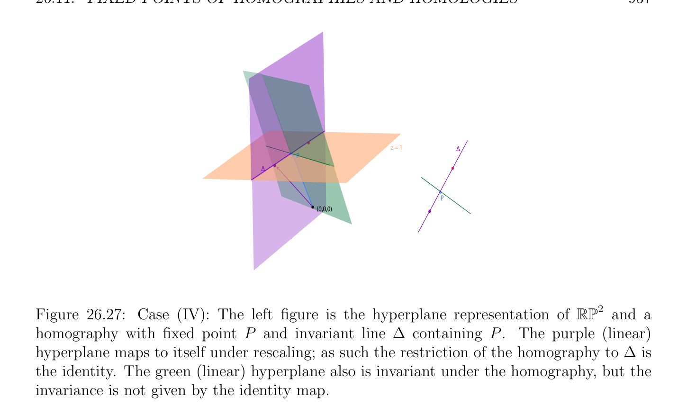
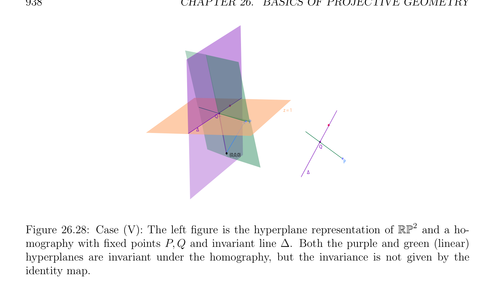
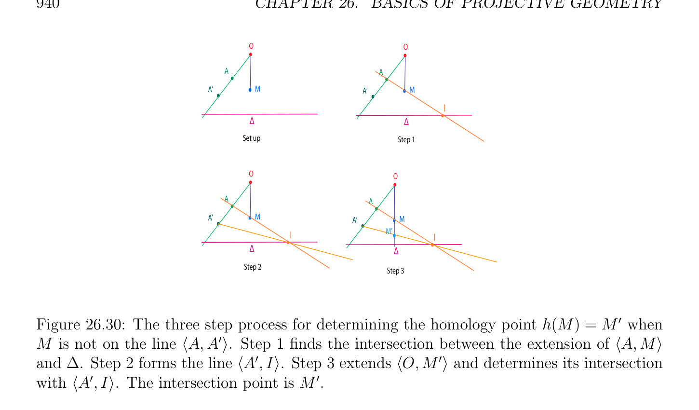
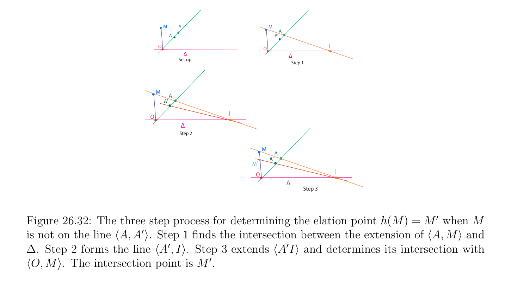
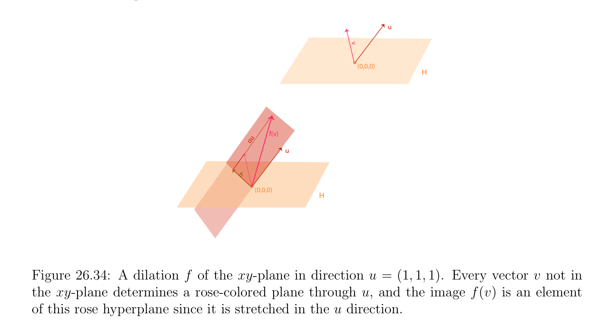
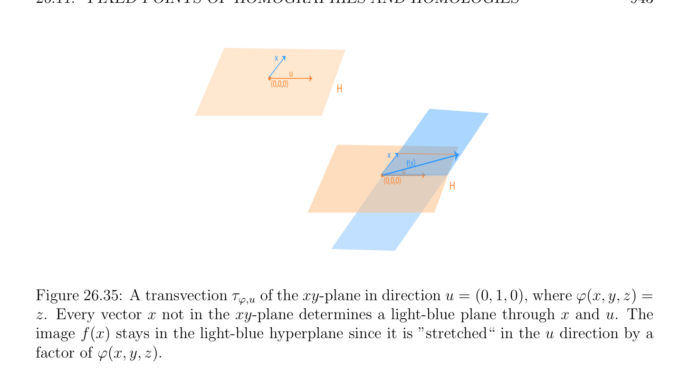

# Fixed Points of Homographies and Homologies

<!-- PAGE 932 -->
$$b'$$
$$c$$
$$d$$
$$a'$$
$$agb$$
$$c'$$
$$Figure 26.23: A quadrangle, and harmonic divisions.$$

## 26.11 Fixed Points of Homographies and Homologies;

$$\mathbb{RP}  \mathbb{RP}$$
$$Homographies of1and2$$
$Let\mathbb{P}(E)$ be a projective space where $E$ is a vector space over some field $K$, and let $h: \mathbb{P}(E) \to \mathbb{P}(E)$ be homography (or projectivity) of $\mathbb{P}(E)$ where $h$ is given by the linear isomorphism $f$ : $E \to E$ so that $h =\mathbb{P}(f)$. Observe that if $u \in E$ is an eigenvector of $f$ for some eigenvalue $\lambda  \in K$, then
$$h([u]) = [f(u)] = [\lambda u] = [u]$$
since $\lambda  \neq  0$ because $f$ is an isomorphism, which means that the point $[u] \in$ P(E) is a fixed pointh of $h$. In other words, eigenvectors of $f$ induce fixed points of $h =\mathbb{P}(f)$. Consequently, it makes sense to try to classify homographies in terms of their fixed points. Of course this depends on the field $K$. If $K$ is algebraically closed, for instance $K =\mathbb{C}$, then all the eigenvalues of $f$ belong to $K$, and we can use the Jordan form of a matrix representing $f$. If $K = \mathbb{R}$, which is of particular interest to us, then we can use the real Jordan form,
$$\mathbb{R}^{2}  \mathbb{R}^{3}$$
and we can obtain a compete classification for $E =$ and $E =$ . We will also see that special kinds of homographies that leave every point of some projective hyperplane P(H) fixed, called homologies, play a special role. We begin with the classification of the homographies of the real projective $line\mathbb{RP}^{1}$. Since
$$\mathbb{RP}^{1}$$
a homography $h$ of is represented by a real invertible $2 \times  2$ matrix
$$A = \begin{pmatrix} a & b \\ c & d \end{pmatrix} ,$$

<!-- PAGE 933 -->
and since $A$ either $0, 1$, or $2$, real eigenvalues, the homography $h$ has $0, 1$, or $2$ fixed points.
$$\mathbb{RP}^{1}$$

> **Definition 26.10.** A homography of the real projective line not equal to the identity is elliptic if is has no fixed point, parabolic if it has a single fixed point, or hyperbolic if it has two fixed points.
$(1)$ Elliptic homographies. In this case, $(a + d)^{2}$ - 4(ad - bc) $< 0$, so $A$ has two distinct complex conjugate eigenvalues $\alpha  \pm  i\beta$ , and in $\mathbb{C}^{2}$, they correspond to two complex eigenvectors $w_{1} = u +$ iv and $w_{2} = u$ - iv, with $u, v \in \mathbb{R}^{2}$. Since
$$f(w_{1}) = (\alpha  -i\beta )w_{1}$$
we obtain
$$f(u) + if(v) = \alpha u + \beta v + i(-\beta u + \alpha v),$$
which shows that in the basis $(u, v)$, the homography $h$ is represented by the matrix
$$\Gamma  = \begin{pmatrix} \alpha & -\beta \\ \beta & \alpha \end{pmatrix} .$$
If we let $\theta  \in (0, 2\pi$ ) be the angle given by
$$\cos \theta  = \frac{\alpha}{p\overline{\alpha}^{2}\overline{+}\overline{\beta}^{2}}$$
$$\sin \theta  = \frac{\beta}{p\overline{\alpha}^{2}\overline{+}\overline{\beta}^{2}}$$
and write
$$\rho  =p\overline{\alpha}^{2} \overline{+}\overline{\beta}^{2},$$
then
$$\Gamma  = \rho \begin{pmatrix} \cos \theta & -\sin \theta \\ \sin \theta & \cos \theta \end{pmatrix}$$
which corresponds to a similarity. Observe that $h$ is an involution, that is, $h^{2} =$ id iff $\theta  = \pi /2$.
$(2)$ Parabolic homographies. In this case, we must have $(a + d)^{2}$ - 4(ad - bc) $= 0$. The matrix $A$ is not diagonalizable and it has a Jordan form of the form
$$\Gamma  = \begin{pmatrix} \lambda & 1 \\ 0 & \lambda \end{pmatrix} .$$
In the affine line $y = 1$, a parabolic homography behaves like the translation by $1/\lambda$ .

<!-- PAGE 934 -->
$(3)$ Hyperbolic homographies. In this case, $(a + d)^{2}$ -4(ad -bc) $> 0$, so $A$ has two distinct nonzero reals eigenvalues $\lambda$  and $\mu$ , and in a basis of eigenvectors it is represented by the diagonal matrix
$$\Gamma  = \begin{pmatrix} \lambda & 0 \\ 0 & \mu \end{pmatrix} .$$
If $P$ and $Q$ are the distinct fixed points of the the homography $h$, it is not hard to
$$\mathbb{RP}^{1}$$
show that for every $M \in$ such that $M \neq  P, Q$, we have
$$[P, Q, M, h(M)] = k$$
where $k = \lambda /\mu$ . For example, see Sidler $[167]$ (Chapter $3$, Proposition 3.3.1), and Berger $[11]$ (Lemma 6.6.3). It can also be shown that $h$ is an involution $(h^{2} =$ id) with two distinct fixed points $P$ and $Q$ iff $a + d = 0$ iff $k = -1$ in the above equation; see Sidler $[167]$ (Chapter $3$, Proposition 3.3.2), and Samuel $[148]$ (Section 2.4). We now classify the homographies of $\mathbb{RP}^{2}$. Since the characteristic polynomial of a $3 \times  3$ real matrix $A$ has degree $3$ and since every real polynomial of degree $3$ has at least one real zero, $A$ has some real eigenvalue. Since $\mathbb{C}$ is algebraically closed, every complex polynomial of degree $3$ has three zeros (counted with multiplicity), in which case, all three eigenvalues of a $3 \times  3$ complex matrix $A$ belong to $\mathbb{C}$. Thus we have the following useful fact.
$$\mathbb{RP}^{2}$$

> **Proposition 26.22.** Every homography of the real projective plane or of the complex
$$\mathbb{CP}^{2}$$
projective plane has at least one fixed point.
$$\mathbb{RP}^{2}$$
Here is the classification of the homographies of based on the real Jordan form of a $3\times 3$ matrix. Most details are left as exercises. We denote by $\Gamma$  the $3\times 3$ matrix representing the real Jordan form of the matrix of the linear map representing the homography $h$.
(I) Three real eigenvalues $\alpha , \beta , \gamma$ . The matrix $\Gamma$  has the form
$$\Gamma  = \begin{pmatrix} \alpha & 0 & 0 \\ 0 & \beta & 0 \\ 0 & 0 & \gamma \end{pmatrix} ,$$
with $\alpha , \beta , \gamma  \in \mathbb{R}$ nonzero and all distinct. As illustrated in Figure 26.24, the homography $h$ has three fixed points $P, Q, R$, forming a triangle. The sides (lines) of this triangle are invariant under $h$. The restriction of $h$ to each of these sides is hyperbolic.
(II) One real eigenvalue $\alpha$  and two complex conjugate eigenvalues. Then $\Gamma$  has the form
$$\Gamma  = \begin{pmatrix} \alpha & 0 & 0 \\ 0 & \beta & -\gamma \\ 0 & \gamma & \beta \end{pmatrix} ,$$

<!-- PAGE 935 -->
$$RR$$
$$z = 1$$
$$P$$
$$Q$$
$$QP$$
$$(0,0,0)$$
$$\mathbb{RP}^{2}$$

**Figure 26.24:** Case (I): The left figure is the hyperplane representation of and a homography with fixed points $P, Q, R$. The purple (linear) hyperplane maps to itself in a manner which is not the identity. with $\alpha , \gamma  \in \mathbb{R}$ nonzero. The homography $h$, which is illustrated in Figure 26.25, has one fixed point $P$, and a line $\Delta$ invariant under $h$ and not containing $P$. The restriction of $h$ to $\Delta$ is elliptic.
$$B$$
$$A$$
$$A$$
$$D$$
$$\Delta z = 1$$
$$P\Delta$$
$$B$$
$$(0,0,0)$$
$$C$$
$$P$$
$$C$$
$$D$$
$$\mathbb{RP}^{2}$$

**Figure 26.25:** Case (II): The left figure is the hyperplane representation of and a homography with fixed point $P$ and invariant line $\Delta$ . The purple (linear) hyperplane maps to itself under a rotation and rescaling.

<!-- PAGE 936 -->
(III) Two real eigenvalues $\alpha , \beta$ . The matrix $\Gamma$  has the form
$$\Gamma  = \begin{pmatrix} \alpha & 0 & 0 \\ 0 & \beta & 0 \\ 0 & 0 & \beta \end{pmatrix} ,$$
with $\alpha , \beta  \in \mathbb{R}$ nonzero and distinct. The homography $h$, as illustrated in Figure 26.26, has one fixed point $P$, and a line $\Delta$ invariant under $h$ and not containing $P$. The restriction of $h$ to $\Delta$ is the identity. Every line through $P$ is invariant under $h$ and the restriction of $h$ to this line is hyperbolic.
$$\Delta z = 1\Delta$$
$$P$$
$$(0,0,0)$$
$$P$$
$$\mathbb{RP}^{2}$$

**Figure 26.26:** Case (III): The left figure is the hyperplane representation of and a homography with fixed point $P$ and invariant line $\Delta$ . The purple (linear) hyperplane maps to itself under rescaling; as such the restriction of the homography to $\Delta$ is the identity. The green (linear) hyperplane also is invariant under the homography, but the invariance is not given by the identity map.
(IV) One real eigenvalue $\alpha$ . The matrix $\Gamma$  has the form
$$\Gamma  = \begin{pmatrix} \alpha & 0 & 0 \\ 0 & \alpha & 1 \\ 0 & 0 & \alpha \end{pmatrix} ,$$
with $\alpha  \in \mathbb{R}$ nonzero. As illustrated by Figure 26.27, the homography $h$ has one fixed point $P$, and a line $\Delta$ invariant under $h$ containing $P$. The restriction of $h$ to $\Delta$ is the identity. Every line through $P$ is invariant under $h$ and the restriction of $h$ to this line is parabolic.

<!-- PAGE 937 -->
$$z = 1\Delta$$
$$P$$
$$\Delta$$
$$P$$
$$(0,0,0)$$
$$\mathbb{RP}^{2}$$

**Figure 26.27:** Case (IV): The left figure is the hyperplane representation of and a homography with fixed point $P$ and invariant line $\Delta$ containing $P$. The purple (linear) hyperplane maps to itself under rescaling; as such the restriction of the homography to $\Delta$ is the identity. The green (linear) hyperplane also is invariant under the homography, but the invariance is not given by the identity map.
$(V)$ Two real eigenvalues $\alpha , \beta$ . The matrix $\Gamma$  has the form
$$\Gamma  = \begin{pmatrix} \alpha & 0 & 0 \\ 0 & \beta & 1 \\ 0 & 0 & \beta \end{pmatrix} ,$$
with $\alpha , \beta  \in \mathbb{R}$ nonzero and distinct. The homography $h$, which is illustrated in Figure 26.28, has two fixed points $P$ and $Q$. The line $\langle P, Q\rangle$ is invariant under $h$, and there is is another line $\Delta$ through $Q$ invariant under $h$. The restriction of $h$ to $\Delta$ is parabolic, and the restriction of $h$ to $\langle P, Q\rangle$ is hyperbolic.
(VI) One real eigenvalue $\alpha$ . The matrix $\Gamma$  has the form
$$\Gamma  = \begin{pmatrix} \alpha & 1 & 0 \\ 0 & \alpha & 1 \\ 0 & 0 & \alpha \end{pmatrix} ,$$
with $\alpha  \in \mathbb{R}$ nonzero. The homography $h$, which is illustrated in Figure 26.29, has one fixed point $P$, and a line $\Delta$ invariant under $h$ containing $P$. The restriction of $h$ to $\Delta$ is parabolic. For the classification of the homographies of $\mathbb{CP}^{2}$, Case (II) becomes Case (I).

<!-- PAGE 938 -->
$$z = 1$$
$$Q$$
$$P$$
$$\Delta$$
$$Q$$
$$(0,0,0)$$
$$P$$
$$\Delta$$
$$\mathbb{RP}^{2}$$

**Figure 26.28:** Case $(V)$: The left figure is the hyperplane representation of and a homography with fixed points $P, Q$ and invariant line $\Delta$ . Both the purple and green (linear) hyperplanes are invariant under the homography, but the invariance is not given by the identity map. Observe that in Cases (III) and (IV), the homography $h$ has a line $\Delta$ of fixed points, as well as a fixed point $P$. In Case (III), $P \in / \Delta$ , and in Case (IV), $P \in \Delta$ . This kind of homography is called a homology. The point $P$ is called the center and the line $\Delta$ is called the axis (or base). Some authors only use the term homology when $P \in / \Delta$ , and when $P \in \Delta$ , they use the term elation. When $P \in \Delta$ , other authors use the term projective transvection, which we prefer. The center is usually denoted by $O$ (instead of $P)$. One of the nice features of homologies (and projective transvections) is that there is a nice geometric construction of the image h(M) of a point $M$ in terms of the center $O$, the axis $\Delta$ , and any pair $(A$, A') where A' $=$ h(A), $A \neq  O$, and $A \in / \Delta$ . This construction is possible because for any point M̸ $= O$, the line $\langle M, h(M)\rangle$ passes through $O$. This can be proved using Desargues’ Theorem; for example, see Silder $[167]$ (Chapter $4$, Section 4.2). We will prove this property for a generalization of homologies to any projective space $\mathbb{P}(E)$, where $E$ is a vector space of any finite dimension. For the construction, first assume that $M \neq  O$ is not on the line $\langle A, A'\rangle$ . In this case, the line $\langle A, M\rangle$ intersects $\Delta$ in some point I. Since $I \in \Delta$ , it is fixed by $h$, so the image of the line $\langle A, I\rangle$ is the line $\langle$ A', $I\rangle$ , and since $M$ is on the line $\langle A, I\rangle$ , its image M' $=$ h(M) is on the line $\langle$ A', $I\rangle$ . But M' $=$ h(M) is also on the line $\langle O, M\rangle$ , which implies that M' $=$ h(M) is the intersection point of the lines $\langle$ A', $I\rangle$ and $\langle O, M\rangle$ ; see Figure 26.30. If M̸ $= O$ is on the line $\langle A, A'\rangle$ , then we use the construction of the image B' of some point $B \neq  O$ and not on $\langle A, A'\rangle$ as before, and then repeat the construction by finding the intersection $J$ of $\langle M, B\rangle$ and $\Delta$ , and then M' $=$ h(M) is the intersection point of $\langle$ B', $J\rangle$ and

<!-- PAGE 939 -->
$$z = 1\Delta$$
$$P$$
$$\Delta$$
$$P$$
$$(0,0,0)$$
$$\mathbb{RP}^{2}$$

**Figure 26.29:** Case (VI): The left figure is the hyperplane representation of and a homography with fixed point $P$ and invariant line $\Delta$ . The purple (linear) hyperplane maps to itself in a manner which is not the identity. $\langle A, A'\rangle$ ; see Figure 26.31.

<!-- PAGE 940 -->
$$OO$$
$$AA$$
$$A’MA’M$$
$$I$$
$$\overline{\Delta}\overline{\Delta}$$
$$Set upStep 1$$
$$OO$$
$$AA$$
$$A’MA’M$$
$$IM’$$
$$I$$
$$\overline{\Delta}\overline{\Delta}$$
$$Step 2Step 3$$

**Figure 26.30:** The three step process for determining the homology point h(M) $=$ M' when $M$ is not on the line $\langle A, A'\rangle$ . Step $1$ finds the intersection between the extension of $\langle A, M\rangle$ and $\Delta$ . Step $2$ forms the line $\langle$ A', $I\rangle$ . Step $3$ extends $\langle O$, M' $\rangle$ and determines its intersection with $\langle$ A', $I\rangle$ . The intersection point is M' .
$$OO$$
$$MM$$
$$AA$$
$$A’BA’B$$
$$I$$
$$\overline{\Delta}\overline{\Delta}$$
$$Set upStep 1$$
$$OO$$
$$MM$$
$$AA$$
$$A’BA’B$$
$$IB’$$
$$I$$
$$\overline{\Delta}\overline{\Delta}$$
$$Step 2Step 3$$
$$O$$
$$M$$
$$A$$
$$A’B$$
$$B’O$$
$$I$$
$$\overline{\Delta}\overline{J} M$$
$$Step 4A$$
$$M’B$$
$$A’$$
$$B’$$
$$I$$
$$\overline{\Delta}\overline{J}$$
$$Step 5$$

**Figure 26.31:** The five step process for determining the homology point h(M) $=$ M' when $M$ is on the line $\langle A, A'\rangle$ . Steps $1$ through $3$ determine the line $\langle B, B'\rangle$ . Step $4$ finds the intersection between $\langle M, B\rangle$ and $\Delta$ , namely $J$. Step $5$ forms the line $\langle J, B'\rangle$ and intersects it with $\langle A, A'\rangle$ . The intersection point is M' .

<!-- PAGE 941 -->
The above construction also works if $O \in \Delta$ ; see Figures 26.32 and 26.33.
$$MAM$$
$$A$$
$$A’A’$$
$$\overline{O}\overline{O} I$$
$$\overline{\Delta}\overline{\Delta}$$
$$Set upStep 1$$
$$M$$
$$A$$
$$A’$$
$$I$$
$$O$$
$$\overline{\Delta}$$
$$Step 2$$
$$M$$
$$A$$
$$A’$$
$$M’$$
$$I$$
$$O$$
$$\overline{\Delta}$$
$$Step 3$$

**Figure 26.32:** The three step process for determining the elation point h(M) $=$ M' when $M$ is not on the line $\langle A, A'\rangle$ . Step $1$ finds the intersection between the extension of $\langle A, M\rangle$ and $\Delta$ . Step $2$ forms the line $\langle$ A', $I\rangle$ . Step $3$ extends $\langle A'I\rangle$ and determines its intersection with $\langle O, M\rangle$ . The intersection point is M' . Another useful property of homologies (here, $O \in / \Delta$ ) is that for any line $d$ passing through the center $O$, if I is the intersection point of the line $d$ and $\Delta$ , then for any $M \in d$ distinct from $O$ and not on $\Delta$ and its image M' , the cross-ratio $[O$, I, $M$, M' ] is independent of $d$. If $[O$, I, $M$, M' ] $= -1$ for all M̸ $= O$, we say that $h$ is a harmonic homology. It can be shown that a homography $h$ is a harmonic homology iff $h$ is an involution $(h^{2} =$ id); see
$$\mathbb{RP}^{2}$$
Silder $[167]$ (Chapter $4$, Section 4.4). It can also be shown that any homography of can be expressed as the composition of two homologies; see Silder $[167]$ (Chapter $4$, Section 4.5). We now consider the generalization of the notion of homology (and projective transvection) to any projective space $\mathbb{P}(E)$, where $E$ is a vector space of any finite dimension over a field $K$. We need to review a few concepts from Section 8.15. Let $E$ be a vector space and let $H$ be a hyperplane in $E$. Recall from Definition 8.8 that for any nonzero vector $u \in E$ such that $u \notin H$, and any scalar $\alpha  \neq  0, 1$, a linear map $f$ : $E \to E$ such that f(x) $= x$ for all $x \in H$ and f(x) $= \alpha x$ for every $x \in D =$ Ku is called a dilatation of hyperplane $H$, direction $D$, and scale factor $\alpha$ . See Figure 26.34. From Definition 8.9, for any nonzero nonlinear form $\phi  \in E^{*}$ defining $H$ (which means that $H =$ Ker $(\phi$ )) and any nonzero vector $u \in H$, the linear map $\tau_{\phi ,u}$  given by
$$\tau_{\phi ,u} (x) = x + \phi (x)u,\phi (u) = 0,$$
for all $x \in E$ is called a transvection of hyperplane $H$ and direction $u$. See Figure 26.35.

<!-- PAGE 942 -->
$$B A’B A’$$
$$AA$$
$$\overline{O} MMI$$
$$\overline{O}$$
$$\overline{\Delta}\overline{\Delta}$$
$$Set upStep 1$$
$$B’$$
$$BA’$$
$$A$$
$$\overline{O} MIB$$
$$AA’$$
$$\overline{\Delta}\overline{O} MI$$
$$Step 2\overline{\Delta}$$
$$Step 3$$
$$B’$$
$$BA’B’$$
$$A$$
$$\overline{O} MI$$
$$\overline{J}\overline{\Delta}$$
$$Step 4B$$
$$A’$$
$$A$$
$$OMM’I$$
$$\overline{J}$$
$$\Delta$$
$$Step 5$$

**Figure 26.33:** The five step process for determining elation point h(M) $=$ M' when $M$ is on the line $\langle A, A'\rangle$ . Steps $1$ through $3$ determine the line $\langle B, B'\rangle$ . Step $4$ finds the intersection between $\langle M, B\rangle$ and $\Delta$ , namely $J$. Step $5$ forms the line $\langle J, B'\rangle$ and intersects it with $\langle A, A'\rangle$ . The intersection point is M' .
$$u$$
$$v$$
$$(0,0,0)$$
$$H$$
$$f(v)$$
$$\alpha u$$
$$u$$
$$h$$
$$(0,0,0)$$
$$H$$

**Figure 26.34:** A dilation $f$ of the xy-plane in direction $u = (1, 1, 1)$. Every vector $v$ not in the xy-plane determines a rose-colored plane through $u$, and the image f(v) is an element of this rose hyperplane since it is stretched in the $u$ direction.

<!-- PAGE 943 -->
$$x$$
$$u$$
$$\overline{(0,0,0)} H$$
$$x$$
$$\overline{f}\overline{(}\overline{x)}$$
$$u$$
$$\overline{(0,0,0)} H$$

**Figure 26.35:** A transvection $\tau_{\phi ,u}$  of the xy-plane in direction $u = (0, 1, 0)$, where $\phi (x, y, z) = z$. Every vector $x$ not in the xy-plane determines a light-blue plane through $x$ and $u$. The image f(x) stays in the light-blue hyperplane since it is ”stretched“ in the $u$ direction by a factor of $\phi (x, y, z)$. Proposition 26.23, which we repeat here for the convenience of the reader, characterizes the linear isomorphisms $f \neq$  id that leave every point in the hyperplane $H$ fixed.

> **Proposition 26.23.** Let $f$ : $E \to E$ be a bijective linear map of a finite-dimensional vector space $E$ and assume that $f \neq$  id and that f(x) $= x$ for all $x \in H$, where $H$ is some hyperplane in $E$. If det(f) $= 1$, then $f$ is a transvection of hyperplane $H$; otherwise, $f$ is a dilatation of hyperplane $H$. In either case, the vector $u$ is uniquely defined up to a nonzero scalar.

*Proof.* Only the last part was not proved in Proposition 8.23, Since $f$ is bijective and the identity on $H$, the linear map $f$ - id has kernel exactly $H$. Since $H$ is a hyperplane in $E$, the image of $f$ -id has dimension $1$, and since $u$ belong to this image, it is uniquely defined up to a nonzero scalar. The proof of Proposition 8.23 shows that if dim(E) $= n + 1$ and if $f$ is a dilatation of hyperplane $H$, direction $D =$ Ku, and scale $\alpha$ , then $1$ is an eigenvalue of $f$ with multiplicity $n$ and $\alpha  \neq  0, 1$ is an eigenvalue of $f$ with multiplicity $1$; the vector $u$ is an eigenvector for $\alpha$ , and $f$ is diagonalizable. If $f$ is a transvection of hyperplane $H$ and direction $u$, then $1$ is the only eigenvalue of $f$, and it has multiplicity $n$; the vector $u$ is an eigenvector for $1$, and $f$ is not diagonalizable. A homology is the projective version of the type of maps involved in Proposition 26.23.

> **Definition 26.11.** For any vector space $E$ and any hyperplane $H$ in $E$, a homography $h: \mathbb{P}(E) \to \mathbb{P}(E)$ is a homology of axis (or base) $\mathbb{P}(H)$ if h(P) $= P$ for all $P \in \mathbb{P}(H)$. In other words, the restriction of $h$ to $\mathbb{P}(H)$ is the identity. More explicitly, if $h = \mathbb{P}(f)$ for some linear isomorphism $f$ : $E \to E$, we have $\mathbb{P}(f)(P) = P$ for all points $P = [u] \in \mathbb{P}(H)$.

<!-- PAGE 944 -->
Using Proposition 26.23 we obtain the following characterization of homologies. Write dim(E) $= n + 1$.

> **Proposition 26.24.** If $h: \mathbb{P}(E) \to \mathbb{P}(E)$ is a homology of axis $\mathbb{P}(H)$ and if $h \neq$  id, then for any linear isomorphism $f$ : $E \to E$ such that $h =\mathbb{P}(f)$, the following properties hold:
$(1)$ Either $f$ is a dilatation of hyperplane $H$ and of direction $u$ for some nonzero $u \in$ E-H uniquely defined up to a scalar;
$(2)$ Or $f$ is a transvection of hyperplane $H$ and direction $u$ for some nonzero $u \in H$ uniquely defined up to a scalar. In both cases, $O = [u] \in \mathbb{P}(E)$ is a fixed point of $h$, and $h$ has no other fixed points besides $O$ and points in $\mathbb{P}(H)$. In Case $(1), O \in / \mathbb{P}(H)$, whereas in Case $(2), O \in \mathbb{P}(H)$. Furthermore, for any point $M \in \mathbb{P}(E)$, if M̸ $= O$ and if $M \in / \mathbb{P}(H)$, then the line $\langle M, h(M)\rangle$ passes through $O$. If dim(E) $\ge 3$, the point $O$ is the only point satisfying the above property.

*Proof.* Since the restriction of $h = \mathbb{P}(f)$ to $\mathbb{P}(H)$ is the identity, and since $\mathbb{P}(f) = \mathbb{P}(id_{H})$, by Proposition 26.4 we have $f = \lambda id_{H}$ on $H$ for some nonzero scalar $\lambda  \in K$. Then $g = \lambda^{-1} f$ is the identity on $H$, so by Proposition 26.23 we obtain $(1)$ and $(2)$. In Case $(1)$, we have g(u) $= \alpha u$, so $\mathbb{P}(g)([u]) =\mathbb{P}(f)([u]) = [u]$. In Case $(2)$, g(u) $= u$, so again $\mathbb{P}(g)([u]) = \mathbb{P}(f)([u]) = [u]$. Therefore, $O = [u]$ is a fixed point of $\mathbb{P}(f)$. In Case $(1)$, the eigenvalues of $f$ are $1$ with multiplicity $n$ and $\alpha$  with multiplicity $1$. If $Q = [v] \neq  O$ was a fixed point of $h$ not in $\mathbb{P}(H)$, then $v$ would be an eigenvector corresponding to a nonzero eigenvalue $\lambda$  of $f$ with $\lambda  \neq  1, \alpha$ , and then $f$ would have $n + 2$ eigenvalues (counted with multiplicty), which is absurd. In Case $(2)$, the only eigenvalue of $f$ is $1$, with multiplicity $n$, so $f$ not diagonalizable, and as above, a vector $v$ such that $Q = [v]$ is a fixed point of $h$ not in $\mathbb{P}(H)$ would be an eigenvector corresponding to a nonzero eigenvalue $\lambda  \neq  1$ of $f$, so $f$ would be diagonalizable, a contradiction. Since in Case $(1)$, for any $x \neq  u$ and $x \in / H$ we have $x = \lambda u + h$ for some unique $h \in H$ and some unique $\lambda  \neq  0$, so
$$g(x) = g(\lambda u) + g(h) = \lambda \alpha u + h = \lambda u + h + (\lambda \alpha  -\lambda )u = x + \lambda (\alpha  -1)u,$$
which shows that $O, [x]$ and $\mathbb{P}(g)([x]) = \mathbb{P}(f)([x])$ are collinear. In Case $(2)$, for any $x \neq  u$ and $x \in / H$ we have
$$g(x) = x + \phi (x)u,$$
which also shows that $O, [x] and\mathbb{P}(g)([x]) =\mathbb{P}(f)([x])$ are collinear. The last property is left as an exercise (see Vienne $[191]$, Chapter $4$, Proposition $7)$. Proposition 26.24 suggests the following definition.

<!-- PAGE 945 -->

> **Definition 26.12.** Let $h: \mathbb{P}(E) \to \mathbb{P}(E)$ be a homology of axis $\mathbb{P}(H)$ with $h \neq$  id, where $h = \mathbb{P}(f)$ for some linear isomorphism $f$ : $E \to E$. The fixed point $O = [u]$ associated with the vector $u$ involved in the definition of $f$, which is unique up to a scalar, is called the center of $h$. If $O \in \mathbb{P}(H)$, then $h$ is called a projective transvection (or elation). The same geometric construction that we used in the case of the projective plane shows that a homology is determined by its center $O$, its axis $\mathbb{P}(H)$, and a pair of points $A$ and $\mathbb{P}$ A' $=$ h(A), with A̸ $= O$ and $A \in / (H)$. As a kind of converse, we have the following proposition which is easily shown; see Vienne $[191]$ (Chapter IV, Proposition $8)$.

> **Proposition 26.25.** $Let\mathbb{P}(H)$ be a hyperplane $of\mathbb{P}(E)$ and let $O \in \mathbb{P}(E)$ be a point. For any
$$\mathbb{P}$$
pair of distinct points $(A$, A') such that $O, A$, A' are collinear and $A$, A' $\in / (H) \cup {O}$, there is a unique homology $h: \mathbb{P}(E) \to \mathbb{P}(E)$ of centrer $O$ and axis $\mathbb{P}(H)$ such that h(A) $=$ A'.
Remark: From the proof of Proposition 8.23, since every dilatation can be represented by a matrix of the form
$$\begin{pmatrix} \alpha & 0 & \cdots & 0 \\ 0 & 1 & 0 \\ \vdots & \ddots & \vdots \\ 0 & 0 & \cdots & 1 \end{pmatrix} ,$$
we see that by choosing the hyperplane at infinity to be $x_{1} = 0$, on the affine hyperplane $x_{1} = 1$, a homology becomes a central magnification by $\alpha^{-1}$ . Similarly, since every transvection can be represented by a matrix of the form
$$\begin{pmatrix} 1 & 0 & \cdots & 0 \\ \alpha & 1 & 0 \\ \vdots & \ddots & \vdots \\ 0 & 0 & \cdots & 1 \end{pmatrix} ,$$
we see that by choosing the hyperplane at infinity to be $x_{1} = 0$, on the affine hyperplane $x_{1} = 1$, an elation becomes a translation. Theorem 8.26 immediately yields the following result showing that the group of homographies PGL(E) is generated by the homologies.

> **Theorem 26.26.** Let $E$ be any finite-dimensional vector space over a field $K$ of characteristic not equal to $2$. Then, the group of homographies PGL(E) is generated by the homologies.
$$\mathbb{R}^{3} \mathbb{RP}^{2}$$
When $E =$ , we saw earlier that the involutions of have a nice structure. In particular, if an involution has two fixed points, then it is a harmonic homology. If dim(E) $\ge 4$, it is harder to characterize the involutions $of\mathbb{P}(E)$, but it is possible. The case where the linear isomorphism $f$ : $E \to E$ defining the involutive homography $h =\mathbb{P}(f)$
