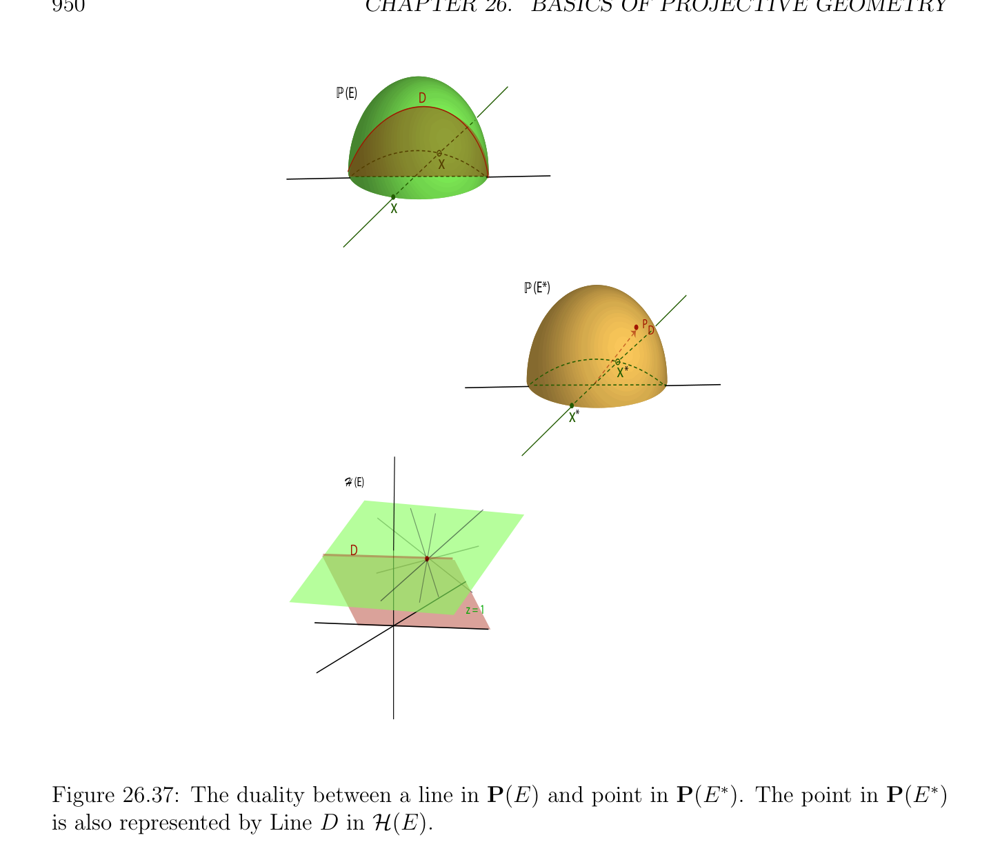

# Cross-Ratios of Hyperplanes

<!-- PAGE 950 -->
$$P(E)D$$
$$x$$
$$x$$
$$P(E*)$$
$$PD$$
$$x*$$
$$x*$$
$$H (E)$$
$$D$$
$$z = 1$$

**Figure 26.37:** The duality between a line in P(E) and point in $P(E^{*})$. The point in $P(E^{*})$ is also represented by Line $D$ in $\mathcal{H}(E)$.

## 26.13 Cross-Ratios of Hyperplanes

Given a pencil $P =$ P(U) of hyperplanes in $\mathcal{H}(E)$, for any sequence $(H_{1}, H_{2}, H_{3}, H_{4})$ of hyperplanes in this pencil, if $H_{1}, H_{2}, H_{3}$ are distinct, we define the cross-ratio $[H_{1}, H_{2}, H_{3}, H_{4}]$ as the cross-ratio of the hyperplanes $H_{i}$ considered as points on the projective line $P$ in $P(E^{*})$. In particular, in a projective plane P(E), given any four concurrent lines $D_{1}, D_{2}, D_{3}, D_{4}$, where $D_{1}, D_{2}, D_{3}$ are distinct, for any two distinct lines $\Delta$ and $\Delta'$ not passing through the
$$\cap$$
common intersection $c$ of the lines $D_{i}$, letting $d_{i} = \Delta \cap D_{i}$, and $d_{i}' = \Delta' D_{i}$, note that the projection of center $c$ from $\Delta$ to $\Delta'$ maps each $d_{i}$ to $d_{i}'$. Since such a projection is a projectivity, and since projectivities between lines preserve cross-ratios, we have
$$[d_{1}, d_{2}, d_{3}, d_{4}] = [d_{1}', d_{2}', d_{3}', d_{4}'],$$

<!-- PAGE 951 -->
$$P(E)$$
$$a$$
$$b$$
$$x$$
$$x$$
$$P(E*)$$
$$Da$$
$$p<a,b>$$
$$Dx*$$
$$b$$
$$x*$$
$$H (E)$$
$$Dp<a,b>$$
$$a$$
$$b$$
$$z = 1$$

**Figure 26.38:** The duality between a line through two points in P(E) and a point incident to two lines in $P(E^{*})$. which means that the cross-ratio of the $d_{i}$ is independent of the line $\Delta$ (see Figure 26.39). In fact, this cross-ratio is equal to $[D_{1}, D_{2}, D_{3}, D_{4}]$, as shown in the next proposition.

> **Proposition 26.27.** Let $P =$ P(U) be a pencil of hyperplanes in $\mathcal{H}(E)$, and let $\Delta =$ P(D) be any projective line such that $\Delta \in / H$ for all $H \in P$. The map $h: P \to \Delta$ defined such that h(H) $= H \cap \Delta$ for every hyperplane $H \in P$ is a projectivity. Furthermore, for any sequence $(H_{1}, H_{2}, H_{3}, H_{4})$ of hyperplanes in the pencil $P$, if $H_{1}, H_{2}, H_{3}$ are distinct and $d_{i} = \Delta \cap H_{i}$, then $[d_{1}, d_{2}, d_{3}, d_{4}] = [H_{1}, H_{2}, H_{3}, H_{4}]$.

*Proof.* First, the map $h: P \to \Delta$ is well–defined, since in a projective space, every line $\Delta =$ P(D) not contained in a hyperplane intersects this hyperplane in exactly one point. Since $P =$ P(U) is a pencil of hyperplanes in $\mathcal{H}(E), U$ has dimension $2$, and let $\phi$  and $\psi$ be two nonnull linear forms in $E^{*}$ that constitute a basis of $U$, and let $F = \phi^{-1} (0)$ and
