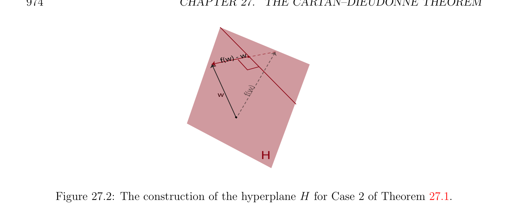
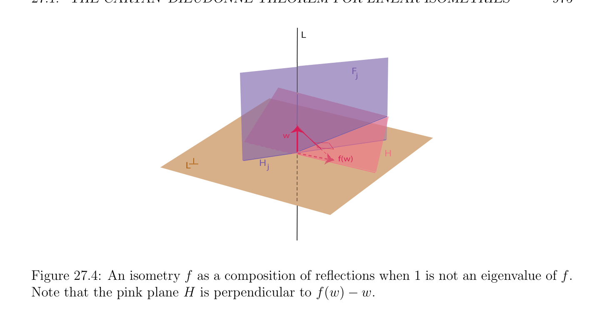

# The Cartan–Dieudonné Theorem for Linear Isometries

<!-- PAGE 971 -->
Chapter $27$ The Cartan–Dieudonn´e Theorem In this chapter the structure of the orthogonal group is studied in more depth. In particular, we prove that every isometry in O(n) is the composition of at most $n$ reflections about hyperplanes (for $n \ge 2$, see Theorem 27.1). This important result is a special case of the “Cartan–Dieudonn´e theorem” (Cartan $[33]$, Dieudonn´e $[50])$. We also prove that every rotation in SO(n) is the composition of at most $n$ flips (for $n \ge 3)$. Affine isometries are defined, and their fixed points are investigated. First, we characterize the set of fixed points of an affine map. Then we show that the Cartan–Dieudonn´e theorem can be generalized to affine isometries: Every rigid motion in Is(n) is the composition of at most $n$ affine reflections if it has a fixed point, or else of at most $n + 2$ affine reflections. We prove that every rigid motion in SE(n) is the composition of at most $n$ affine flips (for $n \ge 3)$.

## 27.1 The Cartan–Dieudonn´e Theorem for Linear

$$Isometries$$
The fact that the group O(n) of linear isometries is generated by the reflections is a special case of a theorem known as the Cartan–Dieudonn´e theorem. Elie Cartan proved a version of this theorem early in the twentieth century. A proof can be found in his book on spinors $[33]$, which appeared in $1937$ (Chapter I, Section $10$, pages 10–12). Cartan’s version applies to nondegenerate quadratic forms over $\mathbb{R}$ or $\mathbb{C}$. The theorem was generalized to quadratic forms over arbitrary fields by Dieudonn´e $[50]$. One should also consult Emil Artin’s book $[6]$, which contains an in-depth study of the orthogonal group and another proof of the Cartan–Dieudonn´e theorem.

> **Theorem 27.1.** Let $E$ be a Euclidean space of dimension $n \ge 1$. Every isometry $f \in$ O(E) that is not the identity is the composition of at most $n$ reflections. When $n \ge 2$, the identity is the composition of any reflection with itself.
$$971$$

<!-- PAGE 972 -->

*Proof.* We proceed by induction on $n$. When $n = 1$, every isometry $f \in$ O(E) is either the identity or -id, but -id is a reflection about $H = {0}$. When $n \ge 2$, we have id $= s \circ s$ for every reflection $s$. Let us now consider the case where $n \ge 2$ and $f$ is not the identity. There are two subcases. Case $1$. The map $f$ admits $1$ as an eigenvalue, i.e., there is some nonnull vector $w$ such that f(w) $= w$. In this case, let $H$ be the hyperplane orthogonal to $w$, so that $E = H \oplus \mathbb{R} w$. We claim that f(H) $\subseteq H$. Indeed, if
$$v \cdot  w = 0$$
for any $v \in H$, since $f$ is an isometry, we get
$$f(v) \cdot  f(w) = v \cdot  w = 0,$$
and since f(w) $= w$, we get
$$f(v) \cdot  w = f(v) \cdot  f(w) = 0,$$
and thus f(v) $\in H$. Furthermore, since $f$ is not the identity, $f$ is not the identity of $H$. Since $H$ has dimension $n$ - $1$, by the induction hypothesis applied to $H$, there are at most $k \le n$ - $1$ reflections $s_{1}, \dots  , s_{k}$ about some hyperplanes $H_{1}, \dots  , H_{k}$ in $H$, such that the restriction of $f$ to $H$ is the composition $s_{k} \circ \cdots  \circ s_{1}$. Each $s_{i}$ can be extended to a reflection in $E$ as follows: If $H = H_{i} \oplus L_{i}$ (where $L_{i} = H_{i}^{\perp}$ , the orthogonal complement of $H_{i}$ in $H), L = \mathbb{R} w$, and $F_{i} = H_{i} \oplus L$, since $H$ and $L$ are orthogonal, $F_{i}$ is indeed a hyperplane, $E = F_{i} \oplus L_{i} = H_{i} \oplus L \oplus L_{i}$, and for every $u = h + \lambda w \in H \oplus L = E$, since
$$s_{i}(h) = p_{Hi}(h) -p_{Li}(h),$$
we can define $s_{i}$ on $E$ such that
$$s_{i}(h + \lambda w) = p_{Hi}(h) + \lambda w -p_{Li}(h),$$
and since $h \in H, w \in L, F_{i} = H_{i} \oplus L$, and $H = H_{i} \oplus L_{i}$, we have
$$s_{i}(h + \lambda w) = p_{Fi}(h + \lambda w) -p_{Li}(h + \lambda w),$$
which defines a reflection about $F_{i} = H_{i} \oplus L$. Now, since $f$ is the identity on $L =\mathbb{R} w$, it is immediately verified that $f = s_{k} \circ \cdots  \circ s_{1}$, with $k \le n$ - $1$. See Figure 27.1. Case $2$. The map $f$ does not admit $1$ as an eigenvalue, i.e., f(u) $\neq  u$ for all $u \neq  0$. Pick any $w \neq  0$ in $E$, and let $H$ be the hyperplane orthogonal to f(w) - $w$. Since $f$ is an isometry, we have $\|f(w)\| = \|w\|$, and by Lemma 13.2, we know that s(w) $=$ f(w), where $s$ is the reflection about $H$, and we claim that $s \circ f$ leaves $w$ invariant. Indeed, since $s^{2} =$ id, we have
$$s(f(w)) = s(s(w)) = w.$$
See Figure 27.2.

<!-- PAGE 973 -->
$$LF$$
$$i$$
$$Hw$$
$$iw$$
$$h + \lambda$$
$$h\lambda w$$
$$p$$
$$H (h$$
$$Hi)$$
$$Ls  (h)i\lambda w$$
$$i  (h)$$
$$-p  Li$$

**Figure 27.1:** An illustration of how to extend the reflection $s_{i}$ of Case $1$ in Theorem 27.1 to $E$. The result of this extended reflection is the bold green vector. Since $s^{2} =$ id, we cannot have $s\circ f =$ id, since this would imply that $f = s$, where $s$ is the identity on $H$, contradicting the fact that $f$ is not the identity on any vector. Thus, we are back to Case $1$. Thus, there are $k \le$ n-1 hyperplane reflections such that $s\circ f = s_{k} \circ \cdots \circ s_{1}$, from which we get
$$f = s \circ s_{k} \circ \cdots  \circ s_{1},$$
with at most $k + 1 \le n$ reflections.
Remarks:
$(1) A$ slightly different proof can be given. Either $f$ is the identity, or there is some nonnull vector $u$ such that f(u) $\neq  u$. In the second case, proceed as in the second part of the proof, to get back to the case where $f$ admits $1$ as an eigenvalue.
$(2)$ Theorem 27.1 still holds if the inner product on $E$ is replaced by a nondegenerate symmetric bilinear form $\phi$ , but the proof is a lot harder; see Section 29.9.
$(3)$ The proof of Theorem 27.1 shows more than stated. If $1$ is an eigenvalue of $f$, for any eigenvector $w$ associated with $1$ (i.e., f(w) $= w$, w̸ $= 0)$, then $f$ is the composition of $k \le n$ - $1$ reflections about hyperplanes $F_{i}$ such that $F_{i} = H_{i} \oplus L$, where $L$ is the line $\mathbb{R} w$ and the $H_{i}$ are subspaces of dimension $n$ - $2$ all orthogonal to $L$ (the $H_{i}$ are hyperplanes in $H)$. This situation is illustrated in Figure 27.3. If $1$ is not an eigenvalue of $f$, then $f$ is the composition of $k \le n$ reflections about hyperplanes $H, F_{1}, \dots  , F_{k-1}$, such that $F_{i} = H_{i} \oplus L$, where $L$ is a line intersecting $H$, and the $H_{i}$ are subspaces of dimension n-2 all orthogonal to $L$ (the $H_{i}$ are hyperplanes in $L^{\perp})$. This situation is illustrated in Figure 27.4.

<!-- PAGE 974 -->
$$w) - w$$
$$f($$
$$w)$$
$$wf($$
$$H$$

**Figure 27.2:** The construction of the hyperplane $H$ for Case $2$ of Theorem 27.1.
$$L$$
$$F$$
$$j$$
$$s  (u)     s  (u)ji$$
$$u$$
$$s  (u)w$$
$$iw$$
$$H$$
$$j$$
$$H$$
$$H$$
$$i$$

**Figure 27.3:** An isometry $f$ as a composition of reflections, when $1$ is an eigenvalue of $f$.
$(4)$ It is natural to ask what is the minimal number of hyperplane reflections needed to obtain an isometry $f$. This has to do with the dimension of the eigenspace Ker $(f$ - id) associated with the eigenvalue $1$. We will prove later that every isometry is the composition of $k$ hyperplane reflections, where
$$k = n -\dim(\mathrm{Ker} (f -id)),$$
and that this number is minimal (where $n =$ dim(E)). When $n = 2$, a reflection is a reflection about a line, and Theorem 27.1 shows that every isometry in O(2) is either a reflection about a line or a rotation, and that every rotation is the product of two reflections about some lines. In general, since det(s) $= -1$ for a reflection $s$, when $n \ge 3$ is odd, every rotation is the product of an even number less than or equal

<!-- PAGE 975 -->
$$L$$
$$F$$
$$j$$
$$w$$
$$H$$
$$Hf(w)$$
$$\overline{L} j$$

**Figure 27.4:** An isometry $f$ as a composition of reflections when $1$ is not an eigenvalue of $f$. Note that the pink plane $H$ is perpendicular to f(w) - $w$. to $n$ - $1$ of reflections, and when $n$ is even, every improper orthogonal transformation is the product of an odd number less than or equal to $n$ - $1$ of reflections. In particular, for $n = 3$, every rotation is the product of two reflections about planes. When $n$ is odd, we can say more about improper isometries. Indeed, when $n$ is odd, every improper isometry admits the eigenvalue $-1$. This is because if $E$ is a Euclidean space of finite dimension and $f$ : $E \to E$ is an isometry, because $\|f(u)\| = \|u\|$ for every $u \in E$, if $\lambda$ is any eigenvalue of $f$ and $u$ is an eigenvector associated with $\lambda$ , then
$$\|f(u)\|= \|\lambda u\|= |\lambda |\|u\|= \|u\|,$$
which implies $|\lambda$ | $= 1$, since u̸ $= 0$. Thus, the real eigenvalues of an isometry are either $+1$ or $-1$. However, it is well known that polynomials of odd degree always have some real root. As a consequence, the characteristic polynomial det(f - $\lambda$ id) of $f$ has some real root, which is either $+1$ or $-1$. Since $f$ is an improper isometry, det(f) $= -1$, and since det(f) is the product of the eigenvalues, the real roots cannot all be $+1$, and thus $-1$ is an eigenvalue of $f$. Going back to the proof of Theorem 27.1, since $-1$ is an eigenvalue of $f$, there is some nonnull eigenvector $w$ such that f(w) $= -w$. Using the second part of the proof, we see that the hyperplane $H$ orthogonal to f(w) - $w =$ -2w is in fact orthogonal to $w$, and thus $f$ is the product of $k \le n$ reflections about hyperplanes $H, F_{1}, \dots  , F_{k-1}$ such that $F_{i} = H_{i} \oplus L$, where $L$ is a line orthogonal to $H$, and the $H_{i}$ are hyperplanes in $H = L^{\perp}$ orthogonal to $L$. However, $k$ must be odd, and so $k$ - $1$ is even, and thus the composition of the reflections about $F_{1}, \dots  , F_{k-1}$ is a rotation. Thus, when $n$ is odd, an improper isometry is the composition of a reflection about a hyperplane $H$ with a rotation consisting of reflections about hyperplanes $F_{1}, \dots  , F_{k-1}$ containing a line, $L$, orthogonal to

<!-- PAGE 976 -->
$H$. In particular, when $n = 3$, every improper orthogonal transformation is the product of a rotation with a reflection about a plane orthogonal to the axis of rotation. Using Theorem 27.1, we can also give a rather simple proof of the classical fact that in a Euclidean space of odd dimension, every rotation leaves some nonnull vector invariant, and thus a line invariant. If $\lambda$  is an eigenvalue of $f$, then the following lemma shows that the orthogonal complement $E_{\lambda}(f)^{\perp}$ of the eigenspace associated with $\lambda$  is closed under $f$.

> **Proposition 27.2.** Let $E$ be a Euclidean space of finite dimension $n$, and let $f$ : $E \to E$ be an isometry. For any subspace $F$ of $E$, if f(F) $= F$, then $f(F^{\perp}$ ) $\subseteq F^{\perp}$ and $E = F \oplus F^{\perp}$ .

*Proof.* We just have to prove that if $w \in E$ is orthogonal to every $u \in F$, then f(w) is also orthogonal to every $u \in F$. However, since f(F) $= F$, for every $v \in F$, there is some $u \in F$ such that f(u) $= v$, and we have
$$f(w) \cdot  v = f(w) \cdot  f(u) = w \cdot  u,$$
since $f$ is an isometry. Since we assumed that $w \in E$ is orthogonal to every $u \in F$, we have
$$w \cdot  u = 0,$$
and thus
$$f(w) \cdot  v = 0,$$
and this for every $v \in F$. Thus, $f(F^{\perp}$ ) $\subseteq F^{\perp}$ . The fact that $E = F \oplus F^{\perp}$ follows from

> **Lemma 12.11.** Lemma 27.2 is the starting point of the proof that every orthogonal matrix can be diagonalized over the field of complex numbers. Indeed, if $\lambda$  is any eigenvalue of $f$, then $f(E_{\lambda}(f)) = E_{\lambda}(f)$, where $E_{\lambda}(f)$ is the eigenspace associated with $\lambda$ , and thus the orthogonal $E_{\lambda}(f)^{\perp}$ is closed under $f$, and $E = E_{\lambda}(f) \oplus E_{\lambda}(f)^{\perp}$. The problem over $\mathbb{R}$ is that there may not be any real eigenvalues. However, when $n$ is odd, the following lemma shows that every rotation admits $1$ as an eigenvalue (and similarly, when $n$ is even, every improper orthogonal transformation admits $1$ as an eigenvalue).

> **Proposition 27.3.** Let $E$ be a Euclidean space.
$(1)$ If $E$ has odd dimension $n =$ 2m $+ 1$, then every rotation $f$ admits $1$ as an eigenvalue and the eigenspace $F$ of all eigenvectors left invariant under $f$ has an odd dimension 2p $+ 1$. Furthermore, there is an orthonormal basis of $E$, in which $f$ is represented by a matrix of the form
$$\begin{pmatrix} R_{2(m-p)} & 0 \\ 0 & I_{2p+1} \end{pmatrix} ,$$
where $R_{2(m-p)}$ is a rotation matrix that does not have $1$ as an eigenvalue.

<!-- PAGE 977 -->
$(2)$ If $E$ has even dimension $n =$ 2m, then every improper orthogonal transformation $f$ admits $1$ as an eigenvalue and the eigenspace $F$ of all eigenvectors left invariant under $f$ has an odd dimension 2p $+ 1$. Furthermore, there is an orthonormal basis of $E$, in which $f$ is represented by a matrix of the form
$$\begin{pmatrix} S_{2(m-p)-1} & 0 \\ 0 & I_{2p+1} \end{pmatrix} ,$$
where $S_{2(m-p)-1}$ is an improper orthogonal matrix that does not have $1$ as an eigenvalue.

*Proof.* We prove only $(1)$, the proof of $(2)$ being similar. Since $f$ is a rotation and $n = 2m+1$ is odd, by Theorem 27.1, $f$ is the composition of an even number less than or equal to 2m of reflections. From Lemma 24.15, recall the Grassmann relation
$$\dim(M) + \dim(N) = \dim(M + N) + \dim (M \cap N),$$
where $M$ and $N$ are subspaces of $E$. Now, if $M$ and $N$ are hyperplanes, their dimension is $n$ - $1$, and thus dim $(M \cap N) \ge n$ - $2$. Thus, if we intersect $k \le n$ hyperplanes, we see that the dimension of their intersection is at least $n$ - $k$. Since each of the reflections is the identity on the hyperplane defining it, and since there are at most 2m $= n$ - $1$ reflections, their composition is the identity on a subspace of dimension at least $1$. This proves that $1$ is an eigenvalue of $f$. Let $F$ be the eigenspace associated with $1$, and assume that its dimension is $q$. Let $G = F^{\perp}$ be the orthogonal of $F$. By Lemma 27.2, $G$ is stable under $f$, and $E = F \oplus G$. Using Lemma 12.10, we can find an orthonormal basis of $E$ consisting of an orthonormal basis for $G$ and orthonormal basis for $F$. In this basis, the matrix of $f$ is of the form
$$\begin{pmatrix} R_{2m+1-q} & 0 \\ 0 & I_{q} \end{pmatrix} .$$
Thus, det(f) $=$ det(R), and $R$ must be a rotation, since $f$ is a rotation and det(f) $= 1$. Now, if $f$ left some vector $u \neq  0$ in $G$ invariant, this vector would be an eigenvector for $1$, and we would have $u \in F$, the eigenspace associated with $1$, which contradicts $E = F \oplus G$. Thus, by the first part of the proof, the dimension of $G$ must be even, since otherwise, the restriction of $f$ to $G$ would admit $1$ as an eigenvalue. Consequently, $q$ must be odd, and $R$ does not admit $1$ as an eigenvalue. Letting $q =$ 2p $+ 1$, the lemma is established. An example showing that Lemma 27.3 fails for $n$ even is the following rotation matrix (when $n = 2)$:
$$R = \begin{pmatrix} \cos \theta & -\sin \theta \\ \sin \theta & \cos \theta \\ eigenvaluesfor\theta \end{pmatrix} .$$
The above matrix does not have real    $\neq  k\pi$ . It is easily shown that for $n = 2$, with respect to any chosen orthonormal basis $(e_{1}, e_{2})$, every rotation is represented by a matrix of form
$$R = \begin{pmatrix} \cos \theta & -\sin \theta \\ \sin \theta & \cos \theta \end{pmatrix}$$

<!-- PAGE 978 -->
where $\theta  \in [0, 2\pi$ [, and that every improper orthogonal transformation is represented by a matrix of the form
$$S = \begin{pmatrix} \cos \theta & \sin \theta \\ \sin \theta & -\cos \theta \end{pmatrix} .$$
In the first case, we call $\theta  \in [0, 2\pi$ [ the measure of the angle of rotation of $R$ w.r.t. the orthonormal basis $(e_{1}, e_{2})$. In the second case, we have a reflection about a line, and it is easy to determine what this line is. It is also easy to see that $S$ is the composition of a reflection about the x-axis with a rotation (of matrix $R)$.  We refrained from calling $\theta$  “the angle of rotation,” because there are some subtleties
$$involved in defining rigorously the notion of angle of two vectors (or two lines). For$$
example, note that with respect to the “opposite basis” $(e_{2}, e_{1})$, the measure $\theta$  must be changed to $2\pi$  - $\theta$  (or $-\theta$  if we consider the quotient set $\mathbb{R}/2\pi$  of the real numbers modulo $2\pi$ ). It is easily shown that the group SO(2) of rotations in the plane is abelian. First, recall that every plane rotation is the product of two reflections (about lines), and that every isometry in O(2) is either a reflection or a rotation. To alleviate the notation, we will omit the composition operator $\circ$ , and write rs instead of $r \circ s$. Now, if $r$ is a rotation and $s$ is a reflection, rs being in O(2) must be a reflection (since det(rs) $=$ det(r) det(s) $= -1)$, and thus $(rs)^{2} =$ id, since a reflection is an involution, which implies that
$$srs = r^{-1}.$$
Then, given two rotations $r_{1}$ and $r_{2}$, writing $r_{1}$ as $r_{1} = s_{2}s_{1}$ for two reflections $s_{1}, s_{2}$, we have
$$r_{1}r_{2}r_{1}^{-1}= s_{2}s_{1}r_{2}(s_{2}s_{1})^{-1}= s_{2}s_{1}r_{2}s_{1}^{-1} s_{2}^{-1}= s_{2}s_{1}r_{2}s_{1}s_{2} = s_{2}r_{2}^{-1} s_{2} = r_{2},$$
since srs $= r^{-1}$ for all reflections $s$ and rotations $r$, and thus $r_{1}r_{2} = r_{2}r_{1}$. We can also perform the following calculation, using some elementary trigonometry:
$$\begin{pmatrix} \cos \phi & \sin \phi \\ \sin \phi & -\cos \phi \end{pmatrix} \begin{pmatrix} \cos \psi & \sin \psi \\ \sin \psi & -\cos \psi \end{pmatrix} = \begin{pmatrix} \cos(\phi  + \psi ) & \sin(\phi  + \psi ) \\ \sin(\phi  + \psi ) & -\cos(\phi  + \psi ) \end{pmatrix} .$$
The above also shows that the inverse of a rotation matrix
$$R = \begin{pmatrix} \cos \theta & -\sin \theta \\ \sin \theta & \cos \theta \end{pmatrix}$$
is obtained by changing $\theta$  to $-\theta$  (or $2\pi$  - $\theta$ ). Incidentally, note that in writing a rotation $r$ as the product of two reflections $r = s_{2}s_{1}$, the first reflection $s_{1}$ can be chosen arbitrarily, since $s_{1}^{2} =$ id, $r = (rs_{1})s_{1}$, and $rs_{1}$ is a reflection. For $n = 3$, the only two choices for $p$ are $p = 1$, which corresponds to the identity, or $p = 0$, in which case $f$ is a rotation leaving a line invariant. This line $D$ is called the axis of

<!-- PAGE 979 -->
$$D$$
$$\theta  / 2$$
$$R (u)$$
$$u$$
$$Figure 27.5: 3D rotation as the composition of two reflections.$$
rotation. The rotation $R$ behaves like a two-dimensional rotation around the axis of rotation. Thus, the rotation $R$ is the composition of two reflections about planes containing the axis of rotation $D$ and forming an angle $\theta /2$. This is illustrated in Figure 27.5. The measure of the angle of rotation $\theta$  can be determined through its cosine via the formula
$$\cos \theta  = u \cdot  R(u),$$
where $u$ is any unit vector orthogonal to the direction of the axis of rotation. However, this does not determine $\theta  \in [0, 2\pi$ [ uniquely, since both $\theta$  and $2\pi$  - $\theta$  are possible candidates. What is missing is an orientation of the plane (through the origin) orthogonal to the axis of rotation. In the orthonormal basis of the lemma, a rotation is represented by a matrix of the form
$$R = \begin{pmatrix} \cos \theta & -\sin \theta & 0 \\ \sin \theta & \cos \theta & 0 \\ 0 & 0 & 1 \end{pmatrix} .$$
Remark: For an arbitrary rotation matrix $A$, since $a_{1 1} + a_{2 2} + a_{3 3}$ (the trace of $A)$ is the sum of the eigenvalues of $A$, and since these eigenvalues are cos $\theta  + i$ sin $\theta$ , cos $\theta  -i$ sin $\theta$ , and $1$, for some $\theta  \in [0, 2\pi$ [, we can compute cos $\theta$  from
$$1 + 2 \cos \theta  = a_{1 1} + a_{2 2} + a_{3 3}.$$
It is also possible to determine the axis of rotation (see the problems).

<!-- PAGE 980 -->
An improper transformation is either a reflection about a plane or the product of three reflections, or equivalently the product of a reflection about a plane with a rotation, and we noted in the discussion following Theorem 27.1 that the axis of rotation is orthogonal to the plane of the reflection. Thus, an improper transformation is represented by a matrix of the form
$$S = \begin{pmatrix} \cos \theta & -\sin \theta & 0 \\ \sin \theta & \cos \theta & 0 \\ 0 & 0 & 1 \end{pmatrix} .$$
$$-$$
When $n \ge 3$, the group of rotations SO(n) is not only generated by hyperplane reflections, but also by flips (about subspaces of dimension $n$ - $2)$. We will also see, in Section 27.2, that every proper affine rigid motion can be expressed as the composition of at most $n$ flips, which is perhaps even more surprising! The proof of these results uses the following key lemma.

> **Proposition 27.4.** Given any Euclidean space $E$ of dimension $n \ge 3$, for any two reflections $h_{1}$ and $h_{2}$ about some hyperplanes $H_{1}$ and $H_{2}$, there exist two flips $f_{1}$ and $f_{2}$ such that $h_{2} \circ h_{1} = f_{2} \circ f_{1}$.

*Proof.* If $h_{1} = h_{2}$, it is obvious that
$$h_{1} \circ h_{2} = h_{1} \circ h_{1} = id = f_{1} \circ f_{1}$$
for any flip $f_{1}$. If $h_{1} \neq  h_{2}$, then $H_{1} \cap H_{2} = F$, where dim(F) $= n$ - $2$ (by the Grassmann relation). We can pick an orthonormal basis $(e_{1}, \dots  , e_{n})$ of $E$ such that $(e_{1}, \dots  , e_{n-2})$ is an orthonormal basis of $F$. We can also extend $(e_{1}, \dots  , e_{n-2})$ to an orthonormal basis $(e_{1}, \dots  , e_{n-2}, u_{1}, v_{1})$ of $E$, where $(e_{1}, \dots  , e_{n-2}, u_{1})$ is an orthonormal basis of $H_{1}$, in which case
$$e_{n-1}=\cos \theta_{1}  u_{1} + \sin \theta_{1}  v_{1},$$
$$e_{n}=\sin \theta_{1}  u_{1} -\cos \theta_{1}  v_{1},$$
for some $\theta_{1}  \in [0, 2\pi$ ]. See Figure 27.6 Since $h_{1}$ is the identity on $H_{1}$ and $v_{1}$ is orthogonal to $H_{1}$, it follows that $h_{1}(u_{1}) = u_{1}, h_{1}(v_{1}) = -v_{1}$, and we get
$$h_{1}(e_{n-1})=\cos \theta_{1}  u_{1} -\sin \theta_{1}  v_{1},$$
$$h_{1}(e_{n})=\sin \theta_{1}  u_{1} + \cos \theta_{1}  v_{1}.$$
After some simple calculations, we get
$$h_{1}(e_{n-1})=\cos 2\theta_{1}  e_{n-1} + \sin 2\theta_{1}  e_{n},$$
$$h_{1}(e_{n})=\sin 2\theta_{1}  e_{n-1} -\cos 2\theta_{1}  e_{n}.$$

<!-- PAGE 981 -->
$$H$$
$$1e$$
$$3$$
$$e$$
$$3$$
$$v1$$
$$u$$
$$1$$
$$ee$$
$$F11$$
$$eH$$
$$22e$$
$$2$$
$$v$$
$$1$$
$$u$$
$$1$$
$$e$$
$$1$$

**Figure 27.6:** An illustration of the hyperplanes $H_{1}, H_{2}$, their intersection $F$, and the two orthonormal basis utilized in the proof of Proposition 27.4. As a consequence, the matrix $A_{1}$ of $h_{1}$ over the basis $(e_{1}, \dots  , e_{n})$ is of the form
$$A_{1} = \begin{pmatrix} I_{n-2} & 0 & 0 \\ 0 & \cos 2\theta_{1} & \sin 2\theta_{1} \\ 0 & \sin 2\theta_{1} & \cos 2\theta_{1} \end{pmatrix} .$$
$$-$$
Similarly, the matrix $A_{2}$ of $h_{2}$ over the basis $(e_{1}, \dots  , e_{n})$ is of the form
$$A_{2} = \begin{pmatrix} I_{n-2} & 0 & 0 \\ 0 & \cos 2\theta_{2} & \sin 2\theta_{2} \\ 0 & \sin 2\theta_{2} & \cos 2\theta_{2} \end{pmatrix} .$$
$$-$$
Observe that both $A_{1}$ and $A_{2}$ have the eigenvalues $-1$ and $+1$ with multiplicity $n$ - $1$. The trick is to observe that if we change the last entry in $I_{n-2}$ from $+1$ to $-1$ (which is possible since $n \ge 3)$, we have the following product $A_{2}A_{1}$:
$$\begin{pmatrix} I_{n-3} & 0 & 0 & 0 \\ 0 & -1 & 0 & 0 \\ 0 & 0 & \cos 2\theta_{2} & \sin 2\theta_{2} \\ 0 & 0 & \sin 2\theta_{2} & \cos 2\theta_{2} \end{pmatrix} \begin{pmatrix} I_{n-3} & 0 & 0 & 0 \\ 0 & -1 & 0 & 0 \\ 0 & 0 & \cos 2\theta_{1} & \sin 2\theta_{1} \\ 0 & 0 & \sin 2\theta_{1} & \cos 2\theta_{1} \end{pmatrix} .$$
$$--$$
Now, the two matrices above are clearly orthogonal, and they have the eigenvalues $-1, -1$, and $+1$ with multiplicity n-2, which implies that the corresponding isometries leave invariant a subspace of dimension $n$ - $2$ and act as -id on its orthogonal complement (which has dimension $2)$. This means that the above two matrices represent two flips $f_{1}$ and $f_{2}$ such that $h_{2} \circ h_{1} = f_{2} \circ f_{1}$. See Figure 27.7.

<!-- PAGE 982 -->
$$H 1$$
$$e$$
$$eh (e)3$$
$$h (e)313$$
$$13$$
$$e$$
$$eF1$$
$$F1$$
$$\theta e$$
$$e12$$
$$2h (e)$$
$$h (e)12$$
$$12$$
$$(ii.)$$
$$(i.)$$
$$e$$
$$f(e)3$$
$$13$$
$$e$$
$$1$$
$$f1(e)$$
$$1$$
$$(iii.)$$

**Figure 27.7:** The conversion of the hyperplane reflection $h_{1}$ into the flip or $180^{\circ}$ rotation around the green axis in the $e_{2}e_{3}-plane$. The green axis corresponds to the restriction of the eigenspace associated with eigenvalue $1$. Using Lemma 27.4 and the Cartan–Dieudonn´e theorem, we obtain the following characterization of rotations when $n \ge 3$.

> **Theorem 27.5.** Let $E$ be a Euclidean space of dimension $n \ge 3$. Every rotation $f \in$ SO(E) is the composition of an even number of flips $f = f_{2k} \circ \cdots  \circ f_{1}$, where 2k $\le n$. Furthermore, if $u \neq  0$ is invariant under $f$ (i.e., $u \in$ Ker $(f$ - id)), we can pick the last flip $f_{2k}$ such that $u \in F_{2k}^{\perp}$ , where $F_{2k}$ is the subspace of dimension $n$ - $2$ determining $f_{2k}$.

*Proof.* By Theorem 27.1, the rotation $f$ can be expressed as an even number of hyperplane reflections $f = s_{2k}\circ s_{2k-1}\circ \cdots \circ s_{2}\circ s_{1}$, with 2k $\le n$. By Lemma 27.4, every composition of two reflections $s_{2i} \circ s_{2i-1}$ can be replaced by the composition of two flips $f_{2i} \circ f_{2i-1} (1 \le i \le k)$, which yields $f = f_{2k} \circ \cdots  \circ f_{1}$, where 2k $\le n$. Assume that f(u) $= u$, with $u \neq  0$. We have already made the remark that in the case where $1$ is an eigenvalue of $f$, the proof of Theorem 27.1 shows that the reflections $s_{i}$ can be chosen so that $s_{i}(u) = u$. In particular, if each reflection $s_{i}$ is a reflection about the hyperplane $H_{i}$, we have $u \in H_{2k-1} \cap H_{2k}$. Letting $F = H_{2k-1} \cap H_{2k}$, pick an orthonormal basis $(e_{1}, \dots  , e_{n-3}, e_{n-2})$ of $F$, where
$$e_{n-2} = \frac{u}{\|u\|} .$$
