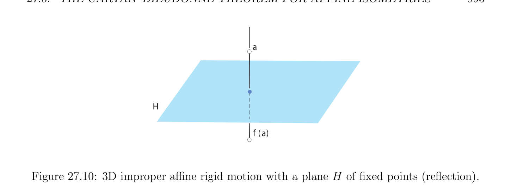

# The Cartan–Dieudonné Theorem for Affine Isometries

<!-- PAGE 993 -->
$$a$$
$$H$$
$$f (a)$$

**Figure 27.10:** 3D improper affine rigid motion with a plane $H$ of fixed points (reflection).
$$D$$
$$a$$
$$O$$
$$H$$
$$f(a)$$
$$Figure 27.11: 3D improper affine rigid motion with a unique fixed point.$$
The third kind is the composition of an affine reflection about a plane followed by a nontrivial translation by a vector parallel to the direction of the plane of the reflection, as illustrated in Figure 27.13. This last transformation is an improper affine isometry.

## 27.5 The Cartan–Dieudonn´e Theorem for Affine

$$Isometries$$
The Cartan–Dieudonn´e theorem also holds for affine isometries, with a small twist due to translations. The reader is referred to Berger $[11]$, Snapper and Troyer $[168]$, or Tisseron $[181]$ for a detailed treatment of the Cartan–Dieudonn´e theorem and its variants.

> **Theorem 27.11.** Let $E$ be an affine Euclidean space of dimension $n \ge 1$. Every affine isometry $f \in$ Is(E) that has a fixed point and is not the identity is the composition of at most $n$ affine reflections. Every affine isometry $f \in$ Is(E) that has no fixed point is the

<!-- PAGE 994 -->
$$D$$
$$f (a)$$
$$f (a)$$
$$\tau$$
$$g(a)$$
$$a$$
$$a$$
$$(i.)$$
$$(ii.)$$

**Figure 27.12:** 3D proper affine rigid motion with no fixed point (screw motion). The second illustration demonstrates that a screw motion produces a helix path along the surface of a cylinder.
$$a$$
$$H$$
$$g(a)\overline{\tau} f (a)$$
$$Figure 27.13: 3D improper affine rigid motion with no fixed points.$$

<!-- PAGE 995 -->
composition of at most $n + 2$ affine reflections. When $n \ge 2$, the identity is the composition of any reflection with itself.

*Proof.* First, we use Theorem 27.10. If $f$ has a fixed point $\Omega$ , we choose $\Omega$ as an origin and work in the vector space $E_{\Omega}$. Since $f$ behaves as a linear isometry, the result follows
$$\longrightarrow  \longrightarrow \longrightarrow$$
from Theorem 27.1. More specifically, we can write $f = s_{k} \circ \cdots  \circ s_{1}$ for $k \le n$ hyperplane
$$\longrightarrow$$
reflections $s_{i}$ . We define the affine reflections $s_{i}$ such that
$$\longrightarrow \longrightarrow$$
$$s_{i}(a) = \Omega +s_{i} (\Omega a)$$
for all $a \in E$, and we note that $f = s_{k} \circ \cdots  \circ s_{1}$, since
$$\longrightarrow \longrightarrow \longrightarrow$$
$$f(a) = \Omega +s_{k} \circ \cdots  \circ s_{1}(\Omega a)$$
for all $a \in E$. If $f$ has no fixed point, then $f = t \circ g$ for some affine isometry $g$ that has a
$$\longrightarrow$$
fixed point $\Omega$ and some translation $t = t_{\tau}$, with $f (\tau$ ) $= \tau$ . By the argument just given, we can write $g = s_{k} \circ \cdots  \circ s_{1}$ for some affine reflections (at most $n)$. However, by Lemma 27.9, the translation $t = t_{\tau}$ can be achieved by two affine reflections about parallel hyperplanes, and thus $f = s_{k+2} \circ \cdots  \circ s_{1}$, for some affine reflections (at most $n + 2)$. When $n \ge 3$, we can also characterize the affine isometries in SE(n) in terms of affine flips. Remarkably, not only we can do without translations, but we can even bound the number of affine flips by $n$.

> **Theorem 27.12.** Let $E$ be a Euclidean affine space of dimension $n \ge 3$. Every affine rigid motion $f \in$ SE(E) is the composition of an even number of affine flips $f = f_{2k} \circ \cdots  \circ f_{1}$, where 2k $\le n$.

*Proof.* As in the proof of Theorem 27.11, we distinguish between the two cases where $f$ has some fixed point or not. If $f$ has a fixed point $\Omega$ , we apply Theorem 27.5. More specifically,
$$\longrightarrow  \longrightarrow \longrightarrow  \longrightarrow$$
we can write $f = f_{2k} \circ \cdots  \circ f_{1}$ for some flips $f_{i}$ . We define the affine flips $f_{i}$ such that
$$\longrightarrow \longrightarrow$$
$$f_{i}(a) = \Omega +f_{i} (\Omega a)$$
for all $a \in E$, and we note that $f = f_{2k} \circ \cdots  \circ f_{1}$, since
$$\longrightarrow \longrightarrow \longrightarrow$$
$$f(a) = \Omega +f_{2k} \circ \cdots  \circ f_{1}(\Omega a)$$
for all $a \in E$. If $f$ does not have a fixed point, as in the proof of Theorem 27.11, we get
$$f = t_{\tau} \circ f_{2k} \circ \cdots  \circ f_{1},$$
$$\longrightarrow$$
for some affine flips $f_{i}$. We need to get rid of the translation. However, $f (\tau$ ) $= \tau$ , and by
$$\longrightarrow_{\perp}  \longrightarrow$$
the second part of Theorem 27.5, we can assume that $\tau  \in F_{2k}$ , where $F_{2k}$ is the direction

<!-- PAGE 996 -->
of the affine subspace defining the affine flip $f_{2k}$. Finally, appealing to Lemma 27.9, since $\longrightarrow_{\perp} \tau  \in F_{2k}$ , the translation $t_{\tau}$ can be expressed as the composition $f_{2k}'  \circ f_{2k-1}'$ of two affine flips
$$\longrightarrow  \longrightarrow$$
$f_{2k-1}'$  and $f_{2k}'$ about the two parallel subspaces $\Omega + F_{2k}$ and $\Omega + \tau /2 + F_{2k}$, whose distance
$$\longrightarrow$$
is $\|\tau \|/2$. However, since $f_{2k-1}'$  and $f_{2k}$ are both the identity on $\Omega + F_{2k}$, we must have $f_{2k-1}'  = f_{2k}$, and thus
$$f=t_{\tau} \circ f_{2k} \circ f_{2k-1} \circ \cdots  \circ f_{1}$$
$$=f_{2k}'  \circ f_{2k-1}' \circ f_{2k} \circ f_{2k-1} \circ \cdots  \circ f_{1}$$
$$=f_{2k}'  \circ f_{2k-1} \circ \cdots  \circ f_{1},$$
since $f_{2k-1}'  = f_{2k}$ and $f_{2k-1}' \circ f_{2k} = f_{2k} \circ f_{2k} =$ id, since $f_{2k}$ is an affine symmetry.
Remark: It is easy to prove that if $f$ is a screw motion in SE(3), $D$ its axis, $\theta$  is its angle of rotation, and $\tau$  the translation along the direction of $D$, then $f$ is the composition of two affine flips about lines $D_{1}$ and $D_{2}$ orthogonal to $D$, at a distance $\|\tau \|/2$ and making an angle $\theta /2$.
