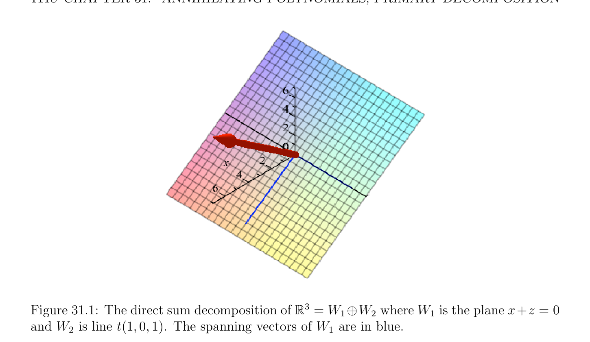

# The Primary Decomposition Theorem

<!-- PAGE 1113 -->

## 31.4 The Primary Decomposition Theorem

If $f$ : $E \to E$ is a linear map and $\lambda  \in K$ is an eigenvalue of $f$, recall that the eigenspace $E_{\lambda}$ associated with $\lambda$  is the kernel of the linear map $\lambda$ id - $f$. If all the eigenvalues $\lambda_{1}  \dots  , \lambda_{k}$  of $f$ are in $K$, it may happen that
$$E = E_{\lambda1} \oplus \cdots  \oplus E_{\lambda k},$$
but in general there are not enough eigenvectors to span $E$. What if we generalize the notion of eigenvector and look for (nonzero) vectors $u$ such that
$$(\lambda id -f)^{r}(u) = 0,for some r \ge 1?$$
It turns out that if the minimal polynomial of $f$ is of the form
$$m = (X -\lambda_{1} )^{r1}\cdots  (X -\lambda_{k} )^{rk},$$
then $r = r_{i}$ does the job for $\lambda_{i}$ ; that is, if we let
$$W_{i} = \mathrm{Ker} (\lambda_{i} id -f)^{ri},$$
then
$$E = W_{1} \oplus \cdots  \oplus W_{k}.$$
This result is very nice but seems to require that the eigenvalues of $f$ all belong to $K$. Actually, it is a special case of a more general result involving the factorization of the minimal polynomial $m$ into its irreducible monic factors (see Theorem 30.17),
$$m = p_{1}^{r1} \cdots  p_{k}^{rk} ,$$
where the $p_{i}$ are distinct irreducible monic polynomials over $K$.

> **Theorem 31.10.** (Primary Decomposition Theorem) Let $f$ : $E \to E$ be a linear map on the finite-dimensional vector space $E$ over the field $K$. Write the minimal polynomial $m$ of $f$ as
$$m = p_{1}^{r1} \cdots  p_{k}^{rk} ,$$
where the $p_{i}$ are distinct irreducible monic polynomials over $K$, and the $r_{i}$ are positive integers. Let
$$W_{i} = \mathrm{Ker} (p_{i}^{ri} (f)),i = 1, \dots  , k.$$
Then
(a) $E = W_{1} \oplus \cdots  \oplus W_{k}$.
$(b)$ Each $W_{i}$ is invariant under $f$.
$(c)$ The minimal polynomial of the restriction $f$ | $W_{i}$ of $f$ to $W_{i}$ is $p_{i}^{ri}$ .

<!-- PAGE 1114 -->

*Proof.* The trick is to construct projections $\pi_{i}$  using the polynomials $p_{j}^{rj}$ so that the range of $\pi_{i}$  is equal to $W_{i}$. Let
$$g_{i} = m/p_{i}^{ri} = \prod_{j\neq i}  p_{j}^{rj} .$$
Note that
$$p_{i}^{ri} g_{i} = m.$$
Since $p_{1}, \dots  , p_{k}$ are irreducible and distinct, they are relatively prime. Then using Proposition 30.14, it is easy to show that $g_{1}, \dots  , g_{k}$ are relatively prime. Otherwise, some irreducible polynomial $p$ would divide all of $g_{1}, \dots  , g_{k}$, so by Proposition 30.14 it would be equal to one of the irreducible factors $p_{i}$. But that $p_{i}$ is missing from $g_{i}$, a contradiction. Therefore, by Proposition 30.15, there exist some polynomials $h_{1}, \dots  , h_{k}$ such that
$$g_{1}h_{1} + \cdots  + g_{k}h_{k} = 1.$$
Let $q_{i} = g_{i}h_{i}$ and let $\pi_{i}  = q_{i}(f) = g_{i}(f)h_{i}(f)$. We have
$$q_{1} + \cdots  + q_{k} = 1,$$
and since $m$ divides $q_{i}q_{j}$ for $i \neq  j$, we get
$$\pi_{1}  + \cdots  + \pi_{k}  = id$$
$$\pi_{i} \pi_{j}  = 0,i \neq  j.$$
(We implicitly used the fact that if $p, q$ are two polynomials, the linear maps p(f) $\circ$ q(f) and q(f) $\circ$ p(f) are the same since p(f) and q(f) are polynomials in the powers of $f$, which commute.) Composing the first equation with $\pi_{i}$  and using the second equation, we get
$$\pi_{i}^{2}  = \pi_{i} .$$
Therefore, the $\pi_{i}$  are projections, and $E$ is the direct sum of the images of the $\pi_{i}$ . Indeed, every $u \in E$ can be expressed as
$$u = \pi_{1} (u) + \cdots  + \pi_{k} (u).$$
Also, if
$$\pi_{1} (u) + \cdots  + \pi_{k} (u) = 0,$$
then by applying $\pi_{i}$  we get
$$0 = \pi_{i}^{2}  (u) = \pi_{i} (u),i = 1, \dots  k.$$
To finish proving (a), we need to show that
$$W_{i} = \mathrm{Ker} (p_{i}^{ri} (f)) = \pi_{i} (E).$$

<!-- PAGE 1115 -->
If $v \in \pi_{i} (E)$, then $v = \pi_{i} (u)$ for some $u \in E$, so
$$p_{i}^{ri} (f)(v) = p_{i}^{ri} (f)(\pi_{i} (u))$$
$$= p_{i}^{ri} (f)g_{i}(f)h_{i}(f)(u)$$
$$= h_{i}(f)p_{i}^{ri} (f)g_{i}(f)(u)$$
$$= h_{i}(f)m(f)(u) = 0,$$
because $m$ is the minimal polynomial of $f$. Therefore, $v \in W_{i}$. Conversely, assume that $v \in W_{i} =$ Ker $(p_{i}^{ri} (f))$. If $j \neq  i$, then $g_{j}h_{j}$ is divisible by $p_{i}^{ri}$ , so
$$g_{j}(f)h_{j}(f)(v) = \pi_{j} (v) = 0,j \neq  i.$$
Then since $\pi_{1}  + \cdots  + \pi_{k}  =$ id, we have $v = \pi_{i} v$, which shows that $v$ is in the range of $\pi_{i}$ . Therefore, $W_{i} = Im(\pi_{i}$ ), and this finishes the proof of (a). If $p_{i}^{ri}$ (f)(u) $= 0$, then $p_{i}^{ri}$ (f)(f(u)) $= f(p_{i}^{ri}$ (f)(u)) $= 0$, so $(b)$ holds. If we write $f_{i} = f$ | $W_{i}$, then $p_{i}^{ri} (f_{i}) = 0$, because $p_{i}^{ri} (f) = 0$ on $W_{i}$ (its kernel). Therefore, the minimal polynomial of $f_{i}$ divides $p_{i}^{ri}$ . Conversely, let $q$ be any polynomial such that $q(f_{i}) = 0$ (on $W_{i})$. Since $m = p_{i}^{ri} g_{i}$, the fact that m(f)(u) $= 0$ for all $u \in E$ shows that
$$p_{i}^{ri} (f)(g_{i}(f)(u)) = 0,u \in E,$$
and thus $Im(g_{i}(f)) \subseteq$ Ker $(p_{i}^{ri} (f)) = W_{i}$. Consequently, since q(f) is zero on $W_{i}$,
$$q(f)g_{i}(f) = 0for all u \in E.$$
But then $qg_{i}$ is divisible by the minimal polynomial $m = p_{i}^{ri} g_{i}$ of $f$, and since $p_{i}^{ri}$ and $g_{i}$ are relatively prime, by Euclid’s proposition, $p_{i}^{ri}$ must divide $q$. This finishes the proof that the minimal polynomial of $f_{i}$ is $p_{i}^{ri}$ , which is $(c)$. To best understand the projection constructions of Theorem 31.10, we provide the following two explicit examples of the primary decomposition theorem.
$$\mathbb{R}^{3} \mathbb{R}^{3}$$

> **Example 31.2.** First let $f$ : $\to$ be defined as f(x, $y, z) = (y, x, z)$. In terms of the
$$standard basis f is represented by the 3 \times  3 matrix X_{f} := \begin{pmatrix} - \\ 0 & -1 & 0 \\ 1 & 0 & 0 \\ 0 & 0 & 1 \end{pmatrix} . Then a simple$$
calculation shows that $m_{f}(x) = \chi_{f} (x) = (x^{2}+1)(x-1)$. Using the notation of the preceding proof set
$$m = p_{1}p_{2},p_{1} = x^{2}+ 1,p_{2} = x -1.$$
Then
$$g_{1} = \frac{m}{p_{1}} = x -1,g_{2} = \frac{m}{p_{2}} = x^{2}+ 1.$$

<!-- PAGE 1116 -->
We must find $h_{1}, h_{2} \in \mathbb{R}[x]$ such that $g_{1}h_{1} + g_{2}h_{2} = 1$. In general this is the hard part of the projection construction. But since we are only working with two relatively prime polynomials $g_{1}, g_{2}$, we may apply the Euclidean algorithm to discover that
$$+ 1) = 1$$
$$- \frac{x + 1}{2} (x -1) + \frac{1}{2} (x^{2},$$
where $h_{1} = -_{2}^{x+1}$ while $h_{2} =_{2}^{1}$ . By definition
$$\pi_{1}  = g_{1}(f)h_{1}(f) = - \frac{1}{2} (X_{f} -id)(X_{f} + id) = - \frac{1}{2} (X_{f}^{2} -id) = \begin{pmatrix} 1 & 0 & 0 \\ 0 & 1 & 0 \\ 0 & 0 & 0 \end{pmatrix} ,$$
and
$$\pi_{2}  = g_{2}(f)h_{2}(f) = \frac{1}{2} (X_{f}^{2} + id) = \begin{pmatrix} 0 & 0 & 0 \\ 0 & 0 & 0 \\ 0 & 0 & 1 \end{pmatrix} .$$
$\mathbb{R}^{3}$ Then $= W_{1} \oplus W_{2}$, where
$$000$$
$W_{1} = \pi_{1} (\mathbb{R}^{3}) =$ Ker $(p_{1}(X_{f})) =$ Ker $(X_{f}^{2} +$ id) $=$ Ker $0 0 0 = {(x, y, 0) \in \mathbb{R}^{3}}$,
$$$$
$$001$$
$$-1-10$$
$W_{2} = \pi_{2} (\mathbb{R}^{3}) =$ Ker $(p_{2}(X_{f})) =$ Ker $(X_{f}$ - id) $=$ Ker $1 -1 0 = {(0, 0, z) \in \mathbb{R}^{3}}$.
$$$$
$$000$$
$$\mathbb{R}^{3}$$

> **Example 31.3.** For our second example of the primary decomposition theorem let $f$ : $\to \mathbb{R}^{3}$ be defined as f(x, $y, z) = (y, -x + z, -y)$, with standard matrix representation $X_{f} =$
$$\begin{pmatrix} 0 & -1 & 0 \\ 1 & 0 & -1 \\ 0 & 1 & 0 \end{pmatrix} . A simple calculation shows that m_{f}(x) = \chi_{f} (x) = x(x^{2} + 2). Set$$
$$p_{1} = x^{2}+ 2,p_{2} = x,g_{1} = \frac{m_{f}}{p_{1}} = x,g_{2} = \frac{m_{f}}{p_{2}} = x^{2}+ 2.$$
Since $gcd(g_{1}, g_{2}) = 1$, we use the Euclidean algorithm to find
$$h_{1} = - \frac{1}{2} x,h_{2} = \frac{1}{2} ,$$
such that $g_{1}h_{1} + g_{2}h_{2} = 1$. Then
$$\pi_{1}  = g_{1}(f)h_{1}(f) = - \frac{1}{2} X_{f}^{2} = \begin{pmatrix} 1 & 0 & -^{1} \\ 0\overline{2} & 1 & 0^{2} \\ 0 & 1 \end{pmatrix} ,$$
$$-_{2}^{1}$$
$$\overline{2}$$

<!-- PAGE 1117 -->
while
$$\pi_{2}  = g_{2}(f)h_{2}(f) = \frac{1}{2} (X_{f}^{2} + 2id) = \begin{pmatrix} 1 & 0_{2}^{1} \\ 0\overline{2} & 0 & 0 \\ 1 & 0_{2}^{1} \end{pmatrix} .$$
$$\overline{2}$$
Although it is not entirely obvious, $\pi_{1}$  and $\pi_{2}$  are indeed projections since
$$\pi_{1}^{2}  = \begin{pmatrix} 1 & 0 & -^{1} \\ 0\overline{2} & 1 & 0^{2} \\ 0 & 1 \end{pmatrix} \begin{pmatrix} 1 & 0 & -^{1} \\ 0\overline{2} & 1 & 0^{2} \\ 0 & 1 \end{pmatrix} = \begin{pmatrix} 1 & 0 & -^{1} \\ 0\overline{2} & 1 & 0^{2} \\ 0 & 1 \end{pmatrix} = \pi_{1} ,$$
$$-_{2}^{1}-_{2}^{1}-_{2}^{1}$$
$$\overline{2}\overline{2}\overline{2}$$
and
$$\pi_{2}^{2}  = \begin{pmatrix} 1 & 0_{2}^{1} \\ 0\overline{2} & 0 & 0 \\ 1 & 0_{2}^{1} \end{pmatrix} \begin{pmatrix} 1 & 0_{2}^{1} \\ 0\overline{2} & 0 & 0 \\ 1 & 0_{2}^{1} \end{pmatrix} = \begin{pmatrix} 1 & 0_{2}^{1} \\ 0\overline{2} & 0 & 0 \\ 1 & 0_{2}^{1} \end{pmatrix} = \pi_{2} .$$
$$\overline{2}\overline{2}\overline{2}$$
Furthermore observe that $\pi_{1}  + \pi_{2}  =$ id. The primary decomposition theorem implies that $\mathbb{R}^{3} = W_{1} \oplus W_{2}$ where
$$W_{1} = \pi_{1} (\mathbb{R}^{3}) = \mathrm{Ker} (p_{1}(f)) = \mathrm{Ker} (X^{2} + 2) = \mathrm{Ker} \begin{pmatrix} 1 & 0 & 1 \\ 0 & 0 & 0 \\ 1 & 0 & 1 \end{pmatrix} = span{(0, 1, 0), (1, 0, -1)},$$
$W_{2} = \pi_{2} (\mathbb{R}^{3}) =$ Ker $(p_{2}(f)) =$ Ker $(X) = span{(1, 0, 1)}$. See Figure 31.1. If all the eigenvalues of $f$ belong to the field $K$, we obtain the following result.

> **Theorem 31.11.** (Primary Decomposition Theorem, Version $2)$ Let $f$ : $E \to E$ be a linear map on the finite-dimensional vector space $E$ over the field $K$. If all the eigenvalues $\lambda_{1} , \dots  , \lambda_{k}$  of $f$ belong to $K$, write
$$m = (X -\lambda_{1} )^{r1}\cdots  (X -\lambda_{k} )^{rk}$$
for the minimal polynomial of $f$,
$$\chi_{f}  = (X -\lambda_{1} )^{n1}\cdots  (X -\lambda_{k} )^{nk}$$
for the characteristic polynomial of $f$, with $1 \le r_{i} \le n_{i}$, and let
$$W_{i} = \mathrm{Ker} (\lambda_{i} id -f)^{ri},i = 1, \dots  , k.$$
Then
(a) $E = W_{1} \oplus \cdots  \oplus W_{k}$.

<!-- PAGE 1118 -->
$$\mathbb{R}^{3}$$

**Figure 31.1:** The direct sum decomposition of $= W_{1}\oplus W_{2}$ where $W_{1}$ is the plane $x+z = 0$ and $W_{2}$ is line t(1, $0, 1)$. The spanning vectors of $W_{1}$ are in blue.
$(b)$ Each $W_{i}$ is invariant under $f$.
$(c) dim(W_{i}) = n_{i}$.
$(d)$ The minimal polynomial of the restriction $f$ | $W_{i}$ of $f$ to $W_{i}$ is $(X$ - $\lambda_{i} )^{ri}$.

*Proof.* Parts (a), $(b)$ and $(d)$ have already been proven in Theorem 31.10, so it remains to prove $(c)$. Since $W_{i}$ is invariant under $f$, let $f_{i}$ be the restriction of $f$ to $W_{i}$. The characteristic polynomial $\chi_{fi}$  of $f_{i}$ divides $\chi (f)$, and since $\chi (f)$ has all its roots in $K$, so does $\chi_{i} (f)$. By Theorem 15.5, there is a basis of $W_{i}$ in which $f_{i}$ is represented by an upper triangular matrix, and since $(\lambda_{i}$ id - $f)^{ri} = 0$, the diagonal entries of this matrix are equal to $\lambda_{i}$ . Consequently,
$$\chi_{fi}  = (X -\lambda_{i} )^{\dim(Wi)},$$
and since $\chi_{fi}$  divides $\chi (f)$, we conclude hat
$$\dim(W_{i}) \le n_{i},i = 1, \dots  , k.$$
Because $E$ is the direct sum of the $W_{i}$, we have $dim(W_{1}) + \cdots  + dim(W_{k}) = n$, and since $n_{1} + \cdots  + n_{k} = n$, we must have
$$\dim(W_{i}) = n_{i},i = 1, \dots  , k,$$
proving $(c)$.
