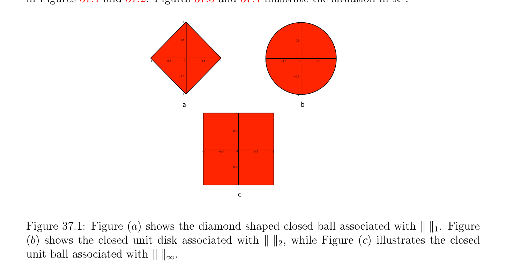
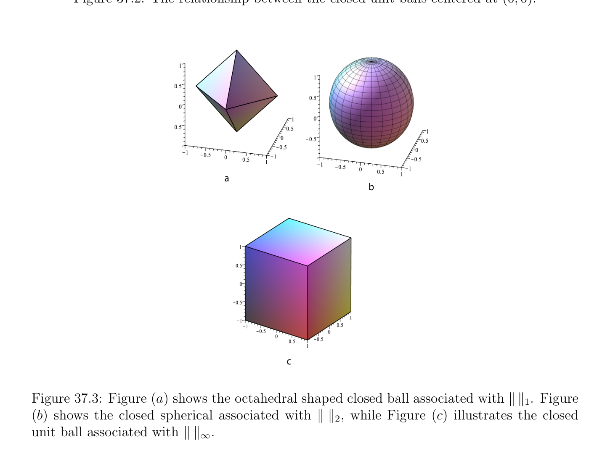
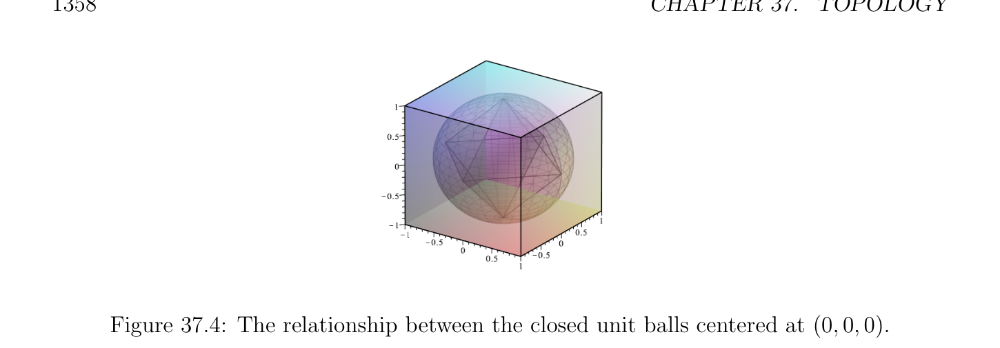

# Metric Spaces and Normed Vector Spaces

<!-- PAGE 1353 -->
Chapter $37$ Topology

## 37.1 Metric Spaces and Normed Vector Spaces

This chapter contains a review of basic topological concepts. First metric spaces are defined. Next normed vector spaces are defined. Closed and open sets are defined, and their basic properties are stated. The general concept of a topological space is defined. The closure and the interior of a subset are defined. The subspace topology and the product topology are defined. Continuous maps and homeomorphisms are defined. Limits of sequences are defined. Continuous linear maps and multilinear maps are defined and studied briefly. The chapter ends with the definition of a normed affine space. Most spaces considered in this book have a topological structure given by a metric or a norm, and we first review these notions. We begin with metric spaces. Recall that $\mathbb{R}_{+} = {x \in \mathbb{R}$ | $x \ge 0}$.

> **Definition 37.1.** A metric space is a set $E$ together with a function $d: E \times  E \to \mathbb{R}_{+}$, called a metric, or distance, assigning a nonnegative real number d(x, $y)$ to any two points $x, y \in E$, and satisfying the following conditions for all $x, y, z \in E$:
(D1) d(x, $y) =$ d(y, $x)$. (symmetry)
(D2) d(x, $y) \ge 0$, and d(x, $y) = 0$ iff $x = y$. (positivity)
(D3) d(x, $z) \le$ d(x, $y) +$ d(y, $z)$. (triangle inequality) Geometrically, Condition (D3) expresses the fact that in a triangle with vertices $x, y, z$, the length of any side is bounded by the sum of the lengths of the other two sides. From (D3), we immediately get
$$|d(x, y) -d(y, z)| \le d(x, z).$$
Let us give some examples of metric spaces. Recall that the absolute value |x| of a real number $x \in \mathbb{R}$ is defined such  | | $= x$ if $x \ge 0$, |x| $= -x$ if $x < 0$, and for a complex
$$number x = a + ib, by |x| =\sqrt \frac{thatx}{a^{2}+ b^{2}.}$$
$$1353$$

<!-- PAGE 1354 -->

> **Example 37.1.** $1$. Let $E = \mathbb{R}$, and d(x, $y) =$ |x - y|, the absolute value of $x$ - $y$. This is the so-called natural metric on $\mathbb{R}$.
$$\mathbb{R}^{n} \mathbb{C}^{n}$$
$2$. Let $E =$ (or $E =$ ). We have the Euclidean metric
$$d_{2}(x, y) = \begin{pmatrix} |x_{1} -y_{1}|^{2}+ \cdots  + |x_{n} -y_{n}\overline{|}^{212} \end{pmatrix} ,$$
the distance between the points $(x_{1}, \dots  , x_{n})$ and $(y_{1}, \dots  , y_{n}). 3$. For every set $E$, we can define the discrete metric, defined such that d(x, $y) = 1$ iff $x \neq  y$, and d(x, $x) = 0. 4$. For any a, $b \in \mathbb{R}$ such that a $< b$, we define the following sets: [a, $b] = {x \in \mathbb{R}$ | $a \le x \le b}$, (closed interval) (a, $b) = {x \in \mathbb{R}$ | a $< x < b}$, (open interval) [a, $b) = {x \in \mathbb{R}$ | $a \le x < b}$, (interval closed on the left, open on the right) (a, $b] = {x \in \mathbb{R}$ | a $< x \le b}$, (interval open on the left, closed on the right) Let $E = [a, b]$, and d(x, $y) =$ |x - y|. Then, ([a, $b], d)$ is a metric space. We will need to define the notion of proximity in order to define convergence of limits and continuity of functions. For this we introduce some standard “small neighborhoods.”

> **Definition 37.2.** Given a metric space $E$ with metric $d$, for every $a \in E$, for every $\rho  \in \mathbb{R}$, with $\rho  > 0$, the set
$$B(a, \rho ) = {x \in E | d(a, x) \le \rho }$$
is called the closed ball of center a and radius $\rho$ , the set
$$B_{0}(a, \rho ) = {x \in E | d(a, x) < \rho }$$
is called the open ball of center a and radius $\rho$ , and the set
$$S(a, \rho ) = {x \in E | d(a, x) = \rho }$$
is called the sphere of center a and radius $\rho$ . It should be noted that $\rho$  is finite (i.e., not $+\infty$ ). A subset $X$ of a metric space $E$ is bounded if there is a closed ball B(a, $\rho$ ) such that $X \subseteq$ B(a, $\rho$ ). Clearly, B(a, $\rho$ ) $= B_{0}(a, \rho$ ) $\cup$ S(a, $\rho$ ).

> **Example 37.2.**

<!-- PAGE 1355 -->
$1$. In $E =\mathbb{R}$ with the distance |x - y|, an open ball of center a and radius $\rho$  is the open interval $(a$ - $\rho$ , $a + \rho$ ).
$$\mathbb{R}^{2}$$
$2$. In $E =$ with the Euclidean metric, an open ball of center a and radius $\rho$  is the set of points inside the disk of center a and radius $\rho$ , excluding the boundary points on the circle.
$$\mathbb{R}^{3}$$
$3$. In $E =$ with the Euclidean metric, an open ball of center a and radius $\rho$  is the set of points inside the sphere of center a and radius $\rho$ , excluding the boundary points on the sphere. One should be aware that intuition can be misleading in forming a geometric image of a closed (or open) ball. For example, if $d$ is the discrete metric, a closed ball of center a and radius $\rho  < 1$ consists only of its center a, and a closed ball of center a and radius $\rho  \ge 1$ consists of the entire space!  If $E = [a, b]$, and d(x, $y) =$ |x - y|, as in Example 37.1, an open ball $B_{0}(a, \rho$ ), with $\rho  < b$ - $a$, is in fact the interval [a, $a + \rho$ ), which is closed on the left. We now consider a very important special case of metric spaces, normed vector spaces. Normed vector spaces have already been defined in Chapter $9$ (Definition 9.1) but for the reader’s convenience we repeat the definition.

> **Definition 37.3.** Let $E$ be a vector space over a field $K$, where $K$ is either the field $\mathbb{R}$ of reals, or the $field\mathbb{C}$ of complex numbers. A norm on $E$ is a function $\|\|: E \to \mathbb{R}_{+}$, assigning a nonnegative real number $\|u\|$ to any vector $u \in E$, and satisfying the following conditions for all $x, y, z \in E$:
(N1) $\|x\|\ge 0$, and $\|x\| = 0$ iff $x = 0$. (positivity)
(N2) $\|\lambda x\| = |\lambda$ | $\|x\|$. (scaling)
(N3) $\|x + y\|\le \|x\| + \|y\|$. (triangle inequality) $A$ vector space $E$ together with a norm $\|\|$ is called a normed vector space. From (N3), we easily get
$$|\|x\|-\|y\|| \le \|x -y\|.$$
Given a normed vector space $E$, if we define $d$ such that
$$d(x, y) = \|x -y\|,$$
it is easily seen that $d$ is a metric. Thus, every normed vector space is immediately a metric space. Note that the metric associated with a norm is invariant under translation, that is,
$$d(x + u, y + u) = d(x, y).$$

<!-- PAGE 1356 -->
For this reason, we can restrict ourselves to open or closed balls of center $0$. Examples of normed vector spaces were given in Example 9.1. We repeat the most important examples.
$$\mathbb{R}^{n}  \mathbb{C}^{n}$$

> **Example 37.3.** Let $E =$ (or $E =$ ). There are three standard norms. For every $(x_{1}, \dots  , x_{n}) \in E$, we have the norm $\|x\|_{1}$, defined such that,
$$\|x\|_{1} = |x_{1}| + \cdots  + |x_{n}|,$$
we have the Euclidean norm $\|x\|_{2}$, defined such that,
$$\|x\|_{2} = \begin{pmatrix} |x_{1}|^{2}+ \cdots  + |x_{n}\overline{|}^{212} \end{pmatrix} ,$$
and the sup-norm $\|x\|_{\infty}$, defined such that,
$$\|x\|_{\infty}= \max{|x_{i}| | 1 \le i \le n}.$$
More generally, we define the $\ell_{p}$ -norm (for $p \ge 1)$ by
$$\|x\|_{p} = (|x_{1}|^{p}+ \cdots  + |x_{n}|^{p})^{1/p}.$$
We proved in Proposition 9.1 that the $\ell_{p}$ -norms are indeed norms. The closed unit balls centered at $(0, 0)$ for $\|\|_{1}, \|\|_{2}$, and $\|\|_{\infty}$, along with the containment relationships, are shown in Figures 37.1 and 37.2. Figures 37.3 and 37.4 illustrate the situation in $\mathbb{R}^{3}$.
$$11$$
$$0.50.5$$
$$K\overline{1}\overline{K}\overline{0.5}\overline{0}\overline{0.5}\overline{1} K\overline{1}\overline{K}\overline{0.5}\overline{0}\overline{0.5}\overline{1}$$
$$K0.5K0.5$$
$$K1K1$$
$$ab$$
$$1$$
$$0.5$$
$$K\overline{1}\overline{K}\overline{0.5}\overline{0}\overline{0.5}\overline{1}$$
$$K0.5$$
$$K1$$
$$c$$

**Figure 37.1:** Figure (a) shows the diamond shaped closed ball associated with $\|\|_{1}$. Figure
$(b)$ shows the closed unit disk associated with $\|\|_{2}$, while Figure $(c)$ illustrates the closed unit ball associated with $\|\|_{\infty}$.

<!-- PAGE 1357 -->
$$1$$
$$0.5$$
$$\overline{K}\overline{1}\overline{K}\overline{0.5}\overline{0}\overline{0.5}\overline{1}$$
$$K0.5$$
$$K1$$
$$Figure 37.2: The relationship between the closed unit balls centered at (0, 0).$$
$$a$$
$$b$$
$$c$$

**Figure 37.3:** Figure (a) shows the octahedral shaped closed ball associated with $\|\|_{1}$. Figure
$(b)$ shows the closed spherical associated with $\|\|_{2}$, while Figure $(c)$ illustrates the closed unit ball associated with $\|\|_{\infty}$. In a normed vector space we define a closed ball or an open ball of radius $\rho$  as a closed ball or an open ball of center $0$. We may use the notation $B(\rho$ ) and $B_{0}(\rho$ ). We will now define the crucial notions of open sets and closed sets, and of a topological space.

<!-- PAGE 1358 -->

**Figure 37.4:** The relationship between the closed unit balls centered at $(0, 0, 0)$.

> **Definition 37.4.** Let $(E, d)$ be a metric space. A subset $U \subseteq E$ is an open set in $E$ if either $U = \emptyset$ , or for every $a \in U$, there is some open ball $B_{0}(a, \rho$ ) such that, $B_{0}(a, \rho$ ) $\subseteq U.^{1} A$ subset $F \subseteq E$ is a closed set in $E$ if its complement $E$ - $F$ is open in $E$. See Figure 37.5.
$$a$$
$$B(a,    )\rho$$
$$O$$
$$U$$
$$\mathbb{R}^{2}$$

**Figure 37.5:** An open set $U$ in $E =$ under the standard Euclidean metric. Any point in the peach set $U$ is surrounded by a small raspberry open set which lies within $U$. The set $E$ itself is open, since for every $a \in E$, every open ball of center a is contained in $E$. In $E =\mathbb{R}^{n}$, given $n$ intervals $[a_{i}, b_{i}]$, with $a_{i} < b_{i}$, it is easy to show that the open n-cube
$${(x_{1}, \dots  , x_{n}) \in E | a_{i} < x_{i} < b_{i}, 1 \le i \le n}$$
is an open set. In fact, it is possible to find a metric for which such open n-cubes are open balls! Similarly, we can define the closed n-cube
$${(x_{1}, \dots  , x_{n}) \in E | a_{i} \le x_{i} \le b_{i}, 1 \le i \le n},$$
which is a closed set. The open sets satisfy some important properties that lead to the definition of a topological space. $\overline{1}\overline{Recall} \overline{that} \overline{\rho  >}\overline{0.}$

<!-- PAGE 1359 -->

> **Proposition 37.1.** Given a metric space $E$ with metric $d$, the family $\mathcal{O}$ of all open sets defined in Definition 37.4 satisfies the following properties:
(O1) For every finite family $(U_{i})_{1\le i\le n}$ of sets $U_{i} \in O$, we have $U_{1} \cap \cdots  \cap U_{n} \in O$, i.e., $\mathcal{O}$ is closed under finite intersections.
$$(O2) For every arbitrary family (U_{i})_{i\in I} of sets U_{i} \in O, we have \bigcup_{i}  \in I U_{i} \in O, i.e.,\mathcal{O} is closed$$
under arbitrary unions.
(O3) $\emptyset \in O$, and $E \in O$, i.e., $\emptyset$ and $E$ belong to $\mathcal{O}$. Furthermore, for any two distinct points $a \neq  b$ in $E$, there exist two open sets $U_{a}$ and $U_{b}$ such that, $a \in U_{a}, b \in U_{b}$, and $U_{a} \cap U_{b} = \emptyset$ .

*Proof.* It is straightforward. For the last point, letting $\rho  =$ d(a, $b)/3$ (in fact $\rho  =$ d(a, $b)/2$ works too), we can pick $U_{a} = B_{0}(a, \rho$ ) and $U_{b} = B_{0}(b, \rho$ ). By the triangle inequality, we must have $U_{a} \cap U_{b} = \emptyset$ . The above proposition leads to the very general concept of a topological space.  One should be careful that, in general, the family of open sets is not closed under infinite intersections. For example, in $\mathbb{R}$ under the metric |x - y|, letting $U_{n} = (-1/n, +1/n)$,
$$each U_{n} is open, but \bigcap_{n}  U_{n} = {0}, which is not open.$$
Later on, given any nonempty subset $A$ of a metric space $(E, d)$, we will need to know that certain special sets containing $A$ are open.

> **Definition 37.5.** Let $(E, d)$ be a metric space. For any nonempty subset $A$ of $E$ and any $x \in E$, let
$$d(x, A) = \inf d(x, a).$$
$$a\in A$$

> **Proposition 37.2.** Let $(E, d)$ be a metric space. For any nonempty subset $A$ of $E$ and for any two points $x, y \in E$, we have
$$|d(x, A) -d(y, A)| \le d(x, y).$$

*Proof.* For all $a \in A$ we have
$$d(x, a) \le d(x, y) + d(y, a),$$
which implies
$$d(x, A) = \inf d(x, a)$$
$$a\in A$$
$$\le \inf(d(x, y) + d(y, a))$$
$$a\in A$$
$$= d(x, y) + \inf d(y, a)$$
$$a\in A$$
$$= d(x, y) + d(y, A).$$
