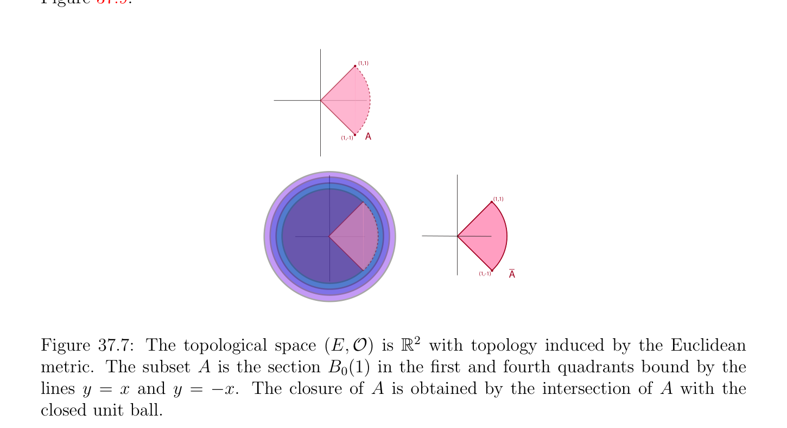
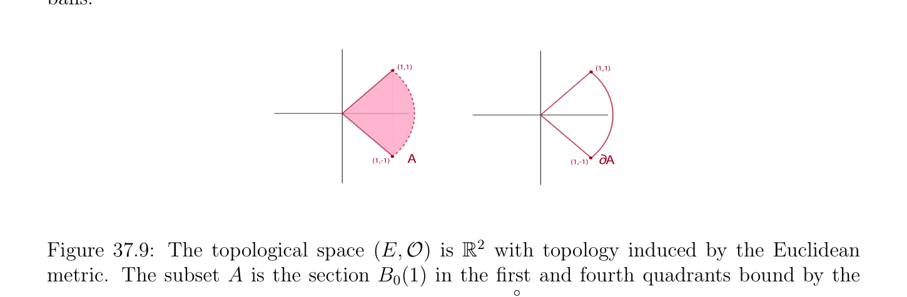
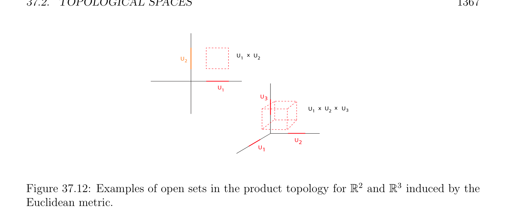
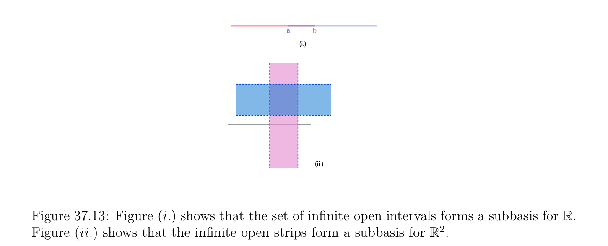

# Topological Spaces

<!-- PAGE 1360 -->
By symmetry, we also obtain d(y, $A) \le$ d(x, $y) +$ d(x, $A)$, and thus
$$|d(x, A) -d(y, A)| \le d(x, y),$$
as claimed.

> **Definition 37.6.** Let $(E, d)$ be a metric space. For any nonempty subset $A$ of $E$, and any $r > 0$, let
$$V_{r}(A) = {x \in E | d(x, A) < r}.$$

> **Proposition 37.3.** Let $(E, d)$ be a metric space. For any nonempty subset $A$ of $E$, and any $r > 0$, the set $V_{r}(A)$ is an open set containing $A$.

*Proof.* For any $y \in E$ such that d(x, $y) < r$ - d(x, $A)$, by Proposition 37.2 we have
$$d(y, A) \le d(x, A) + d(x, y) \le d(x, A) + r -d(x, A) = r,$$
so $V_{r}(A)$ contains the open ball $B_{0}(x, r$ - d(x, $A))$, which means that it is open. Obviously, $A \subseteq V_{r}(A)$.

## 37.2 Topological Spaces

Motivated by Proposition 37.1, a topological space is defined in terms of a family of sets satisfying the properties of open sets stated in that proposition.

> **Definition 37.7.** Given a set $E$, a topology on $E$ (or a topological structure on $E)$, is defined as a family $\mathcal{O}$ of subsets of $E$ called open sets, and satisfying the following three properties:
$(1)$ For every finite family $(U_{i})_{1\le i\le n}$ of sets $U_{i} \in O$, we have $U_{1} \cap \cdots  \cap U_{n} \in O$, i.e., $\mathcal{O}$ is closed under finite intersections.
$$(2) For every arbitrary family (U_{i})_{i\in I} of sets U_{i} \in O, we have \bigcup_{i}  \in I U_{i} \in O, i.e.,\mathcal{O} is closed$$
under arbitrary unions.
$(3) \emptyset \in O$, and $E \in O$, i.e., $\emptyset$ and $E$ belong to $\mathcal{O}$. A set $E$ together with a $topology\mathcal{O}$ on $E$ is called a topological space. Given a topological space $(E,\mathcal{O})$, a subset $F$ of $E$ is a closed set if $F = E$ - $U$ for some open set $U \in O$, i.e., $F$ is the complement of some open set.  It is possible that an open set is also a closed set. For example, $\emptyset$ and $E$ are both open and closed. When a topological space contains a proper nonempty subset $U$ which is both open and closed, the space $E$ is said to be disconnected.

<!-- PAGE 1361 -->

> **Definition 37.8.** A topological space $(E,\mathcal{O})$ is said to satisfy the Hausdorff separation axiom (or $T_{2}-separation$ axiom) if for any two distinct points $a \neq  b$ in $E$, there exist two open sets $U_{a}$ and $U_{b}$ such that, $a \in U_{a}, b \in U_{b}$, and $U_{a} \cap U_{b} = \emptyset$ . When the $T_{2}-separation$ axiom is satisfied, we also say that $(E,\mathcal{O})$ is a Hausdorff space. As shown by Proposition 37.1, any metric space is a topological Hausdorff space, the family of open sets being in fact the family of arbitrary unions of open balls. Similarly, any normed vector space is a topological Hausdorff space, the family of open sets being the family of arbitrary unions of open balls. The topology $\mathcal{O}$ consisting of all subsets of $E$ is called the discrete topology.
Remark: Most (if not all) spaces used in analysis are Hausdorffspaces. Intuitively, the Hausdorff separation axiom says that there are enough “small” open sets. Without this axiom, some counter-intuitive behaviors may arise. For example, a sequence may have more than one limit point (or a compact set may not be closed). Nevertheless, non-Hausdorff topological spaces arise naturally in algebraic geometry. But even there, some substitute for separation is used. One of the reasons why topological spaces are important is that the definition of a topology only involves a certain family $\mathcal{O}$ of sets, and not how such family is generated from a metric or a norm. For example, different metrics or different norms can define the same family of open sets. Many topological properties only depend on the family $\mathcal{O}$ and not on the specific metric or norm. But the fact that a topology is definable from a metric or a norm is important, because it usually implies nice properties of a space. All our examples will be spaces whose topology is defined by a metric or a norm.

> **Definition 37.9.** A topological space $(E,\mathcal{O})$ is metrizable if there is a distance on $E$ defining the topology $\mathcal{O}$. Note that in a metric space $(E, d)$, the metric $d$ is explicitly given. However, in general, the topology of a metrizable space $(E,\mathcal{O})$ is not specified by an explicitly given metric, but some metric defining the topology $\mathcal{O}$ exists. Obviously, a metrizable topological space must be Hausdorff. Actually, a stronger separation property holds, a metrizable space is normal; see Definition 37.30.
Remark: By taking complements we can state properties of the closed sets dual to those of Definition 37.7. Thus, $\emptyset$ and $E$ are closed sets, and the closed sets are closed under finite unions and arbitrary intersections. It is also worth noting that the Hausdorff separation axiom implies that for every $a \in E$, the set ${a}$ is closed. Indeed, if $x \in E -{a}$, then $x \neq$  a, and so there exist open sets $U_{a}$ and $U_{x}$ such that $a \in U_{a}, x \in U_{x}$, and $U_{a} \cap U_{x} = \emptyset$ . See Figure 37.6. Thus, for every $x \in E -{a}$, there is an open set $U_{x}$ containing $x$ and contained in $E -{a}$, showing by (O3) that $E -{a}$ is open, and thus that the set ${a}$ is closed.

<!-- PAGE 1362 -->
$$Ux$$
$$x$$
$$a$$
$$Ua$$
$$E$$
$$Figure 37.6: A schematic illustration of the Hausdorff separation property$$
Given a topological space $(E,\mathcal{O})$, given any subset $A$ of $E$, since $E \in O$ and $E$ is a closed set, the family $\mathcal{C}_{A} = {F$ | $A \subseteq F, F$ a closed $set}$ of closed sets containing $A$ is nonempty,
$$and since any arbitrary intersection of closed sets is a closed set, the intersection \bigcap  \mathcal{C}_{A} of$$
the sets in the family $\mathcal{C}_{A}$ is the smallest closed set containing $A$. By a similar reasoning, the union of all the open subsets contained in $A$ is the largest open set contained in $A$.

> **Definition 37.10.** Given a topological space $(E,\mathcal{O})$, given any subset $A$ of $E$, the smallest
$$closed set containing A is denoted by \overline{A}, and \frac{is}{A} called the closure, or adherence of A. See$$
Figure 37.7. A subset $A$ of $E$ is dense in $E$ if  $= E$. The largest open set contained in $A$ is denoted $by^{\circ}A$, and is called the interior of $A$. See Figure 37.8. The set Fr $A =\overline{A} \cap \overline{E}\overline{-} \overline{A}$ is called the boundary (or frontier) of $A$. We also denote the boundary of $A$ by $\partial A$. See Figure 37.9.
$$(1,1)$$
$$(1,-1)A$$
$$(1,1)$$
$$_$$
$$(1,-1)A$$
$$\mathbb{R}^{2}$$

**Figure 37.7:** The topological space $(E,\mathcal{O})$ is with topology induced by the Euclidean metric. The subset $A$ is the section $B_{0}(1)$ in the first and fourth quadrants bound by the lines $y = x$ and $y = -x$. The closure of $A$ is obtained by the intersection of $A$ with the closed unit ball.

<!-- PAGE 1363 -->
$$(1,1)$$
$$(1,-1)A$$
$$(1,1)(1,1)$$
$$Ao$$
$$(1,-1)(1,-1)$$
$$\mathbb{R}^{2}$$

**Figure 37.8:** The topological space $(E,\mathcal{O})$ is with topology induced by the Euclidean metric. The subset $A$ is the section $B_{0}(1)$ in the first and fourth quadrants bound by the lines $y = x$ and $y = -x$. The interior of $A$ is obtained by the covering $A$ with small open balls.
$$(1,1)(1,1)$$
$$(1,-1)A дA$$
$$(1,-1)$$
$$\mathbb{R}^{2}$$

**Figure 37.9:** The topological space $(E,\mathcal{O})$ is with topology induced by the Euclidean metric. The subset $A$ is the section $B_{0}(1)$ in the first and fourth quadrants bound by the lines $y = x$ and $y = -x$. The boundary of $A$ is $\overline{A} -^{\circ}A$.
Remark: The notation $\overline{A}$ for the closure of a subset $A$ of $E$ is somewhat unfortunate, since $\overline{A}$ is often used to denote the set complement of $A$ in $E$. Still, we prefer it to more cumbersome notations such as clo(A), and we denote the complement of $A$ in $E$ by $E$ - $A$ (or sometimes, $A^{c})$. By definition, it is clear that a subset $A$ of $E$ is closed iff $A =\overline{A}$. The set $\mathbb{Q}$ of rationals
$$is dense in \mathbb{R}.It \frac{is}{A} easily shown that \overline{A} =^{\circ}A \cup \partial A and^{\circ}A \cap \partial A = \emptyset .Another useful$$
characterization of  is given by the following proposition.

> **Proposition 37.4.** Given a topological space $(E,\mathcal{O})$, given any subset $A$ of $E$, the closure $\overline{A}$ of $A$ is the set of all points $x \in E$ such that for every open set $U$ containing $x$, then

<!-- PAGE 1364 -->
$U \cap A \neq  \emptyset$ . See Figure 37.10.
$$A$$
$$\overline{A}$$
$$\mathbb{R}^{2}$$

**Figure 37.10:** The topological space $(E,\mathcal{O})$ is with topology induced by the Euclidean metric. The purple subset $A$ is illustrated with three red points, each in its closure since the open ball centered at each point has nontrivial intersection with $A$.

*Proof.* If $A = \emptyset$ , since $\emptyset$ is closed, the proposition holds trivially. Thus, assume that $A \neq  \emptyset$ .
$$First assume that x \in \overline{A}. Let U be any open set such that \frac{x}{A} \in U. If U \cap A = \emptyset , since U is$$
open, then $E$ - $U$ is a closed set containing $A$, and since  is the intersection of all closed sets containing $A$, we must have $x \in E$ - $U$, which is impossible. Conversely, assume that $x \in E$ is a point such that for every open set $U$ containing $x$, then $U \cap A \neq  \emptyset$ . Let $F$ be any closed subset containing $A$. If $x \in / F$, since $F$ is closed, then $U = E$ - $F$ is an open set
$$such that x \in U, and U \cap \frac{A}{A.} = \emptyset , a contradiction. Thus, we have x \in F for every closed set$$
containing $A$, that is, $x \in$ Often it is necessary to consider a subset $A$ of a topological space $E$, and to view the subset $A$ as a topological space. The following proposition shows how to define a topology on a subset.

> **Proposition 37.5.** Given a topological space $(E,\mathcal{O})$, given any subset $A$ of $E$, let
$$\mathcal{U} = {U \cap A | U \in O}$$
be the family of all subsets of $A$ obtained as the intersection of any open set in $\mathcal{O}$ with $A$. The following properties hold.
$(1)$ The space $(A,\mathcal{U})$ is a topological space.

<!-- PAGE 1365 -->
$(2)$ If $E$ is a metric space with metric $d$, then the restriction $d_{A}$ : $A \times  A \to \mathbb{R}_{+}$ of the metric $d$ to $A$ defines a metric space. Furthermore, the topology induced by the metric $d_{A}$ agrees with the topology defined by $\mathcal{U}$, as above.

*Proof.* Left as an exercise. Proposition 37.5 suggests the following definition.

> **Definition 37.11.** Given a topological space $(E,\mathcal{O})$, given any subset $A$ of $E$, the subspace topology on $A$ induced by $\mathcal{O}$ is the family $\mathcal{U}$ of open sets defined such that
$$\mathcal{U} = {U \cap A | U \in O}$$
is the family of all subsets of $A$ obtained as the intersection of any open set in $\mathcal{O}$ with $A$. We say that $(A,\mathcal{U})$ has the subspace topology. If $(E, d)$ is a metric space, the restriction $d_{A}$ : $A \times  A \to \mathbb{R}_{+}$ of the metric $d$ to $A$ is called the subspace metric.
$$\mathbb{R}^{n}$$
For example, if $E =$ and $d$ is the Euclidean metric, we obtain the subspace topology on the closed n-cube
$${(x_{1}, \dots  , x_{n}) \in E | a_{i} \le x_{i} \le b_{i}, 1 \le i \le n}.$$
See Figure 37.11,  One should realize that every open set $U \in O$ which is entirely contained in $A$ is also in the family $\mathcal{U}$, but $\mathcal{U}$ may contain open sets that are not in $\mathcal{O}$. For example, if $E = \mathbb{R}$ with |x-y|, and $A = [a, b]$, then sets of the form [a, $c)$, with a $< c < b$ belong $to\mathcal{U}$, but they are not open sets $for\mathbb{R}$ under |x-y|. However, there is agreement in the following situation.

> **Proposition 37.6.** Given a topological space $(E,\mathcal{O})$, given any subset $A$ of $E$, if $\mathcal{U}$ is the subspace topology, then the following properties hold.
$(1)$ If $A$ is an open set $A \in O$, then every open set $U \in U$ is an open set $U \in O$.
$(2)$ If $A$ is a closed set in $E$, then every closed set w.r.t. the subspace topology is a closed set w.r.t. $\mathcal{O}$.

*Proof.* Left as an exercise. The concept of product topology is also useful. We have the following proposition.

> **Proposition 37.7.** Given $n$ topological spaces $(E_{i},\mathcal{O}_{i})$, let $\mathcal{B}$ be the family of subsets of $E_{1} \times  \cdots  \times  E_{n}$ defined as follows:
$$\mathcal{B} = {U_{1} \times  \cdots  \times  U_{n} | U_{i} \in O_{i}, 1 \le i \le n},$$
and let $\mathcal{P}$ be the family consisting of arbitrary unions of sets in $\mathcal{B}$, including $\emptyset$ . Then $\mathcal{P}$ is a topology on $E_{1} \times  \cdots  \times  E_{n}$.

<!-- PAGE 1366 -->
$$D = (0,1,1)$$
$$A = (1,1,1)$$
$$C = (1,0,1)$$
$$B = (1,1,0)$$
$$\mathbb{R}^{3}$$

**Figure 37.11:** An example of an open set in the subspace topology for ${(x, y, z) \in$ | $-1 \le x \le 1, -1 \le y \le 1, -1 \le z \le 1}$. The open set is the corner region ABCD and is obtained by intersection the cube $B_{0}((1, 1, 1), 1)$.

*Proof.* Left as an exercise.

> **Definition 37.12.** Given $n$ topological spaces $(E_{i},\mathcal{O}_{i})$, the product topology on $E_{1}\times \cdots \times E_{n}$ is the family $\mathcal{P}$ of subsets of $E_{1} \times  \cdots  \times  E_{n}$ defined as follows: if
$$\mathcal{B} = {U_{1} \times  \cdots  \times  U_{n} | U_{i} \in O_{i}, 1 \le i \le n},$$
$then\mathcal{P}$ is the family consisting of arbitrary unions of sets $in\mathcal{B}$, including $\emptyset$ . See Figure 37.12. If each $(E_{i}, d_{Ei})$ is a metric space, there are three natural metrics that can be defined on $E_{1} \times  \cdots  \times  E_{n}$:
$$d_{1}((x_{1}, \dots  , x_{n}), (y_{1}, \dots  , y_{n})) = d_{E1}(x_{1}, y_{1}) + \cdots  + d_{En}(x_{n}, y_{n}),$$
$$d_{2}((x_{1}, \dots  , x_{n}), (y_{1}, \dots  , y_{n})) = \begin{pmatrix} (d_{E1}(x_{1}, y_{1}))^{2}+ \cdots  + (d_{En}(x_{n}, y_{n}\overline{))}^{212} \\ {d_{E1}(x_{1}, y_{1}), \dots  , d_{En}(x_{n}, y_{n})}. \end{pmatrix} ,$$
$$d_{\infty}((x_{1}, \dots  , x_{n}), (y_{1}, \dots  , y_{n})) = \max$$

<!-- PAGE 1367 -->
$$UxU$$
$$U212$$
$$\overline{U} 1$$
$$U3$$
$$UxUxU3$$
$$12$$
$$\overline{U2}$$
$$U1$$
$$\mathbb{R}^{2}  \mathbb{R}^{3}$$

**Figure 37.12:** Examples of open sets in the product topology for and induced by the Euclidean metric. It is easy to show that $d_{\infty}((x_{1}, \dots  , x_{n}), (y_{1}, \dots  , y_{n})) \le d_{2}((x_{1}, \dots  , x_{n}), (y_{1}, \dots  , y_{n})) \le d_{1}((x_{1}, \dots  , x_{n}), (y_{1}, \dots  , y_{n}))$
$$\le nd_{\infty}((x_{1}, \dots  , x_{n}), (y_{1}, \dots  , y_{n})),$$
so these distances define the same topology, which is the product topology. If each $(E_{i}, \|\|_{Ei})$ is a normed vector space, there are three natural norms that can be defined on $E_{1} \times  \cdots  \times  E_{n}$:
$$\|(x_{1}, \dots  , x_{n})\|_{1} = \|x_{1}\|_{E1} + \cdots  + \|x_{n}\|_{En},$$
$$\|(x_{1}, \dots  , x_{n})\|_{2} = \begin{pmatrix} \|x_{1}\|_{E1}^{2}+ \cdots  + \|x_{n}\overline{\|}_{En}^{212} \\ x_{1} & , \dots  ,x_{n} \end{pmatrix} ,$$
$$\|(x_{1}, \dots  , x_{n})\|_{\infty}= \max {\|\|_{E1} \|\|_{En}} .$$
It is easy to show that
$$\|(x_{1}, \dots  , x_{n})\|_{\infty}\le \|(x_{1}, \dots  , x_{n})\|_{2} \le \|(x_{1}, \dots  , x_{n})\|_{1} \le n\|(x_{1}, \dots  , x_{n})\|_{\infty},$$
so these norms define the same topology, which is the product topology. It can also be verified that when $E_{i} = \mathbb{R}$, with the standard topology induced by |x - y|, the topology
$$\mathbb{R}^{n}$$
product on is the standard topology induced by the Euclidean norm.

> **Definition 37.13.** Two metrics $d$ and d' on a space $E$ are equivalent if they induce the same $topology\mathcal{O}$ on $E$ (i.e., they define the same $family\mathcal{O}$ of open sets). Similarly, two norms $\|\|$ and $\|\|'$ on a space $E$ are equivalent if they induce the same topology $\mathcal{O}$ on $E$. Given a topological space $(E,\mathcal{O})$, it is often useful, as in Proposition 37.7, to define the topology $\mathcal{O}$ in terms of a subfamily $\mathcal{B}$ of subsets of $E$.

<!-- PAGE 1368 -->

> **Definition 37.14.** We say that a family $\mathcal{B}$ of subsets of $E$ is a basis for the topology $\mathcal{O}$, if $\mathcal{B}$ is a subset of $\mathcal{O}$, and if every open set $U$ in $\mathcal{O}$ can be obtained as some union (possibly infinite) of sets in $\mathcal{B}$ (agreeing that the empty union is the empty set). For example, given any metric space $(E, d), \mathcal{B} = {B_{0}(a, \rho$ ) | $a \in E, \rho  > 0}$. In particular, if $d = \|\|_{2}$, the open intervals form a basis for $\mathbb{R}$, while the open disks form a basis for $\mathbb{R}^{2}$.
$$\mathbb{R}^{2}$$
The open rectangles also form a basis for with the standard topology. See Figure 37.13. It is immediately verified that if a $family\mathcal{B} = (U_{i})_{i\in I}$ is a basis for the topology of $(E,\mathcal{O})$,
$$then E = \bigcup_{i}  U_{i}, and the intersection of any two sets U_{i}, U_{j} \in B is the union of some sets in$$
the family $\mathcal{B}^{\in I}$ (again, agreeing that the empty union is the empty set). Conversely, a family $\mathcal{B}$ with these properties is the basis of the topology obtained by forming arbitrary unions of sets in $\mathcal{B}$.

> **Definition 37.15.** A subbasis for $\mathcal{O}$ is a family $\mathcal{S}$ of subsets of $E$, such that the family $\mathcal{B}$ of all finite intersections of sets in $\mathcal{S}$ (including $E$ itself, in case of the empty intersection) is a basis of $\mathcal{O}$. See Figure 37.13.
$$\overline{a}\overline{b}$$
$$(i.)$$
$$(ii.)$$

**Figure 37.13:** Figure $(i.)$ shows that the set of infinite open intervals forms a subbasis $for\mathbb{R}$. Figure (ii.) shows that the infinite open strips form a subbasis for $\mathbb{R}^{2}$. The following proposition gives useful criteria for determining whether a family of open subsets is a basis of a topological space.

> **Proposition 37.8.** Given a topological space $(E,\mathcal{O})$ and a family $\mathcal{B}$ of open subsets in $\mathcal{O}$ the following properties hold:
$(1)$ The family $\mathcal{B}$ is a basis for the topology $\mathcal{O}$ iff for every open set $U \in O$ and every $x \in U$, there is some $B \in B$ such that $x \in B$ and $B \subseteq U$. See Figure 37.14.
$(2)$ The family $\mathcal{B}$ is a basis for the topology $\mathcal{O}$ iff
$$(a) For every x \in E, there is some B \in B such that x \in B.$$
