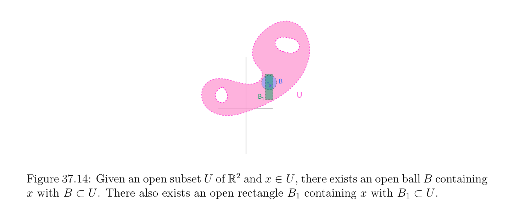
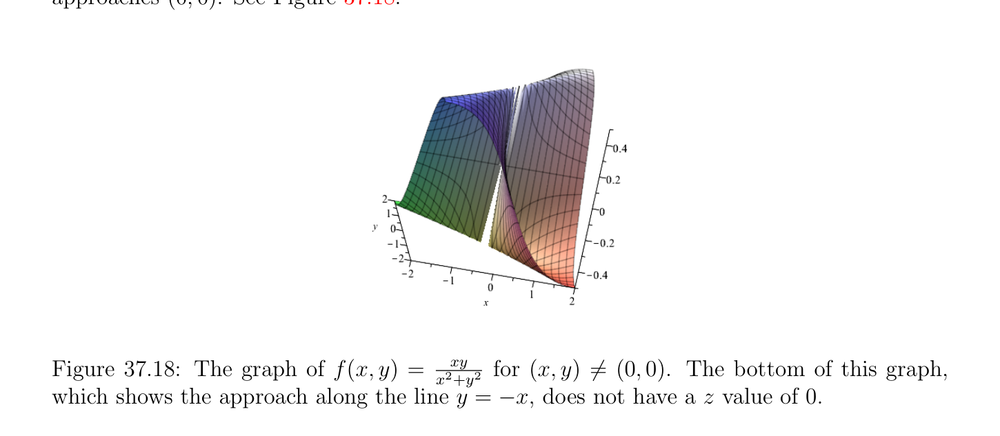

# Continuous Functions, Limits

<!-- PAGE 1369 -->
$$(b) For any two open subsets, B_{1}, B_{2} \in B, for every x \in E, if x \in B_{1} \cap B_{2}, then there$$
$$is some B_{3} \in B such that x \in B_{3} and B_{3} \subseteq B_{1} \cap B_{2}. See Figure 37.15.$$
$$B$$
$$x$$
$$BU$$
$$1$$
$$\mathbb{R}^{2}$$

**Figure 37.14:** Given an open subset $U$ of and $x \in U$, there exists an open ball $B$ containing $x$ with $B \subset U$. There also exists an open rectangle $B_{1}$ containing $x$ with $B_{1} \subset U$.
$$x$$
$$B3$$
$$B$$
$$2$$
$$B$$
$$1$$
$$Figure 37.15: A schematic illustration of Condition (b) in Proposition 37.8.$$
We now consider the fundamental property of continuity.

## 37.3 Continuous Functions, Limits

> **Definition 37.16.** Let $(E,\mathcal{O}_{E})$ and $(F,\mathcal{O}_{F})$ be topological spaces, and let $f$ : $E \to F$ be a function. For every $a \in E$, we say that $f$ is continuous at a, if for every open set $V \in O_{F}$ containing f(a), there is some open set $U \in O_{E}$ containing a, such that, f(U) $\subseteq V$ . See Figure 37.16. We say that $f$ is continuous if it is continuous at every $a \in E$. Define a neighborhood of $a \in E$ as any subset $N$ of $E$ containing some open set $O \in O$ such that $a \in O$. If $f$ is continuous at a and $N$ is any neighborhood of f(a), there is some open set $V \subseteq N$ containing f(a), and since $f$ is continuous at a, there is some open set $U$ containing a, such that f(U) $\subseteq V$ . Since $V \subseteq N$, the open set $U$ is a subset of $f^{-1} (N)$

<!-- PAGE 1370 -->
$$f$$
$$Uaf(U)$$
$$f(a)$$
$$EV$$
$$F$$
$$Figure 37.16: A schematic illustration of Definition 37.16.$$
containing a, and $f^{-1} (N)$ is a neighborhood of a. Conversely, if $f^{-1} (N)$ is a neighborhood of a whenever $N$ is any neighborhood of f(a), it is immediate that $f$ is continuous at a. See Figure 37.17.
$$f$$
$$f(U)$$
$$U$$
$$f(a)$$
$$VN$$
$$a$$
$$f  (N)-1$$
$$EF$$
$$Figure 37.17: A schematic illustration of the neighborhood condition.$$
It is easy to see that Definition 37.16 is equivalent to the following statements.

> **Proposition 37.9.** Let $(E,\mathcal{O}_{E})$ and $(F,\mathcal{O}_{F})$ be topological spaces, and let $f$ : $E \to F$ be a function. For every $a \in E$, the function $f$ is continuous at $a \in E$ iff for every neighborhood $N$ of f(a) $\in F$, then $f^{-1} (N)$ is a neighborhood of a. The function $f$ is continuous on $E$ iff $f^{-1} (V$ ) is an open set in $\mathcal{O}_{E}$ for every open set $V \in O_{F}$. If $E$ and $F$ are metric spaces defined by metrics $d_{E}$ and $d_{F}$, we can show easily that $f$ is continuous at a iff for every $\epsilon  > 0$, there is some $\eta  > 0$, such that, for every $x \in E$,
$$if d_{E}(a, x) \le \eta , then d_{F}(f(a), f(x)) \le \epsilon .$$
Similarly, if $E$ and $F$ are normed vector spaces defined by norms $\|\|_{E}$ and $\|\|_{F}$, we can show easily that $f$ is continuous at a iff

<!-- PAGE 1371 -->
for every $\epsilon  > 0$, there is some $\eta  > 0$, such that, for every $x \in E$,
$$if \|x -a\|_{E} \le \eta , then \|f(x) -f(a)\|_{F} \le \epsilon .$$
It is worth noting that continuity is a topological notion, in the sense that equivalent metrics (or equivalent norms) define exactly the same notion of continuity.

> **Definition 37.17.** If $(E,\mathcal{O}_{E})$ and $(F,\mathcal{O}_{F})$ are topological spaces, and $f$ : $E \to F$ is a function, for every nonempty subset $A \subseteq E$ of $E$, we say that $f$ is continuous on $A$ if the restriction of $f$ to $A$ is continuous with respect to $(A,\mathcal{U})$ and $(F,\mathcal{O}_{F})$, where $\mathcal{U}$ is the subspace topology induced by $\mathcal{O}_{E}$ on $A$. Given a product $E_{1}\times \cdots \times E_{n}$ of topological spaces, as usual, we let $\pi_{i}$  : $E_{1}\times \cdots \times E_{n} \to E_{i}$ be the projection function such that, $\pi_{i} (x_{1}, \dots  , x_{n}) = x_{i}$. It is immediately verified that each $\pi_{i}$  is continuous. Given a topological space $(E,\mathcal{O})$, we say that a point $a \in E$ is isolated if ${a}$ is an open set in $\mathcal{O}$. Then if $(E,\mathcal{O}_{E})$ and $(F,\mathcal{O}_{F})$ are topological spaces, any function $f$ : $E \to F$ is continuous at every isolated point $a \in E$. In the discrete topology, every point is isolated. In a nontrivial normed vector space $(E, \|\|)$ (with E̸ $= {0})$, no point is isolated. To show this, we show that every open ball $B_{0}(u, \rho$ ,) contains some vectors different from $u$. Indeed, since $E$ is nontrivial, there is some $v \in E$ such that $v \neq  0$, and thus $\lambda  = \|v\| > 0$ (by (N1)). Let
$$w = u + \frac{\rho}{\lambda  + 1} v.$$
Since $v \neq  0$ and $\rho  > 0$, we have $w \neq  u$. Then,
$$\|w -u\|= \frac{\rho}{\lambda  + 1} v = \frac{\rho \lambda}{\lambda  + 1} < \rho ,$$
which shows that $\|w$ - $u\| < \rho$ , for $w \neq  u$. The following proposition is easily shown.

> **Proposition 37.10.** Given topological spaces $(E,\mathcal{O}_{E}), (F,\mathcal{O}_{F})$, and $(G,\mathcal{O}_{G})$, and two functions $f$ : $E \to F$ and $g: F \to G$, if $f$ is continuous at $a \in E$ and $g$ is continuous at f(a) $\in F$, then $g \circ f$ : $E \to G$ is continuous at $a \in E$. Given $n$ topological spaces $(F_{i},\mathcal{O}_{i})$, for every function $f$ : $E \to F_{1} \times  \cdots  \times  F_{n}$, then $f$ is continuous at $a \in E$ iff every $f_{i}$ : $E \to F_{i}$ is continuous at a, where $f_{i} = \pi_{i}  \circ f$. One can also show that in a metric space $(E, d)$, the distance $d: E\times E \to \mathbb{R}$ is continuous, where $E \times  E$ has the product topology. By the triangle inequality, we have
$$d(x, y) \le d(x, x_{0}) + d(x_{0}, y_{0}) + d(y_{0}, y) = d(x_{0}, y_{0}) + d(x_{0}, x) + d(y_{0}, y)$$

<!-- PAGE 1372 -->
and
$$d(x_{0}, y_{0}) \le d(x_{0}, x) + d(x, y) + d(y, y_{0}) = d(x, y) + d(x_{0}, x) + d(y_{0}, y).$$
Consequently,
$$|d(x, y) -d(x_{0}, y_{0})| \le d(x_{0}, x) + d(y_{0}, y),$$
which proves that $d$ is continuous at $(x_{0}, y_{0})$. In fact this shows that $d$ is uniformly continuous; see Definition 37.36. Given any nonempty subset $A$ of $E$, by Proposition 37.2, the map $x \mapsto$ d(x, $A)$ is continuous (in fact, uniformy continuous). Similarly, for a normed vector space $(E, \|\|)$, the norm $\|\|: E \to \mathbb{R}$ is (uniformly) continuous. Given a function $f$ : $E_{1} \times  \cdots  \times  E_{n} \to F$, we can fix $n$ - $1$ of the arguments, say $a_{1}, \dots  , a_{i-1}, a_{i+1}, \dots  , a_{n}$, and view $f$ as a function of the remaining argument,
$$x_{i} \mapsto f(a_{1}, \dots  , a_{i-1}, x_{i}, a_{i+1}, \dots  , a_{n}),$$
where $x_{i} \in E_{i}$. If $f$ is continuous, it is clear that each $f_{i}$ is continuous.  One should be careful that the converse is false! For example, consider the function $f$ : $\mathbb{R} \times \mathbb{R} \to \mathbb{R}$, defined such that,
$$f(x, y) = \frac{xy}{x^{2}+ y^{2}} if (x, y) \neq  (0, 0), andf(0, 0) = 0.$$
The function $f$ is continuous on $\mathbb{R} \times \mathbb{R} -{(0, 0)}$, but on the line $y =$ mx, with $m \neq  0$, we have f(x, $y) =_{1+}^{m}$  ̸ $= 0$, and thus, on this line, f(x, $y)$ does not approach $0$ when $(x, y)$ approaches $(0, 0).^{m2}$ See Figure 37.18.

**Figure 37.18:** The graph of f(x, $y) =_{x2}^{xy}$  for $(x, y) \neq  (0, 0)$. The bottom of this graph, which shows the approach along the $line^{+y2} y = -x$, does not have a $z$ value of $0$. The following proposition is useful for showing that real-valued functions are continuous.

<!-- PAGE 1373 -->

> **Proposition 37.11.** If $E$ is a topological space, and $(\mathbb{R}$, |x-y|) the reals under the standard topology, for any two functions $f$ : $E \to \mathbb{R}$ and $g: E \to \mathbb{R}$, for any $a \in E$, for any $\lambda  \in \mathbb{R}$, if $f$ and $g$ are continuous at a, then $f +g, \lambda f, f \cdot g$, are continuous at a, and $f/g$ is continuous at a if g(a) $\neq  0$.

*Proof.* Left as an exercise. Using Proposition 37.11, we can show easily that every real polynomial function is continuous. The notion of isomorphism of topological spaces is defined as follows.

> **Definition 37.18.** Let $(E,\mathcal{O}_{E})$ and $(F,\mathcal{O}_{F})$ be topological spaces, and let $f$ : $E \to F$ be a function. We say that $f$ is a homeomorphism between $E$ and $F$ if $f$ is bijective, and both $f$ : $E \to F$ and $f^{-1}: F \to E$ are continuous.  One should be careful that a bijective continuous function $f$ : $E \to F$ is not necessarily a homeomorphism. For example, if $E = \mathbb{R}$ with the discrete topology, and $F = \mathbb{R}$ with the standard topology, the identity is not a homeomorphism. Another interesting example
$$\mathbb{R}\mathbb{R}^{2}$$
involving a parametric curve is given below. Let $L:  \to$ be the function, defined such that,
$$L_{1}(t) = \frac{t(1 + t^{2})}{1 + t^{4}} ,$$
$$L_{2}(t) = \frac{t(1t^{2})}{1 + t^{4}} - .$$
If we think of (x(t), y(t)) $= (L_{1}(t), L_{2}(t))$ as a geometric point in $\mathbb{R}^{2}$, the set of points (x(t), y(t)) obtained by letting $t$ vary $in\mathbb{R}$ from $-\infty$ to $+\infty$ , defines a curve having the shape of a “figure eight,” with self-intersection at the origin, called the “lemniscate of Bernoulli.” See Figure 37.19. The map $L$ is continuous, and in fact bijective, but its inverse $L^{-1}$ is not continuous. Indeed, when we approach the origin on the branch of the curve in the upper left quadrant (i.e., points such that, $x \le 0, y \ge 0)$, then $t$ goes to $-\infty$ , and when we approach the origin on the branch of the curve in the lower right quadrant (i.e., points such that, $x \ge 0, y \le 0)$, then $t$ goes to $+\infty$ .
$$Figure 37.19: The lemniscate of Bernoulli.$$

<!-- PAGE 1374 -->
We also review the concept of limit of a sequence. Given any set $E$, a sequence is any function $x: \mathbb{N} \to E$, usually denoted by $(x_{n})_{n\in N}$, or $(x_{n})_{n\ge0}$, or even by $(x_{n})$.

> **Definition 37.19.** Given a topological space $(E,\mathcal{O})$, we say that a sequence $(x_{n})_{n\in N}$ converges to some $a \in E$ if for every open set $U$ containing a, there is some $n_{0} \ge 0$, such that, $x_{n} \in U$, for all $n \ge n_{0}$. We also say that a is a limit of $(x_{n})_{n\in N}$. See Figure 37.20.
$$an0+2$$
$$an0+1$$
$$an0$$
$$a$$
$$U$$
$$an$$
$$E$$
$$Figure 37.20: A schematic illustration of Definition 37.19.$$
When $E$ is a metric space with metric $d$, it is easy to show that this is equivalent to the fact that, for every $\epsilon  > 0$, there is some $n_{0} \ge 0$, such that, $d(x_{n}, a) \le \epsilon$ , for all $n \ge n_{0}$. When $E$ is a normed vector space with norm $\|\|$, it is easy to show that this is equivalent to the fact that, for every $\epsilon  > 0$, there is some $n_{0} \ge 0$, such that, $\|x_{n}$ - $a\|\le \epsilon$ , for all $n \ge n_{0}$. The following proposition shows the importance of the Hausdorff separation axiom.

> **Proposition 37.12.** Given a topological space $(E,\mathcal{O})$, if the Hausdorff separation axiom holds, then every sequence has at most one limit.

*Proof.* Left as an exercise. It is worth noting that the notion of limit is topological, in the sense that a sequence converge to a limit $b$ iff it converges to the same limit $b$ in any equivalent metric (and similarly for equivalent norms). If $E$ is a metric space and if $A$ is a subset of $E$, there is a convenient way of showing that a point $x \in E$ belongs to the closure $\overline{A}$ of $A$ in terms of sequences.

> **Proposition 37.13.** Given any metric space $(E, d)$, for any subset $A$ of $E$ and any point $x \in E$, we have $x \in \overline{A}$ iff there is a sequence $(a_{n})$ of points $a_{n} \in A$ converging to $x$.

<!-- PAGE 1375 -->

*Proof.* If the sequence $(a_{n})$ of points $a_{n} \in A$ converges to $x$, then for every open subset $U$
$$of E containing x, there is some \frac{n_{0}}{A.} such that a_{n} \in U for all n \ge n_{0}, so U \cap A \neq  \emptyset , and$$
Proposition 37.4 implies that $x$
$$Conversely, assume that x \in \frac{\in}{A.} Then for every n \ge 1, consider the open ball B_{0}(x, 1/n).$$
By Proposition 37.4, we have $B_{0}(x, 1/n) \cap A \neq  \emptyset$ , so we can pick some $a_{n} \in B_{0}(x, 1/n) \cap A$. This, way, we define a sequence $(a_{n})$ of points in $A$, and by construction d(x, $a_{n}) < 1/n$ for all $n \ge 1$, so the sequence $(a_{n})$ converges to $x$. We still need one more concept of limit for functions.

> **Definition 37.20.** Let $(E,\mathcal{O}_{E})$ and $(F,\mathcal{O}_{F})$ be topological spaces, let $A$ be some nonempty subset of $E$, and let $f$ : $A \to F$ be a function. For any $a \in \overline{A}$ and any $b \in F$, we say that f(x) approaches $b$ as $x$ approaches a with values in $A$ if for every open set $V \in O_{F}$ containing $b$, there is some open set $U \in O_{E}$ containing a, such that, f(U $\cap A) \subseteq V$ . See Figure 37.21. This is denoted by
$$lim f(x) = b.$$
$$x\to a,x\in A$$
$$f$$
$$f(U     A)h$$
$$a$$
$$bb$$
$$UV$$
$$A$$
$$E$$
$$F$$
$$Figure 37.21: A schematic illustration of Definition 37.20.$$
First, note that by Proposition 37.4, since $a \in \overline{A}$, for every open set $U$ containing a, we have $U \cap A \neq  \emptyset$ , and the definition is nontrivial. Also, even if $a \in A$, the value f(a) of $f$ at a plays no role in this definition. When $E$ and $F$ are metric space with metrics $d_{E}$ and $d_{F}$, it can be shown easily that the definition can be stated as follows: For every $\epsilon  > 0$, there is some $\eta  > 0$, such that, for every $x \in A$,
$$if d_{E}(x, a) \le \eta , then d_{F}(f(x), b) \le \epsilon .$$
When $E$ and $F$ are normed vector spaces with norms $\|\|_{E}$ and $\|\|_{F}$, it can be shown easily that the definition can be stated as follows:

<!-- PAGE 1376 -->
For every $\epsilon  > 0$, there is some $\eta  > 0$, such that, for every $x \in A$,
$$if \|x -a\|_{E} \le \eta , then \|f(x) -b\|_{F} \le \epsilon .$$
We have the following result relating continuity at a point and the previous notion.

> **Proposition 37.14.** Let $(E,\mathcal{O}_{E})$ and $(F,\mathcal{O}_{F})$ be two topological spaces, and let $f$ : $E \to F$ be a function. For any $a \in E$, the function $f$ is continuous at a iff f(x) approaches f(a) when $x$ approaches a (with values in $E)$.

*Proof.* Left as a trivial exercise. Another important proposition relating the notion of convergence of a sequence to continuity, is stated without proof.

> **Proposition 37.15.** Let $(E,\mathcal{O}_{E})$ and $(F,\mathcal{O}_{F})$ be two topological spaces, and let $f$ : $E \to F$ be a function.
$(1)$ If $f$ is continuous, then for every sequence $(x_{n})_{n\in N}$ in $E$, if $(x_{n})$ converges to a, then $(f(x_{n}))$ converges to f(a).
$(2)$ If $E$ is a metric space, and $(f(x_{n}))$ converges to f(a) whenever $(x_{n})$ converges to a, for every sequence $(x_{n})_{n\in N}$ in $E$, then $f$ is continuous. A special case of Definition 37.20 will be used when $E$ and $F$ are (nontrivial) normed vector spaces with norms $\|\|_{E}$ and $\|\|_{F}$. Let $U$ be any nonempty open subset of $E$. We showed earlier that $E$ has no isolated points and that every set ${v}$ is closed, for every $v \in E$. Since $E$ is nontrivial, for every $v \in U$, there is a nontrivial open ball contained in $U$ (an open
$$ball not reduced \frac{to}{A.} its center). Then, for every v \in U, A = U -{v} is open and nonempty,$$
and clearly, $v \in$  For any $v \in U$, if f(x) approaches $b$ when $x$ approaches $v$ with values in $A = U -{v}$, we say that f(x) approaches $b$ when $x$ approaches $v$ with values $\neq  v$ in $U$. This is denoted by
$$lim f(x) = b.$$
$$x\to v,x\in U,x\neq v$$
Remark: Variations of the above case show up in the following case: $E =\mathbb{R}$, and $F$ is some arbitrary topological space. Let $A$ be some nonempty subset of $\mathbb{R}$, and let $f$ : $A \to F$ be some function. For any $a \in A$, we say that $f$ is continuous on the right at a if
$$lim f(x) = f(a).$$
$$x\to a,x\in A\cap [a, +\infty )$$
We can define continuity on the left at a in a similar fashion. Let us consider another variation. Let $A$ be some nonempty subset $of\mathbb{R}$, and let $f$ : $A \to F$ be some function. For any $a \in A$, we say that $f$ has a discontinuity of the first kind at a if
$$lim f(x) = f(a_{-})$$
$$x\to a,x\in A\cap (-\infty ,a)$$
