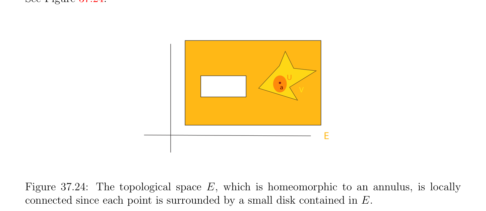
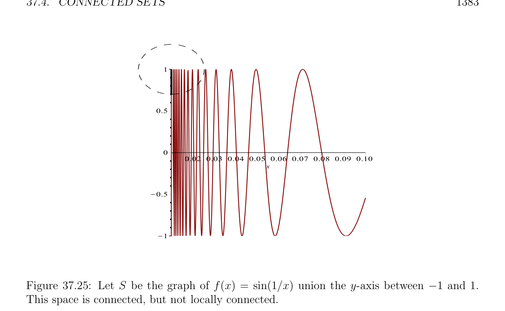
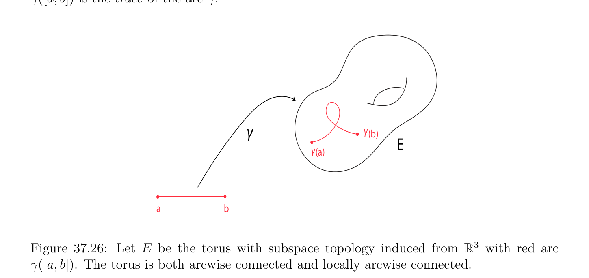

# Connected Sets

<!-- PAGE 1377 -->
and
$$lim f(x) = f(a_{+})$$
$$x\to a,x\in A\cap (a, +\infty )$$
both exist, and either $f(a_{-}) \neq$  f(a), or $f(a_{+}) \neq$  f(a). Note that it is possible that $f(a_{-}) = f(a_{+})$, but $f$ is still discontinuous at a if this common value differs from f(a). Functions defined on a nonempty subset $of\mathbb{R}$, and that are continuous, except for some points of discontinuity of the first kind, play an important role in analysis. We now turn to connectivity properties of topological spaces.

## 37.4 Connected Sets

Connectivity properties of topological spaces play a very important role in understanding the topology of surfaces. This section gathers the facts needed to have a good understanding of the classification theorem for compact surfaces (with boundary). The main references are Ahlfors and Sario $[2]$ and Massey $[125, 126]$. For general background on topology, geometry, and algebraic topology, we also highly recommend Bredon $[30]$ and Fulton $[68]$.

> **Definition 37.21.** A topological space $(E,\mathcal{O})$ is connected if the only subsets of $E$ that are both open and closed are the empty set and $E$ itself. Equivalently, $(E,\mathcal{O})$ is connected if $E$ cannot be written as the union $E = U \cup V$ of two disjoint nonempty open sets $U, V$ , or if $E$ cannot be written as the union $E = U \cup V$ of two disjoint nonempty closed sets. A subset, $S \subseteq E$, is connected if it is connected in the subspace topology on $S$ induced by $(E,\mathcal{O})$. See Figure 37.22. A connected open set is called a region and a closed set is a closed region if its interior is a connected (open) set. The definition of connectivity is meant to capture the fact that a connected space $S$ is “one piece.” Given the metric space $(\mathbb{R}^{n}, \|\|_{2})$, the quintessential examples of connected spaces are $B_{0}(a, \rho$ ) and B(a, $\rho$ ). In particular, the following standard proposition characterizing the connected subsets of $\mathbb{R}$ can be found in most topology texts (for example, Munkres $[135]$, Schwartz $[156])$. For the sake of completeness, we give a proof.

> **Proposition 37.16.** A subset of the real line, $\mathbb{R}$, is connected iff it is an interval, i.e., of the form [a, $b]$, (a, $b]$, where $a = -\infty$ is possible, [a, $b)$, where $b = +\infty$ is possible, or (a, $b)$, where $a = -\infty$ or $b = +\infty$ is possible.

*Proof.* Assume that $A$ is a connected nonempty subset of $\mathbb{R}$. The cases where $A = \emptyset$ or $A$ consists of a single point are trivial. Otherwise, we show that whenever a, $b \in A$, a $< b$, then the entire interval [a, $b]$ is a subset of $A$. Indeed, if this was not the case, there would be some $c \in$ (a, $b)$ such that $c \in / A$, and then we could write $A = ((-\infty , c)\cap A)\cup ((c, +\infty )\cap A)$, where $(-\infty , c) \cap A$ and $(c, +\infty$ ) $\cap A$ are nonempty and disjoint open subsets of $A$, contradicting the fact that $A$ is connected. It follows easily that $A$ must be an interval.

<!-- PAGE 1378 -->
$$V$$
$$S$$
$$U$$
$$(i.)$$
$$S$$
$$(ii.)$$
$$\mathbb{R}^{2}$$

**Figure 37.22:** Figure $(i)$ shows that the union of two disjoint disks in is a disconnected set since each circle can be separated by open half regions. Figure (ii) is an example of a
$$\mathbb{R}^{2}$$
connected subset of since the two disks can not separated by open sets. Conversely, we show that an interval, I, must be connected. Let $A$ be any nonempty subset of I which is both open and closed in I. We show that $I = A$. Fix any $x \in A$ and consider the set, $R_{x}$, of all $y$ such that $[x, y] \subseteq A$. If the set $R_{x}$ is unbounded, then $R_{x} = [x, +\infty$ ). Otherwise, if this set is bounded, let $b$ be its least upper bound. We claim that $b$ is the right boundary of the interval $I$. Because $A$ is closed in I, unless I is open on the right and $b$ is its right boundary, we must have $b \in A$. In the first case, $A \cap [x, b) =$ I $\cap [x, b) = [x, b)$. In the second case, because $A$ is also open in I, unless $b$ is the right boundary of the interval $I$ (closed on the right), there is some open set $(b$ - $\eta , b + \eta$ ) contained in $A$, which implies that $[x, b + \eta /2] \subseteq A$, contradicting the fact that $b$ is the least upper bound of the set $R_{x}$. Thus, $b$ must be the right boundary of the interval $I$ (closed on the right). A similar argument applies to the set, $L_{y}$, of all $x$ such that $[x, y] \subseteq A$ and either $L_{y}$ is unbounded, or its greatest lower bound a is the left boundary of I (open or closed on the left). In all cases, we showed that $A =$ I, and the interval must be connected. Intuitively, if a space is not connected, it is possible to define a continuous function which is constant on disjoint “connected components” and which takes possibly distinct values on

<!-- PAGE 1379 -->
disjoint components. This can be stated in terms of the concept of a locally constant function.

> **Definition 37.22.** Given two topological spaces $X, Y$ , a function $f$ : $X \to Y$ is locally constant if for every $x \in X$, there is an open set $U \subseteq X$ such that $x \in U$ and $f$ is constant on $U$. We claim that a locally constant function is continuous. In fact, we will prove that $f^{-1} (V$ ) is open for every subset, $V \subseteq Y$ (not just for an open set $V$ ). It is enough to show that $f^{-1} (y)$ is open for every $y \in Y$ , since for every subset $V \subseteq Y$ ,
$$f^{-1} (V ) = \bigcup_{y\in V}  f^{-1} (y),$$
and open sets are closed under arbitrary unions. However, either $f^{-1} (y) = \emptyset$ if $y \in Y$ -f(X) or $f$ is constant on $U = f^{-1} (y)$ if $y \in$ f(X) (with value $y)$, and since $f$ is locally constant, for every $x \in U$, there is some open set, $W \subseteq X$, such that $x \in W$ and $f$ is constant on $W$, which implies that f(w) $= y$ for all $w \in W$ and thus, that $W \subseteq U$, showing that $U$ is a union of open sets and thus, is open. The following proposition shows that a space is connected iff every locally constant function is constant:

> **Proposition 37.17.** A topological space is connected iff every locally constant function is constant. See Figure 37.23.
$$f$$
$$f$$
$$\overline{0}\overline{1}$$

**Figure 37.23:** An example of a locally constant, but not constant, real-valued function $f$ over the disconnected set consisting of the disjoint union of the two solid balls. On the pink ball, $f$ is $0$, while on the purple ball, $f$ is $1$.

*Proof.* First, assume that $X$ is connected. Let $f$ : $X \to Y$ be a locally constant function to some space $Y$ and assume that $f$ is not constant. Pick any $y \in$ f(X). Since $f$ is not constant, $U_{1} = f^{-1}$ (y)̸ $= X$, and of course, $U_{1}$ ̸ $= \emptyset$ . We proved just before Proposition 37.17 that $f^{-1} (V$ ) is open for every subset $V \subseteq Y$ , and thus $U_{1} = f^{-1} (y) = f^{-1} ({y})$ and

<!-- PAGE 1380 -->
$U_{2} = f^{-1} (Y -{y})$ are both open, nonempty, and clearly $X = U_{1} \cup U_{2}$ and $U_{1}$ and $U_{2}$ are disjoint. This contradicts the fact that $X$ is connected and $f$ must be constant. Assume that every locally constant function $f$ : $X \to Y$ is constant. If $X$ is not connected, we can write $X = U_{1} \cup U_{2}$, where both $U_{1}, U_{2}$ are open, disjoint, and nonempty. We can define the function, $f$ : $X \to \mathbb{R}$, such that f(x) $= 1$ on $U_{1}$ and f(x) $= 0$ on $U_{2}$. Since $U_{1}$ and $U_{2}$ are open, the function $f$ is locally constant, and yet not constant, a contradiction.
$$\mathbb{R}^{n}$$
A characterization on the connected subsets of is harder and requires the notion of arcwise connectedness. One of the most important properties of connected sets is that they are preserved by continuous maps.

> **Proposition 37.18.** Given any continuous map, $f$ : $E \to F$, if $A \subseteq E$ is connected, then f(A) is connected.

*Proof.* If f(A) is not connected, then there exist some nonempty open sets, $U, V$ , in $F$ such that f(A) $\cap U$ and f(A) $\cap V$ are nonempty and disjoint, and
$$f(A) = (f(A) \cap U) \cup (f(A) \cap V ).$$
Then, $f^{-1} (U)$ and $f^{-1} (V$ ) are nonempty and open since $f$ is continuous and
$$A = (A \cap f^{-1} (U)) \cup (A \cap f^{-1} (V )),$$
with $A \cap f^{-1} (U)$ and $A \cap f^{-1} (V$ ) nonempty, disjoint, and open in $A$, contradicting the fact that $A$ is connected. An important corollary of Proposition 37.18 is that for every continuous function, $f$ : $E \to \mathbb{R}$, where $E$ is a connected space, f(E) is an interval. Indeed, this follows from Proposition 37.16. Thus, if $f$ takes the values a and $b$ where a $< b$, then $f$ takes all values $c \in$ [a, $b]$. This is a very important property known as the intermediate value theorem. Even if a topological space is not connected, it turns out that it is the disjoint union of maximal connected subsets and these connected components are closed in $E$. In order to obtain this result, we need a few lemmas.

> **Lemma 37.19.** Given a topological space, $E$, for any family, $(A_{i})_{i\in I}$, of (nonempty) con-
$$nected subsets of E, if A_{i} \cap A_{j} ̸= \emptyset for all i, j \in I, then the union, A = \bigcup_{i}  \in I A_{i}, of the$$
family, $(A_{i})_{i\in I}$, is also connected.
$$Proof. Assume that \bigcup_{i}  A_{i} is not connected. There exists two nonempty open subsets, U$$
and $V$ , of $E$ such $that^{\in I} A \cap U$ and $A \cap V$ are disjoint and nonempty and such that
$$A = (A \cap U) \cup (A \cap V ).$$
Now, for every $i \in$ I, we can write
$$A_{i} = (A_{i} \cap U) \cup (A_{i} \cap V ),$$

<!-- PAGE 1381 -->
where $A_{i} \cap U$ and $A_{i} \cap V$ are disjoint, since $A_{i} \subseteq A$ and $A \cap U$ and $A \cap V$ are disjoint. Since $A_{i}$ is connected, either $A_{i} \cap U = \emptyset$ or $A_{i} \cap V = \emptyset$ . This implies that either $A_{i} \subseteq A \cap U$ or $A_{i} \subseteq A \cap V$ . However, by assumption, $A_{i} \cap A_{j}$ ̸ $= \emptyset$ , for all $i, j \in$ I, and thus, either both $A_{i} \subseteq A \cap U$ and $A_{j} \subseteq A \cap U$, or both $A_{i} \subseteq A \cap V$ and $A_{j} \subseteq A \cap V$ , since $A \cap U$ and $A \cap V$ are disjoint. Thus, we conclude that either $A_{i} \subseteq A \cap U$ for all $i \in$ I, or $A_{i} \subseteq A \cap V$ for all $i \in$ I. But this proves that either
$$A = \bigcup_{i\in I}  A_{i} \subseteq A \cap U,$$
or
$$A = \bigcup_{i\in I}  A_{i} \subseteq A \cap V,$$
contradicting the fact that both $A \cap U$ and $A \cap V$ are disjoint and nonempty. Thus, $A$ must be connected. In particular, the above lemma applies when the connected sets in a family $(A_{i})_{i\in I}$ have a point in common.

> **Lemma 37.20.** If $A$ is a connected subset of a topological space, $E$, then for every subset, $B$, such that $A \subseteq B \subseteq \overline{A}$, where $\overline{A}$ is the closure of $A$ in $E$, the set $B$ is connected.

*Proof.* If $B$ is not connected, then there are two nonempty open subsets, $U, V$ , of $E$ such that $B \cap U$ and $B \cap V$ are disjoint and nonempty, and
$$B = (B \cap U) \cup (B \cap V ).$$
Since $A \subseteq B$, the above implies that
$$A = (A \cap U) \cup (A \cap V ),$$
and since $A$ is connected, either $A\cap U = \emptyset$ , or $A\cap V = \emptyset$ . Without loss of generality, assume that $A \cap V = \emptyset$ , which implies that $A \subseteq A \cap U \subseteq B \cap U$. However, $B \cap U$ is closed in the subspace topology for $B$ and since $B \subseteq \overline{A}$ and $\overline{A}$ is closed in $E$, the closure of $A$ in $B$ w.r.t. the subspace topology of $B$ is clearly $B \cap \overline{A} = B$, which implies that $B \subseteq B \cap U$ (since the closure is the smallest closed set containing the given set). Thus, $B \cap V = \emptyset$ , a contradiction. In particular, Lemma 37.20 shows that if $A$ is a connected subset, then its closure, $\overline{A}$, is also connected. We are now ready to introduce the connected components of a space.

> **Definition 37.23.** Given a topological space, $(E,\mathcal{O})$, we say that two points, a, $b \in E$, are connected if there is some connected subset, $A$, of $E$ such that $a \in A$ and $b \in A$.

<!-- PAGE 1382 -->
It is immediately verified that the relation “a and $b$ are connected in E” is an equivalence relation. Only transitivity is not obvious, but it follows immediately as a special case of

> **Lemma 37.19.** Thus, the above equivalence relation defines a partition of $E$ into nonempty disjoint connected components. The following proposition is easily proved using Lemma 37.19 and Lemma 37.20:

> **Proposition 37.21.** Given any topological space, $E$, for any $a \in E$, the connected component containing a is the largest connected set containing a. The connected components of $E$ are closed. The notion of a locally connected space is also useful.

> **Definition 37.24.** A topological space, $(E,\mathcal{O})$, is locally connected if for every $a \in E$, for every neighborhood, $V$ , of a, there is a connected neighborhood, $U$, of a such that $U \subseteq V$ . See Figure 37.24.
$$U$$
$$aV$$
$$E$$

**Figure 37.24:** The topological space $E$, which is homeomorphic to an annulus, is locally connected since each point is surrounded by a small disk contained in $E$. As we shall see in a moment, it would be equivalent to require that $E$ has a basis of connected open sets.  There are connected spaces that are not locally connected and there are locally connected spaces that are not connected. The two properties are independent. For example, the
$$\mathbb{R}^{2}$$
subspace of $S = {(x, sin(1/x))$, | $x > 0} \cup {(0, y)$ | $-1 \le y \le 1}$ is connected but not locally connected. See Figure 37.25. The subspace $S$ of $\mathbb{R}$ consisting $[0, 1] \cup [2, 3]$ is locally connected but not connected.

> **Proposition 37.22.** A topological space, $E$, is locally connected iff for every open subset, $A$, of $E$, the connected components of $A$ are open.

<!-- PAGE 1383 -->

**Figure 37.25:** Let $S$ be the graph of f(x) $= sin(1/x)$ union the y-axis between $-1$ and $1$. This space is connected, but not locally connected.

*Proof.* Assume that $E$ is locally connected. Let $A$ be any open subset of $E$ and let $C$ be one of the connected components of $A$. For any $a \in C \subseteq A$, there is some connected neighborhood, $U$, of a such that $U \subseteq A$ and since $C$ is a connected component of $A$ containing a, we must have $U \subseteq C$. This shows that for every $a \in C$, there is some open subset containing a contained in $C$, so $C$ is open. Conversely, assume that for every open subset, $A$, of $E$, the connected components of $A$ are open. Then, for every $a \in E$ and every neighborhood, $U$, of a, since $U$ contains some open set $A$ containing a, the $interior,^{\circ}U$, of $U$ is an open set containing a and its connected components are open. In particular, the connected component $C$ containing a is a connected open set containing a and contained in $U$. Proposition 37.22 shows that in a locally connected space, the connected open sets form a
$$\mathbb{R}^{n}$$
basis for the topology. It is easily seen that is locally connected. Another very important property of surfaces and more generally, manifolds, is to be arcwise connected. The intuition is that any two points can be joined by a continuous arc of curve. This is formalized as follows.

> **Definition 37.25.** Given a topological space, $(E,\mathcal{O})$, an arc (or path) is a continuous map, $\gamma$  : [a, $b] \to E$, where [a, $b]$ is a closed interval of the real line, $\mathbb{R}$. The point $\gamma$ (a) is the initial point of the arc and the point $\gamma (b)$ is the terminal point of the arc. We say that $\gamma$  is an arc

<!-- PAGE 1384 -->
joining $\gamma$ (a) and $\gamma (b)$. See Figure 37.26. An arc is a closed curve if $\gamma (a) = \gamma (b)$. The set $\gamma$ ([a, $b])$ is the trace of the arc $\gamma$ .
$$\gamma \gamma$$
$$(b)$$
$$E$$
$$\gamma (a)$$
$$ab$$
$$\mathbb{R}^{3}$$

**Figure 37.26:** Let $E$ be the torus with subspace topology induced from with red arc $\gamma$ ([a, $b])$. The torus is both arcwise connected and locally arcwise connected. Typically, $a = 0$ and $b = 1$.  One should not confuse an arc, $\gamma$  : [a, $b] \to E$, with its trace. For example, $\gamma$  could be constant, and thus, its trace reduced to a single point. An arc is a Jordan arc if $\gamma$  is a homeomorphism onto its trace. An arc, $\gamma$  : [a, $b] \to E$, is a Jordan curve if $\gamma (a) = \gamma (b)$ and $\gamma$  is injective on [a, $b)$. Since [a, $b]$ is connected, by Proposition 37.18, the trace $\gamma$ ([a, $b])$ of an arc is a connected subset of $E$. Given two arcs $\gamma$  : $[0, 1] \to E$ and $\delta$ : $[0, 1] \to E$ such that $\gamma (1) = \delta (0)$, we can form a new arc defined as follows:

> **Definition 37.26.** Given two arcs, $\gamma$  : $[0, 1] \to E$ and $\delta$ : $[0, 1] \to E$, such that $\gamma (1) = \delta (0)$, we can form their composition (or product), $\gamma \delta$ ,, defined such that
$$\gamma (2t)if 0 \le t \le 1/2;$$
$$\gamma \delta (t) =$$
$$\delta (2t -1)if 1/2 \le t \le 1.$$
The inverse, $\gamma^{-1}$ , of the arc, $\gamma$ , is the arc defined such that $\gamma^{-1} (t) = \gamma$ (1-t), for all $t \in [0, 1]$. It is trivially verified that Definition 37.26 yields continuous arcs.

> **Definition 37.27.** A topological space, $E$, is arcwise connected if for any two points, a, $b \in E$, there is an arc, $\gamma$  : $[0, 1] \to E$, joining a and $b$, i.e., such that $\gamma (0) = a$ and $\gamma (1) = b$. A topological space, $E$, is locally arcwise connected if for every $a \in E$, for every neighborhood, $V$ , of a, there is an arcwise connected neighborhood, $U$, of a such that $U \subseteq V$ . See Figure 37.26.

<!-- PAGE 1385 -->
$$\mathbb{R}^{n}$$
The space is locally arcwise connected, since for any open ball, any two points in this ball are joined by a line segment. Manifolds and surfaces are also locally arcwise connected. Proposition 37.18 also applies to arcwise connectedness (this is a simple exercise). The following theorem is crucial to the theory of manifolds and surfaces:

> **Theorem 37.23.** If a topological space, $E$, is arcwise connected, then it is connected. If a topological space, $E$, is connected and locally arcwise connected, then $E$ is arcwise connected.

*Proof.* First, assume that $E$ is arcwise connected. Pick any point, a, in $E$. Since $E$ is arcwise connected, for every $b \in E$, there is a path, $\gamma$  : $[0, 1] \to E$, from a to $b$ and so,
$$E = \bigcup_{b\in E}^{b}  \gamma_{b} ([0, 1])$$
a union of connected subsets all containing a. By Lemma 37.19, $E$ is connected. Now assume that $E$ is connected and locally arcwise connected. For any point $a \in E$, let $F_{a}$ be the set of all points, $b$, such that there is an arc, $\gamma_{b}$  : $[0, 1] \to E$, from a to $b$. Clearly, $F_{a}$ contains a. We show that $F_{a}$ is both open and closed. For any $b \in F_{a}$, since $E$ is locally arcwise connected, there is an arcwise connected neighborhood $U$ containing $b$ (because $E$ is a neighborhood of $b)$. Thus, $b$ can be joined to every point $c \in U$ by an arc, and since by the definition of $F_{a}$, there is an arc from a to $b$, the composition of these two arcs yields an arc from a to $c$, which shows that $c \in F_{a}$. But then $U \subseteq F_{a}$ and thus, $F_{a}$ is open. See Figure 37.27 $(i.)$. Now assume that $b$ is in the complement of $F_{a}$. As in the previous case, there is some arcwise connected neighborhood $U$ containing $b$. Thus, every point $c \in U$ can be joined to $b$ by an arc. If there was an arc joining a to $c$, we would get an arc from a to $b$, contradicting the fact that $b$ is in the complement of $F_{a}$. Thus, every point $c \in U$ is in the complement of $F_{a}$, which shows that $U$ is contained in the complement of $F_{a}$, and thus, that the the complement of $F_{a}$ is open. See Figure 37.27 (ii.). Consequently, we have shown that $F_{a}$ is both open and closed and since it is nonempty, we must have $E = F_{a}$, which shows that $E$ is arcwise connected. If $E$ is locally arcwise connected, the above argument shows that the connected components of $E$ are arcwise connected.  It is not true that a connected space is arcwise connected. For example, the space consisting of the graph of the function
$$f(x) = \sin(1/x),$$
where $x > 0$, together with the portion of the y-axis, for which $-1 \le y \le 1$, is connected, but not arcwise connected. See Figure 37.25. A trivial modification of the proof of Theorem 37.23 shows that in a normed vector space, $E$, a connected open set is arcwise connected by polygonal lines (i.e., arcs consisting of line segments). This is because in every open ball, any two points are connected by a line
