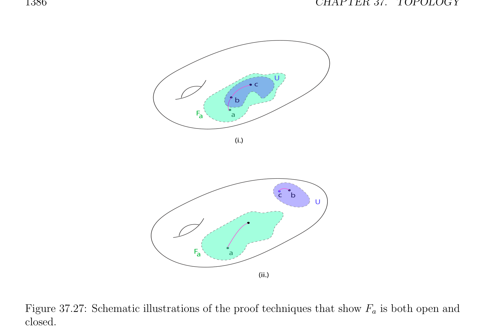
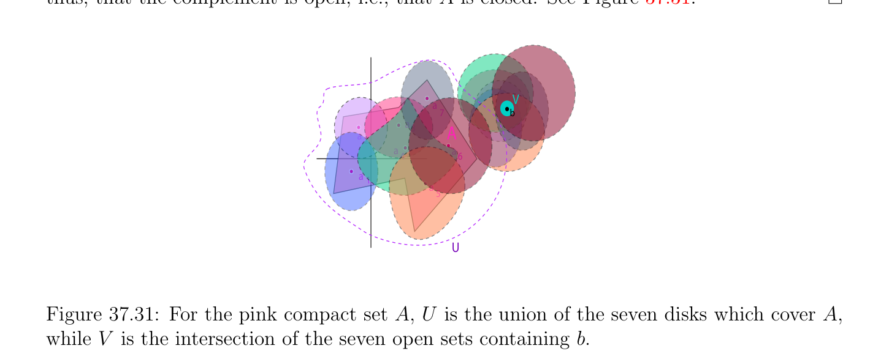
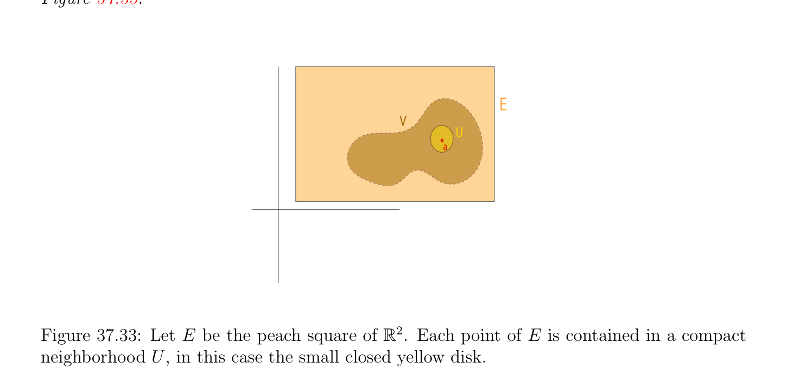
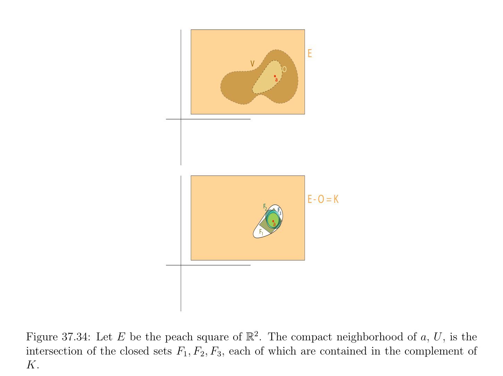

# Compact Sets and Locally Compact Spaces

<!-- PAGE 1386 -->
$$U$$
$$c$$
$$b$$
$$Faa$$
$$(i.)$$
$$cb$$
$$U$$
$$Faa$$
$$(ii.)$$

**Figure 37.27:** Schematic illustrations of the proof techniques that show $F_{a}$ is both open and closed. segment. Furthermore, if $E$ is finite dimensional, these polygonal lines can be forced to be parallel to basis vectors. We now consider compactness.

## 37.5 Compact Sets and Locally Compact Spaces

The property of compactness is very important in topology and analysis. We provide a quick review geared towards the study of manifolds, and for details, we refer the reader to Munkres $[135]$, Schwartz $[156]$. In this section we will need to assume that the topological spaces are Hausdorffspaces. This is not a luxury, as many of the results are false otherwise. We begin this section by providing the definition of compactness and describing a collection of compact spaces in $\mathbb{R}$. There are various equivalent ways of defining compactness. For our purposes, the most convenient way involves the notion of open cover.

> **Definition 37.28.** Given a topological space $E$, for any subset $A$ of $E$, an open cover $(U_{i})_{i\in I}$
$$of A is a family of open subsets of E such that A \subseteq \bigcup_{i}  U_{i}. An open subcover of an open$$
cover $(U_{i})_{i\in I}$ of $A$ is any subfamily $(U_{j})_{j\in J}$ which is $an^{\in I}$ open cover of $A$, with $J \subseteq$ I. An

<!-- PAGE 1387 -->
open cover $(U_{i})_{i\in I}$ of $A$ is finite if I is finite. See Figure 37.28. The topological space $E$ is compact if it is Hausdorffand for every open cover $(U_{i})_{i\in I}$ of $E$, there is a finite open subcover $(U_{j})_{j\in J}$ of $E$. Given any subset $A$ of $E$, we say that $A$ is compact if it is compact with respect to the subspace topology. We say that $A$ is relatively compact if its closure $\overline{A}$ is compact.
$$U$$
$$U2$$
$$1$$

**Figure 37.28:** An open cover of $S^{2}$ using two open sets induced by the Euclidean topology of $\mathbb{R}^{3}$. It is immediately verified that a subset $A$ of $E$ is compact in the subspace topology relative to $A$ iff for every open cover $(U_{i})_{i\in I}$ of $A$ by open subsets of $E$, there is a finite open subcover $(U_{j})_{j\in J}$ of $A$. The property that every open cover contains a finite open subcover is often called the Heine-Borel-Lebesgue property. By considering complements, a Hausdorff
$$space is compact iff for every family (F_{i})_{i\in I} of closed sets, if \bigcap_{i}  \in I F_{i} = \emptyset , then \bigcap_{j}  \in J F_{j} = \emptyset$$
for some finite subset $J$ of I.  Definition 37.28 requires that a compact space be Hausdorff. There are books in which a compact space is not necessarily required to be Hausdorff. Following Schwartz, we prefer calling such a space quasi-compact. Another equivalent and useful characterization can be given in terms of families having the finite intersection property.
$$Definition 37.29. A family (F_{i})_{i\in I} of sets has the finite intersection property if \bigcap_{j}  \in J F_{j} \neq  \emptyset$$
for every finite subset $J$ of I.

<!-- PAGE 1388 -->

> **Proposition 37.24.** A topological Hausdorff space $E$ is compact iff for every family $(F_{i})_{i\in I}$
$$of closed sets having the finite intersection property, then \bigcap_{i}  \in I F_{i} \neq  \emptyset .$$

*Proof.* If $E$ is compact and $(F_{i})_{i\in I}$ is a family of closed sets having the finite intersection
$$property, then \bigcap_{i}  F_{i} cannot be empty, since otherwise we would have \bigcap  j\in J F_{j} = \emptyset for some$$
finite subset $J of^{\in I}$ I, a contradiction. The converse is equally obvious. Another useful consequence of compactness is as follows. For any family $(F_{i})_{i\in I}$ of closed
$$sets such that F_{i+1} \subseteq F_{i} for all i \in I, if \bigcap_{i}  \in  F_{i} = \emptyset , then F_{i} = \emptyset for some i \in I. Indeed,$$
$$there must be some finite subset J of I such^{I} that \bigcap_{jj}  F_{j} = \emptyset , and since F_{i+1} \subseteq F_{i} for  all\mathbb{R}$$
$i \in$ I, we must have $F_{j} = \emptyset$ for the smallest $F_{j}$ in $(F^{\in J})_{j\in J}$. Using this fact, we note that is not compact. Indeed, the family of closed sets, $([n, +\infty ))_{n\ge0}$, is decreasing and has an empty intersection. It is immediately verified that every finite union of compact subsets is compact. Similarly,
$$\frac{every}{A \cup B} \frac{finite}{A} \frac{union}{B} of relatively compact subsets is relatively compact (use the fact that$$
$=  \cap$ ). Given a metric space, if we define a bounded subset to be a subset that can be enclosed in some closed ball (of finite radius), then any nonbounded subset of a metric space is not compact. However, a closed interval [a, $b]$ of the real line is compact.

> **Proposition 37.25.** Every closed interval, [a, $b]$, of the real line is compact.

*Proof.* We proceed by contradiction. Let $(U_{i})_{i\in I}$ be any open cover of [a, $b]$ and assume that there is no finite open subcover. Let $c = (a + b)/2$. If both [a, $c]$ and $[c, b]$ had some finite open subcover, so would [a, $b]$, and thus, either [a, $c]$ does not have any finite subcover, or $[c, b]$ does not have any finite open subcover. Let $[a_{1}, b_{1}]$ be such a bad subinterval. The same argument applies and we split $[a_{1}, b_{1}]$ into two equal subintervals, one of which must be bad. Thus, having defined $[a_{n}, b_{n}]$ of length $(b$ - $a)/2^{n}$ as an interval having no finite open subcover, splitting $[a_{n}, b_{n}]$ into two equal intervals, we know that at least one of the two has no finite open subcover and we denote such a bad interval by $[a_{n+1}, b_{n+1}]$. See Figure 37.29. The sequence $(a_{n})$ is nondecreasing and bounded from above by $b$, and thus, by a fundamental property of the real line, it converges to its least upper bound, $\alpha$ . Similarly, the sequence $(b_{n})$ is nonincreasing and bounded from below by a and thus, it converges to its greatest lowest bound, $\beta$ . Since $[a_{n}, b_{n}]$ has length $(b-a)/2^{n}$, we must have $\alpha  = \beta$ . However, the common limit $\alpha  = \beta$  of the sequences $(a_{n})$ and $(b_{n})$ must belong to some open set, $U_{i}$, of the open cover and since $U_{i}$ is open, it must contain some interval $[c, d]$ containing $\alpha$ . Then, because $\alpha$  is the common limit of the sequences $(a_{n})$ and $(b_{n})$, there is some $N$ such that the intervals $[a_{n}, b_{n}]$ are all contained in the interval $[c, d]$ for all $n \ge N$, which contradicts the fact that none of the intervals $[a_{n}, b_{n}]$ has a finite open subcover. Thus, [a, $b]$ is indeed compact.

<!-- PAGE 1389 -->
$$\overline{a}\overline{c}\overline{b}$$
$$\overline{a}\overline{c}\overline{b}\overline{b}$$
$$111$$
$$\overline{a}\overline{c}\overline{b}\overline{b}\overline{b}$$
$$2221$$
$$\overline{a}\overline{a}\overline{c}\overline{b}\overline{b}\overline{b}$$
$$23331$$
$$\overline{a}\overline{a}\overline{b}\overline{b}\overline{b}\overline{b}$$
$$24431$$

**Figure 37.29:** The first four stages of the nested interval construction utilized in the proof of Proposition 37.25. The argument of Proposition 37.25 can be adapted to show that $in\mathbb{R}^{m}$, every closed set, $[a_{1}, b_{1}] \times  \cdots  \times  [a_{m}, b_{m}]$, is compact. At every stage, we need to divide into $2^{m}$ subpieces instead of $2$. We next discuss some important properties of compact spaces. We begin with two separations axioms which only hold for Hausdorffspaces:

> **Proposition 37.26.** Given a topological Hausdorff space, $E$, for every compact subset, $A$, and every point, $b$, not in $A$, there exist disjoint open sets, $U$ and $V$ , such that $A \subseteq U$ and $b \in V$ . See Figure 37.30. As a consequence, every compact subset is closed.
$$b V$$
$$A$$
$$U$$

**Figure 37.30:** The compact set of $\mathbb{R}^{2}, A$, is separated by any point in its complement.

<!-- PAGE 1390 -->

*Proof.* Since $E$ is Hausdorff, for every $a \in A$, there are some disjoint open sets, $U_{a}$ and $V_{a}$, containing a and $b$ respectively. Thus, the family, $(U_{a})_{a\in A}$, forms an open cover of $A$. Since
$$A is compact there is a finite open subcover, (U_{j})_{j\in J}, of A, where J \subseteq A, and then \bigcup_{j}  \in J U_{j}$$
$$is an open set containing A disjoint from the open set \bigcap_{j}  V_{j} containing b. This shows that$$
every point, $b$, in the complement of $A$ belongs to $some^{\in J}$ open set in this complement and thus, that the complement is open, i.e., that $A$ is closed. See Figure 37.31.
$$V$$
$$a$$
$$7b$$
$$a3A$$
$$a2$$
$$aa$$
$$\overline{4} 6$$
$$a 1$$
$$a 5$$
$$U$$

**Figure 37.31:** For the pink compact set $A, U$ is the union of the seven disks which cover $A$, while $V$ is the intersection of the seven open sets containing $b$. Actually, the proof of Proposition 37.26 can be used to show the following useful property:

> **Proposition 37.27.** Given a topological Hausdorff space $E$, for every pair of compact disjoint subsets $A$ and $B$, there exist disjoint open sets $U$ and $V$ , such that $A \subseteq U$ and $B \subseteq V$ .

*Proof.* We repeat the argument of Proposition 37.26 with $B$ playing the role of $b$ and use Proposition 37.26 to find disjoint open sets $U_{a}$ containing $a \in A$, and $V_{a}$ containing $B$. The following proposition shows that in a compact topological space, every closed set is compact:

> **Proposition 37.28.** Given a compact topological space, $E$, every closed set is compact.

*Proof.* Since $A$ is closed, $E -A$ is open and from any open cover, $(U_{i})_{i\in I}$, of $A$, we can form an open cover of $E$ by adding $E$ - $A$ to $(U_{i})_{i\in I}$ and, since $E$ is compact, a finite subcover, $(U_{j})_{j\in J} \cup {E$ - $A}$, of $E$ can be extracted such that $(U_{j})_{j\in J}$ is a finite subcover of $A$. See Figure 37.32.
Remark: Proposition 37.28 also holds for quasi-compact spaces, i.e., the Hausdorff separation property is not needed. Putting Proposition 37.27 and Proposition 37.28 together, we note that if $X$ is compact, then for every pair of disjoint closed sets $A$ and $B$, there exist disjoint open sets $U$ and $V$ such that $A \subseteq U$ and $B \subseteq V$ .

<!-- PAGE 1391 -->
$$E$$
$$V$$
$$O$$
$$aa$$
$$E- O = K$$
$$F$$
$$2F$$
$$3$$
$$aa$$
$$F1$$

**Figure 37.32:** An illustration of the proof of Proposition 37.28. Both $E$ and $A$ are closed squares in $\mathbb{R}^{2}$. Note that an open cover of $A$, namely the green circles, when combined with the yellow square annulus $E$ - $A$ covers all of the yellow square $E$.

> **Definition 37.30.** A topological space $E$ is normal if every one-point set is closed, and for every pair of disjoint closed sets $A$ and $B$, there exist disjoint open sets $U$ and $V$ such that $A \subseteq U$ and $B \subseteq V$ . A topological space $E$ is regular if every one-point set is closed, and for every point $a \in E$ and every closed subset $B$ of $E$, if $a \in / B$, then there exist disjoint open sets $U$ and $V$ such that $a \in U$ and $B \subseteq V$ . It is clear that a normal space is regular, and a regular space is Hausdorff. There are examples of Hausdorffspaces that are not regular, and of regular spaces that are not normal. We just observed that a compact space is normal. An important property of metrizable spaces is that they are normal.

> **Proposition 37.29.** Every metrizable space $E$ is normal.

*Proof.* Assume the topology of $E$ is given by the metric $d$. Since $B$ is closed and $A \cap B = \emptyset$ , for every $a \in A$ since $a \in / \overline{B} = B$, there is some open ball $B_{0}(a, \epsilon_{a}$ ) of radius $\epsilon_{a}  > 0$ such that $B_{0}(a, \epsilon_{a}$ ) $\cap B = \emptyset$ . Similarly, since $A$ is closed and $A \cap B = \emptyset$ , for every $b \in B$ there is

<!-- PAGE 1392 -->
some open ball $B_{0}(b, \epsilon_{b}$ ) of radius $\epsilon_{b}  > 0$ such that $B_{0}(b, \epsilon_{b}$ ) $\cap A = \emptyset$ . Let
$$U = \bigcup_{a\in A}  B_{0}(a, \epsilon_{a} /2),V = \bigcup_{b\in B}  B_{0}(b, \epsilon_{b} /2).$$
Then $A$ and $B$ are open sets such that $A \subseteq U$ and $B \subseteq V$ , and we claim that $U \cap V = \emptyset$ . If not, then there is some $z \in U \cap V$ , which implies that for some $a \in A$ and some $b \in B$, we have
$$z \in B_{0}(a, \epsilon_{a} /2) \cap B_{0}(b, \epsilon_{b} /2).$$
It follows that
$$d(a, b) \le d(a, z) + d(z, b) < (\epsilon_{a}  + \epsilon_{b} )/2.$$
If $\epsilon_{a}  \le \epsilon_{b}$ ,then d(a, $b) < \epsilon_{b}$ , so $a \in B_{0}(b, \epsilon_{b}$ ), contradicting the fact that $B_{0}(b, \epsilon_{b}$ ) $\cap A = \emptyset$ . If $\epsilon_{b}  \le \epsilon_{a}$ ,then d(a, $b) < \epsilon_{a}$ , so $b \in B_{0}(a, \epsilon_{a}$ ), contradicting the fact that $B_{0}(a, \epsilon_{a}$ ) $\cap B = \emptyset$ . Compact spaces also have the following property.

> **Proposition 37.30.** Given a compact topological space, $E$, for every $a \in E$, for every neighborhood, $V$ , of a, there exists a compact neighborhood, $U$, of a such that $U \subseteq V$ . See Figure 37.33.
$$E$$
$$V$$
$$U$$
$$a$$

**Figure 37.33:** Let $E$ be the peach square of $\mathbb{R}^{2}$. Each point of $E$ is contained in a compact neighborhood $U$, in this case the small closed yellow disk.

*Proof.* Since $V$ is a neighborhood of a, there is some open subset, $O$, of $V$ containing a. Then the complement, $K = E -O$, of $O$ is closed and since $E$ is compact, by Proposition 37.28, $K$ is compact. Now, if we consider the family of all closed sets of the form, $K\cap F$, where $F$ is any closed neighborhood of a, since $a \in / K$, this family has an empty intersection and thus, there is a finite number of closed neighborhood, $F_{1}, \dots  , F_{n}$, of a, such that $K \cap F_{1} \cap \cdots  \cap F_{n} = \emptyset$ .

<!-- PAGE 1393 -->
Then, $U = F_{1} \cap \cdots  \cap F_{n}$ is closed and hence by Proposition 37.28, a compact neigborhood of a contained in $O \subseteq V$ . See Figure 37.34.
$$E$$
$$V$$
$$O$$
$$aa$$
$$E- O = K$$
$$F$$
$$2F$$
$$3$$
$$aa$$
$$F1$$

**Figure 37.34:** Let $E$ be the peach square of $\mathbb{R}^{2}$. The compact neighborhood of a, $U$, is the intersection of the closed sets $F_{1}, F_{2}, F_{3}$, each of which are contained in the complement of $K$. It can be shown that in a normed vector space of finite dimension, a subset is compact
$$\mathbb{R}^{n}$$
iff it is closed and bounded. For the proof is simple.  In a normed vector space of infinite dimension, there are closed and bounded sets that are not compact! More could be said about compactness in metric spaces but we will only need the notion of Lebesgue number, which will be discussed a little later. Another crucial property of compactness is that it is preserved under continuity.

> **Proposition 37.31.** Let $E$ be a topological space and let $F$ be a topological Hausdorff space. For every compact subset, $A$, of $E$, for every continuous map, $f$ : $E \to F$, the subspace f(A) is compact.

<!-- PAGE 1394 -->

*Proof.* Let $(U_{i})_{i\in I}$ be an open cover of f(A). We claim that $(f^{-1} (U_{i}))_{i\in I}$ is an open cover of $A$, which is easily checked. Since $A$ is compact, there is a finite open subcover, $(f^{-1} (U_{j}))_{j\in J}$, of $A$, and thus, $(U_{j})_{j\in J}$ is an open subcover of f(A). As a corollary of Proposition 37.31, if $E$ is compact, $F$ is Hausdorff, and $f$ : $E \to F$ is continuous and bijective, then $f$ is a homeomorphism. Indeed, it is enough to show that $f^{-1}$ is continuous, which is equivalent to showing that $f$ maps closed sets to closed sets. However, closed sets are compact and Proposition 37.31 shows that compact sets are mapped to compact sets, which, by Proposition 37.26, are closed. Another important corollary of Proposition 37.31 is the following result.

> **Proposition 37.32.** If $E$ is a compact nonempty topological space and if $f$ : $E \to \mathbb{R}$ is a continuous function, then there are points a, $b \in E$ such that f(a) is the minimum of f(E) and f(b) is the maximum of f(E).

*Proof.* The set f(E) is a compact subset of $\mathbb{R}$ and thus, a closed and bounded set which contains its greatest lower bound and its least upper bound. The following property also holds.

> **Proposition 37.33.** Let $(E, d)$ be a metric space. For any nonempty subset $A$ of $E$, if $A$ is compact, then for every open subset $U$ such that $A \subseteq U$, there is some $r > 0$ such that $V_{r}(A) \subseteq U$.

*Proof.* The function $x \mapsto$ d(x, $E$ - $U)$ is continuous and d(x, $E$ - $U) > 0$ for $x \in A$ (since $A \subseteq U)$. By Proposition 37.32, there is some $a \in A$ such that
$$d(a, E -U) = \inf d(x, E -U).$$
$$x\in A$$
But d(a, $E$ - $U) = r > 0$, which implies that $V_{r}(A) \subseteq U$. Another useful notion is that of local compactness. Indeed manifolds and surfaces are locally compact.

> **Definition 37.31.** A topological space $E$ is locally compact if it is Hausdorffand for every $a \in E$, there is some compact neighborhood $K$ of a. See Figure 37.33. From Proposition 37.30, every compact space is locally compact but the converse is false. For example, $\mathbb{R}$ is locally compact but not compact. In fact it can be shown that a normed vector space of finite dimension is locally compact.

> **Proposition 37.34.** Given a locally compact topological space, $E$, for every $a \in E$, for every neighborhood, $N$, of a, there exists a compact neighborhood, $U$, of a, such that $U \subseteq N$.

<!-- PAGE 1395 -->

*Proof.* For any $a \in E$, there is some compact neighborhood, $V$ , of a. By Proposition 37.30, every neigborhood of a relative to $V$ contains some compact neighborhood $U$ of a relative to $V$ . But every neighborhood of a relative to $V$ is a neighborhood of a relative to $E$ and every neighborhood $N$ of a in $E$ yields a neighborhood, $V \cap N$, of a in $V$ and thus, for every neighborhood, $N$, of a, there exists a compact neighborhood, $U$, of a such that $U \subseteq N$. When $E$ is a metric space, the subsets $V_{r}(A)$ defined in Definition 37.6 have the following property.
$$Proposition 37.35. Let (E, d) be a metric space. If E is \frac{locally}{V_{r}(A)} compact, then for any$$
nonempty compact subset $A$ of $E$, there is some $r > 0$ such that  is compact.

*Proof.* Since $E$ is locally compact, for every $x \in A$, there is some compact subset $V_{x}$ whose $interior_{x}^{\circ}V$  contains $x$. The family of open $subsets_{x}^{\circ}V$  is an open cover $A$, and since $A$ is compact, it has a finite subcover ${_{x1}^{\circ}V , \dots  ,_{xn}^{\circ}V$ }. Then $U = V_{x1} \cup \cdots  \cup V_{xn}$ is compact (as a finite union of compact subsets), and it contains an open subset containing $A$ (the
$$\frac{union}{V_{r}(A)} of the_{xi}^{\circ}V ). By Proposition \frac{37.33,}{V_{r}(A)} there is some \frac{r>}{V_{r}(A)} 0 such that V_{r}(A) \subseteq^{\circ} U, and thus$$
$\subseteq U$. Since $U$ is compact and  is closed,  is compact. It is much harder to deal with noncompact manifolds than it is to deal with compact manifolds. However, manifolds are locally compact and it turns out that there are various ways of embedding a locally compact Hausdorff space into a compact Hausdorff space. The most economical construction consists in adding just one point. This construction, known as the Alexandroff compactification, is technically useful, and we now describe it and sketch the proof that it achieves its goal. To help the reader’s intuition, let us consider the case of the plane, $\mathbb{R}^{2}$. If we view the $plane,\mathbb{R}^{2}$, as embedded in $3-space,\mathbb{R}^{3}$, say as the xy plane of equation $z = 0$, we can consider the sphere, $\Sigma$ , of radius $1$ centered on the z-axis at the point $(0, 0, 1)$ and tangent to the xOy plane at the origin (sphere of equation $x^{2} + y^{2} + (z$ - $1)^{2} = 1)$. If $N$ denotes the north pole on the sphere, i.e., the point of coordinates $(0, 0, 2)$, then any line, $D$, passing through the north pole and not tangent to the sphere (i.e., not parallel to the xOy plane) intersects the xOy plane in a unique point, $M$, and the sphere in a unique point, $P$, other than the north pole, $N$. This, way, we obtain a bijection between the xOy plane and the punctured sphere $\Sigma$ , i.e., the sphere with the north pole $N$ deleted. This bijection is called a stereographic projection. See Figure 37.35. The Alexandroff compactification of the plane puts the north pole back on the sphere, which amounts to adding a single point at infinity $\infty$ to the plane. Intuitively, as we travel away from the origin $O$ towards infinity (in any direction!), we tend towards an ideal point at infinity $\infty$ . Imagine that we “bend” the plane so that it gets wrapped around the sphere, according to stereographic projection. See Figure 37.36. A simpler example takes a line and gets a circle as its compactification. The Alexandroff compactification is a generalization of these simple constructions.

<!-- PAGE 1396 -->
$$N$$
$$P$$
$$(0,0,1)$$
$$y$$
$$M$$
$$x$$

**Figure 37.35:** The stereographic projections of $x^{2} + y^{2} + (z$ - $1)^{2} = 1$ onto the xy-plane.

> **Definition 37.32.** Let $(E,\mathcal{O})$ be a locally compact space. Let $\omega$  be any point not in $E$, and let $E_{\omega} = E \cup {\omega$ }. Define the family, $\mathcal{O}_{\omega}$, as follows:
$$\mathcal{O}_{\omega} = O \cup {(E -K) \cup {\omega } | K compact in E}.$$
The pair, $(E_{\omega},\mathcal{O}_{\omega})$, is called the Alexandroff compactification (or one point compactification) of $(E,\mathcal{O})$. See Figure 37.37. The following theorem shows that $(E_{\omega},\mathcal{O}_{\omega})$ is indeed a topological space, and that it is compact.

> **Theorem 37.36.** Let $E$ be a locally compact topological space. The Alexandroff compactification, $E_{\omega}$, of $E$ is a compact space such that $E$ is a subspace of $E_{\omega}$ and if $E$ is not compact, then $\overline{E} = E_{\omega}$.

*Proof.* The verification that $\mathcal{O}_{\omega}$ is a family of open sets is not difficult but a bit tedious. Details can be found in Munkres $[135]$ or Schwartz $[156]$. Let us show that $E_{\omega}$ is compact. For every open cover, $(U_{i})_{i\in I}$, of $E_{\omega}$, since $\omega$  must be covered, there is some $U_{i0}$ of the form
$$U_{i0} = (E -K_{0}) \cup {\omega }$$
where $K_{0}$ is compact in $E$. Consider the family, $(V_{i})_{i\in I}$, defined as follows:
$$V_{i} = U_{i}ifU_{i} \in O,$$
$$V_{i} = E -KifU_{i} = (E -K) \cup {\omega },$$
where $K$ is compact in $E$. Then, because each $K$ is compact and thus closed in $E$ (since $E$ is Hausdorff), $E -K$ is open, and every $V_{i}$ is an open subset of $E$. Furthermore, the family,
