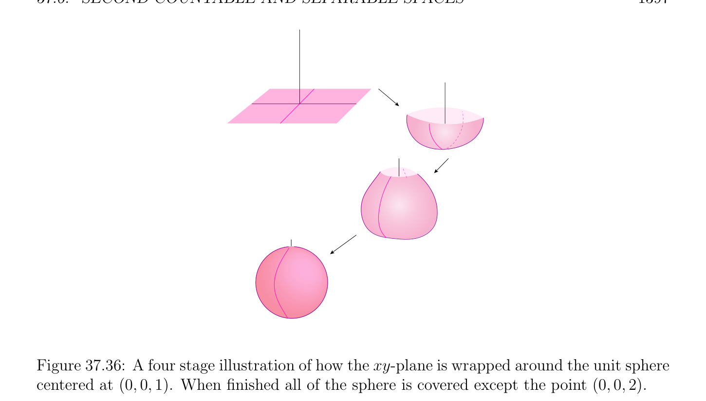
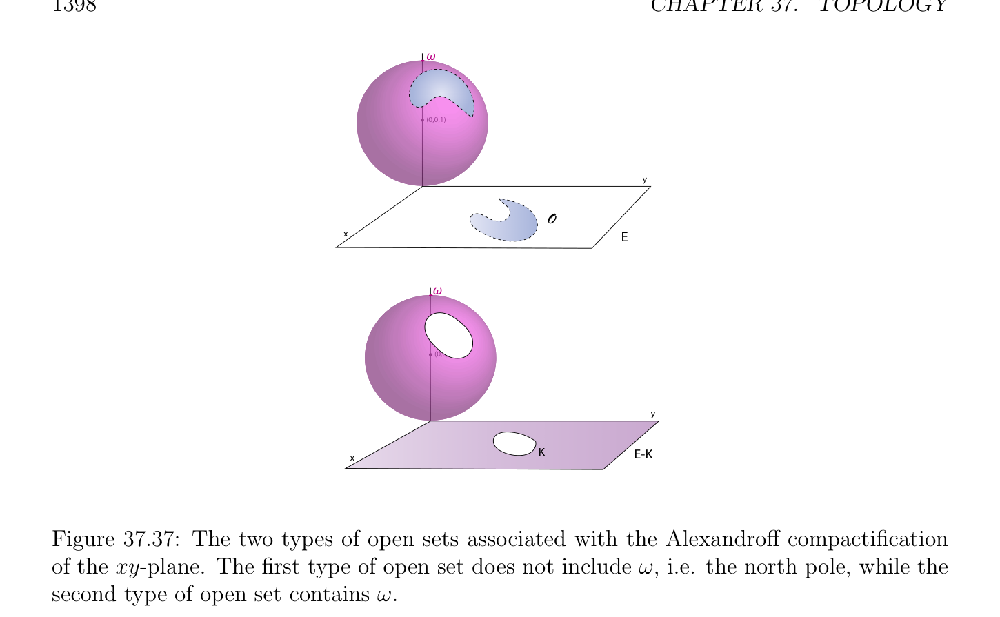

# Second-Countable and Separable Spaces

<!-- PAGE 1397 -->

**Figure 37.36:** A four stage illustration of how the xy-plane is wrapped around the unit sphere centered at $(0, 0, 1)$. When finished all of the sphere is covered except the point $(0, 0, 2). (V_{i})_{i\in(I-{i0})}$, is an open cover of $K_{0}$. Since $K_{0}$ is compact, there is a finite open subcover, $(V_{j})_{j\in J}$, of $K_{0}$, and thus, $(U_{j})_{j\in J\cup {i0}}$ is a finite open cover of $E_{\omega}$. Let us show that $E_{\omega}$ is Hausdorff. Given any two points, a, $b \in E_{\omega}$, if both a, $b \in E$, since $E$ is Hausdorffand every open set in $\mathcal{O}$ is an open set in $\mathcal{O}_{\omega}$, there exist disjoint open sets, $U, V$ (in $\mathcal{O})$, such that $a \in U$ and $b \in V$ . If $b = \omega$ , since $E$ is locally compact, there is some compact set, $K$, containing an open set, $U$, containing a and then, $U$ and $V = (E -K)\cup {\omega$ } are disjoint open sets (in $\mathcal{O}_{\omega})$ such that $a \in U$ and $b \in V$ . The space $E$ is a subspace of $E_{\omega}$ because for every open set, $U$, in $\mathcal{O}_{\omega}$, either $U \in O$ and $E \cap U = U$ is open in $E$, or $U = (E$ - $K) \cup {\omega$ }, where $K$ is compact in $E$, and thus, $U \cap E = E$ - $K$, which is open in $E$, since $K$ is compact in $E$ and thus, closed (since $E$ is Hausdorff). Finally, if $E$ is not compact, for every compact subset, $K$, of $E, E$ - $K$ is nonempty and thus, for every open set, $U = (E-K)\cup {\omega$ }, containing $\omega$ , we have $U \cap E \neq  \emptyset$ , which shows that $\omega  \in \overline{E}$ and thus, that $\overline{E} = E_{\omega}$.

## 37.6 Second-Countable and Separable Spaces

In studying surfaces and manifolds, an important property is the existence of a countable basis for the topology. Indeed this property, among other things, guarantees the existence of triangulations of manifolds, and the fact that a manifold is metrizable.

<!-- PAGE 1398 -->
$$\omega$$
$$(0,0,1)$$
$$y$$
$$O$$
$$xE$$
$$\omega$$
$$(0,0,1)$$
$$y$$
$$KE-K$$
$$x$$

**Figure 37.37:** The two types of open sets associated with the Alexandroff compactification of the xy-plane. The first type of open set does not include $\omega$ , i.e. the north pole, while the second type of open set contains $\omega$ .

> **Definition 37.33.** A topological space $E$ is called second-countable if there is a countable basis for its topology, i.e., if there is a countable family, $(U_{i})_{i\ge0}$, of open sets such that every open set of $E$ is a union of open sets $U_{i}$.
$$\mathbb{R}^{n}$$
It is easily seen that is second-countable and more generally, that every normed vector space of finite dimension is second-countable. More generally, a metric space is secondcountable if and only if it is separable, a very useful property that holds for all of the spaces that we will consider in practice.

> **Definition 37.34.** A topological space $E$ is separable if it contains some countable subset $S$ which is dense in $X$, that is, $\overline{S} = E$. Observe that by Proposition 37.4, a subset $S$ of $E$ is dense in $E$ if and only if every nonempty open subset of $E$ contains some element of $S$. The (metric) space $\mathbb{R}$ is separable because $\mathbb{Q}$ is a countable dense subset of $\mathbb{R}$. Similarly, $\mathbb{C}  \mathbb{Q}^{n}  \mathbb{R}^{n}  \mathbb{R}^{n}$ is separable. In general, is dense in , so is separable, and similarly, every finite-dimensional normed vector space over $\mathbb{R}$ (or $\mathbb{C})$ is separable. For metric spaces, we have the following useful result.

> **Proposition 37.37.** If $E$ is a metric space, then $E$ is second-countable iff $E$ is separable.

<!-- PAGE 1399 -->

*Proof.* If $\mathcal{B} = (B_{n})$ is a countable basis for the topology of $E$, then for any set $S$ obtained by picking some point $s_{n}$ in $B_{n}$, since every nonempty open subset $U$ of $E$ is the union of some of the $B_{n}$, the intersection $U \cap S$ is nonempty, and so $S$ is dense in $E$. Conversely, assume that there is a countable subset $S = (s_{n})$ of $E$ which is dense in $E$. We claim that the countable family $\mathcal{B}$ of open balls $B_{0}(s_{n}, 1/m) (m \in \mathbb{N}, m > 0)$ is a basis for the topology of $E$. For every $x \in E$ and every $r > 0$, there is some $m > 0$ such that $1/m < r/2$, and some $n$ such that $s_{n} \in B_{0}(x, 1/m)$. It follows that $x \in B_{0}(s_{n}, 1/m)$. For all $y \in B_{0}(s_{n}, 1/m)$, we have
$$d(x, y) \le d(x, s_{n}) + d(s_{n}, y) \le 2/m < r,$$
thus $B_{0}(s_{n}, 1/m) \subseteq B_{0}(x, r)$, which by Proposition 37.8(a) implies that $\mathcal{B}$ is a basis for the topology of $E$.

> **Proposition 37.38.** If $E$ is a compact metric space, then $E$ is separable.

*Proof.* For every $n > 0$, the family of open balls of radius $1/n$ forms an open cover of $E$,
$$and since E is compact, there is a finite subset A_{n} of E such that E = \bigcup_{a}  B_{0}(a_{i}, 1/n).$$
It is easy to see that this is equivalent to the condition d(x, $A_{n}) < 1/n for^{i\in An}$ all $x \in E$. Let
$$A = \bigcup_{n}  \ge 1 A_{n}. Then A is countable, and for evey x \in E, we have$$
$$d(x, A) \le d(x, A_{n}) < \frac{1}{n} ,for all n \ge 1,$$
which implies that d(x, $A) = 0$; that is, $A$ is dense in $E$. The following theorem due to Uryshon gives a very useful sufficient condition for a topological space to be metrizable.

> **Theorem 37.39.** (Urysohn metrization theorem) If a topological space $E$ is regular and second-countable, then it is metrizable. The proof of Theorem 37.39 can be found in Munkres $[135]$ (Chapter $4$, Theorem 34.1). As a corollary of Theorem 37.39, every (second-countable) manifold, and thus every Lie group, is metrizable. The following technical result shows that a locally compact metrizable space which is also separable can be expressed as the union of a countable monotonic sequence of compact subsets. This gives us a method for generalizing various properties of compact metric spaces to locally compact metric spaces of the above kind.

> **Proposition 37.40.** Let $E$ be a locally compact metric space. The following properties are equivalent:
$(1)$ There is  sequence $(U_{n})_{n\ge0}$ of open subsets such that for all $n \in \mathbb{N}, U_{n} \subseteq U_{n+1}, \overline{U}_{n}$ is
$$compact, \frac{a}{U_{n}} \subseteq , and .$$
$$U_{n+1} E = \bigcup_{n}  \ge 0 U_{n} = \bigcup  n\ge 0 \overline{U}_{n}$$

<!-- PAGE 1400 -->
$(2)$ The space $E$ is the union of a countable family of compact subsets of $E$.
$(3)$ The space $E$ is separable.
$$Proof. We \frac{show}{U_{n}} (1) implies (2), (2) implies (3), and (3) implies (1). Obviously, (1) implies$$
$(2)$ since the  are compact.
$$If (2) holds, then E = \bigcup_{n}  \ge 0 K_{n}, for some compact subsets K_{n}. By Proposition 37.38,$$
each compact subset $K_{n}$ is separable, so let $S_{n}$ be a countable dense subset of $K_{n}$, Then
$$S = \bigcup_{n}  \ge 0 S_{n} is a countable dense subset of E, since$$
$$E = \bigcup_{n\ge0}  K_{n} \subseteq \bigcup_{n\ge0}  \overline{S}_{n} \subseteq \overline{S} \subseteq E.$$
Consequently $(3)$ holds. If $(3)$ holds, let $S = {s_{n}}$ be a countable dense subset of $E$. By Proposition 37.37, the space $E$ has a countable $basis\mathcal{B}$ of open sets $O_{n}$. Since $E$ is locally compact, for every $x \in E$, there is some compact neighborhood $W_{x}$ containing $x$, and by Proposition 37.8, there some
$$\frac{index}{O_{n(x)}} n(x) such that x \in O_{n(x)} \subseteq W_{x}. Since W_{x} is a compact neighborhood, we deduce that$$
is compact. Consequently, there is a subfamily $of\mathcal{B}$ consisting of open subsets $O_{i}$ such $that\overline{O}_{i}$ is compact, which is a countable basis for the topology of $E$, so we may assume that we restrict our attention to this basis. We define the sequence $(U_{n})_{n\ge1}$ of open subsets of $E$ by induction as follows: Set $U_{1} = O_{1}$, and let
$$U_{n+1} = O_{n+1} \cup V_{r}(\overline{U}_{n}),$$
where $r > 0$ is chosen so $that\overline{V}_{r}\overline{(}\overline{U}_{n}\overline{)$ is compact, which is possible by $Proposition}$ 37.35. We immediately check that the $U_{n}$ satisfy $(1)$ of Proposition 37.40. It can also be shown that if $E$ is a locally compact space that has a countable basis, then $E_{\omega}$ also has a countable basis (and in fact, is metrizable). We also have the following property.

> **Proposition 37.41.** Given a second-countable topological space $E$, every open cover $(U_{i})_{i\in I}$, of $E$ contains some countable subcover.

*Proof.* Let $(O_{n})_{n\ge0}$ be a countable basis for the topology. Then all sets $O_{n}$ contained in some $U_{i}$ can be arranged into a countable subsequence, $(\Omega_{m} )_{m\ge0}$, of $(O_{n})_{n\ge0}$ and for every $\Omega_{m}$ , there is some $U_{im}$ such that $\Omega_{m}  \subseteq U_{im}$. Furthermore, every $U_{i}$ is some union of sets $\Omega_{j}$ , and thus, every $a \in E$ belongs to some $\Omega_{j}$ , which shows that $(\Omega_{m} )_{m\ge0}$ is a countable open subcover of $(U_{i})_{i\in I}$. As an immediate corollary of Proposition 37.41, a locally connected second-countable space has countably many connected components.
