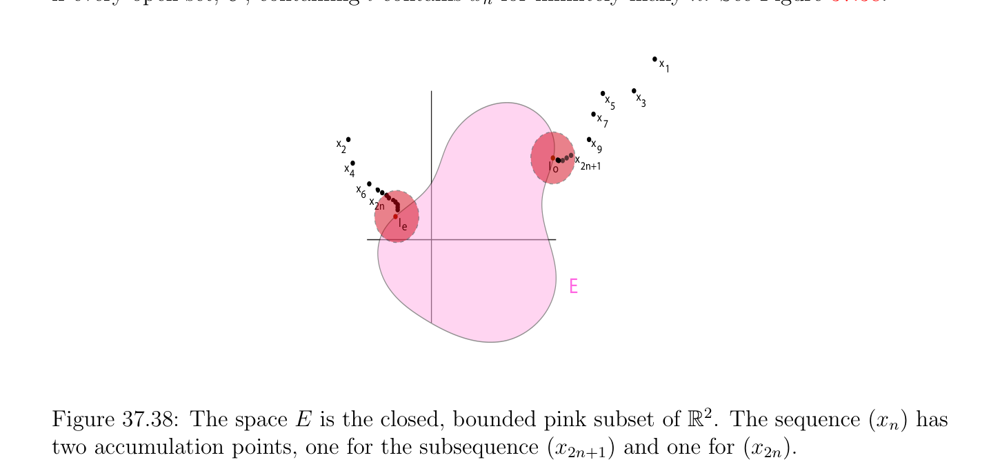
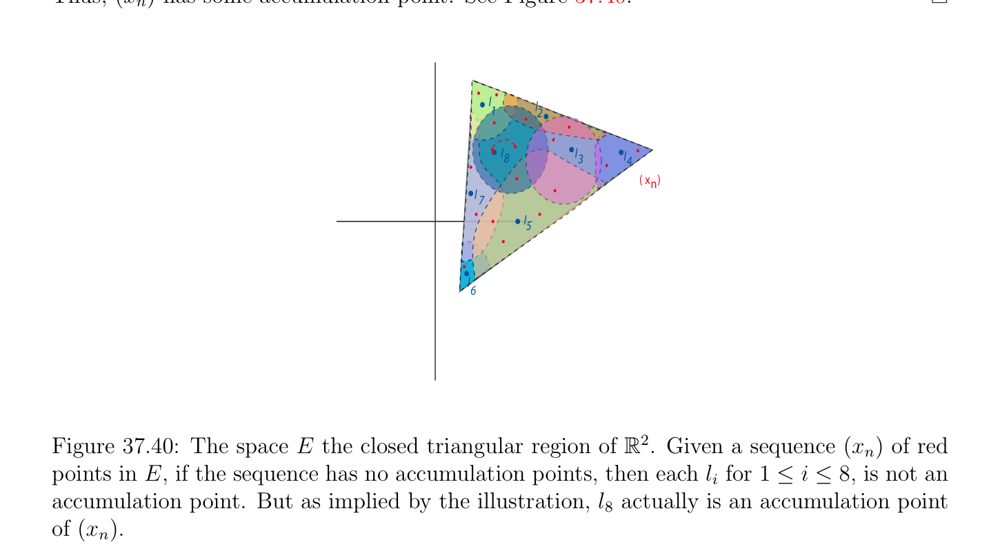
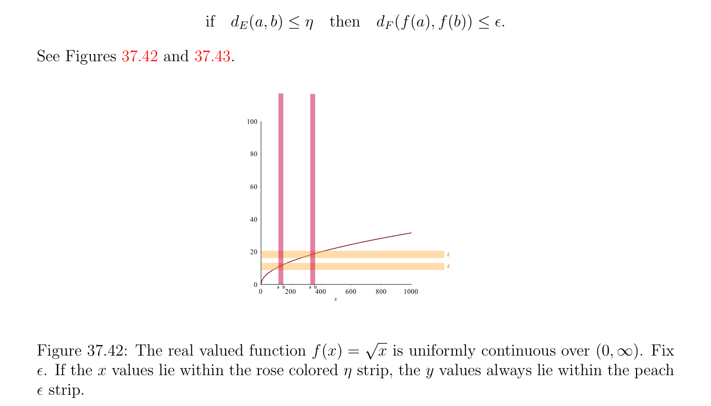
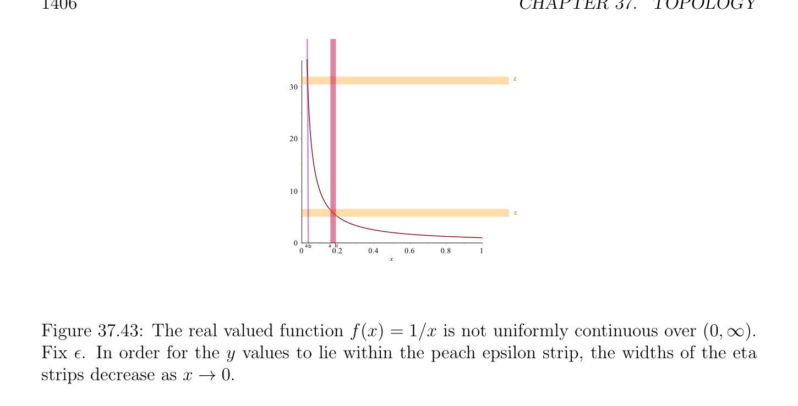

# Sequential Compactness

<!-- PAGE 1401 -->

## 37.7 Sequential Compactness

For a general topological Hausdorff space $E$, the definition of compactness relies on the existence of finite cover. However, when $E$ has a countable basis or is a metric space, we may define the notion of compactness in terms of sequences. To understand how this is done, we need to first define accumulation points.

> **Definition 37.35.** Given a topological Hausdorff space, $E$, given any sequence, $(x_{n})$, of points in $E$, a point, $l \in E$, is an accumulation point (or cluster point) of the sequence $(x_{n})$ if every open set, $U$, containing $l$ contains $x_{n}$ for infinitely many $n$. See Figure 37.38.
$$x1$$
$$xx$$
$$53$$
$$x$$
$$7$$
$$xx$$
$$29$$
$$x$$
$$xlo2n+1$$
$$4$$
$$x6$$
$$x2n$$
$$le$$
$$E$$

**Figure 37.38:** The space $E$ is the closed, bounded pink subset of $\mathbb{R}^{2}$. The sequence $(x_{n})$ has two accumulation points, one for the subsequence $(x_{2n+1})$ and one for $(x_{2n})$. Clearly, if $l$ is a limit of the sequence, $(x_{n})$, then it is an accumulation point, since every open set, $U$, containing a contains all $x_{n}$ except for finitely many $n$. For second-countable spaces we are able to give another characterization of accumulation points.

> **Proposition 37.42.** Given a second-countable topological Hausdorff space, $E$, a point, $l$, is an accumulation point of the sequence, $(x_{n})$, iff $l$ is the limit of some subsequence, $(x_{nk})$, of $(x_{n})$.

*Proof.* Clearly, if $l$ is the limit of some subsequence $(x_{nk})$ of $(x_{n})$, it is an accumulation point of $(x_{n})$. Conversely, let $(U_{k})_{k\ge0}$ be the sequence of open sets containing $l$, where each $U_{k}$ belongs to a countable basis of $E$, and let $V_{k} = U_{1} \cap \cdots  \cap U_{k}$. For every $k \ge 1$, we can find some $n_{k} > n_{k-1}$ such that $x_{nk} \in V_{k}$, since $l$ is an accumulation point of $(x_{n})$. Now, since every open set containing $l$ contains some $U_{k0}$ and since $x_{nk} \in U_{k0}$ for all $k \ge 0$, the sequence $(x_{nk})$ has limit $l$.

<!-- PAGE 1402 -->
Remark: Proposition 37.42 also holds for metric spaces. As an illustration of Proposition 37.42 let $(x_{n})$ be the sequence $(1, -1, 1, -1, \dots$  ). This sequence has two accumulation points, namely $1$ and $-1$ since $(x_{2n+1}) = (1)$ and $(x_{2n}) = (-1)$. In second-countable Hausdorffspaces, compactness can be characterized in terms of accumulation points (this is also true for metric spaces).

> **Proposition 37.43.** A second-countable topological Hausdorff space, $E$, is compact iff every sequence, $(x_{n})$, of $E$ has some accumulation point in $E$.

*Proof.* Assume that every sequence, $(x_{n})$, has some accumulation point. Let $(U_{i})_{i\in I}$ be some open cover of $E$. By Proposition 37.41, there is a countable open subcover, $(O_{n})_{n\ge0}$, for $E$. Now, if $E$ is not covered by any finite subcover of $(O_{n})_{n\ge0}$, we can define a sequence, $(x_{m})$, by induction as follows: Let $x_{0}$ be arbitrary and for every $m \ge 1$, let $x_{m}$ be some point in $E$ not in $O_{1} \cup \cdots  \cup O_{m}$, which exists, since $O_{1} \cup \cdots  \cup O_{m}$ is not an open cover of $E$. We claim that the sequence, $(x_{m})$, does not have any accumulation point. Indeed, for every $l \in E$, since $(O_{n})_{n\ge0}$ is an open cover of $E$, there is some $O_{m}$ such that $l \in O_{m}$, and by construction, every $x_{n}$ with $n \ge m + 1$ does not belong to $O_{m}$, which means that $x_{n} \in O_{m}$ for only finitely many $n$ and $l$ is not an accumulation point. See Figure 37.39.
$$xm$$
$$O$$
$$m+1$$
$$x3$$
$$x2E$$
$$O$$
$$4$$
$$Ox1$$
$$3x0$$
$$\overline{O}\overline{O}$$
$$2\overline{1}$$

**Figure 37.39:** The space $E$ is the open half plane above the line $y = -1. S$ ince $E$ is not compact, we inductively build a sequence, $(x_{n})$ that will have no accumulation point in $E$. Note the $y$ coordinate of $x_{n}$ approaches infinity. Conversely, assume that $E$ is compact, and let $(x_{n})$ be any sequence . If $l \in E$ is not an accumulation point of the sequence, then there is some open set, $U_{l}$, such that $l \in U_{l}$

<!-- PAGE 1403 -->
and $x_{n} \in U_{l}$ for only finitely many $n$. Thus, if $(x_{n})$ does not have any accumulation point, the family, $(U_{l})_{l\in E}$, is an open cover of $E$ and since $E$ is compact, it has some finite open subcover, $(U_{l})_{l\in J}$, where $J$ is a finite subset of $E$. But every $U_{l}$ with $l \in J$ is such that
$$x_{n} \in U_{l} for only finitely many n, and since J is finite, x_{n} \in \bigcup_{l}  U_{l} for only finitely many n,$$
which contradicts the fact that $(U_{l})_{l\in J}$ is an open cover of $E,^{\in J}$ and thus contains all the $x_{n}$. Thus, $(x_{n})$ has some accumulation point. See Figure 37.40.
$$l1l2$$
$$l8l3l4$$
$$( x   )n$$
$$l7$$
$$\overline{l}\overline{5}$$
$$l$$
$$6$$

**Figure 37.40:** The space $E$ the closed triangular region of $\mathbb{R}^{2}$. Given a sequence $(x_{n})$ of red points in $E$, if the sequence has no accumulation points, then each $l_{i}$ for $1 \le i \le 8$, is not an accumulation point. But as implied by the illustration, $l_{8}$ actually is an accumulation point of $(x_{n})$.
Remarks: $1$. By combining Propositions 37.42 and 37.43, we have observe that a second-countable Hausdorff space $E$ is compact iff every sequence $(x_{n})$ has a convergent subsequence $(x_{nk})$. In other words, we say a second-countable Hausdorff space $E$ is compact iff it is sequentially compact. $2$. It should be noted that the proof showing that if $E$ is compact, then every sequence has some accumulation point, holds for any arbitrary compact space (the proof does not use a countable basis for the topology). The converse also holds for metric spaces. We will prove this converse since it is a major property of metric spaces. Given a metric space in which every sequence has some accumulation point, we first prove the existence of a Lebesgue number.

<!-- PAGE 1404 -->

> **Lemma 37.44.** Given a metric space, $E$, if every sequence, $(x_{n})$, has an accumulation point, for every open cover, $(U_{i})_{i\in I}$, of $E$, there is some $\delta  > 0$ (a Lebesgue number for $(U_{i})_{i\in I})$ such that, for every open ball, $B_{0}(a, \epsilon$ ), of radius $\epsilon  \le \delta$ , there is some open subset, $U_{i}$, such that $B_{0}(a, \epsilon$ ) $\subseteq U_{i}$. See Figure 37.41
$$U1$$
$$1U2$$
$$U3$$
$$23$$
$$14U$$
$$4$$
$$413U$$
$$10125$$
$$5U$$
$$116$$
$$9U$$
$$7$$
$$\overline{6} U$$
$$8$$
$$8$$
$$7$$

**Figure 37.41:** The space $E$ the closed triangular region $of\mathbb{R}^{2}$. It’s open cover is $(U_{i})_{i=1}^{8}$. The Lebesque number is the radius of the small orange balls labelled $1$ through $14$. Each open ball of this radius entirely contained within at least one $U_{i}$. For example, Ball $2$ is contained in both $U_{1}$ and $U_{2}$.

*Proof.* If there was no $\delta$  with the above property, then, for every natural number, $n$, there would be some open ball, $B_{0}(a_{n}, 1/n)$, which is not contained in any open set, $U_{i}$, of the open cover, $(U_{i})_{i\in I}$. However, the sequence, $(a_{n})$, has some accumulation point, a, and since $(U_{i})_{i\in I}$ is an open cover of $E$, there is some $U_{i}$ such that $a \in U_{i}$. Since $U_{i}$ is open, there is some open ball of center a and radius $\epsilon$  contained in $U_{i}$. Now, since a is an accumulation point of the sequence, $(a_{n})$, every open set containing a contains $a_{n}$ for infinitely many $n$ and thus, there is some $n$ large enough so that
$$1/n \le \epsilon /2anda_{n} \in B_{0}(a, \epsilon /2),$$
which implies that
$$B_{0}(a_{n}, 1/n) \subseteq B_{0}(a, \epsilon ) \subseteq U_{i},$$
a contradiction. By a previous remark, since the proof of Proposition 37.43 implies that in a compact topological space, every sequence has some accumulation point, by Lemma 37.44, in a compact metric space, every open cover has a Lebesgue number. This fact can be used to prove another important property of compact metric spaces, the uniform continuity theorem.

<!-- PAGE 1405 -->

> **Definition 37.36.** Given two metric spaces, $(E, d_{E})$ and $(F, d_{F})$, a function, $f$ : $E \to F$, is uniformly continuous if for every $\epsilon  > 0$, there is some $\eta  > 0$, such that, for all a, $b \in E$,
$$ifd_{E}(a, b) \le \eta thend_{F}(f(a), f(b)) \le \epsilon .$$
See Figures 37.42 and 37.43.
$$100$$
$$80$$
$$60$$
$$40$$
$$20\varepsilon$$
$$\varepsilon$$
$$0\overline{a}\overline{b}\overline{a} \overline{b}$$
$$\overline{0}\overline{200}\overline{400}\overline{600}\overline{800}\overline{1000}$$
$$x$$
$$\sqrt$$

**Figure 37.42:** The real valued function f(x) $= \overline{x}$ is uniformly continuous over $(0, \infty$ ). Fix $\epsilon$ . If the $x$ values lie within the rose colored $\eta$  strip, the $y$ values always lie within the peach $\epsilon$  strip. As we saw earlier, the metric on a metric space is uniformly continuous, and the norm on a normed metric space is uniformly continuous. The uniform continuity theorem can be stated as follows:

> **Theorem 37.45.** Given two metric spaces, $(E, d_{E})$ and $(F, d_{F})$, if $E$ is compact and if $f$ : $E \to F$ is a continuous function, then $f$ is uniformly continuous.

*Proof.* Consider any $\epsilon  > 0$ and let $(B_{0}(y, \epsilon /2))_{y\in F}$ be the open cover of $F$ consisting of open balls of radius $\epsilon /2$. Since $f$ is continuous, the family,
$$(f^{-1} (B_{0}(y, \epsilon /2)))_{y\in F},$$
is an open cover of $E$. Since, $E$ is compact, by Lemma 37.44, there is a Lebesgue number, $\delta$ , such that for every open ball, $B_{0}(a, \eta$ ), of radius $\eta  \le \delta$ , then $B_{0}(a, \eta$ ) $\subseteq f^{-1} (B_{0}(y, \epsilon /2))$, for some $y \in F$. In particular, for any a, $b \in E$ such that $d_{E}(a, b) \le \eta  = \delta /2$, we have a, $b \in B_{0}(a, \delta$ ) and thus, a, $b \in f^{-1} (B_{0}(y, \epsilon /2))$, which implies that f(a), f(b) $\in B_{0}(y, \epsilon /2)$. But then, $d_{F}(f(a)$, f(b)) $\le \epsilon$ , as desired. We now prove another lemma needed to obtain the characterization of compactness in metric spaces in terms of accumulation points.

<!-- PAGE 1406 -->
$$\varepsilon$$
$$30$$
$$20$$
$$10$$
$$\varepsilon$$
$$0\overline{ab}\overline{a}\overline{b}$$
$$\overline{0}\overline{0.2}\overline{0.4}\overline{0.6}\overline{0.8}\overline{1}$$
$$x$$

**Figure 37.43:** The real valued function f(x) $= 1/x$ is not uniformly continuous over $(0, \infty$ ). Fix $\epsilon$ . In order for the $y$ values to lie within the peach epsilon strip, the widths of the eta strips decrease as $x \to 0$.

> **Lemma 37.46.** Given a metric space, $E$, if every sequence, $(x_{n})$, has an accumulation point, then for every $\epsilon  > 0$, there is a finite open cover, $B_{0}(a_{0}, \epsilon$ ) $\cup \cdots  \cup B_{0}(a_{n}, \epsilon$ ), of $E$ by open balls of radius $\epsilon$ .

*Proof.* Let $a_{0}$ be any point in $E$. If $B_{0}(a_{0}, \epsilon$ ) $= E$, then the lemma is proved. Otherwise, assume that a sequence, $(a_{0}, a_{1}, \dots  , a_{n})$, has been defined, such that $B_{0}(a_{0}, \epsilon )\cup \cdots \cup B_{0}(a_{n}, \epsilon$ ) does not cover $E$. Then, there is some $a_{n+1}$ not in $B_{0}(a_{0}, \epsilon$ ) $\cup \cdots  \cup B_{0}(a_{n}, \epsilon$ ) and either
$$B_{0}(a_{0}, \epsilon ) \cup \cdots  \cup B_{0}(a_{n+1}, \epsilon ) = E,$$
in which case the lemma is proved, or we obtain a sequence, $(a_{0}, a_{1}, \dots  , a_{n+1})$, such that $B_{0}(a_{0}, \epsilon$ ) $\cup \cdots  \cup B_{0}(a_{n+1}, \epsilon$ ) does not cover $E$. If this process goes on forever, we obtain an infinite sequence, $(a_{n})$, such that $d(a_{m}, a_{n}) > \epsilon$  for all $m \neq  n$. Since every sequence in $E$ has some accumulation point, the sequence, $(a_{n})$, has some accumulation point, a. Then, for infinitely many $n$, we must have $d(a_{n}, a) \le \epsilon /3$ and thus, for at least two distinct natural numbers, $p, q$, we must have $d(a_{p}, a) \le \epsilon /3$ and $d(a_{q}, a) \le \epsilon /3$, which implies $d(a_{p}, a_{q}) \le d(a_{p}, a)+d(a_{q}, a) \le 2\epsilon /3$, contradicting the fact that $d(a_{m}, a_{n}) > \epsilon$  for all $m \neq  n$. See Figure 37.44. Thus, there must be some $n$ such that
$$B_{0}(a_{0}, \epsilon ) \cup \cdots  \cup B_{0}(a_{n}, \epsilon ) = E.$$

> **Definition 37.37.** A metric space $E$ is said to be precompact (or totally bounded) if for every $\epsilon  > 0$, there is a finite open cover, $B_{0}(a_{0}, \epsilon$ ) $\cup \cdots  \cup B_{0}(a_{n}, \epsilon$ ), of $E$ by open balls of radius $\epsilon$ . We now obtain the Weierstrass–Bolzano property.
