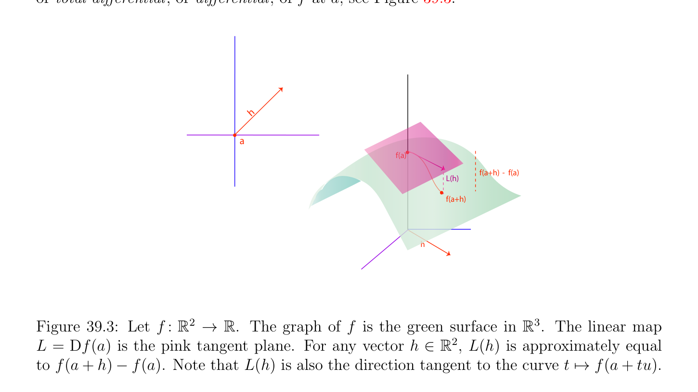

# Directional Derivatives, Total Derivatives

<!-- PAGE 1441 -->
Chapter $39$ Differential Calculus

## 39.1 Directional Derivatives, Total Derivatives

This chapter contains a review of basic notions of differential calculus. First, we review the definition of the derivative of a function $f$ : $\mathbb{R} \to \mathbb{R}$. Next, we define directional derivatives and the total derivative of a function $f$ : $E \to F$ between normed affine spaces. Basic properties of derivatives are shown, including the chain rule. We show how derivatives are represented by Jacobian matrices. The mean value theorem is stated, as well as the implicit function theorem and the inverse function theorem. Diffeomorphisms and local diffeomorphisms are defined. Tangent spaces are defined. Higher-order derivatives are defined, as well as the Hessian. Schwarz’s lemma (about the commutativity of partials) is stated. Several versions of Taylor’s formula are stated, and a famous formula due to Fa`a di Bruno’s is given. We first review the notion of the derivative of a real-valued function whose domain is an open subset of $\mathbb{R}$. Let $f$ : $A \to \mathbb{R}$, where $A$ is a nonempty open subset of $\mathbb{R}$, and consider any $a \in A$. The main idea behind the concept of the derivative of $f$ at a, denoted by f' (a), is that locally around a (that is, in some small open set $U \subseteq A$ containing a), the function $f$ is approximated $linearly^{1}$ by the map
$$x \mapsto f(a) + f' (a)(x -a).$$
As pointed out by Dieudonn´e in the early 1960s, it is an “unfortunate accident” that if $V$ is vector space of dimension one, then there is a bijection between the space $V^{*}$ of linear forms defined on $V$ and the field of scalars. As a consequence, the derivative of a real-valued function $f$ defined on an open subset $A$ of the reals can be defined as the scalar f' (a) (for any $a \in A)$. But as soon as $f$ is a function of several arguments, the scalar interpretation of the derivative breaks down. $\overline{1}\overline{Actually,} \overline{the} \overline{approximation} \overline{is} \overline{affine,}$ but everybody commits this abuse of language.
$$1441$$

<!-- PAGE 1442 -->
Part of the difficulty in extending the idea of derivative to more complex spaces is to give an adequate notion of linear approximation. The key idea is to use linear maps. This could be carried out in terms of matrices but it turns out that this neither shortens nor simplifies proofs. In fact, this is often the opposite. We admit that the more intrinsic definition of the notion of derivative $f_{a}'$  at a point a of a function $f$ : $E \to F$ between two normed (affine) spaces $E$ and $F$ as a linear map requires a greater effort to be grasped, but we feel that the advantages of this definition outweight its degree of abstraction. In particular, it yields a clear notion of the derivative of a function $f$ : $M_{m}(\mathbb{R}) \to M_{n}(\mathbb{R})$ defined from $m \times  m$ matrices to $n \times  n$ matrices (many definitions make use of partial derivatives with respect to matrices that do make any sense). But more importantly, the definition of the derivative as a linear map makes it clear that whether the space $E$ or the space $F$ is infinite dimensional does not matter. This is important in optimization theory where the natural space of solutions of the problem is often an infinite dimensional function space. Of course, to carry out computations one need to pick finite bases and to use Jacobian matrices, but this is a different matter. Let us now review the formal definition of the derivative of a real-valued function.

> **Definition 39.1.** Let $A$ be any nonempty open subset $of\mathbb{R}$, and let $a \in A$. For any function $f$ : $A \to \mathbb{R}$, the derivative of $f$ at $a \in A$ is the limit (if it exists)
$$-$$
$$f' (a) =h\to lim0, h\in U \frac{f(a + h)f(a)}{h} ,$$
where $U = {h \in \mathbb{R}$ | $a + h \in A, h \neq  0}$. This limit is denoted by f' (a), or Df(a), $or^{df}$ (a). If f' (a) exists for every $a \in A$, we say that $f$ is differentiable on $A$. In this case, $the^{dx}$ map $a \mapsto$ f' (a) is denoted by f' , or Df, $or_{dx}^{df}$ . Note that since $A$ is assumed to be open, $A -{a}$ is also open, and since the function $h \mapsto a + h$ is continuous and $U$ is the inverse image of $A -{a}$ under this function, $U$ is indeed open and the definition makes sense. We can also define f' (a) as follows: there is some function $\epsilon$ , such that,
$$f(a + h) = f(a) + f' (a) \cdot  h + \epsilon (h)h,$$
whenever $a + h \in A$, where $\epsilon (h)$ is defined for all $h$ such that $a + h \in A$, and
$$lim \epsilon (h) = 0.$$
$$h\to 0, h\in U$$
Remark: We can also define the notion of derivative of $f$ at a on the left, and derivative of $f$ at a on the right. For example, we say that the derivative of $f$ at a on the left is the limit f' $(a_{-})$ (if it exists)
$$-$$
$$h\to lim0, h\in U \frac{f(a + h)f(a)}{h} ,$$

<!-- PAGE 1443 -->
where $U = {h \in \mathbb{R}$ | $a + h \in A, h < 0}$. If a function $f$ as in Definition 39.1 has a derivative f' (a) at a, then it is continuous at a. If $f$ is differentiable on $A$, then $f$ is continuous on $A$. The composition of differentiable functions is differentiable.
Remark: $A$ function $f$ has a derivative f' (a) at a iff the derivative of $f$ on the left at a and the derivative of $f$ on the right at a exist, and if they are equal. Also, if the derivative of $f$ on the left at a exists, then $f$ is continuous on the left at a (and similarly on the right). We would like to extend the notion of derivative to functions $f$ : $A \to F$, where $E$ and $F$ are normed affine spaces, and $A$ is some nonempty open subset of $E$. The first difficulty is to make sense of the quotient
$$\frac{f(a + h)f(a)}{h} -.$$
If $E$ and $F$ are normed affine spaces, it will be notationally convenient to assume that
$$\longrightarrow$$
the vector space associated with $E$ is denoted by $E$ , and that the vector space associated
$$\longrightarrow$$
with $F$ is denoted as $F$ . Since $F$ is a normed affine space, making sense of $f(a+h)-f(a)$ is easy: we can define this $--------\longrightarrow$ as f(a)f(a $+ h)$, the unique vector translating f(a) to f(a $+ h)$. We should note however, that this quantity is a vector and not a point. Nevertheless, in defining derivatives, it is
$$--------\longrightarrow$$
notationally more pleasant to denote f(a)f(a $+ h)$ by f(a $+ h)$ - f(a). Thus, in the rest of
$$\longrightarrow$$
this chapter, the vector ab will be denoted by b-a. But now, how do we define the quotient by a vector? Well, we don’t! $A$ first possibility is to consider the directional derivative with respect to a vector $u \neq  0 \longrightarrow$ in $E$ . We can consider the vector f(a $+$ tu) - f(a), where $t \in \mathbb{R}$ (or $t \in \mathbb{C})$. Now,
$$\frac{f(a + tu)f(a)}{t} -$$
makes sense. The idea is that in $E$, the points of the form $a +$ tu for $t$ in some small interval $[-\epsilon , +\epsilon$ ] in $\mathbb{R}$ (or $\mathbb{C})$ form a line segment $[r, s]$ in $A$ containing a, and that the image of this line segment defines a small curve segment on f(A). This curve segment is defined by the map $t \mapsto$ f(a $+$ tu), from $[r, s]$ to $F$, and the directional derivative $D_{u}f(a)$ defines the direction of the tangent line at a to this curve; see Figure 39.1. This leads us to the following definition.

> **Definition 39.2.** Let $E$ and $F$ be two normed affine spaces, let $A$ be a nonempty open
$$\longrightarrow$$
subset of $E$, and let $f$ : $A \to F$ be any function. For any $a \in A$, for any $u \neq  0$ in $E$ , the directional derivative of $f$ at a w.r.t. the vector $u$, denoted by $D_{u}f(a)$, is the limit (if it exists)
$$-$$
$$D_{u}f(a) =t\to lim0, t\in U \frac{f(a + tu)f(a)}{t} ,$$

<!-- PAGE 1444 -->
$$tu$$
$$a +$$
$$a$$
$$uf(a)D$$
$$u   f$$
$$(a$$
$$)$$
$$\overline{a}$$
$$f(a+tu)$$
$$a$$
$$+$$
$$tu$$
$$\mathbb{R}^{2} \mathbb{R} \mathbb{R}^{3}$$

**Figure 39.1:** Let $f$ : $\to$ . The graph of $f$ is the peach surface in , and $t \mapsto$ f(a $+$ tu) is the embedded orange curve connecting f(a) to f(a $+$ tu). Then $D_{u}f(a)$ is the slope of the pink tangent line in the direction of $u$. where $U = {t \in \mathbb{R}$ | $a +$ tu $\in A, t \neq  0}$ (or $U = {t \in \mathbb{C}$ | $a +$ tu $\in A, t \neq  0})$. Note that
$$\longrightarrow$$
$D_{u}f(a)$ is a vector in $F$ . Since the map $t \mapsto a +$ tu is continuous, and since $A -{a}$ is open, the inverse image $U$ of $A -{a}$ under the above map is open, and the definition of the limit in Definition 39.2 makes sense.
Remark: Since the notion of limit is purely topological, the existence and value of a directional derivative is independent of the choice of norms in $E$ and $F$, as long as they are equivalent norms. The directional derivative is sometimes called the Gˆateaux derivative. In the special case where $E = \mathbb{R}$ and $F = \mathbb{R}$, and we let $u = 1$ (i.e., the real number $1$, viewed as a vector), it is immediately verified that $D_{1}f(a) =$ f' (a), in the sense of Definition 39.1. When $E = \mathbb{R}$ (or $E = \mathbb{C})$ and $F$ is any normed vector space, the derivative $D_{1}f(a)$, also denoted by f' (a), provides a suitable generalization of the notion of derivative. However, when $E$ has dimension $\ge 2$, directional derivatives present a serious problem, which is that their definition is not sufficiently uniform. Indeed, there is no reason to believe that the directional derivatives w.r.t. all nonnull vectors $u$ share something in common. As a consequence, a function can have all directional derivatives at a, and yet not be continuous at a. Two functions may have all directional derivatives in some open sets, and yet their composition may not.
$$\mathbb{R}^{2} \mathbb{R}$$

> **Example 39.1.** Let $f$ : $\to$  be the function given by
$$(x2y$$
$$if (x, y) \neq  (0, 0)$$
$$f(x, y) =\overline{x}\overline{4}\overline{+}\overline{y}\overline{2}$$
$$0if (x, y) = (0, 0).$$

<!-- PAGE 1445 -->
The graph of f(x, $y)$ is illustrated in Figure 39.2.

**Figure 39.2:** The graph of the function from Example 39.1. Note that $f$ is not continuous at $(0, 0)$, despite the existence of $D_{u}f(0, 0)$ for all $u \neq  0$.
$$For any u \neq  0, letting u = \begin{pmatrix} h \\ k \end{pmatrix} , we have$$
$$\frac{f(0 + tu)f(0)}{t} -= \frac{h^{2}k}{t^{2}h^{4}+ k^{2}} ,$$
so that
$$h2$$
$$if k \neq  0$$
$$D_{u}f(0, 0) =$$
$$0^{k}if k = 0.$$
Thus, $D_{u}f(0, 0)$ exists for all $u \neq  0$.
$$\mathbb{R}^{2} \mathbb{R}$$
On the other hand, if Df(0, $0)$ existed, it would be a linear map Df(0, $0): \to$ represented by a row matrix $(\alpha  \beta$ ), and we would have $D_{u}f(0, 0) =$ Df(0, 0)(u) $= \alpha h + \beta k$, but the explicit formula for $D_{u}f(0, 0)$ is not linear. As a matter of fact, the function $f$ is not continuous at $(0, 0)$. For example, on the parabola $y = x^{2}$, f(x, $y) =_{2}^{1}$ , and when we approach the origin on this parabola, the limit $is_{2}^{1}$ , but f(0, $0) = 0$. To avoid the problems arising with directional derivatives we introduce a more uniform notion. Given two normed spaces $E$ and $F$, recall that a linear map $f$ : $E \to F$ is continuous iff there is some constant $C \ge 0$ such that
$$\|f(u)\|\le C \|u\|for all u \in E.$$

<!-- PAGE 1446 -->

> **Definition 39.3.** Let $E$ and $F$ be two normed affine spaces, let $A$ be a nonempty open subset of $E$, and let $f$ : $A \to F$ be any function. For any $a \in A$, we say that $f$ is differentiable at
$$\longrightarrow \longrightarrow$$
$a \in A$ if there is a linear continuous map $L: E \to F$ and a function $\epsilon$ , such that
$$f(a + h) = f(a) + L(h) + \epsilon (h)\|h\|$$
for every $a + h \in A$, where $\epsilon (h)$ is defined for every $h$ such that $a + h \in A$ and
$$lim \epsilon (h) = 0,$$
$$h\to 0, h\in U$$
$$\longrightarrow$$
where $U = {h \in E$ | $a + h \in A, h \neq  0}$. The linear map $L$ is denoted by Df(a), or $Df_{a}$, or df(a), or $df_{a}$, or f' (a), and it is called the Fr´echet derivative, or derivative, or total derivative, or total differential, or differential, of $f$ at a; see Figure 39.3.
$$h$$
$$\overline{a}$$
$$f(a)$$
$$f(a+h) -f(a)$$
$$L(h)$$
$$f(a+h)$$
$$h$$
$$\mathbb{R}^{2} \mathbb{R} \mathbb{R}^{3}$$

**Figure 39.3:** Let $f$ : $\to$ . The graph of $f$ is the green surface in . The linear map $L =$ Df(a) is the pink tangent plane. For any vector $h \in \mathbb{R}^{2}$, L(h) is approximately equal to f(a $+ h)$ - f(a). Note that L(h) is also the direction tangent to the curve $t \mapsto$ f(a $+$ tu).
$$\longrightarrow$$
Since the map $h \mapsto a + h$ from $E$ to $E$ is continuous, and since $A$ is open in $E$, the
$$\longrightarrow$$
inverse image $U$ of $A -{a}$ under the above map is open in $E$ , and it makes sense to say that
$$lim \epsilon (h) = 0.$$
$$h\to 0, h\in U$$
Note that for every $h \in U$, since $h \neq  0, \epsilon (h)$ is uniquely determined since
$$- -$$
$$\epsilon (h) = \frac{f(a + h)f(a)L(h)}{\|h\|} ,$$

<!-- PAGE 1447 -->
and that the value $\epsilon (0)$ plays absolutely no role in this definition. The condition for $f$ to be differentiable at a amounts to the fact that
$$lim\| \frac{f(a + h)f(a)L(h)}{\|h\|} - -\|= 0$$
$$h\mapsto 0$$
as $h \neq  0$ approaches $0$, when $a + h \in A$. However, it does no harm to assume that $\epsilon (0) = 0$, and we will assume this from now on. Again, we note that the derivative Df(a) of $f$ at a provides an affine approximation of $f$, locally around a. If $E = F =\mathbb{R}$, a linear map $L: \mathbb{R} \to \mathbb{R}$ is uniquely determined by some fixed real number $c \in \mathbb{R}$ and we have
$$L(u) = cu,u \in \mathbb{R}.$$
Since
$$| - -| -$$
$$|\epsilon (h)| = \frac{f(a + h)f(a)ch}{|h|} = \frac{f(a + h)f(a)}{h} -c ,$$
if $Df_{a}$ exists, $|\epsilon$ (h)| tends to zero if |h| tends to zero, and we deduce that
$$c = f' (a),$$
so our new notion of derivative agrees with the old (standard) notion of derivative, as it should.
Remarks:
$(1)$ Since the notion of limit is purely topological, the existence and value of a derivative is independent of the choice of norms in $E$ and $F$, as long as they are equivalent norms.
$(2)$ If $h: (-a, a) \to \mathbb{R}$ is a real-valued function defined on some open interval containing $0$, we say that $h$ is o(t) for $t \to 0$, and we write h(t) $=$ o(t), if
$$t\mapsto lim0, t\neq 0 \frac{h(t)}{t} = 0.$$
With this notation (the little $o$ notation), the function $f$ is differentiable at a iff
$$f(a + h) -f(a) -L(h) = o(\|h\|),$$
which is also written as
$$f(a + h) = f(a) + L(h) + o(\|h\|).$$
The following proposition shows that our new definition is consistent with the definition of the directional derivative and that the continuous linear map $L$ is unique, if it exists.

<!-- PAGE 1448 -->

> **Proposition 39.1.** Let $E$ and $F$ be two normed affine spaces, let $A$ be a nonempty open subset of $E$, and let $f$ : $A \to F$ be any function. For any $a \in A$, if Df(a) is defined, then
$$\longrightarrow$$
$f$ is continuous at a and $f$ has a directional derivative $D_{u}f(a)$ for every $u \neq  0$ in $E$ , and furthermore,
$$D_{u}f(a) = Df(a)(u)$$
which can also be written as
$$D_{u}f(a) = Df_{a}(u),$$
and thus, Df(a) is uniquely defined.
$$\longrightarrow$$

*Proof.* If $L =$ Df(a) exists, then for any nonzero vector $u \in E$ , because $A$ is open, for any $t \in \mathbb{R} -{0}$ (or $t \in \mathbb{C} -{0})$ small enough, $a +$ tu $\in A$, so
$$f(a + tu)=f(a) + L(tu) + \epsilon (tu)\|tu\|$$
$$=f(a) + tL(u) + |t|\epsilon (tu)\|u\|$$
which implies that
$$-||$$
$$L(u) = \frac{f(a + tu)f(a)}{t} - \frac{t}{t} \epsilon (tu)\|u\|,$$
and since $lim_{t\mapsto0} \epsilon$ (tu) $= 0$, we deduce that
$$L(u) = Df(a)(u) = D_{u}f(a).$$
Because
$$f(a + h) = f(a) + L(h) + \epsilon (h)\|h\|$$
for all $h$ such that $\|h\|$ is small enough, $L$ is continuous, and $lim_{h\mapsto0} \epsilon (h)\|h\| = 0$, we have $lim_{h\mapsto0}$ f(a $+ h) =$ f(a), that is, $f$ is continuous at a. When $E$ is of finite dimension, every linear map is continuous (see Proposition 9.9 or Theorem 37.58), and this assumption is then redundant. It is important to note that the derivative Df(a) of $f$ at a is a continuous linear map
$$\longrightarrow  \longrightarrow$$
from the vector space $E$ to the vector space $F$ , and not a function from the affine space $E$ to the affine space $F$. Observe that in the equation
$$D_{u}f(a) = Df_{a}(u),$$
the directional derivative $D_{u}f(a)$ is a vector, and $Df_{a}(u)$ is the result of evaluating the linear map $Df_{a}$ on the vector $u$. The linear map $Df_{a}$ “knows” about all the directional derivatives, it is a global object. So after all, the derivative $Df_{a}$ of a function $f$ at a is not a number or a vector, it is a linear map.

<!-- PAGE 1449 -->
Although this may not be immediately obvious, the reason for requiring the linear map $Df_{a}$ to be continuous is to ensure that if a function $f$ is differentiable at a, then it is continuous at a. This is certainly a desirable property of a differentiable function. In finite dimension this holds, but in infinite dimension this is not the case. The following proposition shows that if $Df_{a}$ exists at a and if $f$ is continuous at a, then $Df_{a}$ must be a continuous map. So if a function is differentiable at a, then it is continuous iff the linear map $Df_{a}$ is continuous. We chose to include the second condition rather that the first in the definition of a differentiable function.

> **Proposition 39.2.** Let $E$ and $F$ be two normed affine spaces, let $A$ be a nonempty open subset of $E$, and let $f$ : $A \to F$ be any function. For any $a \in A$, if $Df_{a}$ is defined, then $f$ is continuous at a iff $Df_{a}$ is a continuous linear map.

*Proof.* Proposition 39.1 shows that if $Df_{a}$ is defined and continuous then $f$ is continuous at a. Conversely, assume that $Df_{a}$ exists and that $f$ is continuous at a. Since $f$ is continuous at a and since $Df_{a}$ exists, for any $\eta  > 0$ there is some $\rho$  with $0 < \rho  < 1$ such that if $\|h\|\le \rho$ then
$$\|f(a + h) -f(a)\|\le \frac{\eta}{2} ,$$
and
$$\|f(a + h) -f(a) -D_{a}(h)\|\le \frac{\eta}{2} \|h\|\le \frac{\eta}{2} ,$$
so we have
$$\|D_{a}(h)\|= \|D_{a}(h) -(f(a + h) -f(a)) + f(a + h) -f(a)\|$$
$$\le \|f(a + h) -f(a) -D_{a}(h)\|+ \|f(a + h) -f(a)\|$$
$$\le \frac{\eta}{2} + \frac{\eta}{2} = \eta ,$$
which proves that $Df_{a}$ is continuous at $0$. By Proposition 37.56, $Df_{a}$ is a continuous linear map. In practice, to find the linear map $L = Df_{a} = df_{a}$, we try to expand f(a $+ h)$ - f(a) as a function of $h$ and to isolate the part of f(a $+ h)$ - f(a) which is linear in $h$. For functions on matrices, this is typically not too hard. Then we need to show that the error term $\epsilon (h)$ tends to zero as $\|h\|$ tends to zero, which relies on suitable properties of the norms involved and may be quite challenging.

> **Example 39.2.** Consider the map, $f$ : $M_{n}(\mathbb{R}) \to M_{n}(\mathbb{R})$, given by
$$f(A) = A^{\top}A -I,$$
$$where M_{n}(\mathbb{R}) is equipped with any \frac{matrix}{\mathrm{tr}(A^{\top}A} norm, since they are all equivalent; for example,$$
pick the Frobenius norm, $\|A\|_{F} = p$ ). We claim that
$$Df(A)(H) = A^{\top}H + H^{\top}A,for all A and H in M_{n}(\mathbb{R}).$$
