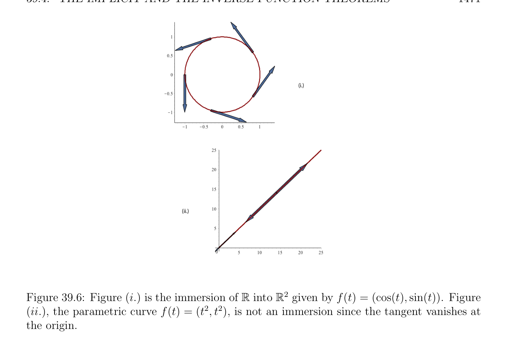

# The Implicit and The Inverse Function Theorems

<!-- PAGE 1465 -->
for some $M \ge 0$, then
$$\|f(a + h) -f(a)\|\le M\|h\|.$$
$$\longrightarrow \longrightarrow$$
As a corollary, if $L: E \to F$ is a continuous linear map, then
$$\|f(a + h) -f(a) -L(h)\|\le M\|h\|,$$
where $M = sup_{x\in(a,a+h)} \|Df(x)$ - $L\|$. The above proposition is sometimes called the “mean value theorem.” Proposition 39.12 can be used to show the following important result.

> **Theorem 39.13.** Given two normed affine spaces $E$ and $F$, where $E$ is of finite dimension $n$, and where $(a_{0}, (u_{1}, \dots  , u_{n}))$ is a frame of $E$, given any open subset $A$ of $E$, given any
$$\longrightarrow  \longrightarrow$$
function $f$ : $A \to F$, the derivative Df : $A \to$ L(E ; $F$ ) is defined and continuous on $A$ iff
$$every partial derivative \partial_{j} f (or \frac{\partial f}{\partial x_{j}} ) is defined and continuous on A, for all j, 1 \le j \le n.$$
As a corollary, if $F$ is of finite dimension $m$, and $(b_{0}, (v_{1}, \dots  , v_{m}))$ is a frame of $F$, the
$$\longrightarrow  \longrightarrow$$
derivative Df : $A \to$ L(E ; $F$ ) is defined and continuous on $A$ iff every partial derivative
$$\partial_{j} f_{i} (or \frac{\partial f_{i}}{\partial x_{j}} ) is defined and continuous on A, for all i, j, 1 \le i \le m, 1 \le j \le n.$$
Theorem 39.13 gives a necessary and sufficient condition for the existence and continuity of the derivative of a function on an open set. It should be noted that a more general version of Theorem 39.13 holds, assuming that $E = (E_{1}, a_{1}) \oplus \cdots  \oplus (E_{n}, a_{n})$, or $E = E_{1} \times  \cdots  \times  E_{n}$, and using the more general partial derivatives $D_{j}f$ introduced before Proposition 39.11.

> **Definition 39.9.** Given two normed affine spaces $E$ and $F$, and an open subset $A$ of $E$, we say that a function $f$ : $A \to F$ is of class $C^{0}$ on $A$ or a $C^{0}-function$ on $A$ if $f$ is continuous on $A$. We say that $f$ : $A \to F$ is of class $C^{1}$ on $A$ or a $C^{1}-function$ on $A$ if Df exists and is continuous on $A$. Since the existence of the derivative on an open set implies continuity, a $C^{1}-function$ is of course a $C^{0}-function$. Theorem 39.13 gives a necessary and sufficient condition for a function $f$ to be a $C^{1}-function$ (when $E$ is of finite dimension). It is easy to show that the composition of $C^{1}-functions$ (on appropriate open sets) is a $C^{1}-function$.

## 39.4 The Implicit and The Inverse Function Theorems

Given three normed affine spaces $E, F$, and $G$, given a function $f$ : $E \times  F \to G$, given any $c \in G$, it may happen that the equation
$$f(x, y) = c$$

<!-- PAGE 1466 -->
has the property that, for some open sets $A \subseteq E$, and $B \subseteq F$, there is a function $g: A \to B$, such that
$$f(x, g(x)) = c,$$
for all $x \in A$. Such a situation is usually very rare, but if some solution (a, $b) \in E \times  F$ such that f(a, $b) = c$ is known, under certain conditions, for some small open sets $A \subseteq E$ containing a and $B \subseteq F$ containing $b$, the existence of a unique $g: A \to B$, such that
$$f(x, g(x)) = c,$$
for all $x \in A$, can be shown. Under certain conditions, it can also be shown that $g$ is continuous, and differentiable. Such a theorem, known as the implicit function theorem, can be proven.
$$\mathbb{R}^{2}\mathbb{R}\mathbb{R}^{2} \mathbb{R} \sim \mathbb{R}^{3} \mathbb{R}^{2} \mathbb{R}\mathbb{R}$$

> **Example 39.10.** Let $E = , F = G = , \Omega = \times = , f$ : $\times  \to$  given by
$$f((x_{1}, x_{2}), x_{3}) = x_{1}^{2} + x_{2}^{2} + x_{3}^{2} -1,$$
$$\mathbb{R}^{2}$$
$$a = \begin{pmatrix} \sqrt & \sqrt & \sqrt & \sqrt \\ \overline{3}/(2 & \overline{2)}, & \overline{3}/(2 & \overline{2)} \end{pmatrix} , b = 1/2, and c = 0. The set of vectors (x_{1}, x_{2}, x_{3}) \in such$$
that
$$f((x_{1}, x_{2}), x_{3}) = x_{1}^{2} + x_{2}^{2} + x_{3}^{2} -1 = 0$$
$$\mathbb{R}^{3} -$$
is the unit sphere in . The vector (a, $b)$ belongs to the unit sphere since $\|a\|_{2}^{2} + b^{2} 1 = 0$.
$$\mathbb{R}^{2} \mathbb{R}$$
The function $g: \to$  given by
$$q$$
$$g(x_{1}, x_{2}) =1 -x_{1}^{2} -x_{2}^{2}$$
satisfies the equation
$$f(x_{1}, x_{2}, g(x_{1}, x_{2})) = 0$$
$$\mathbb{R}^{2}$$
all for $(x_{1}, x_{2})$ in the open disk ${(x_{1}, x_{2}) \in$ | $x_{1}^{2} + x_{2}^{2} < 1}$, and g(a) $= b$. Observe that if we had picked $b = -1/2$, then we would need to consider the function
$$q$$
$$g(x_{1}, x_{2}) = -1 -x_{1}^{2} -x_{2}^{2}.$$
We now state a very general version of the implicit function theorem. The proof of this theorem is fairly involved and uses a fixed-point theorem for contracting mappings in complete metric spaces; it is given in Schwartz $[157]$. Other proofs can be found in Lang $[115]$ and Cartan $[34]$.

> **Theorem 39.14.** Let $E, F$, and $G$, be normed affine spaces, let $\Omega$ be an open subset of $E \times  F$, let $f$ : $\Omega \to G$ be a function defined on $\Omega$ , let (a, $b) \in \Omega$ , let $c \in G$, and assume that f(a, $b) = c$. If the following assumptions hold
$(1)$ The function $f$ : $\Omega \to G$ is continuous on $\Omega$ ;
$(2) F$ is a complete normed affine space (and so is $G)$;

<!-- PAGE 1467 -->
$\longrightarrow  \longrightarrow$
$$(3) \frac{\partial f}{\partial y} (x, y) exists for every (x, y) \in \Omega , and \frac{\partial f}{\partial y} : \Omega \to L(F ;G) is continuous;$$
$\longrightarrow  \longrightarrow \longrightarrow  \longrightarrow$
$$(4) \frac{\partial f}{\partial y} (a, b) is a bijection of \mathcal{L}(F ;G), and \begin{pmatrix} \partial f \\ (a, b \\ \partial y \end{pmatrix} )^{-1}\in L(G;F );$$
then the following properties hold:
(a) There exist some open subset $A \subseteq E$ containing a and some open subset $B \subseteq F$ containing $b$, such that $A \times  B \subseteq \Omega$ , and for every $x \in A$, the equation f(x, $y) = c$ has a single solution $y =$ g(x), and thus, there is a unique function $g: A \to B$ such that f(x, g(x)) $= c$, for all $x \in A$;
$(b)$ The function $g: A \to B$ is continuous. If we also assume that
$(5)$ The derivative Df(a, $b)$ exists; then
$(c)$ The derivative Dg(a) exists, and
$$Dg(a) = - \begin{pmatrix} \partial f \\ (a, b \\ \partial y \end{pmatrix} )^{-1}\circ \frac{\partial f}{\partial x} (a, b);$$
and if in addition $\longrightarrow  \longrightarrow$
$$(6) \frac{\partial f}{\partial x} : \Omega \to L(E ;G) is also continuous (and thus, in view of (3), f is C^{1}on \Omega );$$
then
$$\longrightarrow  \longrightarrow$$
$(d)$ The derivative Dg: $A \to$ L(E ; $F$ ) is continuous, and
$$Dg(x) = - \begin{pmatrix} \partial f \\ (x, g(x \\ \partial y \end{pmatrix} ))^{-1}\circ \frac{\partial f}{\partial x} (x, g(x)),$$
for all $x \in A$.

> **Example 39.11.** Going back to Example 39.10, write $x = (x_{1}, x_{2})$ and $y = x_{3}$, so that the partial derivatives $\partial f/\partial x$ and $\partial f/\partial y$ are given in terms of their Jacobian matrices by
$$\frac{\partial f}{\partial x} (x, y) = \begin{pmatrix} 2x_{1} & 2x_{2} \end{pmatrix}$$
$$\frac{\partial f}{\partial y} (x, y) = 2x_{3}.$$

<!-- PAGE 1468 -->
$$-$$
If $0 <$ |b| $\le 1$ and $\|a\|_{2}^{2} + b^{2} 1 = 0$, then Conditions $(3)$ and $(4)$ are satisfied. Conditions
$(1)$ and $(2)$ obviously hold. Since $df_{(a,b)}$ is given by its Jacobian matrix as
$$df_{(a,b)} = \begin{pmatrix} 2a_{1} & 2a_{2} & 2b \end{pmatrix} ,$$
Condition $(5)$ holds, and clearly, Condition $(6)$ also holds.
$$\mathbb{R}^{2}$$
Theorem 39.14 implies that there is some open subset $A$ of containing a, some open subset $B$ of $\mathbb{R}$ containing $b$, and a unique function $g: A \to B$ such that
$$f(x, g(x)) = 0$$
for all $x \in A$. In fact, we can pick $A$ to be the open unit disk in $\mathbb{R}, B = (0, 2)$, and if $0 < b \le 1$, then
$$q$$
$$g(x_{1}, x_{2}) =1 -x_{1}^{2} -x_{2}^{2},$$
else if $-1 \le b < 0$, then
$$q$$
$$g(x_{1}, x_{2}) = -1 -x_{1}^{2} -x_{2}^{2}.$$
Assuming $0 < b \le 1$, We have
$$\frac{\partial f}{\partial x} (x, g(x)) = (2x_{1} 2x_{2}),$$
and
$$-1$$
$$\begin{pmatrix} \partial f \\ (x, g(x)) \\ \partial y \end{pmatrix} = \frac{1}{2p1 -x_{1}^{2}-x_{2}^{2}} ,$$
so according to the theorem,
$$dg_{x} = - \frac{1}{p1 -x_{1}^{2}-x_{2}^{2}} (x_{1} x_{2}),$$
which matches the derivative of $g$ computed directly. Observe that the functions $(x_{1}, x_{2}) \mapsto p\overline{1}\overline{-} \overline{x}_{1}^{2} \overline{-} \overline{x}_{2}^{2}$ and $(x_{1}, x_{2}) \mapsto -p\overline{1}\overline{-} \overline{x}_{1}^{2} \overline{-} \overline{x}_{2}^{2}$ are two differentiable parametrizations of the sphere, but the union of their ranges does not cover the entire sphere. Since $b \neq  0$, none of the points on the unit circle in the $(x_{1}, x_{2})-plane$ are covered. Our function $f$ views $b$ as lying on the $x_{3}-axis$. In order to cover the entire sphere
$$using this method, we need four more maps, which correspond to b lyingp \frac{onthex_{1}-axis}{1 -x_{2}^{2}-x_{3}^{2}} or$$
$$on the x_{2} axis. \frac{Thenwe}{1 -x_{1}^{2}-x_{3}^{2}.} get the additional (implicit) maps (x_{2}, x_{3}) \mapsto \pm   and$$
$(x_{1}, x_{3}) \mapsto \pm p$ The implicit function theorem plays an important role in the calculus of variations. We now consider another very important notion, that of a (local) diffeomorphism.

<!-- PAGE 1469 -->

> **Definition 39.10.** Given two topological spaces $E$ and $F$, and an open subset $A$ of $E$, we say that a function $f$ : $A \to F$ is a local homeomorphism from $A$ to $F$ if for every $a \in A$, there is an open set $U \subseteq A$ containing a and an open set $V$ containing f(a) such that $f$ is a homeomorphism from $U$ to $V =$ f(U). If $B$ is an open subset of $F$, we say that $f$ : $A \to F$ is a (global) homeomorphism from $A$ to $B$ if $f$ is a homeomorphism from $A$ to $B =$ f(A). If $E$ and $F$ are normed affine spaces, we say that $f$ : $A \to F$ is a local diffeomorphism from $A$ to $F$ if for every $a \in A$, there is an open set $U \subseteq A$ containing a and an open set $V$ containing f(a) such that $f$ is a bijection from $U$ to $V , f$ is a $C^{1}-function$ on $U$, and $f^{-1}$ is a $C^{1}-function$ on $V =$ f(U). We say that $f$ : $A \to F$ is a (global) diffeomorphism from $A$ to $B$ if $f$ is a homeomorphism from $A$ to $B =$ f(A), $f$ is a $C^{1}-function$ on $A$, and $f^{-1}$ is a $C^{1}-function$ on $B$. Note that a local diffeomorphism is a local homeomorphism. Also, as a consequence of Proposition 39.8, if $f$ is a diffeomorphism on $A$, then Df(a) is a linear isomorphism for every $a \in A$. The following theorem can be shown. In fact, there is a fairly simple proof using

> **Theorem 39.14.**

> **Theorem 39.15.** (Inverse Function Theorem) Let $E$ and $F$ be complete normed affine spaces, let $A$ be an open subset of $E$, and let $f$ : $A \to F$ be a $C^{1}-function$ on $A$. The following properties hold:
$(1)$ For every $a \in A$, if Df(a) is a linear isomorphism (which means that both Df(a) and $(Df(a))^{-1}$ are linear and $continuous),^{2}$ then there exist some open subset $U \subseteq A$ containing a, and some open subset $V$ of $F$ containing f(a), such that $f$ is a diffeomorphism from $U$ to $V =$ f(U). Furthermore,
$$Df^{-1} (f(a)) = (Df(a))^{-1}.$$
For every neighborhood $N$ of a, its image f(N) is a neighborhood of f(a), and for every open ball $U \subseteq A$ of center a, its image f(U) contains some open ball of center f(a).
$(2)$ If Df(a) is invertible for every $a \in A$, then $B =$ f(A) is an open subset of $F$, and $f$ is a local diffeomorphism from $A$ to $B$. Furthermore, if $f$ is injective, then $f$ is a diffeomorphism from $A$ to $B$. Proofs of the inverse function theorem can be found in Schwartz $[157]$, Lang $[115]$, Abraham and Marsden $[1]$, and Cartan $[34]$. The idea of Schwartz’s proof is that if we define the function $f_{1}$ : $F \times  \Omega \to F$ by
$$f_{1}(y, z) = f(z) -y,$$
then an inverse $g = f^{-1}$ of $f$ is an implicit solution of the equation $f_{1}(y, z) = 0$, since
$$that the roles of E and F are switched, but this is$$
$$\frac{f_{1}(y, g(y))=f(g(y)) -y=0.Observe}{Actually,sinceEandFareBanach} 2       spaces, by the Open Mapping Theorem, it is sufficient to assume$$
that Df(a) is continuous and bijective; see Lang $[115]$.

<!-- PAGE 1470 -->
not a problem since $F$ is complete. The proof consists in checking that the conditions of Theorem 39.14 apply. Part $(1)$ of Theorem 39.15 is often referred to as the “(local) inverse function theorem.” It plays an important role in the study of manifolds and (ordinary) differential equations. If $E$ and $F$ are both of finite dimension, and some frames have been chosen, the invertibility of Df(a) is equivalent to the fact that the Jacobian determinant det(J(f)(a)) is nonnull. The case where Df(a) is just injective or just surjective is also important for defining manifolds, using implicit definitions.

> **Definition 39.11.** Let $E$ and $F$ be normed affine spaces, where $E$ and $F$ are of finite dimension (or both $E$ and $F$ are complete), and let $A$ be an open subset of $E$. For any $a \in A$, a $C^{1}-function f$ : $A \to F$ is an immersion at a if Df(a) is injective. A $C^{1}-function f$ : $A \to F$ is a submersion at a if Df(a) is surjective. A $C^{1}-function f$ : $A \to F$ is an immersion on $A$ (resp. a submersion on $A)$ if Df(a) is injective (resp. surjective) for every $a \in A$. When $E$ and $F$ are finite dimensional with dim(E) $= n$ and dim(F) $= m$, if $m \ge n$, then $f$ is an immersion iff the Jacobian matrix, J(f)(a), has full rank $n$ for all $a \in E$ and if $n \ge m$, then $f$ is a submersion iff the Jacobian matrix, J(f)(a), has full rank $m$ for all $a \in E$.
$$\mathbb{R}\mathbb{R}^{2}$$

> **Example 39.12.** For example, $f$ :  $\to$ defined by f(t) $=$ (cos(t), sin(t)) is an immersion
$$\mathbb{R}\mathbb{R}^{2}$$
$$since J(f)(t) = \begin{pmatrix} -\sin(t) \\ \cos(t) \end{pmatrix} has \mathrm{rank} 1 for all t. On the other hand, f : \to defined by$$
$$f(t) = (t^{2}, t^{2}) is not an immersion since J(f)(t) = \begin{pmatrix} 2t \\ 2t \end{pmatrix} vanishes at t = 0. See Figure 39.6.$$
$$\mathbb{R}^{2} \mathbb{R}$$
An example of a submersion is given by the projection map $f$ : $\to$ , where f(x, $y) = x$,
$$since J(f)(x, y) = \begin{pmatrix} 1 & 0 \end{pmatrix} .$$
The following results can be shown.
$$\mathbb{R}^{n}\mathbb{R}^{m}$$

> **Proposition 39.16.** Let $A$ be an open subset of , and let $f$ : $A \to$ be a function.
$$\mathbb{R}^{m}$$
For every $a \in A, f$ : $A \to$ is a submersion at a iff there exists an open subset $U$ of $A$ containing a, an open subset $W \subseteq \mathbb{R}^{n-m}$, and a diffeomorphism $\phi$ : $U \to$ f(U) $\times  W$, such that,
$$f = \pi_{1}  \circ \phi ,$$
where $\pi_{1}$  : f(U) $\times  W \to$ f(U) is the first projection. Equivalently,
$$(f \circ \phi^{-1} )(y_{1}, \dots  , y_{m}, \dots  , y_{n}) = (y_{1}, \dots  , y_{m}).$$
$$\phi$$
$$U \subseteq Af(U) \times  W$$
$$N\overline{N}$$
$$\overline{N} N$$
$$NN$$
$$NN\pi$$
$$NN1$$
$$fN&$$
$$f(U) \subseteq \mathbb{R}^{m}$$

<!-- PAGE 1471 -->
$$(i.)$$
$$(ii.)$$
$$\mathbb{R}\mathbb{R}^{2}$$

**Figure 39.6:** Figure $(i.)$ is the immersion of  into given by f(t) $=$ (cos(t), sin(t)). Figure (ii.), the parametric curve f(t) $= (t^{2}, t^{2})$, is not an immersion since the tangent vanishes at the origin. Futhermore, the image of every open subset of $A$ under $f$ is an open subset of $F$. (The same
$$\mathbb{C}^{n}  \mathbb{C}^{m}$$
result holds for and ). See Figure 39.7.
$$\mathbb{R}^{n}\mathbb{R}^{m}$$

> **Proposition 39.17.** Let $A$ be an open subset of , and let $f$ : $A \to$ be a function.
$$\mathbb{R}^{m}$$
For every $a \in A, f$ : $A \to$ is an immersion at a iff there exists an open subset $U$ of $A$ containing a, an open subset $V$ containing f(a) such that f(U) $\subseteq V$ , an open subset $W$ containing $0$ such that $W \subseteq \mathbb{R}^{m-n}$, and a diffeomorphism $\phi$ : $V \to U \times  W$, such that,
$$\phi  \circ f = in_{1},$$
where $in_{1}$ : $U \to U \times  W$ is the injection map such that $in_{1}(u) = (u, 0)$, or equivalently,
$$(\phi  \circ f)(x_{1}, \dots  , x_{n}) = (x_{1}, \dots  , x_{n}, 0, \dots  , 0).$$
$$f$$
$$U \subseteq Af(U) \subseteq V$$
$$M\overline{M}$$
$$\overline{M} M$$
$$MM$$
$$MM\phi$$
$$MM$$
$$in1M&$$
$$U \times  W$$
$$\mathbb{C}^{n}  \mathbb{C}^{m}$$
(The same result holds for and ). See Figure 39.8.
