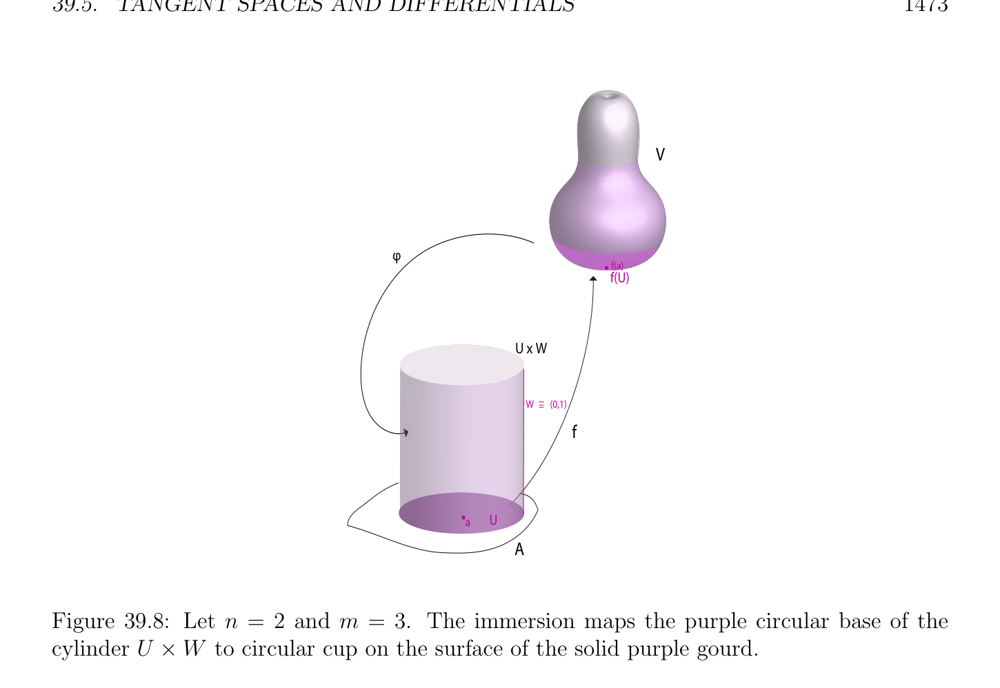

# Tangent Spaces and Differentials

<!-- PAGE 1472 -->
$$A$$
$$f(U) x W$$
$$U$$
$$\varphi$$
$$~$$
$$W =(0,1)$$
$$a$$
$$\pi$$
$$1$$
$$f$$
$$f(U)$$
$$\mathbb{R}^{3}$$

**Figure 39.7:** Let $n = 3$ and $m = 2$. The submersion maps the solid lavender egg in onto the bottom pink circular face of the solid cylinder f(U) $\times  W$.

## 39.5 Tangent Spaces and Differentials

In this section, we discuss briefly a geometric interpretation of the notion of derivative. We consider sets of points defined by a differentiable function. This is a special case of the notion of a (differential) manifold. Given two normed affine spaces $E$ and $F$, let $A$ be an open subset of $E$, and let $f$ : $A \to F$ be a function.

> **Definition 39.12.** Given $f$ : $A \to F$ as above, its graph $\Gamma (f)$ is the set of all points
$$\Gamma (f) = {(x, y) \in E \times  F | x \in A, y = f(x)}.$$
If Df is defined on $A$, we say that $\Gamma (f)$ is a differential submanifold of $E \times  F$ of equation $y =$ f(x). It should be noted that this is a very particular kind of differential manifold.

> **Example 39.13.** If $E =\mathbb{R}$ and $F =\mathbb{R}^{2}$, letting $f = (g, h)$, where $g: \mathbb{R} \to \mathbb{R}$ and $h: \mathbb{R} \to \mathbb{R}$,
$$\mathbb{R}^{3}\mathbb{R}^{2} \mathbb{R}$$
$\Gamma (f)$ is a curve in , of equations $y =$ g(x), $z =$ h(x). When $E =$ and $F = , \Gamma (f)$ is a surface in $\mathbb{R}^{3}$, of equation $z =$ f(x, $y)$. We now define the notion of affine tangent space in a very general way. Next, we will see what it means for manifolds $\Gamma (f)$, as in Definition 39.12.

> **Definition 39.13.** Given a normed affine space $E$, given any nonempty subset $M$ of $E$,
$$\longrightarrow$$
given any point $a \in M$, we say that a vector $u \in E$ is tangent at a to $M$ if there exist a

<!-- PAGE 1473 -->
$$V$$
$$\varphi$$
$$\overline{f(a)}$$
$$f(U)$$
$$U x W$$
$$W =~ (0,1)$$
$$f$$
$$aU$$
$$A$$

**Figure 39.8:** Let $n = 2$ and $m = 3$. The immersion maps the purple circular base of the cylinder $U \times  W$ to circular cup on the surface of the solid purple gourd. sequence $(a_{n})_{n\in N}$ of points in $M$ converging to a, and a sequence $(\lambda_{n} )_{n\in N}$, with $\lambda_{i}  \in \mathbb{R}$ and $\lambda_{n}  \ge 0$, such that the sequence $(\lambda_{n} (a_{n}$ - $a))_{n\in N}$ converges to $u$. The set of all vectors tangent at a to $M$ is called the family of tangent vectors at a to $M$ and the set of all points of $E$ of the form $a + u$ where $u$ belongs to the family of tangent vectors at a to $M$ is called the affine tangent family at a to $M$. Clearly, $0$ is always tangent, and if $u$ is tangent, then so is every $\lambda u$, for $\lambda  \in \mathbb{R}, \lambda  \ge 0$. If $u \neq  0$, then the sequence $(\lambda_{n} )_{n\in N}$ must tend towards $+\infty$ . We have the following proposition.

> **Proposition 39.18.** Let $E$ and $F$ be two normed affine spaces, let $A$ be an open subset of $E$, let $a \in A$, and let $f$ : $A \to F$ be a function. If Df(a) exists, then the family of tangent
$$\longrightarrow \times  \longrightarrow$$
vectors at (a, f(a)) to $\Gamma$  is a subspace $T_{a}(\Gamma$ ) of $E F$ , defined by the condition (equation)
$$(u, v) \in T_{a}(\Gamma )iff v = Df(a)(u),$$
and the affine tangent family at (a, f(a)) to $\Gamma$  is an affine variety $T_{a}(\Gamma$ ) of $E \times  F$, defined by the condition (equation)
$$(x, y) \in T_{a}(\Gamma )iff y = f(a) + Df(a)(x -a),$$
where $\Gamma$  is the graph of $f$.
