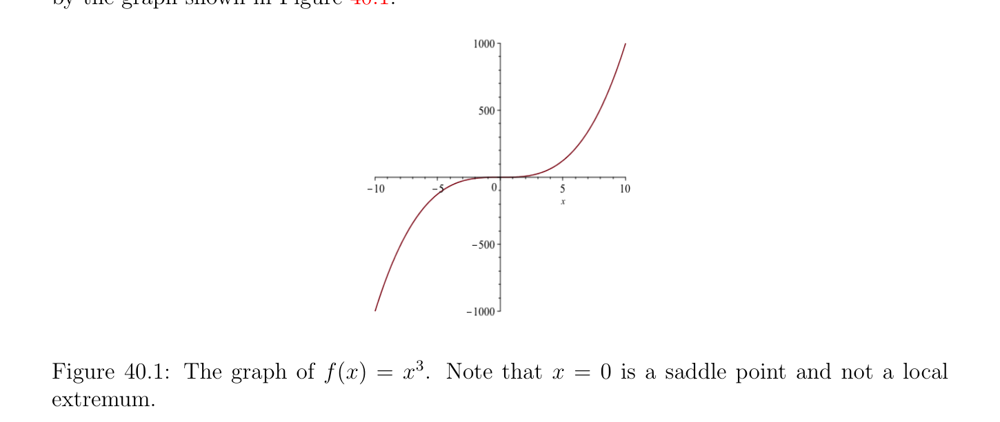

# Local Extrema and Lagrange Multipliers

<!-- PAGE 1494 -->

## 40.1 Local Extrema, Constrained Local Extrema, and

$$Lagrange Multipliers$$
Let $J$ : $E \to \mathbb{R}$ be a real-valued function defined on a normed vector space $E$ (or more generally, any topological space). Ideally we would like to find where the function $J$ reaches a minimum or a maximum value, at least locally. In this chapter we will usually use the notations dJ(u) or J'(u) (or $dJ_{u}$ or $J_{u}')$ for the derivative of $J$ at $u$, instead of DJ(u). Our presentation follows very closely that of Ciarlet $[41]$ (Chapter $7)$, which we find to be one of the clearest.

> **Definition 40.1.** If $J$ : $E \to \mathbb{R}$ is a real-valued function defined on a normed vector space $E$, we say that $J$ has a local minimum (or relative minimum) at the point $u \in E$ if there is some open subset $W \subseteq E$ containing $u$ such that
$$J(u) \le J(w)for all w \in W.$$
Similarly, we say that $J$ has a local maximum (or relative maximum) at the point $u \in E$ if there is some open subset $W \subseteq E$ containing $u$ such that
$$J(u) \ge J(w)for all w \in W.$$
In either case, we say that $J$ has a local extremum (or relative extremum) at $u$. We say that $J$ has a strict local minimum (resp. strict local maximum) at the point $u \in E$ if there is some open subset $W \subseteq E$ containing $u$ such that
$$J(u) < J(w)for all w \in W -{u}$$
(resp.
$$J(u) > J(w)for all w \in W -{u}).$$
By abuse of language, we often say that the point $u$ itself “is a local minimum” or a “local maximum,” even though, strictly speaking, this does not make sense. We begin with a well-known necessary condition for a local extremum.

> **Proposition 40.1.** Let $E$ be a normed vector space and let $J$ : $\Omega \to \mathbb{R}$ be a function, with $\Omega$ some open subset of $E$. If the function $J$ has a local extremum at some point $u \in \Omega$ and if $J$ is differentiable at $u$, then
$$dJ_{u} = J'(u) = 0.$$

*Proof.* Pick any $v \in E$. Since $\Omega$ is open, for $t$ small enough we have $u +$ tv $\in \Omega$ , so there is an open interval $I \subseteq \mathbb{R}$ such that the function $\phi$  given by
$$\phi (t) = J(u + tv)$$

<!-- PAGE 1495 -->
for all $t \in$ I is well-defined. By applying the chain rule, we see that $\phi$  is differentiable at $t = 0$, and we get
$$\phi' (0) = dJ_{u}(v).$$
Without loss of generality, assume that $u$ is a local minimum. Then we have
$$-$$
$$\phi' (0) = tlim\mapsto 0- \frac{\phi (t)\phi (0)}{t} \le 0$$
and
$$-$$
$$\phi' (0) = tlim\mapsto 0+ \frac{\phi (t)\phi (0)}{t} \ge 0,$$
which shows that $\phi' (0) = dJ_{u}(v) = 0$. As $v \in E$ is arbitrary, we conclude that $dJ_{u} = 0$.

> **Definition 40.2.** A point $u \in \Omega$ such that J'(u) $= 0$ is called a critical point of $J$. If $E =\mathbb{R}^{n}$, then the condition $dJ_{u} = 0$ is equivalent to the system
$$\frac{\partial J}{\partial x_{1}} (u_{1}, \dots  , u_{n}) = 0$$
$$\vdots$$
$$\frac{\partial J}{\partial x_{n}} (u_{1}, \dots  , u_{n}) = 0.$$
 The condition of Proposition 40.1 is only a necessary condition for the existence of an extremum, but not a sufficient condition. Here are some counter-examples. If $f$ : $\mathbb{R} \to \mathbb{R}$ is the function given by f(x) $= x^{3}$, since f' $(x) = 3x^{2}$, we have f' $(0) = 0$, but $0$ is neither a minimum nor a maximum of $f$ as evidenced by the graph shown in Figure 40.1.

**Figure 40.1:** The graph of f(x) $= x^{3}$. Note that $x = 0$ is a saddle point and not a local extremum.

<!-- PAGE 1496 -->
$$\mathbb{R}^{2} \mathbb{R}$$
If $g: \to$  is the function given by g(x, $y) = x^{2}$ - $y^{2}$, then $g_{(x,y)}' =$ (2x - 2y), so $g_{(0,0)}' = (0 0)$, yet near $(0, 0)$ the function $g$ takes negative and positive values. See Figure 40.2.

**Figure 40.2:** The graph of g(x, $y) = x^{2}$ - $y^{2}$. Note that $(0, 0)$ is a saddle point and not a local extremum.  It is very important to note that the hypothesis that $\Omega$ is open is crucial for the validity of Proposition 40.1. For example, if $J$ is the identity function on $\mathbb{R}$ and $U = [0, 1]$, a closed subset, then J'(x) $= 1$ for all $x \in [0, 1]$, even though $J$ has a minimum at $x = 0$ and a maximum at $x = 1$. In many practical situations, we need to look for local extrema of a function $J$ under additional constraints. This situation can be formalized conveniently as follows. We have a function $J$ : $\Omega \to \mathbb{R}$ defined on some open subset $\Omega$ of a normed vector space, but we also have some subset $U$ of $\Omega$ , and we are looking for the local extrema of $J$ with respect to the set $U$. The elements $u \in U$ are often called feasible solutions of the optimization problem consisting in finding the local extrema of some objective function $J$ with respect to some subset $U$ of $\Omega$ defined by a set of constraints. Note that in most cases, $U$ is not open. In fact, $U$ is usually closed.

> **Definition 40.3.** If $J$ : $\Omega \to \mathbb{R}$ is a real-valued function defined on some open subset $\Omega$ of a normed vector space $E$ and if $U$ is some subset of $\Omega$ , we say that $J$ has a local minimum (or relative minimum) at the point $u \in U$ with respect to $U$ if there is some open subset $W \subseteq \Omega$ containing $u$ such that
$$J(u) \le J(w)for all w \in U \cap W.$$

<!-- PAGE 1497 -->
Similarly, we say that $J$ has a local maximum (or relative maximum) at the point $u \in U$ with respect to $U$ if there is some open subset $W \subseteq \Omega$ containing $u$ such that
$$J(u) \ge J(w)for all w \in U \cap W.$$
In either case, we say that $J$ has a local extremum at $u$ with respect to $U$. In order to find necessary conditions for a function $J$ : $\Omega \to \mathbb{R}$ to have a local extremum with respect to a subset $U$ of $\Omega$ (where $\Omega$ is open), we need to somehow incorporate the definition of $U$ into these conditions. This can be done in two cases:
$(1)$ The set $U$ is defined by a set of equations,
$$U = {x \in \Omega | \phi_{i} (x) = 0, 1 \le i \le m},$$
where the functions $\phi_{i}$  : $\Omega \to \mathbb{R}$ are continuous (and usually differentiable).
$(2)$ The set $U$ is defined by a set of inequalities,
$$U = {x \in \Omega | \phi_{i} (x) \le 0, 1 \le i \le m},$$
where the functions $\phi_{i}$  : $\Omega \to \mathbb{R}$ are continuous (and usually differentiable). In $(1)$, the equations $\phi_{i} (x) = 0$ are called equality constraints, and in $(2)$, the inequalities $\phi_{i} (x) \le 0$ are called inequality constraints. An inequality constraint of the form $\phi_{i} (x) \ge 0$ is equivalent to the inequality constraint $-\phi_{x} (x) \le 0$. An equality constraint $\phi_{i} (x) = 0$ is equivalent to the conjunction of the two inequality constraints $\phi_{i} (x) \le 0$ and $-\phi_{i} (x) \le 0$, so the case of inequality constraints subsumes the case of equality constraints. However, the case of equality constraints is easier to deal with, and in this chapter we will restrict our attention to this case. If the functions $\phi_{i}$  are convex and $\Omega$ is convex, then $U$ is convex. This is a very important case that we will discuss later. In particular, if the functions $\phi_{i}$  are affine, then the equality constraints can be written as Ax $= b$, and the inequality constraints as Ax $\le b$, for some $m \times  n$ matrix $A$ and some vector $b \in \mathbb{R}^{m}$. We will also discuss the case of affine constraints later. In the case of equality constraints, a necessary condition for a local extremum with respect to $U$ can be given in terms of Lagrange multipliers. In the case of inequality constraints, there is also a necessary condition for a local extremum with respect to $U$ in terms of generalized Lagrange multipliers and the Karush–Kuhn–Tucker conditions. This will be discussed in Chapter $50$. We begin by considering the case where $\Omega \subseteq E_{1} \times  E_{2}$ is an open subset of a product of normed vector spaces and where $U$ is the zero locus of some continuous function $\phi$ : $\Omega \to E_{2}$, which means that
$$U = {(u_{1}, u_{2}) \in \Omega | \phi (u_{1}, u_{2}) = 0}.$$

<!-- PAGE 1498 -->
For the sake of brevity, we say that $J$ has a constrained local extremum at $u$ instead of saying that $J$ has a local extremum at the point $u \in U$ with respect to $U$.
$$\mathbb{R}^{n-m} \mathbb{R}^{m}$$
In most applications, we have $E_{1} =$ and $E_{2} =$ for some integers $m, n$ such that $1 \le m < n, \Omega$ is an open subset of $\mathbb{R}^{n}, J$ : $\Omega \to \mathbb{R}$, and we have $m$ functions $\phi_{i}$  : $\Omega \to \mathbb{R}$ defining the subset
$$U = {v \in \Omega | \phi_{i} (v) = 0, 1 \le i \le m}.$$
Fortunately, there is a necessary condition for constrained local extrema in terms of Lagrange multipliers.

> **Theorem 40.2.** (Necessary condition for a constrained extremum in terms of Lagrange multipliers) Let $\Omega$ be an open subset of $\mathbb{R}^{n}$, consider $m C^{1}-functions \phi_{i}$  : $\Omega \to \mathbb{R}$ (with $1 \le m < n)$, let
$$U = {v \in \Omega | \phi_{i} (v) = 0, 1 \le i \le m},$$
and let $u \in U$ be a point such that the derivatives $d\phi_{i} (u) (\mathbb{R}^{n};\mathbb{R})$ are linearly independent;
$$equivalently, assume that the m \times  n matrix \begin{pmatrix} \in L \\ (\partial \phi_{i} /\partial x_{j})(u) \\ ifJhasa \end{pmatrix} has \mathrm{rank} m. If J : \Omega \to \mathbb{R} is a$$
function which is differentiable at $u \in U$ and     local constrained extremum at $u$, then there exist $m$ numbers $\lambda_{i} (u) \in \mathbb{R}$, uniquely defined, such that
$$dJ(u) + \lambda_{1} (u)d\phi_{1} (u) + \cdots  + \lambda_{m} (u)d\phi_{m} (u) = 0;$$
equivalently,
$$\nabla J(u) + \lambda_{1} (u)\nabla \phi_{1} (u) + \cdots  + \lambda_{m} (u)\nabla \phi_{m} (u) = 0.$$
Theorem 40.2 will be proven as a corollary of Theorem 40.4, which gives a more general formulation that applies to the situation where $E_{1}$ is an infinite-dimensional Banach space. To simplify the exposition we postpone a discussion of this theorem until we have presented several examples illustrating the method of Lagrange multipliers.

> **Definition 40.4.** The numbers $\lambda_{i} (u)$ involved in Theorem 40.2 are called the Lagrange multipliers associated with the constrained extremum $u$ (again, with some minor abuse of language). The linear independence of the linear forms $d\phi_{i} (u)$ is equivalent to the fact that the
$$Jacobian matrix \begin{pmatrix} (\partial \phi_{i} /\partial x_{j})(u) \\ thed\phi_{i} (u) \end{pmatrix} of \phi  = (\phi_{1} , \dots  , \phi_{m} ) at u has \mathrm{rank} m. If m = 1, the linear$$
independence of   reduces to the condition $\nabla \phi_{1} (u) \neq  0$. A fruitful way to reformulate the use of Lagrange multipliers is to introduce the notion of the Lagrangian associated with our constrained extremum problem.

> **Definition 40.5.** The Lagrangian associated with our constrained extremum problem is the
$$\mathbb{R}^{m} \mathbb{R}$$
function $L: \Omega \times \to$  given by
$$L(v, \lambda ) = J(v) + \lambda_{1} \phi_{1} (v) + \cdots  + \lambda_{m} \phi_{m} (v),$$
with $\lambda  = (\lambda_{1} , \dots  , \lambda_{m}$ ).

<!-- PAGE 1499 -->
We have the following simple but important proposition.

> **Proposition 40.3.** There exists some $\mu  = (\mu_{1} , \dots  , \mu_{m}$ ) and some $u \in U$ such that
$$dJ(u) + \mu_{1} d\phi_{1} (u) + \cdots  + \mu_{m} d\phi_{m} (u) = 0$$
if and only if
$$dL(u, \mu ) = 0,$$
or equivalently
$$\nabla L(u, \mu ) = 0;$$
that is, iff $(u, \mu$ ) is a critical point of the Lagrangian $L$.

*Proof.* Indeed dL(u, $\mu$ ) $= 0$ is equivalent to
$$\frac{\partial L}{\partial v} (u, \mu ) = 0$$
$$\frac{\partial L}{\partial \lambda_{1}} (u, \mu ) = 0$$
$$\vdots$$
$$\frac{\partial L}{\partial \lambda_{m}} (u, \mu ) = 0,$$
and since
$$\frac{\partial L}{\partial v} (u, \mu ) = dJ(u) + \mu_{1} d\phi_{1} (u) + \cdots  + \mu_{m} d\phi_{m} (u)$$
and
$$\frac{\partial L}{\partial \lambda_{i}} (u, \mu ) = \phi_{i} (u),$$
we get
$$dJ(u) + \mu_{1} d\phi_{1} (u) + \cdots  + \mu_{m} d\phi_{m} (u) = 0$$
and
$$\phi_{1} (u) = \cdots  = \phi_{m} (u) = 0,$$
that is, $u \in U$. The converse is proven in a similar fashion (essentially by reversing the argument). If we write out explicitly the condition
$$dJ(u) + \lambda_{1} d\phi_{1} (u) + \cdots  + \lambda_{m} d\phi_{m} (u) = 0,$$

<!-- PAGE 1500 -->
we get the $n \times  m$ system
$$\frac{\partial J}{\partial x_{1}} (u) + \lambda_{1} \frac{\partial \phi_{1}}{\partial x_{1}} (u) + \cdots  + \lambda_{m} \frac{\partial \phi_{m}}{\partial x_{1}} (u) = 0$$
$$\vdots$$
$$\frac{\partial J}{\partial x_{n}} (u) + \lambda_{1} \frac{\partial \phi_{1}}{\partial x_{n}} (u) + \cdots  + \lambda_{m} \frac{\partial \phi_{m}}{\partial x_{n}} (u) = 0,$$
and it is important to note that the matrix of this system is the transpose of the Jacobian
$$matrix of \phi  at u. If we write Jac(\phi )(u) = \begin{pmatrix} (\partial \phi_{i} /\partial x_{j})(u) \\ formas \end{pmatrix} for the Jacobian matrix of \phi  (at$$
$u)$, then the above system is written in matrix
$$\nabla J(u) + (Jac(\phi )(u))^{\top}\lambda  = 0,$$
where $\lambda$  is viewed as a column vector, and the Lagrangian is equal to
$$L(u, \lambda ) = J(u) + (\phi_{1} (u), \dots  , \phi_{m} (u))\lambda .$$
The beauty of the Lagrangian is that the constraints ${\phi_{i} (v) = 0}$ have been incorporated into the function L(v, $\lambda$ ), and that the necessary condition for the existence of a constrained local extremum of $J$ is reduced to the necessary condition for the existence of a local extremum of the unconstrained $L$. However, one should be careful to check that the assumptions of Theorem 40.2 are satisfied (in particular, the linear independence of the linear forms $d\phi_{i}$ ).
$$\mathbb{R}^{3} \mathbb{R}$$

> **Example 40.1.** For example, let $J$ : $\to$  be given by
$$J(x, y, z) = x + y + z^{2}$$
$$\mathbb{R}^{3} \mathbb{R}$$
and $g: \to$  by
$$g(x, y, z) = x^{2}+ y^{2}.$$
Since g(x, $y, z) = 0$ iff $x = y = 0$, we have $U = {(0, 0, z)$ | $z \in \mathbb{R}}$ and the restriction of $J$ to $U$ is given by
$$J(0, 0, z) = z^{2},$$
which has a minimum for $z = 0$. However, a “blind” use of Lagrange multipliers would require that there is some $\lambda$  so that
$$\frac{\partial J}{\partial x} (0, 0, z) = \lambda \partial g(0, 0, z), \frac{\partial J}{\partial y} (0, 0, z) = \lambda \partial g(0, 0, z), \frac{\partial J}{\partial z} (0, 0, z) = \lambda \partial g(0, 0, z),$$
$$\overline{\partial x}\overline{\partial y}\overline{\partial z}$$
and since
$$\frac{\partial g}{\partial x} (x, y, z) = 2x, \frac{\partial g}{\partial y} (x, y, z) = 2y, \frac{\partial g}{\partial z} (0, 0, z) = 0,$$

<!-- PAGE 1501 -->
the partial derivatives above all vanish for $x = y = 0$, so at a local extremum we should also have
$$\frac{\partial J}{\partial x} (0, 0, z) = 0, \frac{\partial J}{\partial y} (0, 0, z) = 0, \frac{\partial J}{\partial z} (0, 0, z) = 0,$$
but this is absurd since
$$\frac{\partial J}{\partial x} (x, y, z) = 1, \frac{\partial J}{\partial y} (x, y, z) = 1, \frac{\partial J}{\partial z} (x, y, z) = 2z.$$
The reader should enjoy finding the reason for the flaw in the argument. One should also keep in mind that Theorem 40.2 gives only a necessary condition. The $(u, \lambda$ ) may not correspond to local extrema! Thus, it is always necessary to analyze the local behavior of $J$ near a critical point $u$. This is generally difficult, but in the case where $J$ is affine or quadratic and the constraints are affine or quadratic, this is possible (although not always easy).

> **Example 40.2.** Let us apply the above method to the following example in which $E_{1} =\mathbb{R}, E_{2} =\mathbb{R}, \Omega =\mathbb{R}^{2}$, and
$$J(x_{1}, x_{2}) = -x_{2}$$
$$\phi (x_{1}, x_{2}) = x_{1}^{2} + x_{2}^{2} -1.$$
Observe that
$$\mathbb{R}^{2}$$
$$U = {(x_{1}, x_{2}) \in | x_{1}^{2} + x_{2}^{2} = 1}$$
is the unit circle, and since
$$\nabla \phi (x_{1}, x_{2}) = \begin{pmatrix} 2x_{1} \\ 2x_{2} \end{pmatrix} ,$$
it is clear that $\nabla \phi (x_{1}, x_{2}) \neq  0$ for every point $= (x_{1}, x_{2})$ on the unit circle. If we form the Lagrangian
$$L(x_{1}, x_{2}, \lambda ) = -x_{2} + \lambda (x_{1}^{2} + x_{2}^{2} -1),$$
Theorem 40.2 says that a necessary condition for $J$ to have a constrained local extremum is that $\nabla L(x_{1}, x_{2}, \lambda$ ) $= 0$, so the following equations must hold:
$$2\lambda x_{1} = 0$$
$$-1 + 2\lambda x_{2} = 0$$
$$x_{1}^{2} + x_{2}^{2} = 1.$$
The second equation implies that $\lambda  \neq  0$, and then the first yields $x_{1} = 0$, so the third yields $x_{2} = \pm 1$, and we get two solutions:
$$\lambda  = \frac{1}{2} ,(x_{1}, x_{2}) = (0, 1)$$
$$\lambda  = - \frac{1}{2} ,(x_{1}', x_{2}') = (0, -1).$$

<!-- PAGE 1502 -->
We can check immediately that the first solution is a minimum and the second is a maximum. The reader should look for a geometric interpretation of this problem.

> **Example 40.3.** Let us now consider the case in which $J$ is a quadratic function of the form
$$J(v) = \frac{1}{2} v^{\top}Av -v^{\top}b,$$
where $A$ is an $n \times  n$ symmetric matrix, $b \in \mathbb{R}^{n}$, and the constraints are given by a linear system of the form
$$Cv = d,$$
where $C$ is an $m \times  n$ matrix with $m < n$ and $d \in \mathbb{R}^{m}$. We also assume that $C$ has rank $m$. In this case, the function $\phi$  is given by
$$\phi (v) = (Cv -d)^{\top},$$
because we view $\phi (v)$ as a row vector (and $v$ as a column vector), and by Example 39.3,
$$d\phi (u)(w) = (Cw)^{\top},$$
so the condition that the Jacobian matrix of $\phi$  at $u$ have rank $m$ is satisfied because the range of $d\phi (u)$ is spanned by the row vectors transpose of the columns of $C$, which form a matrix of rank $m$. The Lagrangian of this problem is
$$L(v, \lambda ) = \frac{1}{2} v^{\top}Av -v^{\top}b + (Cv -d)^{\top}\lambda  = \frac{1}{2} v^{\top}Av -v^{\top}b + v^{\top}C^{\top}\lambda  -d^{\top}\lambda ,$$
where $\lambda$  is viewed as a column vector. Now recall that because $A$ is a symmetric matrix, it was shown in Example 39.9 that
$$\nabla L_{(v,\lambda)} = \begin{pmatrix} Av -b + C^{\top}\lambda \\ Cv -d \end{pmatrix} .$$
Therefore, the necessary condition for constrained local extrema is
$$Av + C^{\top}\lambda  = b$$
$$Cv = d,$$
which can be expressed in matrix form as
$$\begin{pmatrix} A & C^{\top} \\ C & 0 \end{pmatrix} \begin{pmatrix} v \\ \lambda \end{pmatrix} = \begin{pmatrix} b \\ d \end{pmatrix} ,$$
where the matrix of the system is a symmetric matrix. We should not be surprised to find the system discussed later in Chapter $42$, except for some renaming of the matrices and vectors involved. As we will show in Section 42.2, the function $J$ has a minimum iff $A$ is positive definite, so in general, if $A$ is only a symmetric matrix, the critical points of the Lagrangian do not correspond to extrema of $J$.

<!-- PAGE 1503 -->
$$Remark: If the Jacobian matrix Jac(\phi )(v) = \begin{pmatrix} (\partial \phi_{i} /\partial x_{j})(v) \end{pmatrix} has \mathrm{rank} m for all v \in U$$
(which is equivalent to the linear independence of the linear forms $d\phi_{i} (v))$, then we say that $\mathbb{R}^{m} 0 \in$ is a regular value of $\phi$ . In this case, it is known that
$$U = {v \in \Omega | \phi (v) = 0}$$
is a smooth submanifold of dimension $n$ - $m$ of $\mathbb{R}^{n}$. Furthermore, the set
$$\mathbb{R}^{n}$$
$$T_{v}U = {w \in | d\phi_{i} (v)(w) = 0, 1 \le i \le m} = \bigcap_{i=1}^{m}  \mathrm{Ker} d\phi_{i} (v)$$
is the tangent space to $U$ at $v$ (a vector space of dimension $n$ - $m)$. Then, the condition
$$dJ(v) + \mu_{1} d\phi_{1} (v) + \cdots  + \mu_{m} d\phi_{m} (v) = 0$$
implies that dJ(v) vanishes on the tangent space $T_{v}U$. Conversely, if dJ(v)(w) $= 0$ for all $w \in T_{v}U$, this means that dJ(v) is orthogonal (in the sense of Definition 11.3) to $T_{v}U$. Since (by Theorem 11.4 $(b))$ the orthogonal of $T_{v}U$ is the space of linear forms spanned by $d\phi_{1} (v), \dots  , d\phi_{m} (v)$, it follows that dJ(v) must be a linear combination of the $d\phi_{i} (v)$. Therefore, when $0$ is a regular value of $\phi$ , Theorem 40.2 asserts that if $u \in U$ is a local extremum of $J$, then dJ(u) must vanish on the tangent space $T_{u}U$. We can say even more. The subset Z(J(u)) of $\Omega$ given by
$$Z(J(u)) = {v \in \Omega | J(v) = J(u)}$$
(the level set of level J(u)) is a hypersurface in $\Omega$ , and if dJ(u) $\neq  0$, the zero locus of dJ(u) is the tangent space $T_{u}Z(J(u))$ to Z(J(u)) at $u$ (a vector space of dimension $n$ - $1)$, where
$$\mathbb{R}^{n}$$
$$T_{u}Z(J(u)) = {w \in | dJ(u)(w) = 0}.$$
Consequently, Theorem 40.2 asserts that
$$T_{u}U \subseteq T_{u}Z(J(u));$$
this is a geometric condition. We now return to the general situation where $E_{1}$ and $E_{2}$ may be infinite-dimensional normed vector spaces (with $E_{1}$ a Banach space) and we state and prove the following general result about the method of Lagrange multipliers.

> **Theorem 40.4.** (Necessary condition for a constrained extremum) Let $\Omega \subseteq E_{1} \times  E_{2}$ be an open subset of a product of normed vector spaces, with $E_{1}$ a Banach space $(E_{1}$ is complete), let $\phi$ : $\Omega \to E_{2}$ be a $C^{1}-function$ (which means that $d\phi (\omega$ ) exists and is continuous for all $\omega  \in \Omega$ ), and let
$$U = {(u_{1}, u_{2}) \in \Omega | \phi (u_{1}, u_{2}) = 0}.$$

<!-- PAGE 1504 -->
Moreover, let $u = (u_{1}, u_{2}) \in U$ be a point such that
$$-1$$
$$\frac{\partial \phi}{\partial x_{2}} (u_{1}, u_{2}) \in L(E_{2}; E_{2})and \begin{pmatrix} \partial \phi \\ (u_{1}, u_{2}) \\ \partial x_{2} \end{pmatrix} \in L(E_{2}; E_{2}),$$
and let $J$ : $\Omega \to \mathbb{R}$ be a function which is differentiable at $u$. If $J$ has a constrained local extremum at $u$, then there is a continuous linear form $\Lambda (u) \in L(E_{2};\mathbb{R})$ such that
$$dJ(u) + \Lambda (u) \circ d\phi (u) = 0.$$

*Proof.* The plan of attack is to use the implicit function theorem; Theorem 39.14. Observe that the assumptions of Theorem 39.14 are indeed met. Therefore, there exist some open subsets $U_{1} \subseteq E_{1}, U_{2} \subseteq E_{2}$, and a continuous function $g: U_{1} \to U_{2}$ with $(u_{1}, u_{2}) \in U_{1}\times U_{2} \subseteq \Omega$ and such that
$$\phi (v_{1}, g(v_{1})) = 0$$
for all $v_{1} \in U_{1}$. Moreover, $g$ is differentiable at $u_{1} \in U_{1}$ and
$$-1$$
$$dg(u_{1}) = - \begin{pmatrix} \partial \phi \\ (u) \\ \partial x_{2} \end{pmatrix} \circ \frac{\partial \phi}{\partial x_{1}} (u).$$
It follows that the restriction of $J$ to $(U_{1} \times  U_{2}) \cap U$ yields a function $G$ of a single variable, with
$$G(v_{1}) = J(v_{1}, g(v_{1}))$$
for all $v_{1} \in U_{1}$. Now the function $G$ is differentiable at $u_{1}$ and it has a local extremum at $u_{1}$ on $U_{1}$, so Proposition 40.1 implies that
$$dG(u_{1}) = 0.$$
By the chain rule,
$$dG(u_{1}) = \frac{\partial J}{\partial x_{1}} (u) + \frac{\partial J}{\partial x_{2}} (u) \circ dg(u_{1})$$
$$-1$$
$$= \frac{\partial J}{\partial x_{1}} (u) - \frac{\partial J}{\partial x_{2}} (u) \circ \begin{pmatrix} \partial \phi \\ (u) \\ \partial x_{2} \end{pmatrix} \circ \frac{\partial \phi}{\partial x_{1}} (u).$$
From $dG(u_{1}) = 0$, we deduce
$$-1$$
$$\frac{\partial J}{\partial x_{1}} (u) = \frac{\partial J}{\partial x_{2}} (u) \circ \begin{pmatrix} \partial \phi \\ (u) \\ \partial x_{2} \end{pmatrix} \circ \frac{\partial \phi}{\partial x_{1}} (u),$$
and since we also have
$$-1$$
$$\frac{\partial J}{\partial x_{2}} (u) = \frac{\partial J}{\partial x_{2}} (u) \circ \begin{pmatrix} \partial \phi \\ (u) \\ \partial x_{2} \end{pmatrix} \circ \frac{\partial \phi}{\partial x_{2}} (u),$$

<!-- PAGE 1505 -->
if we let
$$-1$$
$$\Lambda (u) = - \frac{\partial J}{\partial x_{2}} (u) \circ \begin{pmatrix} \partial \phi \\ (u) \\ \partial x_{2} \end{pmatrix} ,$$
then we get
$$dJ(u) = \frac{\partial J}{\partial x_{1}} (u) + \frac{\partial J}{\partial x_{2}} (u)$$
$$-1$$
$$= \frac{\partial J}{\partial x_{2}} (u) \circ \begin{pmatrix} \partial \phi \\ (u) \\ \partial x_{2} \end{pmatrix} \circ \begin{pmatrix} \partial \phi \\ \partial \phi \\ (u) + & (u) \\ \partial x_{1} & \partial x_{2} \end{pmatrix}$$
$$= -\Lambda (u) \circ d\phi (u),$$
which yields dJ(u) $+ \Lambda (u) \circ d\phi (u) = 0$, as claimed. Finally, we prove Theorem 40.2. Proof of Theorem 40.2. The linear independence of the $m$ linear forms $d\phi_{i} (u)$ is equivalent
$$to the fact that the m \times  n matrix A = \begin{pmatrix} (\partial \phi_{i} /\partial x_{j})(u) \\ columnsare \end{pmatrix} has \mathrm{rank} m. By reordering the$$
columns, we may assume that the first $m$   linearly independent. To conform to the set-up of Theorem 40.4 we define $E_{1}$ and $E_{2}$ as
$$$$
$$E_{1} = \sum_{i=m+1}^{n}  v_{i}e_{i} | (v_{m+1}, \dots  , v_{n}) \in \mathbb{R}^{n-m},E_{2} = \sum_{i=1}^{m}  v_{i}e_{i} | (v_{1}, \dots  , v_{m}) \in \mathbb{R}^{m}.$$
$$\mathbb{R}^{m}$$
If we let $\psi$ : $\Omega \to$ be the function defined by
$$\psi (v_{m+1}, \dots  , v_{n}, v_{1}, \dots  , v_{m}) = (\phi_{1} (v), \dots  , \phi_{m} (v))$$
for all $(v_{m+1}, \dots  , v_{n}, v_{1}, \dots  , v_{m}) \in \Omega$ , with $v = (v_{1}, \dots  , v_{n})$, then we see that $\partial \psi /\partial x_{2}(u)$ is invertible and both $\partial \psi /\partial x_{2}(u)$ and its inverse are continuous, so that Theorem 40.4 applies, and there is some (continuous) linear form $\Lambda (u) \in L(\mathbb{R}^{m};\mathbb{R})$ such that
$$dJ(u) + \Lambda (u) \circ d\psi (u_{m+1}, \dots  , u_{n}, u_{1}, \dots  , u_{m}) = 0,$$
namely
$$dJ(u) + \Lambda (u) \circ d\phi (u) = 0.$$
However, $\Lambda (u)$ is defined by some $m$-tuple $(\lambda_{1} (u), \dots  , \lambda_{m} (u)) \in \mathbb{R}^{m}$, and in view of the definition of $\phi$ , the above equation is equivalent to
$$dJ(u) + \lambda_{1} (u)d\phi_{1} (u) + \cdots  + \lambda_{m} (u)d\phi_{m} (u) = 0.$$
The uniqueness of the $\lambda_{i} (u)$ is a consequence of the linear independence of the $d\phi_{i} (u)$. We now investigate conditions for the existence of extrema involving the second derivative of $J$.
