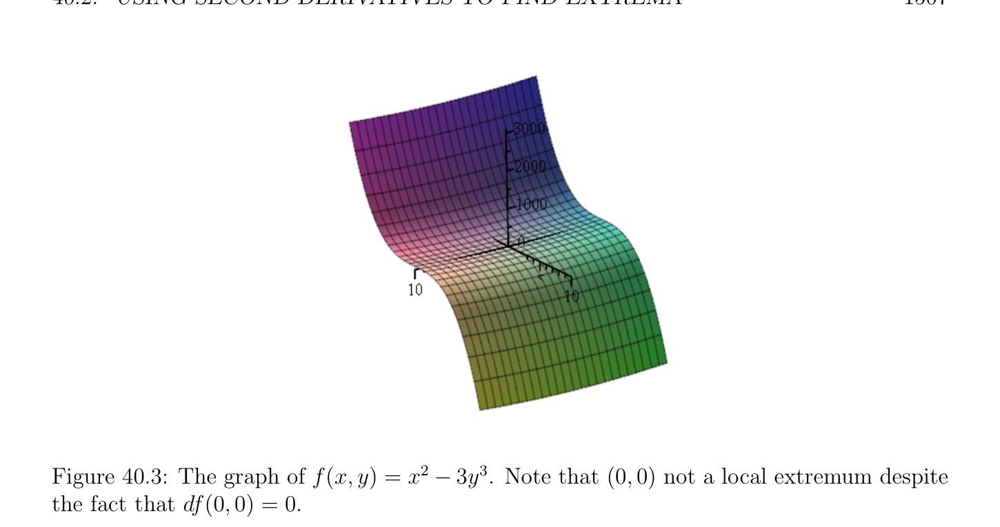

# Using Second Derivatives to Find Extrema

<!-- PAGE 1506 -->

## 40.2 Using Second Derivatives to Find Extrema

For the sake of brevity, we consider only the case of local minima; analogous results are obtained for local maxima (replace $J$ by $-J$, since $max_{u}$ J(u) $= -min_{u}$ -J(u)). We begin with a necessary condition for an unconstrained local minimum.

> **Proposition 40.5.** Let $E$ be a normed vector space and let $J$ : $\Omega \to \mathbb{R}$ be a function, with $\Omega$ some open subset of $E$. If the function $J$ is differentiable in $\Omega$ , if $J$ has a second derivative $D^{2}J(u)$ at some point $u \in \Omega$ , and if $J$ has a local minimum at $u$, then
$$D^{2}J(u)(w, w) \ge 0for all w \in E.$$

*Proof.* Pick any nonzero vector $w \in E$. Since $\Omega$ is open, for $t$ small enough, $u +$ tw $\in \Omega$ and J(u $+$ tw) $\ge$ J(u), so there is some open interval $I \subseteq \mathbb{R}$ such that
$$u + tw \in \Omega andJ(u + tw) \ge J(u)$$
for all $t \in$ I. Using the Taylor–Young formula and the fact that we must have dJ(u) $= 0$ since $J$ has a local minimum at $u$, we get
$$t^{2} \| \epsilon$$
$$0 \le J(u + tw) -J(u) =2 D^{2}J(u)(w, w) + t^{2}w\|^{2}(tw),$$
with $lim_{t\mapsto0} \epsilon$ (tw) $= 0$, which implies that
$$D^{2}J(u)(w, w) \ge 0.$$
Since the argument holds for all $w \in E$ (trivially if $w = 0)$, the proposition is proven. One should be cautioned that there is no converse to the previous proposition. For example, the function $f$ : $x \mapsto x^{3}$ has no local minimum at $0$, yet df(0) $= 0$ and $D^{2}f(0)(u, v) = 0$.
$$\mathbb{R}^{2} \mathbb{R}$$
Similarly, the reader should check that the function $f$ : $\to$  given by
$$f(x, y) = x^{2}-3y^{3}$$
has no local minimum at $(0, 0)$; yet df(0, $0) = 0$ since df(x, $y) =$ (2x, $-9y^{2})$, and for $u = (u_{1}, u_{2}), D^{2}f(0$, 0)(u, $u) = 2u_{1}^{2} \ge 0$ since
$$D^{2}f(x, y)(u, u) = \begin{pmatrix} u_{1} & u_{2} \end{pmatrix} \begin{pmatrix} 2 & 0 \\ 0 & -18y \end{pmatrix} \begin{pmatrix} u_{1} \\ u_{2} \end{pmatrix} .$$
See Figure 40.3. When $E = \mathbb{R}^{n}$, Proposition 40.5 says that a necessary condition for having a local minimum is that the Hessian $\nabla^{2}$ J(u) be positive semidefinite (it is always symmetric). We now give sufficient conditions for the existence of a local minimum.

<!-- PAGE 1507 -->

**Figure 40.3:** The graph of f(x, $y) = x^{2}$ - $3y^{3}$. Note that $(0, 0)$ not a local extremum despite the fact that df(0, $0) = 0$.

> **Theorem 40.6.** Let $E$ be a normed vector space, let $J$ : $\Omega \to \mathbb{R}$ be a function with $\Omega$ some open subset of $E$, and assume that $J$ is differentiable in $\Omega$ and that dJ(u) $= 0$ at some point $u \in \Omega$ . The following properties hold:
$(1)$ If $D^{2}J(u)$ exists and if there is some number $\alpha  \in \mathbb{R}$ such that $\alpha  > 0$ and
$$D^{2}J(u)(w, w) \ge \alpha  \|w\|^{2}for all w \in E,$$
then $J$ has a strict local minimum at $u$.
$(2)$ If $D^{2}J(v)$ exists for all $v \in \Omega$ and if there is a ball $B \subseteq \Omega$ centered at $u$ such that
$$D^{2}J(v)(w, w) \ge 0for all v \in B and all w \in E,$$
then $J$ has a local minimum at $u$.

*Proof.* $(1)$ Using the formula of Taylor–Young, for every vector $w$ small enough, we can write
$$\epsilon$$
$$J(u + w) -J(u) = \frac{1}{2} D^{2}J(u)(w, w) + \|w\|^{2}(w)$$
$$\ge \begin{pmatrix} 1 \\ \alpha  + \epsilon (w) \\ 2 \end{pmatrix} \|w\|^{2}$$
with $lim_{w\mapsto0} \epsilon (w) = 0$. Consequently if we pick $r > 0$ small enough that $|\epsilon$ (w)| $< \alpha /2$ for all $w$ with $\|w\| < r$, then J(u $+ w) >$ J(u) for all $u + w \in B$, where $B$ is the open ball of center $u$ and radius $r$. This proves that $J$ has a local strict minimum at $u$.

<!-- PAGE 1508 -->
$(2)$ The formula of Taylor–Maclaurin shows that for all $u + w \in B$, we have
$$J(u + w) = J(u) + \frac{1}{2} D^{2}J(v)(w, w) \ge J(u),$$
for some $v \in (u, u+w)$ (recall that $(u, u+w) = {(1-\lambda )(u+w)+\lambda (u+w)$ | $0 < \lambda  < 1})$. There are no converses of the two assertions of Theorem 40.6. However, there is a condition on $D^{2}J(u)$ that implies the condition of Part $(1)$. Since this condition is easier to state when $E =\mathbb{R}^{n}$, we begin with this case. Recall that a $n\times n$ symmetric matrix $A$ is positive definite if $x^{\top}Ax > 0$ for all $x \in \mathbb{R}^{n}-{0}$. In particular, $A$ must be invertible.

> **Proposition 40.7.** For any symmetric matrix $A$, if $A$ is positive definite, then there is some $\alpha  > 0$ such that
$$x^{\top}Ax \ge \alpha  \|x\|^{2}for all x \in \mathbb{R}^{n}.$$
$$\mathbb{R}^{n}  \mathbb{R}^{n}$$

*Proof.* Pick any norm in (recall that all norms on are equivalent). Since the unit
$$\mathbb{R}^{n}$$
sphere $S^{n-1} = {x \in$ | $\|x\| = 1}$ is compact and since the function f(x) $= x^{\top}Ax$ is never zero on $S^{n-1}$, the function $f$ has a minimum $\alpha  > 0$ on $S^{n-1}$. Using the usual trick that
$$\mathbb{R}^{n}$$
$x = \|x\|(x/ \|x\|)$ for every nonzero vector $x \in$ and the fact that the inequality of the proposition is trivial for $x = 0$, from
$$x^{\top}Ax \ge \alpha for all x with \|x\|= 1,$$
we get
$$x^{\top}Ax \ge \alpha  \|x\|^{2}for all x \in \mathbb{R}^{n},$$
as claimed. We can combine Theorem 40.6 and Proposition 40.7 to obtain a useful sufficient condition for the existence of a strict local minimum. First let us introduce some terminology.

> **Definition 40.6.** Given a function $J$ : $\Omega \to \mathbb{R}$ as before, say that a point $u \in \Omega$ is a nondegenerate critical point if dJ(u) $= 0$ and if the Hessian matrix $\nabla^{2}$ J(u) is invertible.

> **Proposition 40.8.** Let $J$ : $\Omega \to \mathbb{R}$ be a function defined on some open subset $\Omega \subseteq \mathbb{R}^{n}$. If $J$ is differentiable in $\Omega$ and if some point $u \in \Omega$ is a nondegenerate critical point such that $\nabla^{2}$ J(u) is positive definite, then $J$ has a strict local minimum at $u$.
Remark: It is possible to generalize Proposition 40.8 to infinite-dimensional spaces by finding a suitable generalization of the notion of a nondegenerate critical point. Firstly, we assume that $E$ is a Banach space (a complete normed vector space). Then we define the
$$\mathbb{R}$$
dual E' of $E$ as the set of continuous linear forms on $E$, so that E' $= \mathcal{L}(E$; ). Following Lang, we use the notation E' for the space of continuous linear forms to avoid confusion
