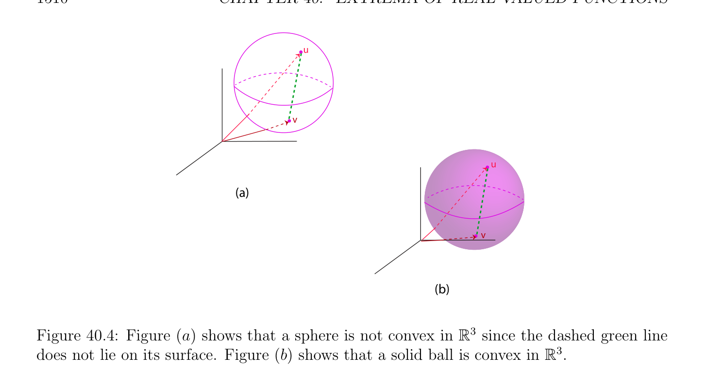
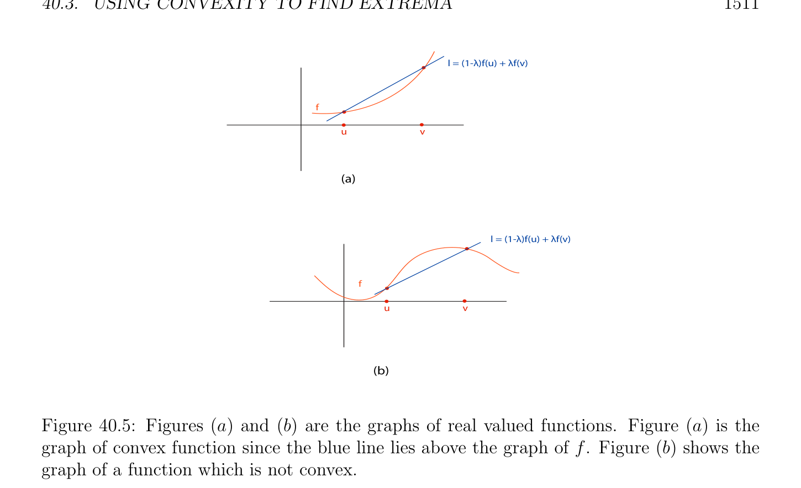

# Using Convexity to Find Extrema

<!-- PAGE 1509 -->
with the space $E^{*} = Hom(E,\mathbb{R})$ of all linear maps from $E$ to $\mathbb{R}$. A continuous bilinear map
$$\mathbb{R}\mathbb{R}$$
$\phi$ : $E \times  E \to$  in $\mathcal{L}_{2}(E, E$; ) yields a map $\Phi$  from $E$ to E' given by
$$\Phi (u) = \phi_{u} ,$$
where $\phi_{u}  \in$ E' is the linear form defined by
$$\phi_{u} (v) = \phi (u, v).$$
It is easy to check that $\phi_{u}$  is continuous and that the map $\Phi$  is continuous. Then we say that $\phi$  is nondegenerate $iff\Phi$ : $E \to$ E' is an isomorphism of Banach spaces, which means that $\Phi$  is invertible and that both $\Phi$  and $\Phi^{-1}$ are continuous linear maps. Given a function $J$ : $\Omega \to \mathbb{R}$ differentiable on $\Omega$ as before (where $\Omega$ is an open subset of $E)$, if $D^{2}J(u)$ exists for some $u \in \Omega$ , we say that $u$ is a nondegenerate critical point if dJ(u) $= 0$ and if $D^{2}J(u)$ is nondegenerate. Of course, $D^{2}J(u)$ is positive definite if $D^{2}J(u)(w, w) > 0$ for all $w \in E-{0}$. Using the above definition, Proposition 40.7 can be generalized to a nondegenerate positive definite bilinear form (on a Banach space) and Theorem 40.8 can also be generalized to the situation where $J$ : $\Omega \to \mathbb{R}$ is defined on an open subset of a Banach space. For details and proofs, see Cartan $[34]$ (Part I Chapter $8)$ and Avez $[9]$ (Chapter $8$ and Chapter $10)$. In the next section we make use of convexity; both on the domain $\Omega$ and on the function $J$ itself.

## 40.3 Using Convexity to Find Extrema

We begin by reviewing the definition of a convex set and of a convex function.

> **Definition 40.7.** Given any real vector space $E$, we say that a subset $C$ of $E$ is convex if either $C = \emptyset$ or if for every pair of points $u, v \in C$, the line segment connecting $u$ and $v$ is contained in $C$, i.e.,
$$(1 -\lambda )u + \lambda v \in Cfor all \lambda  \in \mathbb{R} such that 0 \le \lambda  \le 1.$$
Given any two points $u, v \in E$, the line segment $[u, v]$ is the set
$$[u, v] = {(1 -\lambda )u + \lambda v \in E | \lambda  \in \mathbb{R}, 0 \le \lambda  \le 1}.$$
Clearly, a nonempty set $C$ is convex iff[u, $v] \subseteq C$ whenever $u, v \in C$. See Figure 40.4 for an example of a convex set.

> **Definition 40.8.** If $C$ is a nonempty convex subset of $E$, a function $f$ : $C \to \mathbb{R}$ is convex (on $C)$ if for every pair of points $u, v \in C$,
$$f((1 -\lambda )u + \lambda v) \le (1 -\lambda )f(u) + \lambda f(v)for all \lambda  \in \mathbb{R} such that 0 \le \lambda  \le 1;$$

<!-- PAGE 1510 -->
$$u$$
$$v$$
$$u$$
$$(a)$$
$$v$$
$$(b)$$
$$\mathbb{R}^{3}$$

**Figure 40.4:** Figure (a) shows that a sphere is not convex in since the dashed green line does not lie on its surface. Figure $(b)$ shows that a solid ball is convex in $\mathbb{R}^{3}$. the function $f$ is strictly convex (on $C)$ if for every pair of distinct points $u, v \in C (u \neq  v)$,
$$f((1 -\lambda )u + \lambda v) < (1 -\lambda )f(u) + \lambda f(v)for all \lambda  \in \mathbb{R} such that 0 < \lambda  < 1;$$
$$\mathbb{R}$$
see Figure 40.5. The $epigraph^{1}$ epi(f) of a function $f$ : $A \to$  defined on some subset $A$ of $\mathbb{R}^{n}  \mathbb{R}^{n+1}$ is the subset of defined as
$$\mathbb{R}^{n+1}$$
$$epi(f) = {(x, y) \in | f(x) \le y, x \in A}.$$
A function $f$ : $C \to \mathbb{R}$ defined on a convex subset $C$ is concave (resp. strictly concave) if $(-f)$ is convex (resp. strictly convex). It is obvious that a function $f$ is convex iff its epigraph epi(f) is a convex subset $of\mathbb{R}^{n+1}$.

> **Example 40.4.** Here are some common examples of convex sets. $\bullet$  Subspaces $V \subseteq E$ of a vector space $E$ are convex. $\bullet$  Affine subspaces, that is, sets of the form $u+V$ , where $V$ is a subspace of $E$ and $u \in E$, are convex. $\bullet$  Balls (open or closed) are convex. Given any linear form $\phi$ : $E \to \mathbb{R}$, for any scalar $c \in \mathbb{R}$, the closed half–spaces
$$H_{\phi ,c}^{+} = {u \in E | \phi (u) \ge c},H_{\phi ,c}^{-} = {u \in E | \phi (u) \le c},$$
$$\frac{areconvex.}{“Epi”meansabove.}$$
$1$

<!-- PAGE 1511 -->
$$l = (1-\lambda )f(u) + \lambda f(v)$$
$$f$$
$$\overline{u}\overline{v}$$
$$(a)$$
$$l = (1-\lambda )f(u) + \lambda f(v)$$
$$f$$
$$\overline{u}\overline{v}$$
$$(b)$$

**Figure 40.5:** Figures (a) and $(b)$ are the graphs of real valued functions. Figure (a) is the graph of convex function since the blue line lies above the graph of $f$. Figure $(b)$ shows the graph of a function which is not convex. $\bullet$  Any intersection of half–spaces is convex. $\bullet$  More generally, any intersection of convex sets is convex.

> **Example 40.5.** Here are some common examples of convex and concave functions. $\bullet$  Linear forms are convex functions (but not strictly convex). $\bullet$  Any norm $\|\|$ : $E \to \mathbb{R}_{+}$ is a convex function. $\bullet$  The max function,
$$\max(x_{1}, \dots  , x_{n}) = \max{x_{1}, \dots  , x_{n}}$$
$$is convex on \mathbb{R}^{n}.$$
$$\mathbb{R}$$
$\bullet$  The exponential $x \mapsto e^{cx}$ is strictly convex for any $c \neq  0 (c \in$ ). $\bullet$  The logarithm function is concave on $\mathbb{R}_{+} -{0}. \bullet$  The log-determinant function log det is concave on the set of symmetric positive definite matrices. This function plays an important role in convex optimization. An excellent exposition of convexity and its applications to optimization can be found in Boyd $[29]$. Here is a necessary condition for a function to have a local minimum with respect to a convex subset $U$.

<!-- PAGE 1512 -->

> **Theorem 40.9.** (Necessary condition for a local minimum on a convex subset) Let $J$ : $\Omega \to \mathbb{R}$ be a function defined on some open subset $\Omega$ of a normed vector space $E$ and let $U \subseteq \Omega$ be a nonempty convex subset. Given any $u \in U$, if dJ(u) exists and if $J$ has a local minimum in $u$ with respect to $U$, then
$$dJ(u)(v -u) \ge 0for all v \in U.$$

*Proof.* Let $v = u + w$ be an arbitrary point in $U$. Since $U$ is convex, we have $u +$ tw $\in U$ for all $t$ such that $0 \le t \le 1$. Since dJ(u) exists, we can write
$$J(u + tw) -J(u) = dJ(u)(tw) + \|tw\|\epsilon (tw)$$
with $lim_{t\mapsto0} \epsilon$ (tw) $= 0$. However, because $0 \le t$,
$$J(u + tw) -J(u) = t(dJ(u)(w) + \|w\|\epsilon (tw))$$
and since $u$ is a local minimum with respect to $U$, we have J(u $+$ tw) - J(u) $\ge 0$, so we get
$$t(dJ(u)(w) + \|w\|\epsilon (tw)) \ge 0.$$
The above implies that dJ(u)(w) $\ge 0$, because otherwise we could pick $t > 0$ small enough so that
$$dJ(u)(w) + \|w\|\epsilon (tw) < 0,$$
a contradiction. Since the argument holds for all $v = u + w \in U$, the theorem is proven. Observe that the convexity of $U$ is a substitute for the use of Lagrange multipliers, but we now have to deal with an inequality instead of an equality. In the special case where $U$ is a subspace of $E$ we have the following result.

> **Corollary 40.10.** With the same assumptions as in Theorem 40.9, if $U$ is a subspace of $E$, if dJ(u) exists and if $J$ has a local minimum in $u$ with respect to $U$, then
$$dJ(u)(w) = 0for all w \in U.$$

*Proof.* In this case since $u \in U$ we have 2u $\in U$, and for any $u + w \in U$, we must have $2u-(u+w) =$ u-w $\in U$. The previous theorem implies that dJ(u)(w) $\ge 0$ and dJ(u)(-w) $\ge 0$, that is, dJ(u)(w) $\le 0$, so dJ(u) $= 0$. Since the argument holds for $w \in U$ (because $U$ is a subspace, if $u, w \in U$, then $u + w \in U)$, we conclude that
$$dJ(u)(w) = 0for all w \in U.$$
We will now characterize convex functions when they have a first derivative or a second derivative.

<!-- PAGE 1513 -->

> **Proposition 40.11.** (Convexity and first derivative) Let $f$ : $\Omega \to \mathbb{R}$ be a function differentiable on some open subset $\Omega$ of a normed vector space $E$ and let $U \subseteq \Omega$ be a nonempty convex subset.
$(1)$ The function $f$ is convex on $U$ iff
$$f(v) \ge f(u) + df(u)(v -u)for all u, v \in U.$$
$(2)$ The function $f$ is strictly convex on $U$ iff
$$f(v) > f(u) + df(u)(v -u)for all u, v \in U with u \neq  v.$$
See Figure 40.6.
$$(v, f(v))$$
$$(y,v)$$
$$y - v$$
$$(u, f(u))v - u$$
$$f$$
$$uv$$
$$y = f(u) + df(u)(v-u)$$

**Figure 40.6:** An illustration of a convex valued function $f$. Since $f$ is convex it always lies above its tangent line.

*Proof.* Let $u, v \in U$ be any two distinct points and pick $\lambda  \in \mathbb{R}$ with $0 < \lambda  < 1$. If the function $f$ is convex, then
$$f((1 -\lambda )u + \lambda v) \le (1 -\lambda )f(u) + \lambda f(v),$$
which yields
$$- -$$
$$\frac{f((1\lambda )u + \lambda v)f(u)}{\lambda} \le f(v) -f(u).$$
It follows that
$$- -$$
$$df(u)(v -u) = \lambda lim\mapsto 0 \frac{f((1\lambda )u + \lambda v)f(u)}{\lambda} \le f(v) -f(u).$$

<!-- PAGE 1514 -->
If $f$ is strictly convex, the above reasoning does not work, because a strict inequality is not necessarily preserved by “passing to the limit.” We have recourse to the following trick: for any $\omega$  such that $0 < \omega  < 1$, observe that
$$-$$
$$(1 -\lambda )u + \lambda v = u + \lambda (v -u) = \frac{\omega \lambda}{\omega} u + \frac{\lambda}{\omega} (u + \omega (v -u)).$$
If we assume that $0 < \lambda  \le \omega$ , the convexity of $f$ yields
$$-$$
$$f(u + \lambda (v -u)) = f \begin{pmatrix}  & \lambda \\ 1 - \\ \omega \end{pmatrix} \begin{pmatrix} \lambda \\ u + & (u + \omega (v -u)) \\ \omega \end{pmatrix} \le \frac{\omega \lambda}{\omega} f(u) + \frac{\lambda}{\omega} f(u + \omega (v -u)).$$
If we subtract f(u) to both sides, we get
$$- - - -$$
$$\frac{f(u + \lambda (vu))f(u)}{\lambda} \le \frac{f(u + \omega (vu))f(u)}{\omega} .$$
Now since $0 < \omega  < 1$ and $f$ is strictly convex,
$$f(u + \omega (v -u)) = f((1 -\omega )u + \omega v) < (1 -\omega )f(u) + \omega f(v),$$
which implies that
$$- -$$
$$\frac{f(u + \omega (vu))f(u)}{\omega} < f(v) -f(u),$$
and thus we get
$$- - - -$$
$$\frac{f(u + \lambda (vu))f(u)}{\lambda} \le \frac{f(u + \omega (vu))f(u)}{\omega} < f(v) -f(u).$$
If we let $\lambda$  go to $0$, by passing to the limit we get
$$- -$$
$$df(u)(v -u) \le \frac{f(u + \omega (vu))f(u)}{\omega} < f(v) -f(u),$$
which yields the desired strict inequality. Let us now consider the converse of $(1)$; that is, assume that
$$f(v) \ge f(u) + df(u)(v -u)for all u, v \in U.$$
For any two distinct points $u, v \in U$ and for any $\lambda$  with $0 < \lambda  < 1$, we get
$$f(v) \ge f(v + \lambda (u -v)) -\lambda df(v + \lambda (u -v))(u -v)$$
$$f(u) \ge f(v + \lambda (u -v)) + (1 -\lambda )df(v + \lambda (u -v))(u -v),$$
and if we multiply the first inequality by $1-\lambda$  and the second inequality by $\lambda$  and them add up the resulting inequalities, we get
$$(1 -\lambda )f(v) + \lambda f(u) \ge f(v + \lambda (u -v)) = f((1 -\lambda )v + \lambda u),$$
which proves that $f$ is convex. The proof of the converse of $(2)$ is similar, except that the inequalities are replaced by strict inequalities.

<!-- PAGE 1515 -->
We now establish a convexity criterion using the second derivative of $f$. This criterion is often easier to check than the previous one.

> **Proposition 40.12.** (Convexity and second derivative) Let $f$ : $\Omega \to \mathbb{R}$ be a function twice differentiable on some open subset $\Omega$ of a normed vector space $E$ and let $U \subseteq \Omega$ be a nonempty convex subset.
$(1)$ The function $f$ is convex on $U$ iff
$$D^{2}f(u)(v -u, v -u) \ge 0for all u, v \in U.$$
$(2)$ If
$$D^{2}f(u)(v -u, v -u) > 0for all u, v \in U with u \neq  v,$$
then $f$ is strictly convex.

*Proof.* First assume that the inequality in Condition $(1)$ is satisfied. For any two distinct points $u, v \in U$, the formula of Taylor–Maclaurin yields
$$f(v) -f(u) -df(u)(v -u) = \frac{1}{2} D^{2}f(w)(v -u, v -u)$$
$$= \frac{\rho^{2}}{2} D^{2}f(w)(v -w, v -w),$$
for some $w = (1$ - $\lambda )u + \lambda v = u + \lambda (v$ - $u)$ with $0 < \lambda  < 1$, and with $\rho  = 1/(1$ - $\lambda$ ) $> 0$, so that $v$ - $u = \rho (v$ - $w)$. Since $D^{2}f(w)(v$ - $w, v$ - $w) \ge 0$ for all $u, w \in U$, we conclude by applying Proposition 40.11(1). Similarly, if $(2)$ holds, the above reasoning and Proposition 40.11(2) imply that $f$ is strictly convex. To prove the necessary condition in $(1)$, define $g: \Omega \to \mathbb{R}$ by
$$g(v) = f(v) -df(u)(v),$$
where $u \in U$ is any point considered fixed. If $f$ is convex, since
$$g(v) -g(u) = f(v) -f(u) -df(u)(v -u),$$
Proposition 40.11 implies that f(v) - f(u) - df(u)(v - $u) \ge 0$, which implies that $g$ has a local minimum at $u$ with respect to all $v \in U$. Therefore, we have dg(u) $= 0$. Observe that $g$ is twice differentiable in $\Omega$ and $D^{2}g(u) = D^{2}f(u)$, so the formula of Taylor–Young yields for every $v = u + w \in U$ and all $t$ with $0 \le t \le 1$,
$$t^{2} \epsilon$$
$$0 \le g(u + tw) -g(u) =2 D^{2}f(u)(tw, tw) + \|tw\|^{2}(tw)$$
$$t^{2} \epsilon$$
$$=2 (D^{2}f(u)(w, w) + 2 \|w\|^{2}(wt)),$$
with $lim_{t\mapsto0} \epsilon$ (wt) $= 0$, and for $t$ small enough, we must have $D^{2}f(u)(w, w) \ge 0$, as claimed.

<!-- PAGE 1516 -->
The converse of Proposition 40.12 $(2)$ is false as we see by considering the strictly convex function $f$ given by f(x) $= x^{4}$ and its second derivative at $x = 0$.

> **Example 40.6.** On the other hand, if $f$ is a quadratic function of the form
$$f(u) = \frac{1}{2} u^{\top}Au -u^{\top}b$$
where $A$ is a symmetric matrix, we know that
$$df(u)(v) = v^{\top}(Au -b),$$
so
$$f(v) -f(u) -df(u)(v -u) = \frac{1}{2} v^{\top}Av -v^{\top}b - \frac{1}{2} u^{\top}Au + u^{\top}b -(v -u)^{\top}(Au -b)$$
$$= \frac{1}{2} v^{\top}Av - \frac{1}{2} u^{\top}Au -(v -u)^{\top}Au$$
$$= \frac{1}{2} v^{\top}Av + \frac{1}{2} u^{\top}Au -v^{\top}Au$$
$$= \frac{1}{2} (v -u)^{\top}A(v -u).$$
Therefore, Proposition 40.11 implies that $A$ is positive semidefinite iff $f$ is convex and $A$ is positive definite iff $f$ is strictly convex. We conclude this section by applying our previous theorems to convex functions defined on convex subsets. In this case local minima (resp. local maxima) are global minima (resp. global maxima). The next definition is the special case of Definition 40.1 in which $W = E$ but it does not hurt to state it explicitly.

> **Definition 40.9.** Let $f$ : $E \to \mathbb{R}$ be any function defined on some normed vector space (or more generally, any set). For any $u \in E$, we say that $f$ has a minimum in $u$ (resp. maximum in $u)$ if
$$f(u) \le f(v) (resp. f(u) \ge f(v))for all v \in E.$$
We say that $f$ has a strict minimum in $u$ (resp. strict maximum in $u)$ if
$$f(u) < f(v) (resp. f(u) > f(v))for all v \in E -{u}.$$
If $U \subseteq E$ is a subset of $E$ and $u \in U$, we say that $f$ has a minimum in $u$ (resp. strict minimum in $u)$ with respect to $U$ if
$$f(u) \le f(v)for all v \in U(resp. f(u) < f(v)for all v \in U -{u}),$$
and similarly for a maximum in $u$ (resp. strict maximum in $u)$ with respect to $U$ with $\le$ changed to $\ge$ and $<$ to $>$.

<!-- PAGE 1517 -->
Sometimes, we say global maximum (or minimum) to stress that a maximum (or a minimum) is not simply a local maximum (or minimum).

> **Theorem 40.13.** Given any normed vector space $E$, let $U$ be any nonempty convex subset of $E$.
$(1)$ For any convex function $J$ : $U \to \mathbb{R}$, for any $u \in U$, if $J$ has a local minimum at $u$ in $U$, then $J$ has a (global) minimum at $u$ in $U$.
$(2)$ Any strict convex function $J$ : $U \to \mathbb{R}$ has at most one minimum (in $U)$, and if it does, then it is a strict minimum (in $U)$.
$(3)$ Let $J$ : $\Omega \to \mathbb{R}$ be any function defined on some open subset $\Omega$ of $E$ with $U \subseteq \Omega$ and assume that $J$ is convex on $U$. For any point $u \in U$, if dJ(u) exists, then $J$ has a minimum in $u$ with respect to $U$ iff
$$dJ(u)(v -u) \ge 0for all v \in U.$$
$(4)$ If the convex subset $U$ in $(3)$ is open, then the above condition is equivalent to
$$dJ(u) = 0.$$

*Proof.* $(1)$ Let $v = u + w$ be any arbitrary point in $U$. Since $J$ is convex, for all $t$ with $0 \le t \le 1$, we have
$$J(u + tw) = J(u + t(v -u)) = J((1 -t)u + tv) \le (1 -t)J(u) + tJ(v),$$
which yields
$$J(u + tw) -J(u) \le t(J(v) -J(u)).$$
Because $J$ has a local minimum at $u$, there is some $t_{0}$ with $0 < t_{0} < 1$ such that
$$0 \le J(u + t_{0}w) -J(u) \le t_{0}(J(v) -J(u)),$$
which implies that J(v) - J(u) $\ge 0$.
$(2)$ If $J$ is strictly convex, the above reasoning with $w \neq  0$ shows that there is some $t_{0}$ with $0 < t_{0} < 1$ such that
$$0 \le J(u + t_{0}w) -J(u) < t_{0}(J(v) -J(u)),$$
which shows that $u$ is a strict global minimum (in $U)$, and thus that it is unique.
$(3)$ We already know from Theorem 40.9 that the condition dJ(u)(v-u) $\ge 0$ for all $v \in U$ is necessary (even if $J$ is not convex). Conversely, because $J$ is convex, careful inspection of the proof of Part $(1)$ of Proposition 40.11 shows that only the fact that dJ(u) exists is needed to prove that
$$J(v) -J(u) \ge dJ(u)(v -u)for all v \in U,$$

<!-- PAGE 1518 -->
and if
$$dJ(u)(v -u) \ge 0for all v \in U,$$
then
$$J(v) -J(u) \ge 0for all v \in U,$$
as claimed.
$(4)$ If $U$ is open, then for every $u \in U$ we can find an open ball $B$ centered at $u$ of radius $\epsilon$  small enough so that $B \subseteq U$. Then for any w̸ $= 0$ such that $\|w\| < \epsilon$ , we have both $v = u + w \in B$ and v' $= u$ - $w \in B$, so Condition $(3)$ implies that
$$dJ(u)(w) \ge 0anddJ(u)(-w) \ge 0,$$
which yields
$$dJ(u)(w) = 0.$$
Since the above holds for all $w \neq  0$ such such that $\|w\| < \epsilon$  and since dJ(u) is linear, we leave it to the reader to fill in the details of the proof that dJ(u) $= 0$.

> **Example 40.7.** Theorem 40.13 can be used to rederive the fact that the least squares solutions of a linear system Ax $= b$ (where $A$ is an $m \times  n$ matrix) are given by the normal equation
$$A^{\top}Ax = A^{\top}b.$$
For this, we consider the quadratic function
$$J(v) = \frac{1}{2} \|Av -b\|_{2}^{2} - \frac{1}{2} \|b\|_{2}^{2} ,$$
and our least squares problem is equivalent to finding the minima of $J on\mathbb{R}^{n}$. A computation reveals that
$$J(v) = \frac{1}{2} \|Av -b\|_{2}^{2} - \frac{1}{2} \|b\|_{2}^{2}$$
$$= \frac{1}{2} (Av -b)^{\top}(Av -b) - \frac{1}{2} b^{\top}b$$
$$= \frac{1}{2} (v^{\top}A^{\top}-b^{\top})(Av -b) - \frac{1}{2} b^{\top}b$$
$$= \frac{1}{2} v^{\top}A^{\top}Av -v^{\top}A^{\top}b,$$
and so
$$dJ(u) = A^{\top}Au -A^{\top}b.$$
Since $A^{\top}A$ is positive semidefinite, the function $J$ is convex, and Theorem 40.13(4) implies that the minima of $J$ are the solutions of the equation
$$A^{\top}Au -A^{\top}b = 0.$$
