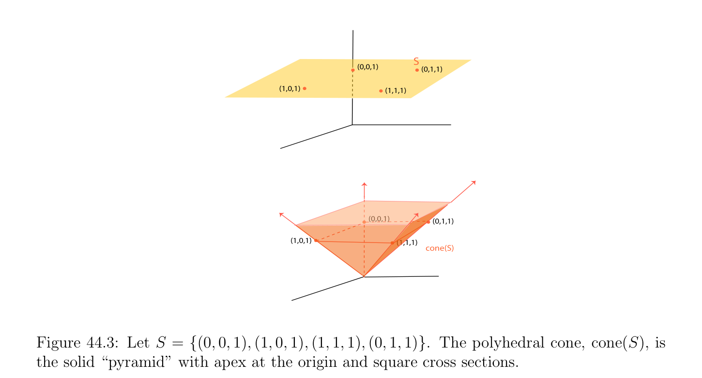
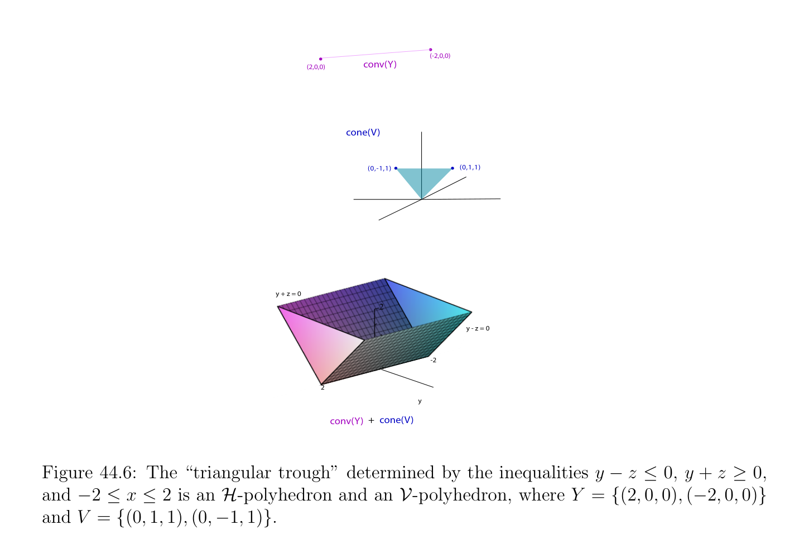

# Cones, Polyhedral Cones, and H-Polyhedra

<!-- PAGE 1580 -->
$$y$$
$$=$$
$$-2$$
$$x\overline{-}$$
$$\overline{3}$$
$$(0,0,1)H_{+}$$
$$H^{_}$$
$$H_{+}$$
$$H_{_}$$
$$(0,1,0)$$
$$(1,0,0)$$
$$x + y + z = 1$$
$$i.ii.$$

**Figure 44.2:** Figure $i$. illustrates the hyperplane $H(\phi$ ) for $\phi (x, y) =$ 2x $+ y + 3$, while Figure ii. illustrates the hyperplane $H(\phi$ ) for $\phi (x, y, z) = x + y + z$ - $1$. with $\phi (x, y, z) = x + y + z$ - $1$; this affine form defines the plane given by the equation $x + y + z = 1$, which is the plane through the points $(0, 0, 1), (0, 1, 0)$, and $(1, 0, 0)$. Both of these hyperplanes are illustrated in Figure 44.2.
$$\mathbb{R}^{n}$$

> **Definition 44.8.** For any two vector $x, y \in$ with $x = (x_{1}, \dots  , x_{n})$ and $y = (y_{1}, \dots  , y_{n})$ we write $x \le y$ iff $x_{i} \le y_{i}$ for $i = 1, \dots  , n$, and $x \ge y$ iff $y \le x$. In particular $x \ge 0$ iff $x_{i} \ge 0$ for $i = 1, \dots  , n$. Certain special types of convex sets called cones $and\mathcal{H}-polyhedra$ play an important role. The set of feasible solutions of a linear program is $an\mathcal{H}-polyhedron$, and cones play a crucial role in the proof of Proposition 45.1 and in the Farkas–Minkowski proposition (Proposition 47.2).

## 44.3 Cones, Polyhedral Cones, and \mathcal{H}-Polyhedra

Cones and polyhedral cones are defined as follows.

> **Definition 44.9.** Given a nonempty subset $S \subseteq \mathbb{R}^{n}$, the cone $C =$ cone(S) spanned by $S$ is the convex set
$$$$
$$cone(S) = \sum_{i=1}^{k}  \lambda_{i} u_{i}, u_{i} \in S, \lambda_{i}  \in \mathbb{R}, \lambda_{i}  \ge 0,$$
of positive combinations of vectors from $S$. If $S$ consists of a finite set of vectors, the cone $C =$ cone(S) is called a polyhedral cone. Figure 44.3 illustrates a polyhedral cone. Note that if some nonzero vector $u$ belongs to a cone $C$, then $\lambda u \in C$ for all $\lambda  \ge 0$, that is, the ray ${\lambda u$ | $\lambda  \ge 0}$ belongs to $C$.

<!-- PAGE 1581 -->
$$S$$
$$(0,0,1)(0,1,1)$$
$$(1,0,1)(1,1,1)$$
$$\overline{(0,0,1)}(0,1,1)$$
$$(1,0,1)(1,1,1)$$
$$cone(S)$$

**Figure 44.3:** Let $S = {(0, 0, 1), (1, 0, 1), (1, 1, 1), (0, 1, 1)}$. The polyhedral cone, cone(S), is the solid “pyramid” with apex at the origin and square cross sections.
Remark: The cones (and polyhedral cones) of Definition 44.9 are always convex. For this reason, we use the simpler terminology cone instead of convex cone. However, there are more general kinds of cones (see Definition 50.1) that are not convex (for example, a union of polyhedral cones or the linear cone generated by the curve in Figure 44.4), and if we were dealing with those we would refer to the cones of Definition 44.9 as convex cones.
$$Definition  44.10. An \mathcal{H}-polyhedron, for short a polyhedron, is any subset \mathcal{P} = \bigcap_{i}  s=1 C_{i} of$$
$\mathbb{R}^{n}$ defined as the intersection of a finite number $s$ of closed half-spaces $C_{i}$. An example of $an\mathcal{H}-polyhedron$ is shown in Figure 44.6. $An\mathcal{H}-polytope$ is a $bounded\mathcal{H}-polyhedron$, which means that there is a closed ball $B_{r}(x)$ of center $x$ and radius $r > 0$ such that $\mathcal{P} \subseteq B_{r}(x)$. An example of $a \mathcal{H}-polytope$ is shown in Figure 44.5.
$$\mathbb{R}^{n}$$
By convention, we agree that itself is an $\mathcal{H}-polyhedron$.
Remark: $The\mathcal{H}-polyhedra$ of Definition 44.10 are always convex. For this reason, as in the case of cones we use the simpler $terminology\mathcal{H}-polyhedron$ instead of $convex\mathcal{H}-polyhedron$. In algebraic topology, there are more general polyhedra that are not convex. It can be shown that $an\mathcal{H}-polytope\mathcal{P}$ is equal to the convex hull of finitely many points (the extreme points $of\mathcal{P})$. This is a nontrivial result whose proof takes a significant amount of work; see Gallier $[74]$ and Ziegler $[201]$. An unbounded $\mathcal{H}-polyhedron$ is not equal to the convex hull of finite set of points. To obtain an equivalent notion we introduce the notion of $a \mathcal{V}-polyhedron$.

<!-- PAGE 1582 -->
$$S$$
$$(0,0,1)$$
$$cone(S)$$

**Figure 44.4:** Let $S$ be a planar curve in $z = 1$. The linear cone of $S$, consisting of all half rays connecting $S$ to the origin, is not convex.
$$\mathbb{R}^{n}$$

> **Definition 44.11.** $A \mathcal{V}-polyhedron$ is any convex subset $A \subseteq$ of the form
$$A = conv(Y ) + cone(V ) = {a + v | a \in conv(Y ), v \in cone(V )},$$
$$\mathbb{R}^{n} \mathbb{R}^{n}$$
where $Y \subseteq$ and $V \subseteq$ are finite (possibly empty). When $V = \emptyset$ we simply have a polytope, and when $Y = \emptyset$ or $Y = {0}$, we simply have a cone. It can be shown that every $\mathcal{H}-polyhedron$ is $a \mathcal{V}-polyhedron$ and conversely. This is one of the major theorems in the theory of polyhedra, and its proof is nontrivial. For a complete proof, see Gallier $[74]$ and Ziegler $[201]$. Every polyhedral cone is closed. This is an important fact that is used in the proof of several other key results such as Proposition 45.1 and the Farkas–Minkowski proposition (Proposition 47.2). Although it seems obvious that a polyhedral cone should be closed, a rigorous proof is not entirely trivial. Indeed, the fact that a polyhedral cone is closed relies crucially on the fact that $C$ is spanned by a finite number of vectors, because the cone generated by an infinite set may
$$\mathbb{R}^{2}$$
not be closed. For example, consider the closed disk $D \subseteq$ of center $(0, 1)$ and radius $1$, which is tangent to the x-axis at the origin. Then the cone(D) consists of the open upper half-plane plus the origin $(0, 0)$, but this set is not closed.

> **Proposition 44.2.** Every polyhedral cone $C$ is closed.

<!-- PAGE 1583 -->
$$Figure 44.5: An icosahedron is an example of an \mathcal{H}-polytope.$$

*Proof.* This is proven by showing that $1$. Every primitive cone is closed, where a primitive cone is a polyhedral cone spanned by linearly independent vectors. $2$. A polyhedral cone $C$ is the union of finitely many primitive cones. Assume that $(a_{1}, \dots  , a_{m})$ are linearly independent vectors in $\mathbb{R}^{n}$, and consider any sequence $(x^{(k)})_{k\ge0}$
$$x^{(k)} = \sum_{i=1}^{m}  \lambda_{i}^{(k)}  a_{i}$$
of vectors in the primitive cone $cone({a_{1}, \dots  , a_{m}})$, which means that $\lambda_{j}^{(k)} \ge 0$ for $i = 1, \dots  , m$ and all $k \ge 0$. The vectors $x^{(k)}$ belong to the subspace $U$ spanned by $(a_{1}, \dots  , a_{m})$, and $U$ is closed. Assume that the sequence $(x^{(k)})_{k\ge0}$ converges to a limit $x \in \mathbb{R}^{n}$. Since $U$ is closed and $x^{(k)} \in U$ for all $k \ge 0$, we have $x \in U$. If we write $x = x_{1}a_{1} + \cdots  + x_{m}a_{m}$, we would like to prove that $x_{i} \ge 0$ for $i = 1, \dots  , m$. The sequence the $(x^{(k)})_{k\ge0}$ converges to $x$ iff
$$-

$=$ 0$$
$$limx^{(k)}x,$$
$$k\mapsto \infty$$
iff
$$klim\mapsto \infty \begin{pmatrix} |\lambda_{i}^{(k)} -x_{i} \end{pmatrix} \sum_{i=1}^{m}  |^{21/2}= 0$$
iff
$$lim\lambda_{i}^{(k)} = x_{i},i = 1, \dots  , m.$$
$$k\mapsto \infty$$
Since $\lambda_{i}^{(k)} \ge 0$ for $i = 1, \dots  , m$ and all $k \ge 0$, we have $x_{i} \ge 0$ for $i = 1, \dots  , m$, so $x \in cone({a_{1}, \dots  , a_{m}})$. Next, assume that $x$ belongs to the polyhedral cone $C$. Consider a positive combination
$$x = \lambda_{1} a_{1} + \cdots  + \lambda_{k} a_{k},(*_{1})$$

<!-- PAGE 1584 -->
$$(-2,0,0)$$
$$(2,0,0)conv(Y)$$
$$cone(V)$$
$$(0,-1,1)(0,1,1)$$
$$y + z = 0$$
$$y + z = 0$$
$$y - z = 0$$
$$-2$$
$$x2$$
$$y$$
$$conv(Y)+cone(V)$$

**Figure 44.6:** The “triangular trough” determined by the inequalities $y$ - $z \le 0, y + z \ge 0$, and $-2 \le x \le 2$ is an $\mathcal{H}-polyhedron$ and an $\mathcal{V}-polyhedron$, where $Y = {(2, 0, 0), (-2, 0, 0)}$ and $V = {(0, 1, 1), (0, -1, 1)}$. for some nonzero $a_{1}, \dots  , a_{k} \in C$, with $\lambda_{i}  \ge 0$ and with $k$ minimal. Since $k$ is minimal, we must have $\lambda_{i}  > 0$ for $i = 1, \dots  , k$. We claim that $(a_{1}, \dots  , a_{k})$ are linearly independent. If not, there is some nontrivial linear combination
$$\mu_{1} a_{1} + \cdots  + \mu_{k} a_{k} = 0,(*_{2})$$
and since the $a_{i}$ are nonzero, $\mu_{j}  \neq  0$ for some at least some $j$. We may assume that $\mu_{j}  < 0$ for some $j$ (otherwise, we consider the family $(-\mu_{i} )_{1\le i\le k})$, so let
$$J = {j \in {1, \dots  , k} | \mu_{j}  < 0}.$$
For any $t \in \mathbb{R}$, since $x = \lambda_{1} a_{1} + \cdots  + \lambda_{k} a_{k}$, using $(*_{2})$ we get
$$x = (\lambda_{1}  + t\mu_{1} )a_{1} + \cdots  + (\lambda_{k}  + t\mu_{k} )a_{k},(*_{3})$$
and if we pick
$$t = minj\in J \begin{pmatrix} -\lambda_{j} \\ \mu_{j} \end{pmatrix} \ge 0,$$
we have $(\lambda_{i}  + t\mu_{i}$ ) $\ge 0$ for $i = 1, \dots  , k$, but $\lambda_{j}  + t\mu_{j}  = 0$ for some $j \in J$, so $(*_{3})$ is an expression of $x$ with less that $k$ nonzero coefficients, contradicting the minimality of $k$ in $(*_{1})$. Therefore, $(a_{1}, \dots  , a_{k})$ are linearly independent.
