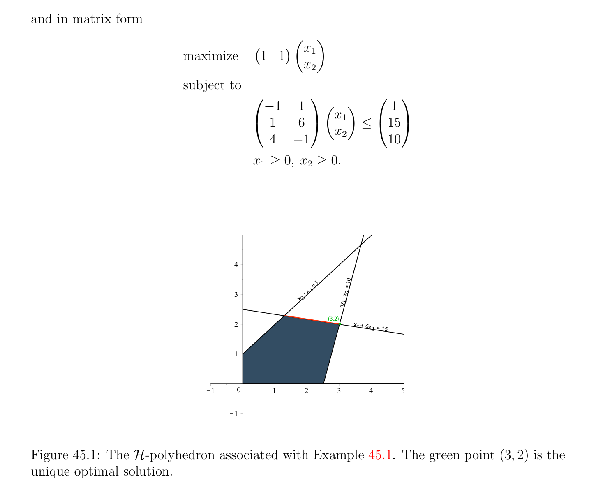

# Linear Programs, Feasible Solutions, Optimal Solutions

<!-- PAGE 1587 -->
Chapter $45$ Linear Programs In this chapter we introduce linear programs and the basic notions relating to this concept. We define the $\mathcal{H}-polyhedron \mathcal{P}(A, b)$ of feasible solutions. Then we define bounded and unbounded linear programs and the notion of optimal solution. We define slack variables and the important notion of linear program in standard form. We show that if a linear program in standard form has a feasible solution and is bounded above, then it has an optimal solution. This is not an obvious result and the proof relies on the fact that a polyhedral cone is closed (this result was shown in the previous chapter). Next we show that in order to find optimal solutions it suffices to consider solutions of a special form called basic feasible solutions. We prove that if a linear program in standard form has a feasible solution and is bounded above, then some basic feasible solution is an optimal solution (Theorem 45.4). Geometrically, a basic feasible solution corresponds to a vertex. In Theorem 45.6 we prove that a basic feasible solution of a linear program in standard form is a vertex of the polyhedron $\mathcal{P}(A, b)$. Finally, we prove that if a linear program in standard form has some feasible solution, then it has a basic feasible solution (see Theorem 45.7). This fact allows the simplex algorithm described in the next chapter to get started.

## 45.1 Linear Programs, Feasible Solutions, Optimal So-

$$lutions$$
The purpose of linear programming is to solve the following type of optimization problem.
$$1587$$

<!-- PAGE 1588 -->

> **Definition 45.1.** A Linear Program $(P)$ is the following kind of optimization problem:
$$maximizecx$$
$$subject to$$
$$a_{1}x \le b_{1}$$
$$\dots$$
$$a_{m}x \le b_{m}$$
$$x \ge 0,$$
where $x \in \mathbb{R}^{n}, c, a_{1}, \dots  , a_{m} \in (\mathbb{R}^{n})^{*}, b_{1}, \dots  , b_{m} \in \mathbb{R}$. The linear form $c$ defines the objective function $x \mapsto$ cx of the Linear Program $(P)$ (from $\mathbb{R}^{n}  \mathbb{R}$ to ), and the inequalities $a_{i}x \le b_{i}$ and $x_{j} \ge 0$ are called the constraints of the Linear Program $(P)$. If we define the $m \times  n$ matrix
$$A = \begin{pmatrix} a_{1} \\ \vdots \\ a_{m} \end{pmatrix}$$
whose rows are the row vectors $a_{1}, \dots  , a_{m}$ and $b$ as the column vector
$$b = \begin{pmatrix} b_{1} \\ \vdots \\ b_{m} \end{pmatrix} ,$$
the $m$ inequality constraints $a_{i}x \le b_{i}$ can be written in matrix form as
$$Ax \le b.$$
Thus the Linear Program $(P)$ can also be stated as the Linear Program $(P)$:
$$maximizecx$$
$$subject toAx \le b and x \ge 0.$$
We should note that in many applications, the natural primal optimization problem is actually the minimization of some objective function cx $= c_{1}x_{1} + \cdots  + c_{n}x_{n}$, rather its maximization. For example, many of the optimization problems considered in Papadimitriou and Steiglitz $[139]$ are minimization problems. Of course, minimizing cx is equivalent to maximizing -cx, so our presentation covers minimization too. Here is an explicit example of a linear program of Type $(P)$:

<!-- PAGE 1589 -->

> **Example 45.1.**
$$maximizex_{1} + x_{2}$$
$$subject to$$
$$x_{2} -x_{1} \le 1$$
$$x_{1} + 6x_{2} \le 15$$
$$4x_{1} -x_{2} \le 10$$
$$x_{1} \ge 0, x_{2} \ge 0,$$
and in matrix form
$$maximize \begin{pmatrix} 1 & 1 \end{pmatrix} \begin{pmatrix} x_{1} \\ x_{2} \end{pmatrix}$$
$$subject to$$
$$\begin{pmatrix} -1 & 1 \\ 1 & 6 \\ 4 & 1 \end{pmatrix} \begin{pmatrix} x_{1} \\ x_{2} \end{pmatrix} \le \begin{pmatrix} 1 \\ 15 \\ 10 \end{pmatrix}$$
$$-$$
$$x_{1} \ge 0, x_{2} \ge 0.$$
$$4$$
$$= 1 10$$
$$x    1x    =$$
$$3    -2$$
$$x24x   -$$
$$1$$
$$(3,2)$$
$$2x1   + 6x$$
$$2 = 15$$
$$1$$
$$\overline{K}\overline{1}\overline{0}\overline{1}\overline{2}\overline{3}\overline{4}\overline{5}$$
$$K1$$

**Figure 45.1:** The $\mathcal{H}-polyhedron$ associated with Example 45.1. The green point $(3, 2)$ is the unique optimal solution. It turns out that $x_{1} = 3, x_{2} = 2$ yields the maximum of the objective function $x_{1} + x_{2}$, which is $5$. This is illustrated in Figure 45.1. Observe that the set of points that satisfy the above constraints is a convex region cut out by half planes determined by the lines of

<!-- PAGE 1590 -->
equations
$$x_{2} -x_{1} = 1$$
$$x_{1} + 6x_{2} = 15$$
$$4x_{1} -x_{2} = 10$$
$$x_{1} = 0$$
$$x_{2} = 0.$$
In general, each constraint $a_{i}x \le b_{i}$ corresponds to the affine form $\phi_{i}$  given by $\phi_{i} (x) = a_{i}x -b_{i}$ and defines the half-space $H_{-}(\phi_{i}$ ), and each inequality $x_{j} \ge 0$ defines the half-space $H_{+}(x_{j})$. The intersection of these half-spaces is the set of solutions of all these constraints. It is a (possibly empty) $\mathcal{H}-polyhedron$ denoted $\mathcal{P}(A, b)$.

> **Definition 45.2.** If $\mathcal{P}(A, b) = \emptyset$ , we say that the Linear Program $(P)$ has no feasible solution, and otherwise any $x \in$ P(A, $b)$ is called a feasible solution of $(P)$. The linear program shown in Example 45.2 obtained by reversing the direction of the inequalities $x_{2}$ - $x_{1} \le 1$ and $4x_{1}$ - $x_{2} \le 10$ in the linear program of Example 45.1 has no feasible solution; see Figure 45.2.

> **Example 45.2.**
$$maximizex_{1} + x_{2}$$
$$subject to$$
$$x_{1} -x_{2} \le -1$$
$$x_{1} + 6x_{2} \le 15$$
$$x_{2} -4x_{1} \le -10$$
$$x_{1} \ge 0, x_{2} \ge 0.$$
$Assume\mathcal{P}(A, b) \neq  \emptyset$ , so that the Linear Program $(P)$ has a feasible solution. In this case, consider the image ${cx \in \mathbb{R}$ | $x \in$ P(A, $b)}$ of $\mathcal{P}(A, b)$ under the objective function $x \mapsto$ cx.

> **Definition 45.3.** If the set ${cx \in \mathbb{R}$ | $x \in$ P(A, $b)}$ is unbounded above, then we say that the Linear Program $(P)$ is unbounded. The linear program shown in Example 45.3 obtained from the linear program of Example 45.1 by deleting the constraints $4x_{1}$ - $x_{2} \le 10$ and $x_{1} + 6x_{2} \le 15$ is unbounded.

> **Example 45.3.**
$$maximizex_{1} + x_{2}$$
$$subject to$$
$$x_{2} -x_{1} \le 1$$
$$x_{1} \ge 0, x_{2} \ge 0.$$

<!-- PAGE 1591 -->
$$5$$
$$4$$
$$= 1$$
$$x  1$$
$$-  10$$
$$3x2$$
$$x    =$$
$$2$$
$$4x   -$$
$$x   + 1$$
$$16x   2 = 15$$
$$2$$
$$1$$
$$\overline{K}\overline{1}\overline{0}\overline{1}\overline{2}\overline{3}\overline{4}\overline{5}$$
$$K1$$

**Figure 45.2:** There is no $\mathcal{H}-polyhedron$ associated with Example 45.2 since the blue and purple regions do not overlap. Otherwise, we will prove shortly that if $\mu$  is the least upper bound of the set ${cx \in \mathbb{R}$ | $x \in$ P(A, $b)}$, then there is some $p \in$ P(A, $b)$ such that
$$cp = \mu ,$$
that is, the objective function $x \mapsto$ cx has a maximum value $\mu$  on $\mathcal{P}(A, b)$ which is achieved by some $p \in$ P(A, $b)$.

> **Definition 45.4.** If the set ${cx \in \mathbb{R}$ | $x \in$ P(A, $b)}$ is nonempty and bounded above, any point $p \in$ P(A, $b)$ such that cp $= max{cx \in \mathbb{R}$ | $x \in$ P(A, $b)}$ is called an optimal solution (or optimum) of $(P)$. Optimal solutions are often denoted by an upper *; for example, $p^{*}$. The linear program of Example 45.1 has a unique optimal solution $(3, 2)$, but observe that the linear program of Example 45.4 in which the objective function is $(1/6)x_{1} + x_{2}$ has infinitely many optimal solutions; the maximum of the objective function is $15/6$ which occurs along the points of orange boundary line in Figure 45.1.

> **Example 45.4.**
$$maximize \frac{1}{6} x_{1} + x_{2}$$
$$subject to$$
$$x_{2} -x_{1} \le 1$$
$$x_{1} + 6x_{2} \le 15$$
$$4x_{1} -x_{2} \le 10$$
$$x_{1} \ge 0, x_{2} \ge 0.$$

<!-- PAGE 1592 -->
The proof that if the set ${cx \in \mathbb{R}$ | $x \in$ P(A, $b)}$ is nonempty and bounded above, then there is an optimal solution $p \in$ P(A, $b)$, is not as trivial as it might seem. It relies on the fact that a polyhedral cone is closed, a fact that was shown in Section 44.3. We also use a trick that makes the proof simpler, which is that a Linear Program $(P)$ with inequality constraints Ax $\le b$
$$maximizecx$$
$$subject toAx \le b and x \ge 0,$$
is equivalent to the Linear Program $(P_{2})$ with equality constraints
$$maximizecx$$
$$b b$$
$$subject toAx = b andx \ge 0,$$
$$bb b$$
where $A$ is an $m \times  (n + m)$ matrix, $c$ is a linear form in $(\mathbb{R}^{n+m})^{*}$, and $x \in \mathbb{R}^{n+m}$, given by $b  b  b$
$$Ab = \begin{pmatrix} A & I_{m} \end{pmatrix} ,bc = \begin{pmatrix} c & 0_{m}^{\top} \end{pmatrix} ,andxb = \begin{pmatrix} x \\ z \end{pmatrix} ,$$
$$\mathbb{R}^{n} \mathbb{R}^{m}$$
with $x \in$ and $z \in$ . Indeed, Ax $= b$ and $x \ge 0$ iff
$$bb b$$
$$Ax + z = b,x \ge 0, z \ge 0,$$
iff
$$Ax \le b,x \ge 0,$$
and $c x =$ cx. $b b$

> **Definition 45.5.** The variables $z$ are called slack variables, and a linear program of the form $(P_{2})$ is called a linear program in standard form. The result of converting the linear program of Example 45.4 to standard form is the program shown in Example 45.5.

> **Example 45.5.**
$$maximize \frac{1}{6} x_{1} + x_{2}$$
$$subject to$$
$$x_{2} -x_{1} + z_{1} = 1$$
$$x_{1} + 6x_{2} + z_{2} = 15$$
$$4x_{1} -x_{2} + z_{3} = 10$$
$$x_{1} \ge 0, x_{2} \ge 0, z_{1} \ge 0, z_{2} \ge 0, z_{3} \ge 0.$$

<!-- PAGE 1593 -->
We can now prove that if a linear program has a feasible solution and is bounded, then it has an optimal solution.

> **Proposition 45.1.** Let $(P_{2})$ be a linear program in standard form, with equality constraint Ax $= b$. If $\mathcal{P}(A, b)$ is nonempty and bounded above, and if $\mu$  is the least upper bound of the set ${cx \in \mathbb{R}$ | $x \in$ P(A, $b)}$, then there is some $p \in$ P(A, $b)$ such that
$$cp = \mu ,$$
that is, the objective function $x \mapsto$ cx has a maximum value $\mu$  on $\mathcal{P}(A, b)$ which is achieved by some optimum solution $p \in$ P(A, $b)$.

*Proof.* Since $\mu  = sup{cx \in \mathbb{R}$ | $x \in$ P(A, $b)}$, there is a sequence $(x^{(k)})_{k\ge0}$ of vectors $x^{(k)} \in$ P(A, $b)$ such that $lim_{k\mapsto \infty} cx^{(k)} = \mu$ . In particular, if we write $x^{(k)} = (x_{1}^{(k)} , \dots  , x_{n}^{(k)}$ ) we have $x_{j}^{(k)} \ge 0$ for $j = 1, \dots  , n$ and for all $k \ge 0$. Let $A$ be the $(m + 1) \times  n$ matrix
$$e$$
$$Ae = \begin{pmatrix} c \\ A \end{pmatrix} ,$$
$$\mathbb{R}^{m+1}$$
and consider the sequence $(Ax^{(k)})_{k\ge0}$ of vectors $Ax^{(k)} \in$ . We have
$$e e$$
$$Ax^{(k)}e= \begin{pmatrix} c \\ A \end{pmatrix} x^{(k)}= \begin{pmatrix} cx_{(k)} \\ Ax^{(k)} \end{pmatrix} = \begin{pmatrix} cx^{(k)} \\ b \end{pmatrix} ,$$
since by hypothesis $x^{(k)} \in$ P(A, $b)$, and the constraints are Ax $= b$ and $x \ge 0$. Since by
$$hypothesis lim_{k\mapsto \infty}cx^{(k)}= \mu , the sequence ( Ax^{(k)}e)_{k\ge0} converges to the vector \begin{pmatrix} \mu \\ b \end{pmatrix} . Now,$$
observe that each vector $Ax^{(k)}$ can be written as the convex combination
$$e$$
$$Ax^{(k)}e = \sum_{j=1}^{n}  x_{j}^{(k)}A^{j}e,$$
$$\mathbb{R}^{m+1}$$
with $x_{j}^{(k)} \ge 0$ and where $A^{j} \in$ is the jth column of $A$. Therefore, $Ax^{(k)}$ belongs to the
$$e e e$$
polyheral cone
$$C = cone(A^{1}, \dots  ,A^{n}) = {Ax | x \in \mathbb{R}^{n}, x \ge 0},$$
$$e e e$$
and since by Proposition 44.2 this cone is closed, $lim_{k\ge \infty} Ax^{(k)} \in C$, which means that there
$$e$$
$$\mathbb{R}^{n}$$
is some $u \in$ with $u \ge 0$ such that
$$\begin{pmatrix} \mu \\ b \end{pmatrix} = klim\ge \infty Ax^{(k)}e= Aue = \begin{pmatrix} cu \\ Au \end{pmatrix} ,$$
that is, cu $= \mu$  and Au $= b$. Hence, $u$ is an optimal solution of $(P_{2})$. The next question is, how do we find such an optimal solution? It turns out that for linear programs in standard form where the constraints are of the form Ax $= b$ and $x \ge 0$, there are always optimal solutions of a special type called basic feasible solutions.
