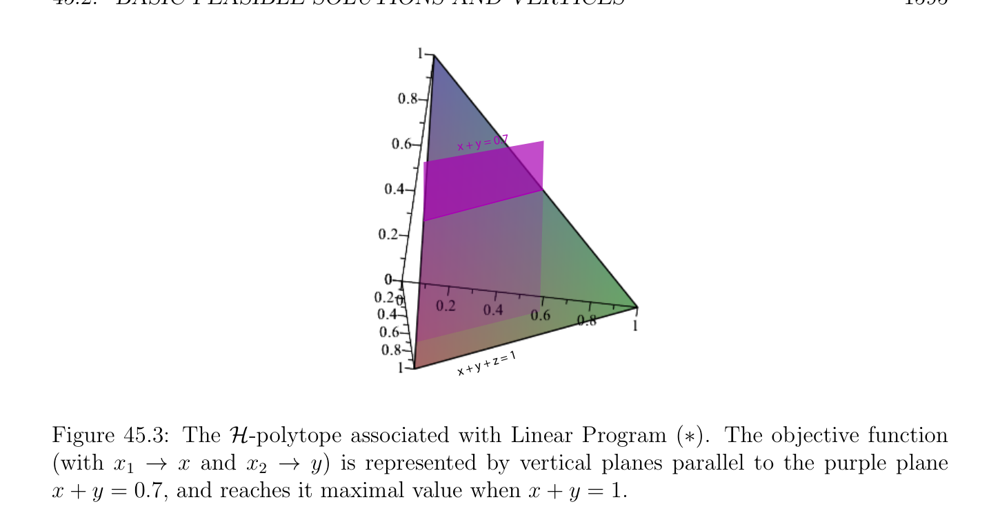
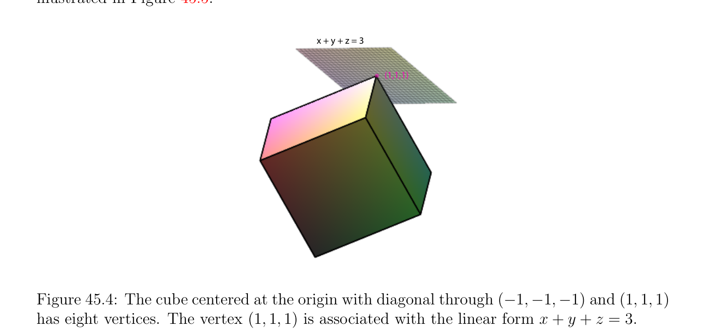

# Basic Feasible Solutions and Vertices

<!-- PAGE 1594 -->

## 45.2 Basic Feasible Solutions and Vertices

If the system Ax $= b$ has a solution and if some row of $A$ is a linear combination of other rows, then the corresponding equation is redundant, so we may assume that the rows of $A$ are linearly independent; that is, we may assume that $A$ has rank $m$, so $m \le n$.

> **Definition 45.6.** If $A$ is an $m \times  n$ matrix, for any nonempty subset $K$ of ${1, \dots  , n}$, let $A_{K}$ be the submatrix of $A$ consisting of the columns of $A$ whose indices belong to $K$. We denote the jth column of the matrix $A$ by $A^{j}$.

> **Definition 45.7.** Given a Linear Program $(P_{2})$
$$maximizecx$$
$$subject toAx = b and x \ge 0,$$
$$\mathbb{R}^{n}$$
where $A$ has rank $m$, a vector $x \in$ is a basic feasible solution of $(P)$ if $x \in$ P(A, $b) \neq  \emptyset$ , and if there is some subset $K$ of ${1, \dots  , n}$ of size $m$ such that
$(1)$ The matrix $A_{K}$ is invertible (that is, the columns of $A_{K}$ are linearly independent).
$(2) x_{j} = 0$ for all $j \in / K$. The subset $K$ is called a basis of $x$. Every index $k \in K$ is called basic, and every index $j \in / K$ is called nonbasic. Similarly, the columns $A^{k}$ corresponding to indices $k \in K$ are called basic, and the columns $A^{j}$ corresponding to indices $j \in / K$ are called nonbasic. The variables corresponding to basic indices $k \in K$ are called basic variables, and the variables corresponding to indices $j \in / K$ are called nonbasic. For example, the linear program
$$maximizex_{1} + x_{2}$$
$$subject tox_{1} + x_{2} + x_{3} = 1 and x_{1} \ge 0, x_{2} \ge 0, x_{3} \ge 0,(*)$$
has three basic feasible solutions; the basic feasible solution $K = {1}$ corresponds to the point $(1, 0, 0)$; the basic feasible solution $K = {2}$ corresponds to the point $(0, 1, 0)$; the basic feasible solution $K = {3}$ corresponds to the point $(0, 0, 1)$. Each of these points corresponds to the vertices of the slanted purple triangle illustrated in Figure 45.3. The vertices $(1, 0, 0)$ and $(0, 1, 0)$ optimize the objective function with a value of $1$. We now show that if the Standard Linear Program $(P_{2})$ as in Definition 45.7 has some feasible solution and is bounded above, then some basic feasible solution is an optimal solution. We follow Matousek and Gardner $[127]$ (Chapter $4$, Section $2$, Theorem 4.2.3). First we obtain a more convenient characterization of a basic feasible solution.

> **Proposition 45.2.** Given any Standard Linear Program $(P_{2})$ where Ax $= b$ and $A$ is an $m \times  n$ matrix of rank $m$, for any feasible solution $x$, if $J_{>} = {j \in {1, \dots  , n}$ | $x_{j} > 0}$, then $x$ is a basic feasible solution iff the columns of the matrix $A_{J>}$ are linearly independent.

<!-- PAGE 1595 -->
$$+ y = 0.7$$
$$x$$
$$+ z = 1$$
$$x + y$$

**Figure 45.3:** The $\mathcal{H}-polytope$ associated with Linear Program (*). The objective function (with $x_{1} \to x$ and $x_{2} \to y)$ is represented by vertical planes parallel to the purple plane $x + y =$ 0.7, and reaches it maximal value when $x + y = 1$.

*Proof.* If $x$ is a basic feasible solution, then there is some subset $K \subseteq {1, \dots  , n}$ of size $m$ such that the columns of $A_{K}$ are linearly independent and $x_{j} = 0$ for all $j \in / K$, so by definition, $J_{>} \subseteq K$, which implies that the columns of the matrix $A_{J>}$ are linearly independent. Conversely, assume that $x$ is a feasible solution such that the columns of the matrix $A_{J>}$ are linearly independent. If $|J_{>}| = m$, we are done since we can pick $K = J_{>}$ and then $x$ is a basic feasible solution. If $|J_{>}| < m$, we can extend $J_{>}$ to an m-element subset $K$ by adding $m -|J_{>}|$ column indices so that the columns of $A_{K}$ are linearly independent, which is possible since $A$ has rank $m$. Next we prove that if a linear program in standard form has any feasible solution $x_{0}$ and is bounded above, then is has some basic feasible solution $x$ which is as good as $x_{0}$, in the
$$e$$
sense that cx $\ge cx_{0}$.
$$e$$

> **Proposition 45.3.** Let $(P_{2})$ be any standard linear program with objective function cx, where Ax $= b$ and $A$ is an $m \times  n$ matrix of rank $m$. If $(P_{2})$ is bounded above and if $x_{0}$ is some feasible solution of $(P_{2})$, then there is some basic feasible solution $x$ such that cx $\ge cx_{0}$.
$$ee$$

*Proof.* Among the feasible solutions $x$ such that cx $\ge cx_{0} (x_{0}$ is one of them) pick one with the maximum number of coordinates $x_{j}$ equal to $0$, say $x$. Let
$$e$$
$$K = J_{>} = {j \in {1, \dots  , n} |x_{j} > 0}$$
$$e$$
and let $s =$ |K|. We claim that $x$ is a basic feasible solution, and by construction cx $\ge cx_{0}$.
$$ee$$
If the columns of $A_{K}$ are linearly independent, then by Proposition 45.2 we know that $x$
$$e$$
is a basic feasible solution and we are done.

<!-- PAGE 1596 -->
Otherwise, the columns of $A_{K}$ are linearly dependent, so there is some nonzero vector
$$\mathbb{R}^{n}$$
$v = (v_{1}, \dots  , v_{s})$ such that $A_{K} v = 0$. Let $w \in$ be the vector obtained by extending $v$ by setting $w_{j} = 0$ for all $j \in / K$. By construction,
$$Aw = A_{K} v = 0.$$
We will derive a contradiction by exhibiting a feasible solution $x(t_{0})$ such that $cx(t_{0}) \ge cx_{0}$ with more zero coordinates than $x$.
$$e$$
For this we claim that we may assume that $w$ satisfies the following two conditions:
$(1)$ cw $\ge 0$.
$(2)$ There is some $j \in K$ such that $w_{j} < 0$. If cw $= 0$ and if Condition $(2)$ fails, since $w \neq  0$, we have $w_{j} > 0$ for some $j \in K$, in which case we can use $-w$, for which $w_{j} < 0$. If cw $< 0$, then c(-w) $> 0$, so we may assume that cw $> 0$. If $w_{j} > 0$ for all $j \in K$, since $x$ is feasible, $x \ge 0$, and so x(t) $= x +$ tw $\ge 0$ for all $t \ge 0$. Furthermore, since Aw $= 0$ and $e  e  e x$ is feasible, we have $e$
$$Ax(t) = Ax + tAw = b,$$
$$e$$
and thus x(t) is feasible for all $t \ge 0$. We also have
$$cx(t) = cx + tcw.$$
$$e$$
Since cw $> 0$, as $t > 0$ goes to infinity the objective function cx(t) also tends to infinity, contradicting the fact that is is bounded above. Therefore, some $w$ satisfying Conditions $(1)$ and $(2)$ above must exist. We show that there is some $t_{0} > 0$ such that $cx(t_{0}) \ge cx_{0}$ and $x(t_{0}) = x + t_{0}w$ is feasible,
$$e$$
yet $x(t_{0})$ has more zero coordinates than $x$, a contradiction.
$$e$$
Since x(t) $= x +$ tw, we have
$$e$$
$$x(t)_{i} =x_{i} + tw_{i},$$
$$e$$
so if we let $I = {i \in {1, \dots  , n}$ | $w_{i} < 0} \subseteq K$, which is nonempty since $w$ satisfies Condition
$(2)$ above, if we pick
$$t_{0} = \min- \frac{x_{i}}{w_{i}} e,$$
$$i\in I$$
then $t_{0} > 0$, because $w_{i} < 0$ for all $i \in$ I, and by definition of $K$ we have $x_{i} > 0$ for all $i \in K$.
$$e$$
By the definition of $t_{0} > 0$ and since $x \ge 0$, we have
$$e$$
$$x(t_{0})_{j} =x_{j} + t_{0}w_{j} \ge 0for all j \in K,$$
$$e$$
so $x(t_{0}) \ge 0$, and $x(t_{0})_{i} = 0$ for some $i \in$ I. Since $Ax(t_{0}) = b$ (for any $t), x(t_{0})$ is a feasible solution,
$$cx(t_{0}) = cx + t_{0}cw \ge cx_{0} + t_{0}cw \ge cx_{0},$$
$$e$$
and $x(t_{0})_{i} = 0$ for some $i \in$ I, we see that $x(t_{0})$ has more zero coordinates than $x$, a
$$e$$
contradiction.

<!-- PAGE 1597 -->
Proposition 45.3 implies the following important result.

> **Theorem 45.4.** Let $(P_{2})$ be any standard linear program with objective function cx, where Ax $= b$ and $A$ is an $m \times  n$ matrix of rank $m$. If $(P_{2})$ has some feasible solution and if it is bounded above, then some basic feasible solution $x$ is an optimal solution of $(P_{2})$.
$$e$$

*Proof.* By Proposition 45.3, for any feasible solution $x$ there is some basic feasible solution $x$
$$e$$
such that cx $\le$ cx. But there are only finitely many basic feasible solutions, so one of them
$$e$$
has to yield the maximum of the objective function. Geometrically, basic solutions are exactly the vertices of the $polyhedron\mathcal{P}(A, b)$, a notion that we now define.

> **Definition 45.8.** Given an $\mathcal{H}-polyhedron \mathcal{P} \subseteq \mathbb{R}^{n}$, a vertex of $\mathcal{P}$ is a point $v \in P$ with property that there is some nonzero linear form $c \in (\mathbb{R}^{n})^{*}$ and some $\mu  \in \mathbb{R}$, such that $v$ is the unique point of $\mathcal{P}$ for which the map $x \mapsto$ cx has the maximum value $\mu$  ; that is, cy $<$ cv $= \mu$  for all $y \in P -{v}$. Geometrically, this means that the hyperplane of equation cy $= \mu$  touches $\mathcal{P}$ exactly at $v$. More generally, a convex subset $F$ of $\mathcal{P}$ is a $k$-dimensional face of $\mathcal{P}$ if $F$ has dimension $k$ and if there is some affine form $\phi (x) =$ cx - $\mu$  such that cy $= \mu$  for all $y \in F$, and cy $< \mu$  for all $y \in P$ - $F$. A 1-dimensional face is called an edge. The concept of a vertex is illustrated in Figure 45.4, while the concept of an edge is illustrated in Figure 45.5.
$$x + y + z = 3$$
$$(1,1,1)$$

**Figure 45.4:** The cube centered at the origin with diagonal through $(-1, -1, -1)$ and $(1, 1, 1)$ has eight vertices. The vertex $(1, 1, 1)$ is associated with the linear form $x + y + z = 3$. Since a $k$-dimensional face $F$ of $\mathcal{P}$ is equal to the intersection of the hyperplane $H(\phi$ ) of equation cx $= \mu$  with $\mathcal{P}$, it is indeed convex and the notion of dimension makes sense. Observe that a 0-dimensional face of $\mathcal{P}$ is a vertex. If $\mathcal{P}$ has dimension $d$, then the $(d$ - 1)- dimensional faces of $\mathcal{P}$ are called its facets.

<!-- PAGE 1598 -->
$$(1,1,-1)$$
$$(1,1,1)$$
$$x + y = 2$$

**Figure 45.5:** The cube centered at the origin with diagonal through $(-1, -1, -1)$ and $(1, 1, 1)$ has twelve edges. The edge from $(1, 1, -1)$ to $(1, 1, 1)$ is associated with the linear form $x + y = 2$. If $(P)$ is a linear program in standard form, then its basic feasible solutions are exactly the vertices of the polyhedron $\mathcal{P}(A, b)$. To prove this fact we need the following simple proposition

> **Proposition 45.5.** Let Ax $= b$ be a linear system where $A$ is an $m \times  n$ matrix of rank $m$. For any subset $K \subseteq {1, \dots  , n}$ of size $m$, if $A_{K}$ is invertible, then there is at most one basic
$$\mathbb{R}^{n}$$
feasible solution $x \in$ with $x_{j} = 0$ for all $j \in / K$ (of course, $x \ge 0)$

*Proof.* In order for $x$ to be feasible we must have Ax $= b$. Write $N = {1, \dots  , n}$ - $K, x_{K}$ for the vector consisting of the coordinates of $x$ with indices in $K$, and $x_{N}$ for the vector consisting of the coordinates of $x$ with indices in $N$. Then
$$Ax = A_{K}x_{K} + A_{N}x_{N} = b.$$
In order for $x$ to be a basic feasible solution we must have $x_{N} = 0$, so
$$A_{K}x_{K} = b.$$
Since by hypothesis $A_{K}$ is invertible, $x_{K} = A_{K}^{-1} b$ is uniquely determined. If $x_{K} \ge 0$ then $x$ is a basic feasible solution, otherwise it is not. This proves that there is at most one basic
$$\mathbb{R}^{n}$$
feasible solution $x \in$ with $x_{j} = 0$ for all $j \in / K$.

> **Theorem 45.6.** Let $(P)$ be a linear program in standard form, where Ax $= b$ and $A$ is an $m \times  n$ matrix of rank $m$. For every $v \in$ P(A, $b)$, the following conditions are equivalent:
$(1) v$ is a vertex of the Polyhedron $\mathcal{P}(A, b)$.

<!-- PAGE 1599 -->
$(2) v$ is a basic feasible solution of the Linear Program $(P)$.

*Proof.* First, assume that $v$ is a vertex of $\mathcal{P}(A, b)$, and let $\phi (x) =$ cx - $\mu$  be a linear form such that cy $< \mu$  for all $y \in$ P(A, $b)$ and cv $= \mu$ . This means that $v$ is the unique point of $\mathcal{P}(A, b)$ for which the objective function $x \mapsto$ cx has the maximum value $\mu  on\mathcal{P}(A, b)$, so by Theorem 45.4, since this maximum is achieved by some basic feasible solution, by uniqueness $v$ must be a basic feasible solution. Conversely, suppose $v$ is a basic feasible solution of $(P)$ corresponding to a subset $K \subseteq {1, \dots  , n}$ of size $m$. Let $c \in (\mathbb{R}^{n})^{*}$ be the linear form defined by
$$b$$
$$($$
$$0if j \in K$$
$$c_{j} =$$
$$b-1if j \in /K.$$
By construction $c v = 0$ and $c x \le 0$ for any $x \ge 0$, hence the function $x \mapsto c x$ on $\mathcal{P}(A, b)$
$$b bb$$
has a maximum at $v$. Furthermore, $c x < 0$ for any $x \ge 0$ such that $x_{j} > 0$ for some $j \in / K$.
$$b$$
However, by Proposition 45.5, the vector $v$ is the only basic feasible solution such that $v_{j} = 0$ for all $j \in / K$, and therefore $v$ is the only point of $\mathcal{P}(A, b)$ maximizing the function $x \mapsto c x$,
$$b$$
so it is a vertex.
$$In theory, to find an optimal solution we try all_{m}^{n} \begin{pmatrix} solution \end{pmatrix} possible m-elements subsets K of$$
${1, \dots  , n}$ and solve for the corresponding unique  $x_{K}$ of $A_{K}x = b$. Then we check whether such a solution satisfies $x_{K} \ge 0$, compute $cx_{K}$, and return some feasible $x_{K}$ for which the objective function is maximum. This is a totally impractical algorithm. A practical algorithm is the simplex algorithm. Basically, the simplex algorithm tries to “climb” in the polyhderon $\mathcal{P}(A, b)$ from vertex to vertex along edges (using basic feasible solutions), trying to maximize the objective function. We present the simplex algorithm in the next chapter. The reader may also consult texts on linear programming. In particular, we recommend Matousek and Gardner $[127]$, Chvatal $[40]$, Papadimitriou and Steiglitz $[139]$, Bertsimas and Tsitsiklis $[21]$, Ciarlet $[41]$, Schrijver $[154]$, and Vanderbei $[187]$. Observe that Theorem 45.4 asserts that if a Linear Program $(P)$ in standard form (where Ax $= b$ and $A$ is an $m\times n$ matrix of rank $m)$ has some feasible solution and is bounded above, then some basic feasible solution is an optimal solution. By Theorem 45.6, the polyhedron $\mathcal{P}(A, b)$ must have some vertex. But suppose we only know that $\mathcal{P}(A, b)$ is nonempty; that is, we don’t know that the objective function cx is bounded above. Does $\mathcal{P}(A, b)$ have some vertex? The answer to the above question is yes, and this is important because the simplex algorithm needs an initial basic feasible solution to get started. Here we prove that $if\mathcal{P}(A, b)$ is nonempty, then it must contain a vertex. This proof still doesn’t constructively yield a vertex, but we will see in the next chapter that the simplex algorithm always finds a vertex if there is one (provided that we use a pivot rule that prevents cycling).

<!-- PAGE 1600 -->

> **Theorem 45.7.** Let $(P)$ be a linear program in standard form, where Ax $= b$ and $A$ is an $m \times  n$ matrix of rank $m$. If $\mathcal{P}(A, b)$ is nonempty (there is a feasible solution), then $\mathcal{P}(A, b)$ has some vertex; equivalently, $(P)$ has some basic feasible solution.

*Proof.* The proof relies on a trick, which is to add slack variables $x_{n+1}, \dots  , x_{n+m}$ and use the new objective function $-(x_{n+1} + \cdots  + x_{n+m})$. If we let $A$ be the $m \times  (m +$ n)-matrix, and $x, \overline{x}$, and $x$ be the vectors given by
$$b b$$
$$Ab = \begin{pmatrix} A & I_{m} \end{pmatrix} ,x = \begin{pmatrix} x_{1} \\ \vdots \\ x_{n} \end{pmatrix} \in \mathbb{R}^{n},\overline{x} = \begin{pmatrix} x_{n+1} \\ \vdots \\ x_{n+m} \end{pmatrix} \in \mathbb{R}^{m},xb = \begin{pmatrix} x \\ \overline{x} \end{pmatrix} \in \mathbb{R}^{n+m},$$
then consider the Linear Program $(P)$ in standard form
$$b$$
$$maximize-(x_{n+1} + \cdots  + x_{n+m})$$
$$subject toAx = b andx \ge 0.$$
$$b b b$$
Since $x_{i} \ge 0$ for all $i$, the objective function $-(x_{n+1} + \cdots  + x_{n+m})$ is bounded above by $0$. The system Ax $= b$ is equivalent to the system
$$b b$$
$$Ax +\overline{x} = b,$$
so for every feasible solution $u \in$ P(A, $b)$, since Au $= b$, the vector $(u, 0_{m})$ is also a feasible solution of $(P)$, in fact an optimal solution since the value of the objective function $-(x_{n+1}+$
$$b$$
$\cdots +x_{n+m}) for\overline{x} = 0$ is $0$. By Proposition 45.3, the linear program $(P)$ has some basic feasible
$$b$$
solution $(u^{*}, w^{*})$ for which the value of the objective function is greater than or equal to the value of the objective function for $(u, 0_{m})$, and since $(u, 0_{m})$ is an optimal solution, $(u^{*}, w^{*})$ is also an optimal solution of $(P)$. This implies that $w^{*} = 0$, since otherwise the objective
$$b$$
function $-(x_{n+1} + \cdots  + x_{n+m})$ would have a strictly negative value. Therefore, $(u^{*}, 0_{m})$ is a basic feasible solution of $(P)$, and thus the columns corresponding
$$b$$
to nonzero components of $u^{*}$ are linearly independent. Some of the coordinates of $u^{*}$ could be equal to $0$, but since $A$ has rank $m$ we can add columns of $A$ to obtain a basis $K$ associated with $u^{*}$, and $u^{*}$ is indeed a basic feasible solution of $(P)$. The definition of a basic feasible solution can be adapted to linear programs where the constraints are of the form Ax $\le b, x \ge 0$; see Matousek and Gardner $[127]$ (Chapter $4$, Section $4$, Definition 4.4.2). The most general type of linear program allows constraints of the form $a_{i}x \ge b_{i}$ or $a_{i}x = b_{i}$ besides constraints of the form $a_{i}x \le b_{i}$. The variables $x_{i}$ may also take negative values. It is always possible to convert such programs to the type considered in Definition 45.1. We proceed as follows.
