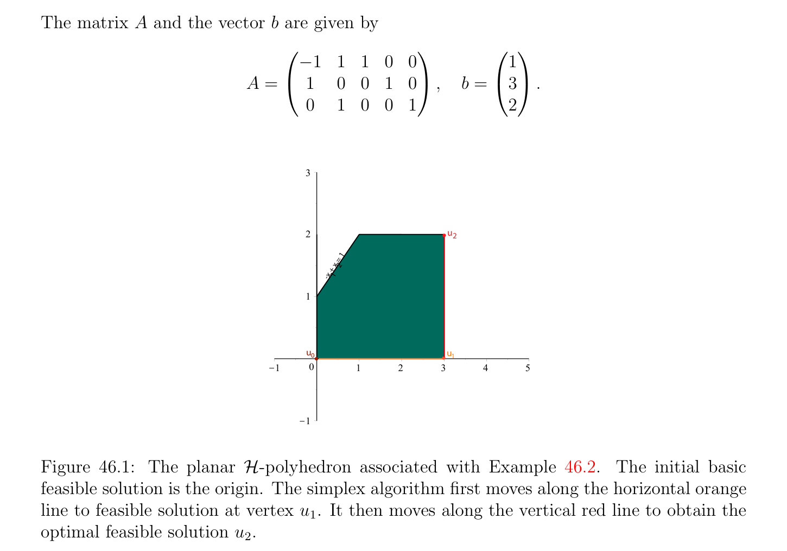

# The Idea Behind the Simplex Algorithm

<!-- PAGE 1605 -->
Chapter $46$ The Simplex Algorithm

## 46.1 The Idea Behind the Simplex Algorithm

The simplex algorithm, due to Dantzig, applies to a linear program $(P)$ in standard form, where the constraints are given by Ax $= b$ and $x \ge 0$, with $A$ a $m \times  n$ matrix of rank $m$, and with an objective function $x \mapsto$ cx. This algorithm either reports that $(P)$ has no feasible solution, or that $(P)$ is unbounded, or yields an optimal solution. Geometrically, the algorithm climbs from vertex to vertex in the polyhedron $\mathcal{P}(A, b)$, trying to improve the value of the objective function. Since vertices correspond to basic feasible solutions, the simplex algorithm actually works with basic feasible solutions. Recall that a basic feasible solution $x$ is a feasible solution for which there is a subset $K \subseteq {1, \dots  , n}$ of size $m$ such that the matrix $A_{K}$ consisting of the columns of $A$ whose indices belong to $K$ are linearly independent, and that $x_{j} = 0$ for all $j \in / K$. We also let $J_{>}(x)$ be the set of indices
$$J_{>}(x) = {j \in {1, \dots  , n} | x_{j} > 0},$$
so for a basic feasible solution $x$ associated with $K$, we have $J_{>}(x) \subseteq K$. In fact, by Proposition 45.2, a feasible solution $x$ is a basic feasible solution iff the columns of $A_{J>(x)}$ are linearly independent. If $J_{>}(x)$ had cardinality $m$ for all basic feasible solutions $x$, then the simplex algorithm would make progress at every step, in the sense that it would strictly increase the value of the objective function. Unfortunately, it is possible that $|J_{>}(x)| < m$ for certain basic feasible solutions, and in this case a step of the simplex algorithm may not increase the value of the objective function. Worse, in rare cases, it is possible that the algorithm enters an infinite loop. This phenomenon called cycling can be detected, but in this case the algorithm fails to give a conclusive answer. Fortunately, there are ways of preventing the simplex algorithm from cycling (for example, Bland’s rule discussed later), although proving that these rules work correctly is quite involved.
$$1605$$

<!-- PAGE 1606 -->
The potential “bad” behavior of a basic feasible solution is recorded in the following definition.

> **Definition 46.1.** Given a Linear Program $(P)$ in standard form where the constraints are given by Ax $= b$ and $x \ge 0$, with $A$ an $m \times  n$ matrix of rank $m$, a basic feasible solution $x$ is degenerate if $|J_{>}(x)| < m$, otherwise it is nondegenerate. The origin $0_{n}$, if it is a basic feasible solution, is degenerate. For a less trivial example, $x = (0, 0, 0, 2)$ is a degenerate basic feasible solution of the following linear program in which $m = 2$ and $n = 4$.

> **Example 46.1.**
$$maximizex_{2}$$
$$subject to$$
$$-x_{1} + x_{2} + x_{3} = 0$$
$$x_{1} + x_{4} = 2$$
$$x_{1} \ge 0, x_{2} \ge 0, x_{3} \ge 0, x_{4} \ge 0.$$
The matrix $A$ and the vector $b$ are given by
$$A = \begin{pmatrix} -1 & 1 & 1 & 0 \\ 1 & 0 & 0 & 1 \end{pmatrix} ,b = \begin{pmatrix} 0 \\ 2 \end{pmatrix} ,$$
and if $x = (0, 0, 0, 2)$, then $J_{>}(x) = {4}$. There are two ways of forming a set of two linearly independent columns of $A$ containing the fourth column. Given a basic feasible solution $x$ associated with a subset $K$ of size $m$, since the columns of the matrix $A_{K}$ are linearly independent, by abuse of language we call the columns of $A_{K}$ a basis of $x$. If $u$ is a vertex of $(P)$, that is, a basic feasible solution of $(P)$ associated with a basis $K$ (of size $m)$, in “normal mode,” the simplex algorithm tries to move along an edge from the vertex $u$ to an adjacent vertex $v$ (with $u, v \in$ P(A, $b) \subseteq \mathbb{R}^{n})$ corresponding to a basic feasible solution whose basis is obtained by replacing one of the basic vectors $A^{k}$ with $k \in K$ by another nonbasic vector $A^{j}$ for some $j \in / K$, in such a way that the value of the objective function is increased. Let us demonstrate this process on an example.

<!-- PAGE 1607 -->

> **Example 46.2.** Let $(P)$ be the following linear program in standard form.
$$maximizex_{1} + x_{2}$$
$$subject to$$
$$-x_{1} + x_{2} + x_{3} = 1$$
$$x_{1} + x_{4} = 3$$
$$x_{2} + x_{5} = 2$$
$$x_{1} \ge 0, x_{2} \ge 0, x_{3} \ge 0, x_{4} \ge 0, x_{5} \ge 0.$$
The matrix $A$ and the vector $b$ are given by
$$A = \begin{pmatrix} -1 & 1 & 1 & 0 & 0 \\ 1 & 0 & 0 & 1 & 0 \\ 0 & 1 & 0 & 0 & 1 \end{pmatrix} ,b = \begin{pmatrix} 1 \\ 3 \\ 2 \end{pmatrix} .$$
$$3$$
$$2u2$$
$$= 1$$
$$+ x 2$$
$$-x 1$$
$$1$$
$$u\overline{0} u\overline{1}$$
$$\overline{K}\overline{1}\overline{0}\overline{1}\overline{2}\overline{3}\overline{4}\overline{5}$$
$$K1$$

**Figure 46.1:** The planar $\mathcal{H}-polyhedron$ associated with Example 46.2. The initial basic feasible solution is the origin. The simplex algorithm first moves along the horizontal orange line to feasible solution at vertex $u_{1}$. It then moves along the vertical red line to obtain the optimal feasible solution $u_{2}$. The vector $u_{0} = (0, 0, 1, 3, 2)$ corresponding to the basis $K = {3, 4, 5}$ is a basic feasible solution, and the corresponding value of the objective function is $0 + 0 = 0$. Since the columns $(A^{3}, A^{4}, A^{5})$ corresponding to $K = {3, 4, 5}$ are linearly independent we can express $A^{1}$ and $A^{2}$ as
$$A^{1}= -A^{3}+ A^{4}$$
$$A^{2}= A^{3}+ A^{5}.$$

<!-- PAGE 1608 -->
Since
$$1A^{3}+ 3A^{4}+ 2A^{5}= Au_{0} = b,$$
for any $\theta  \in \mathbb{R}$, we have
$$b = 1A^{3}+ 3A^{4}+ 2A^{5}-\theta A^{1}+ \theta A^{1}$$
$$= 1A^{3}+ 3A^{4}+ 2A^{5}-\theta (-A^{3}+ A^{4}) + \theta A^{1}$$
$$= \theta A^{1}+ (1 + \theta )A^{3}+ (3 -\theta )A^{4}+ 2A^{5},$$
and
$$b = 1A^{3}+ 3A^{4}+ 2A^{5}-\theta A^{2}+ \theta A^{2}$$
$$= 1A^{3}+ 3A^{4}+ 2A^{5}-\theta (A^{3}+ A^{5}) + \theta A^{2}$$
$$= \theta A^{2}+ (1 -\theta )A^{3}+ 3A^{4}+ (2 -\theta )A^{5}.$$
In the first case, the vector $(\theta , 0, 1 + \theta , 3$ - $\theta , 2)$ is a feasible solution iff0 $\le \theta  \le 3$, and the new value of the objective function is $\theta$ . In the second case, the vector $(0, \theta , 1$ - $\theta , 3, 2$ - $\theta , 1)$ is a feasible solution iff0 $\le \theta  \le 1$, and the new value of the objective function is also $\theta$ . Consider the first case. It is natural to ask whether we can get another vertex and increase the objective function by setting to zero one of the coordinates of $(\theta , 0, 1+\theta , 3-\theta , 2)$, in this case the fouth one, by picking $\theta  = 3$. This yields the feasible solution $(3, 0, 4, 0, 2)$, which corresponds to the basis $(A^{1}, A^{3}, A^{5})$, and so is indeed a basic feasible solution, with an improved value of the objective function equal to $3$. Note that $A^{4}$ left the basis $(A^{3}, A^{4}, A^{5})$ and $A^{1}$ entered the new basis $(A^{1}, A^{3}, A^{5})$. We can now express $A^{2}$ and $A^{4}$ in terms of the basis $(A^{1}, A^{3}, A^{5})$, which is easy to do since we already have $A^{1}$ and $A^{2}$ in term of $(A^{3}, A^{4}, A^{5})$, and $A^{1}$ and $A^{4}$ are swapped. Such a step is called a pivoting step. We obtain
$$A^{2}= A^{3}+ A^{5}$$
$$A^{4}= A^{1}+ A^{3}.$$
Then we repeat the process with $u_{1} = (3, 0, 4, 0, 2)$ and the basis $(A^{1}, A^{3}, A^{5})$. We have
$$b = 3A^{1}+ 4A^{3}+ 2A^{5}-\theta A^{2}+ \theta A^{2}$$
$$= 3A^{1}+ 4A^{3}+ 2A^{5}-\theta (A^{3}+ A^{5}) + \theta A^{2}$$
$$= 3A^{1}+ \theta A^{2}+ (4 -\theta )A^{3}+ (2 -\theta )A^{5},$$
and
$$b = 3A^{1}+ 4A^{3}+ 2A^{5}-\theta A^{4}+ \theta A^{4}$$
$$= 3A^{1}+ 4A^{3}+ 2A^{5}-\theta (A^{1}+ A^{3}) + \theta A^{4}$$
$$= (3 -\theta )A^{1}+ (4 -\theta )A^{3}+ \theta A^{4}+ 2A^{5}.$$

<!-- PAGE 1609 -->
In the first case, the point $(3, \theta , 4$ - $\theta , 0, 2$ - $\theta$ ) is a feasible solution iff0 $\le \theta  \le 2$, and the new value of the objective function is $3+\theta$ . In the second case, the point $(3-\theta , 0, 4-\theta , \theta , 2)$ is a feasible solution iff0 $\le \theta  \le 3$, and the new value of the objective function is $3$ - $\theta$ . To increase the objective function, we must choose the first case and we pick $\theta  = 2$. Then we get the feasible solution $u_{2} = (3, 2, 2, 0, 0)$, which corresponds to the basis $(A^{1}, A^{2}, A^{3})$, and thus is a basic feasible solution. The new value of the objective function is $5$. Next we express $A^{4}$ and $A^{5}$ in terms of the basis $(A^{1}, A^{2}, A^{3})$. Again this is easy to do since we just swapped $A^{5}$ and $A^{2}$ (a pivoting step), and we get
$$A^{5}= A^{2}-A^{3}$$
$$A^{4}= A^{1}+ A^{3}.$$
We repeat the process with $u_{2} = (3, 2, 2, 0, 0)$ and the basis $(A^{1}, A^{2}, A^{3})$. We have
$$b = 3A^{1}+ 2A^{2}+ 2A^{3}-\theta A^{4}+ \theta A^{4}$$
$$= 3A^{1}+ 2A^{2}+ 2A^{3}-\theta (A^{1}+ A^{3}) + \theta A^{4}$$
$$= (3 -\theta )A^{1}+ 2A^{2}+ (2 -\theta )A^{3}+ \theta A^{4},$$
and
$$b = 3A^{1}+ 2A^{2}+ 2A^{3}-\theta A^{5}+ \theta A^{5}$$
$$= 3A^{1}+ 2A^{2}+ 2A^{3}-\theta (A^{2}-A^{3}) + \theta A^{5}$$
$$= 3A^{1}+ (2 -\theta )A^{2}+ (2 + \theta )A^{3}+ \theta A^{5}.$$
In the first case, the point $(3$ - $\theta , 2, 2$ - $\theta , \theta , 0)$ is a feasible solution iff0 $\le \theta  \le 2$, and the value of the objective function is $5$ - $\theta$ . In the second case, the point $(3, 2$ - $\theta , 2 + \theta , 0, \theta$ ) is a feasible solution iff0 $\le \theta  \le 2$, and the value of the objective function is also $5$ - $\theta$ . Since we must have $\theta  \ge 0$ to have a feasible solution, there is no way to increase the objective function. In this situation, it turns out that we have reached an optimal solution, in our case $u_{2} = (3, 2, 2, 0, 0)$, with the maximum of the objective function equal to $5$. We could also have applied the simplex algorithm to the vertex $u_{0} = (0, 0, 1, 3, 2)$ and to the vector $(0, \theta , 1$ - $\theta , 3, 2$ - $\theta , 1)$, which is a feasible solution iff0 $\le \theta  \le 1$, with new value of the objective function $\theta$ . By picking $\theta  = 1$, we obtain the feasible solution $(0, 1, 0, 3, 1)$, corresponding to the basis $(A^{2}, A^{4}, A^{5})$, which is indeed a vertex. The new value of the objective function is $1$. Then we express $A^{1}$ and $A^{3}$ in terms the basis $(A^{2}, A^{4}, A^{5})$ obtaining
$$A^{1}= A^{4}-A^{3}$$
$$A^{3}= A^{2}-A^{5},$$
and repeat the process with $(0, 1, 0, 3, 1)$ and the basis $(A^{2}, A^{4}, A^{5})$. After three more steps we will reach the optimal solution $u_{2} = (3, 2, 2, 0, 0)$.

<!-- PAGE 1610 -->
Let us go back to the linear program of Example 46.1 with objective function $x_{2}$ and where the matrix $A$ and the vector $b$ are given by
$$A = \begin{pmatrix} -1 & 1 & 1 & 0 \\ 1 & 0 & 0 & 1 \end{pmatrix} ,b = \begin{pmatrix} 0 \\ 2 \end{pmatrix} .$$
Recall that $u_{0} = (0, 0, 0, 2)$ is a degenerate basic feasible solution, and the objective function has the value $0$. See Figure 46.2 for a planar picture of the $\mathcal{H}-polyhedron$ associated with

> **Example 46.1.**
$$3$$
$$2u$$
$$2$$
$$x$$
$$2$$
$$1$$
$$u\overline{1}$$
$$\overline{K}\overline{1}\overline{0}\overline{1}\overline{2}\overline{3}$$
$$x$$
$$1$$
$$K1$$

**Figure 46.2:** The planar $\mathcal{H}-polyhedron$ associated with Example 46.1. The initial basic feasible solution is the origin. The simplex algorithm moves along the slanted orange line to the apex of the triangle. Pick the basis $(A^{3}, A^{4})$. Then we have
$$A^{1}= -A^{3}+ A^{4}$$
$$A^{2}= A^{3},$$
and we get
$$b = 2A^{4}-\theta A^{1}+ \theta A^{1}$$
$$= 2A^{4}-\theta (-A^{3}+ A^{4}) + \theta A^{1}$$
$$= \theta A^{1}+ \theta A^{3}+ (2 -\theta )A^{4},$$
and
$$b = 2A^{4}-\theta A^{2}+ \theta A^{2}$$
$$= 2A^{4}-\theta A^{3}+ \theta A^{2}$$
$$= \theta A^{2}-\theta A^{3}+ 2A^{4}.$$

<!-- PAGE 1611 -->
In the first case, the point $(\theta , 0, \theta , 2$ - $\theta$ ) is a feasible solution iff0 $\le \theta  \le 2$, and the value of the objective function is $0$, and in the second case the point $(0, \theta , -\theta , 2)$ is a feasible solution iff $\theta  = 0$, and the value of the objective function is $\theta$ . However, since we must have $\theta  = 0$ in the second case, there is no way to increase the objective function either. It turns out that in order to make the cases considered by the simplex algorithm as mutually exclusive as possible, since in the second case the coefficient of $\theta$  in the value of the objective function is nonzero, namely $1$, we should choose the second case. We must pick $\theta  = 0$, but we can swap the vectors $A^{3}$ and $A^{2}$ (because $A^{2}$ is coming in and $A^{3}$ has the coefficient $-\theta$ , which is the reason why $\theta$  must be zero), and we obtain the basic feasible solution $u_{1} = (0, 0, 0, 2)$ with the new basis $(A^{2}, A^{4})$. Note that this basic feasible solution corresponds to the same vertex $(0, 0, 0, 2)$ as before, but the basis has changed. The vectors $A^{1}$ and $A^{3}$ can be expressed in terms of the basis $(A^{2}, A^{4})$ as
$$A^{1}= -A^{2}+ A^{4}$$
$$A^{3}= A^{2}.$$
We now repeat the procedure with $u_{1} = (0, 0, 0, 2)$ and the basis $(A^{2}, A^{4})$, and we get
$$b = 2A^{4}-\theta A^{1}+ \theta A^{1}$$
$$= 2A^{4}-\theta (-A^{2}+ A^{4}) + \theta A^{1}$$
$$= \theta A^{1}+ \theta A^{2}+ (2 -\theta )A^{4},$$
and
$$b = 2A^{4}-\theta A^{3}+ \theta A^{3}$$
$$= 2A^{4}-\theta A^{2}+ \theta A^{3}$$
$$= -\theta A^{2}+ \theta A^{3}+ 2A^{4}.$$
In the first case, the point $(\theta , \theta , 0, 2-\theta$ ) is a feasible solution iff0 $\le \theta  \le 2$ and the value of the objective function is $\theta$ , and in the second case the point $(0, -\theta , \theta , 2)$ is a feasible solution iff $\theta  = 0$ and the value of the objective function is $\theta$ . In order to increase the objective function we must choose the first case and pick $\theta  = 2$. We obtain the feasible solution $u_{2} = (2, 2, 0, 0)$ whose corresponding basis is $(A^{1}, A^{2})$ and the value of the objective function is $2$. The vectors $A^{3}$ and $A^{4}$ are expressed in terms of the basis $(A^{1}, A^{2})$ as
$$A^{3}= A^{2}$$
$$A^{4}= A^{1}+ A^{3},$$
and we repeat the procedure with $u_{2} = (2, 2, 0, 0)$ and the basis $(A^{1}, A^{2})$. We get
$$b = 2A^{1}+ 2A^{2}-\theta A^{3}+ \theta A^{3}$$
$$= 2A^{1}+ 2A^{2}-\theta A^{2}+ \theta A^{3}$$
$$= 2A^{1}+ (2 -\theta )A^{2}+ \theta A^{3},$$

<!-- PAGE 1612 -->
and
$$b = 2A^{1}+ 2A^{2}-\theta A^{4}+ \theta A^{4}$$
$$= 2A^{1}+ 2A^{2}-\theta (A^{1}+ A^{3}) + \theta A^{4}$$
$$= (2 -\theta )A^{1}+ 2A^{2}-\theta A^{3}+ \theta A^{4}.$$
In the first case, the point $(2, 2$ - $\theta , 0, \theta$ ) is a feasible solution iff0 $\le \theta  \le 2$ and the value of the objective function is $2 -\theta$ , and in the second case, the point $(2 -\theta , 2, -\theta , \theta$ ) is a feasible solution iff $\theta  = 0$ and the value of the objective function is $2$. This time there is no way to improve the objective function and we have reached an optimal solution $u_{2} = (2, 2, 0, 0)$ with the maximum of the objective function equal to $2$. Let us now consider an example of an unbounded linear program.

> **Example 46.3.** Let $(P)$ be the following linear program in standard form.
$$maximizex_{1}$$
$$subject to$$
$$x_{1} -x_{2} + x_{3} = 1$$
$$-x_{1} + x_{2} + x_{4} = 2$$
$$x_{1} \ge 0, x_{2} \ge 0, x_{3} \ge 0, x_{4} \ge 0.$$
The matrix $A$ and the vector $b$ are given by
$$A = \begin{pmatrix} 1 & -1 & 1 & 0 \\ -1 & 1 & 0 & 1 \end{pmatrix} ,b = \begin{pmatrix} 1 \\ 2 \end{pmatrix} .$$
The vector $u_{0} = (0, 0, 1, 2)$ corresponding to the basis $K = {3, 4}$ is a basic feasible solution, and the corresponding value of the objective function is $0$. The vectors $A^{1}$ and $A^{2}$ are expressed in terms of the basis $(A^{3}, A^{4})$ by
$$A^{1}= A^{3}-A^{4}$$
$$A^{2}= -A^{3}+ A^{4}.$$
Starting with $u_{0} = (0, 0, 1, 2)$, we get
$$b = A^{3}+ 2A^{4}-\theta A^{1}+ \theta A^{1}$$
$$= A^{3}+ 2A^{4}-\theta (A^{3}-A^{4}) + \theta A^{1}$$
$$= \theta A^{1}+ (1 -\theta )A^{3}+ (2 + \theta )A^{4},$$
and
$$b = A^{3}+ 2A^{4}-\theta A^{2}+ \theta A^{2}$$
$$= A^{3}+ 2A^{4}-\theta (-A^{3}+ A^{4}) + \theta A^{2}$$
$$= \theta A^{2}+ (1 + \theta )A^{3}+ (2 -\theta )A^{4}.$$

<!-- PAGE 1613 -->
$$nequal  xy % 1, x C y % 2, x R 0, y R 0 , x = 1 ..5, y = 1 ..5, color = "Nautic$$
$$5$$
$$4$$
$$3 = 2$$
$$+ x 2$$
$$-x 1$$
$$2$$
$$= 1$$
$$x  2$$
$$1  -$$
$$x 1$$
$$\theta (1,1)$$
$$\overline{K}\overline{1}\overline{0}\overline{1}\overline{2}\overline{3}\overline{4}\overline{5}$$
$$K1$$

**Figure 46.3:** The planar $\mathcal{H}-polyhedron$ associated with Example 46.3. The initial basic feasible solution is the origin. The simplex algorithm first moves along the horizontal indigo line to basic feasible solution at vertex $(1, 0)$. Any optimal feasible solution occurs by moving along the boundary line parameterized by the orange arrow $\theta (1, 1)$. In the first case, the point $(\theta , 0, 1 -\theta , 2 + \theta$ ) is a feasible solution iff0 $\le \theta  \le 1$ and the value of the objective function is $\theta$ , and in the second case, the point $(0, \theta , 1+\theta , 2-\theta$ ) is a feasible solution iff0 $\le \theta  \le 2$ and the value of the objective function is $0$. In order to increase the objective function we must choose the first case, and we pick $\theta  = 1$. We get the feasible solution $u_{1} = (1, 0, 0, 3)$ corresponding to the basis $(A^{1}, A^{4})$, so it is a basic feasible solution, and the value of the objective function is $1$. The vectors $A^{2}$ and $A^{3}$ are given in terms of the basis $(A^{1}, A^{4})$ by
$$A^{2}= -A^{1}$$
$$A^{3}= A^{1}+ A^{4}.$$
Repeating the process with $u_{1} = (1, 0, 0, 3)$, we get
$$b = A^{1}+ 3A^{4}-\theta A^{2}+ \theta A^{2}$$
$$= A^{1}+ 3A^{4}-\theta (-A^{1}) + \theta A^{2}$$
$$= (1 + \theta )A^{1}+ \theta A^{2}+ 3A^{4},$$
and
$$b = A^{1}+ 3A^{4}-\theta A^{3}+ \theta A^{3}$$
$$= A^{1}+ 3A^{4}-\theta (A^{1}+ A^{4}) + \theta A^{3}$$
$$= (1 -\theta )A^{1}+ \theta A^{3}+ (3 -\theta )A^{4}.$$
