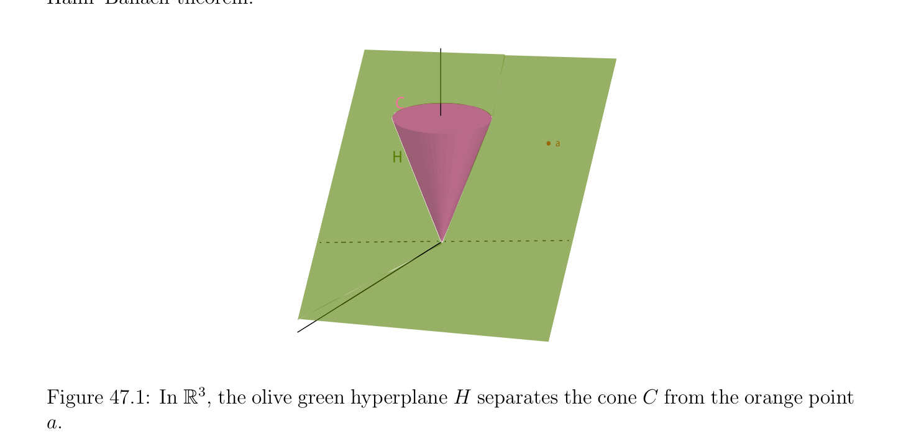

# Variants of the Farkas Lemma

<!-- PAGE 1639 -->
Chapter $47$ Linear Programming and Duality

## 47.1 Variants of the Farkas Lemma

$$\mathbb{R}^{m}$$
If $A$ is an $m \times  n$ matrix and if $b \in$ is a vector, it is known from linear algebra that the linear system Ax $= b$ has no solution iff there is some linear form $y \in (\mathbb{R}^{m})^{*}$ such that yA $= 0$ and yb $\neq  0$. This means that the linear from $y$ vanishes on the columns $A^{1}, \dots  , A^{n}$ of $A$ but does not vanish on $b$. Since the linear form $y$ defines the linear hyperplane $H$ of equation yz $= 0$ (with $z \in \mathbb{R}^{m})$, geometrically the equation Ax $= b$ has no solution iff there is a linear hyperplane $H$ containing $A^{1}, \dots  , A^{n}$ and not containing $b$. This is a kind of separation theorem that says that the vectors $A^{1}, \dots  , A^{n}$ and $b$ can be separated by some linear hyperplane $H$. What we would like to do is to generalize this kind of criterion, first to a system Ax $= b$ subject to the constraints $x \ge 0$, and next to sets of inequality constraints Ax $\le b$ and $x \ge 0$. There are indeed such criteria going under the name of Farkas lemma. The key is a separation result involving polyhedral cones known as the Farkas–Minkowski proposition. We have the following fundamental separation lemma.
$$\mathbb{R}^{n} \mathbb{R}^{n}$$

> **Proposition 47.1.** Let $C \subseteq$ be a closed nonempty (convex) cone. For any point $a \in$ , if $a \in / C$, then there is a linear hyperplane $H$ (through $0)$ such that $1. C$ lies in one of the two half-spaces determined by $H. 2. a \in / H 3$. a lies in the other half-space determined by $H$. We say that $H$ strictly separates $C$ and a. Proposition 47.1, which is illustrated in Figure 47.1, is an easy consequence of another separation theorem that asserts that given any two nonempty closed convex sets $A$ and $B \mathbb{R}^{n}$ of with $A$ compact, there is a hyperplane $H$ strictly separating $A$ and $B$ (which means that $A \cap H = \emptyset , B \cap H = \emptyset$ , that $A$ lies in one of the two half-spaces determined by $H$,
$$1639$$

<!-- PAGE 1640 -->
and $B$ lies in the other half-space determined by $H)$; see Gallier $[73]$ (Chapter $7$, Corollary 7.4 and Proposition 7.3). This proof is nontrivial and involves a geometric version of the Hahn–Banach theorem.
$$C$$
$$a$$
$$H$$

**Figure 47.1:** $In\mathbb{R}^{3}$, the olive green hyperplane $H$ separates the cone $C$ from the orange point a. The Farkas–Minkowski proposition is Proposition 47.1 applied to a polyhedral cone
$$C = {\lambda_{1} a_{1} + \cdots  + \lambda_{n} a_{n} | \lambda_{i}  \ge 0, i = 1, \dots  , n}$$
where ${a_{1}, \dots  , a_{n}}$ is a finite number of vectors $a_{i} \in \mathbb{R}^{n}$. By Proposition 44.2, any polyhedral cone is closed, so Proposition 47.1 applies and we obtain the following separation lemma.
$$\mathbb{R}^{n}$$

> **Proposition 47.2.** (Farkas–Minkowski) Let $C \subseteq$ be a nonempty polyhedral cone $C = cone({a_{1}, \dots  , a_{n}})$. For any point $b \in \mathbb{R}^{n}$, if $b \in / C$, then there is a linear hyperplane $H$ (through $0)$ such that $1. C$ lies in one of the two half-spaces determined by $H. 2. b \in / H 3. b$ lies in the other half-space determined by $H$. Equivalently, there is a nonzero linear form $y \in (\mathbb{R}^{n})^{*}$ such that $1. ya_{i} \ge 0$ for $i = 1, \dots  , n. 2$. yb $< 0$.

<!-- PAGE 1641 -->
A direct proof of the Farkas–Minkowski proposition not involving Proposition 47.1 is given at the end of this section.
Remark: There is a generalization of the Farkas–Minkowski proposition applying to infinite dimensional real Hilbert spaces; see Theorem 48.12 (or Ciarlet $[41]$, Chapter $9)$. Proposition 47.2 implies our first version of Farkas’ lemma.

> **Proposition 47.3.** (Farkas Lemma, Version I) Let $A$ be an $m \times  n$ matrix and let $b \in \mathbb{R}^{m}$ be any vector. The linear system Ax $= b$ has no solution $x \ge 0$ iff there is some nonzero linear form $y \in (\mathbb{R}^{m})^{*}$ such that yA $\ge 0_{n}^{\top}$ and yb $< 0$.

*Proof.* First assume that there is some nonzero linear form $y \in (\mathbb{R}^{m})^{*}$ such that yA $\ge 0$ and yb $< 0$. If $x \ge 0$ is a solution of Ax $= b$, then we get
$$yAx = yb,$$
but if yA $\ge 0$ and $x \ge 0$, then yAx $\ge 0$, and yet by hypothesis yb $< 0$, a contradiction. Next assume that Ax $= b$ has no solution $x \ge 0$. This means that $b$ does not belong to the polyhedral cone $C = cone({A^{1}, \dots  , A^{n}})$ spanned by the columns of $A$. By Proposition 47.2, there is a nonzero linear form $y \in (\mathbb{R}^{m})^{*}$ such that $1. yA^{j} \ge 0$ for $j = 1, \dots  , n. 2$. yb $< 0$, which says that yA $\ge 0_{n}^{\top}$ and yb $< 0$. Next consider the solvability of a system of inequalities of the form Ax $\le b$ and $x \ge 0$.

> **Proposition 47.4.** (Farkas Lemma, Version II) Let $A$ be an $m \times  n$ matrix and let $b \in \mathbb{R}^{m}$ be any vector. The system of inequalities Ax $\le b$ has no solution $x \ge 0$ iff there is some nonzero linear form $y \in (\mathbb{R}^{m})^{*}$ such that $y \ge 0_{m}^{\top}$, yA $\ge 0_{n}^{\top}$ and yb $< 0$.

*Proof.* We use the trick of linear programming which consists of adding “slack variables” $z_{i}$ to convert inequalities $a_{i}x \le b_{i}$ into equations $a_{i}x + z_{i} = b_{i}$ with $z_{i} \ge 0$ already discussed just before Definition 44.9. If we let $z = (z_{1}, \dots  , z_{m})$, it is obvious that the system Ax $\le b$ has a solution $x \ge 0$ iff the equation
$$\begin{pmatrix} A & I_{m} \end{pmatrix} \begin{pmatrix} x \\ z \end{pmatrix} = b$$
$$has a solution \begin{pmatrix} x \\ z \end{pmatrix} with x \ge 0 and z \ge 0. Now by Farkas I, the above system has no$$
solution with with $x \ge 0$ and $z \ge 0$ iff there is some nonzero linear form $y \in (\mathbb{R}^{m})^{*}$ such that
$$y \begin{pmatrix} A & I_{m} \\ andyb < \end{pmatrix} \ge 0_{n+m}^{\top}$$
and yb $< 0$, that is, yA $\ge 0_{n}^{\top} , y \ge 0_{m}^{\top}   0$.

<!-- PAGE 1642 -->
In the next section we use Farkas II to prove the duality theorem in linear programming. Observe that by taking the negation of the equivalence in Farkas II we obtain a criterion of solvability, namely: The system of inequalities Ax $\le b$ has a solution $x \ge 0$ iff for every nonzero linear form $y \in (\mathbb{R}^{m})^{*}$ such that $y \ge 0_{m}^{\top}$, if yA $\ge 0_{n}^{\top}$, then yb $\ge 0$. We now prove the Farkas–Minkowski proposition without using Proposition 47.1. This approach uses a basic property of the distance function from a point to a closed set.
$$\mathbb{R}^{n} \mathbb{R}^{n}$$

> **Definition 47.1.** Let $X \subseteq$ be any nonempty set and let $a \in$ be any point. The distance d(a, $X)$ from a to $X$ is defined as
$$d(a, X) = \inf \|a -x\|.$$
$$x\in X$$
Here, $\|\|$ denotes the Euclidean norm.
$$\mathbb{R}^{n} \mathbb{R}^{n}$$

> **Proposition 47.5.** Let $X \subseteq$ be any nonempty set and let $a \in$ be any point. If $X$ is closed, then there is some $z \in X$ such that $\|a$ - $z\| =$ d(a, $X)$.

*Proof.* Since $X$ is nonempty, pick any $x_{0} \in X$, and let $r = \|a$ - $x_{0}\|$. If $B_{r}(a)$ is the closed
$$\mathbb{R}^{n}$$
ball $B_{r}(a) = {x \in$ | $\|x$ - $a\|\le r}$, then clearly
$$d(a, X) = \inf \|a -x\|=\inf \|a -x\|.$$
$$x\in Xx\in X\cap Br(a)$$
Since $B_{r}(a)$ is compact and $X$ is closed, $K = X \cap B_{r}(a)$ is also compact. But the function $x \mapsto \|a$ - $x\|$ defined on the compact set $K$ is continuous, and the image of a compact set by a continuous function is compact, so by Heine–Borel it has a minimum that is achieved by some $z \in K \subseteq X$.
Remark: If $U$ is a nonempty, closed and convex subset of a Hilbert space $V$ , a standard result of Hilbert space theory (the projection lemma, see Proposition 48.5) asserts that for any $v \in V$ there is a unique $p \in U$ such that
$$\|v -p\|= \inf \|v -u\|= d(v, U),$$
$$u\in U$$
and
$$\langle p -v, u -p\rangle \ge 0for all u \in U.$$
Here $\|w\| = p\overline{\langle}\overline{w, w}\overline{\rangle}$, where $\langle$ -, $-\rangle$ is the inner product of the Hilbert space $V$ . We can now give a proof of the Farkas–Minkowski proposition (Proposition 47.2) that does not use Proposition 47.1. This proof is adapted from Matousek and Gardner $[127]$ (Chapter $6$, Sections 6.5).

<!-- PAGE 1643 -->
$$z$$
$$H$$
$$a_{3}$$
$$C$$
$$a_{2}$$
$$a_{1}b$$

**Figure 47.2:** The hyperplane $H$, perpendicular to $z$ - $b$, separates the point $b$ from $C = cone({a_{1}, a_{2}, a_{3}})$. Proof of the Farkas–Minkowski proposition. Let $C = cone({a_{1}, \dots  , a_{m}})$ be a polyhedral cone (nonempty) and assume that $b \in / C$. By Proposition 44.2, the polyhedral cone is closed, and by Proposition 47.5 there is some $z \in C$ such that d(b, $C) = \|b$ - $z\|$; that is, $z$ is a point of $C$ closest to $b$. Since $b \in / C$ and $z \in C$ we have $u = z$ - $b \neq  0$, and we claim that the linear hyperplane $H$ orthogonal to $u$ does the job, as illustrated in Figure 47.2. First let us show that
$$\langle u, z\rangle = \langle z -b, z\rangle = 0.(*_{1})$$
This is trivial if $z = 0$, so assume $z \neq  0$. If $\langle u, z\rangle$ ̸ $= 0$, then either $\langle u, z\rangle > 0$ or $\langle u, z\rangle < 0$. In either case we show that we can find some point z' $\in C$ closer to $b$ than $z$ is, a contradiction. Case $1: \langle u, z\rangle > 0$. Let z' $= (1$ - $\alpha )z$ for any $\alpha$  such that $0 < \alpha  < 1$. Then z' $\in C$ and since $u = z$ - $b$,
$$z'-b = (1 -\alpha )z -(z -u) = u -\alpha z,$$
so
$$\|z'-b\|^{2}= \|u -\alpha z\|^{2}= \|u\|^{2}-2\alpha \langle u, z\rangle + \alpha^{2} \|z\|^{2}.$$
If we pick $\alpha  > 0$ such that $\alpha  < 2\langle u, z\rangle / \|z\|^{2}$, then $-2\alpha \langle u, z\rangle + \alpha^{2} \|z\|^{2} < 0$, so $\|z'$ - $b\|^{2} < \|u\|^{2} = \|z$ - $b\|^{2}$, contradicting the fact that $z$ is a point of $C$ closest to $b$. Case $2: \langle u, z\rangle < 0$. Let z' $= (1 + \alpha )z$ for any $\alpha$  such that $\alpha  \ge -1$. Then z' $\in C$ and since $u = z -b$, we have z' - $b = (1 + \alpha )z$ - $(z$ - $u) = u + \alpha z$ so
$$\|z'-b\|^{2}= \|u + \alpha z\|^{2}= \|u\|^{2}+ 2\alpha \langle u, z\rangle + \alpha^{2} \|z\|^{2},$$

<!-- PAGE 1644 -->
and if
$$0 < \alpha  < -2\langle u, z\rangle / \|z\|^{2},$$
then $2\alpha \langle u, z\rangle + \alpha^{2} \|z\|^{2} < 0$, so $\|z'$ - $b\|^{2} < \|u\|^{2} = \|z$ - $b\|^{2}$, a contradiction as above. Therefore $\langle u, z\rangle = 0$. We have
$$\langle u, u\rangle = \langle u, z -b\rangle = \langle u, z\rangle -\langle u, b\rangle = -\langle u, b\rangle ,$$
and since $u \neq  0$, we have $\langle u, u\rangle > 0$, so $\langle u, u\rangle = -\langle u, b\rangle$ implies that
$$\langle u, b\rangle < 0.(*_{2})$$
It remains to prove that $\langle u, a_{i}\rangle \ge 0$ for $i = 1, \dots  , m$. Pick any $x \in C$ such that $x \neq  z$. We claim that
$$\langle b -z, x -z\rangle \le 0.(*_{3})$$
Otherwise $\langle b$ - $z, x$ - $z\rangle > 0$, that is, $\langle z$ - $b, x$ - $z\rangle < 0$, and we show that we can find some point z' $\in C$ on the line segment $[z, x]$ closer to $b$ than $z$ is. For any $\alpha$  such that $0 \le \alpha  \le 1$, we have z' $= (1$ - $\alpha )z + \alpha x = z + \alpha (x$ - $z) \in C$, and since z' - $b = z$ - $b + \alpha (x$ - $z)$ we have
$$\|z'-b\|^{2}= \|z -b + \alpha (x -z)\|^{2}= \|z -b\|^{2}+ 2\alpha \langle z -b, x -z\rangle + \alpha^{2} \|x -z\|^{2},$$
so for any $\alpha  > 0$ such that
$$\alpha  < -2\langle z -b, x -z\rangle / \|x -z\|^{2},$$
we have $2\alpha \langle z$ - $b, x$ - $z\rangle + \alpha^{2} \|x$ - $z\|^{2} < 0$, which implies that $\|z'$ - $b\|^{2} < \|z$ - $b\|^{2}$, contradicting that $z$ is a point of $C$ closest to $b$. Since $\langle b$ - $z, x$ - $z\rangle \le 0, u = z$ - $b$, and by $(*_{1}), \langle u, z\rangle = 0$, we have
$$0 \ge \langle b -z, x -z\rangle = \langle -u, x -z\rangle = -\langle u, x\rangle + \langle u, z\rangle = -\langle u, x\rangle ,$$
which means that
$$\langle u, x\rangle \ge 0for all x \in C,(*_{3})$$
as claimed. In particular,
$$\langle u, a_{i}\rangle \ge 0for i = 1, \dots  , m.(*_{4})$$
Then by $(*_{2})$ and $(*_{4})$, the linear form defined by $y = u^{\top}$ satisfies the properties yb $< 0$ and $ya_{i} \ge 0$ for $i = 1, \dots  , m$, which proves the Farkas–Minkowski proposition. There are other ways of proving the Farkas–Minkowski proposition, for instance using minimally infeasible systems or Fourier–Motzkin elimination; see Matousek and Gardner $[127]$ (Chapter $6$, Sections 6.6 and 6.7).
