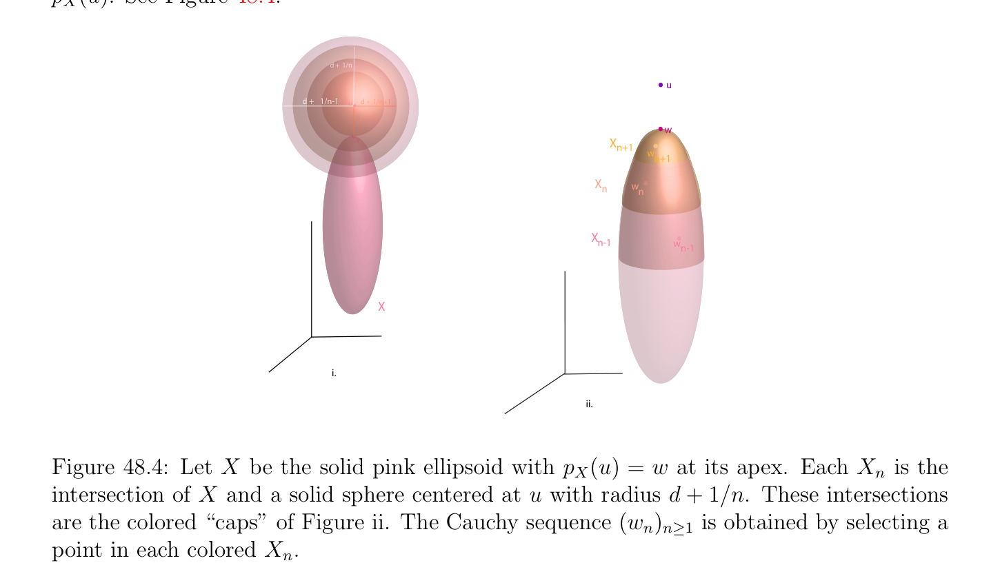
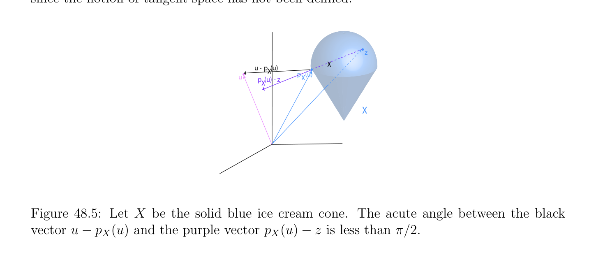
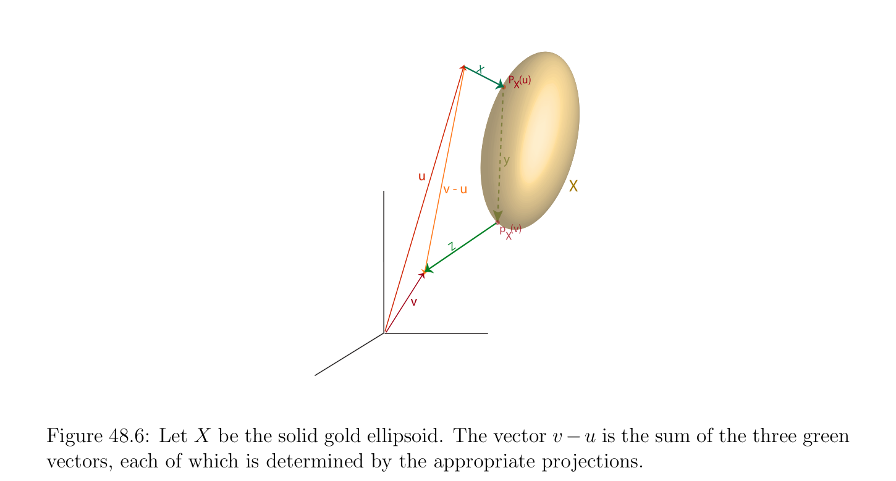
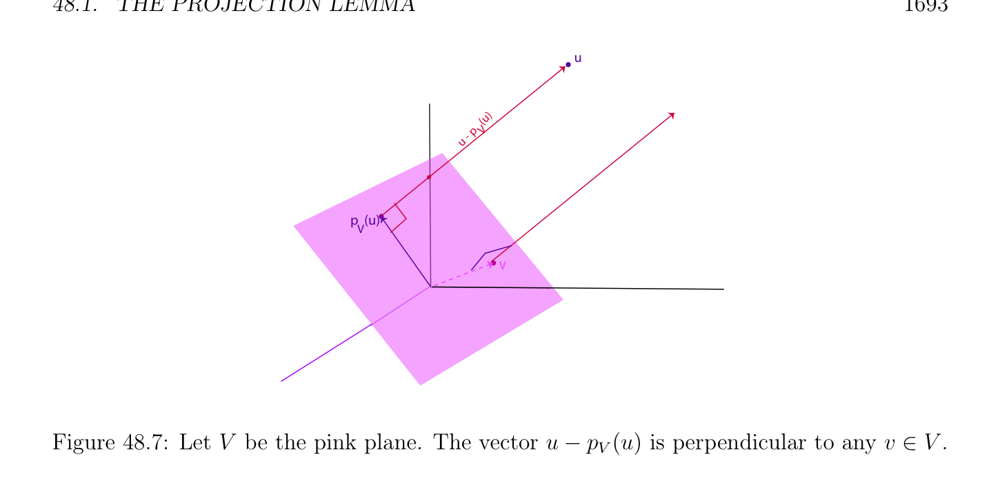

# The Projection Lemma

<!-- PAGE 1681 -->
Chapter $48$ Basics of Hilbert Spaces Most of the “deep” results about the existence of minima of real-valued functions proven in Chapter $49$ rely on two fundamental results of Hilbert space theory:
$(1)$ The projection lemma, which is a result about nonempty, closed, convex subsets of a Hilbert space $V$ .
$(2)$ The Riesz representation theorem, which allows us to express a continuous linear form on a Hilbert space $V$ in terms of a vector in $V$ and the inner product on $V$ . The correctness of the Karush–Kuhn–Tucker conditions appearing in Lagrangian duality follows from a version of the Farkas–Minkowski proposition, which also follows from the projection lemma. Thus, we feel that it is indispensable to review some basic results of Hilbert space theory, although in most applications considered here the Hilbert space in question will be finite-dimensional. However, in optimization theory, there are many problems where we seek to find a function minimizing some type of energy functional (often given by a bilinear form), in which case we are dealing with an infinite dimensional Hilbert space, so it necessary to develop tools to deal with the more general situation of infinite-dimensional Hilbert spaces.

## 48.1 The Projection Lemma

$$Given a Hermitian space \langle \frac{E, \phi ,}{\phi (u, u),} \rangle  we showed in Section 14.1 that the function \|\|: E \to \mathbb{R}$$
defined such that $\|u\| = p$  is a norm on $E$. Thus, $E$ is a normed vector space. If $E$ is also complete, then it is a very interesting space. Recall that completeness has to do with the convergence of Cauchy sequences. A normed vector space $\langle E, \|\|\rangle$ is automatically a metric space under the metric $d$ defined such that d(u, $v) = \|v -u\|$ (see Chapter $37$ for the definition of a normed vector space and of a metric space, or Lang $[115, 116]$, or Dixmier $[52])$. Given a metric space $E$ with metric $d$, a sequence
$$1681$$

<!-- PAGE 1682 -->
$(a_{n})_{n\ge1}$ of elements $a_{n} \in E$ is a Cauchy sequence iff for every $\epsilon  > 0$, there is some $N \ge 1$ such that
$$d(a_{m}, a_{n}) < \epsilon for allm, n \ge N.$$
We say that $E$ is complete iff every Cauchy sequence converges to a limit (which is unique, since a metric space is Hausdorff). Every finite dimensional vector space over $\mathbb{R}$ or $\mathbb{C}$ is complete. For example, one can
$$\mathbb{C}^{n}$$
show by induction that given any basis $(e_{1}, \dots  , e_{n})$ of $E$, the linear map $h: \to E$ defined such that
$$h((z_{1}, \dots  , z_{n})) = z_{1}e_{1} + \cdots  + z_{n}e_{n}$$
is a homeomorphism (using the sup-norm on $\mathbb{C}^{n})$. One can also use the fact that any two norms on a finite dimensional vector space over $\mathbb{R}$ or $\mathbb{C}$ are equivalent (see Chapter $9$, or Lang $[116]$, Dixmier $[52]$, Schwartz $[156])$. However, if $E$ has infinite dimension, it may not be complete. When a Hermitian space is complete, a number of the properties that hold for finite dimensional Hermitian spaces also hold for infinite dimensional spaces. For example, any closed subspace has an orthogonal complement, and in particular, a finite dimensional subspace has an orthogonal complement. Hermitian spaces that are also complete play an important role in analysis. Since they were first studied by Hilbert, they are called Hilbert spaces.

> **Definition 48.1.** A (complex) Hermitian space $\langle E, \phi \rangle$ which is a complete normed vector space under the norm $\|\|$ induced by $\phi$  is called a Hilbert space. A real Euclidean space $\langle E, \phi \rangle$ which is complete under the norm $\|\|$ induced by $\phi$  is called a real Hilbert space. All the results in this section hold for complex Hilbert spaces as well as for real Hilbert spaces. We state all results for the complex case only, since they also apply to the real case, and since the proofs in the complex case need a little more care.

> **Example 48.1.** The space $\ell^{2}$ of all countably infinite sequences $x = (x_{i})_{i\in N}$ of complex
$$\infty$$
$$numbers  such \mathbb{C} that \sum_{i}  |x_{i}|^{2}< \infty is a Hilbert space. It will be shown later that the map$$
$\phi$ : $\ell^{2} \times  \ell^{2} \to  defined^{=0}$ such that
$$\phi  ((x_{i})_{i\in N}, (y_{i})_{i\in N}) = \sum_{i=0}^{\infty}  x_{i}\overline{y}_{i}$$
is well defined, and that $\ell^{2}$ is a Hilbert space under $\phi$ . In fact, we will prove a more general result (Proposition A.3).

> **Example 48.2.** The set $\mathcal{C}^{\infty}[a, b]$ of smooth functions $f$ : [a, $b] \to \mathbb{C}$ is a Hermitian space under the Hermitian form
$$\langle f, g\rangle = \int_{a}^{}  bf(x)\overline{g}\overline{(}\overline{x}\overline{)} dx,$$
but it is not a Hilbert space because it is not complete. It is possible to construct its completion $L^{2}([a, b])$, which turns out to be the space of Lebesgue integrable functions on [a, $b]$.

<!-- PAGE 1683 -->
Theorem 37.63 yields a quick proof of the fact that any Hermitian space $E$ (with Hermitian product $\langle$ -, $-\rangle$ ) can be embedded in a Hilbert space $E_{h}$.

> **Theorem 48.1.** Given a Hermitian space $(E, \langle$ -, $-\rangle$ ) (resp. Euclidean space), there is a Hilbert space $(E_{h}, \langle$ -, $-\rangle_{h}$ ) and a linear map $\phi$ : $E \to E_{h}$, such that
$$\langle u, v\rangle = \langle \phi (u), \phi (v)\rangle_{h}$$
for all $u, v \in E$, and $\phi (E)$ is dense in $E_{h}$. Furthermore, $E_{h}$ is unique up to isomorphism.

*Proof.* Let $(E, \|\|_{E})$ be the Banach space, and let $\phi$ : $E \to E$ be the linear isometry, given
$$bb$$
by Theorem $37.63.^{b}$ Let $\|u\| = p\overline{\langle}\overline{u, u}\overline{\rangle}$ (with $u \in E)$ and $E_{h} = E$. If $E$ is a real vector space,
$$b$$
we know from Section refsec5bis that the inner product $\langle$ -, $-\rangle$ can be expressed in terms of the norm $\|u\|$ by the polarity equation
$$-\| -\|$$
$$\langle u, v\rangle = \frac{1}{2} (\|u + v\|^{2}u\|^{2}v\|^{2}),$$
and if $E$ is a complex vector space, we know from Section 14.1 that we have the polarity equation
$$-\| + -$$
$$\langle u, v\rangle = \frac{1}{4} (\|u + v\|^{2}u -v\|^{2} i\|u + iv\|^{2}i\|u -iv\|^{2}).$$
By the Cauchy-Schwarz inequality, $|\langle u, v\rangle$ | $\le \|u\|\|v\|$, the map $\langle$ -, $-\rangle$ : $E \times  E \to \mathbb{C}$ (resp. $\langle$ -, $-\rangle$ : $E \times  E \to \mathbb{R})$ is continuous. However, it is not uniformly continuous, but we can get around this problem by using the polarity equations to extend it to a continuous map. By continuity, the polarity equations also hold in $E_{h}$, which shows that $\langle$ -, $-\rangle$ extends to a positive definite Hermitian inner product (resp. Euclidean inner product) $\langle$ -, $-\rangle_{h}$  on $E_{h}$ induced by $\|\|_{E}$ extending $\langle$ -, $-\rangle$ .
$$b$$
Remark: We followed the approach in Schwartz $[155]$ (Chapter XXIII, Section $42$. Theorem $2)$. For other approaches, see Munkres $[135]$ (Chapter $7$, Section $43)$, and Bourbaki $[27]$. One of the most important facts about finite-dimensional Hermitian (and Euclidean) spaces is that they have orthonormal bases. This implies that, up to isomorphism, every
$$\mathbb{C}^{n} \mathbb{N}$$
finite-dimensional Hermitian space is isomorphic to (for some $n \in$ ) and that the inner product is given by
$$\langle (x_{1}, \dots  , x_{n}), (y_{1}, \dots  , y_{n})\rangle = \sum_{i=1}^{n}  x_{i}\overline{y}_{i}.$$
$$Furthermore, every subspace W has an orthogonal complement \frac{W^{\perp}}{E} , and the inner product$$
induces a natural duality between $E$ and $E^{*}$ (actually, between  and $E^{*})$ where $E^{*}$ is the space of linear forms on $E$. When $E$ is a Hilbert space, $E$ may be infinite dimensional, often of uncountable dimension. Thus, we can’t expect that $E$ always have an orthonormal basis. However, if we modify

<!-- PAGE 1684 -->
the notion of basis so that a “Hilbert basis” is an orthogonal family that is also dense in $E$, i.e., every $v \in E$ is the limit of a sequence of finite combinations of vectors from the Hilbert basis, then we can recover most of the “nice” properties of finite-dimensional Hermitian spaces. For instance, if $(u_{k})_{k\in K}$ is a Hilbert basis, for every $v \in E$, we can define the Fourier
$$coefficients c_{k} = \langle v, u_{k}\rangle /\|u_{k}\|, and then, v is the “sum” of its Fourier series \sum_{k}  c_{k}u_{k}. How-$$
ever, the cardinality of the index set $K$ can be very large, and it is $necessary^{\in K}$ to define what it means for a family of vectors indexed by $K$ to be summable. We will do this in Section A.1. It turns out that every Hilbert space is isomorphic to a space of the form $\ell^{2} (K)$, where $\ell^{2} (K)$ is a generalization of the space of Example 48.1 (see Theorem A.8, usually called the Riesz-Fischer theorem). Our first goal is to prove that a closed subspace of a Hilbert space has an orthogonal complement. We also show that duality holds if we redefine the dual E' of $E$ to be the space of continuous linear maps on $E$. Our presentation closely follows Bourbaki $[27]$. We also were inspired by Rudin $[145]$, Lang $[115, 116]$, Schwartz $[156, 155]$, and Dixmier $[52]$. In fact, we highly recommend Dixmier $[52]$ as a clear and simple text on the basics of topology and analysis. To achieve this goal, we must first prove the so-called projection lemma. Recall that in a metric space $E$, a subset $X$ of $E$ is closed iff for every convergent sequence
$$(x_{n}) of points x_{n} \in X, the limit x = lim_{n\to \infty}x_{n} also belongs to X. The closure \overline{X} \frac{of}{X.} X is$$
the set of all limits of convergent sequences $(x_{n})$ of points $x_{n} \in X$. Obviously, $X \subseteq$  We say that the subset $X$ of $E$ is dense in $E$ iff $E = \overline{X}$, the closure of $X$, which means that every $a \in E$ is the limit of some sequence $(x_{n})$ of points $x_{n} \in X$. Convex sets will again play a crucial role. In a complex vector space $E$, a subset $C \subseteq E$ is convex if $(1$ - $\lambda )x + \lambda y \in C$ for all $x, y \in C$ and all real $\lambda  \in [0, 1]$. Observe that a subspace is convex. First we state the following easy “parallelogram law,” whose proof is left as an exercise.

> **Proposition 48.2.** If $E$ is a Hermitian space, for any two vectors $u, v \in E$, we have
$$\|u + v\|^{2}+ \|u -v\|^{2}= 2(\|u\|^{2}+ \|v\|^{2}).$$
From the above, we get the following proposition:

> **Proposition 48.3.** If $E$ is a Hermitian space, given any $d, \delta  \in \mathbb{R}$ such that $0 \le \delta  < d$, let
$$B = {u \in E | \|u\|< d}andC = {u \in E | \|u\|\le d + \delta }.$$
For any convex set such $A$ that $A \subseteq C$ - $B$, we have
$$\sqrt$$
$$\|v -u\|\le \overline{12}\overline{d\delta ,}$$
for all $u, v \in A$ (see Figure 48.1).

<!-- PAGE 1685 -->
$$A u$$
$$CB$$
$$v$$
$$Figure 48.1: Inequality of Proposition 48.3.$$

*Proof.* Since $A$ is $convex,_{2}^{1}  (u + v) \in A$ if $u, v \in A$, and thus, $\|_{2}^{1} (u + v)\|\ge d$. From the parallelogram equality written in the form
$$\frac{1}{2} (u + v)^{2}+ \frac{1}{2} (u -v)^{2}= \frac{1}{2} \begin{pmatrix} \|u\|^{2}+ \|v\|^{2} \end{pmatrix} ,$$
since $\delta  < d$, we get
$$\frac{1}{2} (u -v)^{2}= \frac{1}{2} \begin{pmatrix} \|u\|^{2}+ \|v\|^{2} \end{pmatrix} - \frac{1}{2} (u + v)^{2}\le (d + \delta )^{2}-d^{2}= 2d\delta  + \delta^{2} \le 3d\delta ,$$
from which
$$\sqrt$$
$$\|v -u\|\le \overline{12}\overline{d\delta .}$$

> **Definition 48.2.** If $X$ is a nonempty subset of a metric space $(E, d)$, for any $a \in E$, recall that we define the distance d(a, $X)$ of a to $X$ as
$$d(a, X) = \inf d(a, b).$$
$$b\in X$$
Also, the diameter $\delta (X)$ of $X$ is defined by
$$\delta (X) = \sup{d(a, b) | a, b \in X}.$$
It is possible that $\delta (X) = \infty$ . We leave the following standard two facts as an exercise (see Dixmier $[52])$:

> **Proposition 48.4.** Let $E$ be a metric space.
$(1)$ For every subset $X \subseteq E, \delta (X) = \delta (\overline{X})$.
$(2)$ If $E$ is a complete metric space, for every sequence $(F_{n})$ of closed nonempty subsets of $E$ such that $F_{n+1} \subseteq F_{n}$, if $lim_{n\to \infty} \delta (F_{n}) = 0$, then $\infty  F_{n}$ consists of a single point.
$$\bigcap_{n}  =1$$
We are now ready to prove the crucial projection lemma.

<!-- PAGE 1686 -->

> **Proposition 48.5.** (Projection lemma) Let $E$ be a Hilbert space and let $X \subseteq E$ be any nonempty convex and closed subset.
$(1)$ For any $u \in E$, there is a unique vector $p_{X}(u) \in X$ such that
$$\|u -p_{X}(u)\|= \inf \|u -v\|= d(u, X).$$
$$v\in X$$
See Figure 48.2.
$(2)$ The vector $p_{X}(u)$ is the unique vector $w \in E$ satisfying the following property (see Figure 48.3):
$$w \in Xand\mathfrak{R}\langle u -w, z -w\rangle \le 0for all z \in X.(*)$$
$(3)$ If $X$ is a nonempty closed subspace of $E$, then the vector $p_{X}(u)$ is the unique vector $w \in E$ satisfying the following property:
$$w \in Xand\langle u -w, z\rangle = 0for all z \in X.(**)$$
$$uu$$
$$- p$$
$$X   (u)$$
$$pX(u)$$

**Figure 48.2:** Let $X$ be the solid pink ellipsoid. The projection of the purple point $u$ onto $X$ is the magenta point $p_{X}(u)$.

*Proof.* $(1)$ Let $d = inf_{v\in X} \|u$ - $v\| =$ d(u, $X)$. We define a sequence $X_{n}$ of subsets of $X$ as follows: for every $n \ge 1$,
$$ $$
$$X_{n} =v \in X | \|u -v\|\le d + \frac{1}{n} .$$

<!-- PAGE 1687 -->
$$z$$
$$w$$
$$uX$$
$$Figure 48.3: Inequality of Proposition 48.5.$$
It is immediately verified that each $X_{n}$ is nonempty (by definition of $d)$, convex, and that $X_{n+1} \subseteq X_{n}$. Also, by Proposition 48.3, (where $B = {v \in E$ | $\|u$ - $v\|\le d}, C =$ v $\in E$ | $\|u$ - $v\|\le d +_{n}^{1}$ , and $A = X_{n})$, we have
$$\sup{\|z -v\|| v, z \in X_{n}} \le p\overline{12}\overline{d/n,}$$
$$and thus, \bigcap_{n}  \ge 1 X_{n} contains at most one point; see Proposition 48.4(2). We will prove that$$
$$\bigcap_{n}  \ge 1 X_{n} contains exactly one point, namely, p_{X}(u). For this, define a sequence (w_{n})_{n\ge1} by$$
picking some $w_{n} \in X_{n}$ for every $n \ge 1$. We claim that $(w_{n})_{n\ge1}$ is a Cauchy sequence. Given any $\epsilon  > 0$, if we pick $N$ such that
$$N > \frac{12d}{\epsilon^{2}} ,$$
since $(X_{n})_{n\ge1}$ is a monotonic decreasing sequence, which means that $X_{n+1} \subseteq X_{n}$ for all $n \ge 1$, for all $m, n \ge N$, we have
$$\|w_{m} -w_{n}\|\le p\overline{12}\overline{d/N} < \epsilon ,$$
as desired. Since $E$ is complete, the sequence $(w_{n})_{n\ge1}$ has a limit $w$, and since $w_{n} \in X$ and $X$ is closed, we must have $w \in X$. Also observe that
$$\|u -w\|\le \|u -w_{n}\|+ \|w_{n} -w\|,$$
and since $w$ is the limit of $(w_{n})_{n\ge1}$ and
$$\|u -w_{n}\|\le d + \frac{1}{n} ,$$
given any $\epsilon  > 0$, there is some $n$ large enough so that
$$\frac{1}{n} < \frac{\epsilon}{2} and\|w_{n} -w\|\le \frac{\epsilon}{2} ,$$

<!-- PAGE 1688 -->
and thus
$$\|u -w\|\le d + \epsilon .$$
Since the above holds for every $\epsilon  > 0$, we have $\|u$ - $w\| = d$. Thus, $w \in X_{n}$ for all $n \ge 1$,
$$which proves that \bigcap_{nn}  X_{n} = {w}. Now any z \in X such that \|u -z\|= d(u, X) = d also$$
belongs to every $X ,^{\ge1}$ and thus $z = w$, proving the uniqueness of $w$, which we denote as $p_{X}(u)$. See Figure 48.4.
$$\overline{d + 1/n}$$
$$u$$
$$\overline{d + 1/n-1}\overline{u}\overline{d + 1/n+1}$$
$$\overline{d}$$
$$w$$
$$vXn+1$$
$$\overline{w}\overline{n+1}$$
$$Xw$$
$$nn$$
$$Xn-1$$
$$wn-1$$
$$X$$
$$i.$$
$$ii.$$

**Figure 48.4:** Let $X$ be the solid pink ellipsoid with $p_{X}(u) = w$ at its apex. Each $X_{n}$ is the intersection of $X$ and a solid sphere centered at $u$ with radius $d + 1/n$. These intersections are the colored “caps” of Figure ii. The Cauchy sequence $(w_{n})_{n\ge1}$ is obtained by selecting a point in each colored $X_{n}$.
$(2)$ Let $z \in X$. Since $X$ is convex, $v = (1$ - $\lambda )p_{X}(u) + \lambda z \in X$ for every $\lambda , 0 \le \lambda  \le 1$. Then by the definition of $u$, we have
$$\|u -v\|\ge \|u -p_{X}(u)\|$$
for all $\lambda , 0 \le \lambda  \le 1$, and since
$$\|u -v\|^{2}= \|u -p_{X}(u) -\lambda (z -p_{X}(u))\|^{2}$$
$$= \|u -p_{X}(u)\|^{2}+ \lambda^{2} \|z -p_{X}(u)\|^{2}-2\lambda \mathfrak{R}\langle u -p_{X}(u), z -p_{X}(u)\rangle ,$$
for all $\lambda , 0 < \lambda  \le 1$, we get
$$\mathfrak{R}\langle u -p_{X}(u), z -p_{X}(u)\rangle = \frac{1}{2\lambda} \begin{pmatrix} \|u -p_{X}(u)\|^{2}-\|u -v\|^{2} \end{pmatrix} + \frac{\lambda}{2} \|z -p_{X}(u)\|^{2}.(\dagger )$$
Since
$$\|u -v\|\ge \|u -p_{X}(u)\|,$$

<!-- PAGE 1689 -->
we have $\|u$ - $p_{X}(u)\|^{2} -\|u$ - $v\|^{2} = (\|u$ - $p_{X}(u)\|-\|u$ - $v\|)(\|u$ - $p_{X}(u)\| + \|u$ - $v\|) \le 0$, and since Equation $(\dagger$ ) holds for all $\lambda$  such that $0 < \lambda  \le 1$, if $\|u$ - $p_{X}(u)\|^{2} -\|u$ - $v\|^{2} < 0$, then for $\lambda  > 0$ small enough we have
$$\frac{1}{2\lambda} \begin{pmatrix} \|u -p_{X}(u)\|^{2}-\|u -v\|^{2} \end{pmatrix} + \frac{\lambda}{2} \|z -p_{X}(u)\|^{2}< 0,$$
and if $\|u$ - $p_{X}(u)\|^{2} -\|u$ - $v\|^{2} = 0$, then the limit $of_{2}^{\lambda}\|z$ - $p_{X}(u)\|^{2}$ as $\lambda  > 0$ goes to zero is zero, so in all cases, by $(\dagger$ ), we have
$$\mathfrak{R}\langle u -p_{X}(u), z -p_{X}(u)\rangle \le 0.$$
Conversely, assume that $w \in X$ satisfies the condition
$$\mathfrak{R}\langle u -w, z -w\rangle \le 0$$
for all $z \in X$. For all $z \in X$, we have
$$\|u -z\|^{2}= \|u -w\|^{2}+ \|z -w\|^{2}-2\mathfrak{R}\langle u -w, z -w\rangle \ge \|u -w\|^{2},$$
which implies that $\|u$ - $w\| =$ d(u, $X) = d$, and from $(1)$, that $w = p_{X}(u)$.
$(3)$ If $X$ is a subspace of $E$ and $w \in X$, when $z$ ranges over $X$ the vector $z$ - $w$ also ranges over the whole of $X$ so Condition (*) is equivalent to
$$w \in Xand\mathfrak{R}\langle u -w, z\rangle \le 0for all z \in X.(*_{1})$$
Since $X$ is a subspace, if $z \in X$, then $-z \in X$, which implies that $(*_{1})$ is equivalent to
$$w \in Xand\mathfrak{R}\langle u -w, z\rangle = 0for all z \in X.(*_{2})$$
Finally, since $X$ is a subspace, if $z \in X$ ,then iz $\in X$, and this implies that
$$0 = \mathfrak{R}\langle u -w, iz\rangle = -i\mathfrak{I}\langle u -w, z\rangle ,$$
so $\mathfrak{I}\langle u$ - $w, z\rangle = 0$, but since we also have $\mathfrak{R}\langle u$ - $w, z\rangle = 0$, we see that $(*_{2})$ is equivalent to
$$w \in Xand\langle u -w, z\rangle = 0for all z \in X,(**)$$
as claimed.

> **Definition 48.3.** The vector $p_{X}(u)$ is called the projection of $u$ onto $X$, and the map $p_{X}$ : $E \to X$ is called the projection of $E$ onto $X$.

<!-- PAGE 1690 -->
In the case of a real Hilbert space, there is an intuitive geometric interpretation of the condition
$$\langle u -p_{X}(u), z -p_{X}(u)\rangle \le 0$$
for all $z \in X$. If we restate the condition as
$$\langle u -p_{X}(u), p_{X}(u) -z\rangle \ge 0$$
for all $z \in X$, this says that the absolute value of the measure of the angle between the vectors $u$ - $p_{X}(u)$ and $p_{X}(u)$ - $z$ is at most $\pi /2$. See Figure 48.5. This makes sense, since $X$ is convex, and points in $X$ must be on the side opposite to the “tangent space” to $X$ at $p_{X}(u)$, which is orthogonal to $u$ - $p_{X}(u)$. Of course, this is only an intuitive description, since the notion of tangent space has not been defined!
$$z$$
$$u - p  (u)X$$
$$Xp   (u)$$
$$up  (u)- zX$$
$$X$$
$$X$$

**Figure 48.5:** Let $X$ be the solid blue ice cream cone. The acute angle between the black vector $u$ - $p_{X}(u)$ and the purple vector $p_{X}(u)$ - $z$ is less than $\pi /2$. If $X$ is a closed subspace of $E$, then Condition (**) says that the vector $u$ - $p_{X}(u)$ is orthogonal to $X$, in the sense that $u$ - $p_{X}(u)$ is orthogonal to every vector $z \in X$. The map $p_{X}$ : $E \to X$ is continuous as shown below.

> **Proposition 48.6.** Let $E$ be a Hilbert space. For any nonempty convex and closed subset $X \subseteq E$, the map $p_{X}$ : $E \to X$ is continuous. In fact, $p_{X}$ satisfies the Lipschitz condition
$$\|p_{X}(v) -p_{X}(u)\|\le \|v -u\|for all u, v \in E.$$

*Proof.* For any two vectors $u, v \in E$, let $x = p_{X}(u)-u, y = p_{X}(v)-p_{X}(u)$, and $z = v-p_{X}(v)$. Clearly, (as illustrated in Figure 48.6),
$$v -u = x + y + z,$$
and from Proposition 48.5(2), we also have
$$\mathfrak{R}\langle x, y\rangle \ge 0and\mathfrak{R}\langle z, y\rangle \ge 0,$$

<!-- PAGE 1691 -->
from which we get
$$\|v -u\|^{2}= \|x + y + z\|^{2}= \|x + z + y\|^{2}$$
$$= \|x + z\|^{2}+ \|y\|^{2}+ 2\mathfrak{R}\langle x, y\rangle + 2\mathfrak{R}\langle z, y\rangle$$
$$\ge \|y\|^{2}= \|p_{X}(v) -p_{X}(u)\|^{2}.$$
However, $\|p_{X}(v)$ - $p_{X}(u)\|\le \|v$ - $u\|$ obviously implies that $p_{X}$ is continuous.
$$X$$
$$P  (u)X$$
$$y$$
$$u$$
$$v - uX$$
$$p  (v)$$
$$X$$
$$Z$$
$$v$$

**Figure 48.6:** Let $X$ be the solid gold ellipsoid. The vector $v -u$ is the sum of the three green vectors, each of which is determined by the appropriate projections. We can now prove the following important proposition.

> **Proposition 48.7.** Let $E$ be a Hilbert space.
$(1)$ For any closed subspace $V \subseteq E$, we have $E = V \oplus V^{\perp}$ , and the map $p_{V}$ : $E \to V$ is linear and continuous.
$(2)$ For any $u \in E$, the projection $p_{V} (u)$ is the unique vector $w \in E$ such that
$$w \in Vand\langle u -w, z\rangle = 0for all z \in V .$$

*Proof.* $(1)$ First, we prove that $u$ - $p_{V} (u) \in V^{\perp}$ for all $u \in E$. For any $v \in V$ , since $V$ is a subspace, $z = p_{V} (u) + \lambda v \in V$ for all $\lambda  \in \mathbb{C}$, and since $V$ is convex and nonempty (since it is a subspace), and closed by hypothesis, by Proposition 48.5(2), we have
$$\mathcal{ℜ}(\overline{\lambda} \langle u -p_{V} (u), v\rangle ) =\mathcal{ℜ}(\langle u -p_{V} (u), \lambda v\rangle = \mathfrak{R}\langle u -p_{V} (u), z -p_{V} (u)\rangle \le 0$$

<!-- PAGE 1692 -->
for all $\lambda  \in \mathbb{C}$. In particular, the above holds for $\lambda  = \langle u$ - $p_{V} (u), v\rangle$ , which yields
$$| \langle u -p_{V} (u), v\rangle | \le 0,$$
and thus, $\langle u$ - $p_{V} (u), v\rangle = 0$. See Figure 48.7. As a consequence, $u$ - $p_{V} (u) \in V^{\perp}$ for all $u \in E$. Since $u = p_{V} (u) + u$ - $p_{V} (u)$ for every $u \in E$, we have $E = V + V^{\perp}$ . On the other hand, since $\langle$ -, $-\rangle$ is positive definite, $V \cap V^{\perp} = {0}$, and thus $E = V \oplus V^{\perp}$ . We already proved in Proposition 48.6 that $p_{V}$ : $E \to V$ is continuous. Also, since $p_{V} (\lambda u + \mu v) -(\lambda p_{V} (u) + \mu p_{V} (v)) = p_{V} (\lambda u + \mu v) -(\lambda u + \mu v) + \lambda (u -p_{V} (u)) + \mu (v -p_{V} (v))$, for all $u, v \in E$, and since the left-hand side term belongs to $V$ , and from what we just showed, the right-hand side term belongs to $V^{\perp}$ , we have
$$p_{V} (\lambda u + \mu v) -(\lambda p_{V} (u) + \mu p_{V} (v)) = 0,$$
showing that $p_{V}$ is linear.
$(2)$ This is basically obvious from $(1)$. We proved in $(1)$ that $u$ - $p_{V} (u) \in V^{\perp}$ , which is exactly the condition
$$\langle u -p_{V} (u), z\rangle = 0$$
for all $z \in V$ . Conversely, if $w \in V$ satisfies the condition
$$\langle u -w, z\rangle = 0$$
for all $z \in V$ , since $w \in V$ , every vector $z \in V$ is of the form $y$ - $w$, with $y = z + w \in V$ , and thus, we have
$$\langle u -w, y -w\rangle = 0$$
for all $y \in V$ , which implies the condition of Proposition 48.5(2):
$$\mathfrak{R}\langle u -w, y -w\rangle \le 0$$
for all $y \in V$ . By Proposition 48.5, $w = p_{V} (u)$ is the projection of $u$ onto $V$ .
Remark: If $p_{V}$ : $E \to V$ is linear, then $V$ is a subspace of $E$. It follows that if $V$ is a closed convex subset of $E$, then $p_{V}$ : $E \to V$ is linear iff $V$ is a subspace of $E$.

> **Example 48.3.** Let us illustrate the power of Proposition 48.7 on the following “least squares” problem. Given a real $m \times n$-matrix $A$ and some vector $b \in \mathbb{R}^{m}$, we would like to solve the linear system
$$Ax = b$$
$$\mathbb{R}^{n}$$
in the least-squares sense, which means that we would like to find some solution $x \in$ that minimizes the Euclidean norm $\|Ax -b\|$ of the error Ax $-b$. It is actually not clear that the

<!-- PAGE 1693 -->
$$u$$
$$p   (u)$$
$$V$$
$$u -$$
$$p  (u)$$
$$V$$
$$V$$

**Figure 48.7:** Let $V$ be the pink plane. The vector $u$ - $p_{V} (u)$ is perpendicular to any $v \in V$ . problem has a solution, but it does! The problem can be restated as follows: Is there some $\mathbb{R}^{n} x \in$ such that
$$\|Ax -b\|= \inf \|Ay -b\|,$$
$$y\in \mathbb{R} n$$
or equivalently, is there some $z \in$ Im $(A)$ such that
$$\|z -b\|= d(b, \mathrm{Im} (A)),$$
$$\mathbb{R}^{m} \mathbb{R}^{n}$$
where Im $(A) = {Ay \in$ | $y \in$ }, the image of the linear map induced by $A$. Since Im $(A)$ is a closed subspace of $\mathbb{R}^{m}$, because we are in finite dimension, Proposition 48.7 tells us that there is a unique $z \in$ Im $(A)$ such that
$$\|z -b\|= \inf \|Ay -b\|,$$
$$y\in \mathbb{R} n$$
and thus the problem always has a solution since $z \in$ Im $(A)$, and since there is at least some $\mathbb{R}^{n} x \in$ such that Ax $= z$ (by definition of Im $(A))$. Note that such an $x$ is not necessarily unique. Furthermore, Proposition 48.7 also tells us that $z \in$ Im $(A)$ is the solution of the equation
$$\langle z -b, w\rangle = 0for all w \in \mathrm{Im} (A),$$
$$\mathbb{R}^{n}$$
or equivalently, that $x \in$ is the solution of
$$\langle Ax -b, Ay\rangle = 0for all y \in \mathbb{R}^{n},$$
which is equivalent to
$$\langle A^{\top}(Ax -b), y\rangle = 0for all y \in \mathbb{R}^{n},$$
and thus, since the inner product is positive definite, to $A^{\top}(Ax$ - $b) = 0$, i.e.,
$$A^{\top}Ax = A^{\top}b.$$
