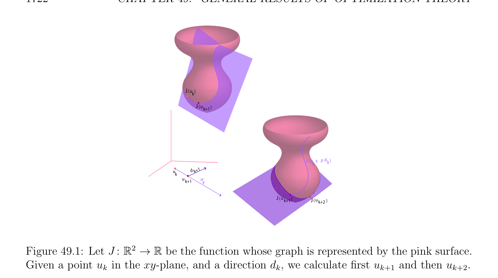

# Iterative Methods for Unconstrained Problems

<!-- PAGE 1721 -->
$$\mathbb{R}^{n} \mathbb{R}$$

> **Corollary 49.10.** If $J$ : $\to$  is a quadratic function given by
$$J(v) = \frac{1}{2} \langle Av, v\rangle -\langle b, v\rangle$$
then
$$\langle \nabla^{2} J_{u}(w), w\rangle \le \lambda_{n}  \|w\|^{2}$$
where $\lambda_{n}$  is the largest eigenvalue of $A$; The above fact will be useful later on. Similarly, given a quadratic functional $J$ defined on a Hilbert space $V$ , where
$$J(v) = \frac{1}{2} a(v, v) -h(v),$$
by Theorem 49.8 $(4)$, the functional $J$ is elliptic iff there is some $\alpha  > 0$ such that
$$\langle \nabla^{2} J_{u}(v), v\rangle = a(v, v) \ge \alpha  \|v\|^{2}for all v \in V .$$
This is precisely the hypothesis $(*_{\alpha})$ used in Theorem 49.4.

## 49.5 Iterative Methods for Unconstrained

$$Problems$$
We will now describe methods for solving unconstrained minimization problems, that is, finding the minimum (or minima) of a functions $J$ over the whole space $V$ . These methods are iterative, which means that given some initial vector $u_{0}$, we construct a sequence $(u_{k})_{k\ge0}$ that converges to a minimum $u$ of the function $J$. The key step is define $u_{k+1}$ from $u_{k}$, and a first idea is to reduce the problem to a simpler problem, namely the minimization of a function of a single (real) variable. For this, we need two perform two steps:
$(1)$ Find a descent direction at $u_{k}$, which is a some nonzero vector $d_{k}$ which is usually determined from the gradient of $J$ at various points. The descent direction $d_{k}$ must satisfy the inequality $\langle \nabla J_{uk}, d_{k}\rangle < 0$.
$(2)$ Exact line search: Find the minimum of the restriction of the function $J$ along the line through $u_{k}$ and parallel to the direction $d_{k}$. This means finding a real $\rho_{k}  \in \mathbb{R}$ (depending on $u_{k}$ and $d_{k})$ such that
$$J(u_{k} + \rho_{k} d_{k}) = \inf J(u_{k} + \rho d_{k}).$$
$$\rho \in \mathbb{R}$$
Typically, $\rho_{k}  > 0$. This problem only succeeds if $\rho_{k}$  is unique, in which case we set
$$u_{k+1} = u_{k} + \rho_{k} d_{k}.$$
This step is often called a line search or line minimization, and $\rho_{k}$  is called the stepsize parameter. See Figure 49.1.

<!-- PAGE 1722 -->
$$J (uk)$$
$$J (uk+1)$$
$$J (u+\rho dk)$$
$$k$$
$$ukdk+1$$
$$uk+1d$$
$$k$$
$$J (uk+1)J (u)$$
$$k+2$$
$$\mathbb{R}^{2} \mathbb{R}$$

**Figure 49.1:** Let $J$ : $\to$  be the function whose graph is represented by the pink surface. Given a point $u_{k}$ in the xy-plane, and a direction $d_{k}$, we calculate first $u_{k+1}$ and then $u_{k+2}$.

> **Proposition 49.11.** If $J$ is a quadratic elliptic functional of the form
$$J(v) = \frac{1}{2} a(v, v) -h(v),$$
then given $d_{k}$, there is a unique $\rho_{k}$  solving the line search in Step $(2)$.

*Proof.* This is because, by Proposition 49.3, we have
$$J(u_{k} + \rho d_{k}) = \frac{\rho^{2}}{2} a(d_{k}, d_{k}) + \rho \langle \nabla J_{uk}, d_{k}\rangle + J(u_{k}),$$
and since $a(d_{k}, d_{k}) > 0$ (because $J$ is elliptic), the above function of $\rho$  has a unique minimum when its derivative is zero, namely
$$\rho  a(d_{k}, d_{k}) + \langle \nabla J_{uk}, d_{k}\rangle = 0.$$
Since Step $(2)$ is often too costly, an alternative is
$(3)$ Backtracking line search: Pick two constants $\alpha$  and $\beta$  such that $0 < \alpha  < 1/2$ and $0 < \beta  < 1$, and set $t = 1$. Given a descent direction $d_{k}$ at $u_{k} \in$ dom(J), while $J(u_{k} + td_{k}) > J(u_{k}) + \alpha t\langle \nabla J_{uk}, d_{k}\rangle$ do $t := \beta t; \rho_{k}  = t; u_{k+1} = u_{k} + \rho_{k} d_{k}$.

<!-- PAGE 1723 -->
Since $d_{k}$ is a descent direction, we must have $\langle \nabla J_{uk}, d_{k}\rangle < 0$, so for $t$ small enough the condition $J(u_{k} + td_{k}) \le J(u_{k}) + \alpha t\langle \nabla J_{uk}, d_{k}\rangle$ will hold and the search will stop. It can be shown that the exit inequality $J(u_{k} + td_{k}) \le J(u_{k}) + \alpha t\langle \nabla J_{uk}, d_{k}\rangle$ holds for all $t \in (0, t_{0}]$, for some $t_{0} > 0$. Thus the backtracking line search stops with a step length $\rho_{k}$  that satisfies $\rho_{k}  = 1$ or $\rho_{k}  \in (\beta t_{0}, t_{0}]$. Care has to be exercised so that $u_{k} + \rho_{k} d_{k} \in$ dom(J). For more details, see Boyd and Vandenberghe $[29]$ (Section 9.2). We now consider one of the simplest methods for choosing the directions of descent in the case where $V = \mathbb{R}^{n}$, which is to pick the directions of the coordinate axes in a cyclic fashion. Such a method is called the method of relaxation. If we write
$$u_{k} = (u_{1}^{k}, u_{2}^{k}, \dots  , u_{n}^{k}),$$
then the components $u_{i}^{k+1}$ of $u_{k+1}$ are computed in terms of $u_{k}$ by solving from top down the following system of equations:
$$J(u_{1}^{k+1}, u_{2}^{k}, u_{3}^{k}, \dots  , u_{n}^{k}) = \inf J(\lambda , u_{2}^{k}, u_{3}^{k}, \dots  , u_{n}^{k})$$
$$\lambda \in \mathbb{R}$$
$$J(u_{1}^{k+1}, u_{2}^{k+1}, u_{3}^{k}, \dots  , u_{n}^{k}) = \inf J(u_{1}^{k+1}, \lambda , u_{3}^{k}, \dots  , u_{n}^{k})$$
$$\lambda \in \mathbb{R}$$
$$\vdots$$
$$J(u_{1}^{k+1}, \dots  , u_{n-1}^{k+1}, u_{n}^{k+1}) = \inf J(u_{1}^{k+1}, \dots  , u_{n-1}^{k+1}, \lambda ).$$
$$\lambda \in \mathbb{R}$$
Another and more informative way to write the above system is to define the vectors $u_{k;i}$ by
$$u_{k;0} = (u_{1}^{k}, u_{2}^{k}, \dots  , u_{n}^{k})$$
$$u_{k;1} = (u_{1}^{k+1}, u_{2}^{k}, \dots  , u_{n}^{k})$$
$$\vdots$$
$$u_{k;i} = (u_{1}^{k+1}, \dots  , u_{i}^{k+1}, u_{i+1}^{k}, \dots  , u_{n}^{k})$$
$$\vdots$$
$$u_{k;n} = (u_{1}^{k+1}, u_{2}^{k+1}, \dots  , u_{n}^{k+1}).$$
Note that $u_{k;0} = u_{k}$ and $u_{k;n} = u_{k+1}$. Then our minimization problem can be written as
$$J(u_{k;1}) = \inf J(u_{k;0} + \lambda e_{1})$$
$$\lambda \in \mathbb{R}$$
$$\vdots$$
$$J(u_{k;i}) = \inf J(u_{k;i-1} + \lambda e_{i})$$
$$\lambda \in \mathbb{R}$$
$$\vdots$$
$$J(u_{k;n}) = \inf J(u_{k;n-1} + \lambda e_{n}),$$
$$\lambda \in \mathbb{R}$$
