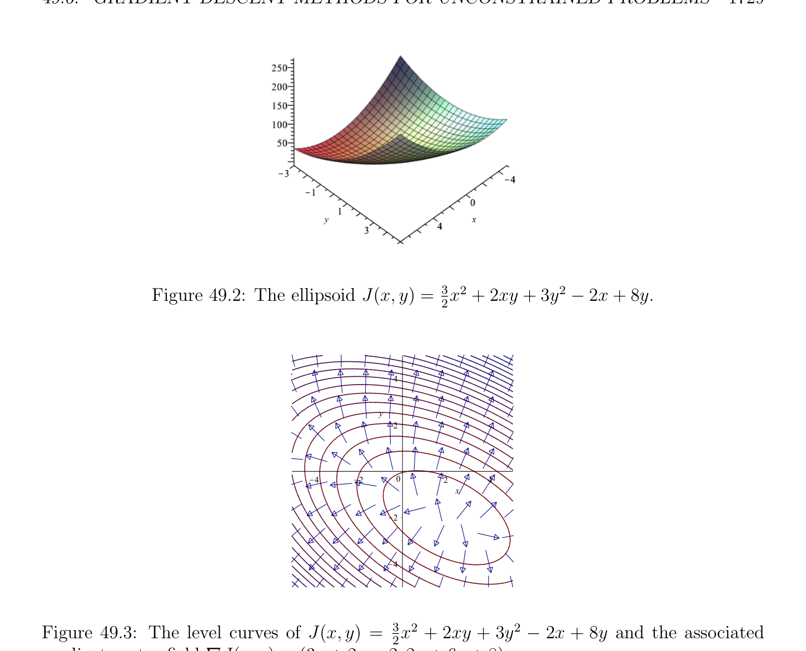
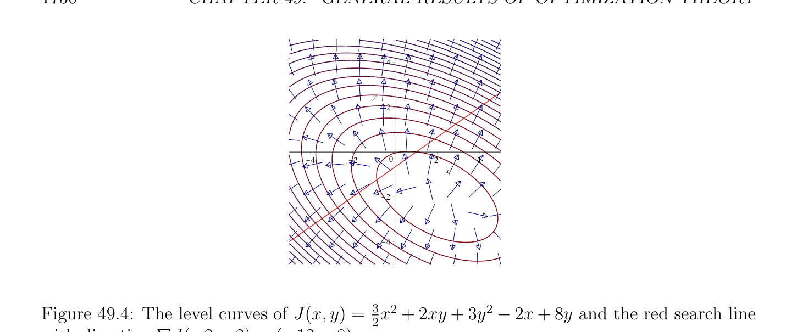

# Gradient Descent Methods for Unconstrained Problems

<!-- PAGE 1724 -->
where $e_{i}$ denotes the ith canonical basis vector in $\mathbb{R}^{n}$. If $J$ is differentiable, necessary conditions for a minimum, which are also sufficient if $J$ is convex, is that the directional derivatives $dJ_{v}(e_{i})$ be all zero, that is,
$$\langle \nabla J_{v}, e_{i}\rangle = 0i = 0, \dots  , n.$$
The following result regarding the convergence of the mehod of relaxation is proven in Ciarlet $[41]$ (Chapter $8$, Theorem 8.4.2).
$$\mathbb{R}^{n} \mathbb{R}$$

> **Proposition 49.12.** If the functional $J$ : $\to$  is elliptic, then the relaxation method converges.
Remarks: The proof of Proposition 49.12 uses Theorem 49.8. The finite dimensionality of $\mathbb{R}^{n}$ also plays a crucial role. The differentiability of the function $J$ is also crucial. Examples where the method loops forever if $J$ is not differentiable can be given; see Ciarlet $[41]$ (Chapter $8$, Section 8.4). The proof of Proposition 49.12 yields an a priori bound on the error $\|u$ - $u_{k}\|$. If $J$ is a quadratic functional
$$J(v) = \frac{1}{2} v^{\top}Av -b^{\top}v,$$
where $A$ is a symmetric positive definite matrix, then $\nabla J_{v} =$ Av - $b$, so the above method for solving for $u_{k+1}$ in terms of $u_{k}$ becomes the Gauss–Seidel method for solving a linear system; see Section 10.3. We now discuss gradient methods.

## 49.6 Gradient Descent Methods for Unconstrained

$$Problems$$
The intuition behind these methods is that the convergence of an iterative method ought to be better if the difference $J(u_{k})$ - $J(u_{k+1})$ is as large as possible during every iteration step. To achieve this, it is natural to pick the descent direction to be the one in the opposite direction of the gradient vector $\nabla J_{uk}$. This choice is justified by the fact that we can write
$$J(u_{k} + w) = J(u_{k}) + \langle \nabla J_{uk}, w\rangle + \epsilon (w) \|w\|,with lim_{w\mapsto0} \epsilon (w) = 0.$$
If $\nabla J_{uk}$ ̸ $= 0$, the first-order part of the variation of the function $J$ is bounded in absolute value by $\|\nabla J_{uk}\|\|w\|$ (by the Cauchy–Schwarz inequality), with equality if $\nabla J_{uk}$ and $w$ are collinear. Gradient descent methods pick the direction of descent to be $d_{k} = -\nabla J_{uk}$, so that we have
$$u_{k+1} = u_{k} -\rho_{k} \nabla J_{uk},$$

<!-- PAGE 1725 -->
where we put a negative sign in front of of the variable $\rho_{k}$  as a reminder that the descent direction is opposite to that of the gradient; a positive value is expected for the scalar $\rho_{k}$ . There are four standard methods to pick $\rho_{k}$ :
$(1)$ Gradient method with fixed stepsize parameter. This is the simplest and cheapest method which consists of using the same constant $\rho_{k}  = \rho$  for all iterations.
$(2)$ Gradient method with variable stepsize parameter. In this method, the parameter $\rho_{k}$ is adjusted in the course of iterations according to various criteria.
$(3)$ Gradient method with optimal stepsize parameter, also called steepest descent method for the Euclidean norm. This is a version of Method $2$ in which $\rho_{k}$  is determined by the following line search:
$$J(u_{k} -\rho_{k} \nabla J_{uk}) = \inf J(u_{k} -\rho \nabla J_{uk}).$$
$$\rho \in \mathbb{R}$$
This optimization problem only succeeds if the above minimization problem has a unique solution.
$(4)$ Gradient descent method with backtracking line search. In this method, the step parameter is obtained by performing a backtracking line search. We have the following useful result about the convergence of the gradient method with optimal parameter.
$$\mathbb{R}^{n} \mathbb{R}$$

> **Proposition 49.13.** Let $J$ : $\to$  be an elliptic functional. Then the gradient method with optimal stepsize parameter converges.

*Proof.* Since $J$ is elliptic, by Theorem 49.8(3), the functional $J$ has a unique minimum $u$ characterized by $\nabla J_{u} = 0$. Our goal is to prove that the sequence $(u_{k})_{k\ge0}$ constructed using the gradient method with optimal parameter converges to $u$, starting from any initial vector $u_{0}$. Without loss of generality we may assume that $u_{k+1} \neq  u_{k}$ and $\nabla J_{uk}$ ̸ $= 0$ for all $k$, since otherwise the method converges in a finite number of steps. Step $1$. Show that any two consecutive descent directions are orthogonal and
$$.$$
$$J(u_{k}) -J(u_{k+1}) \ge \frac{\alpha}{2} \|u_{k} -u_{k+1}\|^{2}$$
Let $\phi_{k}$  : $\mathbb{R} \to \mathbb{R}$ be the function given by
$$\phi_{k} (\rho ) = J(u_{k} -\rho \nabla J_{uk}).$$
Since the function $\phi_{k}$  is strictly convex and coercive, by Theorem 49.8(2), it has a unique minimum $\rho_{k}$  which is the unique solution of the equation $\phi_{k}' (\rho$ ) $= 0$. By the chain rule
$$\phi_{k}' (\rho ) = dJ_{uk-\rho\nabla Juk}(-\nabla J_{uk})$$
$$= -\langle \nabla J_{uk-\rho\nabla Juk}, \nabla J_{uk}\rangle ,$$

<!-- PAGE 1726 -->
and since $u_{k+1} = u_{k}$ - $\rho_{k} \nabla J_{uk}$ we get
$$\langle \nabla J_{uk+1}, \nabla J_{uk}\rangle = 0,$$
which shows that two consecutive descent directions are orthogonal. Since $u_{k+1} = u_{k}$ - $\rho_{k} \nabla J_{uk}$ and we assumed that that $u_{k+1} \neq  u_{k}$, we have $\rho_{k}  \neq  0$, and we also get
$$\langle \nabla J_{uk+1}, u_{k+1} -u_{k}\rangle = 0.$$
By the inequality of Theorem 49.8(1) we have
$$.$$
$$J(u_{k}) -J(u_{k+1}) \ge \frac{\alpha}{2} \|u_{k} -u_{k+1}\|^{2}$$
Step $2$. Show that $lim_{k\mapsto \infty} \|u_{k}$ - $u_{k+1}\| = 0$. It follows from the inequality proven in Step $1$ that the sequence $(J(u_{k}))_{k\ge0}$ is decreasing and bounded below (by J(u), where $u$ is the minimum of $J)$, so it converges and we conclude that
$$lim(J(u_{k}) -J(u_{k+1})) = 0,$$
$$k\mapsto \infty$$
which combined with the preceding inequality shows that
$$lim\|u_{k} -u_{k+1}\|= 0.$$
$$k\mapsto \infty$$
Step $3$. Show that $\|\nabla J_{uk}\|\le$

$\nabla J_{uk} -\nabla J_{uk+1}$

. Using the orthogonality of consecutive descent directions, by Cauchy–Schwarz we have
$$\|\nabla J_{uk}\|^{2}= \langle \nabla J_{uk}, \nabla J_{uk} -\nabla J_{uk+1}\rangle$$
$$\le \|\nabla J_{uk}\|

$\nabla J_{uk} -\nabla J_{uk+1}$

,$$ so that
$$\|\nabla J_{uk}\|\le

$\nabla J_{uk} -\nabla J_{uk+1}$

.$$ Step $4$. Show that $lim_{k\mapsto \infty} \|\nabla J_{uk}\| = 0$. Since the sequence $(J(u_{k}))_{k\ge0}$ is decreasing and the functional $J$ is coercive, the sequence $(u_{k})_{k\ge0}$ must be bounded. By hypothesis, the derivative dJ is of $J$ is continuous, so it is
$$\mathbb{R}^{n} \mathbb{R}^{n}$$
uniformly continuous over compact subsets of ; here we are using the fact that is finite dimensional. Hence, we deduce that for every $\epsilon  > 0$, there is some $\delta  > 0$ such that if $\|u_{k}$ - $u_{k+1}\| < \delta$  then
$$dJ_{uk} -dJ_{uk+12} < \epsilon .$$

<!-- PAGE 1727 -->
But by definition of the operator norm and using the Cauchy–Schwarz inequality
$$dJ_{uk} -dJ_{uk+12} = \sup|dJ_{uk}(w) -dJ_{uk+1}(w)|$$
$$\|w\|=1$$
$$= \sup|\langle \nabla J_{uk} -\nabla J_{uk+1}, w\rangle |$$
$$\|w\|=1$$
$$\le

$\nabla J_{uk} -\nabla J_{uk+1}$

.$$ But we also have
$$\nabla J_{uk} -\nabla J_{uk+1}^{2}

$= \langle \nabla J_{uk} -\nabla J_{uk+1}, \nabla J_{uk} -\nabla J_{uk+1}\rangle$$$
$$= dJ_{uk}(\nabla J_{uk} -\nabla J_{uk+1}) -dJ_{uk+1}(\nabla J_{uk} -\nabla J_{uk+1})$$
$$\le

$dJ_{uk} -dJ_{uk+12}^{2}$

,$$ and so
$$dJ_{uk} -dJ_{uk+12} =

$\nabla J_{uk} -\nabla J_{uk+1}$

.$$ It follows that since
$$lim\|u_{k} -u_{k+1}\|= 0$$
$$k\mapsto \infty$$
then
$$lim

$\nabla J_{uk} -\nabla J_{uk+1}$

$=$ lim

$dJ_{uk} -dJ_{uk+12} =$ 0,$$
$$k\mapsto \infty k\mapsto \infty$$
and using the fact that
$$\|\nabla J_{uk}\|\le

$\nabla J_{uk} -\nabla J_{uk+1}$

,$$ we obtain
$$lim\|\nabla J_{uk}\|= 0.$$
$$k\mapsto \infty$$
Step $5$. Finally we can prove the convergence of the sequence $(u_{k})_{k\ge0}$. Since $J$ is elliptic and since $\nabla J_{u} = 0$ (since $u$ is the minimum of $J$ over $\mathbb{R}^{n})$, we have
$$\alpha  \|u_{k} -u\|^{2}\le \langle \nabla J_{uk} -\nabla J_{u}, u_{k} -u\rangle$$
$$= \langle \nabla J_{uk}, u_{k} -u\rangle$$
$$\le \|\nabla J_{uk}\|\|u_{k} -u\|.$$
Hence, we obtain
$$\|u_{k} -u\|\le \frac{1}{\alpha} \|\nabla J_{uk}\|,(b)$$
and since we showed that
$$lim\|\nabla J_{uk}\|= 0,$$
$$k\mapsto \infty$$
we see that the sequence $(u_{k})_{k\ge0}$ converges to the mininum $u$.

<!-- PAGE 1728 -->
Remarks: As with the previous proposition, the assumption of finite dimensionality is crucial. The proof provides an a priori bound on the error $\|u_{k}$ - $u\|$. If $J$ is a an elliptic quadratic functional
$$J(v) = \frac{1}{2} \langle Av, v\rangle -\langle b, v\rangle ,$$
we can use the orthogonality of the descent directions $\nabla J_{uk}$ and $\nabla J_{uk+1}$ to compute $\rho_{k}$ . Indeed, we have $\nabla J_{v} =$ Av - $b$, so
$$0 = \langle \nabla J_{uk+1}, \nabla J_{uk}\rangle = \langle A(u_{k} -\rho_{k} (Au_{k} -b)) -b, Au_{k} -b\rangle ,$$
which yields
$$\|\|^{2}$$
$$\rho_{k}  = \frac{w_{k}}{\langle Aw_{k}, w_{k}\rangle} ,withw_{k} = Au_{k} -b = \nabla J_{uk}.$$
Consequently, a step of the iteration method takes the following form:
$(1)$ Compute the vector
$$w_{k} = Au_{k} -b.$$
$(2)$ Compute the scalar
$$\rho_{k}  = \frac{w_{k}}{\langle Aw_{k}, w_{k}\rangle} \|\|^{2}.$$
$(3)$ Compute the next vector $u_{k+1}$ by
$$u_{k+1} = u_{k} -\rho_{k} w_{k}.$$
This method is of particular interest when the computation of Aw for a given vector $w$ is cheap, which is the case if $A$ is sparse.

> **Example 49.1.** For a particular illustration of this method, we turn to the example provided
$$by Shewchuk, with A = \begin{pmatrix} 3 & 2 \\ 2 & 6 \end{pmatrix} and b = \begin{pmatrix} 2 \\ -8 \end{pmatrix} , namely$$
$$J(x, y) = \frac{1}{2} \begin{pmatrix} x & y \end{pmatrix} \begin{pmatrix} 3 & 2 \\ 2 & 6 \end{pmatrix} \begin{pmatrix} x \\ y \end{pmatrix} - \begin{pmatrix} 2 & -8 \end{pmatrix} \begin{pmatrix} x \\ y \end{pmatrix}$$
$$+ 2 -$$
$$= \frac{3}{2} x^{2}xy + 3y^{2}2x + 8y.$$
This quadratic ellipsoid, which is illustrated in Figure 49.2, has a unique minimum at $(2, -2)$. In order to find this minimum via the gradient descent with optimal step size

<!-- PAGE 1729 -->
$$+ 2 -$$
$$Figure 49.2: The ellipsoid J(x, y) =_{2}^{3}x^{2}xy + 3y^{2}2x + 8y.$$
$$4$$
$$y$$
$$2$$
$$\overline{K}\overline{4}\overline{K}\overline{2}\overline{0}\overline{2}\overline{4}$$
$$x$$
$$K2$$
$$K4$$

**Figure 49.3:** The level curves of J(x, $y) =^{3}x^{2} +$ 2xy $+ 3y^{2}$ - 2x $+$ 8y and the associated gradient vector field $\nabla$ J(x, $y) =$ (3x $+$ 2y $-^{2}2$, 2x $+$ 6y $+ 8)$. parameter, we pick a starting point, say $u_{k} = (-2, -2)$, and calculate the search direction $w_{k} = \nabla$ J(-2, $-2) =$ (-12, $-8)$. Note that
$$\nabla J(x, y) = (3x + 2y -2, 2x + 6y + 8) = \begin{pmatrix} 3 & 2 \\ 2 & 6 \end{pmatrix} \begin{pmatrix} x \\ y \end{pmatrix} - \begin{pmatrix} 2 \\ -8 \end{pmatrix}$$
is perpendicular to the appropriate elliptical level curve; see Figure 49.3. We next perform the line search along the line given by the equation -8x $+$ 12y $= -8$ and determine $\rho_{k}$ . See Figures 49.4 and 49.5.

<!-- PAGE 1730 -->
$$4$$
$$y$$
$$2$$
$$\overline{K}\overline{4}\overline{K}\overline{2}\overline{0}\overline{2}\overline{4}$$
$$x$$
$$K2$$
$$K4$$
$$+ 2 -$$

**Figure 49.4:** The level curves of J(x, $y) =_{2}^{3}x^{2}$ xy $+ 3y^{2}$ 2x $+$ 8y and the red search line with direction $\nabla$ J(-2, $-2) =$ (-12, $-8)$
$$4$$
$$y$$
$$2$$
$$\overline{K}\overline{4}\overline{K}\overline{2}\overline{0}\overline{2}\overline{4}$$
$$(2/25, -46/75)x$$
$$(-2,-2)K2$$
$$K4$$

**Figure 49.5:** Let $u_{k} = (-2, -2)$. When traversing along the red search line, we look for the green perpendicular gradient vector. This gradient vector, which occurs at $u_{k+1} = (2/25, -46/75)$, provides a minimal $\rho_{k}$ , since it has no nonzero projection on the search line. In particular, we find that
$$\rho_{k}  = \frac{w_{k}}{\langle Aw_{k}, w_{k}\rangle} \|\|^{2}= \frac{13}{75} .$$
This in turn gives us the new point
$$u_{k+1} = u_{k} - \frac{13}{75} w_{k} = (-2, -2) - \frac{13}{75} (-12, -8) = \begin{pmatrix} 2 & 46 \\ , - \\ 25 & 75 \end{pmatrix} ,$$
and we continue the procedure by searching along the gradient direction $\nabla J(2/25, -46/75) = (-224/75, 112/25)$. Observe that $u_{k+1} = (_{25}^{2} , -_{75}^{46})$ has a gradient vector which is perpendicular to the search line with direction vector $w_{k} = \nabla$ J(-2, $-2) =$ (-12 - $8)$; see Figure
