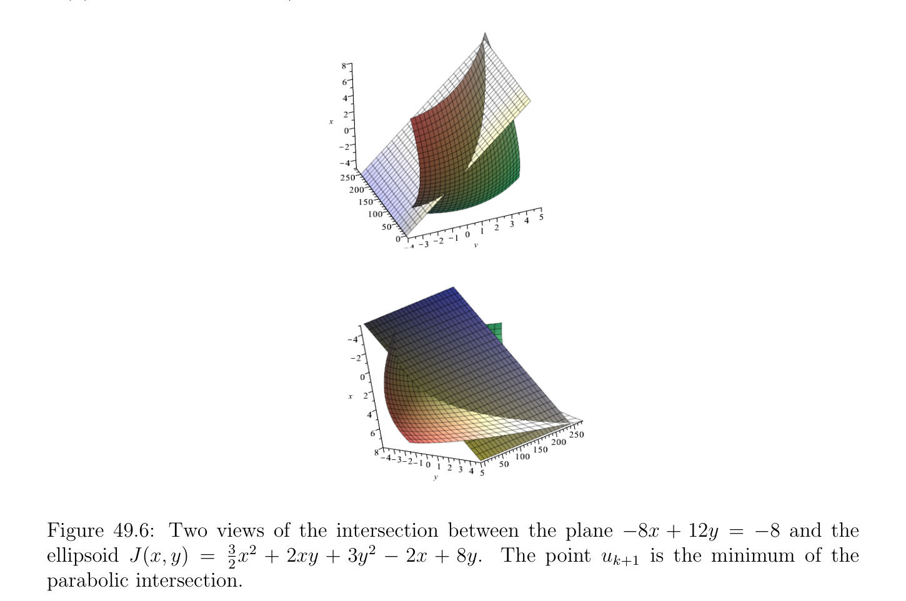

# Convergence of Gradient Descent with Variable Stepsize

<!-- PAGE 1731 -->
49.5. Geometrically this procedure corresponds to intersecting the plane -8x $+$ 12y $= -8$ with the ellipsoid J(x, $y) =_{2}^{3}x^{2} +$ 2xy $+ 3y^{2}$ - 2x $+$ 8y to form the parabolic curve f(x) $= 25/6x^{2} -2/3x -4$, and then locating the x-coordinate of its apex which occurs when f' $(x) = 0$, i.e when $x = 2/25$; see Figure 49.6. After $31$ iterations, this procedure stabi-

**Figure 49.6:** Two views of the intersection between the plane -8x $+$ 12y $= -8$ and the ellipsoid J(x, $y) =_{2}^{3}x^{2} +$ 2xy $+ 3y^{2}$ - 2x $+$ 8y. The point $u_{k+1}$ is the minimum of the parabolic intersection. lizes to point $(2, -2)$, which as we know, is the unique minimum of the quadratic ellipsoid
$$+ 2 -$$
J(x, $y) =_{2}^{3}x^{2}$ xy $+ 3y^{2}$ 2x $+$ 8y. A proof of the convergence of the gradient method with backtracking line search, under the hypothesis that $J$ is strictly convex, is given in Boyd and Vandenberghe[29] (Section 9.3.1). More details on this method and the steepest descent method for the Euclidean norm can also be found in Boyd and Vandenberghe $[29]$ (Section 9.3).

## 49.7 Convergence of Gradient Descent with Variable

$$Stepsize$$
We now give a sufficient condition for the gradient method with variable stepsize parameter to converge. In addition to requiring $J$ to be an elliptic functional, we add a Lipschitz

<!-- PAGE 1732 -->
condition on the gradient of $J$. This time the space $V$ can be infinite dimensional.

> **Proposition 49.14.** Let $J$ : $V \to \mathbb{R}$ be a continuously differentiable functional defined on a Hilbert space $V$ . Suppose there exists two constants $\alpha  > 0$ and $M > 0$ such that
$$\langle \nabla J_{v} -\nabla J_{u}, v -u\rangle \ge \alpha  \|v -u\|^{2}for all u, v \in V ,$$
and the Lipschitz condition
$$\|\nabla J_{v} -\nabla J_{u}\|\le M \|v -u\|for all u, v \in V .$$
If there exists two real numbers a, $b \in \mathbb{R}$ such that
$$0 < a \le \rho_{k}  \le b \le \frac{2\alpha}{M^{2}} for all k \ge 0,$$
then the gradient method with variable stepsize parameter converges. Furthermore, there is some constant $\beta  > 0$ (depending on $\alpha , M$, a, $b)$ such that
$$\beta  < 1and\|u_{k} -u\|\le \beta^{k} \|u_{0} -u\|,$$
where $u \in V$ is the unique minimum of $J$.

*Proof.* By hypothesis the functional $J$ is elliptic, so by Theorem 49.8(2) it has a unique minimum $u$ characterized by the fact that $\nabla J_{u} = 0$. Then since $u_{k+1} = u_{k} -\rho_{k} \nabla J_{uk}$, we can write
$$u_{k+1} -u = (u_{k} -u) -\rho_{k} (\nabla J_{uk} -\nabla J_{u}).(*)$$
Using the inequalities
$$\langle \nabla J_{uk} -\nabla J_{u}, u_{k} -u\rangle \ge \alpha  \|u_{k} -u\|^{2}$$
and
$$\|\nabla J_{uk} -\nabla J_{u}\|\le M \|u_{k} -u\|,$$
and assuming that $\rho_{k}  > 0$, it follows that
$$\|u_{k+1} -u\|^{2}= \|u_{k} -u\|^{2}-2\rho_{k} \langle \nabla J_{uk} -\nabla J_{u}, u_{k} -u\rangle + \rho_{k}^{2}  \|\nabla J_{uk} -\nabla J_{u}\|^{2}$$
$$\le \begin{pmatrix} 1 -2\alpha \rho_{k}  + M^{2}\rho_{k}^{2} \end{pmatrix} \|u_{k} -u\|^{2}.$$
Consider the function
$$T(\rho ) = M^{2}\rho^{2} -2\alpha \rho  + 1.$$
Its graph is a parabola intersecting the y-axis at $y = 1$ for $\rho  = 0$, it has a minimum for $\rho  = \alpha /M^{2}$ , and it also has the value $y = 1$ for $\rho  = 2\alpha /M^{2}$ ; see Figure 49.7. Therefore if we pick a, $b$ and $\rho_{k}$  such that
$$0 < a \le \rho_{k}  \le b < \frac{2\alpha}{M^{2}} ,$$

<!-- PAGE 1733 -->
we ensure that for $\rho  \in$ [a, $b]$ we have
$$T(\rho )^{1/2}= (M^{2} \rho^{2} -2\alpha \rho  + 1)^{1/2}\le (\max{T(a), T(b)})^{1/2}= \beta  < 1.$$
Then by induction we get
$$\|u_{k+1} -u\|\le \beta^{k+1} \|u_{0} -u\|,$$
which proves convergence.
$$y = 1$$
$$(0,1)$$
$$(\overline{\alpha},1 -\overline{\alpha})$$
$$\overline{M}\overline{2}\overline{M}\overline{2}$$
$$\overline{\alpha}\overline{2}\overline{\alpha}$$
$$a\overline{2} b\overline{2}$$
$$\overline{M}\overline{M}$$
$$Figure 49.7: The parabola T(\rho ) used in the proof of Proposition 49.14.$$
Remarks: In the proof of Proposition 49.14, it is the fact that $V$ is complete which plays a crucial role. If $J$ is twice differentiable, the hypothesis
$$\|\nabla J_{v} -\nabla J_{u}\|\le M \|v -u\|for all u, v \in V$$
can be expressed as
$$\sup

$\nabla^{2} J_{v}$

$\le$ M.$$
$$v\in V$$
In the case of a quadratic elliptic functional defined over $\mathbb{R}^{n}$,
$$J(v) = \langle Av, v\rangle -\langle b, v\rangle ,$$
the upper bound $2\alpha /M^{2}$ can be improved. In this case we have
$$\nabla J_{v} = Av -b,$$
and we know that $\alpha  = \lambda_{1}$  and $M = \lambda_{n}$  do the job, where $\lambda_{1}$  is the smallest eigenvalue of $A$ and $\lambda_{n}$  is the largest eigenvalue of $A$. Hence we can pick a, $b$ such that
$$0 < a \le \rho_{k}  \le b < \frac{2\lambda_{1}}{\lambda_{n}^{2}} .$$

<!-- PAGE 1734 -->
Since $u_{k+1} = u_{k}$ - $\rho_{k} \nabla J_{uk}$ and $\nabla J_{uk} = Au_{k}$ - $b$, we have
$$u_{k+1} -u = (u_{k} -u) -\rho_{k} (Au_{k} -Au) = (I -\rho_{k} A)(u_{k} -u),$$
so we get
$$\|u_{k+1} -u\|\le \|I -\rho_{k} A\|_{2} \|u_{k} -u\|.$$
However, since I - $\rho_{k} A$ is a symmetric matrix, $\|I$ - $\rho_{k} A\|_{2}$ is the largest absolute value of its eigenvalues, so
$$\|I -\rho_{k} A\|_{2} \le \max{|1 -\rho_{k} \lambda_{1} |, |1 -\rho_{k} \lambda_{n} |}.$$
The function
$$\mu (\rho ) = \max{|1 -\rho \lambda_{1} |, |1 -\rho \lambda_{n} |}$$
is a piecewise affine function, and it is easy to see that if we pick a, $b$ such that
$$0 < a \le \rho_{k}  \le b < \frac{2}{\lambda_{n}} ,$$
then
$$\max \mu (\rho ) \le \max{\mu (a), \mu (b)} < 1.$$
$$\rho \in [a,b]$$
Therefore, the upper bound $2\lambda_{1} /\lambda_{n}^{2}$  can be replaced by $2/\lambda_{n}$ , which is typically much larger. A “good” pick for $\rho_{k}$  is $2/(\lambda_{1}  + \lambda_{n}$ ) (as opposed to $\lambda_{1} /\lambda_{n}^{2}$  for the first version). In this case
$$-$$
$$|1 -\rho_{k} \lambda_{1} | = |1 -\rho_{k} \lambda_{n} | = \frac{\lambda_{n} \lambda_{1}}{\lambda_{n}  + \lambda_{1}} ,$$
so we get
$$-\lambda  - -$$
$$\beta  = \frac{\lambda_{n} \lambda_{1}}{\lambda_{n}  + \lambda_{1}} \overline{=}_{\lambda}^{\lambda n1} \frac{1}{+ 1} \overline{n}  = \frac{cond_{2}(A)1}{cond_{2}(A) + 1} ,$$
$$\overline{\lambda}\overline{1}$$
where $cond_{2}(A) = \lambda_{n} /\lambda_{1}$  is the condition number of the matrix $A$ with respect to the spectral norm. Thus we see that the larger the condition number of $A$ is, the slower the convergence of the method will be. This is not surprising since we already know that linear systems involving ill-conditioned matrices (matrices with a large condition number) are problematic and prone to numerical instability. One way to deal with this problem is to use a method known as preconditioning. We only described the most basic gradient descent methods. There are numerous variants, and we only mention a few of these methods. The method of scaling consists in using $-\rho_{k} D_{k}\nabla J_{uk}$ as descent direction, where $D_{k}$ is some suitably chosen symmetric positive definite matrix. In the gradient method with extrapolation, $u_{k+1}$ is determined by
$$u_{k+1} = u_{k} -\rho_{k} \nabla J_{uk} + \beta_{k} (u_{k} -u_{k-1}).$$
