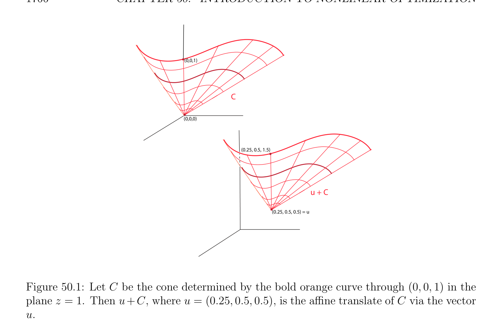
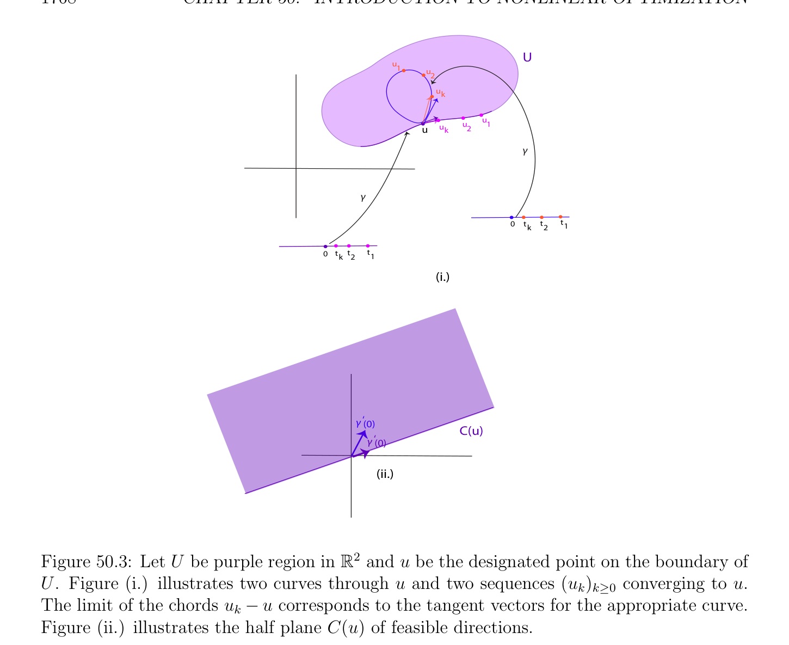
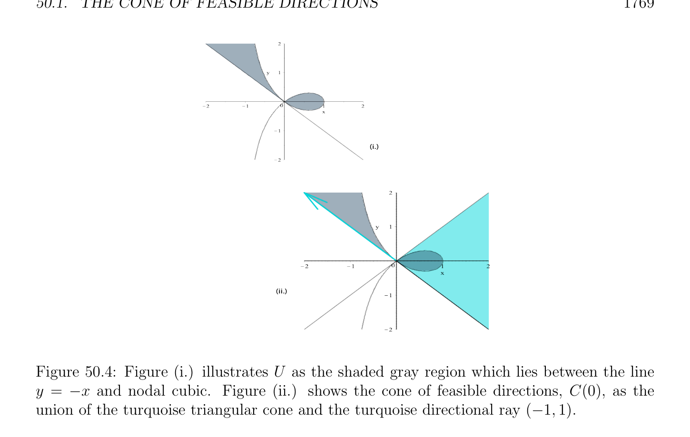

# The Cone of Feasible Directions

<!-- PAGE 1765 -->
program simpler than the primal program. If $d^{*}$ is the optimal value of the dual program and if $p^{*}$ is the optimal value of the primal program, we always have
$$d^{*}\le p^{*},$$
which is known as weak duality. Under certain conditions, $d^{*} = p^{*}$, that is, the duality gap is zero, in which case we say that strong duality holds. Also, under certain conditions, a solution of the dual yields a solution of the primal, and if the primal has an optimal solution, then the dual has an optimal solution, but beware that the converse is generally false (see Theorem 50.17). We also show how to deal with equality constraints, and discuss the use of conjugate functions to find the dual function. Our coverage of Lagrangian duality is quite thorough, but we do not discuss more general orderings such as the semidefinite ordering. For these topics which belong to convex optimization, the reader is referred to Boyd and Vandenberghe $[29]$. Our approach in this chapter is very much inspired by Ciarlet $[41]$ because we find it one of the more direct, and it is general enough to accomodate Hilbert spaces. The field of nonlinear optimization and convex optimization is vast and there are many books on the subject. Among those we recommend (in alphabetic order) Bertsekas $[16, 17, 18]$, Bertsekas, Nedi´c, and Ozdaglar $[19]$, Boyd and Vandenberghe $[29]$, Luenberger $[120]$, and Luenberger and Ye $[121]$.

## 50.1 The Cone of Feasible Directions

Let $V$ be a normed vector space and let $U$ be a nonempty subset of $V$ . For any point $u \in U$, consider any converging sequence $(u_{k})_{k\ge0}$ of vectors $u_{k} \in U$ having $u$ as their limit, with $u_{k} \neq  u$ for all $k \ge 0$, and look at the sequence of “unit chords,”
$$\frac{u_{k}u}{\|u_{k} -u\|} -.$$
This sequence could oscillate forever, or it could have a limit, some unit vector $w \in V$ . In
$$b$$
the second case, all nonzero vectors $\lambda w$ for all $\lambda  > 0$, belong to an object called the cone of
$$b$$
feasible directions at $u$. First, we need to define the notion of cone.

> **Definition 50.1.** Given a (real) vector space $V$ , a nonempty subset $C \subseteq V$ is a cone with apex $0$ (for short, a cone), if for any $v \in V$ , if $v \in C$, then $\lambda v \in C$ for all $\lambda  > 0 (\lambda  \in \mathbb{R})$. For any $u \in V$ , a cone with apex $u$ is any nonempty subset of the form $u + C = {u + v$ | $v \in C}$, where $C$ is a cone with apex $0$; see Figure 50.1. Observe that a cone with apex $0$ (or $u)$ is not necessarily convex, and that $0$ does not necessarily belong to $C$ (resp. $u$ does not necessarily belong to $u + C)$ (although in the case of the cone of feasible directions C(u) we have $0 \in$ C(u)). The condition for being a cone only asserts that if a nonzero vector $v$ belongs to $C$, then the open ray ${\lambda v$ | $\lambda  > 0}$ (resp. the affine open ray $u + {\lambda v$ | $\lambda  > 0})$ also belongs to $C$.

<!-- PAGE 1766 -->
$$(0,0,1)$$
$$C$$
$$\overline{(0,0,0)}$$
$$V$$
$$(0.25, 0.5, 1.5)$$
$$u + C$$
$$(0.25, 0.5, 0.5) = u$$

**Figure 50.1:** Let $C$ be the cone determined by the bold orange curve through $(0, 0, 1)$ in the plane $z = 1$. Then $u+C$, where $u =$ (0.25, 0.5, 0.5), is the affine translate of $C$ via the vector $u$.

> **Definition 50.2.** Let $V$ be a normed vector space and let $U$ be a nonempty subset of $V$ . For any point $u \in U$, the cone C(u) of feasible directions at $u$ is the union of ${0}$ and the set of all nonzero vectors $w \in V$ for which there exists some convergent sequence $(u_{k})_{k\ge0}$ of vectors such that
$(1) u_{k} \in U$ and $u_{k} \neq  u$ for all $k \ge 0$, and $lim_{k\mapsto \infty} u_{k} = u$.
$$(2) lim_{k\mapsto \infty} \frac{u_{k}u}{\|u_{k} -u\|} -= \frac{w}{\|w\|} , with w \neq  0.$$
Condition $(2)$ can also be expressed as follows: there is a sequence $(\delta_{k} )_{k\ge0}$ of vectors $\delta_{k}  \in V$ such that
$$u_{k} = u + \|u_{k} -u\| \frac{w}{\|w\|} + \|u_{k} -u\|\delta_{k} ,klim\mapsto \infty \delta_{k}  = 0, w \neq  0.$$
Figure 50.2 illustrates the construction of $w$ in C(u). Clearly, the cone C(u) of feasible directions at $u$ is a cone with apex $0$, and $u +$ C(u) is a cone with apex $u$. Obviously, it would be desirable to have conditions on $U$ that imply that C(u) is a convex cone. Such conditions will be given later on. Observe that the cone C(u) of feasible directions at $u$ contains the velocity vectors at $u$ of all curves $\gamma$  in $U$ through $u$. If $\gamma$  : $(-1, 1) \to U$ is such a curve with $\gamma (0) = u$, and if $\gamma' (0) \neq  0$

<!-- PAGE 1767 -->
$$U$$
$$u- u$$
$$1u$$
$$u1$$
$$u$$
$$uk$$
$$2$$
$$u\overline{1} - u$$
$$\overline{u} 1\overline{- u}$$
$$u 2- u\overline{w}$$
$$\overline{u} 2\overline{- u}\overline{w}$$
$$u \overline{k}- u$$
$$\overline{u} k\overline{- u}$$
$$\mathbb{R}^{2}$$

**Figure 50.2:** Let $U$ be the pink region in with fuchsia point $u \in U$. For any sequence $(u_{k})_{k\ge0}$ of points in $U$ which converges to $u$, form the chords $u_{k}$ - $u$ and take the limit to construct the red vector $w$. exists, then there is a sequence $(u_{k})_{k\ge0}$ of vectors in $U$ converging to $u$ as in Definition 50.2, with $u_{k} = \gamma (t_{k})$ for some sequence $(t_{k})_{k\ge0}$ of reals $t_{k} > 0$ such that $lim_{k\mapsto \infty} t_{k} = 0$, so that
$$u_{k} -u = t_{k}\gamma' (0) + t_{k}\epsilon_{k} ,lim\epsilon_{k}  = 0,$$
$$k\mapsto \infty$$
and we get
$$-$$
$$klim\mapsto \infty \frac{u_{k}u}{\|u_{k} -u\|} = \frac{\gamma' (0)}{\|\gamma' (0)\|} .$$
For an illustration of this paragraph in $\mathbb{R}^{2}$, see Figure 50.3.

> **Example 50.1.** In $V =\mathbb{R}^{2}$, let $\phi_{1}$  and $\phi_{2}$  be given by
$$\phi_{1} (u_{1}, u_{2}) = -u_{1} -u_{2}$$
$$\phi_{2} (u_{1}, u_{2}) = u_{1}(u_{1}^{2} + u_{2}^{2}) -(u_{1}^{2} -u_{2}^{2}),$$
and let
$$\mathbb{R}^{2}$$
$$U = {(u_{1}, u_{2}) \in | \phi_{1} (u_{1}, u_{2}) \le 0, \phi_{2} (u_{1}, u_{2}) \le 0}.$$
The region $U$ is shown in Figure 50.4 and is bounded by the curve given by the equation $\phi_{1} (u_{1}, u_{2}) = 0$, that is, $-u_{1}$ - $u_{2} = 0$, the line of slope $-1$ through the origin, and the curve given by the equation $u_{1}(u_{1}^{2} + u_{2}^{2})$ - $(u_{1}^{2}$ - $u_{2}^{2}) = 0$, a nodal cubic through the origin. We obtain a parametric definition of this curve by letting $u_{2} = tu_{1}$, and we find that
$$u_{1}(t) = \frac{u_{1}^{2}(t)u_{2}^{2}(t)}{u_{1}^{2}(t) + u_{2}^{2}(t)} - = \frac{1t^{2}}{1 + t^{2}} -,u_{2}(t) = \frac{t(1t^{2})}{1 + t^{2}} - .$$
The tangent vector at $t$ is given by $(u_{1}'(t), u_{2}'(t))$ with
$$- - --$$
$$u_{1}'(t) = \frac{2t(1 + t^{2})(1t^{2})2t}{(1 + t^{2})^{2}} = \frac{4t}{(1 + t^{2})^{2}}$$

<!-- PAGE 1768 -->
$$U$$
$$u1$$
$$u2$$
$$uk$$
$$uu1$$
$$\overline{u} uk2$$
$$\gamma$$
$$\gamma$$
$$\overline{0}\overline{tk}\overline{t2}\overline{t1}$$
$$\overline{0}\overline{t} k\overline{t} 2\overline{t}\overline{1}$$
$$(i.)$$
$$\gamma ‘(0)$$
$$C(u)$$
$$\gamma ‘(0)$$
$$(ii.)$$
$$\mathbb{R}^{2}$$

**Figure 50.3:** Let $U$ be purple region in and $u$ be the designated point on the boundary of $U$. Figure $(i.)$ illustrates two curves through $u$ and two sequences $(u_{k})_{k\ge0}$ converging to $u$. The limit of the chords $u_{k}$ - $u$ corresponds to the tangent vectors for the appropriate curve. Figure (ii.) illustrates the half plane C(u) of feasible directions. and
$$- - -$$
$$- - -  -  -$$
$$u_{2}'(t) = \frac{(13t^{2})(1 + t^{2})(tt^{3})2t}{(1 + t^{2})^{2}} = \frac{12t^{2}3t^{4}2t^{2} + 2t^{4}}{(1 + t^{2})^{2}} = \frac{14t^{2}t^{4}}{(1 + t^{2})^{2}} .$$
The nodal cubic passes through the origin for $t = \pm 1$, and for $t = -1$ the tangent vector is $(1, -1)$, and for $t = 1$ the tangent vector is $(-1, -1)$. The cone of feasible directions C(0) at the origin is given by
$$\mathbb{R}^{2}$$
$$C(0) = {(u_{1}, u_{2}) \in | u_{1} + u_{2} \ge 0, |u_{1}| \ge |u_{2}|}.$$
This is not a convex cone since it contains the sector delineated by the lines $u_{2} = u_{1}$ and $u_{2} = -u_{1}$, but also the ray supported by the vector $(-1, 1)$. The two crucial properties of the cone of feasible directions are shown in the following proposition.

<!-- PAGE 1769 -->
$$(i.)$$
$$(ii.)$$

**Figure 50.4:** Figure $(i.)$ illustrates $U$ as the shaded gray region which lies between the line $y = -x$ and nodal cubic. Figure (ii.) shows the cone of feasible directions, C(0), as the union of the turquoise triangular cone and the turquoise directional ray $(-1, 1)$.

> **Proposition 50.1.** Let $U$ be any nonempty subset of a normed vector space $V$ .
$(1)$ For any $u \in U$, the cone C(u) of feasible directions at $u$ is closed.
$(2)$ Let $J$ : $\Omega \to \mathbb{R}$ be a function defined on an open subset $\Omega$ containing $U$. If $J$ has a local minimum with respect to the set $U$ at a point $u \in U$, and if $J_{u}'$ exists at $u$, then
$$J_{u}'(v -u) \ge 0for all v \in u + C(u).$$

*Proof.* $(1)$ Let $(w_{n})_{n\ge0}$ be a sequence of vectors $w_{n} \in$ C(u) converging to a limit $w \in V$ . We may assume that $w \neq  0$, since $0 \in$ C(u) by definition, and thus we may also assume that $w_{n} \neq  0$ for all $n \ge 0$. By definition, for every $n \ge 0$, there is a sequence $(u_{k}^{n})_{k\ge0}$ of vectors in $V$ and some $w_{n} \neq  0$ such that
$(1) u_{k}^{n} \in U$ and $u_{k}^{n}$ ̸ $= u$ for all $k \ge 0$, and $lim_{k\mapsto \infty} u_{k}^{n} = u$.
$(2)$ There is a sequence $(\delta_{k}^{n} )_{k\ge0}$ of vectors $\delta_{k}^{n}  \in V$ such that
$$u_{k}^{n} = u + \|u_{k}^{n} -u\| \frac{w_{n}}{\|w_{n}\|} + \|u_{k}^{n} -u\|\delta_{k}^{n} ,klim\mapsto \infty \delta_{k}^{n}  = 0, w_{n} \neq  0.$$
Let $(\epsilon_{n} )_{n\ge0}$ be a sequence of real numbers $\epsilon_{n}  > 0$ such that $lim_{n\mapsto \infty} \epsilon_{n}  = 0$ (for example, $\epsilon_{n}  = 1/(n + 1))$. Due to the convergence of the sequences $(u_{k}^{n})$ and $(\delta_{k}^{n}$ ) for every fixed $n$,

<!-- PAGE 1770 -->
there exist an integer k(n) such that
$$u_{k(n)}^{n} -u

$\le \epsilon_{n}$ ,

$\delta_{k(n)}^{n}$

$\le \epsilon_{n}$ .$$ Consider the sequence $(u_{k(n)}^{n})_{n\ge0}$. We have
$$u_{k(n)}^{n} \in U, u_{k(n)}^{n} ̸= 0, for all n \ge 0,limu_{k(n)}^{n} = u,$$
$$n\mapsto \infty$$
and we can write
$$u_{k(n)}^{n} = u +

$u_{k(n)}^{n} -u \frac{w}{\|w\|} +$

$u_{k(n)}^{n} -u \begin{pmatrix} w_{n}$ & $w \\ \delta_{k(n)}^{n} +$ & - $\\ \|w_{n}\|$ & $\|w\| \end{pmatrix} \begin{pmatrix}\end{pmatrix}$ .$$ Since $lim_{k\mapsto \infty}(w_{n}/ \|w_{n}\|) = w/ \|w\|$, we conclude that $w \in$ C(u). See Figure 50.5.
$$w$$
$$1$$
$$1w2$$
$$u$$
$$1$$
$$u2$$
$$u11$$
$$22w$$
$$u2n$$
$$u1un$$
$$ku2un1U$$
$$k2$$
$$un$$
$$wk$$
$$\overline{1}$$
$$\overline{w} w$$
$$1$$
$$\overline{u}\overline{w}$$
$$\overline{w}$$
$$\mathbb{R}^{2}$$

**Figure 50.5:** Let $U$ be the mint green region in with $u = (0, 0)$. Let $(w_{n})_{n\ge0}$ be a sequence of vectors (points) along the upper dashed curve which converge to $w$. By following the dashed orange longitudinal curves, and selecting an appropriate vector(point), we construct the dark green curve in $U$, which passes through $u$, and at $u$ has tangent vector proportional to $w$.
$(2)$ Let $w = v -u$ be any nonzero vector in the cone C(u), and let $(u_{k})_{k\ge0}$ be a sequence of vectors in $U -{u}$ such that
$(1) lim_{k\mapsto \infty} u_{k} = u$.
$(2)$ There is a sequence $(\delta_{k} )_{k\ge0}$ of vectors $\delta_{k}  \in V$ such that
$$u_{k} -u = \|u_{k} -u\| \frac{w}{\|w\|} + \|u_{k} -u\|\delta_{k} ,klim\mapsto \infty \delta_{k}  = 0, w \neq  0,$$
$(3)$ J(u) $\le J(u_{k})$ for all $k \ge 0$.
