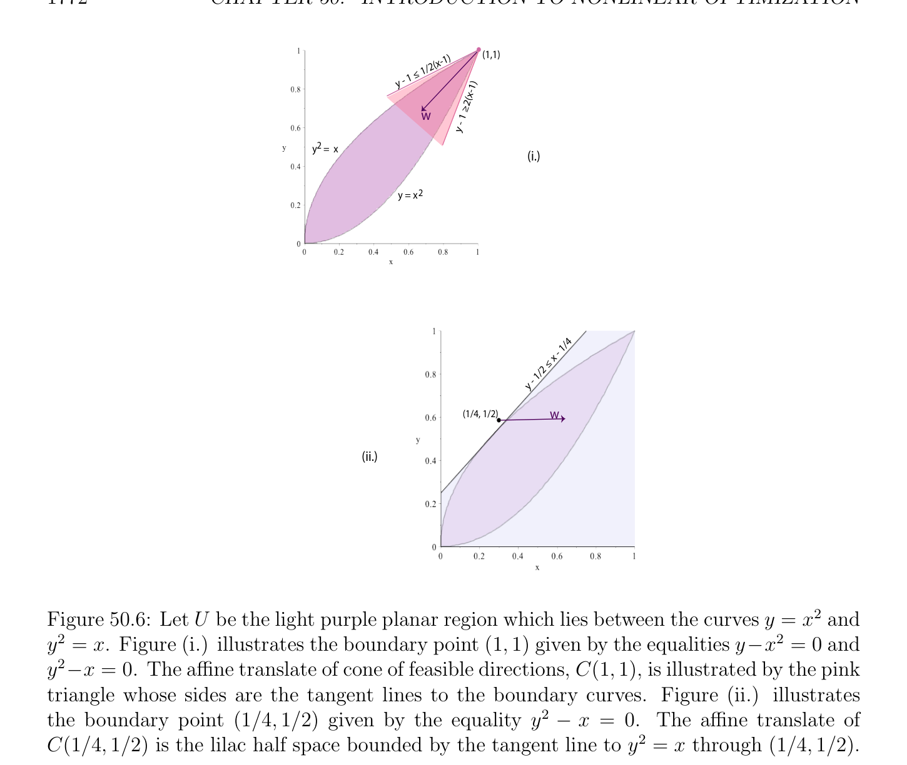
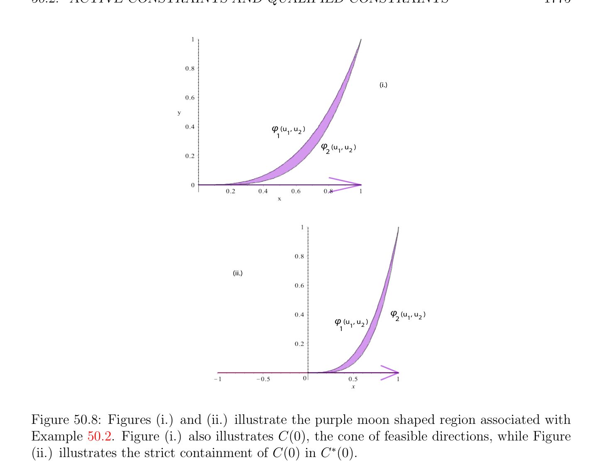

# Active Constraints and Qualified Constraints

<!-- PAGE 1771 -->
Since $J$ is differentiable at $u$, we have
$$0 \le J(u_{k}) -J(u) = J_{u}'(u_{k} -u) + \|u_{k} -u\|\epsilon_{k} ,(*)$$
for some sequence $(\epsilon_{k} )_{k\ge0}$ such that $lim_{k\mapsto \infty} \epsilon_{k}  = 0$. Since $J_{u}'$ is linear and continuous, and since
$$u_{k} -u = \|u_{k} -u\| \frac{w}{\|w\|} + \|u_{k} -u\|\delta_{k} ,klim\mapsto \infty \delta_{k}  = 0, w \neq  0,$$
(*) implies that
$$\| -\|$$
$$0 \le \frac{u_{k}u}{\|w\|} (J_{u}'(w) + \eta_{k} ),$$
with
$$\eta_{k}  = \|w\|(J_{u}'(\delta_{k} ) + \epsilon_{k} ).$$
Since $J_{u}'$ is continuous, we have $lim_{k\mapsto \infty} \eta_{k}  = 0$. But then $J_{u}'(w) \ge 0$, since if $J_{u}'(w) < 0$, then for $k$ large enough the expression $J_{u}'(w) + \eta_{k}$  would be negative, and since $u_{k} \neq  u$, the expression $(\|u_{k}$ - $u\|/ \|w\|)(J_{u}'(w) + \eta_{k}$ ) would also be negative, a contradiction. From now on we assume that $U$ is defined by a set of inequalities, that is
$$U = {x \in \Omega | \phi_{i} (x) \le 0, 1 \le i \le m},$$
where the functions $\phi_{i}$  : $\Omega \to \mathbb{R}$ are continuous (and usually differentiable). As we explained earlier, an equality constraint $\phi_{i} (x) = 0$ is treated as the conjunction of the two inequalities $\phi_{i} (x) \le 0$ and $-\phi_{i} (x) \le 0$. Later on we will see that when the functions $\phi_{i}$  are convex, since $-\phi_{i}$  is not necessarily convex, it is desirable to treat equality constraints separately, but for the time being we won’t.

## 50.2 Active Constraints and Qualified Constraints

Our next goal is find sufficient conditions for the cone C(u) to be convex, for any $u \in U$. For this we assume that the functions $\phi_{i}$  are differentiable at $u$. It turns out that the constraints $\phi_{i}$  that matter are those for which $\phi_{i} (u) = 0$, namely the constraints that are tight, or as we say, active.

> **Definition 50.3.** Given $m$ functions $\phi_{i}$  : $\Omega \to \mathbb{R}$ defined on some open subset $\Omega$ of some vector space $V$ , let $U$ be the set defined by
$$U = {x \in \Omega | \phi_{i} (x) \le 0, 1 \le i \le m}.$$
For any $u \in U$, a constraint $\phi_{i}$  is said to be active at $u$ if $\phi_{i} (u) = 0$, else inactive at $u$ if $\phi_{i} (u) < 0$. If a constraint $\phi_{i}$  is active at $u$, this corresponds to $u$ being on a piece of the boundary of $U$ determined by some of the equations $\phi_{i} (u) = 0$; see Figure 50.6.

<!-- PAGE 1772 -->
$$1)(1,1)$$
$$1/2(x-$$
$$1 \le$$
$$y - )$$
$$2(x-1$$
$$w \ge$$
$$y - 1$$
$$y   =  x2$$
$$(i.)$$
$$y = x 2$$
$$/4$$
$$- 1$$
$$\le  x$$
$$- 1/2$$
$$y$$
$$(1/4, 1/2)w$$
$$(ii.)$$

**Figure 50.6:** Let $U$ be the light purple planar region which lies between the curves $y = x^{2}$ and $y^{2} = x$. Figure $(i.)$ illustrates the boundary point $(1, 1)$ given by the equalities $y-x^{2} = 0$ and $y^{2}-x = 0$. The affine translate of cone of feasible directions, C(1, $1)$, is illustrated by the pink triangle whose sides are the tangent lines to the boundary curves. Figure (ii.) illustrates the boundary point $(1/4, 1/2)$ given by the equality $y^{2}$ - $x = 0$. The affine translate of $C(1/4, 1/2)$ is the lilac half space bounded by the tangent line to $y^{2} = x$ through $(1/4, 1/2)$.

> **Definition 50.4.** For any $u \in U$, with
$$U = {x \in \Omega | \phi_{i} (x) \le 0, 1 \le i \le m},$$
we define I(u) as the set of indices
$$I(u) = {i \in {1, \dots  , m} | \phi_{i} (u) = 0}$$
where the constraints are active. We define the set $C^{*}(u)$ as
$$C^{*}(u) = {v \in V | (\phi_{i}' )_{u}(v) \le 0, i \in I(u)}.$$
Since each $(\phi_{i}' )_{u}$ is a linear form, the subset
$$C^{*}(u) = {v \in V | (\phi_{i}' )_{u}(v) \le 0, i \in I(u)}$$

<!-- PAGE 1773 -->
is the intersection of half spaces passing through the origin, so it is a convex set, and obviously it is a cone. If I(u) $= \emptyset$ , then $C^{*}(u) = V$ . The special kinds of $\mathcal{H}-polyhedra$ of the form $C^{*}(u)$ cut out by hyperplanes through the origin are called $\mathcal{H}-cones$. It can be shown that every $\mathcal{H}-cone$ is a polyhedral cone (also called $a \mathcal{V}-cone)$, and conversely. The proof is nontrivial; see Gallier $[74]$ and Ziegler $[201]$. We will prove shortly that we always have the inclusion
$$C(u) \subseteq C^{*}(u).$$
However, the inclusion can be strict, as in Example 50.1. Indeed for $u = (0, 0)$ we have I(0, $0) = {1, 2}$ and since
$$(\phi_{1}' )_{(u1,u2)} = (-1 -1),(\phi_{2}' )_{(u1,u2)} = (3u_{1}^{2} + u_{2}^{2} -2u_{1} 2u_{1}u_{2} + 2u_{2}),$$
$$\mathbb{R}^{2}$$
we have $(\phi_{2}' )_{(0,0)} = (0 0)$, and thus $C^{*}(0) = {(u_{1}, u_{2}) \in$ | $u_{1} + u_{2} \ge 0}$ as illustrated in Figure 50.7.
$$2$$
$$C  (u)*$$
$$y1$$
$$C(u)$$
$$\overline{K}\overline{2}\overline{K}\overline{1}\overline{0}\overline{1}\overline{2}$$
$$x$$
$$K1$$
$$K2$$

**Figure 50.7:** For $u = (0, 0), C^{*}(u)$ is the sea green half space given by $u_{1} + u_{2} \ge 0$. This half space strictly contains C(u), namely the union of the turquoise triangular cone and the directional ray $(-1, 1)$. The conditions stated in the following definition are sufficient conditions that imply that C(u) $= C^{*}(u)$, as we will prove next.

> **Definition 50.5.** For any $u \in U$, with
$$U = {x \in \Omega | \phi_{i} (x) \le 0, 1 \le i \le m},$$
if the functions $\phi_{i}$  are differentiable at $u$ (in fact, we only need this for $i \in$ I(u)), we say that the constraints are qualified at $u$ if the following conditions hold:

<!-- PAGE 1774 -->
(a) Either the constraints $\phi_{i}$  are affine for all $i \in$ I(u), or
$(b)$ There is some nonzero vector $w \in V$ such that the following conditions hold for all $i \in$ I(u):
$$(i) (\phi_{i}' )_{u}(w) \le 0.$$
$$(ii) If \phi_{i}  is not affine, then (\phi_{i}' )_{u}(w) < 0.$$
Condition (b)(ii) implies that $u$ is not a critical point of $\phi_{i}$  for every $i \in$ I(u), so there is no singularity at $u$ in the zero locus of $\phi_{i}$ . Intuitively, if the constraints are qualified at $u$ then the boundary of $U$ near $u$ behaves “nicely.” The boundary points illustrated in Figure 50.6 are qualified. Observe that
$$\mathbb{R}^{2}$$
$U = {x \in$ | $\phi_{1} (x, y) = y^{2}$ - $x \le 0, \phi_{2} (x, y) = x^{2}$ - $y \le 0}$. For $u = (1, 1)$, I(u) $= {1, 2}, (\phi_{1}' )_{(1,1)} = (-1 2), (\phi_{2}' )_{(1,1)} = (2$ - $1)$, and $w = (-1, -1)$ ensures that $(\phi_{1}' )_{(1,1)}$ and $(\phi_{1}' )_{(1,1)}$ satisfy Condition $(b)$ of Definition 50.5. For $u = (1/4, 1/2)$, I(u) $= {1}, (\phi_{1}' )_{(1,1)} = (-1 1)$, and $w = (1, 0)$ will satisfy Condition $(b)$. In Example 50.1, the constraint $\phi_{2} (u_{1}, u_{2}) = 0$ is not qualified at the origin because $(\phi_{2}' )_{(0,0)} = (0, 0)$; in fact, the origin is a self-intersection. In the example below, the origin is also a singular point, but for a different reason.
$$\mathbb{R}^{2}$$

> **Example 50.2.** Consider the region $U \subseteq$ determined by the two curves given by
$$\phi_{1} (u_{1}, u_{2}) = u_{2} -\max(0, u_{1}^{3})$$
$$\phi_{2} (u_{1}, u_{2}) = u_{1}^{4} -u_{2}.$$
$$We have I(0, 0) = {1, 2}, and since (\phi_{1} )_{(0,0)}'(w_{1}, w_{2}) = (0 1)_{w}^{w1} \begin{pmatrix} u_{2}^{2} \end{pmatrix} = w_{2} and (\phi_{2}' )_{(0,0)}(w_{1}, w_{2}) =$$
$$(0-1)_{w}^{w1} \begin{pmatrix} 2 \end{pmatrix} = -w_{2}, we have C^{*}(0) = {(u_{1}, u_{2}) \in \mathbb{R}^{2}|  = 0}, but the constraints are$$
not qualified at $(0, 0)$ since it is impossible to have simultaneously $(\phi_{1}' )_{(0,0)}(w_{1}, w_{2}) < 0$ and
$$\mathbb{R}^{2}$$
$(\phi_{2}' )_{(0,0)}(w_{1}, w_{2}) < 0$, so in fact C(0) $= {(u_{1}, u_{2}) \in$ | $u_{1} \ge 0, u_{2} = 0}$ is strictly contained in $C^{*}(0)$; see Figure 50.8.

> **Proposition 50.2.** Let $u$ be any point of the set
$$U = {x \in \Omega | \phi_{i} (x) \le 0, 1 \le i \le m},$$
where $\Omega$ is an open subset of the normed vector space $V$ , and assume that the functions $\phi_{i}$ are differentiable at $u$ (in fact, we only need this for $i \in$ I(u)). Then the following facts hold:
$(1)$ The cone C(u) of feasible directions at $u$ is contained in the convex cone $C^{*}(u)$; that is,
$$C(u) \subseteq C^{*}(u) = {v \in V | (\phi_{i}' )_{u}(v) \le 0, i \in I(u)}.$$

<!-- PAGE 1775 -->
$$(i.)$$
$$\varphi (u  , u   )$$
$$112$$
$$\varphi  (u  , u   )$$
$$212$$
$$(ii.)$$
$$\varphi  (u  , u   )$$
$$\varphi (u  , u   )212$$
$$112$$

**Figure 50.8:** Figures $(i.)$ and (ii.) illustrate the purple moon shaped region associated with

> **Example 50.2.** Figure $(i.)$ also illustrates C(0), the cone of feasible directions, while Figure (ii.) illustrates the strict containment of C(0) in $C^{*}(0)$.
$(2)$ If the constraints are qualified at $u$ (and the functions $\phi_{i}$  are continuous at $u$ for all $i \in /$ I(u) if we only assume $\phi_{i}$  differentiable at $u$ for all $i \in$ I(u)), then
$$C(u) = C^{*}(u).$$

*Proof.* $(1)$ For every $i \in$ I(u), since $\phi_{i} (v) \le 0$ for all $v \in U$ and $\phi_{i} (u) = 0$, the function $-\phi_{i}$ has a local minimum at $u$ with respect to $U$, so by Proposition 50.1(2), we have
$$(-\phi_{i}' )_{u}(v) \ge 0for all v \in C(u),$$
which is equivalent to $(\phi_{i}' )_{u}(v) \le 0$ for all $v \in$ C(u) and for all $i \in$ I(u), that is, $u \in C^{*}(u)$. (2)(a) First, let us assume that $\phi_{i}$  is affine for every $i \in$ I(u). Recall that $\phi_{i}$  must be given by $\phi_{i} (v) = h_{i}(v) + c_{i}$ for all $v \in V$ , where $h_{i}$ is a linear form and $c_{i} \in \mathbb{R}$. Since the derivative of a linear map at any point is itself,
$$(\phi_{i}' )_{u}(v) = h_{i}(v)for all v \in V .$$

<!-- PAGE 1776 -->
Pick any nonzero $w \in C^{*}(u)$, which means that $(\phi_{i}' )_{u}(w) \le 0$ for all $i \in$ I(u). For any sequence $(\epsilon_{k} )_{k\ge0}$ of reals $\epsilon_{k}  > 0$ such that $lim_{k\mapsto \infty} \epsilon_{k}  = 0$, let $(u_{k})_{k\ge0}$ be the sequence of vectors in $V$ given by
$$u_{k} = u + \epsilon_{k} w.$$
We have $u_{k} -u = \epsilon_{k} w \neq  0$ for all $k \ge 0$ and $lim_{k\mapsto \infty} u_{k} = u$. Furthermore, since the functions $\phi_{i}$  are continuous for all $i \in /$ I, we have
$$0 > \phi_{i} (u) = lim\phi_{i} (u_{k}),$$
$$k\mapsto \infty$$
and since $\phi_{i}$  is affine and $\phi_{i} (u) = 0$ for all $i \in$ I, we have $\phi_{i} (u) = h_{i}(u) + c_{i} = 0$, so $\phi_{i} (u_{k}) = h_{i}(u_{k}) + c_{i} = h_{i}(u_{k})$ - $h_{i}(u) = h_{i}(u_{k}$ - $u) = (\phi_{i}' )_{u}(u_{k}$ - $u) = \epsilon_{k} (\phi_{i}' )_{u}(w) \le 0, (*_{0})$ which implies that $u_{k} \in U$ for all $k$ large enough. Since
$$-$$
$$\frac{u_{k}u}{\|u_{k} -u\|} = \frac{w}{\|w\|} for all k \ge 0,$$
we conclude that $w \in$ C(u). See Figure 50.9.
$$x + y - 1 = 0$$
$$w$$
$$\overline{w} u$$
$$u$$
$$k$$
$$u$$
$$\overline{3}$$
$$u2$$
$$u$$
$$1$$
$$w = (-1/3,-1/3)$$

**Figure 50.9:** Let $U$ be the peach triangle bounded by the lines $y = 0, x = 0$, and $y = -x+1$. Let $u$ satisfy the affine constraint $\phi (x, y) = y + x -1$. Since $\phi_{(x,y)}'  = (1 1)$, set $w = (-1, -1)$ and approach $u$ along the line $u +$ tw. (2)(b) Let us now consider the case where some function $\phi_{i}$  is not affine for some $i \in$ I(u). Let $w \neq  0$ be some vector in $V$ such that Condition $(b)$ of Definition 50.5 holds, namely: for all $i \in$ I(u), we have
$(i) (\phi_{i}' )_{u}(w) \le 0$.
(ii) If $\phi_{i}$  is not affine, then $(\phi_{i}' )_{u}(w) < 0$.

<!-- PAGE 1777 -->
Pick any nonzero vector $v \in C^{*}(u)$, which means that $(\phi_{i}' )_{u}(v) \le 0$ for all $i \in$ I(u), and let $\delta  > 0$ be any positive real number such that $v + \delta w \neq  0$. For any sequence $(\epsilon_{k} )_{k\ge0}$ of reals $\epsilon_{k}  > 0$ such that $lim_{k\mapsto \infty} \epsilon_{k}  = 0$, let $(u_{k})_{k\ge0}$ be the sequence of vectors in $V$ given by
$$u_{k} = u + \epsilon_{k} (v + \delta w).$$
We have $u_{k}$ - $u = \epsilon_{k} (v + \delta w) \neq  0$ for all $k \ge 0$ and $lim_{k\mapsto \infty} u_{k} = u$. Furthermore, since the functions $\phi_{i}$  are continuous for all $i \in /$ I(u), we have
$$0 > \phi_{i} (u) = lim\phi_{i} (u_{k})for all i \in /I(u).(*_{1})$$
$$k\mapsto \infty$$
Equation $(*_{0})$ of the previous case shows that for all $i \in$ I(u) such that $\phi_{i}$  is affine, since $(\phi_{i}' )_{u}(v) \le 0, (\phi_{i}' )_{u}(w) \le 0$, and $\epsilon_{k} , \delta  > 0$, we have
$$\phi_{i} (u_{k}) = \epsilon_{k} ((\phi_{i}' )_{u}(v) + \delta (\phi_{i}' )_{u}(w)) \le 0for all i \in I(u) and \phi_{i}  affine.(*_{2})$$
Furthermore, since $\phi_{i}$  is differentiable and $\phi_{i} (u) = 0$ for all $i \in$ I(u), if $\phi_{i}$  is not affine we have
$$\phi_{i} (u_{k}) = \epsilon_{k} ((\phi_{i}' )_{u}(v) + \delta (\phi_{i}' )_{u}(w)) + \epsilon_{k}  \|u_{k} -u\|\eta_{k} (u_{k} -u)$$
with $lim_{\|uk-u\|\mapsto0} \eta_{k} (u_{k}$ - $u) = 0$, so if we write $\alpha_{k}  = \|u_{k}$ - $u\|\eta_{k} (u_{k}$ - $u)$, we have
$$\phi_{i} (u_{k}) = \epsilon_{k} ((\phi_{i}' )_{u}(v) + \delta (\phi_{i}' )_{u}(w) + \alpha_{k} )$$
with $lim_{k\mapsto \infty} \alpha_{k}  = 0$, and since $(\phi_{i}' )_{u}(v) \le 0$, we obtain
$$\phi_{i} (u_{k}) \le \epsilon_{k} (\delta (\phi_{i}' )_{u}(w) + \alpha_{k} )for all i \in I(u) and \phi_{i}  not affine.(*_{3})$$
Equations $(*_{1}), (*_{2}), (*_{3})$ show that $u_{k} \in U$ for $k$ sufficiently large, where in $(*_{3})$, since $(\phi_{i}' )_{u}(w) < 0$ and $\delta  > 0$, even if $\alpha_{k}  > 0$, when $lim_{k\mapsto \infty} \alpha_{k}  = 0$, we will have $\delta (\phi_{i}' )_{u}(w)+\alpha_{k}  < 0$ for $k$ large enough, and thus $\epsilon_{k} (\delta (\phi_{i}' )_{u}(w) + \alpha_{k}$ ) $< 0$ for $k$ large enough. Since
$$\frac{u_{k}u}{\|u_{k} -u\|} -= \frac{v + \delta w}{\|v + \delta w\|}$$
for all $k \ge 0$, we conclude that $v +\delta w \in$ C(u) for $\delta  > 0$ small enough. But now the sequence $(v_{n})_{n\ge0}$ given by
$$v_{n} = v + \epsilon_{n} w$$
converges to $v$, and for $n$ large enough, $v_{n} \in$ C(u). Since by Proposition 50.1(1), the cone C(u) is closed, we conclude that $v \in$ C(u). See Figure 50.10. In all cases, we proved that $C^{*}(u) \subseteq$ C(u), as claimed. In the case of $m$ affine constraints $a_{i}x \le b_{i}$, for some linear forms $a_{i}$ and some $b_{i} \in \mathbb{R}$,
$$\mathbb{R}^{n} \mathbb{R}^{n}$$
for any point $u \in$ such that $a_{i}u = b_{i}$ for all $i \in$ I(u), the cone C(u) consists of all $v \in$ such that $a_{i}v \le 0$, so $u +$ C(u) consists of all points $u + v$ such that
$$a_{i}(u + v) \le b_{i}for all i \in I(u),$$
which is the cone cut out by the hyperplanes determining some face of the polyhedron defined by the $m$ constraints $a_{i}x \le b_{i}$. We are now ready to prove one of the most important results of nonlinear optimization.
