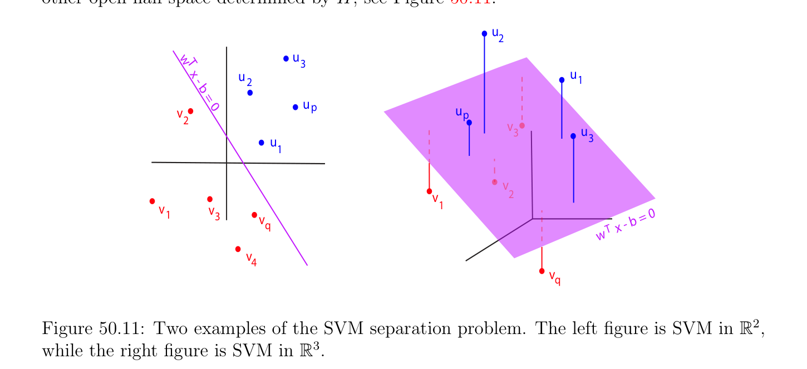

# Hard Margin Support Vector Machine; Version I

<!-- PAGE 1794 -->
$(4)$ Update. $u_{k+1} = u_{k} + \rho_{k} d_{nt,k}$. Newton’s method requires that the KKT-matrix be invertible. Under some mild assumptions, Newton’s method (with feasible start) converges; see Boyd and Vandenberghe $[29]$ (Chapter $10$, Section 10.2.4). We now give an example illustrating Proposition 50.7, the Support Vector Machine (abbreviated as SVM).

## 50.5 Hard Margin Support Vector Machine; Version I

In this section we describe the following classification problem, or perhaps more accurately, separation problem (into two classes). Suppose we have two nonempty disjoint finite sets of
$$\mathbb{R}^{n}$$
$p$ blue points ${u_{i}}_{i=1}^{p}$ and $q$ red points ${v_{j}}_{j=1}^{q}$ in (for simplicity, you may assume that these points are in the plane, that is, $n = 2)$. Our goal is to find a hyperplane $H$ of equation
$$\mathbb{R}^{n} \mathbb{R}$$
$w^{\top}x$ - $b = 0$ (where $w \in$ is a nonzero vector and $b \in$ ), such that all the blue points $u_{i}$ are in one of the two open half-spaces determined by $H$, and all the red points $v_{j}$ are in the other open half-space determined by $H$; see Figure 50.11.
$$u$$
$$2$$
$$w   u$$
$$T3$$
$$xuu$$
$$-21$$
$$b$$
$$= 0$$
$$up$$
$$vu$$
$$p$$
$$2v$$
$$3u$$
$$u3$$
$$1$$
$$v$$
$$v2$$
$$vv1$$
$$13b = 0$$
$$v-$$
$$q\overline{w}\overline{T} x$$
$$v$$
$$4$$
$$v$$
$$q$$

**Figure 50.11:** Two examples of the SVM separation problem. The left figure is SVM in $\mathbb{R}^{2}$, while the right figure is SVM in $\mathbb{R}^{3}$. Without loss of generality, we may assume that
$$w^{\top}u_{i} -b > 0for i = 1, \dots  , p$$
$$w^{\top}v_{j} -b < 0for j = 1, \dots  , q.$$
Of course, separating the blue and the red points may be impossible, as we see in Figure 50.12 for four points where the line segments $(u_{1}, u_{2})$ and $(v_{1}, v_{2})$ intersect. If a hyperplane separating the two subsets of blue and red points exists, we say that they are linearly separable.

<!-- PAGE 1795 -->
$$v$$
$$w   T2$$
$$xu$$
$$-1$$
$$b$$
$$= 0$$
$$u$$
$$1$$
$$v$$
$$2v$$
$$v1u$$
$$2b = 0$$
$$1x -$$
$$\overline{w}\overline{T}$$
$$u$$
$$2$$

**Figure 50.12:** Two examples in which it is impossible to find purple hyperplanes which separate the red and blue points.
Remark: Write $m = p + q$. The reader should be aware that in machine learning the classification problem is usually defined as follows. We assign $m$ so-called class labels $y_{k} = \pm 1$ to the data points in such a way that $y_{i} = +1$ for each blue point $u_{i}$, and $y_{p+j} = -1$ for each red point $v_{j}$, and we denote the $m$ points by $x_{k}$, where $x_{k} = u_{k}$ for $k = 1, \dots  , p$ and $x_{k} = v_{k-p}$ for $k = p + 1, \dots  , p + q$. Then the classification constraints can be written as
$$y_{k}(w^{\top}x_{k} -b) > 0for k = 1, \dots  , m.$$
The set of pairs ${(x_{1}, y_{1}), \dots  , (x_{m}, y_{m})}$ is called a set of training data (or training set). In the sequel, we will not use the above method, and we will stick to our two subsets of $p$ blue points ${u_{i}}_{i=1}^{p}$ and $q$ red points ${v_{j}}_{j=1}^{q}$. Since there are infinitely many hyperplanes separating the two subsets (if indeed the two subsets are linearly separable), we would like to come up with a “good” criterion for choosing such a hyperplane. The idea that was advocated by Vapnik (see Vapnik $[188])$ is to consider the distances $d(u_{i}, H)$ and $d(v_{j}, H)$ from all the points to the hyperplane $H$, and to pick a hyperplane $H$ that maximizes the smallest of these distances. In machine learning this strategy is called finding a maximal margin hyperplane, or hard margin support vector machine, which definitely sounds more impressive. Since the distance from a point $x$ to the hyperplane $H$ of equation $w^{\top}x$ - $b = 0$ is
$$| -|$$
$$d(x, H) = \frac{w^{\top}xb}{\|w\|} ,$$

<!-- PAGE 1796 -->
$$\sqrt$$
(where $\|w\| = \overline{w}^{\top}\overline{w}$ is the Euclidean norm of $w)$, it is convenient to temporarily assume that $\|w\| = 1$, so that
$$d(x, H) = |w^{\top}x -b|.$$
See Figure 50.13. Then with our sign convention, we have
$$x$$
$$w$$
$$d(x, H)$$
$$proj^{w}$$
$$xx - x0$$
$$0$$
$$H$$

**Figure 50.13:** In $\mathbb{R}^{3}$, the distance from a point to the plane $w^{\top}x$ - $b = 0$ is given by the projection onto the normal $w$.
$$d(u_{i}, H) = w^{\top}u_{i} -bi = 1, \dots  , p$$
$$d(v_{j}, H) = -w^{\top}v_{j} + bj = 1, \dots  , q.$$
If we let
$$\delta  = \min{d(u_{i}, H), d(v_{j}, H) | 1 \le i \le p, 1 \le j \le q},$$
then the hyperplane $H$ should chosen so that
$$w^{\top}u_{i} -b \ge \delta i = 1, \dots  , p$$
$$-w^{\top}v_{j} + b \ge \delta j = 1, \dots  , q,$$
and such that $\delta  > 0$ is maximal. The distance $\delta$  is called the margin associated with the hyperplane $H$. This is indeed one way of formulating the two-class separation problem as an optimization problem with a linear objective function $J(\delta , w, b) = \delta$ , and affine and quadratic constraints $(SVM_{h1})$:
$$maximize\delta$$
$$subject to$$
$$w^{\top}u_{i} -b \ge \delta i = 1, \dots  , p$$
$$-w^{\top}v_{j} + b \ge \delta j = 1, \dots  , q$$
$$\|w\|\le 1.$$

<!-- PAGE 1797 -->
Observe that the Problem $(SVM_{h1})$ has an optimal solution $\delta  > 0$ iff the two subsets are linearly separable. We used the constraint $\|w\|\le 1$ rather than $\|w\| = 1$ because the former is qualified, whereas the latter is not. But if $(w, b, \delta$ ) is an optimal solution, then $\|w\| = 1$, as shown in the following proposition.

> **Proposition 50.12.** If $(w, b, \delta$ ) is an optimal solution of Problem $(SVM_{h1})$, so in particular $\delta  > 0$, then we must have $\|w\| = 1$.

*Proof.* First, if $w = 0$, then we get the two inequalities
$$-b \ge \delta ,b \ge \delta ,$$
which imply that $b \le -\delta$  and $b \ge \delta$  for some positive $\delta$ , which is impossible. But then, if $w \neq  0$ and $\|w\| < 1$, by dividing both sides of the inequalities by $\|w\| < 1$ we would obtain the better solution $(w/ \|w\|, b/ \|w\|, \delta / \|w\|)$, since $\|w\| < 1$ implies that $\delta / \|w\| > \delta$ . We now prove that if the two subsets are linearly separable, then Problem $(SVM_{h1})$ has a unique optimal solution.

> **Theorem 50.13.** If two disjoint subsets of $p$ blue points ${u_{i}}_{i=1}^{p}$ and $q$ red points ${v_{j}}_{j=1}^{q}$ are linearly separable, then Problem $(SVM_{h1})$ has a unique optimal solution consisting of a hyperplane of equation $w^{\top}x$ - $b = 0$ separating the two subsets with maximum margin $\delta$ . Furthermore, if we define $c_{1}(w)$ and $c_{2}(w)$ by
$$c_{1}(w) = \min w^{\top}u_{i}$$
$$1\le i\le p$$
$$c_{2}(w) = \max w^{\top}v_{j},$$
$$1\le j\le q$$
then $w$ is the unique maximum of the function
$$\rho (w) = \frac{c_{1}(w)c_{2}(w)}{2} -$$
$$\mathbb{R}^{n}$$
over the convex subset $U$ of given by the inequalities
$$w^{\top}u_{i} -b \ge \delta i = 1, \dots  , p$$
$$-w^{\top}v_{j} + b \ge \delta j = 1, \dots  , q$$
$$\|w\|\le 1,$$
and
$$b = \frac{c_{1}(w) + c_{2}(w)}{2} .$$

<!-- PAGE 1798 -->

*Proof.* Our proof is adapted from Vapnik $[188]$ (Chapter $10$, Theorem 10.1). For any separating hyperplane $H$, since
$$d(u_{i}, H) = w^{\top}u_{i} -bi = 1, \dots  , p$$
$$d(v_{j}, H) = -w^{\top}v_{j} + bj = 1, \dots  , q,$$
and since the smallest distance to $H$ is
$$\delta  = \min{d(u_{i}, H), d(v_{j}, H) | 1 \le i \le p, 1 \le j \le q}$$
$$= \min{w^{\top}u_{i} -b, -w^{\top}v_{j} + b | 1 \le i \le p, 1 \le j \le q}$$
$$= \min{\min{w^{\top}u_{i} -b | 1 \le i \le p}, \min{-w^{\top}v_{j} + b | 1 \le j \le q}}$$
$$= \min{\min{w^{\top}u_{i} | 1 \le i \le p} -b}, \min{-w^{\top}v_{j} | 1 \le j \le q} + b}$$
$$= \min{\min{w^{\top}u_{i} | 1 \le i \le p} -b}, -\max{w^{\top}v_{j} | 1 \le j \le q} + b}$$
$$= \min{c_{1}(w) -b, -c_{2}(w) + b},$$
in order for $\delta$  to be maximal we must have
$$c_{1}(w) -b = -c_{2}(w) + b,$$
which yields
$$b = \frac{c_{1}(w) + c_{2}(w)}{2} .$$
In this case,
$$-$$
$$c_{1}(w) -b = \frac{c_{1}(w)c_{2}(w)}{2} = -c_{2}(w) + b,$$
so the maximum margin $\delta$  is indeed obtained when $\rho (w) = (c_{1}(w)$ - $c_{2}(w))/2$ is maximal over $U$. Conversely, it is easy to see that any hyperplane of equation $w^{\top}x -b = 0$ associated with a $w$ maximizing $\rho$  over $U$ and $b = (c_{1}(w) + c_{2}(w))/2$ is an optimal solution. It remains to show that an optimal separating hyperplane exists and is unique. Since the unit ball is compact, $U$ (as defined in Theorem 50.13) is compact, and since the function $w \mapsto \rho (w)$ is continuous, it achieves its maximum for some $w_{0}$ such that $\|w_{0}\|\le 1$. Actually, we must have $\|w_{0}\| = 1$, since otherwise, by the reasoning used in Proposition 50.12, $w_{0}/ \|w_{0}\|$ would be an even better solution. Therefore, $w_{0}$ is on the boundary of $U$. But $\rho$  is a concave function (as an infimum of affine functions), so if it had two distinct maxima $w_{0}$ and $w_{0}'$ with $\|w_{0}\| = \|w_{0}'\| = 1$, these would be global maxima since $U$ is also convex, so we would have $\rho (w_{0}) = \rho (w_{0}')$ and then $\rho$  would also have the same value along the segment $(w_{0}, w_{0}')$ and in particular at $(w_{0} + w_{0}')/2$, an interior point of $U$, a contradiction. We can proceed with the above formulation $(SVM_{h1})$ but there is a way to reformulate the problem so that the constraints are all affine, which might be preferable since they will be automatically qualified.
