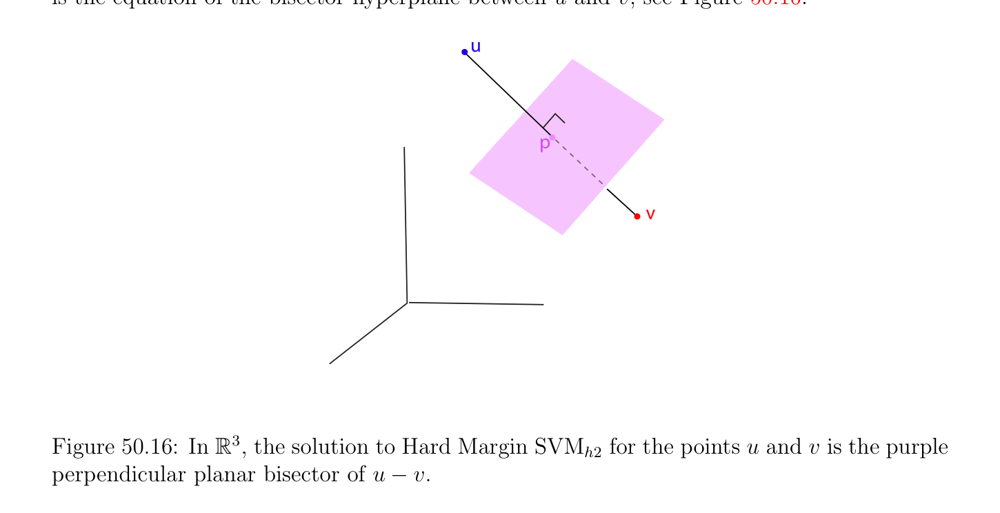

# Lagrangian Duality and Saddle Points

<!-- PAGE 1807 -->
Then by $(*_{1})$ we obtain
$$w = \frac{2(uv)}{(u -v)^{\top}(u -v)} -.$$
We verify easily that
$$2(u_{1} -v_{1})x_{1} + \cdots  + 2(u_{n} -v_{n})x_{n} = (u_{1}^{2} + \cdots  + u_{n}^{2}) -(v_{1}^{2} + \cdots  + v_{n}^{2})$$
is the equation of the bisector hyperplane between $u$ and $v$; see Figure 50.16.
$$u$$
$$p$$
$$v$$

**Figure 50.16:** $In\mathbb{R}^{3}$, the solution to Hard Margin $SVM_{h2}$ for the points $u$ and $v$ is the purple perpendicular planar bisector of $u$ - $v$. In the next section we will derive the dual of the optimization problem discussed in this section. We will also consider a more flexible solution involvlng a soft margin.

## 50.7 Lagrangian Duality and Saddle Points

In this section we investigate methods to solve the Minimization Problem $(P)$:
$$minimizeJ(v)$$
$$subject to \phi_{i} (v) \le 0,i = 1, \dots  , m.$$
It turns out that under certain conditions the original Problem $(P)$, called primal problem, can be solved in two stages with the help another Problem $(D)$, called the dual problem. The Dual Problem $(D)$ is a maximization problem involving a function $G$, called the Lagrangian

<!-- PAGE 1808 -->
dual, and it is obtained by minimizing the Lagrangian L(v, $\mu$ ) of Problem $(P)$ over the variable $v \in \mathbb{R}^{n}$, holding $\mu$  fixed, where $L: \Omega \times \mathbb{R}_{+}^{m} \to \mathbb{R}$ is given by
$$L(v, \mu ) = J(v) + \sum_{i=1}^{m}  \mu_{i} \phi_{i} (v),$$
with $\mu  \in \mathbb{R}_{+}^{m}$. The two steps of the method are:
$(1)$ Find the dual function $\mu  \mapsto G(\mu$ ) explictly by solving the minimization problem of finding the minimum of L(v, $\mu$ ) with respect to $v \in \Omega$ , holding $\mu$  fixed. This is an unconstrained minimization problem (with $v \in \Omega$ ). If we are lucky, a unique minimizer $u_{\mu}$ such that $G(\mu$ ) $= L(u_{\mu}, \mu$ ) can be found. We will address the issue of uniqueness later on.
$(2)$ Solve the maximization problem of finding the maximum of the function $\mu  \mapsto G(\mu$ ) over all $\mu  \in \mathbb{R}_{+}^{m}$. This is basically an unconstrained problem, except for the fact that $\mu  \in \mathbb{R}_{+}^{m}$. If Steps $(1)$ and $(2)$ are successful, under some suitable conditions on the function $J$ and the constraints $\phi_{i}$  (for example, if they are convex), for any solution $\lambda  \in \mathbb{R}_{+}^{m}$ obtained in Step $(2)$, the vector $u_{\lambda}$ obtained in Step $(1)$ is an optimal solution of Problem $(P)$. This is proven in Theorem 50.17. In order to prove Theorem 50.17, which is our main result, we need two intermediate technical results of independent interest involving the notion of saddle point. The local minima of a function $J$ : $\Omega \to \mathbb{R}$ over a domain $U$ defined by inequality constraints are saddle points of the Lagrangian L(v, $\mu$ ) associated with $J$ and the constraints $\phi_{i}$ . Then, under some mild hypotheses, the set of solutions of the Minimization Problem $(P)$
$$minimizeJ(v)$$
$$subject to \phi_{i} (v) \le 0,i = 1, \dots  , m$$
coincides with the set of first arguments of the saddle points of the Lagrangian
$$L(v, \mu ) = J(v) + \sum_{i=1}^{m}  \mu_{i} \phi_{i} (v).$$
This is proved in Theorem 50.15. To prove Theorem 50.17, we also need Proposition 50.14, a basic property of saddle points.

<!-- PAGE 1809 -->

> **Definition 50.7.** Let $L: \Omega \times  M \to \mathbb{R}$ be a function defined on a set of the form $\Omega \times  M$, where $\Omega$ and $M$ are open subsets of two normed vector spaces. A point $(u, \lambda$ ) $\in \Omega \times  M$ is a saddle point of $L$ if $u$ is a minimum of the function L(-, $\lambda$ ): $\Omega \to \mathbb{R}$ given by $v \mapsto$ L(v, $\lambda$ ) for all $v \in \Omega$ and $\lambda$  fixed, and $\lambda$  is a maximum of the function L(u, -): $M \to \mathbb{R}$ given by $\mu  \mapsto$ L(u, $\mu$ ) for all $\mu  \in M$ and $u$ fixed; equivalently,
$$supL(u, \mu ) = L(u, \lambda ) = infL(v, \lambda ).$$
$$\mu \in Mv\in \Omega$$
Note that the order of the arguments $u$ and $\lambda$  is important. The second set $M$ will be the set of generalized multipliers, and this is why we use the symbol $M$. Typically, $M =\mathbb{R}_{+}^{m}$. A saddle point is often depicted as a mountain pass, which explains the terminology; see Figure 50.17. However, this is a bit misleading since other situations are possible; see Figure 50.18.
$$L(u, \lambda )$$
$$x$$
$$y$$

**Figure 50.17:** A three-dimensional rendition of a saddle point L(u, $\lambda$ ) for the function L(u, $\lambda$ ) $= u^{2}$ - $\lambda^{2}$ . The plane $x = u$ provides a maximum as the apex of a downward opening parabola, while the plane $y = \lambda$  provides a minimum as the apex of an upward opening parabola.

> **Proposition 50.14.** If $(u, \lambda$ ) is a saddle point of a function $L: \Omega \times  M \to \mathbb{R}$, then
$$supinfL(v, \mu ) = L(u, \lambda ) = infsupL(v, \mu ).$$
$$\mu \in Mv\in \Omega v\in \Omega \mu \in M$$

*Proof.* First we prove that the following inequality always holds:
$$supinfL(v, \mu ) \le infsupL(v, \mu ).(*_{1})$$
$$\mu \in Mv\in \Omega v\in \Omega \mu \in M$$

<!-- PAGE 1810 -->
$$L(u, \lambda )$$
$$M(0, \lambda )$$
$$\Omega M(0, \lambda )$$
$$\Omega$$
$$(u,0)$$
$$\lambda$$
$$=$$
$$y$$
$$x = u$$
$$(i.)$$
$$\lambda x = u$$
$$y =$$
$$\overline{L(u,}\overline{\lambda}\overline{)}$$
$$(0, \lambda )(0, \lambda )M$$
$$\overline{M}\Omega$$
$$\Omega (u,0)$$
$$(u,0)$$
$$(ii.)$$

**Figure 50.18:** Let $\Omega = {[t, 0, 0]$ | $0 \le t \le 1}$ and $M = {[0, t, 0]$ | $0 \le t \le 1}$. In Figure $(i.)$, L(u, $\lambda$ ) is the blue slanted quadrilateral whose forward vertex is a saddle point. In Figure (ii.), L(u, $\lambda$ ) is the planar green rectangle composed entirely of saddle points. Pick any $w \in \Omega$ and any $\rho  \in M$. By definition of inf (the greatest lower bound) and sup (the least upper bound), we have
$$infL(v, \rho ) \le L(w, \rho ) \le supL(w, \mu ).$$
$$v\in \Omega \mu \in M$$
The cases where $inf_{v\in\Omega}$ L(v, $\rho$ ) $= -\infty$ or where $sup_{\mu\in M}$ L(w, $\mu$ ) $= +\infty$ may arise, but this is not a problem. Since
$$infL(v, \rho ) \le supL(w, \mu )$$
$$v\in \Omega \mu \in M$$
and the right-hand side is independent of $\rho$ , it is an upper bound of the left-hand side for all $\rho$ , so
$$supinfL(v, \mu ) \le supL(w, \mu ).$$
$$\mu \in Mv\in \Omega \mu \in M$$

<!-- PAGE 1811 -->
Since the left-hand side is independent of $w$, it is a lower bound for the right-hand side for all $w$, so we obtain $(*_{1})$:
$$supinfL(v, \mu ) \le infsupL(v, \mu ).$$
$$\mu \in Mv\in \Omega v\in \Omega \mu \in M$$
To obtain the reverse inequality, we use the fact that $(u, \lambda$ ) is a saddle point, so
$$infsupL(v, \mu ) \le supL(u, \mu ) = L(u, \lambda )$$
$$v\in \Omega \mu \in M\mu \in M$$
and
$$L(u, \lambda ) = infL(v, \lambda ) \le supinfL(v, \mu ),$$
$$v\in \Omega \mu \in Mv\in \Omega$$
and these imply that
$$infsupL(v, \mu ) \le supinfL(v, \mu ),(*_{2})$$
$$v\in \Omega \mu \in M\mu \in Mv\in \Omega$$
as desired. We now return to our main Minimization Problem $(P)$:
$$minimizeJ(v)$$
$$subject to \phi_{i} (v) \le 0,i = 1, \dots  , m,$$
where $J$ : $\Omega \to \mathbb{R}$ and the constraints $\phi_{i}$  : $\Omega \to \mathbb{R}$ are some functions defined on some open subset $\Omega$ of some finite-dimensional Euclidean vector space $V$ (more generally, a real Hilbert space $V$ ).

> **Definition 50.8.** The Lagrangian of the Minimization Problem $(P)$ defined above is the function $L: \Omega \times \mathbb{R}_{+}^{m} \to \mathbb{R}$ given by
$$L(v, \mu ) = J(v) + \sum_{i=1}^{m}  \mu_{i} \phi_{i} (v),$$
with $\mu  = (\mu_{1} , \dots  , \mu_{m}$ ). The numbers $\mu_{i}$  are called generalized Lagrange multipliers. The following theorem shows that under some suitable conditions, every solution $u$ of the Problem $(P)$ is the first argument of a saddle point $(u, \lambda$ ) of the Lagrangian $L$, and conversely, if $(u, \lambda$ ) is a saddle point of the Lagrangian $L$, then $u$ is a solution of the Problem $(P)$.

> **Theorem 50.15.** Consider Problem $(P)$ defined above where $J$ : $\Omega \to \mathbb{R}$ and the constraints $\phi_{i}$  : $\Omega \to \mathbb{R}$ are some functions defined on some open subset $\Omega$ of some finite-dimensional Euclidean vector space $V$ (more generally, a real Hilbert space $V$ ). The following facts hold.
$(1)$ If $(u, \lambda$ ) $\in \Omega \times \mathbb{R}_{+}^{m}$ is a saddle point of the Lagrangian $L$ associated with Problem $(P)$, then $u \in U, u$ is a solution of Problem $(P)$, and J(u) $=$ L(u, $\lambda$ ).

<!-- PAGE 1812 -->
$(2)$ If $\Omega$ is convex (open), if the functions $\phi_{i}  (1 \le i \le m)$ and $J$ are convex and differentiable at the point $u \in U$, if the constraints are qualified, and if $u \in U$ is a minimum of Problem $(P)$, then there exists some vector $\lambda  \in \mathbb{R}_{+}^{m}$ such that the pair $(u, \lambda$ ) $\in \Omega \times \mathbb{R}_{+}^{m}$ is a saddle point of the Lagrangian $L$.

*Proof.* $(1)$ Since $(u, \lambda$ ) is a saddle point of $L$ we have $sup_{\mu\in Rm}$ L(u, $\mu$ ) $=$ L(u, $\lambda$ ) which implies
$$+$$
that L(u, $\mu$ ) $\le$ L(u, $\lambda$ ) for all $\mu  \in \mathbb{R}_{+}^{m}$, which means that
$$J(u) + \sum_{i=1}^{m}  \mu_{i} \phi_{i} (u) \le J(u) + \sum_{i=1}^{m}  \lambda_{i} \phi_{i} (u),$$
that is,
$$\sum_{i=1}^{m}  (\mu_{i}  -\lambda_{i} )\phi_{i} (u) \le 0for all \mu  \in \mathbb{R}_{+}^{m}.$$
If we let each $\mu_{i}$  be large enough, then $\mu_{i}$  - $\lambda_{i}  > 0$, and if we had $\phi_{i} (u) > 0$, then the term $(\mu_{i}$  - $\lambda_{i} )\phi_{i} (u)$ could be made arbitrarily large and positive, so we conclude that $\phi_{i} (u) \le 0$
$$for i = 1, \dots  , m, and consequently, u \in U. For \mu  = 0, we conclude that \sum_{i}  m \lambda_{i} \phi_{i} (u) \ge 0.$$
$$However, since \lambda_{i}  \ge 0 and \phi_{i} (u) \le 0, (since u \in U), we have \sum_{i}  m=1 \lambda_{i} \phi_{i} (u) \le^{=1} 0. Combining$$
these two inequalities shows that
$$\sum_{i=1}^{m}  \lambda_{i} \phi_{i} (u) = 0.(*_{1})$$
This shows that J(u) $=$ L(u, $\lambda$ ). Since the inequality L(u, $\lambda$ ) $\le$ L(v, $\lambda$ ) is
$$J(u) + \sum_{i=1}^{m}  \lambda_{i} \phi_{i} (u) \le J(v) + \sum_{i=1}^{m}  \lambda_{i} \phi_{i} (v),$$
by $(*_{1})$ we obtain
$$J(u) \le J(v) + \sum_{i=1}^{m}  \lambda_{i} \phi_{i} (v)for all v \in \Omega$$
$$\le J(v)for all v \in U (since \phi_{i} (v) \le 0 and \lambda_{i}  \ge 0),$$
which shows that $u$ is a minimum of $J$ on $U$.
$(2)$ The hypotheses required to apply Theorem 50.6(1) are satisfied. Consequently if $u \in U$ is a solution of Problem $(P)$, then there exists some vector $\lambda  \in \mathbb{R}_{+}^{m}$ such that the KKT conditions hold:
$$J'(u) + \sum_{i=1}^{m}  \lambda_{i} (\phi_{i}' )_{u} = 0and \sum_{i=1}^{m}  \lambda_{i} \phi_{i} (u) = 0.$$

<!-- PAGE 1813 -->
The second equation yields
$$L(u, \mu ) = J(u) + \sum_{i=1}^{m}  \mu_{i} \phi_{i} (u) \le J(u) = J(u) + \sum_{i=1}^{m}  \lambda_{i} \phi_{i} (u) = L(u, \lambda ),$$
that is,
$$L(u, \mu ) \le L(u, \lambda )for all \mu  \in \mathbb{R}_{+}^{m}(*_{2})$$
$$(since \phi_{i} (u) \le 0 as u \in U), and since the function v \mapsto J(v) + \sum_{i}  \lambda_{i} \phi_{i} (v) = L(v, \lambda ) is$$
convex as a sum of convex functions, by Theorem 40.13(4), the $first^{=1}$ equation is a sufficient condition for the existence of minimum. Consequently,
$$L(u, \lambda ) \le L(v, \lambda )for all v \in \Omega ,(*_{3})$$
and $(*_{2})$ and $(*_{3})$ show that $(u, \lambda$ ) is a saddle point of $L$. To recap what we just proved, under some mild hypotheses, the set of solutions of the Minimization Problem $(P)$
$$minimizeJ(v)$$
$$subject to \phi_{i} (v) \le 0,i = 1, \dots  , m$$
coincides with the set of first arguments of the saddle points of the Lagrangian
$$L(v, \mu ) = J(v) + \sum_{i=1}^{m}  \mu_{i} \phi_{i} (v),$$
and for any optimum $u \in U$ of Problem $(P)$, we have J(u) $=$ L(u, $\lambda$ ). Therefore, if we knew some particular second argument $\lambda$  of these saddle points, then the constrained Problem $(P)$ would be replaced by the unconstrained Problem $(P_{\lambda})$:
$$find u_{\lambda} \in \Omega such that$$
$$L(u_{\lambda}, \lambda ) = infL(v, \lambda ).$$
$$v\in \Omega$$
How do we find such an element $\lambda  \in \mathbb{R}_{+}^{m}$? For this, remember that for a saddle point $(u_{\lambda}, \lambda$ ), by Proposition 50.14, we have
$$L(u_{\lambda}, \lambda ) = infL(v, \lambda ) = supinfL(v, \mu ),$$
$$v\in \Omega \mu \in \mathbb{R} mv\in \Omega$$
$$+$$
so we are naturally led to introduce the function $G: \mathbb{R}_{+}^{m} \to \mathbb{R}$ given by
$$G(\mu ) = infL(v, \mu )\mu  \in \mathbb{R}_{+}^{m},$$
$$v\in \Omega$$

<!-- PAGE 1814 -->
and then $\lambda$  will be a solution of the problem
$$find \lambda  \in \mathbb{R}_{+}^{m} such that$$
$$G(\lambda ) = supG(\mu ),$$
$$\mu \in \mathbb{R} m$$
$$+$$
which is equivalent to the Maximization Problem $(D)$:
$$maximizeG(\mu )$$
$$subject to \mu  \in \mathbb{R}_{+}^{m}.$$

> **Definition 50.9.** Given the Minimization Problem $(P)$
$$minimizeJ(v)$$
$$subject to \phi_{i} (v) \le 0,i = 1, \dots  , m,$$
where $J$ : $\Omega \to \mathbb{R}$ and the constraints $\phi_{i}$  : $\Omega \to \mathbb{R}$ are some functions defined on some open subset $\Omega$ of some finite-dimensional Euclidean vector space $V$ (more generally, a real Hilbert space $V$ ), the function $G: \mathbb{R}_{+}^{m} \to \mathbb{R}$ given by
$$G(\mu ) = infL(v, \mu )\mu  \in \mathbb{R}_{+}^{m},$$
$$v\in \Omega$$
is called the Lagrange dual function (or simply dual function). The Problem $(D)$
$$maximizeG(\mu )$$
$$subject to \mu  \in \mathbb{R}_{+}^{m}$$
is called the Lagrange dual problem. The Problem $(P)$ is often called the primal problem, and $(D)$ is the dual problem. The variable $\mu$  is called the dual variable. The variable $\mu  \in \mathbb{R}_{+}^{m}$ is said to be dual feasible if $G(\mu$ ) is defined (not $-\infty$ ). If $\lambda  \in \mathbb{R}_{+}^{m}$ is a maximum of $G$, then we call it a dual optimal or an optimal Lagrange multiplier. Since
$$L(v, \mu ) = J(v) + \sum_{i=1}^{m}  \mu_{i} \phi_{i} (v),$$
the function $G(\mu$ ) $= inf_{v\in\Omega}$ L(v, $\mu$ ) is the pointwise infimum of some affine functions of $\mu$ , so it is concave, even if the $\phi_{i}$  are not convex. One of the main advantages of the dual problem over the primal problem is that it is a convex optimization problem, since we wish to maximize a concave objective function $G$ (thus minimize $-G$, a convex function), and the constraints $\mu  \ge 0$ are convex. In a number of practical situations, the dual function $G$ can indeed be computed. To be perfectly rigorous, we should mention that the dual function $G$ is actually a partial function, because it takes the value $-\infty$ when the map $v \mapsto$ L(v, $\mu$ ) is unbounded below.

<!-- PAGE 1815 -->

> **Example 50.5.** Consider the Linear Program $(P)$
$$minimizec^{\top}v$$
$$subject to Av \le b, v \ge 0,$$
where $A$ is an $m\times n$ matrix. The constraints $v \ge 0$ are rewritten as $-v_{i} \le 0$, so we introduce Lagrange multipliers $\mu  \in \mathbb{R}_{+}^{m}$ and $\nu  \in \mathbb{R}_{+}^{n}$, and we have the Lagrangian
$$L(v, \mu , \nu ) = c^{\top}v + \mu^{\top} (Av -b) -\nu^{\top} v$$
$$= -b^{\top}\mu  + (c + A^{\top}\mu  -\nu )^{\top}v.$$
To find $G(\mu , \nu$ ), we need to minimize the affine map $v \mapsto (c + A^{\top}\mu$  - $\nu )^{\top}v$ - $b^{\top}\mu$ , where $\mathbb{R}^{n} v \in$ is unrestricted. Since $-b^{\top}\mu$  is a constant, this is equivalent to minimizing the linear function $v \mapsto (c + A^{\top}\mu$  - $\nu )^{\top}v$. Remember that the contraints $v \ge 0$ where incorporated in the Lagrangian L(v, $\mu , \nu$ ) as the term $-\nu^{\top} v$, but when we minimize L(v, $\mu , \nu$ ), there is no restriction on $v \in \mathbb{R}^{n}$. The linear function $v \mapsto (c + A^{\top}\mu$  - $\nu )^{\top}v$ is unbounded below unless $c + A^{\top}\mu$  - $\nu  = 0$. This is because if the vector $c + A^{\top}\mu$  - $\nu$  has some nonzero component, say $\alpha_{i}$ , we can pick $v$ such that $v_{j} = 0$ for all j̸ $= i$ and let $v_{i}$ tend to $+\infty$ if $\alpha_{i}  < 0$, or let $v_{i}$ tend to $-\infty$ if $\alpha_{i}  > 0$, so that $(c + A^{\top}\mu$  - $\nu )^{\top}v = \alpha_{i} v_{i}$ tends to $-\infty$ . It follows that the dual function $G(\mu , \nu$ ) $= inf_{v\in Rn}$ L(v, $\mu , \nu$ ) is given for all $\mu  \ge 0$ and $\nu  \ge 0$ by
$$($$
$$-b^{\top}\mu if A^{\top}\mu  -\nu  + c = 0,$$
$$G(\mu , \nu ) =$$
$$-\infty otherwise.$$
The domain of $G$ is a proper subset of $\mathbb{R}_{+}^{m} \times \mathbb{R}_{+}^{n}$. Another way to obtain $G(\mu , \nu$ ) is to observe that the function $v \mapsto (c+A^{\top}\mu -\nu )^{\top}v -b^{\top}\mu$
$$\mathbb{R}^{n}$$
is affine, thus convex, and since is convex and open, by Theorem 40.13(4), this function (for $\mu , \nu$  fixed) has a minimum at $v$ iff
$$\nabla L(-, \mu , \nu )_{v} = c + A^{\top}\mu  -\nu  = 0,$$
a condition independent of $v$. But if $c+A^{\top}\mu -\nu  = 0$, the function $v \mapsto (c+A^{\top}\mu -\nu )^{\top}v-b^{\top}\mu$ is the constant function with value $-b^{\top}\mu$ , so indeed $G(\mu , \nu$ ) is defined as above. Observe that the value $G(\mu , \nu$ ) of the function $G$, when it is defined, is independent of the second argument $\nu$ . Since we are interested in maximizing $G$, this suggests introducing the function $G$ of the single argument $\mu$  given by
$$b$$
$$G(\mu ) = -b^{\top}\mu ,$$
$$b$$
which is defined for all $\mu  \in \mathbb{R}_{+}^{m}$.
