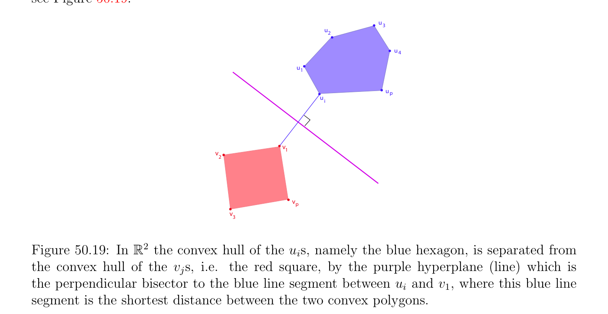

# Some Techniques to Obtain a More Useful Dual Program

<!-- PAGE 1843 -->
minimum distance between the two convex polyhedra $conv(u_{1}, \dots  , u_{p})$ and $conv(v_{1}, \dots  , v_{q})$; see Figure 50.19.
$$u3$$
$$u2$$
$$u4$$
$$u1$$
$$up$$
$$ui$$
$$v1$$
$$v$$
$$2$$
$$vp$$
$$v3$$
$$\mathbb{R}^{2}$$

**Figure 50.19:** In the convex hull of the $u_{i}s$, namely the blue hexagon, is separated from the convex hull of the $v_{j}s$, i.e. the red square, by the purple hyperplane (line) which is the perpendicular bisector to the blue line segment between $u_{i}$ and $v_{1}$, where this blue line segment is the shortest distance between the two convex polygons. It should be noted that the constraint $\|w\|\le 1$ yields a formulation of the dual problem which has the advantage of having a nice geometric interpretation: finding the minimal distance between the convex polyhedra $conv(u_{1}, \dots  , u_{p})$ and $conv(v_{1}, \dots  , v_{q})$. Unfortunately this formulation is not useful for actually solving the problem. However, if the equivalent constraint $\|w\|^{2} (= w^{\top}w) \le 1$ is used, then the dual problem is much more useful as a solving tool. In Chapter $54$ we consider the case where the sets of points ${u_{1}, \dots  , u_{p}}$ and ${v_{1}, \dots  , v_{q}}$ are not linearly separable.

## 50.12 Some Techniques to Obtain a More Useful Dual

$$Program$$
In some cases, it is advantageous to reformulate a primal optimization problem to obtain a more useful dual problem. Three different reformulations are proposed in Boyd and Vandenberghe; see $[29]$, Section 5.7:
$(1)$ Introducing new variables and associated equality constraints.
$(2)$ Replacing the objective function with an increasing function of the the original function.

<!-- PAGE 1844 -->
$(3)$ Making explicit constraints implicit, that is, incorporating them into the domain of the objective function. We only give illustrations of $(1)$ and $(2)$ and refer the reader to Boyd and Vandenberghe $[29]$ (Section 5.7) for more examples of these techniques. Consider the unconstrained program:
$$minimizef(Ax + b),$$
where $A$ is an $m \times  n$ matrix and $b \in \mathbb{R}^{m}$. While the conditions for a zero duality gap are satisfied, the Lagrangian is
$$L(x) = f(Ax + b),$$
so the dual function $G$ is the constant function whose value is
$$G = \inf f(Ax + b),$$
$$x\in \mathbb{R} n$$
which is not useful at all. Let us reformulate the problem as
$$minimizef(y)$$
$$subject to$$
$$Ax + b = y,$$
$$\mathbb{R}^{m}$$
where we introduced the new variable $y \in$ and the equality constraint Ax $+ b = y$. The two problems are obviously equivalent. The Lagrangian of the reformulated problem is
$$L(x, y, \mu ) = f(y) + \mu^{\top} (Ax + b -y)$$
where $\mu  \in \mathbb{R}^{m}$. To find the dual function $G(\mu$ ) we minimize L(x, $y, \mu$ ) over $x$ and $y$. Minimizing over $x$ we see that $G(\mu$ ) $= -\infty$ unless $A^{\top}\mu  = 0$, in which case we are left with
$$G(\mu ) = b^{\top}\mu  + \inf (f(y) -\mu^{\top} y) = b^{\top}\mu  -\inf (\mu^{\top} y -f(y)) = b^{\top}\mu  -f^{*}(\mu ),$$
$$yy$$
where $f^{*}$ is the conjugate of $f$. It follows that the dual program can be expressed as
$$maximizeb^{\top}\mu  -f^{*} (\mu )$$
$$subject to$$
$$A^{\top}\mu  = 0.$$
This formulation of the dual is much more useful than the dual of the original program.

<!-- PAGE 1845 -->

> **Example 50.12.** As a concrete example, consider the following unconstrained program:
$$minimizef(x) = \log \begin{pmatrix} e^{(Ai)\top x+bi} \end{pmatrix} \sum_{i=1}^{n}$$
$$\mathbb{R}^{n}$$
where $A^{i}$ is a column vector in . We reformulate the problem by introducing new variables and equality constraints as follows:
$$minimizef(y) = \log \begin{pmatrix} e^{yi} \end{pmatrix} \sum_{i=1}^{n}$$
$$subject to$$
$$Ax + b = y,$$
where $A$ is the $n \times  n$ matrix whose columns are the vectors $A^{i}$ and $b = (b , \dots  , b_{n})$. Since
$$by Example 50.8(8), the conjugate of the \log-sum-\exp function f(y) = \log \sum_{i}^{1}  is$$
$$\begin{pmatrix} n & e^{yi} \\ =1 \end{pmatrix}$$
$$f^{*} (\mu ) =( \sum_{i}  n=1 \mu_{i}  \log \mu_{i} if 1^{\top}\mu  = 1 and \mu  \ge 0$$
$$\infty otherwise,$$
the dual of the reformulated problem can be expressed as
$$maximizeb^{\top}\mu  -\log \begin{pmatrix} \mu_{i}  \log \mu_{i} \end{pmatrix} \sum_{i=1}^{n}$$
$$subject to$$
$$1^{\top}\mu  = 1$$
$$A^{\top}\mu  = 0$$
$$\mu  \ge 0,$$
an entropy maximization problem.

> **Example 50.13.** Similarly the unconstrained norm minimization problem
$$minimize\|Ax -b\|,$$
where $\|\|$ is any norm on $\mathbb{R}^{m}$, has a dual function which is a constant, and is not useful. This problem can be reformulated as
$$minimize\|y\|$$
$$subject to$$
$$Ax -b = y.$$

<!-- PAGE 1846 -->
By Example 50.8(6), the conjugate of the norm is given by
$$($$
$$0if \|y\|^{D}\le 1$$
$$\|y\|^{*}=$$
$$+\infty otherwise,$$
so the dual of the reformulated program is:
$$maximizeb^{\top}\mu$$
$$subject to$$
$$\|\mu \|^{D}\le 1$$
$$A^{\top}\mu  = 0.$$
Here is now an example of $(2)$, replacing the objective function with an increasing function of the the original function.

> **Example 50.14.** The norm minimization of Example 50.13 can be reformulated as
$$minimize \frac{1}{2} \|y\|^{2}$$
$$subject to$$
$$Ax -b = y.$$
This program is obviously equivalent to the original one. By Example 50.8(7), the conjugate of the square norm is given by
$$\frac{1}{2} \begin{pmatrix} \|y\|^{D2} \end{pmatrix} ,$$
so the dual of the reformulated program is
$$maximize- \frac{1}{2} \begin{pmatrix} \|\mu \|^{D2} \end{pmatrix} + b^{\top}\mu$$
$$subject to$$
$$A^{\top}\mu  = 0.$$
Note that this dual is different from the dual obtained in Example 50.13. The objective function of the dual program in Example 50.13 is linear, but we have the nonlinear constraint $\|\mu \|^{D} \le 1$. On the other hand, the objective function of the dual program of Example 50.14 is quadratic, whereas its constraints are affine. We have other examples of this trade-offwith the Programs $(SVM_{h2})$ (quadratic objective function, affine constraints), and $(SVM_{h1})$ (linear objective function, one nonlinear constraint). Sometimes, it is also helpful to replace a constraint by an increasing function of this constraint; for example, to use the constraint $\|w\|_{2}^{2} (= w^{\top}w) \le 1$ instead of $\|w\|_{2} \le 1$. In Chapter $55$ we revisit the problem of solving an overdetermined or underdetermined linear system Ax $= b$ considered in Section 23.1, from a different point of view.
