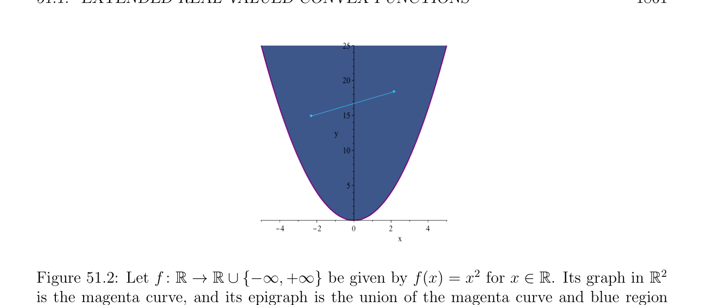
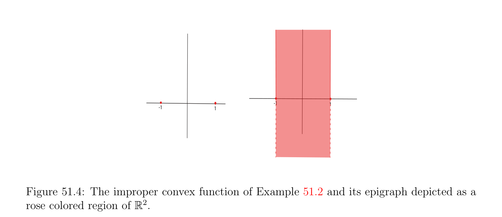

# Extended Real-Valued Convex Functions

<!-- PAGE 1859 -->
inequality constraints which are convex but not necessarily differentiable. In fact, it is fair to say that the theory of extended real-valued convex functions and the notions of subgradient and subdifferential developed in this chapter constitute the machinery needed to extend the Lagrangian framework to convex functions that are not necessarily differentiable. This chapter relies heavily on Rockafellar $[143]$. Some of the results in this chapter are also discussed in Bertsekas $[16, 19, 17]$. It should be noted that Bertsekas has developed a framework to discuss duality that he refers to as the min $common/max$ crossing framework, for short $MC/MC$. Although this framework is elegant and interesting in its own right, the fact that Bertsekas relies on it to prove properties of subdifferentials makes it little harder for a reader to “jump in.”

## 51.1 Extended Real-Valued Convex Functions

We extend the ordering on $\mathbb{R}$ by setting
$$-\infty < x < +\infty ,for all x \in \mathbb{R}.$$
$$\mathbb{R}^{n} \mathbb{R}$$

> **Definition 51.2.** A (total) function $f$ : $\to  \cup {-\infty , +\infty$ } is called an extended realvalued function. For any $x \in \mathbb{R}^{n}$, we say that f(x) is finite if f(x) $\in \mathbb{R}$ (equivalently, f(x) $\neq  \pm \infty$ ). The function $f$ is finite if f(x) is finite for all $x \in \mathbb{R}^{n}$.
$$\mathbb{R}^{n} \mathbb{R}$$
Adapting slightly Definition 40.8, given a function $f$ : $\to \cup {-\infty , +\infty$ }, the epigraph
$$\mathbb{R}^{n+1}$$
of $f$ is the subset of given by
$$\mathbb{R}^{n+1}$$
$$epi(f) = {(x, y) \in | f(x) \le y}.$$
See Figure 51.1. If $S$ is a nonempty subset of $\mathbb{R}^{n}$, the epigraph of the restriction of $f$ to $S$ is defined as
$$\mathbb{R}^{n+1}$$
$$epi(f|S) = {(x, y) \in | f(x) \le y, x \in S}.$$
Observe the following facts: $1$. For any $x \in S$, if f(x) $= -\infty$ , then epi(f) contains the “vertical line” ${(x, y)$ | $y \in \mathbb{R}}$ in $\mathbb{R}^{n+1}. 2$. For any $x \in S$, if f(x) $\in \mathbb{R}$, then epi(f) contains the ray ${(x, y)}$ | f(x) $\le y}$ in $\mathbb{R}^{n+1}. 3$. For any $x \in S$, if f(x) $= +\infty$ , then epi(f) does not contain any point $(x, y)$, with $y \in \mathbb{R}. 4$. We have epi(f) $= \emptyset$ iff $f$ corresponds to the partial function undefined everywhere; that is, f(x) $= +\infty$ for all $x \in \mathbb{R}^{n}$.

<!-- PAGE 1860 -->
$$(x, x  )3$$
$$> >$$
$$\mathbb{R}\mathbb{R} \mathbb{R} \mathbb{R}^{2}$$

**Figure 51.1:** Let $f$ :  $\to  \cup {-\infty , +\infty$ } be given by f(x) $= x^{3}$ for $x \in$ . Its graph in is the magenta curve, and its epigraph is the union of the magenta curve and blue region “above” this curve. For any point $x \in \mathbb{R}$, epi(f) contains the ray which starts at $(x, x^{3})$ and extends upward.
$$\mathbb{R}^{n} \mathbb{R}^{n} \mathbb{R}$$

> **Definition 51.3.** Given a nonempty subset $S$ of , a (total) function $f$ : $\to  \cup {-\infty , +\infty$ } is convex on $S$ if its epigraph epi(f|S) is convex as a subset $of\mathbb{R}^{n+1}$. See Figure 51.2. The function $f$ is concave on $S$ if $-f$ is convex on $S$. The function $f$ is affine on $S$ if it is finite, convex, and concave. If $S =\mathbb{R}^{n}$, we simply that $f$ is convex (resp. concave, resp. affine).
$$\mathbb{R}^{n} \mathbb{R}$$

> **Definition 51.4.** Given any function $f$ : $\to \cup {-\infty , +\infty$ }, the effective domain dom(f) of $f$ is given by
$$\mathbb{R}^{n} \mathbb{R}\mathbb{R}^{n}$$
$$dom(f) = {x \in | (\exists y \in )((x, y) \in epi(f))} = {x \in | f(x) < +\infty }.$$
$$\mathbb{R}^{n}$$
Observe that the effective domain of $f$ contains the vectors $x \in$ such that f(x) $= -\infty$ ,
$$\mathbb{R}^{n}$$
but excludes the vectors $x \in$ such that f(x) $= +\infty$ .

> **Example 51.1.** The above fact is illustrated by the function $f$ : $\mathbb{R} \to \mathbb{R}\cup {-\infty , +\infty$ } where
$$($$
$$-x^{2}if x \ge 0$$
$$f(x) =$$
$$+\infty if x < 0.$$
The epigraph of this function is illustrated Figure 51.3. By definition dom(f) $= [0, \infty$ ). If $f$ is a convex function, since dom(f) is the image of epi(f) by a linear map (a projection), it is convex. By definition, epi(f|S) is convex iff for any $(x_{1}, y_{1})$ and $(x_{2}, y_{2})$ with $x_{1}, x_{2} \in S$ and $y_{1}, y_{2} \in \mathbb{R}$ such that $f(x_{1}) \le y_{1}$ and $f(x_{2}) \le y_{2}$, for every $\lambda$  such that $0 \le \lambda  \le 1$, we have
$$(1 -\lambda )(x_{1}, y_{1}) + \lambda (x_{2}, y_{2}) = ((1 -\lambda )x_{1} + \lambda x_{2}, (1 -\lambda )y_{1} + \lambda y_{2}) \in epi(f|S),$$

<!-- PAGE 1861 -->
$$\mathbb{R}\mathbb{R} \mathbb{R} \mathbb{R}^{2}$$

**Figure 51.2:** Let $f$ :  $\to  \cup {-\infty , +\infty$ } be given by f(x) $= x^{2}$ for $x \in$ . Its graph in is the magenta curve, and its epigraph is the union of the magenta curve and blue region
$$\mathbb{R}^{2}$$
“above” this curve. Observe that epi(f) is a convex set of since the aqua line segment connecting any two points is contained within the epigraph. which means that $(1$ - $\lambda )x_{1} + \lambda x_{2} \in S$ and
$$f((1 -\lambda )x_{1} + \lambda x_{2}) \le (1 -\lambda )y_{1} + \lambda y_{2}.(*)$$
Thus $S$ must be convex and f((1 - $\lambda )x_{1} + \lambda x_{2}) < +\infty$ . Condition (*) is a little awkward, since it does not refer explicitly to $f(x_{1})$ and $f(x_{2})$, as these values may be $-\infty$ , in which case it is not clear what the expression $(1$ - $\lambda )f(x_{1}) + \lambda f(x_{2})$ means. In order to perform arithmetic operations involving $-\infty$ and $+\infty$ , we adopt the following conventions:
$$\alpha  + (+\infty ) = +\infty + \alpha  = +\infty -\infty < \alpha  \le +\infty$$
$$\alpha  + -\infty = -\infty + \alpha  = -\infty -\infty \le \alpha  < +\infty$$
$$\alpha (+\infty ) = (+\infty )\alpha  = +\infty 0 < \alpha  \le +\infty$$
$$\alpha (-\infty ) = (-\infty )\alpha  = -\infty 0 < \alpha  \le +\infty$$
$$\alpha (+\infty ) = (+\infty )\alpha  = -\infty -\infty \le \alpha  < 0$$
$$\alpha (-\infty ) = (-\infty )\alpha  = +\infty -\infty \le \alpha  < 0$$
$$0(+\infty ) = (+\infty )0 = 00(-\infty ) = (-\infty )0 = 0$$
$$-(-\infty ) = +\infty$$
$$\inf \emptyset = +\infty \sup \emptyset = -\infty .$$
The expressions $+\infty + (-\infty$ ) and $-\infty + (+\infty$ ) are meaningless. The following characterizations of convex functions are easy to show.

> **Proposition 51.1.** Let $C$ be a nonempty convex subset of $\mathbb{R}^{n}$.

<!-- PAGE 1862 -->

**Figure 51.3:** The epigraph of the concave function f(x) $= -x^{2}$ if $x \ge 0$ and $+\infty$ otherwise.
$$\mathbb{R}^{n}$$
$(1) A$ function $f$ : $C \to \cup {+\infty$ } is convex on $C$ iff
$$f((1 -\lambda )x + \lambda y) \le (1 -\lambda )f(x) + \lambda f(y)$$
for all $x, y \in C$ and all $\lambda$  such that $0 < \lambda  < 1$.
$$\mathbb{R}^{n} \mathbb{R}^{n}$$
$(2) A$ function $f$ : $\to \cup {-\infty , +\infty$ } is convex iff
$$f((1 -\lambda )x + \lambda y) < (1 -\lambda )\alpha  + \lambda \beta$$
$$\mathbb{R}\mathbb{R}^{n}$$
for all $\alpha , \beta  \in$ , all $x, y \in$ such that f(x) $< \alpha$  and f(y) $< \beta$ , and all $\lambda$  such that $0 < \lambda  < 1$. The “good” convex functions that we would like to deal with are defined below.
$$\mathbb{R}^{n} \mathbb{R}$$

> **Definition 51.5.** A convex function $f$ : $\to  \cup {-\infty , +\infty$ } is $proper^{1}$ if its epigraph is nonempty and does not contain any vertical line. Equivalently, a convex function $f$ is proper
$$\mathbb{R}^{n} \mathbb{R}^{n}$$
if f(x) $> -\infty$ for all $x \in$ and f(x) $< +\infty$ for some $x \in$ . A convex function which is not proper is called an improper function. Observe that a convex function $f$ is proper iff dom(f) $\neq  \emptyset$ and if the restriction of $f$ to dom(f) is a finite function. It is immediately verified that a set $C$ is convex iff its indicator function $I_{C}$ is convex, and clearly, the indicator function of a convex set is proper. The important object of study is the set of proper functions, but improper functions can’t be avoided. $\overline{1}\overline{This} \overline{terminology} \overline{is} \overline{unfortunate} \overline{because}$ it clashes with the notion of a proper function from topology, which has to do with the preservation of compact subsets under inverse images.

<!-- PAGE 1863 -->

> **Example 51.2.** Here is an example of an improper convex function $f$ : $\mathbb{R} \to \mathbb{R}\cup {-\infty , +\infty$ }:
$$-\infty if |x| < 1$$
$$$$
$$$$
$$f(x) =0if |x| = 1$$
$$+\infty if |x| > 1$$
$$$$
Observe that dom(f) $= [-1, 1]$, and that epi(f) is not closed. See Figure 51.4.
$$\overline{-1}\overline{1}$$
$$\overline{-1}\overline{1}$$

**Figure 51.4:** The improper convex function of Example 51.2 and its epigraph depicted as a rose colored region of $\mathbb{R}^{2}$. Functions whose epigraph are closed tend to have better properties. To characterize such functions we introduce sublevel sets.
$$\mathbb{R}^{n} \mathbb{R}\mathbb{R}$$

> **Definition 51.6.** Given a function $f$ : $\to  \cup {-\infty , +\infty$ }, for any $\alpha  \in  \cup {-\infty , +\infty$ }, the sublevel sets $sublev_{\alpha}(f)$ and $sublev_{<\alpha}(f)$ are the sets
$$\mathbb{R}^{n} \mathbb{R}^{n}$$
$$sublev_{\alpha}(f) = {x \in | f(x) \le \alpha }andsublev_{<\alpha}(f) = {x \in | f(x) < \alpha }.$$
For the improper convex function of Example 51.2, we have $sublev_{-\infty}(f) = (-1, 1)$ while $sublev_{<-\infty}(f) = \emptyset$ . $sublev_{\alpha}(f) = (-1, 1) = sublev_{<\alpha}(f)$ whenever $-\infty < \alpha  < 0. sublev_{0}(f) = [-1, 1]$ while $sublev_{<0}(f) = (-1, 1). sublev_{\alpha}(f) = [-1, 1] = sublev_{<\alpha}(f)$ whenever $0 < \alpha  < +\infty$ . $sublev_{+\infty}(f) =\mathbb{R}$ while $sublev_{<+\infty}(f) = [-1, 1]$. A useful corollary of Proposition 51.1 is the following result whose (easy) proof can be found in Rockafellar $[143]$ (Theorem 4.6).

<!-- PAGE 1864 -->

> **Proposition 51.2.** If $f$ is any convex function on $\mathbb{R}^{n}$, then for every $\alpha  \in \mathbb{R} \cup {-\infty , +\infty$ }, the sublevel sets $sublev_{\alpha}(f)$ and $sublev_{<\alpha}(f)$ are convex.
$$\mathbb{R}^{n} \mathbb{R}$$

> **Definition 51.7.** A function $f$ : $\to  \cup {-\infty , +\infty$ } is lower semi-continuous if the
$$\mathbb{R}^{n} \mathbb{R}$$
sublevel sets $sublev_{\alpha}(f) = {x \in$ | f(x) $\le \alpha$ } are closed for all $\alpha  \in$ . Observe that the improper convex function of Example 51.2 is not lower semi-continuous since $sublev_{\alpha}(f) = (-1, 1)$ whenever $-\infty < \alpha  < 0$. This result reflects the fact that the epigraph is not closed as shown in the following proposition; see Rockafellar $[143]$ (Theorem 7.1).
$$\mathbb{R}^{n} \mathbb{R}$$

> **Proposition 51.3.** Let $f$ : $\to  \cup {-\infty , +\infty$ } be any function. The following properties are equivalent:
$(1)$ The function $f$ is lower semi-continuous.
$(2)$ The epigraph of $f$ is a closed set in $\mathbb{R}^{n+1}$. The notion of the closure of convex function plays an important role. It is a bit subtle because a convex function may be improper.
$$\mathbb{R}^{n} \mathbb{R}$$

> **Definition 51.8.** Let $f$ : $\to  \cup {-\infty , +\infty$ } be any function. The function whose epigraph is the closure of the epigraph epi(f) of $f$ (in $\mathbb{R}^{n+1})$ is called the lower semicontinuous hull of $f$. If $f$ is a convex function and if f(x) $> -\infty$ for all $x \in \mathbb{R}^{n}$, then the closure cl(f) of $f$ is equal to its lower semi-continuous hull, else if f(x) $= -\infty$ for some $x \in \mathbb{R}^{n}$, then the closure cl(f) of $f$ is the constant function with value $-\infty$ . A convex function $f$ is closed if $f =$ cl(f). Definition 51.8 implies that there are only two closed improper convex functions: the constant function with value $-\infty$ and the constant function with value $+\infty$ . Also, by Proposition 51.3, a proper convex function is closed iff it is equal to its lower semi-continuous hull iff its epigraph is nonempty and closed. Given a convex set $C$ in $\mathbb{R}^{n}$, the interior int(C) of $C$ (the largest open subset of $\mathbb{R}^{n}$ contained in $C)$ is often not interesting because $C$ may have dimension smaller than $n$. For
$$\mathbb{R}^{3}$$
example, a (closed) triangle in has empty interior. The remedy is to consider the affine hull aff(C) of $C$, which is the smallest affine set containing $C$; see Section 44.2. The dimension of $C$ is the dimension of aff(C). Then the relative interior of $C$ is the interior of $C$ in aff(C) endowed with the subspace topology induced on aff(C). More explicitly, we can make the following definition.

> **Definition 51.9.** Let $C$ be a subset of $\mathbb{R}^{n}$. The relative interior of $C$ is the set
$$relint(C) = {x \in C | B_{\epsilon}(x) \cap aff(C) \subseteq Cfor some \epsilon  > 0},$$
$$\mathbb{R}^{n}$$
$$where B_{\epsilon}(x) = {y \in | \|x -y\|_{2} < \epsilon }, the open \frac{ball}{C} of center x and radius \mathbb{R}^{n} \epsilon  . The relative$$
boundary of $C$ is defined as $\overline{C}$ - relint(C), where  is the closure of $C$ in (the smallest
$$\mathbb{R}^{n}$$
closed subset of containing $C)$.

<!-- PAGE 1865 -->
Remark. Observe that int(C) $\subseteq$ relint(C). Rockafellar denotes the relative interior of a set $C$ by ri(C). The following result from Rockafellar $[143]$ (Theorem 7.2) tells us that an improper convex function mostly takes infinite values, except perhaps at relative boundary points of its effective domain.

> **Proposition 51.4.** If $f$ is an improper convex function, then f(x) $= -\infty$ for every $x \in$ relint(dom(f)). Thus an improper convex function takes infinite values, except at relative boundary points of its effective domain. Example 51.2 illustrates Proposition 51.4. The following result also holds; see Rockafellar $[143]$ (Corollary 7.2.3).

> **Proposition 51.5.** If $f$ is a convex function whose effective domain is relatively open, which means that relint(dom(f)) $=$ dom(f), then either f(x) $> -\infty$ for all $x \in \mathbb{R}^{n}$, or f(x) $= \pm \infty$ for all $x \in \mathbb{R}^{n}$. We also have the following result showing that the closure of a proper convex function does not differ much from the original function; see Rockafellar $[143]$ (Theorem 7.4).
$$\mathbb{R}^{n} \mathbb{R}$$

> **Proposition 51.6.** Let $f$ : $\to  \cup {+\infty$ } be a proper convex function. Then cl(f) is a closed proper convex function, and cl(f) agrees with $f$ on dom(f) except possibly at relative boundary points.

> **Example 51.3.** For an example of Propositions 51.6 and 51.5, let $f$ : $\mathbb{R} \to \mathbb{R} \cup {+\infty$ } be the proper convex function
$$($$
$$x^{2}if x < 1$$
$$f(x) =$$
$$+\infty if |x| \ge 1.$$
Then cl(f) is
$$($$
$$x^{2}if x \le 1$$
$$clf(x) =$$
$$+\infty if |x| > 1,$$
and clf(x) $=$ f(x) whenever $x \in (-\infty , 1) =$ relint(dom(f)) $=$ dom(f). Furthermore, since relint(dom(f)) $=$ dom(f), f(x) $> -\infty$ for all $x \in \mathbb{R}$. See Figure 51.5. Small miracle: the indicator function $I_{C}$ of any closed convex set is proper and closed.
$$\mathbb{R}\mathbb{R}^{n}$$
Indeed, for any $\alpha  \in$  the sublevel set ${x \in$ | $I_{C}(x) \le \alpha$ } is either empty if $\alpha  < 0$, or equal to $C$ if $\alpha  \ge 0$, and $C$ is closed. We now discuss briefly continuity properties of convex functions. The fact that a convex function $f$ can take the values $\pm \infty$ causes a difficulty, so we consider the restriction of $f$ to its effective domain. There is still a problem because an improper function may take the value $-\infty$ . However, if we consider any subset $C$ of dom(f) which is relatively open, which means that relint(C) $= C$, then $C \subseteq$ relint(dom(f)), so by Proposition 51.4, the function

<!-- PAGE 1866 -->
$$25$$
$$25$$
$$20$$
$$20$$
$$15$$
$$15$$
$$10$$
$$10$$
$$5$$
$$5$$
$$(1,1)$$
$$(1,1)$$
$$\overline{5}\overline{4}\overline{3}\overline{2}\overline{1}\overline{0}\overline{1}$$
$$x\overline{5}\overline{4}\overline{3}\overline{2}\overline{1}\overline{0}\overline{1}$$
$$f(x)xcl(f)$$

**Figure 51.5:** The proper convex function of Example 51.3 and its closure. These two functions only differ at the relative boundary point of dom(f), namely $x = 1. f$ has the constant value $-\infty$ on $C$, and so it can be considered to be continuous on $C$. Thus we are led to consider proper functions.

> **Definition 51.10.** Given a proper convex function $f$, for any subset $S \subseteq$ dom(f), we say that $f$ is continuous relative to $S$ if the restriction of $f$ to $S$ is continuous, with $S$ endowed with the subspace topology. The following result is proven in Rockafellar $[143]$ (Theorem 10.1).

> **Proposition 51.7.** If $f$ is a proper convex function, then $f$ is continuous on any convex relatively open subset $C$ (relint(C) $= C)$ contained in its effective domain dom(f), in particular relative to relint(dom(f)).
$$\mathbb{R}^{n}$$
As a corollary, any convex function $f$ which is finite on is continuous. The behavior of a convex function at relative boundary points of the effective domain can be tricky. Here is an example due to Rockafellar $[143]$ illustrating the problems.

> **Example 51.4.** Consider the proper convex function (on $\mathbb{R}^{2})$ given by
$$y^{2}/(2x)if x > 0$$
$$$$
$$$$
$$f(x, y) =0if x = 0, y = 0$$
$$+\infty otherwise.$$
$$$$
We have
$$\mathbb{R}^{2}$$
$$dom(f) = {(x, y) \in | x > 0} \cup {(0, 0)}.$$
See Figure 51.6.
$$\mathbb{R}^{2}$$
The function $f$ is continuous on the open right half-plane ${(x, y) \in$ | $x > 0}$, but not at $(0, 0)$. The limit of f(x, $y)$ when $(x, y)$ approaches $(0, 0)$ on the parabola of equation

<!-- PAGE 1867 -->
$$x = 1/2$$
$$x = 1$$

**Figure 51.6:** The proper convex function of Example 51.4. When intersected by vertical planes of the form $x = \alpha$ , for $\alpha  > 0$, the trace is an upward parabola. When $\alpha$  is close to zero, this parabola approximates the positive $z$ axis. $x = y^{2}/(2\alpha$ ) is $\alpha$  for any $\alpha  > 0$. See Figure 51.7 However, it is easy to see that the limit along any line segment from $(0, 0)$ to a point in the open right half-plane is $0$. We conclude this quick tour of the basic properties of convex functions with a result involving the Lipschitz condition.

> **Definition 51.11.** Let $f$ : $E \to F$ be a function between normed vector spaces $E$ and $F$, and let $U$ be a nonempty subset of $E$. We say that $f$ Lipschitzian on $U$ (or has the Lipschitz condition on $U)$ if there is some $c \ge 0$ such that
$$\|f(x) -f(y)\|_{F} \le c \|x -y\|_{E}for all x, y \in U.$$
Obviously, if $f$ is Lipschitzian on $U$ it is uniformly continuous on $U$. The following result is proven in Rockafellar $[143]$ (Theorem 10.4).

> **Proposition 51.8.** Let $f$ be a proper convex function, and let $S$ be any (nonempty) closed bounded subset of relint(dom(f)). Then $f$ is Lipschitzian on $S$.
$$\mathbb{R}^{n}$$
In particular, a finite convex function on is Lipschitzian on every compact subset of $\mathbb{R}^{n}  \mathbb{R}^{n}$ . However, such a function may not be Lipschitzian on as a whole.
