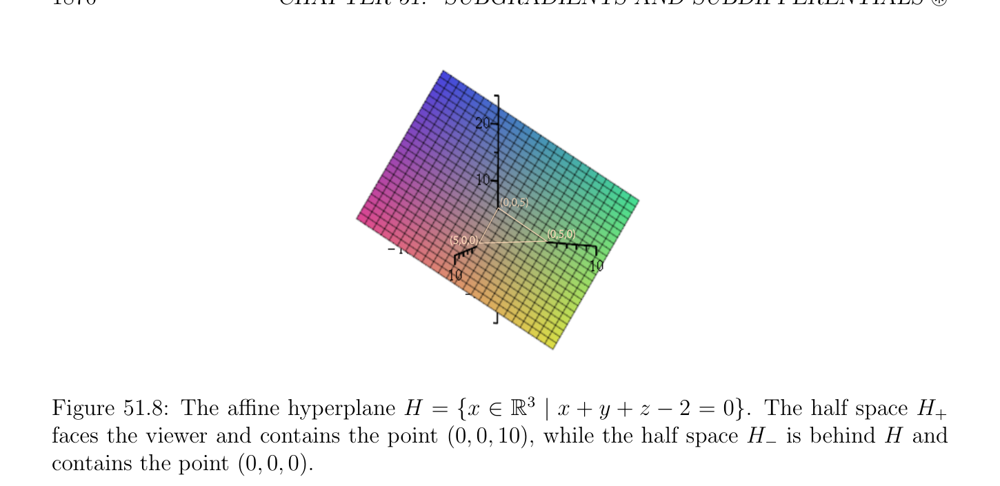
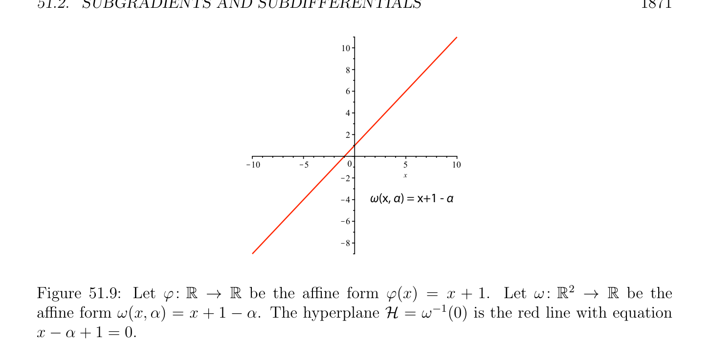
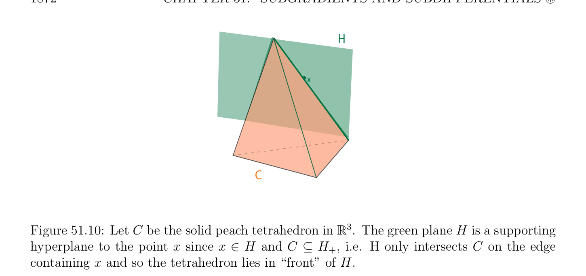
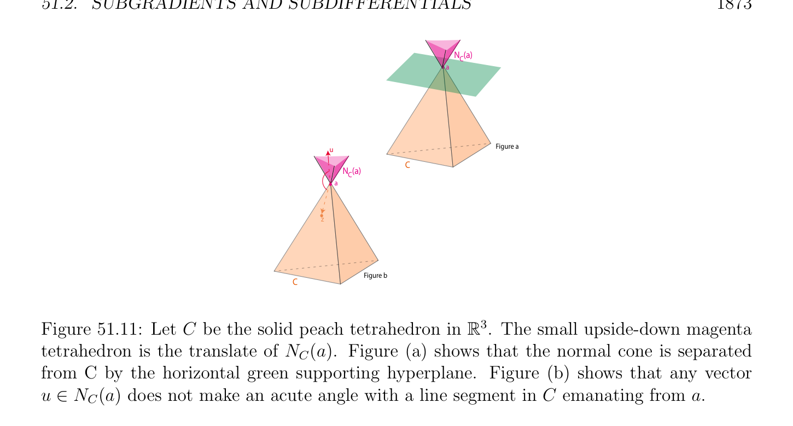
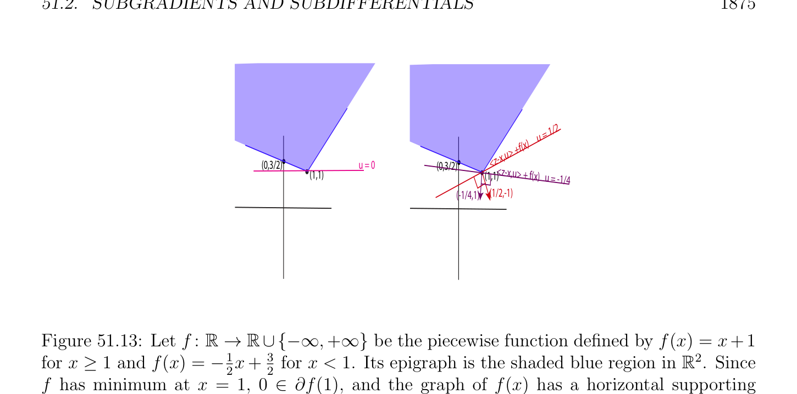
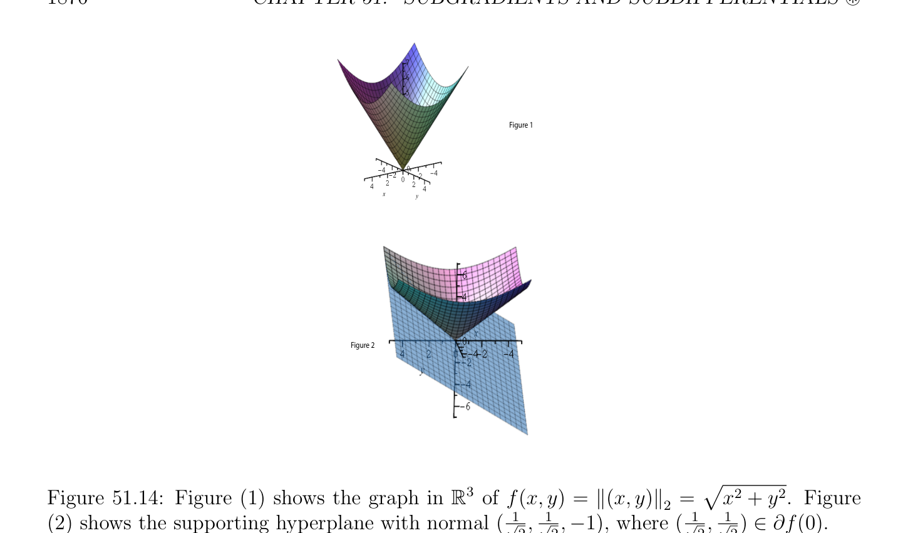
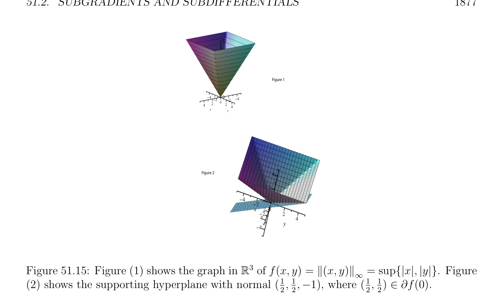

# Subgradients and Subdifferentials

<!-- PAGE 1868 -->
$$Figure a$$
$$Figure b$$

**Figure 51.7:** Figure (a) illustrates the proper convex function of Example 51.4. Figure
$(b)$ illustrates the approach to $(0, 0)$ along the planar parabolic curve $(y^{2}/2, y)$. Then $f(y^{2}/2, y) = 1$ and Figure $b$ shows the intersection of the surface with the plane $z = 1$.

## 51.2 Subgradients and Subdifferentials

We saw in the previous section that proper convex functions have “good” continuity prop-
$$\mathbb{R}^{n}$$
erties. Remarkably, if $f$ is a convex function, for any $x \in$ such that f(x) is finite, the one-sided derivative f' $(x; u)$ exists for all $u \in \mathbb{R}^{n}$; This result has been shown at least since $1893$, as noted by Stoltz (see Rockafellar $[143]$, page $428)$. Directional derivatives will be discussed in Section 51.3. If $f$ is differentitable at $x$, then of course
$$df_{x}(u) = \langle \nabla f_{x}, u\rangle for all u \in \mathbb{R}^{n},$$
where $\nabla f_{x}$ is the gradient of $f$ at $x$. But even if $f$ is not differentiable at $x$, it turns out that for “most” $x \in$ dom(f), in particular if $x \in$ relint(dom(f)), there is a nonempty closed convex set $\partial$ f(x) which may be viewed as a generalization of the gradient $\nabla f_{x}$. This convex set of $\mathbb{R}^{n}, \partial$ f(x), called the subdifferential of $f$ at $x$, has some of the properties of the gradient $\nabla f_{x}$. The vectors in $\partial$ f(x) are called subgradients at $x$. For example, if $f$ is a proper convex function, then $f$ achieves
$$\mathbb{R}^{n}$$
its minimum at $x \in$ iff0 $\in \partial$ f(x). Some of the theorems of Chapter $50$ can be generalized to convex functions that are not necessarily differentiable by replacing conditions involving gradients by conditions involving subdifferentials. These generalizations are crucial for the justification that various iterative methods for solving optimization programs converge. For example, they are used to prove the convergence of the ADMM method discussed in Chapter $52$.

<!-- PAGE 1869 -->
One should note that the notion of subdifferential is not just a gratuitous mathematical generalization. The remarkable fact that the optimization problem
$$minimizeJ(u)$$
$$subject to u \in C,$$
$$\mathbb{R}^{n}$$
where $C$ is a closed convex set in can be rewritten as
$$minimizeJ(u) + I_{C}(z)$$
$$subject to u -z = 0,$$
where $I_{C}$ is the indicator function of $C$, forces us to deal with functions such as $J(u)+I_{C}(z)$ which are not differentiable, even if $J$ is. ADMM can cope with this situation (under certain conditions), and subdifferentials cannot be avoided in justifying its convergence. However, it should be said that the subdifferential $\partial$ f(x) is a theoretical tool that is never computed in practice (except in very special simple cases). To define subgradients we need to review (affine) hyperplanes.
$$\mathbb{R}^{n} \mathbb{R}$$
Recall that an affine form $\phi$ : $\to$  is a function of the form
$$\phi (x) = h(x) + c,x \in \mathbb{R}^{n},$$
$$\mathbb{R}^{n} \mathbb{R}\mathbb{R}\mathbb{R}^{n}$$
where $h: \to$  is a linear form and $c \in$  is some constant. An affine hyperplane $H \subseteq$
$$\mathbb{R}^{n} \mathbb{R}$$
is the kernel of any nonconstant affine form $\phi$ : $\to$  (which means that the linear form $h$ defining $\phi$  is not the zero linear form),
$$\mathbb{R}^{n}$$
$$H = \phi^{-1} (0) = {x \in | \phi (x) = 0}.$$
Any two nonconstant affine forms $\phi$  and $\psi$  defining the same (affine) hyperplane $H$, in the sense that $H = \phi^{-1} (0) = \psi^{-1} (0)$, must be proportional, which means that there is some nonzero $\alpha  \in \mathbb{R}$ such that $\psi  = \alpha \phi$ . A nonconstant affine form $\phi$  also defines the two half spaces $H_{+}$ and $H_{-}$ given by
$$\mathbb{R}^{n} \mathbb{R}^{n}$$
$$H_{+} = {x \in | \phi (x) \ge 0},H_{-}= {x \in | \phi (x) \le 0}.$$
Clearly, $H_{+} \cap H_{-} = H$, their common boundary. See Figure 51.8. The choice of sign is somewhat arbitrary, since the affine form $\alpha \phi$  with $\alpha  < 0$ defines the half spaces with $H_{-}$ and $H_{+}$ (the half spaces are swapped).
$$\mathbb{R}^{n} \mathbb{R}^{n} \mathbb{R}$$
By the duality induced by the Euclidean inner product on , a linear form $h: \to$
$$\mathbb{R}^{n}$$
corresponds to a unique vector $u \in$ such that
$$h(x) = \langle x, u\rangle for all x \in \mathbb{R}^{n}.$$
Then if $\phi$  is the affine form given by $\phi (x) = \langle x, u\rangle + c$, this affine form is nonconstant iff $u \neq  0$, and $u$ is normal to the hyperplane $H$, in the sense that if $x_{0} \in H$ is any fixed vector in $H$, and $x$ is any vector in $H$, then $\langle x$ - $x_{0}, u\rangle = 0$.

<!-- PAGE 1870 -->
$$(0,0,5)$$
$$(5,0,0)(0,5,0)$$
$$\mathbb{R}^{3}$$

**Figure 51.8:** The affine hyperplane $H = {x \in$ | $x + y + z$ - $2 = 0}$. The half space $H_{+}$ faces the viewer and contains the point $(0, 0, 10)$, while the half space $H_{-}$ is behind $H$ and contains the point $(0, 0, 0)$. Indeed, $x_{0} \in H$ means that $\langle x_{0}, u\rangle + c = 0$, and $x \in H$ means that $\langle x, u\rangle + c = 0$, so we get $\langle x_{0}, u\rangle = \langle x, u\rangle$ , which implies $\langle x$ - $x_{0}, u\rangle = 0$. Here is an observation which plays a key role in defining the notion of subgradient. An illustration of the following proposition is provided by Figure 51.9.
$$\mathbb{R}^{n} \mathbb{R} \mathbb{R}^{n+1}$$

> **Proposition 51.9.** Let $\phi$ : $\to$  be a nonconstant affine form. Then the map $\omega$ : $\to \mathbb{R}$ given by
$$\omega (x, \alpha ) = \phi (x) -\alpha ,x \in \mathbb{R}^{n}, \alpha  \in \mathbb{R},$$
is a nonconstant affine form defining a hyperplane $\mathcal{H} = \omega^{-1} (0)$ which is the graph of the affine form $\phi$ . Furthermore, this hyperplane is nonvertical in $\mathbb{R}^{n+1}$, in the sense that $\mathcal{H}$ cannot be defined by a nonconstant affine form $(x, \alpha$ ) $\mapsto \psi (x)$ which does not depend on $\alpha$ .

*Proof.* Indeed, $\phi$  is of the form $\phi (x) =$ h(x) $+ c$ for some nonzero linear form $h$, so
$$\omega (x, \alpha ) = h(x) -\alpha  + c.$$
Since $h$ is linear, the map $(x, \alpha$ ) $=$ h(x) - $\alpha$  is obviously linear and nonzero, so $\omega$  is a nonconstant affine form defining a hyperplane $\mathcal{H}$ in $\mathbb{R}^{n+1}$. By definition,
$$\mathbb{R}^{n+1} \mathbb{R}^{n+1}$$
$$\mathcal{H} = {(x, \alpha ) \in | \omega (x, \alpha ) = 0} = {(x, \alpha ) \in | \phi (x) -\alpha  = 0},$$
which is the graph of $\phi$ . If $\mathcal{H}$ was a vertical hyperplane, then $\mathcal{H}$ would be defined by a nonconstant affine form $\psi$  independent of $\alpha$ , but the affine form $\omega$  given by $\omega (x, \alpha$ ) $= \phi (x)-\alpha$ and the affine form $\psi (x)$ can’t be proportional, a contradiction.
$$\mathbb{R}^{n+1} \mathbb{R}^{n} \mathbb{R}$$
We say that $\mathcal{H}$ is the hyperplane (in ) induced by the affine form $\phi$ : $\to$ . Also recall the notion of supporting hyperplane to a convex set.

<!-- PAGE 1871 -->
$$10$$
$$8$$
$$6$$
$$4$$
$$2$$
$$\overline{10}\overline{5}\overline{0}\overline{5}\overline{10}$$
$$2x$$
$$4\omega (x, \alpha ) = x+1 - \alpha$$
$$6$$
$$8$$
$$\mathbb{R}\mathbb{R} \mathbb{R}^{2} \mathbb{R}$$

**Figure 51.9:** Let $\phi$ :  $\to$  be the affine form $\phi (x) = x + 1$. Let $\omega$ : $\to$  be the affine form $\omega (x, \alpha$ ) $= x + 1$ - $\alpha$ . The hyperplane $\mathcal{H} = \omega^{-1} (0)$ is the red line with equation $x$ - $\alpha  + 1 = 0$.
$$\mathbb{R}^{n}$$

> **Definition 51.12.** If $C$ is a nonempty convex set in and $x$ is a vector in $C$, an affine hyperplane $H$ is a supporting hyperplane to $C$ at $x$ if
$(1) x \in H$.
$(2)$ Either $C \subseteq H_{+}$ or $C \subseteq H_{-}$. See Figure 51.10. Equivalently, there is some nonconstant affine form $\phi$  such that $\phi (z) =$
$$\mathbb{R}^{n}\mathbb{R}^{n} \mathbb{R}$$
$\langle z, u\rangle$ - $c$ for all $z \in$ , for some nonzero $u \in$ and some $c \in$ , such that
$(1) \langle x, u\rangle = c$.
$(2) \langle z, u\rangle \le c$ for all $z \in C$ The notion of vector normal to a convex set is defined as follows.

> **Definition 51.13.** Given a nonempty convex set $C$ in $\mathbb{R}^{n}$, for any $a \in C$, a vector $u \in \mathbb{R}^{n}$ is normal to $C$ at a if
$$\langle z -a, u\rangle \le 0for all z \in C.$$
In other words, $u$ does not make an acute angle with any line segment in $C$ with a as endpoint. The set of all vectors $u$ normal to $C$ is called the normal cone to $C$ at a and is denoted by $N_{C}(a)$. See Figure 51.11. It is easy to check that the normal cone to $C$ at a is a convex cone. Also, if the hyperplane $H$ defined by an affine form $\phi (z) = \langle z, u\rangle -c$ with $u \neq  0$ is a supporting hyperplane to $C$ at $x$, since $\langle z, u\rangle \le c$ for all $z \in C$ and $\langle x, u\rangle = c$, we have $\langle z$ - $x, u\rangle \le 0$ for all $z \in C$, which means that $u$ is normal to $C$ at $x$. This concept is illustrated by Figure 51.12.

<!-- PAGE 1872 -->
$$H$$
$$x$$
$$C$$

**Figure 51.10:** Let $C$ be the solid peach tetrahedron $in\mathbb{R}^{3}$. The green plane $H$ is a supporting hyperplane to the point $x$ since $x \in H$ and $C \subseteq H_{+}$, i.e. $H$ only intersects $C$ on the edge containing $x$ and so the tetrahedron lies in “front” of $H$.
$$\mathbb{R}^{n} \mathbb{R}$$
The notion of subgradient can be motived as follows. A function $f$ : $\to$  is differen-
$$\mathbb{R}^{n}$$
tiable at $x \in$ if
$$f(x + y) = f(x) + df_{x}(y) + \epsilon (y) \|y\|_{2} ,$$
$$\mathbb{R}^{n}  \mathbb{R}^{n} \mathbb{R}$$
for all $y \in$ in some nonempty subset containing $x$, where $df_{x}$ : $\to$  is a linear form, and $\epsilon$  is some function such that $lim_{\|y\|\mapsto0} \epsilon (y) = 0$. Furthermore,
$$df_{x}(y) = \langle y, \nabla f_{x}\rangle for all y \in \mathbb{R}^{n},$$
where $\nabla f_{x}$ is the gradient of $f$ at $x$, so
$$f(x + y) = f(x) + \langle y, \nabla f_{x}\rangle + \epsilon (y) \|y\|_{2} .$$
If we assume that $f$ is convex, it makes sense to replace the equality sign by the inequality sign $\ge$ in the above equation and to drop the “error term” $\epsilon (y) \|y\|_{2}$, so a vector $u$ is a subgradient of $f$ at $x$ if
$$f(x + y) \ge f(x) + \langle y, u\rangle for all y \in \mathbb{R}^{n}.$$
Thus we are led to the following definition.
$$\mathbb{R}^{n} \mathbb{R}\mathbb{R}^{n}$$

> **Definition 51.14.** Let $f$ : $\to  \cup {-\infty , +\infty$ } be a convex function. For any $x \in$ , a
$$\mathbb{R}^{n}$$
subgradient of $f$ at $x$ is any vector $u \in$ such that
$$f(z) \ge f(x) + \langle z -x, u\rangle ,for all z \in \mathbb{R}^{n}.(*_{subgrad})$$
The above inequality is called the subgradient inequality. The set of all subgradients of $f$ at $x$ is denoted $\partial$ f(x) and is called the subdifferential of $f$ at $x$. If $\partial$ f(x) $\neq  \emptyset$ , then we say that $f$ is subdifferentiable at $x$.

<!-- PAGE 1873 -->
$$N  (a)C$$
$$a$$
$$uFigure a$$
$$C$$
$$N  (a)C$$
$$a$$
$$z$$
$$CFigure b$$

**Figure 51.11:** Let $C$ be the solid peach tetrahedron in $\mathbb{R}^{3}$. The small upside-down magenta tetrahedron is the translate of $N_{C}(a)$. Figure (a) shows that the normal cone is separated from $C$ by the horizontal green supporting hyperplane. Figure $(b)$ shows that any vector $u \in N_{C}(a)$ does not make an acute angle with a line segment in $C$ emanating from a. Assume that f(x) is finite. Observe that the subgradient inequality says that $0$ is a subgradient at $x$ iff $f$ has a global minimum at $x$. In this case, the hyperplane $\mathcal{H}$ (in $\mathbb{R}^{n+1})$ defined by the affine form $\omega (y, \alpha$ ) $=$ f(x) - $\alpha$  is a horizontal supporting hyperplane to the epigraph epi(f) at $(x$, f(x)). If $u \in \partial$ f(x) and u̸ $= 0$, then $(*_{subgrad})$ says that the hyperplane induced by the affine form $z \mapsto \langle z$ - $x, u\rangle +$ f(x) as in Proposition 51.9 is a nonvertical supporting hyperplane $\mathcal{H}$ (in $\mathbb{R}^{n+1})$ to the epigraph epi(f) at $(x$, f(x)). The
$$\mathbb{R}^{n+1}$$
vector $(u, -1) \in$ is normal to the hyperplane $\mathcal{H}$. See Figure 51.13. Indeed, if $u \neq  0$, the hyperplane $\mathcal{H}$ is given by
$$\mathbb{R}^{n+1}$$
$$\mathcal{H} = {(y, \alpha ) \in | \omega (y, \alpha ) = 0}$$
with $\omega (y, \alpha$ ) $= \langle y$ - $x, u\rangle +$ f(x) - $\alpha$ , so $\omega (x$, f(x)) $= 0$, which means that $(x$, f(x)) $\in H$. Also, for any $(z, \beta$ ) $\in$ epi(f), by $(*_{subgrad})$, we have
$$\omega (z, \beta ) = \langle z -x, u\rangle + f(x) -\beta  \le f(z) -\beta  \le 0,$$
since $(z, \beta$ ) $\in$ epi(f), so epi(f) $\subseteq H_{-}$, and $\mathcal{H}$ is a nonvertical supporting hyperplane (in $\mathbb{R}^{n+1})$ to the epigraph epi(f) at $(x$, f(x)). Since
$$\omega (y, \alpha ) = \langle y -x, u\rangle + f(x) -\alpha  = \langle (y -x, \alpha ), (u, -1)\rangle + f(x),$$
the vector $(u, -1)$ is indeed normal to the hyperplane $\mathcal{H}$. The above facts are important and recorded as the following proposition.

> **Proposition 51.10.** For every $x \in \mathbb{R}^{n}$, if f(x) is finite, then $f$ is subdifferentiable at $x$ if and only if there is a nonvertical supporting hyperplane (in $\mathbb{R}^{n+1})$ to the epigraph epi(f) at

<!-- PAGE 1874 -->
$$H = <z,u> - c$$
$$u$$
$$a$$
$$C$$

**Figure 51.12:** Let $C$ be the solid peach tetrahedron in $\mathbb{R}^{3}$. The green plane $H$ defined by $\phi (z) = \langle z, u\rangle$ - $c$ is a supporting hyperplane to $C$ at a. The pink normal to $H$, namely the vector $u$, is also normal to $C$ at a. $(x$, f(x)). In this case there is an affine form $\phi$  (over $\mathbb{R}^{n})$ such that f(y) $\ge \phi (y)$ for all $y \in \mathbb{R}^{n}$. We can pick $\phi$  given by $\phi (y) = \langle y$ - $x, u\rangle +$ f(x) for all $y \in \mathbb{R}^{n}$. It is easy to see that $\partial$ f(x) is closed and convex. The set $\partial$ f(x) may be empty, or reduced to a single element. In $\partial$ f(x) consists of a single element it can be shown that $f$ is finite near $x$, differentiable at $x$, and that $\partial$ f(x) $= {\nabla f_{x}}$, the gradient of $f$ at $x$.
$$\mathbb{R}^{n}$$

> **Example 51.5.** The $\ell^{2}$ norm f(x) $= \|x\|_{2}$ is subdifferentiable for all $x \in$ , in fact
$$\mathbb{R}^{n}$$
differentiable for all $x \neq  0$. For $x = 0$, the set $\partial$ f(0) consists of all $u \in$ such that
$$\|z\|_{2} \ge \langle z, u\rangle for all z \in \mathbb{R}^{n},$$
$$\mathbb{R}^{n}$$
namely (by Cauchy–Schwarz), the Euclidean unit ball ${u \in$ | $\|u\|_{2} \le 1}$. See Figure 51.14.

> **Example 51.6.** For the $\ell^{\infty}$ norm if f(x) $= \|x\|_{\infty}$, we leave it as an exercise to show that $\partial$ f(0) is the polyhedron
$$\partial f(0) = conv{\pm e_{1}, \dots  , \pm e_{n}}.$$
See Figure 51.15. One can also work out what is $\partial$ f(x) if $x \neq  0$, but this is more complicated; see Rockafellar $[143]$, page $215$.

> **Example 51.7.** The following function is an example of a proper convex function which is not subdifferentiable everywhere:
$$($$
$$-(1 -|x|^{2})^{1/2}if |x| \le 1$$
$$f(x) =$$
$$+\infty otherwise.$$

<!-- PAGE 1875 -->
$$= 1/2$$
$$u$$
$$f(x)$$
$$> +$$
$$-x,u$$
$$(0,3/2)u = 0<z$$
$$(0,3/2)$$
$$\overline{(1,1)}(1,1)<z-x,u> + f(x)   u =$$
$$-1/4$$
$$(-1/4,1)(1/2,-1)$$

**Figure 51.13:** Let $f$ : $\mathbb{R} \to \mathbb{R}\cup {-\infty , +\infty$ } be the piecewise function defined by f(x) $= x+1$ for $x \ge 1$ and f(x) $= -_{2}^{1}x +^{3}$  for $x < 1$. Its epigraph is the shaded blue region in $\mathbb{R}^{2}$. Since $f$ has minimum at $x = 1, 0^{2} \partial$ f(1), and the graph of f(x) has a horizontal supporting
$$hyperplane at (1, 1). Since {^{1} \frac{\in}{(} , -_{4}^{1}} \subset \partial f(1), the maroon line_{2}^{1} (x -1) + 1 (with normal$$
$(_{2}^{1}, -1))$ and the violet line $-_{4}^{12}x-1)+1$ (with normal $(-_{4}^{1}, -1))$ are supporting hyperplanes to the graph of f(x) at $(1, 1)$. See Figure 51.16. We leave it as an exercise to show that $f$ is subdifferentiable (in fact differentiable) at $x$ when |x| $< 1$, but $\partial$ f(x) $= \emptyset$ when |x| $\ge 1$, even though $x \in$ dom(f) for |x| $= 1$.

> **Example 51.8.** The subdifferential of an indicator function is interesting. Let $C$ be a nonempty convex set. By definition, $u \in \partial I_{C}(x)$ iff
$$I_{C}(z) \ge I_{C}(x) + \langle z -x, u\rangle for all z \in \mathbb{R}^{n}.$$
Since $C$ is nonempty, there is some $z \in C$ such that $I_{C}(z) = 0$, so the above condition implies that $x \in C$ (otherwise $I_{C}(x) = +\infty$ but $0 \ge +\infty +\langle z -u, u\rangle$ is impossible), so $0 \ge \langle z -x, u\rangle$ for all $z \in C$, which means that $z$ is normal to $C$ at $x$. Therefore, $\partial I_{C}(x)$ is the normal cone $N_{C}(x)$ to $C$ at $x$.

> **Example 51.9.** The subdifferentials of the indicator function $f$ of the nonnegative orthant $\mathbb{R}^{n}$ of reveal a connection to complementary slackness conditions. Recall that this indicator function is given by
$$($$
$$0if x_{i} \ge 0, 1 \le i \le n,$$
$$f(x_{1}, \dots  , x_{n}) =$$
$$+\infty otherwise.$$
By Example 51.8, the subgradients $y$ of $f$ at $x \ge 0$ form the normal cone to the nonnegative orthant at $x$. This means that $y \in N_{C}(x)$ iff
$$\langle z -x, y\rangle \le 0for all z \ge 0$$

<!-- PAGE 1876 -->
$$Figure 1$$
$$Figure 2$$
$$\mathbb{R}^{3} p$$

**Figure 51.14:** Figure $(1)$ shows the graph in of f(x, $y) = \|(x, y)\|_{2} = \overline{x}^{2} \overline{+}\overline{y}^{2}$. Figure
$(2)$ shows the supporting hyperplane with normal $(_{2}^{\sqrt1} ,_{2}^{\sqrt1}, -1)$, where $(_{2}^{\sqrt1} ,_{2}^{\sqrt1}) \in \partial$ f(0). iff
$$\langle z, y\rangle \le \langle x, y\rangle for all z \ge 0.$$
In particular, for $z = 0$ we get $\langle x, y\rangle \ge 0$, and for $z =$ 2x $\ge 0$, we have $\langle x, y\rangle \le 0$, so $\langle x, y\rangle = 0$. As a consequence, $y \in N_{C}(x)$ iff $\langle x, y\rangle = 0$ and
$$\langle z, y\rangle \le 0for all z \ge 0.$$
For $z = e_{j} \ge 0$, we get $y_{j} \le 0$. Conversely, if $y \le 0$ and $\langle x, y\rangle = 0$, since $x \ge 0$, we get $\langle z, y\rangle \le 0$ for all $z \ge 0$, and so
$$\mathbb{R}^{n}$$
$$\partial f(x) = {y = (y_{1}, \dots  , y_{n}) \in | y \le 0, \langle x, y\rangle = 0}.$$
$$But for x \ge 0 and y \le 0 we have \langle x, y\rangle = \sum_{j}  n=1 x_{j}y_{j} = 0 iff x_{j}y_{j} = 0 for j = 1, \dots  , n, thus$$
we see that $y \in \partial$ f(x) iff we have
$$x_{j} \ge 0, y_{j} \le 0, x_{j}y_{j} = 0,1 \le j \le n,$$
which are complementary slackness conditions. Supporting hyperplanes to the epigraph of a proper convex function $f$ can be used to prove a property which plays a key role in optimization theory. The proof uses a classical result of convex geometry, namely the Minkowski supporting hyperplane theorem.

<!-- PAGE 1877 -->
$$Figure 1$$
$$Figure 2$$
$$\mathbb{R}^{3}$$

**Figure 51.15:** Figure $(1)$ shows the graph in of f(x, $y) = \|(x, y)\|_{\infty} = sup{|x|, |y|}$. Figure
$(2)$ shows the supporting hyperplane with normal $(_{2}^{1},_{2}^{1} , -1)$, where $(_{2}^{1},_{2}^{1}$ ) $\in \partial$ f(0).

> **Theorem 51.11.** (Minkowski) Let $C$ be a nonempty convex set in $\mathbb{R}^{n}$. For any point $a \in C$ - relint(C), there is a supporting hyperplane $H$ to $C$ at a. Theorem 51.11 is proven in Rockafellar $[143]$ (Theorem 11.6). See also Berger $[11]$ (Proposition 11.5.2). The proof is not as simple as one might expect, and is based on a geometric version of the Hahn–Banach theorem. In order to prove Theorem 51.14 below we need two technical propositions.

> **Proposition 51.12.** Let $C$ be any nonempty convex set in $\mathbb{R}^{n}$. For any $x \in$ relint(C) and any $y \in \overline{C}$, we have $(1-\lambda )x+\lambda y \in$ relint(C) for all $\lambda$  such that $0 \le \lambda  < 1$. In other words, the line segment from $x$ to $y$ including $x$ and excluding $y$ lies entirely within relint(C). Proposition 51.12 is proven in Rockafellar $[143]$ (Theorem 6.1). The proof is not difficult but quite technical.

> **Proposition 51.13.** For any proper convex function $f$ on $\mathbb{R}^{n}$, we have
$$\mathbb{R}^{n+1}$$
$$relint(epi(f)) = {(x, \mu ) \in | x \in relint(dom(f)), f(x) < \mu }.$$

*Proof.* Proposition 51.13 is proven in Rockafellar $[143]$ (Lemma 7.3). By working in the affine hull of epi(f), the statement of Proposition 51.13 is equivalent to
$$\mathbb{R}^{m+1}$$
$$int(epi(f)) = {(x, \mu ) \in | x \in int(dom(f)), f(x) < \mu },$$

<!-- PAGE 1878 -->
$$Figure 51.16: The graph of the function in Example 51.7.$$
assuming that the affine hull of epi(f) has dimension $m + 1$. See Figure $(1)$ of Figure 51.17. The inclusion $\subseteq$ is obvious, so we only need to prove the reverse inclusion. Then for any $z \in$ int(dom(f)), we can find a convex polyhedral subset $P = conv(a_{1}, \dots  , a_{m+1})$ with $a_{1}, \dots  , a_{m+1} \in$ dom(f) such that $z \in$ int(P). Let
$$\alpha  = \max{f(a_{1}), \dots  , f(a_{m+1})}.$$
Since any $x \in P$ can be expressed as
$$x = \lambda_{1} a_{1} + \cdots  + \lambda_{m+1} a_{m+1},\lambda_{1}  + \cdots  + \lambda_{m+1}  = 1, \lambda_{i}  \ge 0,$$
and since $f$ is convex we have f(x) $\le \lambda_{1} f(a_{1}) + \cdots  + \lambda_{m+1} f(a_{m+1}) \le (\lambda_{1}  + \cdots  + \lambda_{m+1} )\alpha  = \alpha$ for all $x \in P$. The above shows that the open subset
$$\mathbb{R}^{m+1}$$
$${(x, \mu ) \in | x \in int(P), \alpha  < \mu }$$
is contained in epi(f). See Figure $(2)$ of Figure 51.17. In particular, for every $\mu  > \alpha$ , we have
$$(z, \mu ) \in int(epi(f)).$$
Thus for any $\beta  \in \mathbb{R}$ such that $\beta  >$ f(z), we see that $(z, \beta$ ) belongs to the relative interior of
$$\mathbb{R}^{m+1}$$
the vertical line segment ${(z, \mu$ ) $\in$ | f(z) $\le \mu  \le \alpha  + \beta  + 1}$ which meets int(epi(f)). See Figure $(3)$ of Figure 51.17. By Proposition 51.12, $(z, \beta$ ) $\in$ int(epi(f)). We can now prove the following important theorem.

> **Theorem 51.14.** Let $f$ be a proper convex function on $\mathbb{R}^{n}$. For any $x \in$ relint(dom(f)), there is a nonvertical supporting hyperplane $\mathcal{H}$ to epi(f) at $(x$, f(x)). Consequently $f$ is
$$\mathbb{R}^{n} \mathbb{R}$$
subdiffentiable for all $x \in$ relint(dom(f)), and there is some affine form $\phi$ : $\to$  such that f(y) $\ge \phi (y)$ for all $y \in \mathbb{R}^{n}$.

<!-- PAGE 1879 -->
$$f(a  ) =2\alpha$$
$$Figure 1$$
$$a1z$$
$$a2$$
$$(x,\mu )$$
$$Figure 2f(a  ) =\alpha$$
$$2$$
$$a1(z, \alpha  + \beta  + 1)$$
$$a2$$
$$f(a  ) =2\alpha$$
$$(z, f(z))$$
$$a1z$$
$$a2$$
$$Figure 3$$

**Figure 51.17:** Figure $(1)$ illustrates epi(f), where epi(f) is contained in a vertical plane
$$\mathbb{R}^{2}$$
of affine dimension $2$. Figure $(2)$ illustrates the magenta open subset ${(x, \mu$ ) $\in$ | $x \in$
$$\mathbb{R}^{2}$$
int(P), $\alpha  < \mu$ } of epi(f). Figure $(3)$ illustrates the vertical line segment ${(z, \mu$ ) $\in$ | f(z) $\le \mu  \le \alpha  + \beta  + 1}$.

*Proof.* By Proposition 51.14, for any $x \in$ relint(dom(f)), we have $(x, \mu$ ) $\in$ relint(epi(f)) for all $\mu  \in \mathbb{R}$ such that f(x) $< \mu$ . Since by definition of epi(f) we have $(x$, f(x)) $\in$ epi(f) - relint(epi(f)), by Minkowski’s theorem (Theorem 51.11), there is a supporting hyperplane $\mathcal{H}$ to epi(f) through $(x$, f(x)). Since $x \in$ relint(dom(f)) and $f$ is proper, the hyperplane $\mathcal{H}$ is not a vertical hyperplane. By Definition 51.14, the function $f$ is subdifferentiable at any $x \in$ relint(dom(f)), and the subgradient inequality shows that if we pick some $x \in$ relint(dom(f)) and if we let $\phi (z) =$ f(x) $+ \langle z -x, u\rangle$ , then $\phi$  is an affine form such that f(z) $\ge \phi (z)$ for all $z \in \mathbb{R}^{n}$. Intuitively, a proper convex function can’t decrease faster than an affine function. It is surprising how much work it takes to prove such an “obvious” fact.
Remark: Consider the proper convex function $f$ : $\mathbb{R} \to \mathbb{R} \cup {+\infty$ } given by
$$\sqrt$$
$$($$
$$-\overline{x} if x \ge 0$$
$$f(x) =$$
$$+\infty if x < 0.$$
