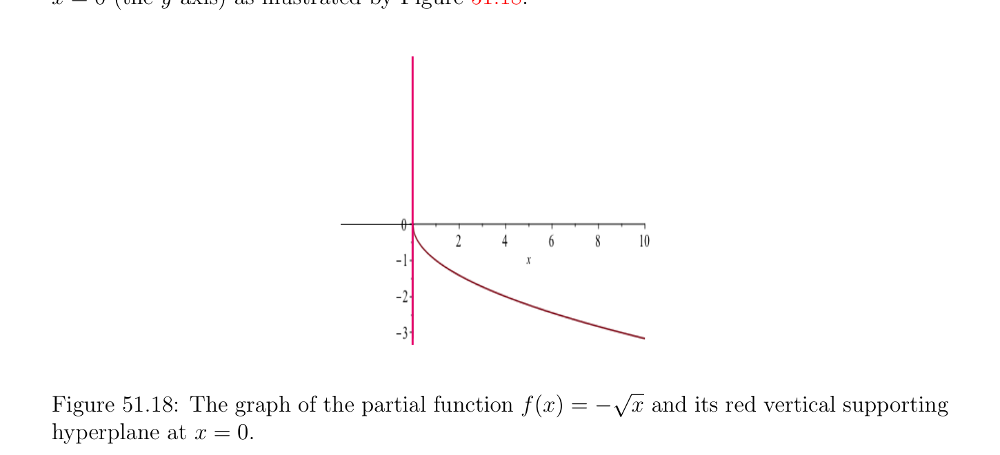
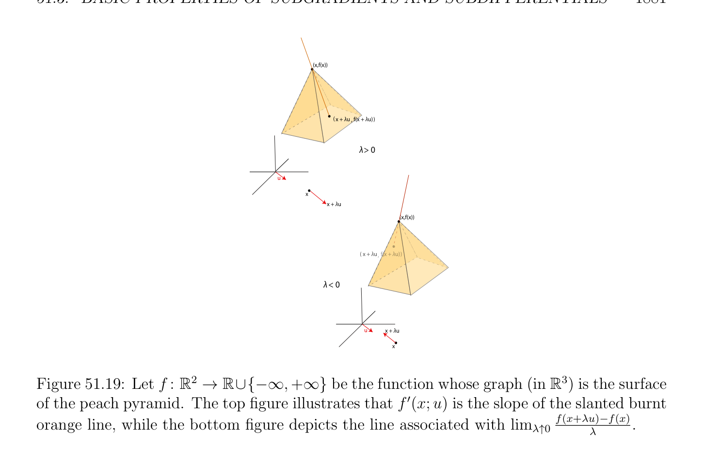
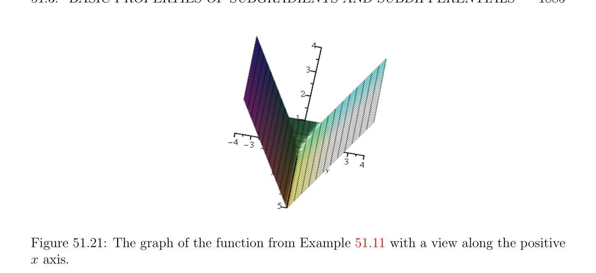

# Basic Properties of Subgradients and Subdifferentials

<!-- PAGE 1880 -->
We have dom(f) $= [0, +\infty$ ), $f$ is differentiable for all $x > 0$, but it is not subdifferentiable at $x = 0$. The only supporting hyperplane to epi(f) at $(0, 0)$ is the vertical line of equation $x = 0$ (the y-axis) as illustrated by Figure 51.18.
$$\sqrt$$

**Figure 51.18:** The graph of the partial function f(x) $=$ - $\overline{x}$ and its red vertical supporting hyperplane at $x = 0$.

## 51.3 Basic Properties of Subgradients and

$$Subdifferentials$$
A major tool to prove properties of subgradients is a variant of the notion of directional derivative.
$$\mathbb{R}^{n} \mathbb{R}\mathbb{R}^{n}$$

> **Definition 51.15.** Let $f$ : $\to  \cup {-\infty , +\infty$ } be any function. For any $x \in$ such that f(x) is finite (f(x) $\in \mathbb{R})$, for any $u \in \mathbb{R}^{n}$, the one-sided directional derivative f' $(x; u)$ is defined to be the limit
$$-$$
$$f' (x; u) = lim\lambda \downarrow 0 \frac{f(x + \lambda u)f(x)}{\lambda}$$
if it exists $(-\infty$ and $+\infty$ being allowed as limits). See Figure 51.19. The above notation for the limit means that we consider the limit when $\lambda  > 0$ tends to $0$. Note that
$$-$$
$$lim\lambda \uparrow 0 \frac{f(x + \lambda u)f(x)}{\lambda}$$
denotes the one-sided limit when $\lambda  < 0$ tends to zero, and that
$$-$$
$$-f' (x; -u) = lim\lambda \uparrow 0 \frac{f(x + \lambda u)f(x)}{\lambda} ,$$

<!-- PAGE 1881 -->
$$(x,f(x))$$
$$(x + \lambda u ,f(x + \lambda u))$$
$$\lambda > 0$$
$$\overline{u}$$
$$x$$
$$x + \lambda u$$
$$(x,f(x))$$
$$(x + \lambda u ,f(x + \lambda u))$$
$$\lambda < 0$$
$$\overline{u}\overline{x +}\overline{\lambda} u$$
$$x$$
$$\mathbb{R}^{2} \mathbb{R}\mathbb{R}^{3}$$

**Figure 51.19:** Let $f$ : $\to \cup {-\infty , +\infty$ } be the function whose graph (in ) is the surface of the peach pyramid. The top figure illustrates that f' $(x; u)$ is the slope of the slanted burnt orange line, while the bottom figure depicts the line associated with $lim_{\lambda\uparrow0\lambda}^{f(x+\lambda u)-f(x)}$. so the (two-sided) directional derivative $D_{u}f(x)$ exists iff -f' $(x; -u) =$ f' $(x; u)$. Also, if $f$ is differentiable at $x$, then
$$f' (x; u) = \langle \nabla f_{x}, u\rangle ,for all u \in \mathbb{R}^{n},$$
where $\nabla f_{x}$ is the gradient of $f$ at $x$. Here is the first remarkable result.
$$\mathbb{R}^{n} \mathbb{R}\mathbb{R}^{n}$$

> **Proposition 51.15.** Let $f$ : $\to  \cup {-\infty , +\infty$ } be a convex function. For any $x \in$ , if f(x) is finite, then the function
$$-$$
$$\lambda  \mapsto \frac{f(x + \lambda u)f(x)}{\lambda}$$
is a nondecreasing function of $\lambda  > 0$, so that f' $(x; u)$ exists for any $u \in \mathbb{R}^{n}$, and
$$-$$
$$f' (x; u) = \lambda >inf0 \frac{f(x + \lambda u)f(x)}{\lambda} .$$
Furthermore, f' $(x; u)$ is a positively homogeneous convex function of $u$ (which means that f' $(x; \alpha u) = \alpha$ f' $(x; u)$ for all $\alpha  \in \mathbb{R}$ with $\alpha  > 0$ and all $u \in \mathbb{R}^{n})$, f' $(x; 0) = 0$, and
$$-f' (x; -u) \le f' (x; u)for all u \in \mathbb{R}^{n}$$

<!-- PAGE 1882 -->
Proposition 51.15 is proven in Rockafellar $[143]$ (Theorem 23.1). The proof is not difficult but not very informative.
Remark: As a convex function of $u$, it can be shown that the effective domain of the function $u \mapsto$ f' $(x; u)$ is the convex cone generated by dom(f) - $x$. We will now state without proof some of the most important properties of subgradients and subdifferentials. Complete details can be found in Rockafellar $[143]$ (Part $V$, Section $23)$. In order to state the next proposition, we need the following definition.

> **Definition 51.16.** For any convex set $C in\mathbb{R}^{n}$, the support function $\delta^{*}$ (-|C) of $C$ is defined by
$$\delta^{*} (x|C) = \sup\langle x, y\rangle ,x \in \mathbb{R}^{n}.$$
$$y\in C$$
According to Definition 50.11, the conjugate of the indicator function $I_{C}$ of a convex set $C$ is given by
$$I_{C}^{*}(x) = \sup(\langle x, y\rangle -I_{C}(y)) = \sup\langle x, y\rangle = \delta^{*} (x|C).$$
$$y\in \mathbb{R} ny\in C$$
Thus $\delta^{*}$ (-|C) $= I_{C}^{*}$, the conjugate of the indicator function $I_{C}$. The following proposition relates directional derivatives at $x$ and the subdifferential at $x$.
$$\mathbb{R}^{n} \mathbb{R}\mathbb{R}^{n}$$

> **Proposition 51.16.** Let $f$ : $\to  \cup {-\infty , +\infty$ } be a convex function. For any $x \in$ ,
$$\mathbb{R}^{n}$$
if f(x) is finite, then a vector $u \in$ is a subgradient to $f$ at $x$ if and only if
$$f' (x; y) \ge \langle y, u\rangle for all y \in \mathbb{R}^{n}.$$
Furthermore, the closure of the convex function $y \mapsto$ f' $(x; y)$ is the support function of the closed convex set $\partial$ f(x), the subdifferential of $f$ at $x$:
$$cl(f' (x; -)) = \delta^{*} (-|\partial f(x)).$$
Sketch of proof. Proposition 51.16 is proven in Rockafellar $[143]$ (Theorem 23.2). We prove the inequality. If we write $z = x + \lambda y$ with $\lambda  > 0$, then the subgradient inequality implies
$$f(x + \lambda u) \ge f(x) + \langle z -x, u\rangle = f(x) + \lambda \langle y, u\rangle ,$$
so we get
$$-$$
$$\frac{f(x + \lambda y)f(x)}{\lambda} \ge \langle y, u\rangle .$$
Since the expression on the left tends to f' $(x; y)$ as $\lambda  > 0$ tends to zero, we obtain the desired inequality. The second part follows from Corollary 13.2.1 in Rockafellar $[143]$.

<!-- PAGE 1883 -->
If $f$ is a proper function $on\mathbb{R}$, then its effective domain being convex is an interval whose relative interior is an open interval (a, $b)$. In Proposition 51.16, we can pick $y = 1$ so $\langle y, u\rangle = u$, and for any $x \in$ (a, $b)$, since the limits $f_{-}' (x) =$ -f'(x; $-1)$ and $f_{+}'(x) =$ f'(x; $1)$ exist, with $f_{-}' (x) \le f_{+}'(x)$, we deduce that $\partial$ f(x) $= [f_{-}'(x), f_{+}'(x)]$. The numbers $\alpha  \in [f_{-}'(x), f_{+}'(x)]$ are
$$\mathbb{R}^{2}$$
the slopes of nonvertical lines in passing through $(x$, f(x)) that are supporting lines to the epigraph epi(f) of $f$.

> **Example 51.10.** If $f$ is the celebrated ReLU function (ramp function) from deep learning defined so that
$$($$
$$0if x < 0$$
$$ReLU(x) = \max{x, 0} =$$
$$xif x \ge 0,$$
then $\partial$ ReLU(0) $= [0, 1]$. See Figure 51.20. The function ReLU is differentiable for $x \neq  0$, with ReLU'(x) $= 0$ if $x < 0$ and ReLU'(x) $= 1$ if $x > 0$.
$$Figure 51.20: The graph of the ReLU function.$$
Proposition 51.16 has several interesting consequences.
$$\mathbb{R}^{n} \mathbb{R}\mathbb{R}^{n}$$

> **Proposition 51.17.** Let $f$ : $\to \cup {-\infty , +\infty$ } be a convex function. For any $x \in$ , if f(x) is finite and if $f$ is subdifferentiable at $x$, then $f$ is proper. If $f$ is not subdifferentiable at $x$, then there is some $y \neq  0$ such that
$$f' (x; y) = -f' (x; -y) = -\infty .$$
Proposition 51.17 is proven in Rockafellar $[143]$ (Theorem 23.3). It confirms that improper convex functions are rather pathological objects, because if a convex function is subdifferentiable for some $x$ such that f(x) is finite, then $f$ must be proper. This is because if f(x) is finite, then the subgradient inequality implies that $f$ majorizes an affine function, which is proper. The next theorem is one of the most important results about the connection between onesided directional derivatives and subdifferentials. It sharpens the result of Theorem 51.14.

<!-- PAGE 1884 -->
$$\mathbb{R}^{n} \mathbb{R}$$

> **Theorem 51.18.** Let $f$ : $\to \cup {+\infty$ } be a proper convex function. For any $x \in /$ dom(f), we have $\partial$ f(x) $= \emptyset$ . For any $x \in$ relint(dom(f)), we have $\partial$ f(x) $\neq  \emptyset$ , the map $y \mapsto$ f' $(x; y)$ is convex, closed and proper, and
$$f' (x; y) =\sup\langle y, u\rangle = \delta^{*} (y|\partial f(x))for all y \in \mathbb{R}^{n}.$$
$$u\in \partial f(x)$$
The subdifferential $\partial$ f(x) is nonempty and bounded (also closed and convex) if and only if $x \in$ int(dom(f)), in which case f' $(x; y)$ is finite for all $y \in \mathbb{R}^{n}$. Theorem 51.18 is proven in Rockafellar $[143]$ (Theorem 23.4). If we write
$$\mathbb{R}^{n}$$
$$dom(\partial f) = {x \in | \partial f(x) \neq  \emptyset },$$
then Theorem 51.18 implies that
$$relint(dom(f)) \subseteq dom(\partial f) \subseteq dom(f).$$
However, $dom(\partial f)$ is not necessarily convex as shown by the following counterexample.
$$\mathbb{R}^{2}$$

> **Example 51.11.** Consider the proper convex function defined on given by
$$f(x, y) = \max{g(x), |y|},$$
where
$$\sqrt$$
$$($$
$$1 -\overline{x} if x \ge 0$$
$$g(x) =$$
$$+\infty if x < 0.$$
$$\mathbb{R}^{2}$$
See Figure 51.21. It is easy to see that dom(f) $= {(x, y) \in$ | $x \ge 0}$, but
$$\mathbb{R}^{2}$$
$dom(\partial f) = {(x, y) \in$ | $x \ge 0} -{(0, y)$ | $-1 < y < 1}$, which is not convex. The following theorem is important because it tells us when a convex function is differentiable in terms of its subdifferential, as shown in Rockafellar $[143]$ (Theorem 25.1).
$$\mathbb{R}^{n}\mathbb{R}^{n}$$

> **Theorem 51.19.** Let $f$ be a convex function on , and let $x \in$ such that f(x) is finite. If $f$ is differentiable at $x$ then $\partial$ f(x) $= {\nabla f_{x}}$ (where $\nabla f_{x}$ is the gradient of $f$ at $x)$ and we have
$$f(z) \ge f(x) + \langle z -x, \nabla f_{x}\rangle for all z \in \mathbb{R}^{n}.$$
Conversely, if $\partial$ f(x) consists of a single vector, then $\partial$ f(x) $= {\nabla f_{x}}$ and $f$ is differentiable at $x$. The first direction is easy to prove. Indeed, if $f$ is differentiable at $x$, then
$$f' (x; y) = \langle y, \nabla f_{x}\rangle for all y \in \mathbb{R}^{n},$$
so by Proposition 51.16, a vector $u$ is a subgradient at $x$ iff
$$\langle y, \nabla f_{x}\rangle \ge \langle y, u\rangle for all y \in \mathbb{R}^{n},$$
so $\langle y, \nabla f_{x}$ - $u\rangle \ge 0$ for all $y$, which implies that $u = \nabla f_{x}$. We obtain the following corollary.

<!-- PAGE 1885 -->

**Figure 51.21:** The graph of the function from Example 51.11 with a view along the positive $x$ axis.
$$\mathbb{R}^{n}\mathbb{R}^{n}$$

> **Corollary 51.20.** Let $f$ be a convex function on , and let $x \in$ such that f(x) is finite. If $f$ is differentiable at $x$, then $f$ is proper and $x \in$ int(dom(f)). The following theorem shows that proper convex functions are differentiable almost everywhere.

> **Theorem 51.21.** Let $f$ be a proper convex function on $\mathbb{R}^{n}$, and let $D$ be the set of vectors where $f$ is differentiable. Then $D$ is a dense subset of int(dom(f)), and its complement in int(dom(f)) has measure zero. Furthermore, the gradient map $x \mapsto \nabla f_{x}$ is continuous on $D$. Theorem 51.21 is proven in Rockafellar $[143]$ (Theorem 25.5).
Remark: If $f$ : (a, $b) \to \mathbb{R}$ is a finite convex function on an open interval of $\mathbb{R}$, then the set $D$ where $f$ is differentiable is dense in (a, $b)$, and (a, $b)$ - $D$ is at most countable. The map f' is continuous and nondecreasing on $D$. See Rockafellar $[143]$ (Theorem 25.3). We also have the following result showing that in “most cases” the subdifferential $\partial$ f(x) can be constructed from the gradient map; see Rockafellar $[143]$ (Theorem 25.6).

> **Theorem 51.22.** Let $f$ be a closed proper convex function on $\mathbb{R}^{n}$. If int(dom(f)) $\neq  \emptyset$ , then for every $x \in$ dom(f), we have
$$\partial f(x\overline{) = conv(}\overline{S}\overline{(}\overline{x}\overline{)) +} N_{dom(f)}(x)$$
where $N_{dom(f)}(x)$ is the normal cone to dom(f) at $x$, and S(x) is the set of all limits of sequences of the form $\nabla f_{x1}, \nabla f_{x2}, \dots  , \nabla f_{xp}, \dots$ , where $x_{1}, x_{2}, \dots  , x_{p}, \dots$  is a sequence in dom(f) converging to $x$ such that each $\nabla f_{xp}$ is defined.
