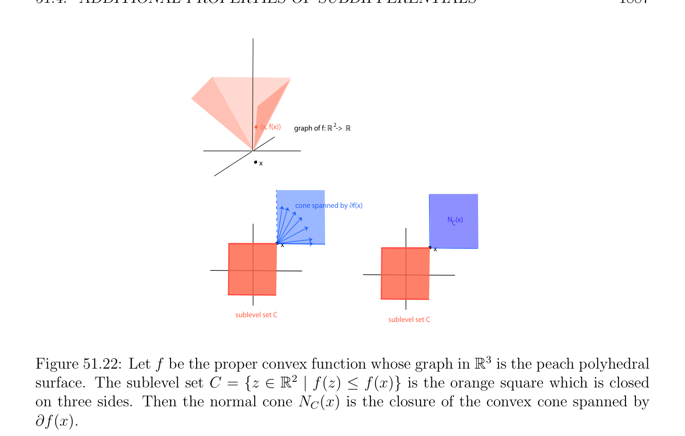
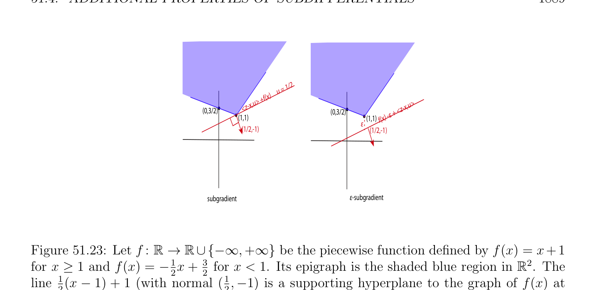

# Additional Properties of Subdifferentials

<!-- PAGE 1886 -->
The next two results generalize familiar results about derivatives to subdifferentials.

> **Proposition 51.23.** Let $f_{1}, \dots  , f_{n}$ be proper convex functions $on\mathbb{R}^{n}$, and let $f = f_{1}+\cdots +f_{n}$. For $x \in \mathbb{R}^{n}$, we have
$$\partial f(x) \supseteq \partial f_{1}(x) + \cdots  + \partial f_{n}(x).$$
$$If \bigcap_{i}  n=1 relint(dom(f_{i})) \neq  \emptyset , then$$
$$\partial f(x) = \partial f_{1}(x) + \cdots  + \partial f_{n}(x).$$
Proposition 51.23 is proven in Rockafellar $[143]$ (Theorem 23.8). The next result can be viewed as a generalization of the chain rule.

> **Proposition 51.24.** Let $f$ be the function given by f(x) $=$ h(Ax) for all $x \in \mathbb{R}^{n}$, where $h$
$$\mathbb{R}^{m}$$
is a proper convex function on and $A$ is an $m \times  n$ matrix. Then
$$\partial f(x) \supseteq A^{\top}(\partial h(Ax))for all x \in \mathbb{R}^{n}.$$
If the range of $A$ contains a point of relint(dom(h)), then
$$\partial f(x) = A^{\top}(\partial h(Ax)).$$
Proposition 51.24 is proven in Rockafellar $[143]$ (Theorem 23.9).

## 51.4 Additional Properties of Subdifferentials

$$\mathbb{R}^{n} \mathbb{R}$$
In general, if $f$ : $\to$  is a function (not necessarily convex) and $f$ is differentiable at $x$,
$$\mathbb{R}^{n}$$
we expect that the gradient $\nabla f_{x}$ of $f$ at $x$ is normal to the level set ${z \in$ | f(z) $= f(x)}$ at f(x). An analogous result, as illustrated in Figure 51.22, holds for proper convex functions in terms of subdifferentials.
$$\mathbb{R}^{n}\mathbb{R}^{n}$$

> **Proposition 51.25.** Let $f$ be a proper convex function on , and let $x \in$ be a vector such that $f$ is subdifferentiable at $x$ but $f$ does not achieve its minimum at $x$. Then the
$$\mathbb{R}^{n}$$
normal cone $N_{C}(x)$ at $x$ to the sublevel set $C = {z \in$ | f(z) $\le f(x)}$ is the closure of the convex cone spanned by $\partial$ f(x). Proposition 51.25 is proven in Rockafellar $[143]$ (Theorem 23.7). The following result sharpens Proposition 51.8.

> **Proposition 51.26.** Let $f$ be a closed proper convex function $on\mathbb{R}^{n}$, and let $S$ be a nonempty closed and bounded subset of int(dom(f)). Then
$$\partial f(S) = \bigcup_{x\in S}  \partial f(x)$$

<!-- PAGE 1887 -->
$$(x, f(x))graph of f: R 2 ->  R$$
$$x$$
$$cone spanned by vf(x)$$
$$N  (x)C$$
$$\overline{x}\overline{x}$$
$$sublevel set Csublevel set C$$
$$\mathbb{R}^{3}$$

**Figure 51.22:** Let $f$ be the proper convex function whose graph in is the peach polyhedral
$$\mathbb{R}^{2}$$
surface. The sublevel set $C = {z \in$ | f(z) $\le f(x)}$ is the orange square which is closed on three sides. Then the normal cone $N_{C}(x)$ is the closure of the convex cone spanned by $\partial$ f(x). is nonempty, closed and bounded. If
$$\alpha  =\sup\|y\|_{2} < +\infty ,$$
$$y\in \partial f(S)$$
then $f$ is Lipschitizan on $S$, and we have
$$f' (x; z) \le \alpha  \|z\|_{2}for all x \in S and all z \in \mathbb{R}^{n}$$
$$|f(y) -f(x)| \le \alpha  \|y -z\|_{2}for all x, y \in S.$$
Proposition 51.24 is proven in Rockafellar $[143]$ (Theorem 24.7). The subdifferentials of a proper convex function $f$ and its conjugate $f^{*}$ are closely related. First, we have the following proposition from Rockafellar $[143]$ (Theorem 12.2).

> **Proposition 51.27.** Let $f$ be convex function on $\mathbb{R}^{n}$. The conjugate function $f^{*}$ of $f$ is a closed and convex function, proper iff $f$ is proper. Furthermore, $(cl(f))^{*} = f^{*}$ , and $f^{**} =$ cl(f). As a corollary of Proposition 51.27, it can be shown that
$$f^{*} (y) =\sup(\langle x, y\rangle -f(x)).$$
$$x\in relint(dom(f))$$
The following result is proven in Rockafellar $[143]$ (Theorem 23.5).

<!-- PAGE 1888 -->
$$\mathbb{R}^{n} \mathbb{R}^{n}$$

> **Proposition 51.28.** For any proper convex function $f$ on and for any vector $x \in$ ,
$$\mathbb{R}^{n}$$
the following conditions on a vector $y \in$ are equivalent.
(a) $y \in \partial$ f(x).
$(b)$ The function $\langle z, y\rangle$ - f(z) achieves its supremum in $z$ at $z = x$.
$(c)$ f(x) $+ f^{*} (y) \le \langle x, y\rangle$ .
$(d)$ f(x) $+ f^{*} (y) = \langle x, y\rangle$ . If (cl(f))(x) $=$ f(x), then there are three more conditions all equivalent to the above conditions. $(a^{*}) x \in \partial f^{*} (y). (b^{*})$ The function $\langle x, z\rangle$ - $f^{*} (z)$ achieves its supremum in $z$ at $z = y. (a^{**}) y \in \partial$ (cl(f))(x). The following results are corollaries of Proposition 51.28; see Rockafellar $[143]$ (Corollaries 23.5.1, 23.5.2, 23.5.3).

> **Corollary 51.29.** For any proper convex function $f$ on $\mathbb{R}^{n}$, if $f$ is closed, then $y \in \partial$ f(x) iff $x \in \partial f^{*} (y)$, for all $x, y \in \mathbb{R}^{n}$. Corollary 51.29 states a sort of adjunction property.

> **Corollary 51.30.** For any proper convex function $f$ on $\mathbb{R}^{n}$, if $f$ is subdifferentiable at $x \in \mathbb{R}^{n}$, then (cl(f))(x) $=$ f(x) and $\partial$ (cl(f))(x) $= \partial$ f(x). Corollary 51.30 shows that the closure of a proper convex function $f$ agrees with $f$ whereever $f$ is subdifferentiable.

> **Corollary 51.31.** For any proper convex function $f$ on $\mathbb{R}^{n}$, for any nonempty closed convex
$$\mathbb{R}^{n}\mathbb{R}^{n}\mathbb{R}^{n}$$
subset $C$ of , for any $y \in$ , the set $\partial \delta^{*}$ (y|C) $= \partial I_{C}^{*}(y)$ consists of the vectors $x \in$ (if any) where the linear form $z \mapsto \langle z, y\rangle$ achieves its maximum over $C$. There is a notion of approximate subgradient which turns out to be useful in optimization theory; see Bertsekas $[19, 17]$.
$$\mathbb{R}^{n} \mathbb{R}$$

> **Definition 51.17.** Let $f$ : $\to  \cup {+\infty$ } be any proper convex function. For any $\epsilon  > 0$,
$$\mathbb{R}^{n}\mathbb{R}^{n}$$
for any $x \in$ , if f(x) is finite, then an $\epsilon$ -subgradient of $f$ at $x$ is any vector $u \in$ such that
$$f(z) \ge f(x) -\epsilon  + \langle z -x, u\rangle ,for all z \in \mathbb{R}^{n}.$$
See Figure 51.23. The set of all $\epsilon$ -subgradients of $f$ at $x$ is denoted $\partial_{\epsilon}$ f(x) and is called the $\epsilon$ -subdifferential of $f$ at $x$.

<!-- PAGE 1889 -->
$$= 1/2$$
$$u$$
$$+f(x)$$
$$,u> >$$
$$<z-x + <z-x,u$$
$$(0,3/2)(0,3/2) -\varepsilon$$
$$(1,1)(1,1)f(x)$$
$$\varepsilon$$
$$(1/2,-1)(1/2,-1)$$
$$subgradient\varepsilon -subgradient$$

**Figure 51.23:** Let $f$ : $\mathbb{R} \to \mathbb{R}\cup {-\infty , +\infty$ } be the piecewise function defined by f(x) $= x+1$ for $x \ge 1$ and f(x) $= -_{2}^{1}x +_{2}^{3}$  for $x < 1$. Its epigraph is the shaded blue region in $\mathbb{R}^{2}$. The $line^{1} (x$ - $1) + 1$ (with normal $(_{2}^{1}, -1)$ is a supporting hyperplane to the graph of f(x) at $(1, 1)^{2}$ while the $line_{2}^{1} (x$ - $1) + 1$ - $\epsilon$  is the hyperplane associated with the $\epsilon$ -subgradient at $x = 1$ and shows that $u =_{2}^{1}  \in \partial_{\epsilon}$ f(x). The set $\partial_{\epsilon}$ f(x) can be defined in terms of the conjugate of the function $h_{x}$ given by
$$h_{x}(y) = f(x + y) -f(x),for all y \in \mathbb{R}^{n}.$$
$$\mathbb{R}^{n} \mathbb{R}$$

> **Proposition 51.32.** Let $f$ : $\to \cup {+\infty$ } be any proper convex function. For any $\epsilon  > 0$, if $h_{x}$ is given by
$$h_{x}(y) = f(x + y) -f(x),for all y \in \mathbb{R}^{n},$$
then
$$h_{x}^{*}(y) = f^{*}(y) + f(x) -\langle x, y\rangle for all y \in \mathbb{R}^{n}$$
and
$$\mathbb{R}^{n}$$
$$\partial_{\epsilon} f(x) = {u \in | h_{x}^{*}(u) \le \epsilon }.$$

*Proof.* We have
$$h_{x}^{*}(y) = \sup(\langle y, z\rangle -h_{x}(z))$$
$$z\in \mathbb{R} n$$
$$= \sup(\langle y, z\rangle -f(x + z) + f(x))$$
$$z\in \mathbb{R} n$$
$$=\sup(\langle y, x + z\rangle -f(x + z) -\langle y, x\rangle + f(x))$$
$$x+z\in \mathbb{R} n$$
$$= f^{*} (y) + f(x) -\langle x, y\rangle .$$
Observe that $u \in \partial_{\epsilon}$ f(x) iff for every $y \in \mathbb{R}^{n}$,
$$f(x + y) \ge f(x) -\epsilon  + \langle y, u\rangle$$
