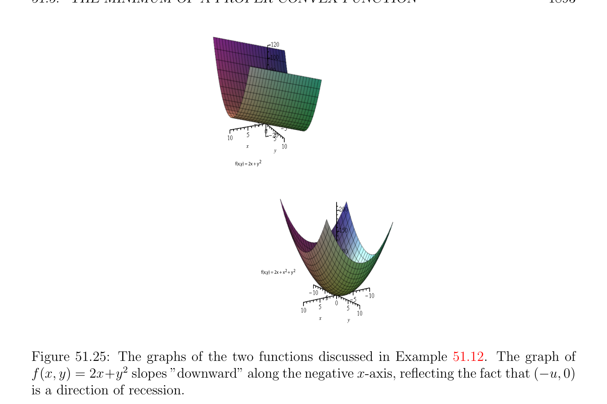

# The Minimum of a Proper Convex Function

<!-- PAGE 1890 -->
iff
$$\epsilon  \ge \langle y, u\rangle -f(x + y) + f(x) = \langle y, u\rangle -h_{x}(y).$$
Since by definition
$$h_{x}^{*}(u) = \sup(\langle y, u\rangle -h_{x}(y)),$$
$$y\in \mathbb{R} n$$
we conclude that
$$\mathbb{R}^{n}$$
$$\partial_{\epsilon} f(x) = {u \in | h_{x}^{*}(u) \le \epsilon },$$
as claimed.
Remark: By Fenchel’s inequality $h_{x}^{*}(y) \ge 0$, and by Proposition 51.28(d), the set of vectors where $h_{x}^{*}$ vanishes is $\partial$ f(x).
$$\mathbb{R}^{n}$$
The equation $\partial_{\epsilon}$ f(x) $= {u \in$ | $h_{x}^{*}(u) \le \epsilon$ } shows that $\partial_{\epsilon}$ f(x) is a closed convex set. As $\epsilon$  gets smaller, the set $\partial_{\epsilon}$ f(x) decreases, and we have
$$\partial f(x) = \bigcap_{\epsilon >0}  \partial_{\epsilon} f(x).$$
However $\delta^{*} (y|\partial_{\epsilon}$ f(x)) $= I_{\partial\epsilon f(x)}^{*}(y)$ does not necessarily decrease to $\delta^{*} (y|\partial$ f(x)) $= I_{\partial f(x)}^{*}(y)$ as $\epsilon$  decreases to zero. The discrepancy corresponds to the discrepancy between f' $(x; y)$ and $\delta^{*} (y|\partial$ f(x)) $= I_{\partial f(x)}^{*}(y)$ and is due to the fact that $f$ is not necessarily closed (see Proposition 51.16) as shown by the following result proven in Rockafellar $[143]$ (Theorem 23.6).
$$\mathbb{R}^{n}$$

> **Proposition 51.33.** Let $f$ be a closed and proper convex function, and let $x \in$ such that f(x) is finite. Then
$$f' (x; y) = lim \delta^{*} (y|\partial_{\epsilon} f(x)) = lim I_{\partial\epsilon f(x)}^{*}(y)for all y \in \mathbb{R}^{n}.$$
$$\epsilon \downarrow 0\epsilon \downarrow 0$$
The theory of convex functions is rich and we have only given a sample of some of the most significant results that are relevant to optimization theory. There are a few more results regarding the minimum of convex functions that are particularly important due to their applications to optimization theory.

## 51.5 The Minimum of a Proper Convex Function

Let $h$ be a proper convex function on $\mathbb{R}^{n}$. The general problem is to study the minimum of $h$ over a nonempty convex set $C$ in $\mathbb{R}^{n}$, possibly defined by a set of inequality and equality constraints. We already observed that minimizing $h$ over $C$ is equivalent to minimizing the proper convex function $f$ given by
$$($$
$$h(x)if x \in C$$
$$f(x) = h(x) + I_{C}(x) =$$
$$+\infty if x \in /C.$$
Therefore it makes sense to begin by considering the problem of minimizing a proper convex
$$\mathbb{R}^{n}\mathbb{R}^{n}$$
function $f$ over . Of course, minimizing over is equivalent to minimizing over dom(f).

<!-- PAGE 1891 -->

> **Definition 51.18.** Let $f$ be a proper convex function $on\mathbb{R}^{n}$. We denote by inf $f$ the quantity
$$\inf f =\inf f(x).$$
$$x\in dom(f)$$
$$\mathbb{R}^{n}$$
This is the minimum of the function $f$ over (it may be equal to $-\infty$ ). For every $\alpha  \in \mathbb{R}$, we have the sublevel set
$$\mathbb{R}^{n}$$
$$sublev_{\alpha}(f) = {x \in | f(x) \le \alpha }.$$
By Proposition 51.2, we know that the sublevel sets $sublev_{\alpha}(f)$ are convex and that
$$dom(f) = \bigcup_{\alpha\in R}  sublev_{\alpha}(f).$$
Observe that $sublev_{\alpha}(f) = \emptyset$ if $\alpha  <$ inf $f$. If inf $f > -\infty$ , then for $\alpha  =$ inf $f$, the sublevel set $sublev_{\alpha}(f)$ consists of the set of vectors where $f$ achieves it minimum.

> **Definition 51.19.** Let $f$ be a proper convex function on $\mathbb{R}^{n}$. If inf $f > -\infty$ , then the sublevel set $sublev_{inff}(f)$ is called the minimum set of $f$ (this set may be empty). See Figure 51.24.
$$f (x;y)\ge 0‘$$
$$x$$
$$(x,f(x))$$
$$graph of f: 2 ->$$
$$R R$$
$$\overline{y} minimum set of f$$

**Figure 51.24:** Let $f$ be the proper convex function whose graph is the surface of the upward
$$\mathbb{R}^{2}$$
facing pink trough. The minimum set of $f$ is the light pink square of which maps to the bottom surface of the trough in $\mathbb{R}^{3}$. For any $x$ in the minimum set, f' $(x; y) \ge 0$, a fact substantiated by Proposition 51.34. It is important to determine whether the minimum set is empty or nonempty, or whether it contains a single point. As we noted in Theorem 40.13(2), if $f$ is strictly convex then the minimum set contains at most one point.

<!-- PAGE 1892 -->
In any case, we know from Proposition 51.2 and Proposition 51.3 that the minimum set of $f$ is convex, and closed iff $f$ is closed.
$$\mathbb{R}^{n}$$
Subdifferentials provide the first criterion for deciding whether a vector $x \in$ belongs to the minimum set of $f$. Indeed, the very definition of a subgradient says that $x \in \mathbb{R}^{n}$ belongs to the minimum set of $f$ iff0 $\in \partial$ f(x). Using Proposition 51.16, we obtain the following result.
$$\mathbb{R}^{n}\mathbb{R}^{n}$$

> **Proposition 51.34.** Let $f$ be a proper convex function over . A vector $x \in$ belongs to the minimum set of $f$ iff
$$0 \in \partial f(x)$$
iff f(x) is finite and
$$f' (x; y) \ge 0for all y \in \mathbb{R}^{n}.$$
Of course, if $f$ is differentiable at $x$, then $\partial$ f(x) $= {\nabla f_{x}}$, and we obtain the well-known condition $\nabla f_{x} = 0$. There are many ways of expressing the conditions of Proposition 51.34, and the minimum set of $f$ can even be characterized in terms of the conjugate function $f^{*}$ . The notion of direction of recession plays a key role.
$$\mathbb{R}^{n} \mathbb{R}$$

> **Definition 51.20.** Let $f$ : $\to  \cup {+\infty$ } be any function. A direction of recession of $f$
$$\mathbb{R}^{n}$$
is any non-zero vector $u \in$ such that for every $x \in$ dom(f), the function $\lambda  \mapsto$ f(x $+ \lambda u)$ is nonincreasing (this means that for all $\lambda_{1} , \lambda_{2}  \in \mathbb{R}$, if $\lambda_{1}  < \lambda_{2}$ , then $x + \lambda_{1} u \in$ dom(f), $x + \lambda_{2} u \in$ dom(f), and f(x $+ \lambda_{2} u) \le$ f(x $+ \lambda_{1} u))$.
$$\mathbb{R}^{2} \mathbb{R}$$

> **Example 51.12.** Consider the function $f$ : $\to$  given by f(x, $y) =$ 2x $+ y^{2}$. Since
$$f(x + \lambda u, y + \lambda v) = 2(x + \lambda u) + (y + \lambda v)^{2}= 2x + y^{2}+ 2(u + yv)\lambda  + v^{2}\lambda^{2} ,$$
if $v \neq  0$, we see that the above quadratic function of $\lambda$  increases for $\lambda  \ge$ -(u $+ yv)/v^{2}$. If $v = 0$, then the function $\lambda  \mapsto$ 2x $+ y^{2} + 2u\lambda$  decreases to $-\infty$ when $\lambda$  goes to $+\infty$ if $u < 0$, so all vectors $(-u, 0)$ with $u > 0$ are directions of recession. See Figure 51.25. The function f(x, $y) =$ 2x $+ x^{2} + y^{2}$ does not have any direction of recession, because
$$f(x + \lambda u, y + \lambda v) = 2x + x^{2}+ y^{2}+ 2(u + ux + yv)\lambda  + (u^{2}+ v^{2})\lambda^{2} ,$$
and since $(u, v) \neq  (0, 0)$, we have $u^{2} + v^{2} > 0$, so as a function of $\lambda$ , the above quadratic function increases for $\lambda  \ge$ -(u $+$ ux $+ yv)/(u^{2} + v^{2})$. See Figure 51.25. In fact, the above example is typical. For any symmetric positive definite $n\times n$ matrix $A$ and any vector $b \in \mathbb{R}^{n}$, the quadratic strictly convex function $q$ given by q(x) $= x^{\top}Ax + b^{\top}x$ has no directions of recession. For any $u \in \mathbb{R}^{n}$, with $u \neq  0$, we have
$$q(x + \lambda u) = (x + \lambda u)^{\top}A(x + \lambda u) + b^{\top}(x + \lambda u)$$
$$= x^{\top}Ax + b^{\top}x + (2x^{\top}Au + b^{\top}u)\lambda  + (u^{\top}Au)\lambda^{2} .$$

<!-- PAGE 1893 -->
$$f(x,y) = 2x + y2$$
$$f(x,y) = 2x + x   + y22$$

**Figure 51.25:** The graphs of the two functions discussed in Example 51.12. The graph of f(x, $y) = 2x+y^{2}$ slopes ”downward” along the negative x-axis, reflecting the fact that $(-u, 0)$ is a direction of recession. Since u̸̸ $= 0$ and $A$ is SPD, we have $u^{\top}Au > 0$, and the above quadratic function increases for $\lambda  \ge -(2x^{\top}Au + b^{\top}u)/(2u^{\top}Au)$. The above fact yields an important trick of convex optimization. If $f$ is any proper closed and convex function, then for any quadratic strictly convex function $q$, the function $h = f +q$ is a proper and closed strictly convex function that has a minimum which is attained for a unique vector. This trick is at the core of the method of augmented Lagrangians, and in particular ADMM. Surprisingly, a rigorous proof requires the deep theorem below. One should be careful not to conclude hastily that if a convex function is proper and closed, then dom(f) and Im(f) are also closed. Also, a closed and proper convex function may not attain its minimum. For example, the function $f$ : $\mathbb{R} \to \mathbb{R} \cup {+\infty$ } given by
$$ \frac{1}{x} if x > 0$$
$$f(x) =$$
$$+\infty if x \le 0$$
$$$$
is a proper, closed and convex function, but dom(f) $= (0, +\infty$ ) and Im(f) $= (0, +\infty$ ). Note that inf $f = 0$ is not attained. The problem is that $f$ has $1$ has a direction of recession as evidenced by the graph provided in Figure 51.26. The following theorem is proven in Rockafellar $[143]$ (Theorem 27.1).

<!-- PAGE 1894 -->

**Figure 51.26:** The graph of the partial function f(x) $=^{1}$ for $x > 0$. The graph of this function decreases along the x-axis since $1$ is a direction $of^{x}$ recession.

> **Theorem 51.35.** Let $f$ be a proper and closed convex function over $\mathbb{R}^{n}$. The following statements hold:
$(1)$ We have inf $f = -f^{*} (0)$. Thus $f$ is bounded below iff $0 \in dom(f^{*}$ ).
$(2)$ The minimum set of $f$ is equal to $\partial f^{*} (0)$. Thus the infimum of $f$ is attained (which
$$\mathbb{R}^{n}$$
means that there is some $x \in$ such that f(x) $=$ inf $f)$ iff $f^{*}$ is subdifferentiable at $0$. This condition holds in particular when $0 \in relint(dom(f^{*}$ )). Moreover, $0 \in relint(dom(f^{*}$ )) iff every direction of recession of $f$ is a direction in which $f$ is constant.
$(3)$ For the infimum of $f$ to be finite but unattained, it is necessary and sufficient that $f^{*} (0)$ be finite and $(f^{*}$ )'(0; $y) = -\infty$ for some $y \in \mathbb{R}^{n}$.
$(4)$ The minimum set of $f$ is a nonempty bounded set iff $0 \in int(dom(f^{*}$ )). This condition holds iff $f$ has no directions of recession.
$(5)$ The minimum set of $f$ consists of a unique vector $x$ iff $f^{*}$ is differentiable at $x$ and $x = \nabla f_{0}^{*}$ .
$(6)$ For each $\alpha  \in \mathbb{R}$, the support function of $sublev_{\alpha}(f)$ is the closure of the positively homogeneous convex function generated by $f^{*} + \alpha$ . If $f$ is bounded below, then the support function of the minimum set of $f$ is the closure of the directional derivative map $y \mapsto (f^{*}$ )'(0; $y)$. In view of the importance of Theorem 51.35(4), we state this property as the following corollary.

<!-- PAGE 1895 -->

> **Corollary 51.36.** Let $f$ be a closed proper convex function on $\mathbb{R}^{n}$. Then the minimal set of $f$ is a non-empty bounded set iff $f$ has no directions of recession. In particular, if $f$ has no directions of recession, then the minimum inf $f$ of $f$ is finite and attained for some $x \in \mathbb{R}^{n}$. Theorem 51.14 implies the following result which is very important for the design of optimization procedures.

> **Proposition 51.37.** Let $f$ be a proper and closed convex function over $\mathbb{R}^{n}$. The function $h$ given by h(x) $=$ f(x) $+$ q(x) obtained by adding any strictly convex quadratic function $q$ of the form q(x) $= x^{\top}Ax + b^{\top}x$ (where $A$ is symmetric positive definite) is a proper closed
$$\mathbb{R}^{n}$$
strictly convex function such that inf $h$ is finite, and there is a unique $x^{*} \in$ such that $h$ attains its minimum in $x^{*}$ (that is, $h(x^{*}) =$ inf $h)$.

*Proof.* By Theorem 51.14 there is some affine form $\phi$  given by $\phi (x) = c^{\top}x + \alpha$  (with $\alpha  \in \mathbb{R})$ such that f(x) $\ge \phi (x)$ for all $x \in \mathbb{R}^{n}$. Then we have
$$h(x) = f(x) + q(x) \ge x^{\top}Ax + (b^{\top}+ c^{\top})x + \alpha for all x \in \mathbb{R}^{n}.$$
Since $A$ is symmetric positive definite, by Example 51.12, the quadratic function $Q$ given by Q(x) $= x^{\top}Ax + (b^{\top} + c^{\top})x + \alpha$  has no directions of recession. Since h(x) $\ge$ Q(x) for all $x \in \mathbb{R}^{n}$, we claim that $h$ has no directions of recession. Otherwise, there would be some nonzero vector $u$, such that the function $\lambda  \mapsto$ h(x $+ \lambda u)$ is nonincreasing for all $x \in$ dom(h), so h(x $+ \lambda u) \le \beta$  for some $\beta$  for all $\lambda$ . But we showed that for $\lambda$  large enough, the function $\lambda  \mapsto$ Q(x $+ \lambda u)$ increases like $\lambda^{2}$ , so for $\lambda$  large enough, we will have Q(x $+ \lambda u) > \beta$ , contradicting the fact that $h$ majorizes $Q$. By Corollary 51.36, $h$ has a finite minimum $x^{*}$ which is attained. If $f$ and $g$ are proper convex functions and if $g$ is strictly convex, then $f + g$ is a proper function. For all $x, y \in \mathbb{R}^{n}$, for any $\lambda$  such that $0 < \lambda  < 1$, since $f$ is convex and $g$ is strictly convex, we have
$$f((1 -\lambda )x + \lambda y) \le (1 -\lambda )f(x) + \lambda f(y)$$
$$g((1 -\lambda )x + \lambda y) < (1 -\lambda )g(x) + \lambda g(y),$$
so we deduce that f((1 - $\lambda )x + \lambda y) +$ g((1 - $\lambda )x + \lambda y) < ((1$ - $\lambda$ )(f(x) $+$ g(x)) $+ \lambda$ (f(x) $+$ g(x))), which shows that $f + g$ is strictly convex. Then, as $f + q$ is strictly convex, it has a unique minimum at $x^{*}$. We now come back to the problem of minimizing a proper convex function $h$ over a nonempty convex subset $C$ . Here is a nice characterization.

> **Proposition 51.38.** Let $h$ be a proper convex function on $\mathbb{R}^{n}$, and let $C$ be a nonempty convex subset of $\mathbb{R}^{n}$.

<!-- PAGE 1896 -->
$(1)$ For any $x \in \mathbb{R}^{n}$, if there is some $y \in \partial$ h(x) such that $-y \in N_{C}(x)$, that is, $-y$ is normal to $C$ at $x$, then $h$ attains its minimum on $C$ at $x$.
$(2)$ If relint(dom(h)) $\cap$ relint(C) $\neq  \emptyset$ , then the converse of $(1)$ holds. This means that if $h$ attains its minimum on $C$ at $x$, then there is some $y \in \partial$ h(x) such that $-y \in N_{C}(x)$. Proposition 51.38 is proven in Rockafellar $[143]$ (Theorem 27.4). The proof is actually quite simple.

*Proof.* $(1)$ By Proposition 51.34, $h$ attains its minimum on $C$ at $x$ iff
$$0 \in \partial (h + I_{C})(x).$$
By Proposition 51.23, since
$$\partial h(x) + \partial I_{C}(x) \subseteq \partial (h + I_{C})(x),$$
if $0 \in \partial$ h(x) $+ \partial I_{C}(x)$, then $h$ attains its minimum on $C$ at $x$. But we saw in Section 51.2 that $\partial I_{C}(x) = N_{C}(x)$, the normal cone to $C$ at $x$. Then the condition $0 \in \partial$ h(x) $+ \partial I_{C}(x)$ says that there is some $y \in \partial$ h(x) such that $y + z = 0$ for some $z \in N_{C}(x)$, and this is equivalent to $-y \in N_{C}(x)$.
$(2)$ By definition of $I_{C}$, the condition relint(dom(h)) $\cap$ relint(C) $\neq  \emptyset$ is the hypothesis of Proposition 51.23 to have
$$\partial (h + I_{C})(x) = \partial h(x) + \partial I_{C}(x).$$
If $h$ attains its minimum on $C$ at $x$, then by Proposition 51.34 we have $0 \in \partial (h + I_{C})(x)$, so $0 \in \partial$ h(x) $+ \partial I_{C}(x) = \partial$ h(x) $+ N_{C}(x)$, and by the reasoning of Part $(1)$, this means that there is some $y \in \partial$ h(x) such that $-y \in N_{C}(x)$.
Remark: $A$ polyhedral function is a convex function whose epigraph is a polyhedron. It is easy to see that Proposition 51.38(2) also holds in the following cases
$(1) C$ is $a \mathcal{H}-polyhedron$ and relint(dom(h)) $\cap C \neq  \emptyset$
$(2) h$ is polyhedral and dom(h) $\cap$ relint(C) $\neq  \emptyset$ .
$(3)$ Both $h$ and $C$ are polyhedral, and dom(h) $\cap C \neq  \emptyset$ .
