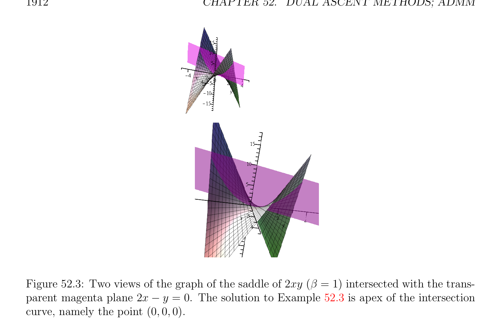

# Augmented Lagrangians and the Method of Multipliers

<!-- PAGE 1909 -->

## 52.2 Augmented Lagrangians and the Method of

$$Multipliers$$
In order to make the minimization step of the dual ascent method more robust, one can use the trick of adding the penalty term $(\rho /2) \|Au$ - $b\|_{2}^{2}$ to the Lagrangian.

> **Definition 52.1.** Given the Optimization Problem $(P)$,
$$minimizeJ(u)$$
$$subject to Au = b,$$
the augmented Lagrangian is given by
$$L_{\rho}(u, \lambda ) = J(u) + \lambda^{\top} (Au -b) + (\rho /2) \|Au -b\|_{2}^{2} ,$$
with $\lambda  \in \mathbb{R}^{m}$, and where $\rho  > 0$ is called the penalty parameter. The augmented Lagrangian $L_{\rho}(u, \lambda$ ) can be viewed as the ordinary Lagrangian of the Minimization Problem $(P_{\rho})$,
$$minimizeJ(u) + (\rho /2) \|Au -b\|_{2}^{2}$$
$$subject to Au = b.$$
The above problem is equivalent to Program $(P)$, since for any feasible solution of $(P_{\rho})$, we must have Au - $b = 0$. The benefit of adding the penalty term $(\rho /2) \|Au$ - $b\|_{2}^{2}$ is that by Proposition 51.37, Problem $(P_{\rho})$ has a unique optimal solution under mild conditions on $A$. Dual ascent applied to the dual of $(P_{\rho})$ yields the the method of multipliers, which consists of the following steps, given some initial $\lambda^{0}$ :
$$u^{k+1}= arg minL_{\rho}(u, \lambda^{k} )$$
$$u$$
$$\lambda^{k+1} = \lambda^{k} + \rho (Au^{k+1}-b).$$
Observe that the second step uses the parameter $\rho$ . The reason is that it can be shown that choosing $\alpha^{k} = \rho$  guarantees that $(u^{k+1}, \lambda^{k+1}$ ) satisfies the equation
$$\nabla J_{uk+1} + A^{\top}\lambda^{k+1} = 0,$$
which means that $(u^{k+1}, \lambda^{k+1}$ ) is dual feasible; see Boyd, Parikh, Chu, Peleato and Eckstein $[28]$, Section 2.3.

> **Example 52.2.** Consider the minimization problem
$$minimizey^{2}+ 2x$$
$$subject to 2x -y = 0.$$

<!-- PAGE 1910 -->

**Figure 52.2:** Two views of the graph of $y^{2} +$ 2x intersected with the transparent red plane 2x-y $= 0$. The solution to Example 52.2 is apex of the intersection curve, namely the point $(-_{4}^{1}, -_{2}^{1}, -_{16}^{15})$. See Figure 52.2. The quadratic function
$$J(x, y) = y^{2}+ 2x = \begin{pmatrix} x & y \end{pmatrix} \begin{pmatrix} 0 & 0 \\ 0 & 1 \end{pmatrix} \begin{pmatrix} x \\ y \end{pmatrix} + \begin{pmatrix} 2 & 0 \end{pmatrix} \begin{pmatrix} x \\ y \end{pmatrix}$$
is convex but not strictly convex. Since $y =$ 2x, the problem is equivalent to minimizing $y^{2} +$ 2x $= 4x^{2} +$ 2x, whose minimum is achieved for $x = -1/4$ (since setting the derivative of the function $x \mapsto 4x^{2} + 2$ yields 8x $+ 2 = 0)$. Thus, the unique minimum of our problem is achieved for $(x = -1/4, y = -1/2)$. The Lagrangian of our problem is
$$L(x, y, \lambda ) = y^{2}+ 2x + \lambda (2x -y).$$
If we apply the dual ascent method, minimization of L(x, $y, \lambda$ ) with respect to $x$ and $y$ holding $\lambda$  constant yields the equations
$$2 + 2\lambda  = 0$$
$$2y -\lambda  = 0,$$
obtained by setting the gradient of $L$ (with respect to $x$ and $y)$ to zero. If $\lambda$ ̸ $= -1$, the problem has no solution. Indeed, if $\lambda  \neq  -1$, minimizing L(x, $y, \lambda$ ) $= y^{2} +$ 2x $+ \lambda$ (2x - $y)$ with respect to $x$ and $y$ yields $-\infty$ .

<!-- PAGE 1911 -->
The augmented Lagrangian is
$$L_{\rho}(x, y, \lambda ) = y^{2}+ 2x + \lambda (2x -y) + (\rho /2)(2x -y)^{2}$$
$$= 2\rho x^{2}-2\rho xy + 2(1 + \lambda )x -\lambda y + \begin{pmatrix} \rho \\ 1 + \\ 2 \end{pmatrix} y^{2},$$
which in matrix form is
$$2\rho^{2} -\rho !$$
$$L_{\rho}(x, y, \lambda ) = \begin{pmatrix} x & y \end{pmatrix} -\rho 1 + \frac{\rho}{2} \begin{pmatrix} x \\ y \end{pmatrix} + \begin{pmatrix} 2(1 + \lambda ) & -\lambda \end{pmatrix} \begin{pmatrix} x \\ y \end{pmatrix} .$$
The trace of the above matrix is $1 +_{2}^{\rho} + 2\rho^{2} > 0$, and the determinant is
$$ $$
$$2\rho^{2} 1 + \frac{\rho}{2} -\rho^{2} = \rho^{2} (1 + \rho ) > 0,$$
since $\rho  > 0$. Therefore, the above matrix is symmetric positive definite. Minimizing $L_{\rho}(x, y, \lambda$ ) with respect to $x$ and $y$, we set the gradient of $L_{\rho}(x, y, \lambda$ ) (with respect to $x$ and $y)$ to zero, and we obtain the equations:
$$2\rho x -\rho y + (1 + \lambda ) = 0$$
$$-2\rho x + (2 + \rho )y -\lambda  = 0.$$
The solution is
$$x = - \frac{1}{4} - \frac{1 + \lambda}{2\rho} ,y = - \frac{1}{2} .$$
Thus the steps for the method of multipliers are
$$x^{k+1}= - \frac{1}{4} - \frac{1 + \lambda^{k}}{2\rho}$$
$$y^{k+1}= - \frac{1}{2}$$
$$\lambda^{k+1} = \lambda^{k} + \rho \begin{pmatrix} 2 & -1 \end{pmatrix} \begin{pmatrix} -_{4}^{1}-^{1+\lambda k} \\ -_{2}^{12\rho} \end{pmatrix} ,$$
and the second step simplifies to
$$\lambda^{k+1} = -1.$$
Consequently, we see that the method converges after two steps for any initial value of $\lambda^{0}$ , and we get
$$x = - \frac{1}{4} y = - \frac{1}{2} ,\lambda  = -1.$$
The method of multipliers also converges for functions $J$ that are not even convex, as illustrated by the next example.

<!-- PAGE 1912 -->

**Figure 52.3:** Two views of the graph of the saddle of 2xy $(\beta  = 1)$ intersected with the transparent magenta plane 2x - $y = 0$. The solution to Example 52.3 is apex of the intersection curve, namely the point $(0, 0, 0)$.

> **Example 52.3.** Consider the minimization problem
$$minimize2\beta xy$$
$$subject to 2x -y = 0,$$
with $\beta  > 0$. See Figure 52.3. The quadratic function
$$J(x, y) = 2\beta xy = \begin{pmatrix} x & y \end{pmatrix} \begin{pmatrix} 0 & \beta \\ \beta & 0 \end{pmatrix} \begin{pmatrix} x \\ y \end{pmatrix}$$
is not convex because the above matrix is not even positive semidefinite (the eigenvalues of the matrix are $-\beta$  and $+\beta$ ). The augmented Lagrangian is
$$L_{\rho}(x, y, \lambda ) = 2\beta xy + \lambda (2x -y) + (\rho /2)(2x -y)^{2}$$
$$= 2\rho x^{2}+ 2(\beta  -\rho )xy + 2\lambda x -\lambda y + \frac{\rho}{2} y^{2},$$
which in matrix form is
$$2\rho \beta \rho !$$
$$L_{\rho}(x, y, \lambda ) = \begin{pmatrix} x & y \end{pmatrix} \beta  -\rho \frac{-\rho}{2} \begin{pmatrix} x \\ y \end{pmatrix} + \begin{pmatrix} 2\lambda & -\lambda \end{pmatrix} \begin{pmatrix} x \\ y \end{pmatrix} .$$

<!-- PAGE 1913 -->
The trace of the above matrix is $2\rho  +_{2}^{\rho}  =_{2}^{5} \rho  > 0$, and the determinant is
$$\rho^{2} -(\beta  -\rho )^{2}= \beta (2\rho  -\beta ).$$
This determinant is positive if $\rho  > \beta /2$, in which case the matrix is symmetric positive definite. Minimizing $L_{\rho}(x, y, \lambda$ ) with respect to $x$ and $y$, we set the gradient of $L_{\rho}(x, y, \lambda$ ) (with respect to $x$ and $y)$ to zero, and we obtain the equations:
$$2\rho x + (\beta  -\rho )y + \lambda  = 0$$
$$2(\beta  -\rho )x + \rho y -\lambda  = 0.$$
Since we are assuming that $\rho  > \beta /2$, the solutions are
$$x = - \frac{\lambda}{2(2\rho  -\beta )} ,y = \frac{\lambda}{(2\rho  -\beta )} .$$
Thus the steps for the method of multipliers are
$$x^{k+1}= - \frac{\lambda^{k}}{2(2\rho  -\beta )}$$
$$y^{k+1}= \frac{\lambda^{k}}{(2\rho  -\beta )}$$
$$\lambda^{k+1}  = \lambda^{k}  + \frac{\rho}{2(2\rho  -\beta )} \begin{pmatrix} 2 & -1 \end{pmatrix} \begin{pmatrix} -\lambda^{k} \\ 2\lambda^{k} \end{pmatrix} ,$$
and the second step simplifies to
$$\lambda^{k+1} = \lambda^{k} + \frac{\rho}{2(2\rho  -\beta )} (-4\lambda^{k} ),$$
that is,
$$\lambda^{k+1} = - \frac{\beta}{2\rho  -} \beta  \lambda^{k} .$$
If we pick $\rho  > \beta  > 0$, which implies that $\rho  > \beta /2$, then
$$\frac{\beta}{2\rho  -\beta} < 1,$$
and the method converges for any intial value $\lambda^{0}$ to the solution
$$x = 0,y = 0,\lambda  = 0.$$
Indeed, since the constraint 2x-y $= 0$ holds, $2\beta$ xy $= 4\beta x^{2}$, and the minimum of the function $x \mapsto 4\beta x^{2}$ is achieved for $x = 0$ (since $\beta  > 0)$.
