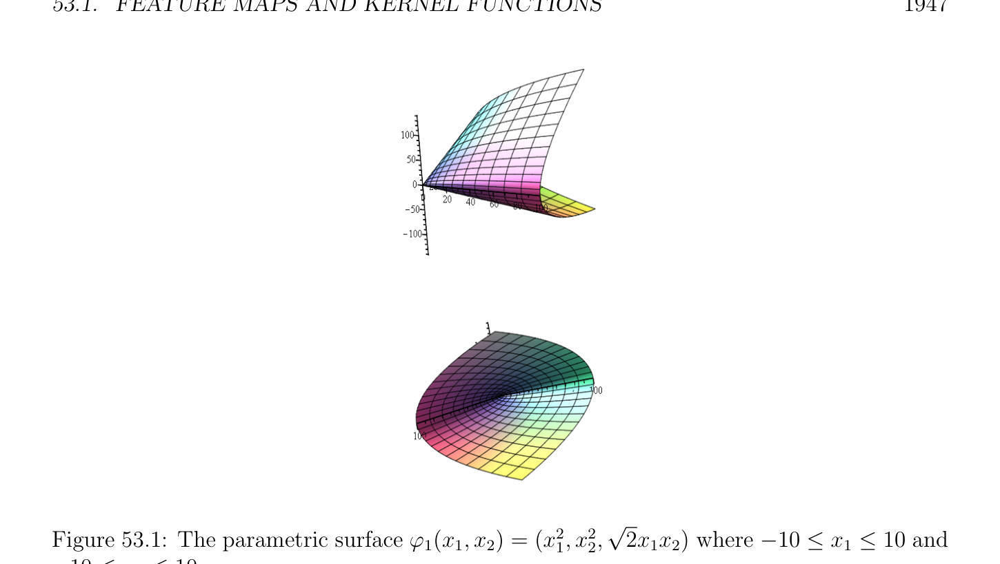

# Feature Maps and Kernel Functions

<!-- PAGE 1945 -->
Chapter $53$ Positive Definite Kernels This chapter is an introduction to positive definite kernels and the use of kernel functions in machine learning. Let $X$ be a nonempty set. If the set $X$ represents a set of highly nonlinear data, it may be advantageous to map $X$ into a space $F$ of much higher dimension called the feature space, using a function $\phi$ : $X \to F$ called a feature map. This idea is that $\phi$  “unwinds” the description of the objects in $F$ in an attempt to make it linear. The space $F$ is usually a vector space equipped with an inner product $\langle$ -, $-\rangle$ . If $F$ is infinite dimensional, then we assume that it is a Hilbert space. Many algorithms that analyze or classify data make use of the inner products $\langle \phi (x), \phi (y)\rangle$ , where $x, y \in X$. These algorithms make use of the function $\kappa$ : $X \times  X \to \mathbb{C}$ given by
$$\kappa (x, y) = \langle \phi (x), \phi (y)\rangle ,x, y \in X,$$
called a kernel function. The kernel trick is to pretend that we have a feature embedding $\phi$ : $X \to F$ (actually unknown), but to only use inner products $\langle \phi (x), \phi (y)\rangle$ that can be evaluated using the original data through the known kernel function $\kappa$ . It turns out that the functions of the form $\kappa$  as above can be defined in terms of a condition which is reminiscent of positive semidefinite matrices (see Definition 53.2). Furthermore, every function satisfying Definition 53.2 arises from a suitable feature map into a Hilbert space; see Theorem 53.8. We illustrate the kernel methods on kernel PCA (see Section 53.4).

## 53.1 Feature Maps and Kernel Functions

> **Definition 53.1.** Let $X$ be a nonempty set, let $H$ be a (complex) Hilbert space, and let $\phi$ : $X \to H$ be a function called a feature map. The function $\kappa$ : $X \times  X \to \mathbb{C}$ given by
$$\kappa (x, y) = \langle \phi (x), \phi (y)\rangle ,x, y \in X,$$
is called a kernel function.
$$1945$$

<!-- PAGE 1946 -->
Remark: $A$ feature map is often called a feature embedding, but this terminology is a bit misleading because it suggests that such a map is injective, which is not necessarily the case. Unfortunately this terminology is used by most people.

> **Example 53.1.** Suppose we have two feature maps $\phi_{1}$  : $X \to \mathbb{R}_{1}^{n}$ and $\phi_{2}$  : $X \to \mathbb{R}_{2}^{n}$, and let $\kappa_{1} (x, y) = \langle \phi_{1} (x), \phi_{1} (y)\rangle$ and $\kappa_{2} (x, y) = \langle \phi_{2} (x), \phi_{2} (y)\rangle$ be the corresponding kernel functions (where $\langle$ -, $-\rangle$ is the standard inner product $on\mathbb{R}^{n})$. Define the feature map $\phi$ : $X \to \mathbb{R}_{12}^{n+n}$ by
$$\phi (x) = (\phi_{1} (x), \phi_{2} (x)),$$
an $(n_{1} + n_{2})-tuple$. We have $\langle \phi (x), \phi (y)\rangle = \langle (\phi_{1} (x), \phi_{2} (x)), (\phi_{1} (y), \phi_{2} (y))\rangle = \langle \phi_{1} (x), \phi_{1} (y)\rangle + \langle \phi_{2} (x), \phi_{2} (y)\rangle$
$$= \kappa_{1} (x, y) + \kappa_{2} (x, y),$$
which shows that the map $\kappa$  given by
$$\kappa (x, y) = \kappa_{1} (x, y) + \kappa_{2} (x, y)$$
is the kernel function corresponding to the feature map $\phi$ : $X \to \mathbb{R}_{12}^{n+n}$.
$$\mathbb{R}^{2}\mathbb{R}^{3}$$

> **Example 53.2.** Let $X$ be a subset of , and let $\phi_{1}$  : $X \to$ be the map given by
$$\sqrt$$
$$\phi_{1} (x_{1}, x_{2}) = (x_{1}^{2}, x_{2}^{2},\overline{2} x_{1}x_{2}).$$
$$\mathbb{R}^{3}$$
Figure 53.1 illustrates $\phi_{1}$  : $X \to$ when $X = {((x_{1}, x_{2})$ | -10 $\le x_{1} \le 10$, -10 $\le x_{2} \le 10}$.
$$\mathbb{R}^{3}$$
Observe that linear relations in the feature space $H =$ correspond to quadratic relations in the input space (of data). We have
$$\sqrt\sqrt$$
$$\langle \phi_{1} (x), \phi_{1} (y)\rangle = \langle (x_{1}^{2}, x_{2}^{2},\overline{2} x_{1}x_{2}), (y_{1}^{2}, y_{2}^{2},\overline{2} y_{1}y_{2})\rangle$$
$$= x_{1}^{2}y_{1}^{2} + x_{2}^{2}y_{2}^{2} + 2x_{1}x_{2}y_{1}y_{2}$$
$$= (x_{1}y_{1} + x_{2}y_{2})^{2}= \langle x, y\rangle^{2} ,$$
where $\langle x, y\rangle$ is the usual inner product on $\mathbb{R}^{2}$. Hence the function
$$\kappa (x, y) = \langle x, y\rangle^{2}$$
is a kernel function associated with the feature space $\mathbb{R}^{3}$.
$$\mathbb{R}^{4}$$
If we now consider the map $\phi_{2}$  : $X \to$ given by
$$\phi_{2} (x_{1}, x_{2}) = (x_{1}^{2}, x_{2}^{2}, x_{1}x_{2}, x_{1}x_{2}),$$
we check immediately that
$$\langle \phi_{2} (x), \phi_{2} (y)\rangle = \kappa (x, y) = \langle x, y\rangle^{2} ,$$
which shows that the same kernel can arise from different maps into different feature spaces.

<!-- PAGE 1947 -->
$$\sqrt$$

**Figure 53.1:** The parametric surface $\phi_{1} (x_{1}, x_{2}) = (x_{1}^{2}, x_{2}^{2}, \overline{2} x_{1}x_{2})$ where -10 $\le x_{1} \le 10$ and -10 $\le x_{2} \le 10$.

> **Example 53.3.** Example 53.2 can be generalized as follows. Suppose we have a feature map
$$\mathbb{R}^{n}$$
$\phi_{1}$  : $X \to$ and let $\kappa_{1} (x, y) = \langle \phi_{1} (x), \phi_{1} (y)\rangle$ be the corresponding kernel function (where
$$\mathbb{R}^{n}\mathbb{R}^{n} \mathbb{R}^{n}$$
$\langle$ -, $-\rangle$ is the standard inner product on ). Define the feature map $\phi$ : $X \to \times$ by its $n^{2}$ components
$$\phi (x)_{(i,j)} = (\phi_{1} (x))_{i}(\phi_{1} (x))_{j},1 \le i, j \le n,$$
$$\mathbb{R}^{n} \mathbb{R}^{n}$$
with the inner product on $\times$ given by
$$\langle u, v\rangle = \sum_{i,j=1}^{n}  u_{(i,j)}v_{(i,j)}.$$
Then we have
$$\langle \phi (x), \phi (y)\rangle = \sum_{i,j=1}^{n}  \phi_{(i,j)} (x)\phi_{(i,j)} (y)$$
$$= \sum_{i,j=1}^{n}  (\phi_{1} (x))_{i}(\phi_{1} (x))_{j}(\phi_{1} (y))_{i}(\phi_{1} (y))_{j}$$
$$= \sum_{i=1}^{n}  (\phi_{1} (x))_{i}(\phi_{1} (y)) \sum_{ij=1}^{n}  (\phi_{1} (x))_{j}(\phi_{1} (y))_{j}$$
$$= (\kappa_{1} (x, y))^{2}.$$

<!-- PAGE 1948 -->
Thus the map $\kappa$  given by $\kappa (x, y) = (\kappa_{1} (x, y))^{2}$ is a kernel map associated with the feature
$$\mathbb{R}^{n} \mathbb{R}^{n}$$
map $\phi$ : $X \to \times$ . The feature map $\phi$  is a direct generalization of the feature map $\phi_{2}$ of Example 53.2. The above argument is immediately adapted to show that if $\phi_{1}$  : $X \to \mathbb{R}_{1}^{n}$ and $\phi_{2}$  : $X \to \mathbb{R}_{2}^{n}$ are two feature maps and if $\kappa_{1} (x, y) = \langle \phi_{1} (x), \phi_{1} (y)\rangle$ and $\kappa_{2} (x, y) = \langle \phi_{2} (x), \phi_{2} (y)\rangle$ are the corresponding kernel functions, then the map defined by
$$\kappa (x, y) = \kappa_{1} (x, y)\kappa_{2} (x, y)$$
$$\mathbb{R}_{1}^{n} \times \mathbb{R}_{2}^{n}$$
is a kernel function for the feature space and the feature map
$$\phi (x)_{(i,j)} = (\phi_{1} (x))_{i}(\phi_{2} (x))_{j},1 \le i \le n_{1}, 1 \le j \le n_{2}.$$
$$\mathbb{R}^{n} \mathbb{R}^{n}$$

> **Example 53.4.** Note that the feature map $\phi$ : $X \to \times$ is not very economical because if i̸ $= j$ then the components $\phi_{(i,j)} (x)$ and $\phi_{(j,i)} (x)$ are both equal to $(\phi_{1} (x))_{i}(\phi_{1} (x))_{j}$.
$$\mathbb{R}(_{2}^{n+1} )$$
Therefore we can define the more economical embedding $\phi'$ : $X \to$ given by
$$($$
$$((x))_{i}^{2}i = j,$$
$$\phi' (x)_{(i,j)} =\sqrt \frac{\phi_{1}}{2(} \phi_{1} (x))_{i}(\phi_{1} (x))_{j}i < j,$$
where the pairs $(i, j)$ with $1 \le i \le j \le n$ are ordered lexicographically. The feature map $\phi$ is a direct generalization of the feature map $\phi_{1}$  of Example 53.2. Observe that $\phi'$ can also be defined in the following way which makes it easier to come up with the generalization to any power:
$$1/2$$
$$\phi_{(i1,...,in)}' (x) = \begin{pmatrix} 2 \\ i_{1} \cdots  i_{n} \end{pmatrix} (\phi_{1} (x))_{1}^{i1} (\phi_{1} (x))_{1}^{i2} \cdots  (\phi_{1} (x))_{1}^{in} ,i_{1} + i_{2} + \cdots  + i_{n} = 2, i_{j} \in \mathbb{N},$$
where the $n$-tuples $(i_{1}, \dots  , i_{n})$ are ordered lexicographically. Recall that for any $m \ge 1$ and
$$\mathbb{N}^{m}$$
any $(i_{1}, \dots  , i_{n}) \in$ such that $i_{1} + i_{2} + \cdots  + i_{n} = m$, we have
$$\begin{pmatrix} m \\ i_{1} \cdots  i_{n} \end{pmatrix} = \frac{m!}{i_{1}! \cdots  i_{n}!} .$$
More generally, for any $m \ge 2$, using the multinomial theorem, we can define a feature
$$\mathbb{R}(_{m}^{n+m-1})$$
embedding $\phi$ : $X \to$ defining the kernel function $\kappa$  given by $\kappa (x, y) = (\kappa_{1} (x, y))^{m}$, with $\phi$  given by
$$1/2$$
$$\phi_{(i1,...,in)} (x) = \begin{pmatrix} m \\ i_{1} \cdots  i_{n} \end{pmatrix} (\phi_{1} (x))_{1}^{i1} (\phi_{1} (x))_{1}^{i2} \cdots  (\phi_{1} (x))_{1}^{in} ,i_{1} + i_{2} + \cdots  + i_{n} = m, i_{j} \in \mathbb{N},$$
where the $n$-tuples $(i_{1}, \dots  , i_{n})$ are ordered lexicographically.

<!-- PAGE 1949 -->

> **Example 53.5.** For any positive real constant $R > 0$, the constant function $\kappa (x, y  R$ is
$$a kernel function corresponding to the feature map \phi : X \to \mathbb{R} given by \phi (x, y) =\sqrt \frac{) =}{R.}$$
$$\mathbb{R}^{n} \mathbb{R}$$
By definition, the function $\kappa_{1}'$  : $\to$  given by $\kappa_{1}' (x, y) = \langle x, y\rangle$ is a kernel function
$$\mathbb{R}^{n}$$
(the feature map is the identity map from to itself). We just saw that for any positive real constant $R > 0$, the constant $\kappa_{2}' (x, y) = R$ is a kernel function. By Example 53.1, the function $\kappa_{3}' (x, y) = \kappa_{1}' (x, y) + \kappa_{2}' (x, y)$ is a kernel function, and for any integer $d \ge 1$, by Example 53.4, the function $\kappa_{d}$  given by
$$\kappa_{d} (x, y) = (\kappa_{3}' (x, y))^{d}= (\langle x, y\rangle + R)^{d},$$
is a kernel function on $\mathbb{R}^{n}$. By the binomial formula,
$$\kappa_{d} (x, y) = \sum_{m=0}^{d}  R^{d-m}\langle x, y\rangle^{m} .$$
By Example 53.1, the feature map of this kernel function is the concatenation of the features of the $d + 1$ kernel maps $R^{d-m}\langle x, y\rangle^{m}$ . By Example 53.3, the components of the feature map of the kernel map $R^{d-m}\langle x, y\rangle^{m}$ are reweightings of the functions
$$\phi_{(i1,...,in)} (x) = x_{1}^{i1} x_{2}^{i2} \cdots  x_{n}^{in} ,i_{1} + i_{2} + \cdots  + i_{n} = m,$$
with $(i_{1}, \dots  , i_{n}) \in \mathbb{N}^{n}$. Thus the components of the feature map of the kernel function $\kappa_{d}$ are reweightings of the functions
$$\phi_{(i1,...,in)} (x) = x_{1}^{i1} x_{2}^{i2} \cdots  x_{n}^{in} ,i_{1} + i_{2} + \cdots  + i_{n} \le d,$$
$$with (i_{1}, \dots  , i_{n}) \in \mathbb{N}^{n}. It is easy to see that the dimension of this feature space \begin{pmatrix} is_{d}^{m+d} \\ embedding \end{pmatrix} .$$
There are a number of variations of the polynomial kernel $\kappa_{d}$ ; all-subsets kernels, ANOVA kernels; see Shawe–Taylor and Christianini $[165]$, Chapter III. In the next example the set $X$ is not a vector space.

> **Example 53.6.** Let $D$ be a finite set and let $X = 2^{D}$ be its power set. If |D| $= n$,
$$\mathbb{R}^{X} \sim  \mathbb{R}^{2n}$$
let $H = =$ . We are assuming that the subsets of $D$ are enumerated in some fashion so that each coordinate of $\mathbb{R}^{2n}$ corresponds to one of these subsets. For example, if $D = {1, 2, 3, 4}$, let $U_{1} = \emptyset U_{2} = {1} U_{3} = {2} U_{4} = {3} U_{5} = {4} U_{6} = {1, 2} U_{7} = {1, 3} U_{8} = {1, 4} U_{9} = {2, 3} U_{10} = {2, 4} U_{11} = {3, 4} U_{12} = {1, 2, 3} U_{13} = {1, 2, 4} U_{14} = {1, 3, 4} U_{15} = {2, 3, 4} U_{16} = {1, 2, 3, 4}$. Let $\phi$ : $X \to H$ be the feature map defined as follows: for any subsets $A, U \in X$,
$$($$
$$1if U \subseteq A$$
$$\phi (A)_{U} =$$
$$0otherwise.$$

<!-- PAGE 1950 -->
For example, if $A_{1} = {1, 2, 3}$, we obtain the vector
$$\phi ({1, 2, 3}) = (1, 1, 1, 1, 0, 1, 1, 0, 1, 0, 0, 1, 0, 0, 0, 0),$$
and if $A_{2} = {2, 3, 4}$, we obtain the vector
$$\phi ({2, 3, 4}) = (1, 0, 1, 1, 1, 0, 0, 0, 1, 1, 1, 0, 0, 0, 1, 0).$$
For any two subsets $A_{1}$ and $A_{2}$ of $D$, it is easy to check that
$$\langle \phi (A_{1}), \phi (A_{2})\rangle = 2^{|A1\cap A2|},$$
the number of common subsets of $A_{1}$ and $A_{2}$. For example, $A_{1} \cap A_{2} = {2, 3}$, and
$$\langle \phi (A_{1}), \phi (A_{2})\rangle = 4.$$
Therefore, the function $\kappa$ : $X \times  X \to \mathbb{R}$ given by
$$\kappa (A_{1}, A_{2}) = 2^{|A1\cap A2|},A_{1}, A_{2} \subseteq D$$
is a kernel function. Kernels on collections of sets can be defined in terms of measures.

> **Example 53.7.** Let $(D,\mathcal{A})$ be a measurable space, where $D$ is a nonempty set and $\mathcal{A}$ is $a \sigma$ -algebra on $D$ (the measurable sets). Let $X$ be a subset of $\mathcal{A}$. If $\mu$  is a positive measure on $(D,\mathcal{A})$ and if $\mu$  is finite, which means that $\mu (D)$ is finite, then we can define the map $\kappa_{1}$  : $X \times  X \to \mathbb{R}$ given by
$$\kappa_{1} (A_{1}, A_{2}) = \mu (A_{1} \cap A_{2}),A_{1}, A_{2} \in X.$$
We can show that $\kappa$  is a kernel function as follows. Let $H = L_{\mu}^{2}(D,\mathcal{A},\mathbb{R})$ be the Hilbert space of $\mu$ -square-integrable functions with the inner product
$$\langle f, g\rangle = \int_{D}  f(s)g(s) d\mu (s),$$
and let $\phi$ : $X \to H$ be the feature embedding given by
$$\phi (A) = \chi_{A} ,A \in X,$$
the characteristic function of $A$. Then we have
$$\kappa_{1} (A_{1}, A_{2}) = \mu (A_{1} \cap A_{2}) = \int_{D}  \chi_{A1\cap A2} (s) d\mu (s)$$
$$= \int_{D}  \chi_{A1} (s)\chi_{A2} (s) d\mu (s) = \langle \chi_{A1} , \chi_{A2} \rangle$$
$$= \langle \phi (A_{1}), \phi (A_{2})\rangle .$$

<!-- PAGE 1951 -->
The above kernel is called the intersection kernel. If we assume that $\mu$  is normalized so that $\mu (D) = 1$, then we also have the union complement kernel:
$$\kappa_{2} (A_{1}, A_{2}) = \mu (\overline{A}_{1} \cap \overline{A}_{2}) = 1 -\mu (A_{1} \cup A_{2}).$$
The sum $\kappa_{3}$  of the kernels $\kappa_{1}$  and $\kappa_{2}$  is the agreement kernel:
$$\kappa_{s} (A_{1}, A_{2}) = 1 -\mu (A_{1} -A_{2}) -\mu (A_{2} -A_{1}).$$
Many other kinds of kernels can be designed, in particular, graph kernels. For comprehensive presentations of kernels, see Sch¨olkopf and Smola $[151]$ and Shawe–Taylor and Christianini $[165]$. Kernel functions have the following important property.

> **Proposition 53.1.** Let $X$ be any nonempty set, let $H$ be any (complex) Hilbert space, let $\phi$ : $X \to H$ be any function, and let $\kappa$ : $X \times  X \to \mathbb{C}$ be the kernel given by
$$\kappa (x, y) = \langle \phi (x), \phi (y)\rangle ,x, y \in X.$$
For any finite subset $S = {x_{1}, \dots  , x_{p}}$ of $X$, if $K_{S}$ is the $p \times  p$ matrix
$$K_{S} = (\kappa (x_{j}, x_{i}))_{1\le i,j\le p} = (\langle \phi (x_{j}), \phi (x_{i})\rangle )_{1\le i,j\le p},$$
then we have
$$u^{*}K_{S} u \ge 0,for all u \in \mathbb{C}^{p}.$$

*Proof.* We have
$$u^{*}K_{S} u = u^{\top}K_{S}^{\top} \overline{u} = \sum_{i,j=1}^{p}  \kappa (x_{i}, x_{j})u_{i}\overline{u}_{j}$$
$$= \sum_{i,j=1}^{p}  \langle \phi (x), \phi (y)\rangle u_{i}\overline{u}_{j}$$
$$*+2$$
$$= \sum_{i=1}^{p}  u_{i}\phi (x_{i}), \sum_{j=1}^{p}  u_{j}\phi (x_{j})= \sum_{i=1}^{p}  u_{i}\phi (x_{i})\ge 0,$$
as claimed.
