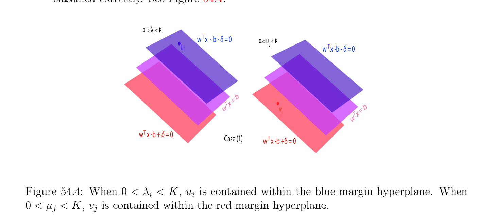
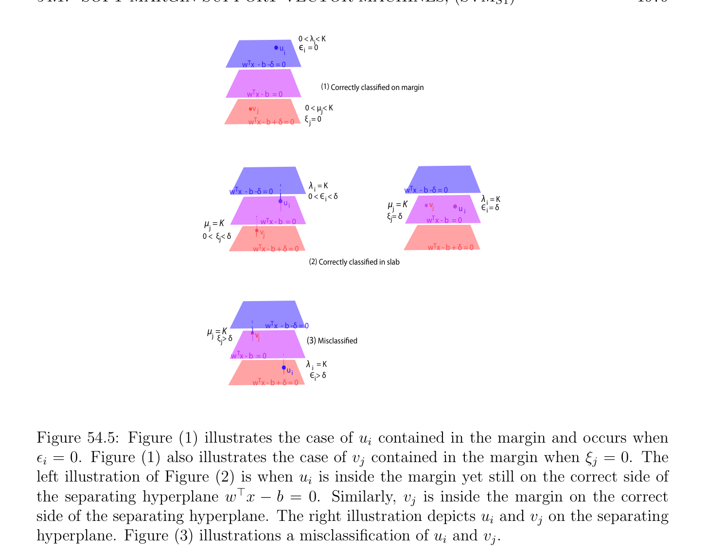
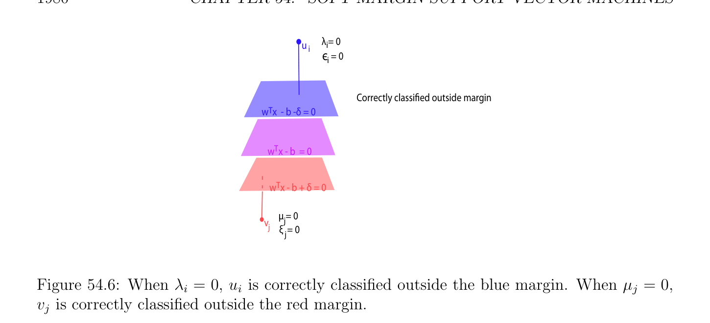

# Soft Margin Support Vector Machines; (SVMs1)

<!-- PAGE 1970 -->
For example, if $p = 2$ and $q = 3$, we have the matrix
$$K = \begin{pmatrix} \kappa (u_{1}, u_{1}) & \kappa (u_{1}, u_{2}) & -\kappa (u_{1}, v_{1}) & -\kappa (u_{1}, v_{2}) & -\kappa (u_{1}, v_{3}) \\ \kappa (u_{2}, u_{1}) & \kappa (u_{2}, u_{2}) & -\kappa (u_{2}, v_{1}) & -\kappa (u_{2}, v_{2}) & -\kappa (u_{2}, v_{3}) \\ -\kappa (v_{1}, u_{1}) & -\kappa (v_{1}, u_{2}) & \kappa (v_{1}, v_{1}) & \kappa (v_{1}, v_{2}) & \kappa (v_{1}, v_{3}) \\ -\kappa (v_{2}, u_{1}) & -\kappa (v_{2}, u_{2}) & \kappa (v_{2}, v_{1}) & \kappa (v_{2}, v_{2}) & \kappa (v_{2}, v_{3}) \\ \kappa (v_{3}, u_{1}) & \kappa (v_{3}, u_{2}) & \kappa (v_{3}, v_{1}) & \kappa (v_{3}, v_{2}) & \kappa (v_{3}, v_{3}) \end{pmatrix} .$$
$$--$$
Then the classification function
$$f(x) = sgn(\langle w, \phi (x)\rangle -b)$$
$$\mathbb{R}^{n}$$
for points in the original data space is also expressed solely in terms of the matrix $K$ and the inner products $\kappa (u_{i}, x) = \langle \phi (u_{i}), \phi (x)\rangle$ and $\kappa (v_{j}, x) = \langle \phi (v_{j}), \phi (x)\rangle$ . As a consequence, in the original data space $\mathbb{R}^{n}$, the hypersurface
$$\mathbb{R}^{n}$$
$$\mathcal{S} = {x \in | \langle w, \phi (x)\rangle -b = 0}$$
separates the data points $u_{i}$ and $v_{j}$, but it is not an affine subspace $of\mathbb{R}^{n}$. The classification function $f$ tells us on which “side” of $\mathcal{S}$ is a new data point $x \in \mathbb{R}^{n}$. Thus, we managed to separate the data points $u_{i}$ and $v_{j}$ that are not separable by an affine hyperplane, by a
$$\mathbb{R}^{n}$$
nonaffine hypersurface $\mathcal{S}$, by assuming that an embdedding $\phi$ : $\to F$ exists, even though
$$\mathbb{R}^{n}\mathbb{R}^{n} \mathbb{R}$$
we don’t know what it is, but having access to $F$ through the kernel function $\kappa$ : $\times \to$ given by the inner products $\kappa (x, y) = \langle \phi (x), \phi (y)\rangle$ . In practice the art of using the kernel method is to choose the right kernel (as the knight says in Indiana Jones, to “choose wisely.”). The method of kernels is very flexible. It also applies to the soft margin versions of SVM, but also to regression problems, to principal component analysis (PCA), and to other problems arising in machine learning. We discussed the method of kernels in Chapter $53$. Other comprehensive presentations of the method of kernels are found in Sch¨olkopf and Smola $[151]$ and Shawe–Taylor and Christianini $[165]$. See also Bishop $[23]$. We first consider the soft margin SVM arising from Problem $(SVM_{h1})$.

## 54.1 Soft Margin Support Vector Machines; (SVM )

$$s1$$
In this section we derive the dual function $G$ associated with the following version of the soft margin SVM coming from Problem $(SVM_{h1})$, where the maximization of the margin $\delta$ has been replaced by the minimization of $-\delta$ , and where we added a “regularizing term”
$$K \begin{pmatrix} p & \epsilon_{i}  + & q & \xi_{j} \\ =1 & j=1 \\ \epsilon and\xi haveas \end{pmatrix} \sum_{ii}  \sum_{j}  whose purpose is to make \epsilon  \in \mathbb{R}^{p} and \xi  \in \mathbb{R}^{q} sparse (that is, try to$$
make      many zeros as possible), where $K > 0$ is a fixed constant that can be

<!-- PAGE 1971 -->
adjusted to determine the influence of this regularizing term. If the primal problem $(SVM_{s1})$ has an optimal solution $(w, \delta , b, \epsilon , \xi$ ), we attempt to use the dual function $G$ to obtain it, but we will see that with this particular formulation of the problem, the constraint $w^{\top}w \le 1$ causes troubles even though it is convex. Soft margin SVM $(SVM_{s1})$:
$$minimize-\delta  + K \begin{pmatrix} \epsilon_{i}  + & \xi_{j} \end{pmatrix} \sum_{i=1}^{p}  \sum_{j=1}^{q}$$
$$subject to$$
$$w^{\top}u_{i} -b \ge \delta  -\epsilon_{i} ,\epsilon_{i}  \ge 0i = 1, \dots  , p$$
$$-w^{\top}v_{j} + b \ge \delta  -\xi_{j} ,\xi_{j}  \ge 0j = 1, \dots  , q$$
$$w^{\top}w \le 1.$$
It is customary to write $\ell = p + q$. Figure 54.2 illustrates the correct margin half space associated with $w^{\top}x$ - $b$ - $\delta  = 0$ while Figure 54.3 illustrates the correct margin half space associated with $w^{\top}x$ - $b + \delta  = 0$. Ideally, all the points should be contained in one of the two correct shifted margin regions described by affine constraints $w^{\top}u_{i}$ - $b \ge \delta$  - $\epsilon_{i}$ , or $-w^{\top}v_{j} + b \ge \delta$  - $\xi_{j}$ .
$$w  xT$$
$$- b$$
$$- \delta$$
$$= 0$$
$$Incorrect side of Blue Margin$$
$$w   x - b - \delta  < 0T$$
$$w  xTT$$
$$- bw   x - b - \delta  > 0$$
$$- \delta$$
$$= 0Correct side of Blue Margin$$
$$w T x$$
$$- b$$
$$= 0$$
$$wseparting hyperplane$$
$$xT - b$$
$$+ \delta$$
$$= 0$$
$$Figure 54.2: The blue margin half space associated with w^{\top}x -b -\delta  = 0.$$
For this problem, the primal problem may have an optimal solution $(w, \delta , b, \epsilon , \xi$ ) with $\|w\| = 1$ and $\delta  > 0$, but if the sets of points are not linearly separable then an optimal solution of the dual may not yield $w$.

<!-- PAGE 1972 -->
$$w T x$$
$$- b$$
$$- \delta  =$$
$$0$$
$$w  x - b$$
$$0 = T$$
$$w   x -b + \delta  < 0T$$
$$Correct side of Red Margin$$
$$Incorrect side of Red Margin$$
$$w Tw   x -b + \delta  > 0T$$
$$x -b + \delta$$
$$= 0$$
$$Figure 54.3: The red margin half space associated with w^{\top}x -b + \delta  = 0.$$
The objective function of our problem is affine and the only nonaffine constraint $w^{\top}w \le 1$ is convex. This constraint is qualified because for any $w \neq  0$ such that $w^{\top}w < 1$ and for any $\delta  > 0$ and any $b$ we can pick $\epsilon$  and $\xi$  large enough so that the constraints are satisfied. Consequently, by Theorem 50.17(2) if the primal problem $(SVM_{s1})$ has an optimal solution, then the dual problem has a solution too, and the duality gap is zero. Unfortunately this does not imply that an optimal solution of the dual yields an optimal solution of the primal because the hypotheses of Theorem 50.17(1) fail to hold. In general, there may not be a unique vector $(w, \epsilon , \xi , b, \delta$ ) such that
$$\inf L(w, \epsilon , \xi , b, \delta , \lambda , \mu , \alpha , \beta , \gamma ) = G(\lambda , \mu , \alpha , \beta , \gamma ).$$
$$w,\epsilon ,\xi ,b,\delta$$
If the sets ${u_{i}}$ and ${v_{j}}$ are not linearly separable, then the dual problem may have a solution for which $\gamma  = 0$,
$$\sum_{i=1}^{p}  \lambda_{i}  = \sum_{j=1}^{q}  \mu_{j}  = \frac{1}{2} ,$$
and
$$\sum_{i=1}^{p}  \lambda_{i} u_{i} = \sum_{j=1}^{q}  \mu_{j} v_{j},$$
so that the dual function $G(\lambda , \mu , \alpha , \beta , \gamma$ ), which is a partial function, is defined and has the value $G(\lambda , \mu , \alpha , \beta , 0) = 0$. Such a pair $(\lambda , \mu$ ) corresponds to the coefficients of two convex

<!-- PAGE 1973 -->
combinations
$$\sum_{i=1}^{p}  2\lambda_{i} u_{i} = \sum_{j=1}^{q}  2\mu_{j} v_{j}$$
which correspond to the same point in the (nonempty) intersection of the convex hulls $conv(u_{1}, \dots  , u_{p})$ and $conv(v_{1}, \dots  , v_{q})$. It turns out that the only connection between $w$ and the dual function is the equation
$$2\gamma w = \sum_{i=1}^{p}  \lambda_{i} u_{i} - \sum_{j=1}^{q}  \mu_{j} v_{j},$$
and when $\gamma  = 0$ this is equation is $0 = 0$, so the dual problem is useless to determine $w$. This point seems to have been missed in the literature (for example, in Shawe–Taylor and Christianini $[165]$, Section 7.2). What the dual problem does show is that $\delta  \ge 0$. However, if $\gamma  \neq  0$, then $w$ is determined by any solution $(\lambda , \mu$ ) of the dual. It still remains to compute $\delta$  and $b$, which can be done under a mild hypothesis that we call the Standard Margin Hypothesis. Let $\lambda  \in \mathbb{R}_{+}^{p}$ be the Lagrange multipliers associated with the inequalities $w^{\top}u_{i}-b \ge \delta -\epsilon_{i}$ , let $\mu  \in \mathbb{R}_{+}^{q}$ be the Lagrange multipliers are associated with the inequalities $-w^{\top}v_{j}+b \ge \delta -\xi_{j}$ , let $\alpha  \in \mathbb{R}_{+}^{p}$ be the Lagrange multipliers associated with the inequalities $\epsilon_{i}  \ge 0, \beta  \in \mathbb{R}_{+}^{q}$ be
$$\mathbb{R}^{+}$$
the Lagrange multipliers associated with the inequalities $\xi_{j}  \ge 0$, and let $\gamma  \in$ be the Lagrange multiplier associated with the inequality $w^{\top}w \le 1$. The linear constraints are given by the 2(p $+ q) \times  (n + p + q + 2)$ matrix given in block form by
$$C = \begin{pmatrix} - & 1_{p} \\ X^{\top} & I_{p+q} & -1_{q} & 1_{p+q} \\ 0_{p+q,n} & I_{p+q} & 0_{p+q} & 0_{p+q} \end{pmatrix} ,$$
$$-$$
where $X$ is the $n \times  (p + q)$ matrix
$$X = \begin{pmatrix} -u_{1} & \cdots & -u_{p} & v_{1} & \cdots & v_{q} \end{pmatrix} ,$$
and the linear constraints are expressed by
$$\begin{pmatrix} - & 1_{p} \\ X^{\top} & I_{p+q} & -1_{q} & 1_{p+q} \\ 0_{p+q,n} & I_{p+q} & 0_{p+q} & 0_{p+q} \end{pmatrix} \begin{pmatrix} w \\ \epsilon \\ \xi \\ b \\ \delta \end{pmatrix} \le \begin{pmatrix} 0_{p+q} \\ 0_{p+q} \end{pmatrix} .$$
$$-$$

<!-- PAGE 1974 -->
More explicitly, $C$ is the following matrix:
$$C = \begin{pmatrix} -u_{1}^{\top} & -1 & \cdots & 0 & 0 & \cdots & 0 & 1 & 1 \\ \vdots & \vdots & \ddots & \vdots & \vdots & \ddots & \vdots & \vdots & \vdots \\ -u_{p}^{\top} & 0 & \cdots & -1 & 0 & \cdots & 0 & 1 & 1 \\ v_{1}^{\top} & 0 & \cdots & 0 & -1 & \cdots & 0 & -1 & 1 \\ \vdots & \vdots & \ddots & \vdots & \vdots & \ddots & \vdots & \vdots & \vdots \\ v_{q}^{\top} & 0 & \cdots & 0 & 0 & \cdots & -1 & -1 & 1 \\ 0 & -1 & \cdots & 0 & 0 & \cdots & 0 & 0 & 0 \\ \vdots & \vdots & \ddots & \vdots & \vdots & \ddots & \vdots & \vdots & \vdots \\ 0 & 0 & \cdots & -1 & 0 & \cdots & 0 & 0 & 0 \\ 0 & 0 & \cdots & 0 & -1 & \cdots & 0 & 0 & 0 \\ \vdots & \vdots & \ddots & \vdots & \vdots & \ddots & \vdots & \vdots & \vdots \\ 0 & 0 & 0 & 0 & 1 & 0 & 0 \end{pmatrix} .$$
$$\cdots \cdots -$$
The objective function is given by
$$J(w, \epsilon , \xi , b, \delta ) = -\delta  + K \begin{pmatrix} \epsilon^{\top} & \xi^{\top} \\ \mathbb{R}_{+}^{p}, \end{pmatrix} 1_{p+q}.$$
$$\mathbb{R}_{+}^{q}\mathbb{R}^{+}$$
The Lagrangian L(w, $\epsilon , \xi , b, \delta , \lambda , \mu , \alpha , \beta , \gamma$ ) with $\lambda , \alpha  \in  \mu , \beta  \in$ , and $\gamma  \in$ is given by
$$L(w, \epsilon , \xi , b, \delta , \lambda , \mu , \alpha , \beta , \gamma ) = -\delta  + K \begin{pmatrix} \epsilon^{\top} & \xi^{\top} \end{pmatrix} 1_{p+q}$$
$$+ \begin{pmatrix} w^{\top} & \epsilon^{\top} & \xi^{\top} \end{pmatrix} \begin{pmatrix} b & \delta \end{pmatrix} C^{\top} \begin{pmatrix} \lambda \\ \mu \\ \alpha \\ \beta \end{pmatrix} + \gamma (w^{\top}w -1).$$
Since
$$\begin{pmatrix} w^{\top} & \epsilon^{\top} & \xi^{\top} \end{pmatrix} \begin{pmatrix} b & \delta \end{pmatrix} C^{\top} \begin{pmatrix} \lambda \\ \mu \\ \alpha \\ \beta \end{pmatrix} = w^{\top}X \begin{pmatrix} \lambda \\ \mu \end{pmatrix} -\epsilon^{\top} (\lambda  + \alpha ) -\xi^{\top} (\mu  + \beta ) + b(1_{p}^{\top} \lambda  -1_{q}^{\top} \mu )$$
$$+ \delta (1_{p}^{\top} \lambda  + 1_{q}^{\top} \mu ),$$
the Lagrangian can be written as
$$L(w, \epsilon , \xi , b, \delta , \lambda , \mu , \alpha , \beta , \gamma ) = -\delta  + K(\epsilon^{\top} 1_{p} + \xi^{\top} 1_{q}) + w^{\top}X \begin{pmatrix} \lambda \\ \mu \end{pmatrix} + \gamma (w^{\top}w -1)$$
$$-\epsilon^{\top} (\lambda  + \alpha ) -\xi^{\top} (\mu  + \beta ) + b(1_{p}^{\top} \lambda  -1_{q}^{\top} \mu ) + \delta (1_{p}^{\top} \lambda  + 1_{q}^{\top} \mu )$$
$$= (1_{p}^{\top} \lambda  + 1_{q}^{\top} \mu  -1)\delta  + w^{\top}X \begin{pmatrix} \lambda \\ \mu \end{pmatrix} + \gamma (w^{\top}w -1)$$
$$+ \epsilon^{\top} (K1_{p} -(\lambda  + \alpha )) + \xi^{\top} (K1_{q} -(\mu  + \beta )) + b(1_{p}^{\top} \lambda  -1_{q}^{\top} \mu ).$$

<!-- PAGE 1975 -->
To find the dual function $G(\lambda , \mu , \alpha , \beta , \gamma$ ) we minimize L(w, $\epsilon , \xi , b, \delta , \lambda , \mu , \alpha , \beta , \gamma$ ) with
$$\mathbb{R}^{n} \mathbb{R}^{p} \mathbb{R}^{q}$$
respect to $w, \epsilon , \xi , b$, and $\delta$ . Since the Lagrangian is convex and $(w, \epsilon , \xi , b, \delta$ ) $\in \times \times \times \mathbb{R} \times \mathbb{R}$, a convex open set, by Theorem 40.13, the Lagrangian has a minimum in $(w, \epsilon , \xi , b, \delta$ ) iff $\nabla L_{w,\epsilon ,\xi ,b,\delta} = 0$, so we compute the gradient with respect to $w, \epsilon , \xi , b, \delta$ , and we get
$$\begin{pmatrix}\end{pmatrix}$$
$$\nabla L_{w,\epsilon ,\xi ,b,\delta} = \begin{pmatrix} \lambda  \\ X & \mu & + 2\gamma w \\ K1_{p} -(\lambda  + \alpha ) \\ K1_{q} -(\mu  + \beta ) \\ 1_{p}^{\top}\lambda  -1_{q}^{\top}\mu \\ 1_{p}^{\top}\lambda  + 1_{q}^{\top}\mu & 1 \end{pmatrix} .$$
$$-$$
By setting $\nabla L_{w,\epsilon ,\xi ,b,\delta} = 0$ we get the equations
$$2\gamma w = -X \begin{pmatrix} \lambda \\ \mu \end{pmatrix}$$
$$\lambda  + \alpha  = K1_{p}(*_{w})$$
$$\mu  + \beta  = K1_{q}$$
$$1_{p}^{\top} \lambda  = 1_{q}^{\top} \mu$$
$$1_{p}^{\top} \lambda  + 1_{q}^{\top} \mu  = 1.$$
The second and third equations are equivalent to the inequalities
$$0 \le \lambda_{i} , \mu_{j}  \le K,i = 1, \dots  , p, j = 1, \dots  , q,$$
often called box constraints, and the fourth and fifth equations yield
$$1_{p}^{\top} \lambda  = 1_{q}^{\top} \mu  = \frac{1}{2} .$$
First let us consider the singular case $\gamma  = 0$. In this case, $(*_{w})$ implies that
$$X \begin{pmatrix} \lambda \\ \mu \end{pmatrix} = 0,$$
and the term $\gamma (w^{\top}w$ - $1)$ is missing from the Lagrangian, which in view of the other four equations above reduces to
$$L(w, \epsilon , \xi , b, \delta , \lambda , \mu , \alpha , \beta , 0) = w^{\top}X \begin{pmatrix} \lambda \\ \mu \end{pmatrix} = 0.$$
In summary, we proved that if $\gamma  = 0$, then
$$pq$$
$$ \sum_{i}  =1 \lambda_{i}  = \sum  j=1 \mu_{j}  =_{2}^{1}$$
$$0if0 \le \lambda_{i}  \le K, i = 1, \dots  , p$$
$$$$
$$$$
$$$$
$$$$
$$G(\lambda , \mu , \alpha , \beta , 0) =0 \le \mu_{j}  \le K, j = 1, \dots  , q$$
$$$$
$$-\infty otherwise$$
$$$$
$$$$
$$$$
$$pq$$
$$and \sum_{i}  =1 \lambda_{i} u_{i} - \sum_{j}  =1 \mu_{j} v_{j} = 0.$$

<!-- PAGE 1976 -->
Geometrically, $(\lambda , \mu$ ) corresponds to the coefficients of two convex combinations
$$\sum_{i=1}^{p}  2\lambda_{i} u_{i} = \sum_{j=1}^{q}  2\mu_{j} v_{j}$$
which correspond to the same point in the intersection of the convex hulls $conv(u_{1}, \dots  , u_{p})$ and $conv(v_{1}, \dots  , v_{q})$ iff the sets ${u_{i}}$ and ${v_{j}}$ are not linearly separable. If the sets ${u_{i}}$ and ${v_{j}}$ are linearly separable, then the convex hulls $conv(u_{1}, \dots  , u_{p})$ and $conv(v_{1}, \dots  , v_{q})$ are disjoint, which implies that $\gamma  > 0$. Let us now assume that $\gamma  > 0$. Plugging back $w$ from equation $(*_{w})$ into the Lagrangian, after simplifications we get
$$G(\lambda , \mu , \alpha , \beta , \gamma ) = - \frac{1}{2\gamma} \begin{pmatrix} \lambda^{\top} & \mu^{\top} \end{pmatrix} X^{\top}X \begin{pmatrix} \lambda \\ \mu \end{pmatrix} + \frac{\gamma}{4\gamma^{2}} \begin{pmatrix} \lambda^{\top} & \mu^{\top} \end{pmatrix} X^{\top}X \begin{pmatrix} \lambda \\ \mu \end{pmatrix} -\gamma$$
$$= - \frac{1}{4\gamma} \begin{pmatrix} \lambda^{\top} & \mu^{\top} \end{pmatrix} X^{\top}X \begin{pmatrix} \lambda \\ \mu \end{pmatrix} -\gamma ,$$
so if $\gamma  > 0$ the dual function is independent of $\alpha , \beta$  and is given by
$$\lambda ! \sum_{i}  p=1 \lambda_{i}  = \sum  qj=1 \mu_{j}  =_{2}^{1}$$
$$$$
$$-_{4\gamma}^{1}X^{\top}X-\gamma if0 \le \lambda_{i}  \le K, i = 1, \dots  , p$$
$$G(\lambda , \mu , \alpha , \beta , \gamma ) = \begin{pmatrix} \lambda^{\top} & \mu^{\top} \end{pmatrix} \mu $$
$$0 \le \mu_{j}  \le K, j = 1, \dots  , q$$
$$$$
$$$$
$$-\infty otherwise.$$
$$$$
Since $X^{\top}X$ is symmetric positive semidefinite and $\gamma  \ge 0$, obviously
$$G(\lambda , \mu , \alpha , \beta , \gamma ) \le 0$$
for all $\gamma  > 0$. The dual program is given by
$$maximize- \frac{1}{4\gamma} \begin{pmatrix} \lambda^{\top} & \mu^{\top} \end{pmatrix} X^{\top}X \begin{pmatrix} \lambda \\ \mu \end{pmatrix} -\gamma if \gamma  > 0$$
$$0if\gamma  = 0$$
$$subject to$$
$$\sum_{i=1}^{p}  \lambda_{i}  - \sum_{j=1}^{q}  \mu_{j}  = 0$$
$$\sum_{i=1}^{p}  \lambda_{i}  + \sum_{j=1}^{q}  \mu_{j}  = 1$$
$$0 \le \lambda_{i}  \le K,i = 1, \dots  , p$$
$$0 \le \mu_{j}  \le K,j = 1, \dots  , q.$$

<!-- PAGE 1977 -->
$$Also, if \gamma  = 0, then X \begin{pmatrix} \lambda \\ \mu \end{pmatrix} = 0.$$
Maximizing with respect to $\gamma  > 0$ by $setting_{\partial \gamma}^{\partial}G(\lambda , \mu , \alpha , \beta , \gamma$ ) $= 0$ yields
$$\gamma^{2} = \frac{1}{4} \begin{pmatrix} \lambda^{\top} & \mu^{\top} \end{pmatrix} X^{\top}X \begin{pmatrix} \lambda \\ \mu \end{pmatrix} ,$$
so we obtain
$$1/2$$
$$G(\lambda , \mu ) = - \begin{pmatrix}  & \lambda \\ \lambda^{\top} & \mu^{\top} X^{\top}X & \mu \end{pmatrix} \begin{pmatrix}\end{pmatrix} \begin{pmatrix}\end{pmatrix} .$$
$$Finally, since G(\lambda , \mu ) = 0 and X \begin{pmatrix} \lambda \\ \mu \end{pmatrix} = 0 if \gamma  = 0, the dual program is equivalent to$$
the following minimization program: Dual of Soft margin SVM $(SVM_{s1})$:
$$minimize \begin{pmatrix} \lambda^{\top} & \mu^{\top} \end{pmatrix} X^{\top}X \begin{pmatrix} \lambda \\ \mu \end{pmatrix}$$
$$subject to$$
$$\sum_{i=1}^{p}  \lambda_{i}  - \sum_{j=1}^{q}  \mu_{j}  = 0$$
$$\sum_{i=1}^{p}  \lambda_{i}  + \sum_{j=1}^{q}  \mu_{j}  = 1$$
$$0 \le \lambda_{i}  \le K,i = 1, \dots  , p$$
$$0 \le \mu_{j}  \le K,j = 1, \dots  , q.$$
Observe that the constraints imply that $K$ must be chosen so that
$$ $$
$$K \ge \max \frac{1}{2p} , \frac{1}{2q} .$$
If $(w, \delta , b, \epsilon , \xi$ ) is an optimal solution of Problem $(SVM_{s1})$, then the complementary slackness conditions yield a classification of the points $u_{i}$ and $v_{j}$ in terms of the values of $\lambda$  and $\mu$ . Indeed, we have $\epsilon_{i} \alpha_{i}  = 0$ for $i = 1, \dots  , p$ and $\xi_{j} \beta_{j}  = 0$ for $j = 1, \dots  , q$. Also, if $\lambda_{i}  > 0$, then corresponding constraint is active, and similarly if $\mu_{j}  > 0$. Since $\lambda_{i}  +\alpha_{i}  = K$, it follows that $\epsilon_{i} \alpha_{i}  = 0$ iff $\epsilon_{i} (K$ - $\lambda_{i}$ ) $= 0$, and since $\mu_{j}  + \beta_{j}  = K$, we have $\xi_{j} \beta_{j}  = 0$ iff $\xi_{j} (K$ - $\mu_{j}$ ) $= 0$. Thus if $\epsilon_{i}  > 0$, then $\lambda_{i}  = K$, and if $\xi_{j}  > 0$, then $\mu_{j}  = K$. Consequently, if $\lambda_{i}  < K$, then $\epsilon_{i}  = 0$ and $u_{i}$ is correctly classified, and similarly if $\mu_{j}  < K$, then $\xi_{j}  = 0$ and $v_{j}$ is correctly classified. We have the following classification:

<!-- PAGE 1978 -->
$(1)$ If $0 < \lambda_{i}  < K$, then $\epsilon_{i}  = 0$ and the $i$-th inequality is active, so
$$w^{\top}u_{i} -b -\delta  = 0.$$
This means that $u_{i}$ is on the blue margin (the hyperplane $H_{w,b+\delta}$ of equation $w^{\top}x = b + \delta$ ) and is classified correctly. Similarly, if $0 < \mu_{j}  < K$, then $\xi_{j}  = 0$ and
$$w^{\top}v_{j} -b + \delta  = 0,$$
so $v_{j}$ is on the red margin (the hyperplane $H_{w,b-\delta}$ of equation $w^{\top}x = b$ - $\delta$ ) and is classified correctly. See Figure 54.4.
$$0 <      < K\lambda i$$
$$w   x  - b - T\delta  = 0\mu$$
$$0 <      < Kj$$
$$uw   x -b - T\delta  = 0$$
$$i$$
$$b$$
$$=$$
$$T  xb$$
$$wv=$$
$$x$$
$$jwT$$
$$w   x -b + T\delta  = 0$$
$$Case (1)w   x -b +\delta T = 0$$

**Figure 54.4:** When $0 < \lambda_{i}  < K, u_{i}$ is contained within the blue margin hyperplane. When $0 < \mu_{j}  < K, v_{j}$ is contained within the red margin hyperplane.
$(2)$ If $\lambda_{i}  = K$, then the $i$-th inequality is active, so
$$w^{\top}u_{i} -b -\delta  = -\epsilon_{i} .$$
If $\epsilon_{i}  = 0$, then the point $u_{i}$ is on the blue margin. If $\epsilon_{i}  > 0$, then $u_{i}$ is within the open half space bounded by the blue margin hyperplane $H_{w,b+\delta}$ and containing the separating hyperplane $H_{w,b}$; if $\epsilon_{i}  \le \delta$ , then $u_{i}$ is classified correctly, and if $\epsilon_{i}  > \delta$ , then $u_{i}$ is misclassified $(u_{i}$ lies on the wrong side of the separating hyperplane, the red side). See Figure 54.5. Similarly, if $\mu_{j}  = K$, then
$$w^{\top}v_{j} -b + \delta  = \xi_{j} .$$
If $\xi_{j}  = 0$, then the point $v_{j}$ is on the red margin. If $\xi_{j}  > 0$, then $v_{j}$ is within the open half space bounded by the red margin hyperplane $H_{w,b-\delta}$ and containing the separating hyperplane $H_{w,b}$; if $\xi_{j}  \le \delta$ , then $v_{j}$ is classified correctly, and if $\xi_{j}  > \delta$ , then $v_{j}$ is misclassified $(v_{j}$ lies on the wrong side of the separating hyperplane, the blue side). See Figure 54.5.

<!-- PAGE 1979 -->
$$0 < \lambda  < Ki$$
$$uє = 0$$
$$ii$$
$$w  x  - b -\delta  = 0T$$
$$(1)Correctly classified on margin$$
$$w  x - b  = 0T$$
$$vj0 < \mu  < Kj$$
$$w  x - b + \delta  = 0T\xi   = 0j$$
$$\lambda  i = KT$$
$$w  x  - b -\delta  = 0Tw  x  - b -\delta  = 0$$
$$0 < Є  < \delta i\lambda  i = K$$
$$ui\mu   = Kvv$$
$$jju iЄ  = \delta i$$
$$\xi  = \delta jw  x - b  = 0T$$
$$\mu   = Kw  x - b  = 0T$$
$$jv$$
$$0 <  \xi  < \delta jj$$
$$w  x - b + \delta  = 0Tw  x - b + \delta  = 0T$$
$$(2)Correctly classified in slab$$
$$w  x  - b -\delta  = 0T$$
$$\mu   = Kvv$$
$$j\xi  > \delta j(3)Misclassified$$
$$j$$
$$w  x - b  = 0T$$
$$\lambda  i = K$$
$$ui$$
$$Є > \delta i$$
$$w  x - b + \delta  = 0T$$

**Figure 54.5:** Figure $(1)$ illustrates the case of $u_{i}$ contained in the margin and occurs when $\epsilon_{i}  = 0$. Figure $(1)$ also illustrates the case of $v_{j}$ contained in the margin when $\xi_{j}  = 0$. The left illustration of Figure $(2)$ is when $u_{i}$ is inside the margin yet still on the correct side of the separating hyperplane $w^{\top}x$ - $b = 0$. Similarly, $v_{j}$ is inside the margin on the correct side of the separating hyperplane. The right illustration depicts $u_{i}$ and $v_{j}$ on the separating hyperplane. Figure $(3)$ illustrations a misclassification of $u_{i}$ and $v_{j}$.
$(3)$ If $\lambda_{i}  = 0$, then $\epsilon_{i}  = 0$ and the $i$-th inequality may or may not be active, so
$$w^{\top}u_{i} -b -\delta  \ge 0.$$
Thus $u_{i}$ is in the closed half space on the blue side bounded by the blue margin hyperplane $H_{w,b+\delta}$ (of course, classified correctly). Similarly, if $\mu_{j}  = 0$, then
$$w^{\top}v_{j} -b + \delta  \le 0$$
and $v_{j}$ is in the closed half space on the red side bounded by the red margin hyperplane $H_{w,b-\delta}$ (of course, classified correctly). See Figure 54.6.

> **Definition 54.1.** The vectors $u_{i}$ on the blue margin $H_{w,b+\delta}$ and the vectors $v_{j}$ on the red margin $H_{w,b-\delta}$ are called support vectors. Support vectors correspond to vectors $u_{i}$ for which $w^{\top}u_{i}$ - $b$ - $\delta  = 0$ (which implies $\epsilon_{i}  = 0)$, and vectors $v_{j}$ for which $w^{\top}v_{j}$ - $b + \delta  = 0$ (which

<!-- PAGE 1980 -->
$$u \lambda  = 0$$
$$ii$$
$$є = 0$$
$$i$$
$$Correctly classified outside margin$$
$$w  x  - b -\delta  = 0T$$
$$w  x - b  = 0T$$
$$w  x - b + \delta  = 0T$$
$$\mu  = 0$$
$$vj$$
$$j\xi   = 0$$
$$j$$

**Figure 54.6:** When $\lambda_{i}  = 0, u_{i}$ is correctly classified outside the blue margin. When $\mu_{j}  = 0, v_{j}$ is correctly classified outside the red margin. implies $\xi_{j}  = 0)$. Support vectors $u_{i}$ such that $0 < \lambda_{i}  < K$ and support vectors $v_{j}$ such that $0 < \mu_{j}  < K$ are support vectors of type $1$. Support vectors of type $1$ play a special role so we denote the sets of indices associated with them by
$$I_{\lambda} = {i \in {1, \dots  , p} | 0 < \lambda_{i}  < K}$$
$$I_{\mu} = {j \in {1, \dots  , q} | 0 < \mu_{j}  < K}.$$
We denote their cardinalities by $numsvl_{1} = |I_{\lambda}|$ and $numsvm_{1} = |I_{\mu}|$. Support vectors $u_{i}$ such that $\lambda_{i}  = K$ and support vectors $v_{j}$ such that $\mu_{j}  = K$ are support vectors of type $2$. Those support vectors $u_{i}$ such that $\lambda_{i}  = 0$ and those support vectors $v_{j}$ such that $\mu_{j}  = 0$ are called exceptional support vectors. The vectors $u_{i}$ for which $\lambda_{i}  = K$ and the vectors $v_{j}$ for which $\mu_{j}  = K$ are said to fail the margin. The sets of indices associated with the vectors failing the margin are denoted by
$$K_{\lambda} = {i \in {1, \dots  , p} | \lambda_{i}  = K}$$
$$K_{\mu} = {j \in {1, \dots  , q} | \mu_{j}  = K}.$$
We denote their cardinalities by $p_{f} = |K_{\lambda}|$ and $q_{f} = |K_{\mu}|$. Vectors $u_{i}$ such that $\lambda_{i}  > 0$ and vectors $v_{j}$ such that $\mu_{j}  > 0$ are said to have margin at most $\delta$ . The sets of indices associated with these vectors are denoted by
$$I_{\lambda >0} = {i \in {1, \dots  , p} | \lambda_{i}  > 0}$$
$$I_{\mu >0} = {j \in {1, \dots  , q} | \mu_{j}  > 0}.$$
We denote their cardinalities by $p_{m} = |I_{\lambda >0}|$ and $q_{m} = |I_{\mu >0}|$.

<!-- PAGE 1981 -->
Obviously, $I_{\lambda >0} = I_{\lambda} \cup K_{\lambda}$ and $I_{\mu >0} = I_{\mu} \cup K_{\mu}$, so $p_{f} \le p_{m}$ and $q_{f} \le q_{m}$. Intuitively a blue point that fails the margin is on the wrong side of the blue margin and a red point that fails the margin is on the wrong side of the red margin. The points in $I_{\lambda >0}$ not in $K_{\lambda}$ are on the blue margin and the points in $I_{\mu >0}$ not in $K_{\mu}$ are on the red margin. There are $p$ - $p_{m}$ points $u_{i}$ classified correctly on the blue side and outside the $\delta$ -slab and there are $q$ - $q_{m}$ points $v_{j}$ classified correctly on the red side and outside the $\delta$ -slab. It is easy to show that we have the following bounds on $K$:
$$ $$
$$\max \frac{1}{2p_{m}} , \frac{1}{2q_{m}} \le K \le \min \frac{1}{2p_{f}} , \frac{1}{2q_{f}} .$$
These inequalities restrict the choice of $K$ quite heavily. It will also be useful to understand how points are classified in terms of $\epsilon_{i}$  (or $\xi_{j}$ ).
$(1)$ If $\epsilon_{i}  > 0$, then by complementary slackness $\lambda_{i}  = K$, so the ith equation is active and by $(2)$ above,
$$w^{\top}u_{i} -b -\delta  = -\epsilon_{i} .$$
Since $\epsilon_{i}  > 0$, the point $u_{i}$ is within the open half space bounded by the blue margin hyperplane $H_{w,b+\delta}$ and containing the separating hyperplane $H_{w,b}$; if $\epsilon_{i}  \le \delta$ , then $u_{i}$ is classified correctly, and if $\epsilon_{i}  > \delta$ , then $u_{i}$ is misclassified. Similarly, if $\xi_{j}  > 0$, then $v_{j}$ is within the open half space bounded by the red margin hyperplane $H_{w,b-\delta}$ and containing the separating hyperplane $H_{w,b}$; if $\xi_{j}  \le \delta$ , then $v_{j}$ is classified correctly, and if $\xi_{j}  > \delta$ , then $v_{j}$ is misclassified.
$(2)$ If $\epsilon_{i}  = 0$, then the point $u_{i}$ is correctly classified. If $\lambda_{i}  = 0$, then by $(3)$ above, $u_{i}$ is in the closed half space on the blue side bounded by the blue margin hyperplane $H_{w,b+\delta}$. If $\lambda_{i}  > 0$, then by $(1)$ and $(2)$ above, the point $u_{i}$ is on the blue margin. Similarly, if $\xi_{j}  = 0$, then the point $v_{j}$ is correctly classified. If $\mu_{j}  = 0$, then $v_{j}$ is in the closed half space on the red side bounded by the red margin hyperplane $H_{w,b-\delta}$, and if $\mu_{j}  > 0$, then the point $v_{j}$ is on the red margin. It shown in Section 54.2 how the dual program is solved using ADMM from Section 52.6. If the primal problem is solvable, this yields solutions for $\lambda$  and $\mu$ .
$$If the optimal value is 0, then \gamma  = 0 and X \begin{pmatrix} \lambda \\ \mu \\ > \end{pmatrix} = 0, so in this case it is not possible$$
to determine $w$. However, if the optimal value is  $0$, then once a solution for $\lambda$  and $\mu$  is obtained, by $(*_{w})$, we have
$$\gamma  = \frac{1}{2} 1/2$$
$$\begin{pmatrix}  & \lambda \\ \lambda^{\top} & \mu^{\top} X^{\top}X & \mu \\  \end{pmatrix} \begin{pmatrix}\end{pmatrix} \begin{pmatrix}\end{pmatrix}$$
$$w = \frac{1}{2\gamma} \begin{pmatrix} \lambda_{i} u_{i} - & \mu_{j} v_{j} \end{pmatrix} \sum_{i=1}^{p}  \sum_{j=1}^{q}  ,$$

<!-- PAGE 1982 -->
so we get
$$\sum_{i=1}^{p}  \lambda_{i} u_{i} - \sum_{j=1}^{q}  \mu_{j} v_{j}$$
$$w =,$$
$$\overline{1}\overline{/}\overline{2}$$
$$\begin{pmatrix} \overline{} & \overline{}\lambda \\ \lambda^{\top} & \mu^{\top} X^{\top}X & \mu \\ \lambda_{i} u_{i} & q & \mu_{j} v_{j}a \end{pmatrix} \begin{pmatrix}\end{pmatrix} \begin{pmatrix}\end{pmatrix}$$
$$which is the result of making \sum_{i}  p=1  - \sum_{j}  =1   unit vector, since$$
$$X = \begin{pmatrix} -u_{1} & \cdots & -u_{p} & v_{1} & \cdots & v_{q} \end{pmatrix} .$$
It remains to find $b$ and $\delta$ , which are not given by the dual program and for this we use the complementary slackness conditions. The equations
$$\sum_{i=1}^{p}  \lambda_{i}  = \sum_{j=1}^{q}  \mu_{j}  = \frac{1}{2}$$
imply that there is some $i_{0}$ such that $\lambda_{i0}  > 0$ and some $j_{0}$ such that $\mu_{j0}  > 0$, but a priori, nothing prevents the situation where $\lambda_{i}  = K$ for all nonzero $\lambda_{i}$  or $\mu_{j}  = K$ for all nonzero $\mu_{j}$ . If this happens, we can rerun the optimization method with a larger value of $K$. If the following mild hypothesis holds, then $b$ and $\delta$  can be found. Standard Margin Hypothesis for $(SVM_{s1})$. There is some index $i_{0}$ such that $0 < \lambda_{i0}  < K$ and there is some index $j_{0}$ such that $0 < \mu_{j0}  < K$. This means that some $u_{i0}$ is a support vector of type $1$ on the blue margin, and some $v_{j0}$ is a support of type $1$ on the red margin. If the Standard Margin Hypothesis for $(SVM_{s1})$ holds, then $\epsilon_{i0}  = 0$ and $\mu_{j0}  = 0$, and then we have the active equations
$$w^{\top}u_{i0} -b = \delta and-w^{\top}v_{j0} + b = \delta ,$$
and we obtain the values of $b$ and $\delta$  as
$$b = \frac{1}{2} (w^{\top}u_{i0} + w^{\top}v_{j0})$$
$$\delta  = \frac{1}{2} (w^{\top}u_{i0} -w^{\top}v_{j0}).$$
Due to numerical instability, when writing a computer program it is preferable to compute the lists of indices $I_{\lambda}$ and $I_{\mu}$ given by
$$I_{\lambda} = {i \in {1, \dots  , p} | 0 < \lambda_{i}  < K}$$
$$I_{\mu} = {j \in {1, \dots  , q} | 0 < \mu_{j}  < K}.$$

<!-- PAGE 1983 -->
Then it is easy to see that we can compute $b$ and $\delta$  using the following averaging formulae:
$$ \sum_{\in I\lambda}  \sum_{\in I\mu}  $$
$$b = w^{\top}/|I_{\lambda}| +/|I_{\mu}|/2$$
$$ \begin{pmatrix} u_{i} \\ i \end{pmatrix} \begin{pmatrix} v_{j} \\ j \end{pmatrix} $$
$$ \sum_{i\in I\lambda}  \sum_{j\in I\mu}  $$
$$\delta  = w^{\top}/|I_{\lambda}| -/|I_{\mu}|/2.$$
$$ \begin{pmatrix} u_{i} \end{pmatrix} \begin{pmatrix} v_{j} \end{pmatrix} $$
As we said earlier, the hypotheses of Theorem 50.17(2) hold, so if the primal problem $(SVM_{s1})$ has an optimal solution with $w \neq  0$, then the dual problem has a solution too, and the duality gap is zero. Therefore, for optimal solutions we have
$$L(w, \epsilon , \xi , b, \delta , \lambda , \mu , \alpha , \beta , \gamma ) = G(\lambda , \mu , \alpha , \beta , \gamma ),$$
which means that
$$1/2$$
$$-\delta  + K \begin{pmatrix} \epsilon_{i}  + & \xi_{j} \end{pmatrix} \sum_{i=1}^{p}  \sum_{j=1}^{q}  = - \begin{pmatrix}  & \lambda \\ \lambda^{\top} & \mu^{\top} X^{\top}X & \mu \end{pmatrix} \begin{pmatrix}\end{pmatrix} \begin{pmatrix}\end{pmatrix} ,$$
so we get
$$\delta  = K \sum_{i=1}^{p}  \sum_{j=1}^{q}  +1/2.$$
$$\begin{pmatrix} \epsilon_{i}  + & \xi_{j} \end{pmatrix} \begin{pmatrix}  & \lambda \\ \lambda^{\top} & \mu^{\top} X^{\top}X & \mu \end{pmatrix} \begin{pmatrix}\end{pmatrix} \begin{pmatrix}\end{pmatrix}$$
Therefore, we confirm that $\delta  \ge 0$. It is important to note that the objective function of the dual program
$$1/2$$
$$-G(\lambda , \mu ) = \begin{pmatrix}  & \lambda \\ \lambda^{\top} & \mu^{\top} X^{\top}X & \mu \end{pmatrix} \begin{pmatrix}\end{pmatrix} \begin{pmatrix}\end{pmatrix}$$
only involves the inner products of the $u_{i}$ and the $v_{j}$ through the matrix $X^{\top}X$, and similarly, the equation of the optimal hyperplane can be written as
$$1/2$$
$$\sum_{i=1}^{p}  \lambda_{i} u_{i}^{\top} x - \sum_{j=1}^{q}  \mu_{j} v_{j}^{\top} x - \begin{pmatrix}  & \lambda \\ \lambda^{\top} & \mu^{\top} X^{\top}X & \mu \end{pmatrix} \begin{pmatrix}\end{pmatrix} \begin{pmatrix}\end{pmatrix} b = 0,$$
an expression that only involves inner products of $x$ with the $u_{i}$ and the $v_{j}$ and inner products of the $u_{i}$ and the $v_{j}$. As explained at the beginning of this chapter, this is a key fact that allows a generalization of the support vector machine using the method of kernels. We can define the following “kernelized” version of Problem $(SVM_{s1})$:

<!-- PAGE 1984 -->
Soft margin kernel SVM $(SVM_{s1})$:
$$minimize-\delta  + K \begin{pmatrix} \epsilon_{i}  + & \xi_{j} \end{pmatrix} \sum_{i=1}^{p}  \sum_{j=1}^{q}$$
$$subject to$$
$$\langle w, \phi (u_{i})\rangle -b \ge \delta  -\epsilon_{i} ,\epsilon_{i}  \ge 0i = 1, \dots  , p$$
$$-\langle w, \phi (v_{j})\rangle + b \ge \delta  -\xi_{j} ,\xi_{j}  \ge 0j = 1, \dots  , q$$
$$\langle w, w\rangle \le 1.$$
Tracing through the computation that led us to the dual program with $u_{i}$ replaced by $\phi (u_{i})$ and $v_{j}$ replaced by $\phi (v_{j})$, we find the following version of the dual program: Dual of Soft margin kernel SVM $(SVM_{s1})$:
$$minimize \begin{pmatrix} \lambda^{\top} & \mu^{\top} \end{pmatrix} K \begin{pmatrix} \lambda \\ \mu \end{pmatrix}$$
$$subject to$$
$$\sum_{i=1}^{p}  \lambda_{i}  - \sum_{j=1}^{q}  \mu_{j}  = 0$$
$$\sum_{i=1}^{p}  \lambda_{i}  + \sum_{j=1}^{q}  \mu_{j}  = 1$$
$$0 \le \lambda_{i}  \le K,i = 1, \dots  , p$$
$$0 \le \mu_{j}  \le K,j = 1, \dots  , q,$$
where $K$ is the $\ell \times  \ell$ kernel symmetric matrix (with $\ell = p + q)$ given by
$$\kappa (u_{i}, u_{j})1 \le i \le p, 1 \le j \le q$$
$$$$
$$$$
$$-\kappa (u_{i}, v_{j-p})1 \le i \le p, p + 1 \le j \le p + q$$
$$$$
$$K_{ij} =$$
$$-\kappa (v_{i-p}, u_{j})p + 1 \le i \le p + q, 1 \le j \le p$$
$$$$
$$$$
$$\kappa (v_{i-p}, v_{j-q})p + 1 \le i \le p + q, p + 1 \le j \le p + q.$$
$$$$
We also find that
$$\sum_{i=1}^{p}  \lambda_{i} \phi (u_{i}) - \sum_{j=1}^{q}  \mu_{j} \phi (v_{j})$$
$$w = .$$
$$\overline{1}\overline{/}\overline{2}$$
$$\begin{pmatrix} \overline{} & \overline{}\lambda \\ \lambda^{\top} & \mu^{\top} K & \mu \end{pmatrix} \begin{pmatrix}\end{pmatrix} \begin{pmatrix}\end{pmatrix}$$
