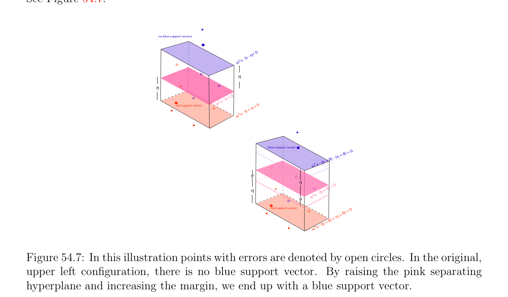
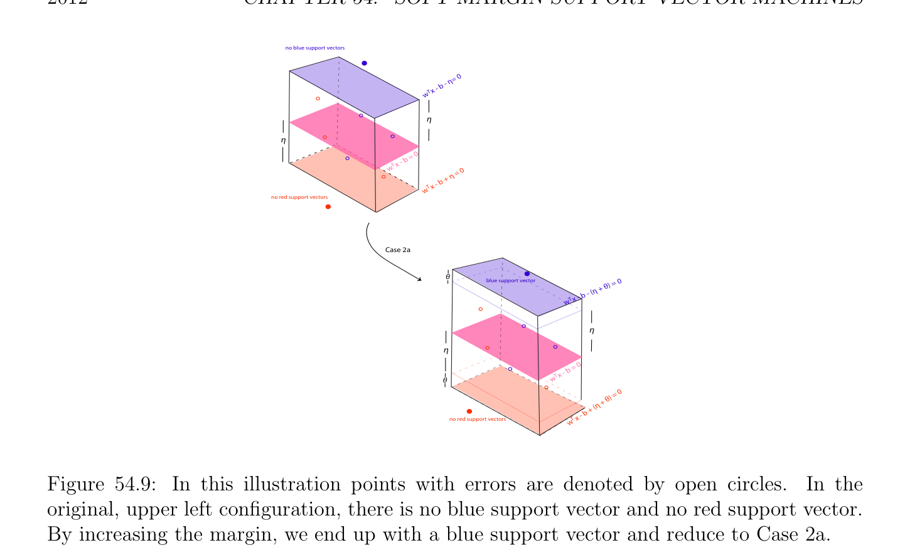
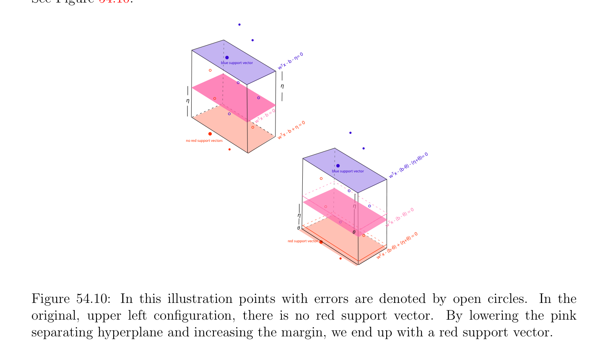

# Existence of Support Vectors for (SVMs2')

<!-- PAGE 2008 -->
By a previous remark, $p_{f} \le p_{m}$ and $q_{f} \le q_{m}$, the first inequality being strict if there is some $i$ such that $0 < \lambda_{i}  < K$, and the second inequality being strict if there is some $j$ such that $0 < \mu_{j}  < K$. This will be the case under the Standard Margin Hypothesis. Observe that a small value of $\nu$  keeps $p_{f}$ and $q_{f}$ small, which is achieved if the $\delta$ -slab is narrow (to avoid having points on the wrong sides of the margin hyperplanes). A large value of $\nu$  allows $p_{m}$ and $q_{m}$ to be fairly large, which is achieved if the $\delta$ -slab is wide. Thus the smaller $\nu$  is, the narrower the $\delta$ -slab is, and the larger $\nu$  is, the wider the $\delta$ -slab is. This is the opposite of the behavior that we witnessed in $\nu$ -regression (see Section 56.1).

## 54.7 Existence of Support Vectors for (SVM )

$$s2'$$
We now consider the issue of the existence of support vectors. We will show that in the “generic case” there is always some blue support vector and some red support vector. The term generic has to do with the choice of $\nu$  and will be explained below. Given any real numbers $u, v, x, y$, if $max{u, v} < min{x, y}$, then $u < x$ and $v < y$. This is because $u, v \le max{u, v} < min{x, y} \le x, y$. Consequently, since by Proposition 54.1, $max{2p_{f}/(p + q), 2q_{f}/(p + q)} \le \nu$ , if $\nu  < min{2p/(p + q), 2q/(p + q)}$, then $p_{f} < p$ and $q_{f} < q$, and since $p_{sf} \le p_{f}$ and $q_{sf} \le q_{f}$, we also have $p_{sf} < p$ and $q_{sf} < q$. This implies that there are constraints corresponding to some $i \in / E_{\lambda}$ (in which case $\epsilon_{i}  = 0)$ and to some $j \in / E_{\mu}$ (in which case $\xi_{j}  = 0)$, of the form
$$w^{\top}u_{i} -b \ge \eta i \in /E_{\lambda}$$
$$-w^{\top}v_{j} + b \ge \eta j \in /E_{\mu}.$$
If $w^{\top}u_{i}$ - $b = \eta$  for some $i \in / E_{\lambda}$ and $-w^{\top}v_{j} + b = \eta$  for some $j \in / E_{\mu}$, then we have a blue support vector and a red support vector. Otherwise, we show how to modify $b$ and $\eta$  to obtain an optimal solution with a blue support vector and a red support vector.

> **Proposition 54.2.** For every optimal solution $(w, b, \eta , \epsilon , \xi$ ) of Problem $(SVM_{s2'})$ with $w \neq  0$ and $\eta  > 0$, if
$$\nu  < \min{2p/(p + q), 2q/(p + q)}$$
and if either no $u_{i}$ is a support vector or no $v_{j}$ is a support vector, then there is another optimal solution (for the same $w)$ with some $i_{0}$ such that $\epsilon_{i0}  = 0$ and $w^{\top}u_{i0}$ - $b = \eta$ , and there is some $j_{0}$ such that $\xi_{j0}  = 0$ and $-w^{\top}v_{j0} + b = \eta$ ; in other words, some $u_{i0}$ and some $v_{j0}$ is a support vector; in particular, $p_{sf} < p$ and $q_{sf} < q$.

*Proof.* We just explained that $p_{sf} < p$ and $q_{sf} < q$, so the following constraints hold:
$$w^{\top}u_{i} -b = \eta  -\epsilon_{i} \epsilon_{i}  > 0i \in E_{\lambda}$$
$$-w^{\top}v_{j} + b = \eta  -\xi_{j} \xi_{j}  > 0j \in E_{\mu}$$
$$w^{\top}u_{i} -b \ge \eta i \in /E_{\lambda}$$
$$-w^{\top}v_{j} + b \ge \eta j \in /E_{\mu},$$

<!-- PAGE 2009 -->
where there is some $i \in / E_{\lambda}$ and some $j \in / E_{\mu}$. If our optimal solution does not have a blue support vector and a red support vector, then either $w^{\top}u_{i}$ - $b > \eta$  for all $i \in / E_{\lambda}$ or $-w^{\top}v_{j} + b > \eta$  for all $j \in / E_{\mu}$. Case $1$. We have
$$w^{\top}u_{i} -b > \eta i \in /E_{\lambda}$$
$$-w^{\top}v_{j} + b \ge \eta j \in /E_{\mu}.$$
There are two subcases. Case 1a. Assume that there is some $j \in / E_{\mu}$ such that $-w^{\top}v_{j} + b = \eta$ . Our strategy is to increase $\eta$  and $b$ by a small amount $\theta$  in such a way that some inequality becomes an equation for some $i \in / E_{\lambda}$. Geometrically, this amounts to raising the separating hyperplane $H_{w,b}$ and increasing the width of the slab, keeping the red margin hyperplane unchanged. See Figure 54.7.
$$no blue support vectors$$
$$\eta = 0$$
$$x - b -$$
$$w T$$
$$\eta$$
$$\eta$$
$$b = 0$$
$$wT  x -$$
$$red support vector \eta  = 0$$
$$x - b +$$
$$wT$$
$$blue support vector 0$$
$$+ \theta ) =$$
$$\theta ) - (\eta$$
$$- (b +$$
$$wT  x$$
$$\theta$$
$$\eta 0$$
$$\theta ) =$$
$$\eta (b +$$
$$w  x - T$$
$$\theta$$
$$red support vector) = 0$$
$$\eta  + \theta$$
$$\theta ) + ($$
$$(b +$$
$$w  xT -$$

**Figure 54.7:** In this illustration points with errors are denoted by open circles. In the original, upper left configuration, there is no blue support vector. By raising the pink separating hyperplane and increasing the margin, we end up with a blue support vector. Let us pick $\theta$  such that
$$\theta  = (1/2) \min{w^{\top}u_{i} -b -\eta  | i \in /E_{\lambda}}.$$

<!-- PAGE 2010 -->
Our hypotheses imply that $\theta  > 0$. We can write
$$w^{\top}u_{i} -(b + \theta ) = \eta  + \theta  -(\epsilon_{i}  + 2\theta )\epsilon_{i}  > 0i \in E_{\lambda}$$
$$-w^{\top}v_{j} + b + \theta  = \eta  + \theta  -\xi_{j} \xi_{j}  > 0j \in E_{\mu}$$
$$w^{\top}u_{i} -(b + \theta ) \ge \eta  + \theta i \in /E_{\lambda}$$
$$-w^{\top}v_{j} + b + \theta  \ge \eta  + \theta j \in /E_{\mu}.$$
By hypothesis
$$-w^{\top}v_{j} + b + \theta  = \eta  + \theta for some j \in /E_{\mu},$$
and by the choice of $\theta$ ,
$$w^{\top}u_{i} -(b + \theta ) = \eta  + \theta for some i \in /E_{\lambda}.$$
The new value of the objective function is
$$\omega (\theta ) = \frac{1}{2} w^{\top}w -\nu (\eta  + \theta ) + \frac{1}{p + q} \sum_{i\in E\lambda}  \sum_{j\in E\mu}$$
$$\begin{pmatrix} (\epsilon_{i}  + 2\theta ) + & \xi_{j} \\  & 2 \end{pmatrix}$$
$$= \frac{1}{2} w^{\top}w -\nu \eta  + \frac{1}{p + q} \sum_{i\in E\lambda}  \sum_{j\in E\mu}  - \begin{pmatrix} p_{sf} \\ \nu  - \\ p + q \end{pmatrix} \theta .$$
$$\begin{pmatrix} \epsilon_{i}  + & \xi_{j} \end{pmatrix}$$
By Proposition 54.1 we have
$$ $$
$$\max \frac{2p_{f}}{p + q} , \frac{2q_{f}}{p + q} \le \nu$$
and $p_{sf} \le p_{f}$ and $q_{sf} \le q_{f}$, which implies that
$$\nu  - \frac{2p_{sf}}{p + q} \ge 0,(*_{1})$$
and so $\omega (\theta$ ) $\le \omega (0)$. If inequality $(*_{1})$ is strict, then this contradicts the optimality of the original solution. Therefore, $\nu  = 2p_{sf}/(p + q), \omega (\theta$ ) $= \omega (0)$, and $(w, b + \theta , \eta  + \theta , \epsilon  + 2\theta , \xi$ ) is an optimal solution such that
$$w^{\top}u_{i} -(b + \theta ) = \eta  + \theta$$
$$-w^{\top}v_{j} + b + \theta  = \eta  + \theta$$
for some $i \in / E_{\lambda}$ and some $j \in / E_{\mu}$. Case 1b. We have $-w^{\top}v_{j} + b > \eta$  for all $j \in / E_{\mu}$. Our strategy is to increase $\eta$  and the errors by a small $\theta$  in such a way that some inequality becomes an equation for some $i \in / E_{\lambda}$ or for some $j \in / E_{\mu}$. Geometrically, this corresponds to increasing the width of the slab, keeping the separating hyperplane unchanged. See Figures 54.8 and 54.9. Then we are reduced to Case 1a or Case 2a.

<!-- PAGE 2011 -->
$$no blue support vectors$$
$$\eta = 0$$
$$x - b -$$
$$w T$$
$$\eta$$
$$\eta$$
$$b = 0$$
$$wT  x -$$
$$\eta  = 0$$
$$x - b +$$
$$no red support vectorswT$$
$$no blue support vectors$$
$$\theta = 0$$
$$(\eta  + \theta )$$
$$x - b -$$
$$w T$$
$$\eta$$
$$\eta$$
$$b = 0$$
$$wT  x -$$
$$\theta$$
$$\theta ) = 0$$
$$red support vector\eta  +$$
$$b + ($$
$$w T x -$$

**Figure 54.8:** In this illustration points with errors are denoted by open circles. In the original, upper left configuration, there is no blue support vector and no red support vector. By increasing the margin, we end up with a red support vector and reduce to Case 1a. We have
$$w^{\top}u_{i} -b = \eta  -\epsilon_{i} \epsilon_{i}  > 0i \in E_{\lambda}$$
$$-w^{\top}v_{j} + b = \eta  -\xi_{j} \xi_{j}  > 0j \in E_{\mu}$$
$$w^{\top}u_{i} -b > \eta i \in /E_{\lambda}$$
$$-w^{\top}v_{j} + b > \eta j \in /E_{\mu}.$$
Let us pick $\theta$  such that
$$\theta  = \min{w^{\top}u_{i} -b -\eta , -w^{\top}v_{j} + b -\eta  | i \in /E_{\lambda}, j \in /E_{\mu}}.$$
Our hypotheses imply that $\theta  > 0$. We can write
$$w^{\top}u_{i} -b = \eta  + \theta  -(\epsilon_{i}  + \theta )\epsilon_{i}  > 0i \in E_{\lambda}$$
$$-w^{\top}v_{j} + b = \eta  + \theta  -(\xi_{j}  + \theta )\xi_{j}  > 0j \in E_{\mu}$$
$$w^{\top}u_{i} -b \ge \eta  + \theta i \in /E_{\lambda}$$
$$-w^{\top}v_{j} + b \ge \eta  + \theta j \in /E_{\mu},$$
and by the choice of $\theta$ , either
$$w^{\top}u_{i} -b = \eta  + \theta for some i \in /E_{\lambda}$$

<!-- PAGE 2012 -->
$$no blue support vectors$$
$$\eta = 0$$
$$x - b -$$
$$w T$$
$$\eta$$
$$\eta$$
$$b = 0$$
$$wT  x -$$
$$\eta  = 0$$
$$x - b +$$
$$wT$$
$$no red support vectors$$
$$Case 2a$$
$$\theta blue support vector= 0$$
$$(\eta  + \theta )$$
$$x - b -$$
$$w T$$
$$\eta$$
$$\eta$$
$$b = 0$$
$$wT  x -$$
$$\theta$$
$$= 0$$
$$+ \theta )$$
$$+ (\eta$$
$$- b$$
$$no red support vectorsw T x$$

**Figure 54.9:** In this illustration points with errors are denoted by open circles. In the original, upper left configuration, there is no blue support vector and no red support vector. By increasing the margin, we end up with a blue support vector and reduce to Case 2a. or
$$-w^{\top}v_{j} + b = \eta  + \theta for some j \in /E_{\mu}.$$
The new value of the objective function is
$$\omega (\theta ) = \frac{1}{2} w^{\top}w -\nu (\eta  + \theta ) + \frac{1}{p + q} \sum_{i\in E\lambda}  \sum_{j\in E\mu}$$
$$\begin{pmatrix} (\epsilon_{i}  + \theta ) + & (\xi_{j} + \theta ) \\  & p_{sf}+ \end{pmatrix}$$
$$= \frac{1}{2} w^{\top}w -\nu \eta  + \frac{1}{p + q} \sum_{i\in E\lambda}  \sum_{j\in E\mu}  - \begin{pmatrix} q_{sf} \\ \nu  - \\ p + q \end{pmatrix} \theta .$$
$$\begin{pmatrix} \epsilon_{i}  + & \xi_{j} \end{pmatrix}$$
Since $max{2p_{f}/(p + q), 2q_{f}/(p + q)} \le \nu$  implies that $(p_{f} + q_{f})/(p + q) \le \nu$  and $p_{sf} \le p_{f}, q_{sf} \le q_{f}$, we have
$$\nu  - \frac{p_{sf}+ q_{sf}}{p + q} \ge 0,(*_{2})$$
and so $\omega (\theta$ ) $\le \omega (0)$. If inequality $(*_{2})$ is strict, then this contradicts the optimality of the original solution. Therefore, $\nu  = (p_{sf} +q_{sf})/(p+q), \omega (\theta$ ) $= \omega (0)$ and $(w, b, \eta  +\theta , \epsilon +\theta , \xi  +\theta$ ) is an optimal solution such that either
$$w^{\top}u_{i} -b = \eta  + \theta for some i \in /E_{\lambda}$$
or
$$-w^{\top}v_{j} + b = \eta  + \theta for some j \in /E_{\mu}.$$

<!-- PAGE 2013 -->
We are now reduced to Case 1a or Case 2a. Case $2$. We have
$$w^{\top}u_{i} -b \ge \eta i \in /E_{\lambda}$$
$$-w^{\top}v_{j} + b > \eta j \in /E_{\mu}.$$
There are two subcases. Case 2a. Assume that there is some $i \in / E_{\lambda}$ such that $w^{\top}u_{i}$ - $b = \eta$ . Our strategy is to increase $\eta$  and decrease $b$ by a small amount $\theta$  in such a way that some inequality becomes an equation for some $j \in / E_{\mu}$. Geometrically, this amounts to lowering the separating hyperplane $H_{w,b}$ and increasing the width of the slab, keeping the blue margin hyperplane unchanged. See Figure 54.10.
$$\eta = 0$$
$$b -$$
$$blue support vectorw T x -$$
$$\eta$$
$$\eta$$
$$b = 0$$
$$wT  x -$$
$$= 0$$
$$b + \eta$$
$$wT  x -$$
$$no red support vectors$$
$$\eta +\theta )= 0$$
$$\theta ) - ($$
$$blue support vector x - (b-$$
$$wT$$
$$\eta$$
$$= 0$$
$$\eta  - \theta )$$
$$x - (b$$
$$w T$$
$$\theta$$
$$\theta = 0$$
$$+\theta )$$
$$red support vector + (\eta$$
$$b-\theta )$$
$$x - ($$
$$wT$$

**Figure 54.10:** In this illustration points with errors are denoted by open circles. In the original, upper left configuration, there is no red support vector. By lowering the pink separating hyperplane and increasing the margin, we end up with a red support vector. Let us pick $\theta$  such that
$$\theta  = (1/2) \min{-w^{\top}v_{j} + b -\eta  | j \in /E_{\mu}}.$$
Our hypotheses imply that $\theta  > 0$. We can write
$$w^{\top}u_{i} -(b -\theta ) = \eta  + \theta  -\epsilon_{i} \epsilon_{i}  > 0i \in E_{\lambda}$$
$$-w^{\top}v_{j} + b -\theta  = \eta  + \theta  -(\xi_{j}  + 2\theta )\xi_{j}  > 0j \in E_{\mu}$$
$$w^{\top}u_{i} -(b -\theta ) \ge \eta  + \theta i \in /E_{\lambda}$$
$$-w^{\top}v_{j} + b -\theta  \ge \eta  + \theta j \in /E_{\mu}.$$

<!-- PAGE 2014 -->
By hypothesis
$$w^{\top}u_{i} -(b -\theta ) = \eta  + \theta for some i \in /E_{\lambda},$$
and by the choice of $\theta$ ,
$$-w^{\top}v_{j} + b -\theta  = \eta  + \theta for some j \in /E_{\mu}.$$
The new value of the objective function is
$$\omega (\theta ) = \frac{1}{2} w^{\top}w -\nu (\eta  + \theta ) + \frac{1}{p + q} \sum_{i\in E\lambda}  \sum_{j\in E\mu}$$
$$\begin{pmatrix} \epsilon_{i}  + & (\xi_{j} + 2\theta ) \\  & 2 \end{pmatrix}$$
$$= \frac{1}{2} w^{\top}w -\nu \eta  + \frac{1}{p + q} \sum_{i\in E\lambda}  \sum_{j\in E\mu}  - \begin{pmatrix} q_{sf} \\ \nu  - \\ p + q \end{pmatrix} \theta .$$
$$\begin{pmatrix} \epsilon_{i}  + & \xi_{j} \end{pmatrix}$$
The rest of the proof is similar to Case 1a with $p_{sf}$ replaced by $q_{sf}$. Case 2b. We have $w^{\top}u_{i}$ - $b > \eta$  for all $i \in / E_{\lambda}$. Since by hypothesis $-w^{\top}v_{j} + b > \eta$  for all $j \in / E_{\mu}$, Case 2b is identical to Case 1b, and we are done. A subtle point here is that Proposition 54.2 shows that if there is an optimal solution, then there is one with a blue and a red support vector, but it does not guarantee that these are support vectors of type $1$. Since the dual program does not determine $b$ and $\eta$  unless these support vectors are of type $1$, from a practical point of view this proposition is not helpful. The proof of Proposition 54.2 reveals that there are three critical values for $\nu$ :
$$\frac{2p_{sf}}{p + q} , \frac{2q_{sf}}{p + q} , \frac{p_{sf}+ q_{sf}}{p + q} .$$
These values can be avoided by requiring the strict inequality
$$ $$
$$\max \frac{2p_{sf}}{p + q} , \frac{2q_{sf}}{p + q} < \nu .$$
Then the following corollary holds.

> **Theorem 54.3.** For every optimal solution $(w, b, \eta , \epsilon , \xi$ ) of Problem $(SVM_{s2'})$ with $w \neq  0$ and $\eta  > 0$, if
$$\max{2p_{f}/(p + q), 2q_{f}/(p + q)} < \nu  < \min{2p/(p + q), 2q/(p + q)},$$
then some $u_{i0}$ and some $v_{j0}$ is a support vector.

*Proof.* We proceed by contradiction. Suppose that for every optimal solution with $w \neq  0$ and $\eta  > 0$ no $u_{i}$ is a blue support vector or no $v_{j}$ is a red support vector. Since $\nu  < min{2p/(p + q), 2q/(p + q)}$, Proposition 54.2 holds, so there is another optimal solution. But since the critical values of $\nu$  are avoided, the proof of Proposition 54.2 shows that the value of the objective function for this new optimal solution is strictly smaller than the original optimal value, a contradiction.

<!-- PAGE 2015 -->
We also have the following proposition that gives a sufficient condition implying that $\eta$ and $b$ can be found in terms of an optimal solution $(\lambda , \mu$ ) of the dual.

> **Proposition 54.4.** If $(w, b, \eta , \epsilon , \xi$ ) is an optimal solution of Problem $(SVM_{s2'})$ with $w \neq  0$ and $\eta  > 0$, if
$$\max{2p_{f}/(p + q), 2q_{f}/(p + q)} < \nu  < \min{2p/(p + q), 2q/(p + q)},$$
then $\eta$  and $b$ can always be determined from an optimal solution $(\lambda , \mu$ ) of the dual in terms of a single support vector.

*Proof.* By Theorem 54.3 some $u_{i0}$ and some $v_{j0}$ is a support vector. As we already explained, Problem $(SVM_{s2'})$ satisfies the conditions for having a zero duality gap. Therefore, for optimal solutions we have
$$L(w, \epsilon , \xi , b, \eta , \lambda , \mu , \alpha , \beta ) = G(\lambda , \mu , \alpha , \beta ),$$
which means that
$$\frac{1}{2} w^{\top}w -\nu \eta  + \frac{1}{p + q} \begin{pmatrix} \epsilon_{i}  + & \xi_{j} \end{pmatrix} \sum_{i=1}^{p}  \sum_{j=1}^{q}  = - \frac{1}{2} \begin{pmatrix} \lambda^{\top} & \mu^{\top} \end{pmatrix} X^{\top}X \begin{pmatrix} \lambda \\ \mu \end{pmatrix} ,$$
and since
$$w = -X \begin{pmatrix} \lambda \\ \mu \end{pmatrix} ,$$
we get
$$\frac{1}{p + q} \begin{pmatrix} \epsilon_{i}  + & \xi_{j} \end{pmatrix} \sum_{i=1}^{p}  \sum_{j=1}^{q}  = \nu \eta  - \begin{pmatrix} \lambda^{\top} & \mu^{\top} \end{pmatrix} X^{\top}X \begin{pmatrix} \lambda \\ \mu \end{pmatrix} .(*)$$
Let $K_{\lambda} = {i \in {1, \dots  , p}$ | $\lambda_{i}  = K_{s}}$ and $K_{\mu} = {j \in {1, \dots  , q}$ | $\mu_{j}  = K_{s}}$. By definition, $p_{f} = |K_{\lambda}|$ and $q_{f} = |K_{\mu}|$ (here we assuming that $K_{s} = 1/(p + q))$. By complementary slackness the following equations are active:
$$w^{\top}u_{i} -b = \eta  -\epsilon_{i} i \in K_{\lambda}$$
$$-w^{\top}v_{j} + b = \eta  -\xi_{j} j \in K_{\mu}.$$
But (*) can be written as
$$\frac{1}{p + q} \begin{pmatrix} \epsilon_{i}  + & \xi_{j} \end{pmatrix} \sum_{i\in K\lambda}  \sum_{j\in K\mu}  = \nu \eta  - \begin{pmatrix} \lambda^{\top} & \mu^{\top} \end{pmatrix} X^{\top}X \begin{pmatrix} \lambda \\ \mu \end{pmatrix} ,(**)$$
and since
$$\epsilon_{i}  = \eta  -w^{\top}u_{i} + bi \in K_{\lambda}$$
$$\xi_{j}  = \eta  + w^{\top}v_{j} -bj \in K_{\mu},$$

<!-- PAGE 2016 -->
by substituting in the Equation (**) we get
$$\begin{pmatrix} p_{f}+ q_{f} \\ \nu  - \\ p + q \end{pmatrix} \eta  = \frac{p_{f}q_{f}}{p + q} - b + \frac{1}{p + q} w^{\top} \sum_{i\in K\mu}  \sum_{i\in K\lambda}  +X^{\top}X \begin{pmatrix} \lambda \\ \mu \end{pmatrix} .$$
$$\begin{pmatrix} v_{j}- & u_{i} \end{pmatrix} \begin{pmatrix} \lambda^{\top} & \mu^{\top} \end{pmatrix}$$
We also know that $w^{\top}u_{i0}$ - $b = \eta$  and $-w^{\top}v_{j0} + b = \eta$  for some $i_{0}$ and some $j_{0}$. In the first case $b = -\eta  + w^{\top}u_{i0}$, and by substituting $b$ in the above equation we get the equation
$$\begin{pmatrix} p_{f}+ q_{f} \\ \nu  - \\ p + q \end{pmatrix} \eta  = - \frac{p_{f}q_{f}}{p + q} - \eta  + \frac{p_{f}q_{f}}{p + q} - w^{\top}u_{i0} + \frac{1}{p + q} w^{\top} \sum_{i\in K\mu}  \sum_{i\in K\lambda}$$
$$\begin{pmatrix} v_{j}- & u_{i} \end{pmatrix}$$
$$+ \begin{pmatrix} \lambda^{\top} & \mu^{\top} \end{pmatrix} X^{\top}X \begin{pmatrix} \lambda \\ \mu \end{pmatrix} ,$$
that is,
$$\begin{pmatrix} 2q_{f} \\ \nu  - \\ p + q \end{pmatrix} \eta  = \frac{p_{f}q_{f}}{p + q} - w^{\top}u_{i0} + \frac{1}{p + q} w^{\top} \sum_{i\in K\mu}  \sum_{i\in K\lambda}$$
$$\begin{pmatrix} v_{j}- & u_{i} \end{pmatrix}$$
$$+ \begin{pmatrix} \lambda^{\top} & \mu^{\top} \end{pmatrix} X^{\top}X \begin{pmatrix} \lambda \\ \mu \end{pmatrix} .$$
In the second case $b = \eta  + w^{\top}v_{j0}$, and we get the equation
$$\begin{pmatrix} p_{f}+ q_{f} \\ \nu  - \\ p + q \end{pmatrix} \eta  = \frac{p_{f}q_{f}}{p + q} - \eta  + \frac{p_{f}q_{f}}{p + q} - w^{\top}v_{j0} + \frac{1}{p + q} w^{\top} \sum_{i\in K\mu}  \sum_{i\in K\lambda}$$
$$\begin{pmatrix} v_{j}- & u_{i} \end{pmatrix}$$
$$+ \begin{pmatrix} \lambda^{\top} & \mu^{\top} \end{pmatrix} X^{\top}X \begin{pmatrix} \lambda \\ \mu \end{pmatrix} ,$$
that is,
$$\begin{pmatrix} 2p_{f} \\ \nu  - \\ p + q \end{pmatrix} \eta  = \frac{p_{f}q_{f}}{p + q} - w^{\top}v_{j0} + \frac{1}{p + q} w^{\top} \sum_{i\in K\mu}  \sum_{i\in K\lambda}$$
$$\begin{pmatrix} v_{j}- & u_{i} \end{pmatrix}$$
$$+ \begin{pmatrix} \lambda^{\top} & \mu^{\top} \end{pmatrix} X^{\top}X \begin{pmatrix} \lambda \\ \mu \end{pmatrix} .$$
We need to choose $\nu$  such that $2p_{f}/(p + q)$ - $\nu$ ̸ $= 0$ and $2q_{f}/(p + q)$ - $\nu$ ̸ $= 0$. Since by Proposition 54.1, we have $max{2p_{f}/(p + q), 2q_{f}/(p + q)} \le \nu$ , it suffices to pick $\nu$  such that $max{2p_{f}/(p + q), 2q_{f}/(p + q)} < \nu$ . If this condition is satisfied we can solve for $\eta$ , and then we find $b$ from either $b = -\eta  + w^{\top}u_{i0}$ or $b = \eta  + w^{\top}v_{j0}$.
Remark: Of course the hypotheses of the proposition imply that $w^{\top}u_{i0}-b = \eta$  and $-w^{\top}v_{j0}+ b = \eta$  for some $i_{0}$ and some $j_{0}$. Thus we can also compute $b$ and $\eta$  using the formulae
$$b = \frac{w^{\top}(u_{i0}+ v_{j0})}{2}$$
$$-$$
$$\eta  = \frac{w^{\top}(u_{i0}v_{j0})}{2} .$$

<!-- PAGE 2017 -->
The interest of Proposition 54.4 lies in the fact that it allows us to compute $b$ and $\eta$  knowing only a single support vector. In practice we can only find support vectors of type $1$ so Proposition 54.4 is useful if we can only find some blue support vector of type $1$ or some red support vector of type $1$. As earlier, if we define $I_{\lambda}$ and $I_{\mu}$ as
$$I_{\lambda} = {i \in {1, \dots  , p} | 0 < \lambda_{i}  < K_{s}}$$
$$I_{\mu} = {j \in {1, \dots  , q} | 0 < \mu_{j}  < K_{s}},$$
then we have the following cases to compute $\eta$  and $b$.
$(1)$ If $I_{\lambda} \neq  \emptyset$ and $I_{\mu} \neq  \emptyset$ , then
$$ \sum_{\in I\lambda}  \sum_{\in I\mu}  $$
$$b = w^{\top}/|I_{\lambda}| +/|I_{\mu}|/2$$
$$ \begin{pmatrix} u_{i} \\ i \end{pmatrix} \begin{pmatrix} v_{j} \\ j \end{pmatrix} $$
$$ \sum_{i\in I\lambda}  \sum_{j\in I\mu}  $$
$$\eta  = w^{\top}/|I_{\lambda}| -/|I_{\mu}|/2.$$
$$ \begin{pmatrix} u_{i} \end{pmatrix} \begin{pmatrix} v_{j} \end{pmatrix} $$
$(2)$ If $I_{\lambda} \neq  \emptyset$ and $I_{\mu} = \emptyset$ , then
$$b = -\eta  + w^{\top} \begin{pmatrix} u_{i} \end{pmatrix} \sum_{i\in I\lambda}  /|I_{\lambda}|$$
$$((p + q)\nu  -2q_{f})\eta  = (p_{f} -q_{f})w^{\top} \begin{pmatrix} u_{i} \end{pmatrix} \sum_{i\in I\lambda}  /|I_{\lambda}| + w^{\top} \begin{pmatrix} v_{j}- & u_{i} \end{pmatrix} \sum_{i\in K\mu}  \sum_{i\in K\lambda}$$
$$+ (p + q) \begin{pmatrix} \lambda^{\top} & \mu^{\top} \end{pmatrix} X^{\top}X \begin{pmatrix} \lambda \\ \mu \end{pmatrix} .$$
$(3)$ If $I_{\lambda} = \emptyset$ and $I_{\mu} \neq  \emptyset$ , then
$$b = \eta  + w^{\top} \begin{pmatrix} v_{j} \end{pmatrix} \sum_{j\in I\mu}  /|I_{\mu}|$$
$$((p + q)\nu  -2p_{f})\eta  = (p_{f} -q_{f})w^{\top} \begin{pmatrix} v_{j} \end{pmatrix} \sum_{j\in I\mu}  /|I_{\mu}| + w^{\top} \begin{pmatrix} v_{j}- & u_{i} \end{pmatrix} \sum_{i\in K\mu}  \sum_{i\in K\lambda}$$
$$+ (p + q) \begin{pmatrix} \lambda^{\top} & \mu^{\top} \end{pmatrix} X^{\top}X \begin{pmatrix} \lambda \\ \mu \end{pmatrix} .$$
The above formulae correspond to $K_{s} = 1/(p + q)$. In general we have to replace the rightmost $(p + q)$ by $1/K_{s}$.
