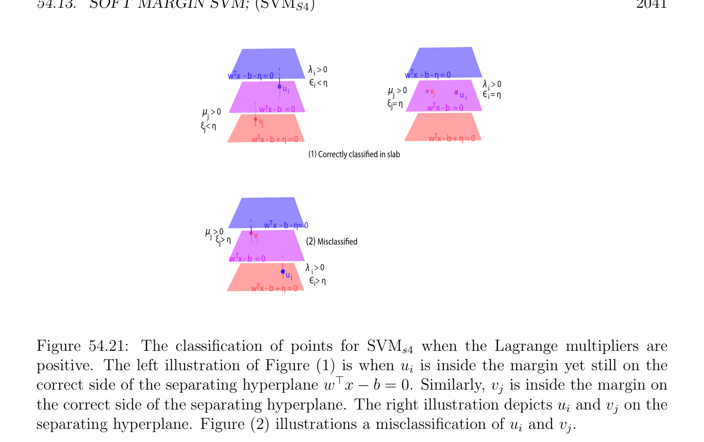

# Soft Margin SVM; (SVMs4)

<!-- PAGE 2037 -->

## 54.13 Soft Margin SVM; (SVM )

$$s4$$
In this section we consider the version of Problem $(SVM_{s2'})$ in which instead of using the
$$function K \sum_{2i}  \sum  as a regularizing function we use the quadratic function$$
$$\begin{pmatrix} p & \epsilon_{i} + & q & \xi_{j} \\ =1 & j=1 \\ \|_{2}). \end{pmatrix}$$
$K(\|\epsilon \|_{2}^{2} + \|\xi$ Soft margin SVM $(SVM_{s4})$:
$$minimize \frac{1}{2} w^{\top}w + (p + q)K_{s} \begin{pmatrix} 1 \\ -\nu \eta  + & (\epsilon^{\top} \epsilon  + \xi^{\top} \xi ) \\ p + q \end{pmatrix}$$
$$subject to$$
$$w^{\top}u_{i} -b \ge \eta  -\epsilon_{i} ,i = 1, \dots  , p$$
$$-w^{\top}v_{j} + b \ge \eta  -\xi_{j} ,j = 1, \dots  , q$$
$$\eta  \ge 0,$$
where $\nu$  and $K_{s}$ are two given positive constants. As we saw earlier, theoretically, it is convenient to pick $K_{s} = 1/(p + q)$. When writing a computer program, it is preferable to assume that $K_{s}$ is arbitrary. In this case $\nu$  needs to be replaced by $(p + q)K_{s}\nu$  in all the formulae obtained with $K_{s} = 1/(p + q)$. The new twist with this formulation of the problem is that if $\epsilon_{i}  < 0$, then the corresponding inequality $w^{\top}u_{i}$ - $b \ge \eta$  - $\epsilon_{i}$  implies the inequality $w^{\top}u_{i}$ - $b \ge \eta$  obtained by setting $\epsilon_{i}$  to zero while reducing the value of $\|\epsilon \|^{2}$, and similarly if $\xi_{j}  < 0$, then the corresponding inequality $-w^{\top}v_{j} +b \ge \eta  -\xi_{j}$  implies the inequality $-w^{\top}v_{j} +b \ge \eta$  obtained by setting $\xi_{j}$  to zero while reducing the value of $\|\xi \|^{2}$. Therefore, if $(w, b, \epsilon , \xi$ ) is an optimal solution of Problem $(SVM_{s4})$, it is not necessary to restrict the slack variables $\epsilon_{i}$  and $\xi_{j}$  to the nonnegative, which simplifies matters a bit. In fact, we will see that for an optimal solution, $\epsilon  = \lambda /(2K_{s})$ and $\xi  = \mu /(2K_{s})$. The variable $\eta$  can also be determined by expressing that the duality gap is zero. One of the advantages of this methods is that $\epsilon$  is determined by $\lambda , \xi$  is determined by $\mu$ , and $\eta$  and $b$ are determined by $\lambda$  and $\mu$ . This method does not require support vectors to compute $b$. We can omit the constraint $\eta  \ge 0$, because for an optimal solution it can be shown using duality that $\eta  \ge 0$; see Section 54.14. A drawback of Program $(SVM_{s4})$ is that for fixed $K_{s}$, the quantity $\delta  = \eta / \|w\|$ and the hyperplanes $H_{w,b}, H_{w,b+\eta}$ and $H_{w,b-\eta}$ are independent of $\nu$ . This will be shown in Theorem 54.8. Thus this method is less flexible than $(SVM_{s2'})$ and $(SVM_{s3})$.

<!-- PAGE 2038 -->
The Lagrangian is given by
$$L(w, \epsilon , \xi , b, \eta , \lambda , \mu , \gamma ) = \frac{1}{2} w^{\top}w -\nu \eta  + K_{s}(\epsilon^{\top} \epsilon  + \xi^{\top} \xi ) + w^{\top}X \begin{pmatrix} \lambda \\ \mu \end{pmatrix}$$
$$\epsilon^{\top} \lambda  -\xi^{\top} \mu  + b(1_{p}^{\top} \lambda  -1_{q}^{\top} \mu ) + \eta (1_{p}^{\top} \lambda  + 1_{q}^{\top} \mu ) -\gamma \eta$$
$$= \frac{-1}{2} w^{\top}w + w^{\top}X \begin{pmatrix} \lambda \\ \mu \end{pmatrix} + \eta (1_{p}^{\top} \lambda  + 1_{q}^{\top} \mu  -\nu  -\gamma )$$
$$+ K_{s}(\epsilon^{\top} \epsilon  + \xi^{\top} \xi ) -\epsilon^{\top} \lambda  -\xi^{\top} \mu  + b(1_{p}^{\top} \lambda  -1_{q}^{\top} \mu ).$$
To find the dual function $G(\lambda , \mu , \gamma$ ) we minimize L(w, $\epsilon , \xi , b, \eta , \lambda , \mu , \gamma$ ) with respect to $w, \epsilon , \xi$ ,
$$\mathbb{R}^{n} \mathbb{R}^{p} \mathbb{R}^{q} \mathbb{R}\mathbb{R}$$
$b$, and $\eta$ . Since the Lagrangian is convex and $(w, \epsilon , \xi , b, \eta$ ) $\in \times \times \times  \times$ , a convex open set, by Theorem 40.13, the Lagrangian has a minimum in $(w, \epsilon , \xi , b, \eta$ ) iff $\nabla L_{w,\epsilon ,\xi ,b,\eta} = 0$, so we compute $\nabla L_{w,\epsilon ,\xi ,b,\eta}$. The gradient $\nabla L_{w,\epsilon ,\xi ,b,\eta}$ is given by
$$\begin{pmatrix}\end{pmatrix}$$
$$\nabla L_{w,\epsilon ,\xi ,b,\eta} = \begin{pmatrix} \lambda  \\ w + X & \mu \\ 2K_{s}\epsilon  -\lambda \\ 2K_{s}\xi  -\mu \\ 1_{p}^{\top}\lambda  -1_{q}^{\top}\mu \\ 1_{p}^{\top}\lambda  + 1_{q}^{\top}\mu & \nu & \gamma \end{pmatrix} .$$
$$- -$$
By setting $\nabla L_{w,\epsilon ,\xi ,b,\eta} = 0$ we get the equations
$$w = -X \begin{pmatrix} \lambda \\ \mu \end{pmatrix} ,(*_{w})$$
$$2K_{s}\epsilon  = \lambda$$
$$2K_{s}\xi  = \mu$$
$$1_{p}^{\top} \lambda  = 1_{q}^{\top} \mu$$
$$1_{p}^{\top} \lambda  + 1_{q}^{\top} \mu  = \nu  + \gamma .$$
The last two equations are identical to the last two equations obtained in Problem $(SVM_{s2'})$. We can use the other equations to obtain the following expression for the dual function $G(\lambda , \mu , \gamma$ ),
$$G(\lambda , \mu , \gamma ) = - \frac{1}{4K_{s}} (\lambda^{\top} \lambda  + \mu^{\top} \mu ) - \frac{1}{2} \begin{pmatrix} \lambda^{\top} & \mu^{\top} \end{pmatrix} X^{\top}X \begin{pmatrix} \lambda \\ \mu \end{pmatrix}$$
$$= - \frac{1}{2} \begin{pmatrix} \lambda^{\top} & \mu^{\top} \end{pmatrix} \begin{pmatrix} 1 \\ X^{\top}X+ & I_{p+q} \\ 2K_{s} \end{pmatrix} \begin{pmatrix} \lambda \\ \mu \end{pmatrix} .$$
Consequently the dual program is equivalent to the minimization program

<!-- PAGE 2039 -->
Dual of the Soft margin SVM $(SVM_{s4})$:
$$minimize \frac{1}{2} \begin{pmatrix} \lambda^{\top} & \mu^{\top} \end{pmatrix} \begin{pmatrix} 1 \\ X^{\top}X+ & I_{p+q} \\ 2K_{s} \end{pmatrix} \begin{pmatrix} \lambda \\ \mu \end{pmatrix}$$
$$subject to$$
$$\sum_{i=1}^{p}  \lambda_{i}  - \sum_{j=1}^{q}  \mu_{j}  = 0$$
$$\sum_{i=1}^{p}  \lambda_{i}  + \sum_{j=1}^{q}  \mu_{j}  \ge \nu$$
$$\lambda_{i}  \ge 0,i = 1, \dots  , p$$
$$\mu_{j}  \ge 0,j = 1, \dots  , q.$$
The above program is similar to the program that was obtained for Problem $(SVM_{s2'})$ but the matrix $X^{\top}X$ is replaced by the matrix $X^{\top}X +(1/2K_{s})I_{p+q}$, which is positive definite since $K_{s} > 0$, and also the inequalities $\lambda_{i}  \le K_{s}$ and $\mu_{j}  \le K_{s}$ no longer hold. It is shown in Section 54.14 how the dual program is solved using ADMM from Section 52.6. If the primal problem is solvable, this yields solutions for $\lambda$  and $\mu$ . We obtain $w$ from $\lambda$  and $\mu$ , as in Problem $(SVM_{s2'})$; namely,
$$w = -X \begin{pmatrix} \lambda \\ \mu \end{pmatrix} = \sum_{i=1}^{p}  \lambda_{i} u_{i} - \sum_{j=1}^{q}  \mu_{j} v_{j}.$$
Since the variables $\epsilon_{i}$  and $\xi_{j}$  are not restricted to be nonnegative we no longer have complementary slackness conditions involving them, but we know that
$$\epsilon  = \frac{\lambda}{2K_{s}} ,\xi  = \frac{\mu}{2K_{s}} .$$
Also since the constraints
$$\sum_{i=1}^{p}  \lambda_{i}  \ge \frac{\nu}{2} and \sum_{j=1}^{q}  \mu_{j}  \ge \frac{\nu}{2}$$
imply that there is some $i_{0}$ such that $\lambda_{i0}  > 0$ and some $j_{0}$ such that $\mu_{j0}  > 0$, we have $\epsilon_{i0}  > 0$ and $\xi_{j0}  > 0$, which means that at least two points are misclassified, so Problem $(SVM_{s4})$ should only be used when the sets ${u_{i}}$ and ${v_{j}}$ are not linearly separable. Because $\epsilon_{i}  = \lambda_{i} /(2K_{s}), \xi_{j}  = \mu_{j} /(2K_{s})$, and there is no upper bound $K_{s}$ on $\lambda_{i}$  and $\mu_{j}$ , the classification of the points is simpler than in the previous cases.
$(1)$ If $\lambda_{i}  = 0$, then $\epsilon_{i}  = 0$ and the inequality $w^{\top}u_{i} -b -\eta  \ge 0$ holds. If equality holds then $u_{i}$ is a support vector on the blue margin (the hyperplane $H_{w,b+\eta})$. Otherwise $u_{i}$ is

<!-- PAGE 2040 -->
in the blue open half-space bounded by the margin hyperplane $H_{w,b+\eta}$ (not containing the separating hyperplane $H_{w,b})$. See Figure 54.20. Similarly, if $\mu_{j}  = 0$, then $\xi_{j}  = 0$ and the inequality $-w^{\top}v_{j} + b$ - $\eta  \ge$ holds. If equality holds then $v_{j}$ is a support vector on the red margin (the hyperplane $H_{w,b-\eta})$. Otherwise $v_{j}$ is in the red open half-space bounded by the margin hyperplane $H_{w,b-\eta}$ (not containing the separating hyperplane $H_{w,b})$. See Figure 54.20.
$$u \lambda  = 0$$
$$ii$$
$$1є = 0$$
$$i$$
$$ui2Correctly classified on blue margin$$
$$w  x  - b -\eta  = 0T$$
$$w  x - b  = 0T$$
$$vCorrectly classified on red margin$$
$$j2$$
$$w  x - b + \eta  = 0T$$
$$\mu  = 0$$
$$vj$$
$$j1\xi   = 0$$
$$j$$

**Figure 54.20:** When $\lambda_{i}  = 0, u_{i}$ is correctly classified on or outside the blue margin. When $\mu_{j}  = 0, v_{j}$ is correctly classified on or outside outside the red margin.
$(2)$ If $\lambda_{i}  > 0$, then $\epsilon_{i}  = \lambda_{i} /(2K_{s}) > 0$. The corresponding constraint is active, so we have
$$w^{\top}u_{i} -b = \eta  -\epsilon_{i} .$$
If $\epsilon_{i}  \le \eta$ , then the points $u_{i}$ is inside the slab bounded by the blue margin hyperplane $H_{w,b+\eta}$ and the separating hyperplane $H_{w,b}$. If $\epsilon_{i}  > \eta$ , then the point $u_{i}$ belongs to the open half-space bounded by the separating hyperplane and containing the red margin hyperplane (the red side); it is misclassified. See Figure 54.21. Similarly, if $\mu_{j}  > 0$, then $\xi_{j}  = \mu_{j} /(2K_{s}) > 0$. The corresponding constraint is active, so we have
$$-w^{\top}v_{j} + b = \eta  -\xi_{j} .$$
If $\xi_{j}  \le \eta$ , then the points $v_{j}$ is inside the slab bounded by the red margin hyperplane $H_{w,b-\eta}$ and the separating hyperplane $H_{w,b}$. If $\xi_{j}  > \eta$ , then the point $v_{j}$ belongs to the open half-space bounded by the separating hyperplane and containing the blue margin hyperplane (the blue side); it is misclassified. See Figure 54.21. We can use the fact that the duality gap is $0$ to find $\eta$ . We have
$$\frac{1}{2} w^{\top}w -\nu \eta  + K_{s}(\epsilon^{\top} \epsilon  + \xi^{\top} \xi ) = - \frac{1}{2} \begin{pmatrix} \lambda^{\top} & \mu^{\top} \end{pmatrix} \begin{pmatrix} 1 \\ X^{\top}X+ & I_{p+q} \\ 2K_{s} \end{pmatrix} \begin{pmatrix} \lambda \\ \mu \end{pmatrix} ,$$

<!-- PAGE 2041 -->
$$\lambda  i > 0T$$
$$w  x  - b - \eta  = 0Tw  x  - b - \eta  = 0$$
$$Є  < \eta i\lambda  i> 0$$
$$ui\mu   > 0vv$$
$$jju iЄ  = \eta i$$
$$\xi  = \eta jw  x - b  = 0T$$
$$\mu   > 0w  x - b  = 0T$$
$$jv$$
$$\xi  < \eta jj$$
$$w  x - b + \eta  = 0Tw  x - b + \eta  = 0T$$
$$(1)Correctly classified in slab$$
$$w  x  - b - \eta = 0T$$
$$\mu   > 0$$
$$j\xi  > \eta vvj$$
$$j(2)Misclassified$$
$$w  x - b  = 0T$$
$$\lambda  i> 0$$
$$ui$$
$$Є > \eta i$$
$$w  x - b + \eta  = 0T$$

**Figure 54.21:** The classification of points for $SVM_{s4}$ when the Lagrange multipliers are positive. The left illustration of Figure $(1)$ is when $u_{i}$ is inside the margin yet still on the correct side of the separating hyperplane $w^{\top}x$ - $b = 0$. Similarly, $v_{j}$ is inside the margin on the correct side of the separating hyperplane. The right illustration depicts $u_{i}$ and $v_{j}$ on the separating hyperplane. Figure $(2)$ illustrations a misclassification of $u_{i}$ and $v_{j}$. and since
$$w = -X \begin{pmatrix} \lambda \\ \mu \end{pmatrix}$$
we get
$$\nu \eta  = K_{s}(\epsilon^{\top} \epsilon  + \xi^{\top} \xi ) + \begin{pmatrix} \lambda^{\top} & \mu^{\top} \end{pmatrix} \begin{pmatrix} 1 \\ X^{\top}X+ & I_{p+q} \\ 4K_{s} \\ \lambda  \end{pmatrix} \begin{pmatrix} \lambda \\ \mu \end{pmatrix}$$
$$= \begin{pmatrix} \lambda^{\top} & \mu^{\top} \end{pmatrix} \begin{pmatrix} 1 \\ X^{\top}X+ & I_{p+q} \\ 2K_{s} \\ wehave\eta \end{pmatrix} \begin{pmatrix} \mu \end{pmatrix} .$$
The above confirms that at optimality    $\ge 0$.
Remark: If we do not assume that $K_{s} = 1/(p+q)$, then the above formula must be replaced by
$$(p + q)K_{s}\nu \eta  = \begin{pmatrix} \lambda^{\top} & \mu^{\top} \end{pmatrix} \begin{pmatrix} 1 \\ X^{\top}X+ & I_{p+q} \\ 2K_{s} \\ theexistenceof \end{pmatrix} \begin{pmatrix} \lambda \\ \mu \end{pmatrix} .$$
Since $\eta$  is determined independently of    support vectors, the margin hyperplane $H_{w,b+\eta}$ may not contain any point $u_{i}$ and the margin hyperplane $H_{w,b-\eta}$ may not contain any point $v_{j}$. We can solve for $b$ using some active constraint corresponding to any $i_{0}$ such that $\lambda_{i0}  > 0$ and any $j_{0}$ such that $\mu_{j0}  > 0$ (by a previous remark, the constraints imply that such $i_{0}$ and

<!-- PAGE 2042 -->
$j_{0}$ must exist). To improve numerical stability we average over the following sets of indices. Let $I_{\lambda}$ and $I_{\mu}$ be the set of indices given by
$$I_{\lambda} = {i \in {1, \dots  , p} | \lambda_{i}  > 0}$$
$$I_{\mu} = {j \in {1, \dots  , q} | \mu_{j}  > 0},$$
and let $p_{m} = |I_{\lambda}|$ and $q_{m} = |I_{\mu}|$. We obtain the formula
$$\sum_{\in I\lambda}  \sum_{\in I\mu}  \sum_{i\in I\lambda}  \sum_{j\in I\mu}  $$
$$b = \begin{pmatrix}  \\ w^{\top} & u_{i} \\ i \end{pmatrix} \begin{pmatrix}  \\ /p_{m} + & v_{j} \\ j \end{pmatrix} \begin{pmatrix} /q_{m} \end{pmatrix} \begin{pmatrix}  \\ + & \epsilon_{i} \end{pmatrix} \begin{pmatrix}  \\ /p_{m} - & \xi_{j} \end{pmatrix} /q_{m}/2.$$
We now prove that for a fixed $K_{s}$, the solution to Problem $(SVM_{s4})$ is unique and independent of the value of $\nu$ .

> **Theorem 54.8.** For $K_{s}$ and $\nu$  fixed, if Problem $(SVM_{s4})$ succeeds, then it has a unique solution. If Problem $(SVM_{s4})$ succeeds and returns $(\lambda , \mu , \eta , w, b)$ for the value $\nu$  and $(\lambda^{\kappa} , \mu^{\kappa} , \eta^{\kappa} , w^{\kappa}, b^{\kappa})$ for the value $\kappa \nu$  with $\kappa  > 0$, then
$$\lambda^{\kappa} = \kappa \lambda , \mu^{\kappa} = \kappa \mu , \eta^{\kappa} = \kappa \eta , w^{\kappa}= \kappa w, b^{\kappa}= \kappa b.$$
As a consequence, $\delta  = \eta / \|w\| = \eta^{\kappa} / \|w^{\kappa}\| = \delta^{\kappa}$ , and the hyperplanes $H_{w,b}, H_{w,b+\eta}$ and $H_{w,b-\eta}$ are independent of $\nu$ .

*Proof.* We already observed that for an optimal solution with $\eta  > 0$, we have $\gamma  = 0$. This means that $(\lambda , \mu$ ) is a solution of the problem
$$minimize \frac{1}{2} \begin{pmatrix} \lambda^{\top} & \mu^{\top} \end{pmatrix} \begin{pmatrix} 1 \\ X^{\top}X+ & I_{p+q} \\ 2K_{s} \end{pmatrix} \begin{pmatrix} \lambda \\ \mu \end{pmatrix}$$
$$subject to$$
$$\sum_{i=1}^{p}  \lambda_{i}  - \sum_{j=1}^{q}  \mu_{j}  = 0$$
$$\sum_{i=1}^{p}  \lambda_{i}  + \sum_{j=1}^{q}  \mu_{j}  = \nu$$
$$\lambda_{i}  \ge 0,i = 1, \dots  , p$$
$$\mu_{j}  \ge 0,j = 1, \dots  , q.$$
Since $K_{s} > 0$ and $X^{\top}X$ is symmetric positive semidefinite, the matrix
$$\mathbb{R}^{p+q}$$
$P = X^{\top}X +_{2Ks}^{1}I_{p+q}$ is symmetric positive definite. Let $\Omega =$ and let $U$ be the convex set given by
$$U = \begin{pmatrix} \lambda \\ \mu \end{pmatrix} \begin{pmatrix} 1_{p}^{\top} & -1_{q}^{\top}! \\ \in \mathbb{R}_{+}^{p+q} & \lambda \\ 1_{p}^{\top} & 1_{q}^{\top} & \mu \end{pmatrix} \begin{pmatrix}  & 0 \\ = & (p + q)K_{s}\nu \end{pmatrix} \begin{pmatrix}\end{pmatrix} .$$

<!-- PAGE 2043 -->
Since the matrix $P$ is symmetric positive definite, the functional
$$F(\lambda , \mu ) = -G(\lambda , \mu ) = \frac{1}{2} \begin{pmatrix} \lambda^{\top} & \mu^{\top} \end{pmatrix} P \begin{pmatrix} \lambda \\ \mu \end{pmatrix}$$
is strictly convex and $U$ is convex, so by Theorem 40.13(2,4), if it has a minimum, then it is unique. Consider the convex set
$$U^{\kappa}= \begin{pmatrix} \lambda \\ \mu \end{pmatrix} \begin{pmatrix} 1_{p}^{\top} & -1_{q}^{\top}! \\ \in \mathbb{R}_{+}^{p+q} & \lambda \\ 1_{p}^{\top} & 1_{q}^{\top} & \mu \end{pmatrix} \begin{pmatrix}  & 0 \\ = & (p + q)K_{s}\kappa \nu \end{pmatrix} \begin{pmatrix}\end{pmatrix} .$$
Observe that
$$\kappa U = \begin{pmatrix} \kappa \lambda \\ \kappa \mu \end{pmatrix} \begin{pmatrix} 1_{p}^{\top} & -1_{q}^{\top}! \\ \in \mathbb{R}_{+}^{p+q} & \kappa \lambda \\ 1_{p}^{\top} & 1_{q}^{\top} & \kappa \mu \end{pmatrix} \begin{pmatrix}  & 0 \\ = & (p + q)K_{s}\kappa \nu \end{pmatrix} \begin{pmatrix}\end{pmatrix} = U^{\kappa} .$$
By Theorem 40.13(3), $(\lambda , \mu$ ) $\in U$ is a minimum of $F$ over $U$ iff
$$dF_{\lambda ,\mu} \begin{pmatrix} \lambda'  -\lambda \\ \mu' -\mu \end{pmatrix} \ge 0for all \begin{pmatrix} \lambda' \\ \mu' \end{pmatrix} \in U.$$
Since
$$dF_{\lambda ,\mu} \begin{pmatrix} \lambda'  -\lambda \\ \mu' -\mu \end{pmatrix} = \begin{pmatrix} \lambda^{\top} & \mu^{\top} \end{pmatrix} P \begin{pmatrix} \lambda'  -\lambda \\ \mu' -\mu \end{pmatrix}$$
the above conditions are equivalent to
$$\begin{pmatrix} \lambda^{\top} & \mu^{\top} \end{pmatrix} P \begin{pmatrix} \lambda'  -\lambda \\ \mu' -\mu \end{pmatrix} \ge 0$$
$$1_{p}^{\top}-1_{q}^{\top}!$$
$$1_{p}^{\top}1_{q}^{\top} \begin{pmatrix} \lambda \\ \mu \end{pmatrix} = \begin{pmatrix} 0 \\ (p + q)K_{s}\nu \end{pmatrix}$$
$$\mathbb{R}_{+}^{p} \mathbb{R}_{+}^{q}$$
$$\lambda , \lambda' \in , \mu , \mu' \in .$$
Since $\kappa  > 0$, by multiplying the above inequality by $\kappa^{2}$ and the equations by $\kappa$ , the following conditions hold:
$$\begin{pmatrix} \kappa \lambda^{\top} & \kappa \mu^{\top} \end{pmatrix} P \begin{pmatrix} \kappa \lambda'  -\kappa \lambda \\ \kappa \mu' -\kappa \mu \end{pmatrix} \ge 0$$
$$1_{p}^{\top}-1_{q}^{\top}!$$
$$1_{p}^{\top}1_{q}^{\top} \begin{pmatrix} \kappa \lambda \\ \kappa \mu \end{pmatrix} = \begin{pmatrix} 0 \\ (p + q)K_{s}\kappa \nu \end{pmatrix}$$
$$\mathbb{R}_{+}^{p} \mathbb{R}_{+}^{q}$$
$$\kappa \lambda , \kappa \lambda' \in , \kappa \mu , \kappa \mu' \in .$$
By Theorem 40.13(3), $(\kappa \lambda , \kappa \mu$ ) $\in U^{\kappa}$ is a minimum of $F$ over $U^{\kappa}$, and because $F$ is strictly convex and $U^{\kappa}$ is convex, if $F$ has a minimum over $U^{\kappa}$, then $(\kappa \lambda , \kappa \mu$ ) $\in U^{\kappa}$ is the unique minimum. Therefore, $\lambda^{\kappa} = \kappa \lambda , \mu^{\kappa} = \kappa \mu$ .

<!-- PAGE 2044 -->
Since $w$ is given by the equation
$$w = -X \begin{pmatrix} \lambda \\ \mu \end{pmatrix}$$
and since we just showed that $\lambda^{\kappa} = \kappa \lambda , \mu^{\kappa} = \kappa \mu$ , we deduce that $w^{\kappa} = \kappa w$. We showed earlier that $\eta$  is given by the equation
$$(p + q)K_{s}\nu \eta  = \begin{pmatrix} \lambda^{\top} & \mu^{\top} \end{pmatrix} \begin{pmatrix} 1 \\ X^{\top}X+ & I_{p+q} \\ 2K_{s} \end{pmatrix} \begin{pmatrix} \lambda \\ \mu \end{pmatrix} .$$
If we replace $\nu$  by $\kappa \nu$ , since $\lambda$  is replaced by $\kappa \lambda$  and $\mu$  by $\kappa \nu$ , we see that $\eta^{\kappa} = \kappa \eta$ . Finally, $b$ is given by the equation
$$-$$
$$b = \frac{w^{\top}(u_{i0}+ v_{j0}) + \epsilon_{i0} \xi_{j0}}{2}$$
for and $i_{0}$ such that $\lambda_{i0}  > 0$ and any $j_{0}$ such that $\mu_{j0}  > 0$. If $\lambda$  is replaced by $\kappa \lambda$  and $\mu$  by $\kappa \mu$ , since $\epsilon  = \lambda /(2K_{s})$ and $\xi  = \mu /(2K_{s})$, we see that $\epsilon$  is replaced by $\kappa \epsilon$  and $\xi$  by $\kappa \xi$ , so $b^{\kappa} = \kappa b$. Since $w^{\kappa} = \kappa w$ and $\eta^{\kappa} = \kappa \eta$  we obtain $\delta  = \eta / \|w\| = \eta^{\kappa} / \|w^{\kappa}\| = \delta^{\kappa}$ . Since $w^{\kappa} = \kappa w, \eta^{\kappa} = \kappa \eta$  and $b^{\kappa} = \kappa b$, the normalized equations of the hyperplanes $H_{w,b}, H_{w,b+\eta}$ and $H_{w,b-\eta}$ (obtained by dividing by $\|w\|)$ are all identical, so the hyperplanes $H_{w,b}, H_{w,b+\eta}$ and $H_{w,b-\eta}$ are independent of $\nu$ . The width of the slab is controlled by $K$. The larger $K$ is the smaller is the width of the slab. Theoretically, since this method does not rely on support vectors to compute $b$, it cannot fail if a solution exists, but in practice the quadratic solver does not converge for values of $K$ that are too large. However, the method handles very small values of $K$, which can yield slabs of excessive width. The “kernelized” version of Problem $(SVM_{s4})$ is the following: Soft margin kernel SVM $(SVM_{s4})$:
$$minimize \frac{1}{2} \langle w, w\rangle -\nu \eta  + K_{s}(\epsilon^{\top} \epsilon  + \xi^{\top} \xi )$$
$$subject to$$
$$\langle w, \phi (u_{i})\rangle -b \ge \eta  -\epsilon_{i} ,i = 1, \dots  , p$$
$$-\langle w, \phi (v_{j})\rangle + b \ge \eta  -\xi_{j} ,j = 1, \dots  , q$$
$$\eta  \ge 0,$$
with $K_{s} = 1/(p + q)$. By going over the derivation of the dual program, we obtain
