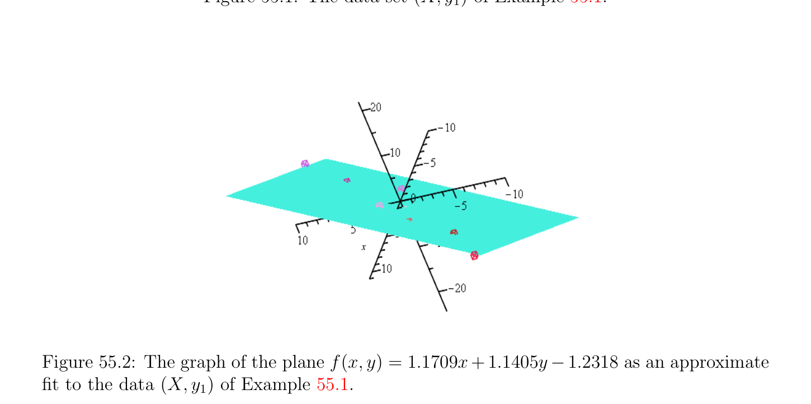
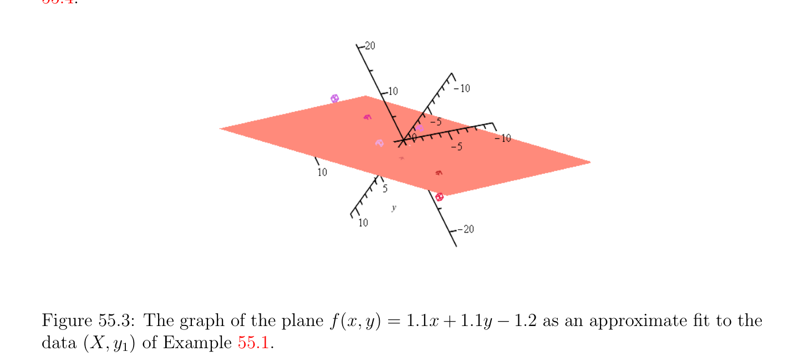
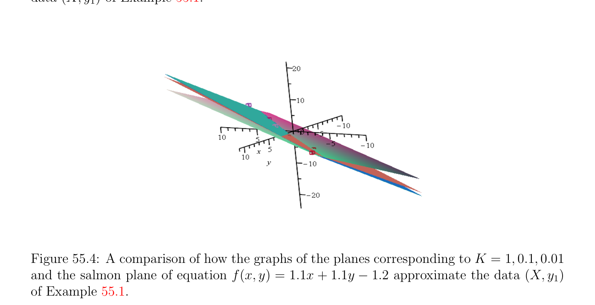

# Ridge Regression; Learning an Affine Function

<!-- PAGE 2075 -->
The above suggests defining the variable $\alpha$  so that $\xi  = K\alpha$ , so we have $\lambda  = 2K\alpha$  and $w = X^{\top}\alpha$ . Then we obtain the dual function as a function of $\alpha$  by substituting the above values of $\xi , \lambda$  and $w$ back in the Lagrangian and we get
$$G(\alpha ) = K^{2}\alpha^{\top} \alpha  + K\alpha^{\top} XX^{\top}\alpha  -2K\alpha^{\top} XX^{\top}\alpha  -2K^{2}\alpha^{\top} \alpha  + 2K\alpha^{\top} y$$
$$= -K\alpha^{\top} (XX^{\top}+ KI_{m})\alpha  + 2K\alpha^{\top} y.$$
This is a strictly concave function so by Theorem 40.13(4), its maximum is achieved iff $\nabla G_{\alpha} = 0$, that is,
$$2K(XX^{\top}+ KI_{m})\alpha  = 2Ky,$$
which yields
$$\alpha  = (XX^{\top}+ KI_{m})^{-1}y.$$
Putting everything together we obtain
$$\alpha  = (XX^{\top}+ KI_{m})^{-1}y$$
$$w = X^{\top}\alpha$$
$$\xi  = K\alpha ,$$
which yields
$$w = X^{\top}(XX^{\top}+ KI_{m})^{-1}y.(*_{wd})$$
Earlier in $(*_{wp})$ we found that
$$w = (X^{\top}X + KI_{n})^{-1}X^{\top}y,$$
and it is easy to check that
$$(X^{\top}X + KI_{n})^{-1}X^{\top}= X^{\top}(XX^{\top}+ KI_{m})^{-1}.$$
If $n < m$ it is cheaper to use the formula on the left-hand side, but if $m < n$ it is cheaper to use the formula on the right-hand side.

## 55.2 Ridge Regression; Learning an Affine Function

It is easy to adapt the above method to learn an affine function f(x) $= x^{\top}w + b$ instead of a linear function f(x) $= x^{\top}w$, where $b \in \mathbb{R}$. We have the following optimization program Program (RR3):
$$minimize\xi^{\top} \xi  + Kw^{\top}w$$
$$subject to$$
$$y -Xw -b1 = \xi ,$$

<!-- PAGE 2076 -->
$$\mathbb{R}^{m} \mathbb{R}^{n}$$
with $y, \xi , 1 \in$ and $w \in$ . Note that in Program (RR3) minimization is performed over $\xi , w$ and $b$, but $b$ is not penalized in the objective function. As in Section 55.1, the objective function is convex. The Lagrangian associated with this program is
$$L(\xi , w, b, \lambda ) = \xi^{\top} \xi  + Kw^{\top}w -w^{\top}X^{\top}\lambda  -\xi^{\top} \lambda  -b1^{\top}\lambda  + \lambda^{\top} y.$$
Since $L$ is convex as a function of $\xi , b, w$, by Theorem 40.13(4), it has a minimum iff $\nabla L_{\xi ,b,w} = 0$. We get
$$\lambda  = 2\xi$$
$$1^{\top}\lambda  = 0$$
$$\xi$$
$$w = \frac{1}{2} K X^{\top}\lambda  = X^{\top}K .$$
As before, if we set $\xi  = K\alpha$  we obtain $\lambda  = 2K\alpha , w = X^{\top}\alpha$ , and
$$G(\alpha ) = -K\alpha^{\top} (XX^{\top}+ KI_{m})\alpha  + 2K\alpha^{\top} y.$$
Since $K > 0$ and $\lambda  = 2K\alpha$ , the dual to ridge regression is the following program Program (DRR3):
$$minimize\alpha^{\top} (XX^{\top}+ KI_{m})\alpha  -2\alpha^{\top} y$$
$$subject to$$
$$1^{\top}\alpha  = 0,$$
where the minimization is over $\alpha$ . Observe that up to the factor $1/2$, this problem satisfies the conditions of Proposition 42.3 with
$$A = (XX^{\top}+ KI_{m})^{-1}$$
$$b = y$$
$$B = 1_{m}$$
$$f = 0,$$
and $x$ renamed as $\alpha$ . Therefore, it has a unique solution $(\alpha , \mu$ ) (beware that $\lambda  = 2K\alpha$  is not the $\lambda$  used in Proposition 42.3, which we rename as $\mu$ ), which is the unique solution of the KKT-equations
$$\begin{pmatrix} XX^{\top}+ KI_{m} & 1_{m} \\ 1_{m}^{\top} & 0 \end{pmatrix} \begin{pmatrix} \alpha \\ \mu \end{pmatrix} = \begin{pmatrix} y \\ 0 \end{pmatrix} .$$
Since the solution given by Proposition 42.3 is
$$\mu  = (B^{\top}AB)^{-1}(B^{\top}Ab -f),\alpha  = A(b -B\mu ),$$

<!-- PAGE 2077 -->
we get $\mu  = (1^{\top}(XX^{\top} + KI_{m})^{-1}1)^{-1}1^{\top}(XX^{\top} + KI_{m})^{-1}y, \alpha  = (XX^{\top} + KI_{m})^{-1}(y$ - $\mu 1)$. Note that the matrix $B^{\top}AB$ is the scalar $1^{\top}(XX^{\top} + KI_{m})^{-1}1$, which is the negative of the Schur complement of $XX^{\top} + KI_{m}$. Interestingly $b = \mu$ , which is not obvious a priori.

> **Proposition 55.2.** We have $b = \mu$ .

*Proof.* To prove this result we need to express $\alpha$  differently. Since $\mu$  is a scalar, $\mu 1 = 1\mu$ , so
$$\mu 1 = 1\mu  = (1^{\top}(XX^{\top}+ KI_{m})^{-1}1)^{-1}11^{\top}(XX^{\top}+ KI_{m})^{-1}y,$$
and we obtain $\alpha  = (XX^{\top} + KI_{m})^{-1}(I_{m}$ - $(1^{\top}(XX^{\top} + KI_{m})^{-1}1)^{-1}11^{\top}(XX^{\top} + KI_{m})^{-1})y. (*_{\alpha3})$ Since $w = X^{\top}\alpha$ , we have $w = X^{\top}(XX^{\top} + KI_{m})^{-1}(I_{m}$ - $(1^{\top}(XX^{\top} + KI_{m})^{-1}1)^{-1}11^{\top}(XX^{\top} + KI_{m})^{-1})y. (*_{w3})$ From $\xi  = K\alpha$ , we deduce that $b$ is given by the equation
$$b1 = y -Xw -K\alpha .$$
Since $w = X^{\top}\alpha$ , using $(*_{\alpha3})$ we obtain
$$b1 = y -Xw -K\alpha$$
$$= y -(XX^{\top}+ KI_{m})\alpha$$
$$= y -(I_{m} -(1^{\top}(XX^{\top}+ KI_{m})^{-1}1)^{-1}11^{\top}(XX^{\top}+ KI_{m})^{-1})y$$
$$= (1^{\top}(XX^{\top}+ KI_{m})^{-1}1)^{-1}11^{\top}(XX^{\top}+ KI_{m})^{-1})y$$
$$= \mu 1,$$
and thus
$$b = \mu  = (1^{\top}(XX^{\top}+ KI_{m})^{-1}1)^{-1}1^{\top}(XX^{\top}+ KI_{m})^{-1}y,(*_{b3})$$
as claimed. In summary the KKT-equations determine both $\alpha$  and $\mu$ , and so $w = X^{\top}\alpha$  and $b$ as well. There is also a useful expression of $b$ as an average. Since $1^{\top}1 = m$ and $1^{\top}\alpha  = 0$, we get
$$b = \frac{1}{m} 1^{\top}y - \frac{1}{m} 1^{\top}Xw - \frac{1}{m} K1^{\top}\alpha  =\overline{y} - \sum_{j=1}^{n}  \overline{X}^{j}w_{j},$$

<!-- PAGE 2078 -->
where $\overline{y}$ is the mean of $y$ and $\overline{X}^{j}$ is the mean of the jth column of $X$. Therefore,
$$b =\overline{y} - \sum_{j=1}^{n}  \overline{X}^{j}w_{j} =\overline{y} -(\overline{X}^{1} \cdots  \overline{X}^{n})w,$$
$$\cdots  \times$$
where $(\overline{X}^{1}  \overline{X}^{n})$ is the $1  n$ row vector whose jth entry is $\overline{X}^{j}$. We will now show that solving the dual (DRR3) for $\alpha$  and obtaining $w = X^{\top}\alpha$  is
$$equivalent to solving our previous ridge regression Problem (RR2) applied to the \frac{centered}{X^{j}}$$
data $y = y -\overline{y} 1_{m}$ and $X = X -\overline{X}, where\overline{X}$ is the $m\times$  matrix whose jth column is $1_{m}$,
$$the vector b whose coordinates b are all equal to the mean \frac{n}{X^{j}} of the jth column X^{j} of X.$$
The expression
$$- \cdots$$
$$b =\overline{y}(\overline{X}^{1} \overline{X}^{n})w$$
suggests looking for an intercept term $b$ (also called bias) of the above form, namely Program (RR4):
$$minimize\xi^{\top} \xi  + Kw^{\top}w$$
$$subject to$$
$$y -Xw -b1 = \xi$$
$$- \cdots$$
$$b =b +\overline{y}(\overline{X}^{1} \overline{X}^{n})w,$$
$$b$$
with $b \in \mathbb{R}$. Again, in Program (RR4), minimization is performed over $\xi , w, b$ and $b$, but $b b  b$ and $b$ are not penalized. $b$ Since
$$b1 =b1 +\overline{y} 1 -(\overline{X}^{1}1 \cdots  \overline{X}^{n}1)w,$$
$$b$$
if $\overline{X} = (\overline{X}^{1}1 \cdots  \overline{X}^{n}1)$ is the $m \times  n$ matrix whose jth column is the vector $\overline{X}^{j}1$, then the above program is equivalent to the program Program (RR5):
$$minimize\xi^{\top} \xi  + Kw^{\top}w$$
$$subject to$$
$$y -Xw -\overline{y} 1 +\overline{Xw} -b1 = \xi ,$$
$$b$$
where minimization is performed over $\xi , w$ and $b$. If we write $y = y$ - $\overline{y} 1$ and $X = X$ - $\overline{X}$,
$$b b b$$
then the above program becomes Program (RR6):
$$minimize\xi^{\top} \xi  + Kw^{\top}w$$
$$subject to$$
$$y -Xw -b1 = \xi ,$$
$$bbb$$

<!-- PAGE 2079 -->
minimizing over $\xi , w$ and $b$. If the solution to this program is $w$, then $b$ is given by
$$b b b$$
$$- \cdots$$
$$b =\overline{y}(\overline{X}^{1}\overline{X}^{n})w = 0,$$
$$b b b b b$$
since the data $y$ and $X$ are centered. Therefore (RR6) is equivalent to ridge regression
$$b b$$
without an intercept term applied to the centered data $y = y$ - $\overline{y} 1$ and $X = X$ - $\overline{X}$,
$$b b$$
Program (RR6'):
$$minimize\xi^{\top} \xi  + Kw^{\top}w$$
$$subject to$$
$$y -Xw = \xi ,$$
$$bb$$
minimizing over $\xi$  and $w$. If $w$ is the optimal solution of this program given by $b$
$$w =X^{\top}(XX^{\top}+ KI_{m})^{-1}y,(*_{w6})$$
$$b b b bb$$
then $b$ is given by
$$- \cdots$$
$$b =\overline{y}(\overline{X}^{1} \overline{X}^{n})w.$$
$$b$$
Remark: Although this is not obvious a priori, the optimal solution $w^{*}$ of the Program
(RR3) given by $(*_{w3})$ is equal to the optimal solution $w$ of Program (RR6') given by $(*_{w6})$.
$$b$$
We believe that it should be possible to prove the equivalence of these formulae but a proof eludes us at this time. We leave this as an open problem. In practice the Program (RR6') involving the centered data appears to be the preferred one.

> **Example 55.1.** Consider the data set $(X, y_{1})$ with
$$X = \begin{pmatrix} -10 & 11 \\ -6 & 5 \\ -2 & 4 \\ 0 & 0 \\ 1 & 2 \\ 2 & -5 \\ 6 & -4 \\ 10 & 6 \end{pmatrix} ,y_{1} = \begin{pmatrix} 0 \\ -2.5 \\ 0.5 \\ -2 \\ 2.5 \\ -4.2 \\ 1 \\ 4 \end{pmatrix}$$
$$-$$
as illustrated in Figure 55.1. We find that $\overline{y} =$ -0.0875 and $(\overline{X}^{1}\overline{, X}^{2}) =$ (0.125, 0.875). For the value $K = 5$, we obtain
$$w = \begin{pmatrix} 0.9207 \\ 0.8677 \end{pmatrix} ,b = -0.9618,$$

<!-- PAGE 2080 -->
for $K =$ 0.1, we obtain
$$w = \begin{pmatrix} 1.1651 \\ 1.1341 \end{pmatrix} ,b = -1.2255,$$
and for $K =$ 0.01,
$$w = \begin{pmatrix} 1.1709 \\ 1.1405 \end{pmatrix} ,b = -1.2318.$$
See Figure 55.2.
$$4$$
$$2$$
$$Z_{-2}^{0}$$
$$-4$$
$$15$$
$$1510$$
$$105$$
$$50$$
$$0-5$$
$$-5-10$$
$$YX$$
$$-10-15$$
$$Figure 55.1: The data set (X, y_{1}) of Example 55.1.$$

**Figure 55.2:** The graph of the plane f(x, $y) = 1.1709x+1.1405y$ -1.2318 as an approximate fit to the data $(X, y_{1})$ of Example 55.1.

<!-- PAGE 2081 -->
We conclude that the points $(X_{i}, y_{i})$ (where $X_{i}$ is the ith row of $X)$ almost lie on the plane of equation
$$x + y -z -1 = 0,$$
and that $f$ is almost the function given by f(x, $y) =$ 1.1x $+$ 1.1y - 1.2. See Figures 55.3 and 55.4.

**Figure 55.3:** The graph of the plane f(x, $y) =$ 1.1x $+$ 1.1y - 1.2 as an approximate fit to the data $(X, y_{1})$ of Example 55.1.

**Figure 55.4:** A comparison of how the graphs of the planes corresponding to $K = 1$, 0.1, 0.01 and the salmon plane of equation f(x, $y) =$ 1.1x $+$ 1.1y - 1.2 approximate the data $(X, y_{1})$ of Example 55.1. If we change $y_{1}$ to
$$y_{2} = \begin{pmatrix} 0 & -2 & 1 & -1 & 2 & -4 & 1 \end{pmatrix} 3^{\top},$$

<!-- PAGE 2082 -->
as evidenced by Figure 55.5, the exact solution is
$$w = \begin{pmatrix} 1 \\ 1 \end{pmatrix} ,b = -1,$$
and for $K =$ 0.01, we find that
$$w = \begin{pmatrix} 0.9999 \\ 0.9999 \end{pmatrix} ,b = -0.9999.$$

**Figure 55.5:** The data $(X, y_{2})$ of Example 55.1 is contained within the graph of the plane f(x, $y) = x + y$ - $1$. We can see how the choice of $K$ affects the quality of the solution $(w, b)$ by computing the norm $\|\xi \|_{2}$ of the error vector $\xi  = y$ - Xw. We notice that the smaller $K$ is, the smaller
$$bb$$
is this norm. It is natural to wonder what happens if we also penalize $b$ in program (RR3). Let us add the term $Kb^{2}$ to the objective function. Then we obtain the program
$$minimize\xi^{\top} \xi  + Kw^{\top}w + Kb^{2}$$
$$subject to$$
$$y -Xw -b1 = \xi ,$$
minimizing over $\xi , w$ and $b$. This suggests treating $b$ an an extra component of the weight vector $w$ and by forming the $m \times  (n + 1)$ matrix $[X 1]$ obtained by adding a column of 1’s (of dimension $m)$ to the matrix $X$, we obtain

<!-- PAGE 2083 -->
Program (RR3b):
$$minimize\xi^{\top} \xi  + Kw^{\top}w + Kb^{2}$$
$$subject to$$
$$y -[X 1] \begin{pmatrix} w \\ b \end{pmatrix} = \xi ,$$
minimizing over $\xi , w$ and $b$. This program is solved just as Program (RR2). In terms of the dual variable $\alpha$ , we get
$$\alpha  = ([X 1][X 1]^{\top}+ KI_{m})^{-1}y$$
$$\begin{pmatrix} w \\ b \end{pmatrix} = [X 1]^{\top}\alpha$$
$$\xi  = K\alpha .$$
Thus $b = 1^{\top}\alpha$ . Observe that $[X$ 1][X $1]^{\top} = XX^{\top} + 11^{\top}$. If $n < m$, it is preferable to use the formula
$$\begin{pmatrix} w \\ b \end{pmatrix} = ([X 1]^{\top}[X 1] + KI_{n+1})^{-1}[X 1]^{\top}y.$$
Since we also have the equation
$$y -Xw -b1 = \xi ,$$
we obtain
$$\frac{1}{m} 1^{\top}y - \frac{1}{m} 1^{\top}Xw - \frac{1}{m} b1^{\top}1 = \frac{1}{m} 1^{\top}K\alpha ,$$
so
$$- \cdots  -$$
$$\overline{y}(\overline{X}^{1} \overline{X}^{n})wb = \frac{1}{m} Kb,$$
which yields
$$- \cdots$$
$$b = \frac{m}{m + K} (\overline{y}(\overline{X}^{1} \overline{X}^{n})w).$$
Remark: As a least squares problem, the solution is given in terms of the pseudo-inverse $[X 1]^{+}$ of $[X 1]$ by
$$\begin{pmatrix} w \\ b \end{pmatrix} = [X 1]^{+}y.$$

> **Example 55.2.** Applying Program (RR3b) to the data set of Example 55.1 with $K =$ 0.01 yields
$$w = \begin{pmatrix} 1.1706 \\ 1.1401 \end{pmatrix} ,b = -1.2298.$$
