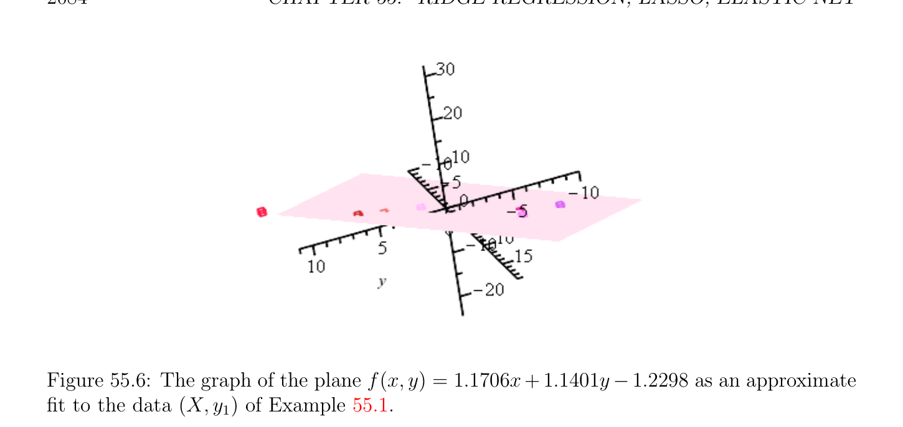

# Kernel Ridge Regression

<!-- PAGE 2084 -->

**Figure 55.6:** The graph of the plane f(x, $y) = 1.1706x+1.1401y$ -1.2298 as an approximate fit to the data $(X, y_{1})$ of Example 55.1. See Figure 55.6. We can see how the choice of $K$ affects the quality of the solution $(w, b)$ by computing the norm $\|\xi \|_{2}$ of the error vector $\xi  = y$ - Xw - $b1_{m}$. As in Example 55.1 we notice that the smaller $K$ is, the smaller is this norm. We also observe that for a given value of $K$, Program (RR6') gives a slightly smaller value of $\|\xi \|_{2}$ than (RR3b) does. As pointed out by Hastie, Tibshirani, and Friedman $[91]$ (Section 3.4), a defect of the approach where $b$ is also penalized is that the solution for $b$ is not invariant under adding a constant $c$ to each value $y_{i}$. This is not the case for the approach using Program (RR6').

## 55.3 Kernel Ridge Regression

One interesting aspect of the dual (of either (RR2) or (RR3)) is that it shows that the solution $w$ being of the form $X^{\top}\alpha$ , is a linear combination
$$w = \sum_{i=1}^{m}  \alpha_{i} x_{i}$$
of the data points $x_{i}$, with the coefficients $\alpha_{i}$  corresponding to the dual variable $\lambda  = 2K\alpha$ of the dual function, and with
$$\alpha  = (XX^{\top}+ KI_{m})^{-1}y.$$
If $m$ is smaller than $n$, then it is more advantageous to solve for $\alpha$ . But what really makes the dual interesting is that with our definition of $X$ as
$$X = \begin{pmatrix} x_{1}^{\top} \\ \vdots \\ x_{m}^{\top} \end{pmatrix} ,$$

<!-- PAGE 2085 -->
the matrix $XX^{\top}$ consists of the inner products $x_{i}^{\top} x_{j}$, and similarly the function learned f(x) $= x^{\top}w$ can be expressed as
$$f(x) = \sum_{i=1}^{m}  \alpha_{i} x_{i}^{\top} x,$$
namely that both $w$ and f(x) are given in terms of the inner products $x_{i}^{\top} x_{j}$ and $x_{i}^{\top} x$. This fact is the key to a generalization to ridge regression in which the input space $\mathbb{R}^{n}$ is embedded in a larger (possibly infinite dimensional) Euclidean space $F$ (with an inner product $\langle$ -, $-\rangle$ ) usually called a feature space, using a function
$$\mathbb{R}^{n}$$
$$\phi :\to F.$$
The problem becomes (kernel ridge regression) Program (KRR2):
$$minimize\xi^{\top} \xi  + K\langle w, w\rangle$$
$$subject to$$
$$y_{i} -\langle w, \phi (x_{i})\rangle = \xi_{i} ,i = 1, \dots  , m,$$
minimizing over $\xi$  and $w$. Note that $w \in F$. This problem is discussed in Shawe–Taylor and Christianini $[165]$ (Section 7.3). We will show below that the solution is exactly the same:
$$\alpha  = (G + KI_{m})^{-1}y$$
$$w = \sum_{i=1}^{m}  \alpha_{i} \phi (x_{i})$$
$$\xi  = K\alpha ,$$
where $G$ is the Gram matrix given by $G_{ij} = \langle \phi (x_{i}), \phi (x_{j})\rangle$ . This matrix is also called the kernel matrix and is often denoted by $K$ instead of $G$. In this framework we have to be a little careful in using gradients since the inner product $\langle$ -, $-\rangle$ on $F$ is involved and $F$ could be infinite dimensional, but this causes no problem because we can use derivatives, and by Proposition 39.5 we have
$$d\langle -, -\rangle_{(u,v)} (x, y) = \langle x, v\rangle + \langle u, y\rangle .$$
This implies that the derivative of the map $u \mapsto \langle u, u\rangle$ is
$$d\langle -, -\rangle_{u} (x) = 2\langle x, u\rangle .(d_{1})$$

<!-- PAGE 2086 -->
Since the map $u \mapsto \langle u, v\rangle$ (with $v$ fixed) is linear, its derivative is
$$d\langle -, v\rangle_{u} (x) = \langle x, v\rangle .(d_{2})$$
The derivative of the Lagrangian
$$L(\xi , w, \lambda ) = \xi^{\top} \xi  + K\langle w, w\rangle - \sum_{i=1}^{m}  \lambda_{i} \langle \phi (x_{i}), w\rangle -\xi^{\top} \lambda  + \lambda^{\top} y$$
with respect to $\xi$  and $w$ is
$$dL_{\xi ,w} \begin{pmatrix} \xi ,ew \\ e \end{pmatrix} = 2(\xi e)^{\top}\xi  -(\xi e)^{\top}\lambda  +2Kw - \sum_{i=1}^{m}  \lambda_{i} \phi (x_{i}), we,$$
where we used $(d$ ) to calculate the derivative of $\xi^{\top} \xi  + K\langle w, w\rangle$ and $(d_{2})$ to calculate the
$$derivative of - \sum_{i}^{1}  m=1 \lambda_{i} \langle \phi (x_{i}), w\rangle -\xi^{\top} \lambda . We have dL_{\xi ,w} = 0 for all \xi e and we iff$$
$$\begin{pmatrix} \xi ,ew \\ e \end{pmatrix}$$
$$2Kw = \sum_{i=1}^{m}  \lambda_{i} \phi (x_{i})$$
$$\lambda  = 2\xi .$$
Again we define $\xi  = K\alpha$ , so we have $\lambda  = 2K\alpha$ , and
$$w = \sum_{i=1}^{m}  \alpha_{i} \phi (x_{i}).$$
Plugging back into the Lagrangian we get
$$G(\alpha ) = K^{2}\alpha^{\top} \alpha  + K \sum_{i,j=1}^{m}  \alpha_{i} \alpha_{j} \langle \phi (x_{i}), \phi (x_{j})\rangle -2K \sum_{i,j=1}^{m}  \alpha_{i} \alpha_{j} \langle \phi (x_{i}), \phi (x_{j})\rangle$$
$$-2K^{2}\alpha^{\top} \alpha  + 2K\alpha^{\top} y$$
$$= -K^{2}\alpha^{\top} \alpha  -K \sum_{i,j=1}^{m}  \alpha_{i} \alpha_{j} \langle \phi (x_{i}), \phi (x_{j})\rangle + 2K\alpha^{\top} y.$$
If $G$ is the matrix given by $G_{ij} = \langle \phi (x_{i}), \phi (x_{j})\rangle$ , then we have
$$G(\alpha ) = -K\alpha^{\top} (G + KI_{m})\alpha  + 2K\alpha^{\top} y.$$
The function $G$ is strictly concave, so by Theorem 40.13(4) it has a maximum for
$$\alpha  = (G + KI_{m})^{-1}y,$$
as claimed earlier.

<!-- PAGE 2087 -->
$$\mathbb{R}^{n}$$
As in the standard case of ridge regression, if $F =$ (but the inner product $\langle$ -, $-\rangle$ is arbitrary), we can adapt the above method to learn an affine function f(w) $= x^{\top}w + b$ instead of a linear function f(w) $= x^{\top}w$, where $b \in \mathbb{R}$. This time we assume that $b$ is of the form
$$-\langle  \cdots \rangle$$
$$b =\overline{y} w, (\overline{X}^{1} \overline{X}^{n}),$$
$$where X^{j}is the j column of the \frac{m}{X^{1}} \times   n \frac{matrix}{X^{n}} X whose ith row is the transpose of the$$
column vector $\phi (x_{i})$, and where ( $\cdots$  ) is viewed as a column vector. We have the minimization problem Program (KRR6'):
$$minimize\xi^{\top} \xi  + K\langle w, w\rangle$$
$$subject to$$
$$[$$
$$y_{i} -\langle w,\phi (x_{i})\rangle = \xi_{i} ,i = 1, \dots  , m,$$
$$b$$
$$[$$
minimizing over $\xi$  and $w$, where $\phi (x_{i})$ is the $n$-dimensional vector $\phi (x_{i})$ - $(\overline{X}^{1} \cdots  \overline{X}^{n})$. The solution is given in terms of the matrix $G$ defined by
$$b$$
$$[ [$$
$$G_{ij} = \langle \phi (x_{i}),\phi (x_{j})\rangle ,$$
$$b$$
as before. We get
$$\alpha  = (G + KI_{m})^{-1}y,$$
$$bb$$
and according to a previous computation, $b$ is given by
$$b =\overline{y} - \frac{1}{m} 1G b\alpha .$$
We explained in Section 53.4 how to compute the matrix $G$ from the matrix $G$.
$$b$$
Since the dimension of the feature space $F$ may be very large, one might worry that computing the inner products $\langle \phi (x_{i}), \phi (x_{j})\rangle$ might be very expensive. This is where kernel
$$\mathbb{R}^{n}$$
functions come to the rescue. A kernel function $\kappa$  for an embedding $\phi$ : $\to F$ is a map $\mathbb{R}^{n} \mathbb{R}^{n} \mathbb{R} \kappa$ : $\times \to$  with the property that
$$\kappa (u, v) = \langle \phi (u), \phi (v)\rangle for all u, v \in \mathbb{R}^{n}.$$
If $\kappa (u, v)$ can be computed in a reasonably cheap way, and if $\phi (u)$ can be computed cheaply, then the inner products $\langle \phi (x_{i}), \phi (x_{j})\rangle$ (and $\langle \phi (x_{i}), \phi (x)\rangle$ ) can be computed cheaply; see Chapter $53$. Fortunately there are good kernel functions. Two very good sources on kernel methods are Sch¨olkopf and Smola $[151]$ and Shawe–Taylor and Christianini $[165]$.
