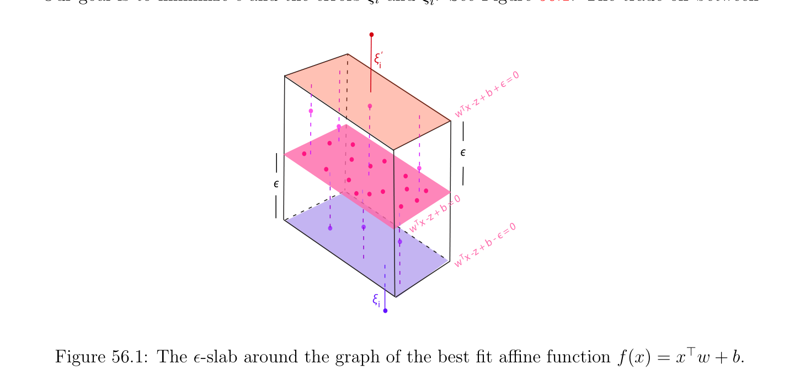
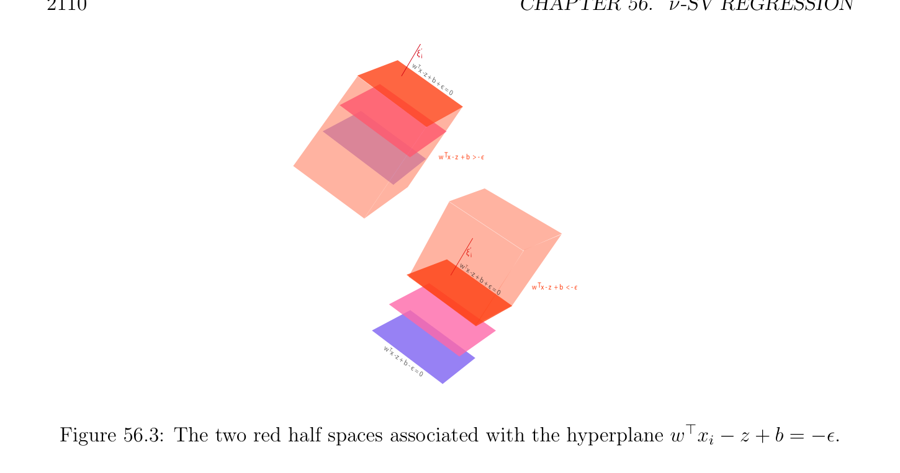

# -SV Regression; Derivation of the Dual

<!-- PAGE 2107 -->
Chapter $56 \nu$ -SV Regression 56.1 $\nu$ -SV Regression; Derivation of the Dual Let ${(x_{1}, y_{1}), \dots  , (x_{m}, y_{m})}$ be a set of observed data usually called a set of training data,
$$\mathbb{R}^{n} \mathbb{R}$$
with $x_{i} \in$ and $y_{i} \in$ . As in Chapter $55$, we form the $m \times  n$ matrix $X$ where the row vectors $x_{i}^{\top}$ are the rows of $X$. Our goal is to learn an affine function $f$ of the form f(x) $= x^{\top}w + b$ that fits the set of training data, but does not penalize errors below some given $\epsilon  \ge 0$. Geometrically, we view the pairs $(x_{i}, y_{i})$ are points in $\mathbb{R}^{n+1}$, and we try to fit a hyperplane $H_{w,b}$ of equation
$$(w^{\top}-1) \begin{pmatrix} x \\ z \end{pmatrix} + b = w^{\top}x -z + b = 0$$
that best fits the set of points $(x_{i}, y_{i})$ (where $(x, z) \in \mathbb{R}^{n+1})$. We seek an $\epsilon  > 0$ such that most points $(x_{i}, y_{i})$ are inside the slab (or tube) of width $2\epsilon$  bounded by the hyperplane $H_{w,b-\epsilon}$ of equation
$$(w^{\top}-1) \begin{pmatrix} x \\ z \end{pmatrix} + b -\epsilon  = w^{\top}x -z + b -\epsilon  = 0$$
and the hyperplane $H_{w,b+\epsilon}$ of equation
$$(w^{\top}-1) \begin{pmatrix} x \\ z \end{pmatrix} + b + \epsilon  = w^{\top}x -z + b + \epsilon  = 0.$$
Observe that the hyperplanes $H_{w,b-\epsilon}, H_{w,b}$ and $H_{w,b+\epsilon}$ intersect the z-axis when $x = 0$ for the values $(b$ - $\epsilon , b, b + \epsilon$ ). Since $\epsilon  \ge 0$, the hyperplane $H_{w,b-\epsilon}$ is below the hyperplane $H_{w,b}$ which is below the hyperplane $H_{w,b+\epsilon}$. We refer to the lower hyperplane $H_{w,b-\epsilon}$ as the blue margin, to the upper hyperplane $H_{w,b+\epsilon}$ as the red margin, and to the hyperplane $H_{w,b}$ as the best fit hyperplane. Also note that since the term $-z$ appears in the equations of these hyperplanes, points for which $w^{\top}x$ - $z + b \le 0$ are above the hyperplane $H_{w,b}$, and points for which $w^{\top}x$ - $z + b \ge 0$ are below the hyperplane $H_{w,b}$ (and similarly for $H_{w,b-\epsilon}$ and
$$2107$$

<!-- PAGE 2108 -->
$H_{b+\epsilon})$. The region bounded by the hyperplanes $H_{w,b-\epsilon}$ and $H_{b+\epsilon}$ (which contains the best fit hyperplane $H_{w,b})$ is called the $\epsilon$ -slab. We also allow errors by allowing the point $(x_{i}, y_{i})$ to be outside of the $\epsilon$ -slab but in the slab between the hyperplane $H_{w,b-\epsilon-\xi i}$ of equation
$$(w^{\top}-1) \begin{pmatrix} x \\ z \end{pmatrix} + b -\epsilon  -\xi_{i}  = w^{\top}x -z + b -\epsilon  -\xi_{i}  = 0$$
for some $\xi_{i}  > 0$ (which is below the blue margin hyperplane $H_{w,b-\epsilon})$ and the hyperplane $H_{w,b+\epsilon+\xi i'}$ of equation
$$(w^{\top}-1) \begin{pmatrix} x \\ z \end{pmatrix} + b + \epsilon  + \xi_{i}'  = w^{\top}x_{i} -z + b + \epsilon  + \xi_{i}'  = 0$$
for some $\xi_{i}'  > 0$ (which is above the red margin hyperplane $H_{w,b+\epsilon})$, so that $w^{\top}x_{i}$ - $y_{i} + b$ - $\epsilon$  - $\xi_{i}  \le 0$ and $w^{\top}x_{i}$ - $y_{i} + b + \epsilon  + \xi_{i}'  \ge 0$, that is,
$$f(x) -y_{i} = w^{\top}x_{i} + b -y_{i} \le \epsilon  + \xi_{i} ,$$
$$-(f(x) -y_{i}) = -w^{\top}x_{i} -b + y_{i} \le \epsilon  + \xi_{i}' .$$
Our goal is to minimize $\epsilon$  and the errors $\xi_{i}$  and $\xi_{i}'$ . See Figure 56.1. The trade offbetween
$$\xi ‘$$
$$i$$
$$є = 0$$
$$b +$$
$$+$$
$$x -z$$
$$w T$$
$$є$$
$$є$$
$$= 0$$
$$b$$
$$z +$$
$$x -$$
$$wT  = 0$$
$$- є$$
$$b$$
$$z +$$
$$Tx -$$
$$w$$
$$\xi$$
$$i$$

**Figure 56.1:** The $\epsilon$ -slab around the graph of the best fit affine function f(x) $= x^{\top}w + b$. the size of $\epsilon$  and the size of the slack variables $\xi_{i}$  and $\xi_{i}'$  is achieved by using two constants $\nu  \ge 0$ and $C > 0$. The method of $\nu$ -support vector regression, for short $\nu$ -SV regression, is specified by the following minimization problem:

<!-- PAGE 2109 -->
Program $\nu$ -SV Regression:
$$minimize \frac{1}{2} w^{\top}w + C \begin{pmatrix} 1 \\ \nu \epsilon  + & (\xi_{i}  + \xi_{i}' ) \\ m \end{pmatrix} \sum_{i=1}^{m}$$
$$subject to$$
$$w^{\top}x_{i} + b -y_{i} \le \epsilon  + \xi_{i} ,\xi_{i}  \ge 0i = 1, \dots  , m$$
$$-w^{\top}x_{i} -b + y_{i} \le \epsilon  + \xi_{i}' ,\xi_{i}'  \ge 0i = 1, \dots  , m$$
$$\epsilon  \ge 0,$$
minimizing over the variables $w, b, \epsilon , \xi$ , and $\xi'$ . The constraints are affine. The problem is to minimize $\epsilon$  and the errors $\xi_{i} , \xi_{i}'$  so that the $\ell^{1}$ -error is “squeezed down” to zero as much as possible, in the sense that the right-hand side of the inequality
$$\sum_{i=1}^{m}  |y_{i} -x_{i}^{\top} w -b| \le m\epsilon  + \sum_{i=1}^{m}  \xi_{i}  + \sum_{i=1}^{m}  \xi_{i}'$$
is as small as possible. As shown by Figure 56.2, the region associated with the constraint $w^{\top}x_{i}$ - $z + b \le \epsilon$  contains the $\epsilon$ -slab. Similarly, as illustrated by Figure 56.3, the region associated with the constraint $w^{\top}x_{i}$ - $z + b \ge -\epsilon$ , equivalently $-w^{\top}x_{i} + z$ - $b \le \epsilon$ , also contains the $\epsilon$ -slab.
$$w T$$
$$x -$$
$$z + b + є =$$
$$0$$
$$+ b$$
$$wT  x$$
$$w Tz =$$
$$x -$$
$$z + b$$
$$\xi - є$$
$$i= 0$$
$$w   x -z + b > Tє$$
$$w T$$
$$x -$$
$$z + b w   x -z + b < Tє$$
$$\xi - є$$
$$i= 0$$

**Figure 56.2:** The two blue half spaces associated with the hyperplane $w^{\top}x_{i}$ - $z + b = \epsilon$ . Observe that if we require $\epsilon  = 0$, then the problem is equivalent to minimizing
$$\|y -Xw -b1\|_{1} + \frac{1}{2} w^{\top}w.$$
Thus it appears that the above problem is the version of Program (RR3) (see Section 55.2) in which the $\ell^{2}$ -norm of $y$ -Xw-b1 is replaced by its $\ell^{1}$ -norm. This a sort of “dual” of lasso

<!-- PAGE 2110 -->
$$\xi  i‘$$
$$w  xT$$
$$-z + b + є =$$
$$0$$
$$w   x - z  + b  > - Tє$$
$$\xi  i‘$$
$$w  Tx$$
$$-z + b$$
$$+ є w   x - z  + b  < - Tє$$
$$= 0$$
$$w  xT$$
$$-z + b$$
$$- є =$$
$$0$$

**Figure 56.3:** The two red half spaces associated with the hyperplane $w^{\top}x_{i}$ - $z + b = -\epsilon$ . (see Section 55.5) where $(1/2)w^{\top}w = (1/2) \|w\|_{2}^{2}$ is replaced by $\tau  \|w\|_{1}$, and $\|y$ - Xw - $b1\|_{1}$ is replaced by $\|y$ - Xw - $b1\|_{2}^{2}$.

> **Proposition 56.1.** For any optimal solution, the equations
$$\xi_{i} \xi_{i}'  = 0,i = 1, \dots  , m(\xi \xi' )$$
hold. If $\epsilon  > 0$, then the equations
$$w^{\top}x_{i} + b -y_{i} = \epsilon  + \xi_{i}$$
$$-w^{\top}x_{i} -b + y_{i} = \epsilon  + \xi_{i}'$$
cannot hold simultaneously.

*Proof.* For an optimal solution we have
$$-\epsilon  -\xi_{i}'  \le w^{\top}x_{i} + b -y_{i} \le \epsilon  + \xi_{i} .$$
If $w^{\top}x_{i} + b$ - $y_{i} \ge 0$, then $\xi_{i}'  = 0$ since the inequality
$$-\epsilon  -\xi_{i}'  \le w^{\top}x_{i} + b -y_{i}$$
is trivially satisfied (because $\epsilon , \xi_{i}'  \ge 0)$, and if $w^{\top}x_{i} + b$ - $y_{i} \le 0$, then similarly $\xi_{i}  = 0$. See Figure 56.4. Observe that the equations
$$w^{\top}x_{i} + b -y_{i} = \epsilon  + \xi_{i}$$
$$-w^{\top}x_{i} -b + y_{i} = \epsilon  + \xi_{i}'$$

<!-- PAGE 2111 -->
$$\xi  i‘$$
$$w  x T$$
$$-z +$$
$$b + є = 0w   x -z +b  < 0T$$
$$+ b$$
$$wT  x$$
$$z = \xi ‘$$
$$w  x Tw  x i$$
$$\xi i-z + T-z$$
$$b - є  + b$$
$$= 0 + є = 0$$
$$x + b$$
$$= w T$$
$$z$$
$$w  x T$$
$$-z +$$
$$\xi ib - є$$
$$= 0$$
$$w   x -z + b  > 0T$$

**Figure 56.4:** The two pink open half spaces associated with the hyperplane $w^{\top}x_{i} -z +b = 0$. Note, $\xi_{i}  > 0$ is outside of the half space $w^{\top}x_{i}$ - $z + b$ - $\epsilon  < 0$, and $\xi_{i}'  > 0$ is outside of the half space $w^{\top}x_{i}$ - $z + b + \epsilon  > 0$. can only hold simultaneously if
$$\epsilon  + \xi_{i}  = -\epsilon  -\xi' ,$$
that is,
$$2\epsilon  + \xi_{i}  + \xi_{i}'  = 0,$$
and since $\epsilon , \xi_{i} , \xi_{i}'  \ge 0$, this can happen only if $\epsilon  = \xi_{i}  = \xi_{i}'  = 0$, and then
$$w^{\top}x_{i} + b = y_{i}.$$
In particular, if $\epsilon  > 0$, then the equations
$$w^{\top}x_{i} + b -y_{i} = \epsilon  + \xi_{i}$$
$$-w^{\top}x_{i} -b + y_{i} = \epsilon  + \xi_{i}'$$
cannot hold simultaneously. Observe that if $\nu  > 1$, then an optimal solution of the above program must yield $\epsilon  = 0$. Indeed, if $\epsilon  > 0$, we can reduce it by a small amount $\delta  > 0$ and increase $\xi_{i}  + \xi_{i}'$  by $\delta$  to still satisfy the constraints, but the objective function changes by the amount $-\nu \delta  + \delta$ , which is negative since $\nu  > 1$, so $\epsilon  > 0$ is not optimal.

<!-- PAGE 2112 -->
Driving $\epsilon$  to zero is not the intended goal, because typically the data is not noise free so very few pairs $(x_{i}, y_{i})$ will satisfy the equation $w^{\top}x_{i} + b = y_{i}$, and then many pairs $(x_{i}, y_{i})$ will correspond to an error $(\xi_{i}  > 0$ or $\xi_{i}'  > 0)$. Thus, typically we assume that $0 < \nu  \le 1$. To construct the Lagrangian, we assign Lagrange multipliers $\lambda_{i}  \ge 0$ to the constraints $w^{\top}x_{i} +b-y_{i} \le \epsilon +\xi_{i}$ , Lagrange multipliers $\mu_{i}  \ge 0$ to the constraints $-w^{\top}x_{i} -b+y_{i} \le \epsilon +\xi_{i}'$ , Lagrange multipliers $\alpha_{i}  \ge 0$ to the constraints $\xi_{i}  \ge 0$, Lagrange multipliers $\beta_{i}  \ge 0$ to the constraints $\xi_{i}'  \ge 0$, and the Lagrange multiplier $\gamma  \ge 0$ to the constraint $\epsilon  \ge 0$. The Lagrangian is
$$L(w, b, \lambda , \mu , \gamma , \xi , \xi' , \epsilon , \alpha , \beta ) = \frac{1}{2} w^{\top}w + C \begin{pmatrix} 1 \\ \nu \epsilon  + & (\xi_{i}  + \xi_{i}' ) \\ m \end{pmatrix} \sum_{i=1}^{m}  -\gamma \epsilon  - \sum_{i=1}^{m}  (\alpha_{i} \xi_{i}  + \beta_{i} \xi_{i}' )$$
$$+ \sum_{i=1}^{m}  \lambda_{i} (w^{\top}x_{i} + b -y_{i} -\epsilon  -\xi_{i} ) + \sum_{i=1}^{m}  \mu_{i} (-w^{\top}x_{i} -b + y_{i} -\epsilon  -\xi_{i}' ).$$
The Lagrangian can also be written as
$$!!$$
$$L(w, b, \lambda , \mu , \gamma , \xi , \xi' , \epsilon , \alpha , \beta ) = \frac{1}{2} w^{\top}w + w^{\top} \sum_{i=1}^{m}  (\lambda_{i}  -\mu_{i} )x_{i}+ \epsilon C\nu  -\gamma  - \sum_{i=1}^{m}  (\lambda_{i}  + \mu_{i} )$$
$$!$$
$$+ \sum_{i=1}^{m}  \xi_{i} \begin{pmatrix} C \\ -\lambda_{i}  -\alpha_{i} \\ m \end{pmatrix} + \sum_{i=1}^{m}  \xi_{i}' \begin{pmatrix} C \\ -\mu_{i}  -\beta_{i} \\ m \end{pmatrix} + b \sum_{i=1}^{m}  (\lambda_{i}  -\mu_{i} )- \sum_{i=1}^{m}  (\lambda_{i}  -\mu_{i} )y_{i}.$$
To find the dual function $G(\lambda , \mu , \gamma , \alpha , \beta$ ), we minimize L(w, $b, \lambda , \mu , \gamma , \xi , \xi' , \epsilon , \alpha , \beta$ ) with respect to the primal variables $w, \epsilon , b, \xi$  and $\xi'$ . Observe that the Lagrangian is convex, and
$$\mathbb{R}^{n} \mathbb{R}\mathbb{R}^{m} \mathbb{R}^{m} \mathbb{R}$$
since $(w, \epsilon , \xi , \xi' , b) \in \times  \times \times \times$ , a convex open set, by Theorem 40.13, the Lagrangian has a minimum iff $\nabla L_{w,\epsilon ,b,\xi ,\xi'} = 0$, so we compute the gradient $\nabla L_{w,\epsilon ,b,\xi ,\xi'}$. We obtain
$$\sum_{i}$$
$$\sum_{ii}^{=1}$$
$$\nabla L_{w,\epsilon ,b,\xi ,\xi'} = \begin{pmatrix} w + & m(\lambda_{i}  -\mu_{i} )x_{i} \\ C\nu  -\gamma  - & m(\lambda_{i}  + \mu_{i} ) \\ =1 \\ m(\lambda  -\mu_{i} ) \\ =1 \\ \overline{m}-\lambda  -\alpha \\ C & \mu & \beta \end{pmatrix} \sum_{Ci}  ,$$
$$- -$$
$$\overline{m}$$
where
$$\begin{pmatrix} C \\ -\lambda  -\alpha \\ m \end{pmatrix} = \frac{C}{m} -\lambda_{i}  -\alpha_{i} ,and \begin{pmatrix} C \\ -\mu  -\beta \\ m \end{pmatrix} = \frac{C}{m} -\mu_{i}  -\beta_{i} .$$
$$ii$$

<!-- PAGE 2113 -->
Consequently, if we set $\nabla L_{w,\epsilon ,b,\xi ,\xi'} = 0$, we obtain the equations
$$w = \sum_{i=1}^{m}  (\mu_{i}  -\lambda_{i} )x_{i} = X^{\top}(\mu  -\lambda ),(*_{w})$$
$$C\nu  -\gamma  - \sum_{i=1}^{m}  (\lambda_{i}  + \mu_{i} ) = 0$$
$$\sum_{i=1}^{m}  (\lambda_{i}  -\mu_{i} ) = 0$$
$$\frac{C}{m} -\lambda  -\alpha  = 0, \frac{C}{m} -\mu  -\beta  = 0.$$
Substituting the above equations in the second expression for the Lagrangian, we find that the dual function $G$ is independent of the variables $\gamma , \alpha , \beta$  and is given by
$$G(\lambda , \mu ) = - \frac{1}{2} \sum_{i,j=1}^{m}  (\lambda_{i}  -\mu_{i} )(\lambda_{j}  -\mu_{j} )x_{i}^{\top} x_{j} - \sum_{i=1}^{m}  (\lambda_{i}  -\mu_{i} )y_{i}$$
if
$$\sum_{i=1}^{m}  \lambda_{i}  - \sum_{i=1}^{m}  \mu_{i}  = 0$$
$$\sum_{i=1}^{m}  \lambda_{i}  + \sum_{i=1}^{m}  \mu_{i}  + \gamma  = C\nu$$
$$\lambda  + \alpha  = \frac{C}{m} ,\mu  + \beta  = \frac{C}{m} ,$$
and $-\infty$ otherwise. The dual program is obtained by maximizing $G(\alpha , \mu$ ) or equivalently by minimizing $-G(\alpha , \mu$ ), over $\alpha , \mu  \in \mathbb{R}_{+}^{m}$. Taking into account the fact that $\alpha , \beta  \ge 0$ and $\gamma  \ge 0$, we obtain the following dual program: Dual Program for $\nu$ -SV Regression:
$$minimize \frac{1}{2} \sum_{i,j=1}^{m}  (\lambda_{i}  -\mu_{i} )(\lambda_{j}  -\mu_{j} )x_{i}^{\top} x_{j} + \sum_{i=1}^{m}  (\lambda_{i}  -\mu_{i} )y_{i}$$
$$subject to$$
$$\sum_{i=1}^{m}  \lambda_{i}  - \sum_{i=1}^{m}  \mu_{i}  = 0$$
$$\sum_{i=1}^{m}  \lambda_{i}  + \sum_{i=1}^{m}  \mu_{i}  \le C\nu$$
$$0 \le \lambda_{i}  \le \frac{C}{m} ,0 \le \mu_{i}  \le \frac{C}{m} ,i = 1, \dots  , m,$$

<!-- PAGE 2114 -->
minimizing over $\alpha$  and $\mu$ . Solving the dual program (for example, using ADMM, see Section 56.3) does not determine $b$, and for this we use the KKT conditions. The KKT conditions (for the primal program) are
$$\lambda_{i} (w^{\top}x_{i} + b -y_{i} -\epsilon  -\xi_{i} ) = 0,i = 1, \dots  , m$$
$$\mu_{i} (-w^{\top}x_{i} -b + y_{i} -\epsilon  -\xi_{i}' ) = 0,i = 1, \dots  , m$$
$$\gamma \epsilon  = 0$$
$$\alpha_{i} \xi_{i}  = 0,i = 1, \dots  , m$$
$$\beta_{i} \xi_{i}'  = 0,i = 1, \dots  , m.$$
If $\epsilon  > 0$, since the equations
$$w^{\top}x_{i} + b -y_{i} = \epsilon  + \xi_{i}$$
$$-w^{\top}x_{i} -b + y_{i} = \epsilon  + \xi_{i}'$$
cannot hold simultaneously, we must have
$$\lambda_{i} \mu_{i}  = 0,i = 1, \dots  , m.(\lambda \mu )$$
From the equations
$$\lambda_{i}  + \alpha_{i}  = \frac{C}{m} ,\mu_{i}  + \beta_{i}  = \frac{C}{m} ,\alpha_{i} \xi_{i}  = 0,\beta_{i} \xi_{i}'  = 0,$$
we get the equations
$$\begin{pmatrix} C \\ -\lambda_{i} \\ m \end{pmatrix} \xi_{i}  = 0, \begin{pmatrix} C \\ -\mu_{i} \\ m \end{pmatrix} \xi_{i}'  = 0,i = 1, \dots  , m.(*)$$
Suppose we have optimal solution with $\epsilon  > 0$. Using the above equations and the fact that $\lambda_{i} \mu_{i}  = 0$ we obtain the following classification of the points $x_{i}$ in terms of $\lambda$  and $\mu$ .
$(1) 0 < \lambda_{i}  < C/m$. By (*), $\xi_{i}  = 0$, so the equation $w^{\top}x_{i} + b$ - $y_{i} = \epsilon$  holds and $x_{i}$ is on the blue margin hyperplane $H_{w,b-\epsilon}$. See Figure 56.5.
$(2) 0 < \mu_{i}  < C/m$. By (*), $\xi_{i}'  = 0$, so the equation $-w^{\top}x_{i}$ - $b + y_{i} = \epsilon$  holds and $x_{i}$ is on the red margin hyperplane $H_{w,b+\epsilon}$. See Figure 56.5.
$(3) \lambda_{i}  = C/m$. By $(\lambda \mu$ ), $\mu_{i}  = 0$, and by (*), $\xi_{i}'  = 0$. Thus we have
$$w^{\top}x_{i} + b -y_{i} = \epsilon  + \xi_{i}$$
$$-w^{\top}x_{i} -b + y_{i} \le \epsilon .$$
The second inequality is equivalent to $-\epsilon  \le w^{\top}x_{i} + b$ - $y_{i}$, and since $\epsilon  > 0$ and $\xi_{i}  \ge 0$ it is trivially satisfied. If $\xi_{i}  = 0$, then $x_{i}$ is on the blue margin $H_{w,b-\epsilon}$, else $x_{i}$ is an error and it lies in the open half-space bounded by the blue margin $H_{w,b-\epsilon}$ and not containing the best fit hyperplane $H_{w,b}$ (it is outside of the $\epsilon$ -slab). See Figure 56.5.

<!-- PAGE 2115 -->
$(4) \mu_{i}  = C/m$. By $(\lambda \mu$ ), $\lambda_{i}  = 0$, and by (*), $\xi_{i}  = 0$. Thus we have
$$w^{\top}x_{i} + b -y_{i} \le \epsilon$$
$$-w^{\top}x_{i} -b + y_{i} = \epsilon  + \xi_{i}' .$$
The second equation is equivalent to $w^{\top}x_{i} + b$ - $y_{i} = -\epsilon$  - $\xi_{i}'$ , and since $\epsilon  > 0$ and $\xi_{i}'  \ge 0$, the first inequality it is trivially satisfied. If $\xi_{i}'  = 0$, then $x_{i}$ is on the red margin $H_{w,b+\epsilon}$, else $x_{i}$ is an error and it lies in the open half-space bounded by the red margin $H_{w,b-\epsilon}$ and not containing the best fit hyperplane $H_{w,b}$ (it is outside of the $\epsilon$ -slab). See Figure 56.5.
$(5) \lambda_{i}  = 0$ and $\mu_{i}  = 0$. By (*), $\xi_{i}  = 0$ and $\xi_{i}'  = 0$, so we have
$$w^{\top}x_{i} + b -y_{i} \le \epsilon$$
$$-w^{\top}x_{i} -b + y_{i} \le \epsilon ,$$
that is
$$-\epsilon  \le w^{\top}x_{i} + b -y_{i} \le \epsilon .$$
If $w^{\top}x_{i} + b$ - $y_{i} = \epsilon$ , then $x_{i}$ is on the blue margin, and if $w^{\top}x_{i} + b$ - $y_{i} = -\epsilon$ , then $x_{i}$ is on the red margin. If $-\epsilon  < w^{\top}x_{i} + b$ - $y_{i} < \epsilon$ , then $x_{i}$ is strictly inside of the $\epsilon$ -slab (bounded by the blue margin and the red margin). See Figure 56.6. The above classification shows that the point $x_{i}$ is an error iff $\lambda_{i}  = C/m$ and $\xi_{i}  > 0$ or or $\mu_{i}  = C/m$ and $\xi_{i}'  > 0$. As in the case of SVM (see Section 50.6) we define support vectors as follows.

> **Definition 56.1.** A vector $x_{i}$ such that either $w^{\top}x_{i} + b$ - $y_{i} = \epsilon$  (which implies $\xi_{i}  = 0)$ or $-w^{\top}x_{i} -b+y_{i} = \epsilon$  (which implies $\xi_{i}'  = 0)$ is called a support vector. Support vectors $x_{i}$ such that $0 < \lambda_{i}  < C/m$ and support vectors $x_{j}$ such that $0 < \mu_{j}  < C/m$ are support vectors of type $1$. Support vectors of type $1$ play a special role so we denote the sets of indices associated with them by
$$I_{\lambda} = {i \in {1, \dots  , m} | 0 < \lambda_{i}  < C/m}$$
$$I_{\mu} = {j \in {1, \dots  , m} | 0 < \mu_{j}  < C/m}.$$
We denote their cardinalities by $numsvl_{1} = |I_{\lambda}|$ and $numsvm_{1} = |I_{\mu}|$. Support vectors $x_{i}$ such that $\lambda_{i}  = C/m$ and support vectors $x_{j}$ such that $\mu_{j}  = C/m$ are support vectors of type $2$. Support vectors for which $\lambda_{i}  = \mu_{i}  = 0$ are called exceptional support vectors. The following definition also gives a useful classification criterion.

> **Definition 56.2.** A point $x_{i}$ such that either $\lambda_{i}  = C/m$ or $\mu_{i}  = C/m$ is said to fail the margin. The sets of indices associated with the vectors failing the margin are denoted by
$$K_{\lambda} = {i \in {1, \dots  , m} | \lambda_{i}  = C/m}$$
$$K_{\mu} = {j \in {1, \dots  , m} | \mu_{j}  = C/m}.$$

<!-- PAGE 2116 -->
$$w   x -z + b + Tє = 00 <      < C/m\mu i$$
$$(x  , y  )iiw   x -z + b + Tє = 0$$
$$(x  , y  ) + bb$$
$$iiwT  xTx +$$
$$0 <      < C/m\lambda iz = = w$$
$$Tz$$
$$w   x -z +b - є = 0$$
$$Case (1)w   x -z +b - Tє = 0$$
$$Case (2)$$
$$\lambda i = C/mw   x -z +b + є = 0Tw   x -z +b + є = 0T$$
$$\xi  i= 0$$
$$+  + b$$
$$(x  , y  )wT  x bwT  x$$
$$iiz = z =$$
$$\xi i$$
$$w   x -z + b - є = 0T(x  , y  )$$
$$ii\lambda i = C/m$$
$$w   x -z + b - є = 0T$$
$$Case (3)\xi i > 0$$
$$\mu i = C/m(x  , y  )$$
$$\xi ‘= 0w   x -z +b +є = 0T\mu i = C/mii$$
$$i\xi ‘ > 0\xi ‘$$
$$(x  , y  )iiii$$
$$w   x -z +b + є = 0T$$
$$+ b$$
$$wT  x$$
$$z = + b$$
$$wT  x$$
$$w   x -z + b - є = 0TCase (4)z =$$
$$w   x -z + b - є = 0T$$
$$Figure 56.5: Classifying x_{i} in terms of nonzero \lambda  and \mu .$$
We denote their cardinalities by $p_{f} = |K_{\lambda}|$ and $q_{f} = |K_{\mu}|$. Vectors $u_{i}$ such that $\lambda_{i}  > 0$ and vectors $v_{j}$ such that $\mu_{j}  > 0$ are said to have margin at most $\epsilon$ . A point $x_{i}$ such that either $\lambda_{i}  > 0$ or $\mu_{i}  > 0$ is said to have margin at most $\epsilon$ . The sets of indices associated with these vectors are denoted by
$$I_{\lambda >0} = {i \in {1, \dots  , m} | \lambda_{i}  > 0}$$
$$I_{\mu >0} = {j \in {1, \dots  , m} | \mu_{j}  > 0}.$$
We denote their cardinalities by $p_{m} = |I_{\lambda >0}|$ and $q_{m} = |I_{\mu >0}|$. Points that fail the margin and are not on the boundary of the $\epsilon$ -slab lie outside the closed $\epsilon$ -slab, so they are errors, also called outliers; they correspond to $\xi_{i}  > 0$ or $\xi_{i}'  > 0$. Observe that we have the equations $I_{\lambda} \cup K_{\lambda} = I_{\lambda >0}$ and $I_{\mu} \cup K_{\mu} = I_{\mu >0}$, and the inequalities $p_{f} \le p_{m}$ and $q_{f} \le q_{m}$. We also have the following results showing that $p_{f}, q_{f}, p_{m}$ and $q_{m}$ have a direct influence on the choice of $\nu$ .

> **Proposition 56.2.**
$(1)$ Let $p_{f}$ be the number of points $x_{i}$ such that $\lambda_{i}  = C/m$, and let $q_{f}$ be the number of points $x_{i}$ such that $\mu_{i}  = C/m$. We have $p_{f}, q_{f} \le (m\nu )/2$.

<!-- PAGE 2117 -->
$$w T$$
$$x$$
$$-z +$$
$$T b +$$
$$w   x -z + b  > -є є = 0$$
$$w   x -z +b  < єT$$
$$= 0$$
$$b$$
$$w z +$$
$$Txx -$$
$$-z + w  T$$
$$b - є = 0$$

**Figure 56.6:** The closed $\epsilon$ - tube associated with zero multiplier classification, namely $\lambda_{i}  = 0$ and $\mu_{i}  = 0$.
$(2)$ Let $p_{m}$ be the number of points $x_{i}$ such that $\lambda_{i}  > 0$, and let $q_{m}$ be the number of points $x_{i}$ such that $\mu_{i}  > 0$. We have $p_{m}, q_{m} \ge (m\nu )/2$.
$(3)$ If $p_{f} \ge 1$ or $q_{f} \ge 1$, then $\nu  \ge 2/m$.

*Proof.* $(1)$ Recall that for an optimal solution with $w \neq  0$ and $\epsilon  > 0$ we have $\gamma  = 0$, so we have the equations
$$\sum_{i=1}^{m}  \lambda_{i}  = \frac{C\nu}{2} and \sum_{j=1}^{m}  \mu_{j}  = \frac{C\nu}{2} .$$
If there are $p_{f}$ points such that $\lambda_{i}  = C/m$, then
$$\frac{C\nu}{2} = \sum_{i=1}^{m}  \lambda_{i}  \ge p_{f} \frac{C}{m} ,$$
so
$$p_{f} \le \frac{m\nu}{2} .$$
A similar reasoning applies if there are $q_{f}$ points such that $\mu_{i}  = C/m$, and we get
$$q_{f} \le \frac{m\nu}{2} .$$
$(2)$ If $I_{\lambda >0} = {i \in {1, \dots  , m}$ | $\lambda_{i}  > 0}$ and $p_{m} = |I_{\lambda >0}|$, then
$$\frac{C\nu}{2} = \sum_{i=1}^{m}  \lambda_{i}  = \sum_{i\in I\lambda >0}  \lambda_{i} ,$$
and since $\lambda_{i}  \le C/m$, we have
$$\frac{C\nu}{2} = \sum_{i\in I\lambda >0}  \lambda_{i}  \le p_{m} \frac{C}{m} ,$$
