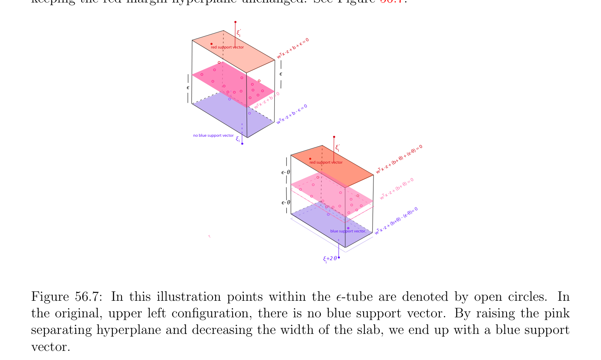
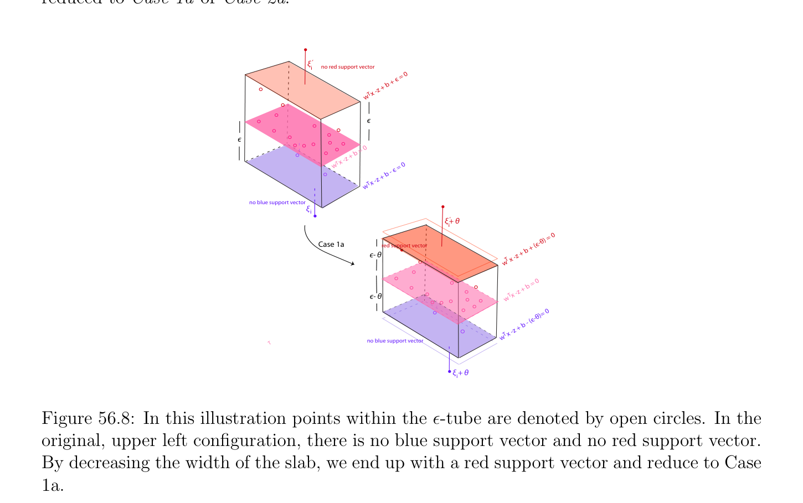
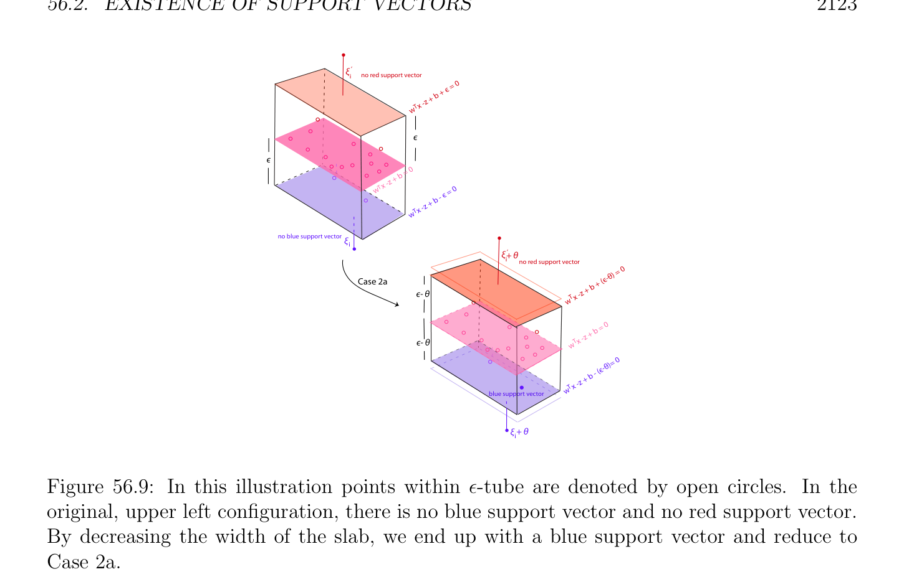
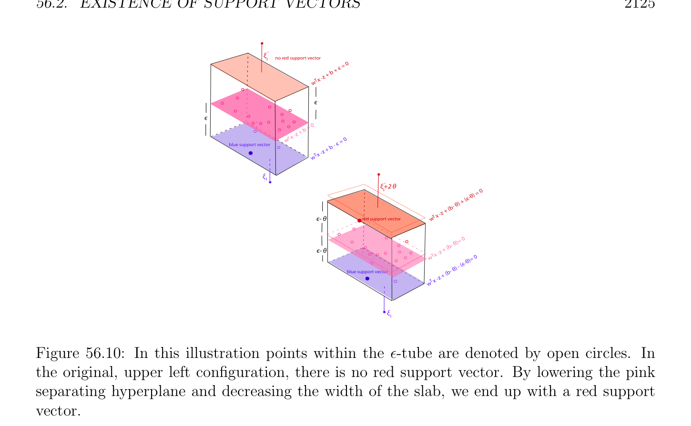

# Existence of Support Vectors

<!-- PAGE 2118 -->
which yields
$$p_{m} \ge \frac{\nu m}{2} .$$
A similar reasoning applies if $\mu_{i}  > 0$.
$(3)$ This follows immediately from $(1)$. Proposition 56.2 yields bounds on $\nu$ , namely
$$ 2 2$$
$$\max \frac{2p_{f}}{m} , \frac{q_{f}}{m} \le \nu  \le \min \frac{2p_{m}}{m} , \frac{q_{m}}{m} ,$$
with $p_{f} \le p_{m}, q_{f} \le q_{m}, p_{f} + q_{f} \le m$ and $p_{m} + q_{m} \le m$. Also, $p_{f} = q_{f} = 0$ means that the $\epsilon$ -slab is wide enough so that there are no errors (no points strictly outside the slab). Observe that a small value of $\nu$  keeps $p_{f}$ and $q_{f}$ small, which is achieved if the $\epsilon$ -slab is wide. A large value of $\nu$  allows $p_{m}$ and $q_{m}$ to be fairly large, which is achieved if the $\epsilon$ -slab is narrow. Thus the smaller $\nu$  is, the wider the $\epsilon$ -slab is, and the larger $\nu$  is, the narrower the $\epsilon$ -slab is.

## 56.2 Existence of Support Vectors

We now consider the issue of the existence of support vectors. We will show that in the generic case, for any optimal solution for which $\epsilon  > 0$, there is some support vector on the blue margin and some support vector on the red margin. Here generic means that there is an optimal solution for some $\nu  < (m$ - $1)/m$. If the data set $(X, y)$ is well fit by some affine function f(x) $= w^{\top}x + b$, in the sense that for many pairs $(x_{i}, y_{i})$ we have $y_{i} = w^{\top}x_{i} + b$ and the $\ell^{1}$ -error
$$\sum_{i=1}^{m}  |w^{\top}x_{i} + b -y_{i}|$$
is small, then an optimal solution may have $\epsilon  = 0$. Geometrically, many points $(x_{i}, y_{i})$ belong to the hyperplane $H_{w,b}$. The situation in which $\epsilon  = 0$ corresponds to minimizing the $\ell^{1}$ -error with a quadratic penalization of $w$. This is a sort of dual of lasso. The fact that the affine function f(x) $= w^{\top}x + b$ fits perfectly many points corresponds to the fact that an $\ell^{1}$ -minimization tends to encourage sparsity. In this case, if $C$ is chosen too small, it is possible that all points are errors (although “small”) and there are no support vectors. But if $C$ is large enough, the solution will be sparse and there will be many support vectors on the hyperplane $H_{w,b}$. Let $E_{\lambda} = {i \in {1, \dots  , m}$ | $\xi_{i}  > 0}, E_{\mu} = {j \in {1, \dots  , m}$ | $\xi_{j}'  > 0}, p_{sf} = |E_{\lambda}|$ and $q_{sf} = |E_{\mu}|$. Obviously, $E_{\lambda}$ and $E_{\mu}$ are disjoint. Given any real numbers $u, v, x, y$, if $max{u, v} < min{x, y}$, then $u < x$ and $v < y$. This is because $u, v \le max{u, v} < min{x, y} \le x, y$.

<!-- PAGE 2119 -->

> **Proposition 56.3.** If $\nu  < (m$ - $1)/m$, then $p_{f} < ⌊m/2⌋$ and $q_{f} < ⌊m/2⌋$.

*Proof.* By Proposition 56.2, $max{2p_{f}/m, 2q_{f}/m} \le \nu$ . If $m$ is even, say $m =$ 2k, then
$$2p_{f}/m = 2p_{f}/(2k) \le \nu  < (m -1)/m = (2k -1)/2k,$$
so $2p_{f} <$ 2k - $1$, which implies $p_{f} < k = ⌊m/2⌋$. A similar argument shows that $q_{f} < k = ⌊m/2⌋$. If $m$ is odd, say $m =$ 2k $+ 1$, then
$$2p_{f}/m = 2p_{f}/(2k + 1) \le \nu  < (m -1)/m = 2k/(2k + 1),$$
so $2p_{f} <$ 2k, which implies $p_{f} < k = ⌊m/2⌋$. A similar argument shows that $q_{f} < k = ⌊m/2⌋$. Since $p_{sf} \le p_{f}$ and $q_{sf} \le q_{f}$, we also have $p_{sf} < ⌊m/2⌋$ and $q_{sf} < ⌊m/2⌋$. This implies that ${1, \dots  , m} -(E_{\lambda} \cup E_{\mu})$ contains at least two elements and there are constraints corresponding to at least two $i \in / (E_{\lambda} \cup E_{\mu})$ (in which case $\xi_{i}  = \xi_{i}'  = 0)$, of the form
$$w^{\top}x_{i} + b -y_{i} \le \epsilon i \in /(E_{\lambda} \cup E_{\mu})$$
$$-w^{\top}x_{i} -b + y_{i} \le \epsilon i \in /(E_{\lambda} \cup E_{\mu}).$$
If $w^{\top}x_{i} + b$ - $y_{i} = \epsilon$  for some $i \in / (E_{\lambda} \cup E_{\mu})$ and $-w^{\top}x_{j}$ - $b + y_{j} = \epsilon$  for some $j \in / (E_{\lambda} \cup E_{\mu})$ with $i \neq  j$, then we have a blue support vector and a red support vector. Otherwise, we show how to modify $b$ and $\epsilon$  to obtain an optimal solution with a blue support vector and a red support vector.

> **Proposition 56.4.** For every optimal solution $(w, b, \epsilon , \xi , \xi'$ ) with $w \neq  0$ and $\epsilon  > 0$, if
$$\nu  < (m -1)/m$$
and if either no $x_{i}$ is a blue support vector or no $x_{i}$ is a red support vector, then there is another optimal solution (for the same $w)$ with some $i_{0}$ such that $\xi_{i0}  = 0$ and $w^{\top}x_{i0}+b-y_{i0} = \epsilon$ , and there is some $j_{0}$ such that $\xi_{j0}'  = 0$ and $-w^{\top}x_{j0}$ - $b + y_{j0} = \epsilon$ ; in other words, some $x_{i0}$ is a blue support vector and some $x_{j0}$ is a red support vector (with $i_{0} \neq  j_{0})$. If all points $(x_{i}, y_{i})$ that are not errors lie on one of the margin hyperplanes, then there is an optimal solution for which $\epsilon  = 0$.

*Proof.* By Proposition 56.3 if $\nu  < (m$ - $1)/m$, then $p_{f} < ⌊m/2⌋$ and $q_{f} < ⌊m/2⌋$, so the following constraints hold:
$$w^{\top}x_{i} + b -y_{i} = \epsilon  + \xi_{i} \xi_{i}  > 0i \in E_{\lambda}$$
$$-w^{\top}x_{j} -b + y_{j} = \epsilon  + \xi_{j}' \xi_{j}'  > 0j \in E_{\mu}$$
$$w^{\top}x_{i} + b -y_{i} \le \epsilon i \in /(E_{\lambda} \cup E_{\mu})$$
$$-w^{\top}x_{i} -b + y_{i} \le \epsilon i \in /(E_{\lambda} \cup E_{\mu}),$$

<!-- PAGE 2120 -->
where $|{1, \dots  , m}$ - $(E_{\lambda} \cup E_{\mu})| \ge 2$. If our optimal solution does not have a blue support vector and a red support vector, then either $w^{\top}x_{i} +b-y_{i} < \epsilon$  for all $i \in / (E_{\lambda} \cup E_{\mu})$ or $-w^{\top}x_{i} -b+y_{i} < \epsilon$  for all $i \in / (E_{\lambda} \cup E_{\mu})$. Case $1$. We have
$$w^{\top}x_{i} + b -y_{i} < \epsilon i \in /(E_{\lambda} \cup E_{\mu})$$
$$-w^{\top}x_{i} -b + y_{i} \le \epsilon i \in /(E_{\lambda} \cup E_{\mu}).$$
There are two subcases. Case 1a. Assume that there is some $j \in / (E_{\lambda} \cup E_{\mu})$ such that $-w^{\top}x_{j}$ - $b + y_{j} = \epsilon$ . Our strategy is to decrease $\epsilon$  and increase $b$ by a small amount $\theta$  in such a way that some inequality $w^{\top}x_{i} + b$ - $y_{i} < \epsilon$  becomes an equation for some $i \in / (E_{\lambda} \cup E_{\mu})$. Geometrically, this amounts to raising the separating hyperplane $H_{w,b}$ and decreasing the width of the slab, keeping the red margin hyperplane unchanged. See Figure 56.7.
$$\xi ‘$$
$$i0$$
$$є =$$
$$red support vector b +$$
$$x -z +$$
$$wT$$
$$є$$
$$є$$
$$b = 0$$
$$x -z +$$
$$w T  = 0$$
$$b - є$$
$$x -z +$$
$$wT$$
$$no blue support vector\xi$$
$$i$$
$$\xi ‘) = 0$$
$$i(є-\theta$$
$$\theta ) +$$
$$red support vector(b+$$
$$-z +$$
$$є- \theta w T x$$
$$) = 0$$
$$b+ \theta$$
$$z + ($$
$$wT  x -$$
$$є- \theta$$
$$-\theta )= 0$$
$$) - (є$$
$$b+\theta$$
$$-z + ($$
$$blue support vectorwT  x$$
$$T$$
$$\xi +2 \theta$$
$$i$$

**Figure 56.7:** In this illustration points within the $\epsilon$ -tube are denoted by open circles. In the original, upper left configuration, there is no blue support vector. By raising the pink separating hyperplane and decreasing the width of the slab, we end up with a blue support vector. The inequalities imply that
$$-\epsilon  \le w^{\top}x_{i} + b -y_{i} < \epsilon .$$
Let us pick $\theta$  such that
$$\theta  = (1/2) \min{\epsilon  -w^{\top}x_{i} -b + y_{i} | i \in /(E_{\lambda} \cup E_{\mu})}.$$

<!-- PAGE 2121 -->
Our hypotheses imply that $\theta  > 0$, and we have $\theta  \le \epsilon$ , because $(1/2)(\epsilon  -w^{\top}x_{i} -b + y_{i}) \le \epsilon$  is equivalent to $\epsilon$  - $w^{\top}x_{i}$ - $b + y_{i} \le 2\epsilon$  which is equivalent to $-w^{\top}x_{i}$ - $b + y_{i} \le \epsilon$ , which holds for all $i \in / (E_{\lambda} \cup E_{\mu})$ by hypothesis. We can write
$$w^{\top}x_{i} + b + \theta  -y_{i} = \epsilon  -\theta  + \xi_{i}  + 2\theta \xi_{i}  > 0i \in E_{\lambda}$$
$$-w^{\top}x_{j} -(b + \theta ) + y_{j} = \epsilon  -\theta  + \xi_{j}' \xi_{j}'  > 0j \in E_{\mu}$$
$$w^{\top}x_{i} + b + \theta  -y_{i} \le \epsilon  -\theta i \in /(E_{\lambda} \cup E_{\mu})$$
$$-w^{\top}x_{i} -(b + \theta ) + y_{i} \le \epsilon  -\theta i \in /(E_{\lambda} \cup E_{\mu}).$$
By hypothesis
$$-w^{\top}x_{j} -(b + \theta ) + y_{j} = \epsilon  -\theta for some j \in /(E_{\lambda} \cup E_{\mu})$$
and by the choice of $\theta$ ,
$$w^{\top}x_{i} + b + \theta  -y_{i} = \epsilon  -\theta for some i \in /(E_{\lambda} \cup E_{\mu}).$$
The value of $C > 0$ is irrelevant in the following argument so we may assume that $C = 1$. The new value of the objective function is
$$\omega (\theta ) = \frac{1}{2} w^{\top}w + \nu (\epsilon  -\theta ) + \frac{1}{m} \sum_{i\in E\lambda}  \sum_{j\in E\mu}$$
$$\begin{pmatrix} (\xi_{i}  + 2\theta ) + & \xi_{j}' \\  & 2 \end{pmatrix}$$
$$= \frac{1}{2} w^{\top}w + \nu \epsilon  + \frac{1}{m} \sum_{i\in E\lambda}  \sum_{j\in E\mu}  - \begin{pmatrix} p_{sf} \\ \nu  - \\ m \end{pmatrix} \theta .$$
$$\begin{pmatrix} \xi_{i}  + & \xi_{j}' \end{pmatrix}$$
By Proposition 56.2 we have
$$ 2$$
$$\max \frac{2p_{f}}{m} , \frac{q_{f}}{m} \le \nu$$
and $p_{sf} \le p_{f}$ and $q_{sf} \le q_{f}$, which implies that
$$\nu  - \frac{2p_{sf}}{m} \ge 0,(*_{1})$$
and so $\omega (\theta$ ) $\le \omega (0)$. If inequality $(*_{1})$ is strict, then this contradicts the optimality of the original solution. Therefore, $\nu  = 2p_{sf}/m, \omega (\theta$ ) $= \omega (0)$ and $(w, b + \theta , \epsilon$  - $\theta , \xi  + 2\theta , \xi'$ ) is an optimal solution such that
$$w^{\top}x_{i} + b + \theta  -y_{i} = \epsilon  -\theta$$
$$-w^{\top}x_{j} -(b + \theta ) + y_{j} = \epsilon  -\theta$$
for some $i, j \in / (E_{\lambda} \cup E_{\mu})$ with $i \neq  j$.

<!-- PAGE 2122 -->
Observe that the exceptional case in which $\theta  = \epsilon$  may arise. In this case all points $(x_{i}, y_{i})$ that are not errors (strictly outside the $\epsilon$ -slab) are on the red margin hyperplane. This case can only arise if $\nu  = 2p_{sf}/m$. Case 1b. We have $-w^{\top}x_{i} -b + y_{i} < \epsilon$  for all $i \in / (E_{\lambda} \cup E_{\mu})$. Our strategy is to decrease $\epsilon$ and increase the errors by a small $\theta$  in such a way that some inequality becomes an equation for some $i \in / (E_{\lambda} \cup E_{\mu})$. Geometrically, this corresponds to decreasing the width of the slab, keeping the separating hyperplane unchanged. See Figures 56.8 and 56.9. Then we are reduced to Case 1a or Case 2a.
$$\xi ‘no red support vector$$
$$i0$$
$$є =$$
$$b +$$
$$x -z +$$
$$wT$$
$$є$$
$$є$$
$$b = 0$$
$$x -z +$$
$$w T = 0$$
$$b - є$$
$$x -z +$$
$$wT$$
$$no blue support vector$$
$$\xi i$$
$$\xi + \theta ‘$$
$$i$$
$$) = 0$$
$$Case 1ared support vector(є-\theta$$
$$b +$$
$$є- \theta -z +$$
$$w T x$$
$$b = 0$$
$$x -z +$$
$$є- \theta wT$$
$$)= 0$$
$$(є-\theta$$
$$+ b -$$
$$Tx -z$$
$$w$$
$$Tno blue support vector$$
$$\xi i+ \theta$$

**Figure 56.8:** In this illustration points within the $\epsilon$ -tube are denoted by open circles. In the original, upper left configuration, there is no blue support vector and no red support vector. By decreasing the width of the slab, we end up with a red support vector and reduce to Case 1a. We have
$$w^{\top}x_{i} + b -y_{i} = \epsilon  + \xi_{i} \xi_{i}  > 0i \in E_{\lambda}$$
$$-w^{\top}x_{j} -b + y_{j} = \epsilon  + \xi_{j}' \xi_{j}'  > 0j \in E_{\mu}$$
$$w^{\top}x_{i} + b -y_{i} < \epsilon i \in /(E_{\lambda} \cup E_{\mu})$$
$$-w^{\top}x_{i} -b + y_{i} < \epsilon i \in /(E_{\lambda} \cup E_{\mu}).$$
Let us pick $\theta$  such that
$$\theta  = \min{\epsilon  -(w^{\top}x_{i} + b -y_{i}), \epsilon  + w^{\top}x_{i} + b -y_{i} | i \in /(E_{\lambda} \cup E_{\mu})},$$

<!-- PAGE 2123 -->
$$\xi ‘$$
$$ino red support vector$$
$$є = 0$$
$$b +$$
$$x -z +$$
$$wT$$
$$є$$
$$є$$
$$= 0$$
$$+ b$$
$$x -z$$
$$w T = 0$$
$$b - є$$
$$x -z +$$
$$wT$$
$$no blue support vector\xi$$
$$i$$
$$\xi + \theta ‘$$
$$ino red support vector$$
$$) = 0$$
$$Case 2a(є-\theta$$
$$b +$$
$$є- \theta -z +$$
$$w T x$$
$$= 0$$
$$+ b$$
$$є- \theta T x -z$$
$$w$$
$$)= 0$$
$$(є-\theta$$
$$+ b -$$
$$Tx -z$$
$$w$$
$$blue support vector$$
$$\xi i+ \theta$$

**Figure 56.9:** In this illustration points within $\epsilon$ -tube are denoted by open circles. In the original, upper left configuration, there is no blue support vector and no red support vector. By decreasing the width of the slab, we end up with a blue support vector and reduce to Case 2a. Our hypotheses imply that $0 < \theta  < \epsilon$ . We can write
$$w^{\top}x_{i} + b -y_{i} = \epsilon  -\theta  + \xi_{i}  + \theta \xi_{i}  > 0i \in E_{\lambda}$$
$$-w^{\top}x_{j} -b + y_{j} = \epsilon  -\theta  + \xi_{j}'  + \theta \xi_{j}'  > 0j \in E_{\mu}$$
$$w^{\top}x_{i} + b -y_{i} \le \epsilon  -\theta i \in /(E_{\lambda} \cup E_{\mu})$$
$$-w^{\top}x_{i} -b + y_{i} \le \epsilon  -\theta i \in /(E_{\lambda} \cup E_{\mu}),$$
and by the choice of $\theta$ , either
$$w^{\top}x_{i} + b -y_{i} = \epsilon  -\theta for some i \in /(E_{\lambda} \cup E_{\mu})$$
or
$$-w^{\top}x_{i} -b + y_{i} = \epsilon  -\theta for some i \in /(E_{\lambda} \cup E_{\mu}).$$
The new value of the objective function is
$$\omega (\theta ) = \frac{1}{2} w^{\top}w + \nu (\epsilon  -\theta ) + \frac{1}{m} \sum_{i\in E\lambda}  \sum_{j\in E\mu}$$
$$\begin{pmatrix} (\xi_{i}  + \theta ) + & (\xi_{j}' + \theta ) \\  & p_{sf}+ \end{pmatrix}$$
$$= \frac{1}{2} w^{\top}w + \nu \epsilon  + \frac{1}{m} \sum_{i\in E\lambda}  \sum_{j\in E\mu}  - \begin{pmatrix} q_{sf} \\ \nu  - \\ m \end{pmatrix} \theta .$$
$$\begin{pmatrix} \xi_{i}  + & \xi_{j}' \end{pmatrix}$$

<!-- PAGE 2124 -->
Since $max{2p_{f}/m, 2q_{f}/m} \le \nu$  implies that $(p_{f} + q_{f})/m \le \nu$  and $p_{sf} \le p_{f}, q_{sf} \le q_{f}$, we have
$$\nu  - \frac{p_{sf}+ q_{sf}}{m} \ge 0,(*_{2})$$
and so $\omega (\theta$ ) $\le \omega (0)$. If inequality $(*_{2})$ is strict, then this contradicts the optimality of the original solution. Therefore, $\nu  = (p_{sf} + q_{sf})/m, \omega (\theta$ ) $= \omega (0)$ and $(w, b, \epsilon$  - $\theta , \xi  + \theta , \xi' + \theta$ ) is an optimal solution such that either
$$w^{\top}x_{i} + b -y_{i} = \epsilon  -\theta for some i \in /(E_{\lambda} \cup E_{\mu})$$
or
$$-w^{\top}x_{i} -b + y_{i} = \epsilon  -\theta for some i \in /(E_{\lambda} \cup E_{\mu}).$$
We are now reduced to Case 1a or or Case 2a. Case $2$. We have
$$w^{\top}x_{i} + b -y_{i} \le \epsilon i \in /(E_{\lambda} \cup E_{\mu})$$
$$-w^{\top}x_{i} -b + y_{i} < \epsilon i \in /(E_{\lambda} \cup E_{\mu}).$$
Again there are two subcases. Case 2a. Assume that there is some $i \in / (E_{\lambda} \cup E_{\mu})$ such that $w^{\top}x_{i} + b$ - $y_{i} = \epsilon$ . Our strategy is to decrease $\epsilon$  and decrease $b$ by a small amount $\theta$  in such a way that some inequality $-w^{\top}x_{j}$ - $b + y_{j} < \epsilon$  becomes an equation for some $j \in / (E_{\lambda} \cup E_{\mu})$. Geometrically, this amounts to lowering the separating hyperplane $H_{w,b}$ and decreasing the width of the slab, keeping the blue margin hyperplane unchanged. See Figure 56.10. The inequalities imply that
$$-\epsilon  < w^{\top}x_{i} + b -y_{i} \le \epsilon .$$
Let us pick $\theta$  such that
$$\theta  = (1/2) \min{\epsilon  -(-w^{\top}x_{i} -b + y_{i}) | i \in /(E_{\lambda} \cup E_{\mu})}.$$
Our hypotheses imply that $\theta  > 0$, and we have $\theta  \le \epsilon$ , because $(1/2)(\epsilon -(-w^{\top}x_{i}-b+y_{i})) \le \epsilon$ is equivalent to $\epsilon$  - $(-w^{\top}x_{i}$ - $b + y_{i}) \le 2\epsilon$  which is equivalent to $w^{\top}x_{i} + b$ - $y_{i} \le \epsilon$  which holds for all $i \in / (E_{\lambda} \cup E_{\mu})$ by hypothesis. We can write
$$w^{\top}x_{i} + b -\theta  -y_{i} = \epsilon  -\theta  + \xi_{i} \xi_{i}  > 0i \in E_{\lambda}$$
$$-w^{\top}x_{j} -(b -\theta ) + y_{j} = \epsilon  -\theta  + \xi_{j}'  + 2\theta \xi_{j}'  > 0j \in E_{\mu}$$
$$w^{\top}x_{i} + b -\theta  -y_{i} \le \epsilon  -\theta i \in /(E_{\lambda} \cup E_{\mu})$$
$$-w^{\top}x_{i} -(b -\theta ) + y_{i} \le \epsilon  -\theta i \in /(E_{\lambda} \cup E_{\mu}).$$

<!-- PAGE 2125 -->
$$\xi ‘no red support vector$$
$$i0$$
$$є =$$
$$b +$$
$$x -z +$$
$$wT$$
$$є$$
$$є$$
$$b = 0$$
$$x -z +$$
$$w T  = 0$$
$$blue support vectorb - є$$
$$x -z +$$
$$wT$$
$$\xi i$$
$$\xi +2 \theta ‘$$
$$i = 0$$
$$(є-\theta )$$
$$\theta ) +$$
$$(b-$$
$$-z +$$
$$є- \theta red support vectorw T x$$
$$)= 0$$
$$b- \theta$$
$$є- \theta z + ($$
$$w T x -0$$
$$- (є-\theta )=$$
$$blue support vectorb- \theta )$$
$$-z + ($$
$$wT  x$$
$$\xi i$$

**Figure 56.10:** In this illustration points within the $\epsilon$ -tube are denoted by open circles. In the original, upper left configuration, there is no red support vector. By lowering the pink separating hyperplane and decreasing the width of the slab, we end up with a red support vector. By hypothesis
$$w^{\top}x_{i} + (b -\theta ) -y_{i} = \epsilon  -\theta for some i \in /(E_{\lambda} \cup E_{\mu}),$$
and by the choice of $\theta$ ,
$$-w^{\top}x_{j} -(b -\theta ) + y_{j} = \epsilon  -\theta for some j \in /(E_{\lambda} \cup E_{\mu}).$$
The new value of the objective function is
$$\omega (\theta ) = \frac{1}{2} w^{\top}w + \nu (\epsilon  -\theta ) + \frac{1}{m} \sum_{i\in E\lambda}  \sum_{j\in E\mu}$$
$$\begin{pmatrix} \xi_{i}  + & (\xi_{j}' + 2\theta ) \\  & 2 \end{pmatrix}$$
$$= \frac{1}{2} w^{\top}w + \nu \epsilon  + \frac{1}{m} \sum_{i\in E\lambda}  \sum_{j\in E\mu}  - \begin{pmatrix} q_{sf} \\ \nu  - \\ m \end{pmatrix} \theta .$$
$$\begin{pmatrix} \xi_{i}  + & \xi_{j}' \end{pmatrix}$$
The rest of the proof is similar except that $2p_{sf}/m$ is replaced by $2q_{sf}/m$. Observe that the exceptional case in which $\theta  = \epsilon$  may arise. In this case all points $(x_{i}, y_{i})$ that are not errors (strictly outside the $\epsilon$ -slab) are on the blue margin hyperplane. This case can only arise if $\nu  = 2q_{sf}/m$. Case 2b. We have $w^{\top}x_{i} + b$ - $y_{i} < \epsilon$  for all $i \in / (E_{\lambda} \cup E_{\mu})$. Since we also assumed that $-w^{\top}x_{i} -b+y_{i} < \epsilon$  for all $i \in / (E_{\lambda} \cup E_{\mu})$, Case 2b is identical to Case 1b and we are done.

<!-- PAGE 2126 -->
The proof of Proposition 56.4 reveals that there are three critical values for $\nu$ :
$$\frac{2p_{sf}}{m} , \frac{2q_{sf}}{m} , \frac{p_{sf}+ q_{sf}}{m} .$$
These values can be avoided by requiring the strict inequality
$$ 2$$
$$\max \frac{2p_{sf}}{m} , \frac{q_{sf}}{m} < \nu .$$
Then the following corollary holds.

> **Theorem 56.5.** For every optimal solution $(w, b, \epsilon , \xi , \xi'$ ) with $w \neq  0$ and $\epsilon  > 0$, if
$$ 2$$
$$\max \frac{2p_{sf}}{m} , \frac{q_{sf}}{m} < \nu  < (m -1)/m,$$
then some $x_{i0}$ is a blue support vector and some $x_{j0}$ is a red support vector (with $i_{0} \neq  j_{0})$.

*Proof.* We proceed by contradiction. Suppose that for every optimal solution with $w \neq  0$ and $\epsilon  > 0$ no $x_{i}$ is a blue support vector or no $x_{i}$ is a red support vector. Since $\nu  < (m$ - $1)/m$, Proposition 56.4 holds, so there is another optimal solution. But since the critical values of $\nu$  are avoided, the proof of Proposition 56.4 shows that the value of the objective function for this new optimal solution is strictly smaller than the original optimal value, a contradiction.
Remark: If an optimal solution has $\epsilon  = 0$, then depending on the value of $C$ there may not be any support vectors, or many. If the primal has an optimal solution with $w \neq  0$ and $\epsilon  > 0$, then by $(*_{w})$ and since
$$\sum_{i=1}^{m}  \lambda_{i}  - \sum_{i=1}^{m}  \mu_{i}  = 0and\lambda_{i} \mu_{i}  = 0,$$
there is $i_{0}$ such that $\lambda_{i0}  > 0$ and some $j_{0} \neq  i_{0}$ such that $\mu_{j0}  > 0$. Under the mild hypothesis called the Standard Margin Hypothesis that there is some $i_{0}$ such that $0 < \alpha_{i0}  <^{C}$ and there is some $j_{0} \neq  i_{0}$ such that $0 < \mu_{j0}  <^{C}$ , in other words there is a blue $support^{m}$ vector of type $1$ and there is a red support $vector^{m}$ of type $1$, then by (*) we have $\xi_{i0}  = 0, \xi_{j0}'  = 0$, and we have the two equations
$$w^{\top}x_{i0} + b -y_{i0} = \epsilon$$
$$-w^{\top}x_{j0} -b + y_{j0} = \epsilon ,$$

<!-- PAGE 2127 -->
so $b$ and $\epsilon$  can be computed. In particular,
$$b = \frac{1}{2} \begin{pmatrix} y_{i0}+ y_{j0}-w^{\top}(x_{i0}+ x_{j0}) \end{pmatrix}$$
$$\epsilon  = \frac{1}{2} \begin{pmatrix} y_{j0}-y_{i0}+ w^{\top}(x_{i0}-x_{j0}) \end{pmatrix} .$$
The function f(x) $= w^{\top}x + b$ (often called regression estimate) is given by
$$f(x) = \sum_{i=1}^{m}  (\mu_{i}  -\lambda_{i} )x_{i}^{\top} x + b.$$
In practice, due to numerical inaccurracy, it is complicated to write a computer program that will select two distinct indices as above. It is preferable to compute the list $I_{\lambda}$ of indices $i$ such that $0 < \lambda_{i}  < C/m$ and the list $I_{\mu}$ of indices $j$ such that $0 < \mu_{j}  < C/m$. Then it is easy to see that
$$b = \begin{pmatrix}\end{pmatrix} \sum_{\in I\lambda}  \begin{pmatrix}\end{pmatrix} \sum_{0\in I\mu}  \begin{pmatrix}\end{pmatrix} \begin{pmatrix}\end{pmatrix} \sum_{\in I\lambda}  \begin{pmatrix}\end{pmatrix} \sum_{0\in I\mu}  /2$$
$$\begin{pmatrix}  &  &  &  &  &  &  &  &  \\ y_{i0} & /|I_{\lambda}| + & y_{j0} & /|I_{\mu}| -w^{\top} & x_{i0} & /|I_{\lambda}| + & x_{j0} & /|I_{\mu}| \\ i0 & j & i0 & j \\  &  &  &  &  &  &  &  &  \\ y_{j0} & /|I_{\mu}| - & y_{i0} & /|I_{\lambda}| + w^{\top} & x_{i0} & /|I_{\lambda}| - & x_{j0} & /|I_{\mu}| \\ j & i0 & i0 & j \end{pmatrix}$$
$$\epsilon  = \begin{pmatrix}\end{pmatrix} \sum_{0\in I\mu}  \begin{pmatrix}\end{pmatrix} \sum_{\in I\lambda}  \begin{pmatrix}\end{pmatrix} \begin{pmatrix}\end{pmatrix} \sum_{\in I\lambda}  \begin{pmatrix}\end{pmatrix} \sum_{0\in I\mu}  /2.$$
These formulae are numerically a lot more stable, but we still have to be cautious to set suitable tolerance factors to decide whether $\lambda_{i}  > 0$ and $\lambda_{i}  < C/m$ (and similarly for $\mu_{i}$ ). The following result gives sufficient conditions for expressing $\epsilon$  in terms of a single support vector.

> **Proposition 56.6.** For every optimal solution $(w, b, \epsilon , \xi , \xi'$ ) with $w \neq  0$ and $\epsilon  > 0$, if
$$ 2$$
$$\max \frac{2p_{sf}}{m} , \frac{q_{sf}}{m} < \nu  < (m -1)/m,$$
then $\epsilon$  and $b$ are determined from a solution $(\lambda , \mu$ ) of the dual in terms of a single support vector. Proof sketch. If we express that the duality gap is zero we obtain the following equation expressing $\epsilon$  in terms of $b$:
$$C \begin{pmatrix} p_{f}+ q_{f} \\ \nu  - \\ m \end{pmatrix} \epsilon  = - \begin{pmatrix} \lambda^{\top} & \mu^{\top} \\  \end{pmatrix} P \begin{pmatrix} \lambda \\ \mu \end{pmatrix} - \begin{pmatrix} y^{\top} & -y^{\top} \end{pmatrix} \begin{pmatrix} \lambda \\ \mu \end{pmatrix}$$
$$- \frac{C}{m} \begin{pmatrix}  \\ w^{\top} & x_{i} - & x_{j} \end{pmatrix} \begin{pmatrix} - & y_{i} + & y_{j}+ (p_{f}-q_{f})b \end{pmatrix} \sum_{i\in K\lambda}  \sum_{j\in K\mu}  \sum_{i\in K\lambda}  \sum_{j\in K\mu}  .$$
