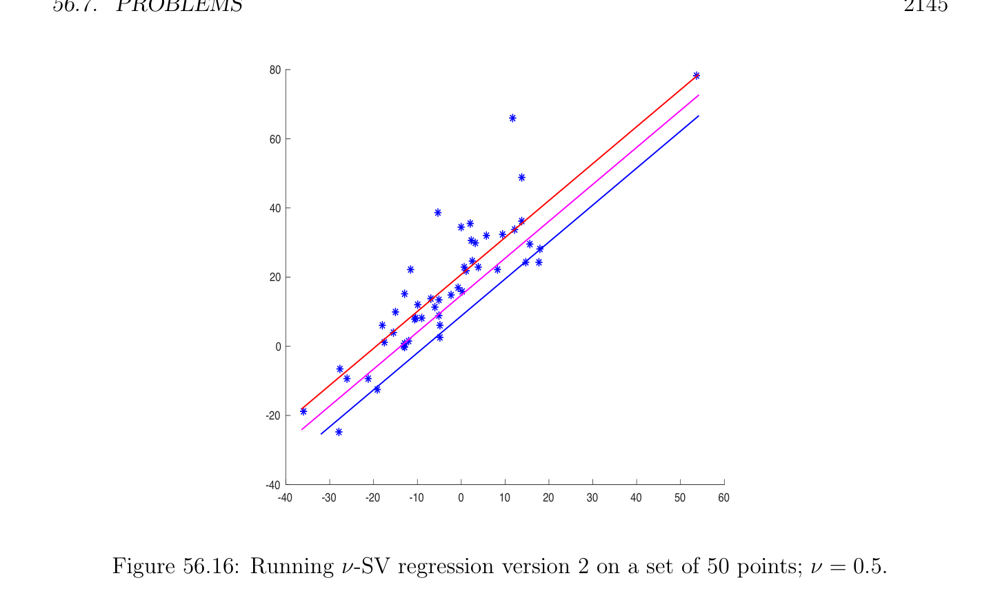

# Problems

<!-- PAGE 2145 -->
$$80$$
$$60$$
$$40$$
$$20$$
$$0$$
$$-20$$
$$-40$$
$$-40-30-20-100102030405060$$

**Figure 56.16:** Running $\nu$ -SV regression version $2$ on a set of $50$ points; $\nu  =$ 0.5.

## 56.7 Problems

Problem 56.1. Prove that if $\nu$ -SV regression succeeds and yields $w, b, \epsilon  > 0$, then $\epsilon$ -SV regression with the same $C$ and the same value of $\epsilon$  also succeeds and returns the same pair $(w, b)$.
Problem 56.2. Prove the formulae
$$b = \begin{pmatrix}\end{pmatrix} \sum_{\in I\lambda}  \begin{pmatrix}\end{pmatrix} \sum_{0\in I\mu}  \begin{pmatrix}\end{pmatrix} \begin{pmatrix}\end{pmatrix} \sum_{\in I\lambda}  \begin{pmatrix}\end{pmatrix} \sum_{0\in I\mu}  /2$$
$$\begin{pmatrix}  &  &  &  &  &  &  &  &  \\ y_{i0} & /|I_{\lambda}| + & y_{j0} & /|I_{\mu}| -w^{\top} & x_{i0} & /|I_{\lambda}| + & x_{j0} & /|I_{\mu}| \\ i0 & j & i0 & j \\  &  &  &  &  &  &  &  &  \\ y_{j0} & /|I_{\mu}| - & y_{i0} & /|I_{\lambda}| + w^{\top} & x_{i0} & /|I_{\lambda}| - & x_{j0} & /|I_{\mu}| \\ j & i0 & i0 & j \end{pmatrix}$$
$$\epsilon  = \begin{pmatrix}\end{pmatrix} \sum_{0\in I\mu}  \begin{pmatrix}\end{pmatrix} \sum_{\in I\lambda}  \begin{pmatrix}\end{pmatrix} \begin{pmatrix}\end{pmatrix} \sum_{\in I\lambda}  \begin{pmatrix}\end{pmatrix} \sum_{0\in I\mu}  /2$$
stated just before Proposition 56.6.
Problem 56.3. Give the details of the proof of Proposition 56.6. In particular, prove that
$$C \begin{pmatrix} p_{f}+ q_{f} \\ \nu  - \\ m \end{pmatrix} \epsilon  = - \begin{pmatrix} \lambda^{\top} & \mu^{\top} \\  \end{pmatrix} P \begin{pmatrix} \lambda \\ \mu \end{pmatrix} - \begin{pmatrix} y^{\top} & -y^{\top} \end{pmatrix} \begin{pmatrix} \lambda \\ \mu \end{pmatrix}$$
$$- \frac{C}{m} \begin{pmatrix}  \\ w^{\top} & x_{i} - & x_{j} \end{pmatrix} \begin{pmatrix} - & y_{i} + & y_{j}+ (p_{f}-q_{f})b \end{pmatrix} \sum_{i\in K\lambda}  \sum_{j\in K\mu}  \sum_{i\in K\lambda}  \sum_{j\in K\mu}  .$$

<!-- PAGE 2146 -->
Problem 56.4. Prove that the matrices
$$A = \begin{pmatrix} 1_{m}^{\top} & -1_{m}^{\top} & 0_{m}^{\top} & 0_{m}^{\top} & 0 \\ 1_{m}^{\top} & 1_{m}^{\top} & 0_{m}^{\top} & 0_{m}^{\top} & 1 \\ I_{m} & 0_{m,m} & I_{m} & 0_{m,m} & 0_{m} \\ 0_{m,m} & I_{m} & 0_{m,m} & I_{m} & 0_{m} \end{pmatrix} ,A_{2} = \begin{pmatrix} 1_{m}^{\top} & -1_{m}^{\top} & 0_{m}^{\top} & 0_{m}^{\top} \\ 1_{m}^{\top} & 1_{m}^{\top} & 0_{m}^{\top} & 0_{m}^{\top} \\ I_{m} & 0_{m,m} & I_{m} & 0_{m,m} \\ 0_{m,m} & I_{m} & 0_{m,m} & I_{m} \end{pmatrix}$$
have rank 2m $+ 2$.
Problem 56.5. Derive the version of $\nu$ -SV regression in which the linear penalty function
$$\sum_{i}  m=1(\xi_{i}  + \xi_{i}' ) is replaced by the quadratic penalty function \sum_{i}  m=1(\xi_{i}^{2}  + \xi_{i}^{'2}  ). Derive the dual$$
program.
$$Problem 56.6. The linear penalty function \sum_{i}  m=1(\xi_{i}  + \xi_{i}' ) can be replaced by the quadratic$$
$$penalty function \sum_{i}  m(\xi_{i}^{2}  +\xi_{i}^{'2}  ). Prove that for an optimal solution we must have \xi_{i}  \ge 0 and$$
$\xi_{i}'  \ge 0$, so we $may^{=1}$ omit the constraints $\xi_{i}  \ge 0$ and $\xi_{i}'  \ge 0$. We must also have $\gamma  = 0$ so we may omit the variable $\gamma$  as well. Prove that $\xi  = (m/2C)\lambda$  and $\xi' = (m/2C)\mu$ . This problem is very similar to the Soft Margin SVM $(SVM_{s4})$ discussed in Section 54.13.
Problem 56.7. Consider the version of $\nu$ -SV regression in Section 56.5. Prove that for any optimal solution with $w \neq  0$ and $\epsilon  > 0$, if the inequalities $(p_{f} + q_{f})/m < \nu  < 1$ hold, then some point $x_{i}$ is a support vector.
Problem 56.8. Prove that the matrix
$$A_{3} = \begin{pmatrix} 1_{m}^{\top} & 1_{m}^{\top} & 0_{m}^{\top} & 0_{m}^{\top} \\ I_{m} & 0_{m,m} & I_{m} & 0_{m,m} \\ 0_{m,m} & I_{m} & 0_{m,m} & I_{m} \end{pmatrix}$$
has rank 2m $+ 1$.
Problem 56.9. Consider the version of $\nu$ -SV regression in Section 56.5. Prove the following formulae: If $I_{\lambda} \neq  \emptyset$ , then
$$\epsilon  = w^{\top} \begin{pmatrix} x_{i} \\ i \end{pmatrix} \sum_{\in I\lambda}  /|I_{\lambda}| + b - \begin{pmatrix} y_{i} \\ i \end{pmatrix} \sum_{\in I\lambda}  /|I_{\lambda}|,$$
and if $I_{\mu} \neq  \emptyset$ , then
$$\epsilon  = -w^{\top} \begin{pmatrix} x_{j} \end{pmatrix} \sum_{j\in I\mu}  /|I_{\mu}| -b + \begin{pmatrix} y_{i} \\ i \end{pmatrix} \sum_{\in I\mu}  /|I_{\mu}|.$$
Problem 56.10. Implement $\nu$ -Regression Version $2$ described in Section 56.5. Run examples using both the original version and version $2$ and compare the results.
