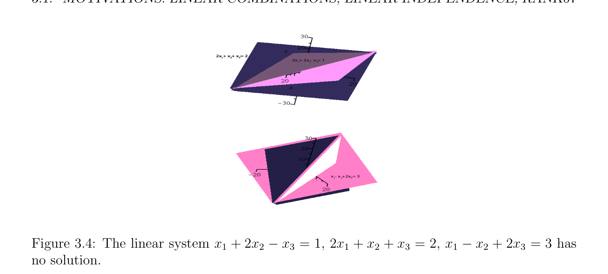
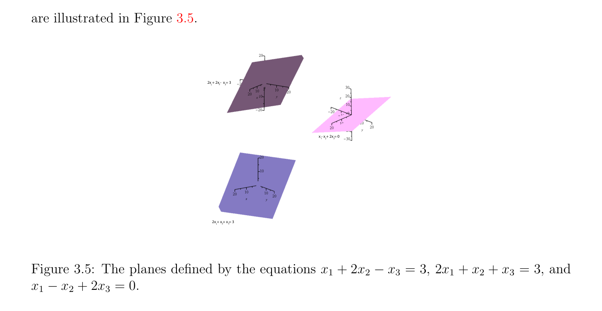

# Motivations: Các tổ hợp tuyến tính, Sự độc lập tuyến tính (linear independence), Hạng (rank)

<!-- PAGE 57 -->
Chương $3$ Các không gian vectơ, Các cơ sở, Các ánh xạ tuyến tính (linear maps)

## 3.1 Motivations: Các tổ hợp tuyến tính, Tuyến tính Inde-

$$pendence and Rank$$
Trong tuyến tính tối ưu hóa các bài tập, ta thường encounter các hệ của các phương trình tuyến tính. Ví dụ, xét bài toán của việc giải sau đây hệ của ba các phương trình tuyến tính trong ba các biến $x_{1}, x_{2}, x_{3} \in \mathbb{R}$:
$$x_{1} + 2x_{2} -x_{3} = 1$$
$$2x_{1} + x_{2} + x_{3} = 2$$
$$x_{1} -2x_{2} -2x_{3} = 3.$$
Một cách đến cách tiếp cận bài toán này là giới thiệu “các vectơ” $u, v, w$, và $b$, cho trước bởi
$$u = \begin{pmatrix} 1 \\ 2 \\ 1 \end{pmatrix} v = \begin{pmatrix} 2 \\ 1 \\ 2 \end{pmatrix} w = \begin{pmatrix} -1 \\ 1 \\ 2 \end{pmatrix} b = \begin{pmatrix} 1 \\ 2 \\ 3 \end{pmatrix}$$
$$--$$
Và đến viết của ta hệ phương trình tuyến tính như
$$x_{1}u + x_{2}v + x_{3}w = b.$$
Trong ở trên phương trình, ta được sử dụng một cách ẩn sự kiện rằng vectơ $z$ có thể được được nhân bởi vô hướng (scalar) $\lambda  \in \mathbb{R}$, ở đâu
$$\lambda z = \lambda \begin{pmatrix} z_{1} \\ z_{2} \\ z_{3} \end{pmatrix} = \begin{pmatrix} \lambda z_{1} \\ \lambda z_{2} \\ \lambda z_{3} \end{pmatrix} ,$$
Và hai các vectơ $y$ và và $z$ có thể được được cộng, ở đâu
$$y + z = \begin{pmatrix} y_{1} \\ y_{2} \\ y_{3} \end{pmatrix} + \begin{pmatrix} z_{1} \\ z_{2} \\ z_{3} \end{pmatrix} = \begin{pmatrix} y_{1} + z_{1} \\ y_{2} + z_{2} \\ y_{3} + z_{3} \end{pmatrix} .$$
$$57$$

<!-- PAGE 58 -->
Cũng, cho trước vectơ
$$x = \begin{pmatrix} x_{1} \\ x_{2} \\ x_{3} \end{pmatrix} ,$$
Ta định nghĩa additive nghịch đảo $-x$ của $x$ (pronounced trừ $x)$ như
$$-x = \begin{pmatrix} -x_{1} \\ -x_{2} \\ x_{3} \end{pmatrix} .$$
$$-$$
Nhận thấy rằng $-x =$ (-1)x, vô hướng (scalar) phép nhân của $x$ bởi $-1$. Tập hợp tất cả các vectơ với ba các thành phần được ký hiệu bởi $\mathbb{R}^{3\times1}$. lý do cho bằng cách sử dụng
$$\mathbb{R}^{3\times1}  \mathbb{R}^{3}$$
Ký hiệu thay vì nhiều hơn/thêm conventional ký hiệu là rằng các phần tử của $\mathbb{R}^{3\times1}$ là các vectơ cột; chúng bao gồm của ba các hàng và đơn lẻ cột, mà các giải thích
$$\mathbb{R}^{3}  \mathbb{R}\mathbb{R}\mathbb{R}$$
Superscript $3 \times  1$. Mặt khác, $=  \times  \times$ bao gồm của tất cả các bộ ba của tạo thành $(x_{1}, x_{2}, x_{3})$, với $x_{1}, x_{2}, x_{3} \in \mathbb{R}$, và các phần tử này là các vectơ hàng. Tuy nhiên, có một hiển nhiên
$$\mathbb{R}^{3\times1}  \mathbb{R}^{3}$$
Song ánh giữa và và chúng là thường được đồng nhất. Cho sake của clarity, trong điều này giới thiệu, ta sẽ ký hiệu tập hợp của các vectơ cột với $n$ các thành phần bởi $\mathbb{R}^{n\times1}$. biểu thức chẳng hạn như
$$x_{1}u + x_{2}v + x_{3}w$$
Ở đâu $u, v, w$ là các vectơ và $x_{i}s$ là các vô hướng (trong $\mathbb{R})$ được gọi là một tổ hợp tuyến tính (linear combination). Bằng cách sử dụng điều này khái niệm, bài toán của việc giải của ta hệ phương trình tuyến tính
$$x_{1}u + x_{2}v + x_{3}w = b.$$
Là tương đương đến xác định liệu $b$ có thể được biểu diễn dưới dạng tổ hợp tuyến tính (linear combination) của $u, v, w$. Bây giờ nếu các vectơ $u, v, w$ là độc lập tuyến tính (linearly independent), mà có nghĩa là không có bộ ba $(x_{1}, x_{2}, x_{3}) \neq  (0, 0, 0)$ sao cho
$$x_{1}u + x_{2}v + x_{3}w = 0_{3},$$
$$\mathbb{R}^{3\times1}$$
Nó có thể được được hiển thị rằng mọi vectơ trong có thể được viết dưới dạng tổ hợp tuyến tính (linear combination) của $u, v, w$. Ở đây, $0_{3}$ là không vectơ
$$0_{3} = \begin{pmatrix} 0 \\ 0 \\ 0 \end{pmatrix} .$$
Nó là thông lệ đến abuse ký hiệu và đến viết $0$ thay vì của $0_{3}$. Điều này rarely gây ra bài toán bởi vì trong hầu hết các trường hợp, liệu $0$ ký hiệu vô hướng (scalar) không hoặc không vectơ có thể được inferred từ context.
$$\mathbb{R}^{3\times1}$$
Thực ra, mọi vectơ $z \in$ có thể được được viết trong duy nhất cách như tổ hợp tuyến tính (linear combination)
$$z = x_{1}u + x_{2}v + x_{3}w.$$

<!-- PAGE 59 -->
Điều này là bởi vì nếu
$$z = x_{1}u + x_{2}v + x_{3}w = y_{1}u + y_{2}v + y_{3}w,$$
Thì bằng cách sử dụng của ta (tuyến tính!) các phép toán trên các vectơ, ta thu được
$$(y_{1} -x_{1})u + (y_{2} -x_{2})v + (y_{3} -x_{3})w = 0,$$
Mà suy ra rằng
$$y_{1} -x_{1} = y_{2} -x_{2} = y_{3} -x_{3} = 0,$$
Bởi sự độc lập tuyến tính (linear independence). Do đó,
$$y_{1} = x_{1},y_{2} = x_{2},y_{3} = x_{3},$$
Mà chỉ ra rằng $z$ có duy nhất biểu thức như tổ hợp tuyến tính (linear combination), như đã khẳng định. Thì phương trình của chúng ta
$$x_{1}u + x_{2}v + x_{3}w = b$$
Có duy nhất nghiệm, và thật vậy, ta có thể kiểm tra rằng
$$x_{1} = 1.4$$
$$x_{2} = -0.4$$
$$x_{3} = -0.4$$
Là nghiệm. Nhưng khi đó, cách mà thực hiện ta xác định rằng một số các vectơ là độc lập tuyến tính (linearly independent)? Một câu trả lời là để tính số đại lượng det(u, $v, w)$, được gọi là định thức (determinant) của $(u, v, w)$, và để kiểm tra rằng nó là khác không. Trong trường hợp của chúng ta, hóa ra là
$$12-1$$
$$\det(u, v, w) =211= 15,$$
$$1-2-2$$
Mà xác nhận rằng $u, v, w$ là độc lập tuyến tính (linearly independent). Khác các phương pháp, mà là nhiều tốt hơn cho các hệ với lớn số của các biến, bao gồm của việc tính toán Phân rã LU (LU-decomposition) hoặc Phân rã QR (QR-decomposition), hoặc SVD của ma trận bao gồm của ba các cột $u, v, w$,
$$A = \begin{pmatrix} u & v & w \end{pmatrix} = \begin{pmatrix} 1 & 2 & -1 \\ 2 & 1 & 1 \\ 1 & 2 & 2 \end{pmatrix} .$$
$$--$$
Nếu ta tạo thành vectơ của unknowns
$$x = \begin{pmatrix} x_{1} \\ x_{2} \\ x_{3} \end{pmatrix} ,$$

<!-- PAGE 60 -->
Thì của ta tổ hợp tuyến tính (linear combination) $x_{1}u + x_{2}v + x_{3}w$ có thể được được viết trong ma trận tạo thành như
$$x_{1}u + x_{2}v + x_{3}w = \begin{pmatrix} 1 & 2 & -1 \\ 2 & 1 & 1 \\ 1 & 2 & 2 \end{pmatrix} \begin{pmatrix} x_{1} \\ x_{2} \\ x_{3} \end{pmatrix} ,$$
$$--$$
Do đó của ta hệ phương trình tuyến tính được biểu diễn bởi
$$\begin{pmatrix} 1 & 2 & -1 \\ 2 & 1 & 1 \\ 1 & 2 & 2 \end{pmatrix} \begin{pmatrix} x_{1} \\ x_{2} \\ x_{3} \end{pmatrix} = \begin{pmatrix} 1 \\ 2 \\ 3 \end{pmatrix} ,$$
$$--$$
Hoặc nhiều hơn/thêm ngắn gọn như
$$Ax = b.$$
Bây giờ những gì nếu các vectơ $u, v, w$ là phụ thuộc tuyến tính (linearly dependent)? Ví dụ, nếu ta xét các vectơ
$$u = \begin{pmatrix} 1 \\ 2 \\ 1 \end{pmatrix} v = \begin{pmatrix} 2 \\ 1 \\ 1 \end{pmatrix} w = \begin{pmatrix} -1 \\ 1 \\ 2 \end{pmatrix} ,$$
$$-$$
Ta xem rằng
$$u -v = w,$$
Không tầm thường sự phụ thuộc tuyến tính (linear dependence). Nó có thể được được kiểm chứng rằng $u$ và $v$ là vẫn độc lập tuyến tính (linearly independent). Bây giờ cho bài toán của chúng ta
$$x_{1}u + x_{2}v + x_{3}w = b$$
Nó phải là trường hợp rằng $b$ có thể được biểu diễn dưới dạng tổ hợp tuyến tính (linear combination) của $u$ và $v$. Tuy nhiên, hóa ra là $u, v, b$ là độc lập tuyến tính (linearly independent) (một cách để xem điều này là để tính định thức (determinant) det(u, $v, b) = -6)$, do đó $b$ không thể được biểu diễn như tổ hợp tuyến tính (linear combination) của $u$ và $v$ và do đó, hệ của chúng ta có không có nghiệm. Nếu ta thay đổi vectơ $b$ đến
$$b = \begin{pmatrix} 3 \\ 3 \\ 0 \end{pmatrix} ,$$
Thì
$$b = u + v,$$
Và do đó hệ
$$x_{1}u + x_{2}v + x_{3}w = b$$
Có nghiệm
$$x_{1} = 1,x_{2} = 1,x_{3} = 0.$$

<!-- PAGE 61 -->
Thực sự, vì $w = u$ - $v$, ở trên hệ là tương đương đến
$$(x_{1} + x_{3})u + (x_{2} -x_{3})v = b,$$
Và bởi vì $u$ và $v$ là độc lập tuyến tính (linearly independent), duy nhất nghiệm trong $x_{1} + x_{3}$ và $x_{2}$ - $x_{3}$ là
$$x_{1} + x_{3} = 1$$
$$x_{2} -x_{3} = 1,$$
Mà cho ta vô hạn số của các nghiệm parameterized bởi $x_{3}$, cụ thể là
$$x_{1} = 1 -x_{3}$$
$$x_{2} = 1 + x_{3}.$$
Trong tóm tắt, $3 \times  3$ hệ phương trình tuyến tính có thể có duy nhất nghiệm, không có nghiệm, hoặc vô hạn số của các nghiệm, tùy thuộc trên sự độc lập tuyến tính (linear independence) (và dependence) hoặc các vectơ $u, v, w, b$. tình huống này có thể được suy rộng/tổng quát hóa đến bất kỳ $n \times  n$ hệ, và chẵn/ngay cả đến bất kỳ $n \times  m$ hệ $(n$ các phương trình trong $m$ các biến), như ta sẽ xem sau này. điểm của quan điểm ở đâu của ta hệ phương trình tuyến tính được biểu diễn trong ma trận tạo thành như Ax $= b$ stresses sự kiện rằng ánh xạ $x \mapsto$ Ax là phép biến đổi tuyến tính. Điều này có nghĩa là
$$A(\lambda x) = \lambda (Ax)$$
$$\mathbb{R}^{3\times1} \mathbb{R}$$
Với mọi $x \in$ và tất cả $\lambda  \in$ và rằng
$$A(u + v) = Au + Av,$$
Với mọi $u, v \in \mathbb{R}^{3\times1}$. Ta có thể quan điểm ma trận $A$ như cách của biểu diễn ánh xạ tuyến tính (linear map) $from\mathbb{R}^{3\times1} \mathbb{R}^{3\times1}$ đến và việc giải hệ Ax $= b$ tương đương với đến xác định liệu $b$ thuộc đến ảnh (image) của điều này ánh xạ tuyến tính (linear map). Cho trước một ma trận cỡ $3 \times  3$
$$A = \begin{pmatrix} a_{11} & a_{12} & a_{13} \\ a_{21} & a_{22} & a_{23} \\ a_{31} & a_{32} & a_{33} \end{pmatrix} ,$$
Có các cột là ba các vectơ được ký hiệu $A^{1}, A^{2}, A^{3}$, và cho trước bất kỳ vectơ $x = (x_{1}, x_{2}, x_{3})$, ta được định nghĩa tích Ax như tổ hợp tuyến tính (linear combination)
$$Ax = x_{1}A^{1} + x_{2}A^{2} + x_{3}A^{3} = \begin{pmatrix} a_{11}x_{1} + a_{12}x_{2} + a_{13}x_{3} \\ a_{21}x_{1} + a_{22}x_{2} + a_{23}x_{3} \\ a_{31}x_{1} + a_{32}x_{2} + a_{33}x_{3} \end{pmatrix} .$$
Chung/phổ biến pattern là rằng tọa độ thứ $i$ của Ax được cho bởi nhất định loại của tích được gọi là tích vô hướng (inner product), của vectơ hàng (row vector), hàng thứ $i$ của $A$, lần vectơ cột (column vector) $x$:
$$\begin{pmatrix} a_{i1} & a_{i2} & a_{i3} \end{pmatrix} \cdot \begin{pmatrix} x_{1} \\ x_{2} \\ x_{3} \end{pmatrix} = a_{i1}x_{1} + a_{i2}x_{2} + a_{i3}x_{3}.$$

<!-- PAGE 62 -->
Tổng quát hơn, cho trước bất kỳ hai các vectơ $x = (x_{1}, \dots  , x_{n})$ và $y = (y_{1}, \dots  , y_{n}) \in \mathbb{R}^{n}$, của chúng tích vô hướng (inner product) được ký hiệu $x \cdot  y$, hoặc $\langle x, y\rangle$, là số
$$x \cdot  y = \begin{pmatrix} x_{1} & x_{2} & \cdots & x_{n} \end{pmatrix} \cdot \begin{pmatrix} y_{1} \\ y_{2} \\ \vdots \\ y_{n} \end{pmatrix} = \sum_{i=1}^{n}  x_{i}y_{i}.$$
Trong các tích đóng rất quan trọng vai trò. Thứ nhất, ta đại lượng
$$\sqrt$$
$$\|x\|_{2} =\overline{x}\overline{\cdot}\overline{x} = (x_{1}^{2} + \cdots  + x_{n}^{2})^{1/2}$$
Là tổng quát hóa của độ dài của vectơ, được gọi là Euclidean chuẩn (norm), hoặc $\ell^{2}$ -chuẩn (norm). Thứ hai, nó có thể được được hiển thị rằng ta có bất đẳng thức
$$|x \cdot  y| \le \|x\|\|y\|,$$
Do đó nếu $x, y \neq  0$, tỉ số $(x \cdot  y)/(\|x\|\|y\|)$ có thể được được quan điểm như cosine của góc, góc giữa $x$ và $y$. Đặc biệt, nếu $x \cdot  y = 0$ thì các vectơ $x$ và $y$ tạo góc $\pi /2$, nghĩa là, chúng là trực giao. (square) các ma trận $Q$ rằng bảo toàn tích vô hướng (inner product), trong nghĩa rằng $\langle$ Qx, $Qy\rangle = \langle x, y\rangle$ với mọi $x, y \in \mathbb{R}^{n}$, cũng đóng rất quan trọng vai trò. Chúng có thể được thought của như suy rộng/tổng quát hóa các phép quay. trả về đến các ma trận, nếu $A$ là một ma trận cỡ $m \times  n$ bao gồm của $n$ các cột $A^{1}, \dots  , A^{n}$ (trong $\mathbb{R}^{m}   \mathbb{R}^{n}$), và $B$ là một ma trận cỡ $n \times  p$ bao gồm của $p$ các cột $B^{1}, \dots  , B^{p}$ (trong) ta có thể tạo thành $p$ các vectơ (trong $\mathbb{R}^{m})$
$$AB^{1}, \dots  , AB^{p}.$$
Các phần tử này $p$ các vectơ constitute ma trận cỡ $m \times  p$ được ký hiệu AB, có cột thứ $j$ là $AB^{j}$. Nhưng ta biết rằng tọa độ thứ $i$ của $AB^{j}$ là tích vô hướng (inner product) của hàng thứ $i$ của $A$ bởi cột thứ $j$ của $B$,
$$\begin{pmatrix} a_{i1} & a_{i2} & \cdots & a_{in} \end{pmatrix} \cdot \begin{pmatrix} b_{1j} \\ b_{2j} \\ \vdots \\ b_{nj} \end{pmatrix} = \sum_{k=1}^{n}  a_{ik}b_{kj}.$$
Do đó ta có được định nghĩa phép toán nhân trên các ma trận, cụ thể là nếu $A = (a_{ik})$ là một ma trận cỡ $m \times  n$ và nếu $B = (b_{jk})$ nếu $n \times  p$ ma trận, thì của chúng tích $AB$ là ma trận cỡ $m \times  n$ có phần tử (entry) trên hàng thứ $i$ và cột thứ $j$ được cho bởi tích vô hướng (inner product) của hàng thứ $i$ của $A$ bởi cột thứ $j$ của $B$,
$$(AB)_{ij} = \sum_{k=1}^{n}  a_{ik}b_{kj}.$$
Beware rằng unlike phép nhân của thực (hoặc phức) các số, nếu $A$ và $B$ là hai ma trận cỡ $n\times n$, nói chung, AB $\neq$ BA.

<!-- PAGE 63 -->
Giả sử rằng $A$ là một ma trận cỡ $n \times  n$ và rằng ta là cố gắng để giải hệ phương trình tuyến tính
$$Ax = b,$$
Với $b \in \mathbb{R}^{n}$. Giả sử ta có thể tìm một ma trận cỡ $n \times  n$ $B$ sao cho
$$BA^{i}= e_{i},i = 1, \dots  , n,$$
Với $e_{i} = (0, \dots  , 0, 1, 0 \dots  , 0)$, ở đâu chỉ khác không phần tử (entry) là $1$ trong thứ $i$ slot. Nếu ta tạo thành ma trận cỡ $n \times  n$
$$I_{n} = \begin{pmatrix} 1 & 0 & 0 & \cdots & 0 & 0 \\ 0 & 1 & 0 & \cdots & 0 & 0 \\ 0 & 0 & 1 & \cdots & 0 & 0 \\ \vdots & \vdots & \vdots & \ddots & \vdots & \vdots \\ 0 & 0 & 0 & \cdots & 1 & 0 \\ 0 & 0 & 0 & \cdots & 0 & 1 \end{pmatrix} ,$$
Được gọi là ma trận đơn vị (identity matrix), có cột thứ $i$ là $e_{i}$, thì ở trên là tương đương đến
$$BA = I_{n}.$$
Nếu Ax $= b$, thì nhân cả hai các vế/cạnh trên trái bởi $B$, ta thu được
$$B(Ax) = Bb.$$
Nhưng là là dễ để xem rằng B(Ax) $=$ (BA)x $= I_{n}x = x$, do đó ta phải có
$$x = Bb.$$
Ta có thể kiểm chứng rằng $x =$ Bb là thật vậy nghiệm, bởi vì nó có thể được được hiển thị rằng
$$A(Bb) = (AB)b = I_{n}b = b.$$
Những gì là không hiển nhiên là rằng $BA = I_{n}$ suy ra $AB = I_{n}$, nhưng điều này là thật vậy provable. ma trận $B$ là thường được ký hiệu $A^{-1}$ và được gọi là nghịch đảo của $A$. Nó có thể được được hiển thị rằng nó là duy nhất ma trận sao cho
$$AA^{-1}= A^{-1}A = I_{n}.$$
Nếu ma trận vuông (square matrix) $A$ có nghịch đảo, thì ta nói rằng nó là khả nghịch hoặc không suy biến, ngược lại ta nói rằng nó là suy biến. Ta sẽ chỉ ra sau này rằng ma trận vuông (square matrix) là khả nghịch khi và chỉ khi các cột của nó là độc lập tuyến tính (linearly independent) khi và chỉ khi định thức (định thức (determinant)) của nó là khác không. Trong tóm tắt, nếu $A$ là square ma trận khả nghịch (invertible matrix), thì hệ phương trình tuyến tính Ax $= b$ có duy nhất nghiệm $x = A^{-1}b$. Trong thực tế, điều này là không tốt cách để giải hệ phương trình tuyến tính bởi vì việc tính toán $A^{-1}$ là cũng expensive. thực tế phương pháp cho việc giải hệ phương trình tuyến tính là Phép khử Gauss (Gaussian elimination), được thảo luận trong Chương $8$. Khác thực tế các phương pháp cho việc giải hệ phương trình tuyến tính

<!-- PAGE 64 -->
Ax $= b$ tạo sử dụng của nhân tử hóa của $A$ (QR phân rã, SVD phân rã), bằng cách sử dụng các ma trận trực giao được định nghĩa tiếp theo. Cho trước một ma trận cỡ $m \times  n$ $A = (a_{kl})$, ma trận cỡ $n \times  m$ $A^{\top} = (a_{ij}^{\top})$ có hàng thứ $i$ là cột thứ $i$ của $A$, mà có nghĩa là $a_{ij}^{\top} = a_{ji}$ cho $i = 1, \dots  , n$ và $j = 1, \dots  , m$, được gọi là chuyển vị (transpose) của $A$. một ma trận cỡ $n \times  n$ $Q$ sao cho
$$QQ^{\top}= Q^{\top}Q = I_{n}$$
Được gọi là một ma trận trực giao (orthogonal matrix). Tương đương, nghịch đảo $Q^{-1}$ của ma trận trực giao (orthogonal matrix) $Q$ bằng của nó chuyển vị (transpose) $Q^{\top}$. Các ma trận trực giao đóng quan trọng vai trò. Geometrically, chúng tương ứng với phép biến đổi tuyến tính rằng bảo toàn độ dài. major kết quả của tuyến tính đại số phát biểu rằng mọi $m \times  n$ ma trận $A$ có thể được viết dưới dạng
$$A = V \Sigma U^{\top} ,$$
Ở đâu $V$ là $m\times m$ ma trận trực giao (orthogonal matrix), $U$ là $n\times n$ ma trận trực giao (orthogonal matrix), và $\Sigma$ là một ma trận cỡ $m\times n$ có chỉ khác không các phần tử (entries) là không âm đường chéo các phần tử (entries) $\sigma_{1}  \ge \sigma_{2}  \ge \cdots  \ge \sigma_{p}$, ở đâu $p =$ min(m, $n)$, được gọi là các giá trị kỳ dị (singular values) của $A$. nhân tử hóa $A = V \Sigma U^{\top}$ được gọi là một suy biến phân rã của $A$, hoặc SVD. SVD có thể được sử dụng để “giải” hệ phương trình tuyến tính Ax $= b$ ở đâu $A$ là một ma trận cỡ $m \times  n$, chẵn/ngay cả khi hệ này có không có nghiệm. Điều này có thể xảy ra khi có nhiều hơn/thêm các phương trình rằng các biến $(m > n)$, trong mà trường hợp hệ là quá xác định. Của course, không có miracle, unsolvable hệ có không có nghiệm. Nhưng ta có thể nhìn cho tốt xấp xỉ nghiệm, cụ thể là vectơ $x$ rằng cực tiểu hóa một số measure của sai số Ax - $b$. Legendre và Gauss được sử dụng $\|Ax$ - $b\|_{2}^{2}$, mà là squared Euclidean chuẩn (norm) của sai số. Điều này đại lượng là khả vi (differentiable), và hóa ra là tồn tại duy nhất một vectơ $x^{+}$ của cực tiểu Euclidean chuẩn (norm) rằng cực tiểu hóa $\|Ax$ - $b\|_{2}^{2}$. Hơn nữa, $x^{+}$ được cho bởi biểu thức $x^{+} = A^{+}b$, ở đâu $A^{+}$ là nghịch đảo giả (pseudo-inverse) của $A$, và $A^{+}$ có thể được được tính từ SVD $A = V \Sigma U^{\top}$ của $A$. Thật vậy, $A^{+} = U\Sigma^{+} V^{\top}$, ở đâu $\Sigma^{+}$ là ma trận thu được từ $\Sigma$ bằng cách thay thế mọi dương giá trị kỳ dị (singular value) $\sigma_{i}$ bởi của nó nghịch đảo $\sigma_{i}^{-1}$, để lại tất cả không các phần tử (entries) intact, và transposing. Thay vì của searching cho vectơ của least Euclidean chuẩn (norm) cực tiểu hóa $\|Ax$ - $b\|_{2}^{2}$, ta có thể cộng hình phạt (penalty) số hạng $K \|x\|_{2}^{2}$ (với một số dương $K > 0)$ đến $\|Ax$ - $b\|_{2}^{2}$ và cực tiểu hóa đại lượng $\|Ax$ - $b\|_{2}^{2} + K \|x\|_{2}^{2}$. Điều này cách tiếp cận được gọi là hồi quy Ridge (ridge regression). Hóa ra là tồn tại duy nhất một điểm cực tiểu hóa $x^{+}$ cho trước bởi $x^{+} = (A^{\top}A + KI_{n})^{-1}A^{\top}b$, như được hiển thị trong thứ hai thể tích. Một cái khác cách tiếp cận là đến thay thế hình phạt (penalty) số hạng $K \|x\|_{2}^{2}$ bởi $K \|x\|_{1}$, ở đâu $\|x\|_{1} = |x_{1}| + \cdots  + |x_{n}|$ ($\ell^{1}$ -chuẩn (norm) của $x)$. đáng chú ý sự kiện là rằng các điểm cực tiểu hóa $x$ của $\|Ax$ - $b\|_{2}^{2} + K \|x\|_{1}$ tiến tới là thưa (sparse), mà có nghĩa là nhiều các thành phần của $x$ bằng không. Điều này cách tiếp cận đã biết như lasso là popular trong máy học (learning) và sẽ được thảo luận trong thứ hai thể tích.

<!-- PAGE 65 -->
Một cái khác quan trọng ứng dụng của SVD là phân tích thành phần chính (PCA) (hoặc PCA), quan trọng công cụ trong dữ liệu giải tích/phân tích. Vẫn chưa một cái khác fruitful cách của interpreting resolution của hệ Ax $= b$ là đến quan điểm bài toán này như giao bài toán. Thật vậy, mỗi của các phương trình
$$x_{1} + 2x_{2} -x_{3} = 1$$
$$2x_{1} + x_{2} + x_{3} = 2$$
$$x_{1} -2x_{2} -2x_{3} = 3$$
$$\mathbb{R}^{3}$$
Định nghĩa tập con của mà là thực sự mặt phẳng. phương trình thứ nhất
$$x_{1} + 2x_{2} -x_{3} = 1$$
Định nghĩa mặt phẳng $H_{1}$ chuyển qua ba các điểm $(1, 0, 0), (0, 1/2, 0), (0, 0, -1)$, trên tọa độ các trục, phương trình thứ hai
$$2x_{1} + x_{2} + x_{3} = 2$$
Định nghĩa mặt phẳng $H_{2}$ chuyển qua ba các điểm $(1, 0, 0), (0, 2, 0), (0, 0, 2)$, trên tọa độ các trục, và phương trình thứ ba
$$x_{1} -2x_{2} -2x_{3} = 3$$
Định nghĩa mặt phẳng $H_{3}$ chuyển qua ba các điểm $(3, 0, 0), (0, -3/2, 0), (0, 0, -3/2)$, trên tọa độ các trục. Xem Hình 3.1.
$$2x + 2x - x = 1123$$
$$x -2x -2x = 3123$$
$$2x + x + x = 223$$
$$1$$
$$Figure 3.1: The planes defined by the preceding linear equations.$$
Giao $H_{i}\cap H_{j}$ của bất kỳ hai phân biệt các mặt phẳng $H_{i}$ và $H_{j}$ là đường thẳng, và giao $H_{1} \cap H_{2} \cap H_{3}$ của ba các mặt phẳng bao gồm của đơn lẻ điểm (1.4, -0.4, -0.4), như được minh họa trong Hình 3.2.

<!-- PAGE 66 -->
$$2x + 2x - x = 1123$$
$$2x + x + x = 2123$$
$$x -2x -2x = 3123$$
$$(1.4, -0.4, -0.4)$$

**Hình 3.2:** nghiệm của hệ là điểm trong chung/phổ biến với mỗi của ba các mặt phẳng. các mặt phẳng tương ứng với hệ
$$x_{1} + 2x_{2} -x_{3} = 1$$
$$2x_{1} + x_{2} + x_{3} = 2$$
$$x_{1} -x_{2} + 2x_{3} = 3,$$
Được minh họa trong Hình 3.3.
$$2x + 2x - x = 1123$$
$$x - x +2x = 3123$$
$$123$$
$$2x + x + x = 2123$$

**Hình 3.3:** các mặt phẳng được định nghĩa bởi các phương trình $x_{1} + 2x_{2}$ - $x_{3} = 1, 2x_{1} + x_{2} + x_{3} = 2$, và $x_{1}$ - $x_{2} + 2x_{3} = 3$. hệ này có không có nghiệm vì không có điểm simultaneously được chứa trong tất cả ba các mặt phẳng; xem Hình 3.4.

<!-- PAGE 67 -->
$$2x + x + x = 22x + x + x = 2112233$$
$$2x + 2x - x = 1123$$
$$x - x +2x = 3123$$

**Hình 3.4:** hệ phương trình tuyến tính $x_{1} + 2x_{2}$ - $x_{3} = 1, 2x_{1} + x_{2} + x_{3} = 2, x_{1}$ - $x_{2} + 2x_{3} = 3$ có không có nghiệm. Cuối cùng, các mặt phẳng tương ứng với hệ
$$x_{1} + 2x_{2} -x_{3} = 3$$
$$2x_{1} + x_{2} + x_{3} = 3$$
$$x_{1} -x_{2} + 2x_{3} = 0,$$
Được minh họa trong Hình 3.5.
$$2x + 2x -  x = 3123$$
$$x - x + 2x = 0123$$
$$123$$
$$2x + x + x = 31123$$

**Hình 3.5:** các mặt phẳng được định nghĩa bởi các phương trình $x_{1} + 2x_{2}$ - $x_{3} = 3, 2x_{1} + x_{2} + x_{3} = 3$, và $x_{1}$ - $x_{2} + 2x_{3} = 0$. hệ này có một cách vô hạn nhiều các nghiệm, cho trước parametrically bởi $(1$ - $x_{3}, 1 + x_{3}, x_{3})$. Geometrically, điều này là đường thẳng chung/phổ biến đến tất cả ba các mặt phẳng; xem Hình 3.6.

<!-- PAGE 68 -->
$$2x + x + x = 31232x + 2x -  x = 3123$$
$$x - x + 2x = 0123$$

**Hình 3.6:** hệ phương trình tuyến tính $x_{1} + 2x_{2}$ - $x_{3} = 3, 2x_{1} + x_{2} + x_{3} = 3, x_{1}$ - $x_{2} + 2x_{3} = 0$ có đỏ đường thẳng chung/phổ biến đến tất cả ba các mặt phẳng. Dưới ở trên interpretation, nhận thấy rằng ta là focusing trên các hàng của ma trận $A$, thay vì trên các cột của nó, như trong trước đó interpretations. Một cái khác great ví dụ của real-world bài toán ở đâu tuyến tính đại số chứng minh là rất effective là bài toán của dữ liệu compression, nghĩa là, của biểu diễn rất lớn dữ liệu tập hợp bằng cách sử dụng nhiều nhỏ hơn lượng của storage. Typically dữ liệu tập hợp được biểu diễn như một ma trận cỡ $m \times  n$ $A$ ở đâu mỗi hàng tương ứng với $n$ chiều dữ liệu điểm và typically, $m \ge n$. Trong hầu hết các ứng dụng, dữ liệu là không độc lập do đó hạng (rank) của $A$ là nhiều nhỏ hơn hơn $min{m, n}$, và mục tiêu của hạng thấp (low-rank) phân rã là đến nhân tử $A$ như tích của hai các ma trận $B$ và $C$, ở đâu $B$ là một ma trận cỡ $m \times  k$ và $C$ là một ma trận cỡ $k \times n$, với $k \ll min{m, n}$ (ở đây, $\ll$ có nghĩa là “nhiều nhỏ hơn hơn”):
$$\begin{pmatrix} A \\ m \times  n \end{pmatrix} = \begin{pmatrix} B \\ m \times  k \end{pmatrix} \begin{pmatrix} C \\ k & n \end{pmatrix}$$
$$\times$$
Bây giờ nó là một cách tổng quát cũng một cách chi phí để tìm chính xác nhân tử hóa như ở trên, do đó ta nhìn cho hạng thấp (low-rank) ma trận ' mà là “tốt” xấp xỉ của $A$. Trong thứ tự để tạo điều này phát biểu precise, ta cần để định nghĩa mechanism để xác định cách mà close hai các ma trận là. Điều này có thể được được thực hiện bằng cách sử dụng các chuẩn ma trận, khái niệm được thảo luận trong Chương $9$. chuẩn (norm) của ma trận $A$ là không âm thực số $\|A\|$ mà behaves nhiều like tuyệt đối giá trị |x| của thực số $x$. Thì của ta mục tiêu là để tìm một số hạng thấp (low-rank) ma trận ' rằng cực tiểu hóa chuẩn (norm)
$$\|A -A'\|^{2},$$
