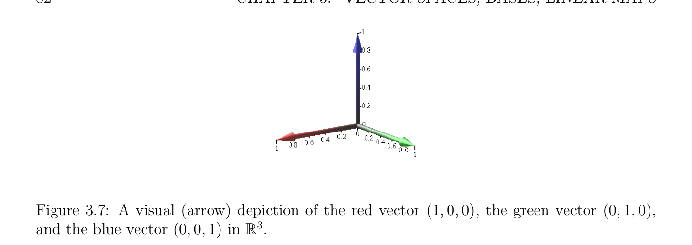

# Sự độc lập tuyến tính (linear independence), Các không gian con

<!-- PAGE 78 -->

## 3.4 Sự độc lập tuyến tính (linear independence), Các không gian con

Một của hầu hết hữu ích các tính chất của các không gian vectơ là rằng chúng possess các cơ sở. Những gì điều này có nghĩa là là rằng trong mọi không gian vectơ (vector space) $E$, tồn tại một tập hợp của các vectơ, ${e_{1}, \dots  , e_{n}}$, sao cho mọi vectơ $v \in E$ có thể được viết dưới dạng tổ hợp tuyến tính (linear combination),
$$v = \lambda_{1} e_{1} + \cdots  + \lambda_{n} e_{n},$$
Của $e_{i}$, với một số các vô hướng, $\lambda_{1} , \dots  , \lambda_{n}  \in \mathbb{R}$. Hơn nữa, bộ $n$, $(\lambda_{1} , \dots  , \lambda_{n}$), như ở trên là duy nhất. Điều này description là fine khi $E$ có hữu hạn cơ sở (basis), ${e_{1}, \dots  , e_{n}}$, nhưng điều này là không luôn luôn trường hợp! Ví dụ, không gian vectơ (vector space) của thực các đa thức, $\mathbb{R}[X]$, thực hiện không có hữu hạn cơ sở (basis) nhưng thay vì nó có vô hạn cơ sở (basis), cụ thể là
$$1, X, X^{2}, \dots  , X^{n}, \dots$$
Một có thể tự hỏi nếu nó là khả dĩ/có thể cho không gian vectơ (vector space) đến có các cơ sở của khác nhau các kích thước, hoặc chẵn/ngay cả đến có hữu hạn cơ sở (basis) cũng như vô hạn cơ sở (basis). Ta sẽ xem sau này rằng điều này là không khả dĩ/có thể; tất cả các cơ sở của không gian vectơ (vector space) có cùng số của các phần tử (cardinality), mà được gọi là số chiều của không gian. Tuy nhiên, ta có kết quả sau bài toán: Nếu không gian vectơ (vector space) có vô hạn cơ sở (basis), ${e_{1}, e_{2}, \dots$, }, cách mà thực hiện ta định nghĩa các tổ hợp tuyến tính? Thực hiện ta cho phép các tổ hợp tuyến tính
$$\lambda_{1} e_{1} + \lambda_{2} e_{2} + \cdots$$
Với một cách vô hạn nhiều khác không các hệ số? Nếu ta cho phép các tổ hợp tuyến tính với một cách vô hạn nhiều khác không các hệ số, thì ta có để tạo nghĩa của các phần tử này các tổng và điều này có thể chỉ được thực hiện reasonably nếu ta định nghĩa như vậy tổng như giới hạn của dãy của các vectơ, $s_{1}, s_{2}, \dots  , s_{n}, \dots$, với $s_{1} = \lambda_{1} e_{1}$ và
$$s_{n+1} = s_{n} + \lambda_{n+1} e_{n+1}.$$
Nhưng khi đó, cách mà thực hiện ta định nghĩa như vậy các giới hạn? Tốt, ta có để định nghĩa một số tôpô trên không gian của chúng ta, bởi có nghĩa là của chuẩn (norm), mêtric hoặc một số khác mechanism. Điều này có thể thật vậy được thực hiện và điều này là những gì Các không gian Banach và Các không gian Hilbert là tất cả về nhưng điều này dường như đến đòi hỏi nhiều machinery. cách để tránh các giới hạn là đến thu hẹp của ta attention đến các tổ hợp tuyến tính liên quan đến chỉ một cách hữu hạn nhiều các vectơ. Ta có thể có vô hạn supply của các vectơ nhưng ta chỉ tạo thành các tổ hợp tuyến tính liên quan đến một cách hữu hạn nhiều khác không các hệ số. Technically, điều này có thể được được thực hiện bởi giới thiệu các họ của hữu hạn hỗ trợ/giá (support). Điều này cho chúng ta ability đến manipulate các họ của các vô hướng được chỉ số bởi một số cố định vô hạn tập hợp và vẫn chưa là treat các phần tử này các họ như nếu chúng đã là hữu hạn. Với các phần tử này motivations trong mind, cho trước tập hợp $A$, nhắc lại rằng I-họ có chỉ số (indexed family) $(a_{i})_{i\in I}$ của các phần tử của $A$ (cho ngắn, họ) là hàm: I $\to A$, hoặc tương đương tập hợp của các cặp ${(i, a_{i})$ | $i \in I}$. Ta agree rằng khi $I = \emptyset , (a_{i})_{i\in I} = \emptyset$. họ $(a_{i})_{i\in I}$ là hữu hạn nếu I là hữu hạn.

<!-- PAGE 79 -->
Nhận xét: Khi xét họ $(a_{i})_{i\in I}$, không có lý do giả sử rằng I được thứ tự. then chốt điểm là rằng mọi phần tử của họ là một cách duy nhất được chỉ số bởi phần tử của I. Do đó, trừ khi specified ngược lại, ta thực hiện không giả sử rằng các phần tử của chỉ số tập hợp được thứ tự. Nếu $A$ là nhóm Abel (abelian group) với đồng nhất thức $0$, ta nói rằng họ $(a_{i})_{i\in I}$ có hữu hạn hỗ trợ/giá (support) nếu $a_{i} = 0$ với mọi $i \in$ I - $J$, ở đâu $J$ là hữu hạn tập con của I (hỗ trợ/giá (support) của họ). Cho trước hai rời nhau các tập hợp I và $J$, hợp của hai các họ $(u_{i})_{i\in I}$ và $(v_{j})_{j\in J}$, được ký hiệu như $(u_{i})_{i\in I} \cup (v_{j})_{j\in J}$, là họ $(w_{k})_{k\in(I\cup J)}$ được định nghĩa sao cho $w_{k} = u_{k}$ nếu $k \in$ I, và $w_{k} = v_{k}$ nếu $k \in J$. Cho trước họ $(u_{i})_{i\in I}$ và bất kỳ phần tử $v$, ta ký hiệu bởi $(u_{i})_{i\in I} \cup_{k}  (v)$ họ $(w_{i})_{i\in I\cup {k}}$ được định nghĩa sao cho, $w_{i} = u_{i}$ nếu $i \in$ I, và $w_{k} = v$, ở đâu $k$ là bất kỳ chỉ số sao cho $k \in /$ I. Cho trước họ $(u_{i})_{i\in I}$, họ con của $(u_{i})_{i\in I}$ là họ $(u_{j})_{j\in J}$ ở đâu $J$ là bất kỳ tập con của I. Trong chương này, trừ khi specified ngược lại, được giả sử rằng tất cả các họ của các vô hướng có hữu hạn hỗ trợ/giá (support).

> **Định nghĩa 3.3.** Cho $E$ là không gian vectơ (vector space). vectơ $v \in E$ là tổ hợp tuyến tính (linear combination) của họ $(u_{i})_{i\in I}$ của các phần tử của $E$ khi và chỉ khi có một họ $(\lambda_{i} )_{i\in I}$ của các vô hướng trong $K$ sao cho
$$v = \sum_{i\in I}  \lambda_{i} u_{i}.$$
$$When I = \emptyset , we stipulate that v = 0. (By Proposition 3.3, sums of the form \sum_{i}  \in I \lambda_{i} u_{i} are$$
Tốt được định nghĩa.) Ta nói rằng họ $(u_{i})_{i\in I}$ là độc lập tuyến tính (linearly independent) khi và chỉ khi với mọi họ $(\lambda_{i} )_{i\in I}$ của các vô hướng trong $K$,
$$\sum_{i\in I}  \lambda_{i} u_{i} = 0implies that\lambda_{i}  = 0 for all i \in I.$$
Tương đương, họ $(u_{i})_{iI}$ là phụ thuộc tuyến tính (linearly dependent) khi và chỉ khi tồn tại một họ $(\lambda_{i} )_{i\in I}$ của các vô hướng trong $K$ sao cho
$$\sum_{i\in I}^{\in}  \lambda_{i} u_{i} = 0and\lambda_{j}  \neq  0 for some j \in I.$$
Ta agree rằng khi $I = \emptyset$, họ $\emptyset$ là độc lập tuyến tính (linearly independent). Nhận thấy rằng định nghĩa các tổ hợp tuyến tính cho các họ của các vectơ thay vì cho các tập hợp của các vectơ có advantage rằng các vectơ đang là combined cần không là phân biệt. Ví dụ, cho $I = {1, 2, 3}$ và các họ $(u, v, u)$ và $(\lambda_{1} , \lambda_{2} , \lambda_{1}$), tổ hợp tuyến tính (linear combination)
$$\sum_{i\in I}  \lambda_{i} u_{i} = \lambda_{1} u + \lambda_{2} v + \lambda_{1} u$$
Làm cho nghĩa. Bằng cách sử dụng các tập hợp của các vectơ trong định nghĩa của tổ hợp tuyến tính (linear combination) thực hiện không cho phép như vậy các tổ hợp tuyến tính; điều này là cũng restrictive.

<!-- PAGE 80 -->
Unravelling Định nghĩa 3.3, họ $(u_{i})_{i\in I}$ là phụ thuộc tuyến tính (linearly dependent) khi và chỉ khi hoặc I bao gồm của đơn lẻ phần tử, nói $i$, và $u_{i} = 0$, hoặc |I| $\ge 2$ và một số $u_{j}$ trong họ có thể được biểu diễn dưới dạng tổ hợp tuyến tính (linear combination) của khác các vectơ trong họ. Thật vậy, trong trường hợp thứ hai, tồn tại một họ $(\lambda_{i} )_{i\in I}$ của các vô hướng trong $K$ sao cho
$$\sum_{i\in I}  \lambda_{i} u_{i} = 0and\lambda_{j}  \neq  0 for some j \in I,$$
Và vì |I| $\ge 2$, tập hợp $I -{j}$ là khác rỗng và ta thu được
$$u_{j} = \sum_{\in(I-{j}  -\lambda_{j}^{-1}  \lambda_{i} u_{i}.$$
$$i})$$
Nhận thấy rằng một của các lý do cho định nghĩa sự phụ thuộc tuyến tính (linear dependence) cho các họ của các vectơ thay vì cho các tập hợp của các vectơ là rằng định nghĩa của chúng ta cho phép bội occurrences của vectơ. Điều này là quan trọng bởi vì ma trận có thể chứa đồng nhất các cột, và ta sẽ like đến nói rằng các cột này là phụ thuộc tuyến tính (linearly dependent). định nghĩa của sự phụ thuộc tuyến tính (linear dependence) cho các tập hợp thực hiện không cho phép chúng ta đến thực hiện rằng. ở trên cũng chỉ ra rằng họ $(u_{i})_{i\in I}$ là độc lập tuyến tính (linearly independent) khi và chỉ khi hoặc $I = \emptyset$, hoặc I bao gồm của đơn lẻ phần tử $i$ và $u_{i} \neq  0$, hoặc |I| $\ge 2$ và không có vectơ $u_{j}$ trong họ có thể được biểu diễn dưới dạng tổ hợp tuyến tính (linear combination) của khác các vectơ trong họ. là precise ta có kết quả sau kết quả.

> **Mệnh đề 3.4.** Cho $E$ là không gian vectơ (vector space). họ $(v_{i})_{i\in I}$ của các vectơ trong $E$ với |I| $\ge 2$ là độc lập tuyến tính (linearly independent) khi và chỉ khi với mọi $k \in$ I, vectơ $v_{k}$ không thể được biểu diễn như tổ hợp tuyến tính (linear combination) của các vectơ trong họ $(v_{j})_{j\in I-{k}}$ thu được bởi removing $v_{k}$ từ họ $(v_{i})_{i\in I}$.

*Chứng minh.* Thứ nhất giả sử rằng họ $(v_{i})_{i\in I}$ là độc lập tuyến tính (linearly independent). Nếu bất kỳ vectơ $v_{k}$ có thể được biểu diễn dưới dạng tổ hợp tuyến tính (linear combination) của các vectơ trong họ $(v_{j})_{j\in I-{k}}$, thì $v_{k} =$
$$\sum_{j}  \in I-{k} \lambda_{j} v_{j} for some scalars \lambda_{j} , so we obtain a nontrivial linear combination$$
$$v_{k} - \sum_{\in I-{k}  \lambda_{j} v_{j} = 0,$$
$$j}$$
Contradicting sự độc lập tuyến tính (linear independence) của họ $(v_{i})_{i\in I}$. Ngược lại, giả sử rằng với mọi $k \in$ I, vectơ $v_{k}$ không thể được biểu diễn như tổ hợp tuyến tính (linear combination) của các vectơ trong họ $(v_{j})_{j\in I-{k}}$ thu được bởi removing $v_{k}$. Nếu họ $(v )_{i\in I}$ là không độc lập tuyến tính (linearly independent), thì có một số các vô hướng $\lambda_{i}$ không tất cả không sao cho
$$\sum_{i}^{i}  \in I \lambda_{i} v_{i} = 0. Suppose \lambda_{k}  \neq  0. Then we obtain$$
$$v_{k} = - \sum_{\in I-{k}  (\lambda_{j} /\lambda_{k} )v_{j},$$
$$j}$$
Contradicting giả thiết.

<!-- PAGE 81 -->
Khi I là khác rỗng, nếu họ $(u_{i})_{i\in I}$ là độc lập tuyến tính (linearly independent), lưu ý rằng $u_{i} \neq  0$ với mọi $i \in$ I. Ngược lại, nếu $u_{i} = 0$ với một số $i \in$ I, thì ta thu được không tầm thường sự phụ thuộc tuyến tính (linear dependence)
$$\sum_{ii}  \lambda_{i} u_{i} = 0 by picking any nonzero \lambda_{i}  and letting \lambda_{k}  = 0 for all k \in I with k \neq  i, since$$
$\lambda^{\in I} 0 = 0$. Nếu |I| $\ge 2$, ta phải cũng có $u_{i} \neq  u_{j}$ với mọi $i, j \in$ I với $i \neq  j$, vì ngược lại ta thu được không tầm thường sự phụ thuộc tuyến tính (linear dependence) bởi chọn $\lambda_{i}  = \lambda$ và $\lambda_{j}  = -\lambda$ với mọi khác không $\lambda$, và đặt $\lambda_{k}  = 0$ với mọi $k \in$ I với $k \neq  i, j$. Do đó, định nghĩa của sự độc lập tuyến tính (linear independence) suy ra rằng không tầm thường độc lập tuyến tính (linearly independent) họ là thực sự tập hợp. Điều này các giải thích tại sao nhất định các tác giả chọn để định nghĩa sự độc lập tuyến tính (linear independence) cho các tập hợp của các vectơ. bài toán với điều này cách tiếp cận là rằng sự phụ thuộc tuyến tính (linear dependence), mà là logical negation của sự độc lập tuyến tính (linear independence), là thì chỉ được định nghĩa cho các tập hợp của các vectơ. Tuy nhiên, như ta được điểm ra trước đó, nó là một cách thực desirable để định nghĩa sự phụ thuộc tuyến tính (linear dependence) cho các họ cho phép bội occurrences của cùng vectơ. Trong trường hợp đặc biệt khi các vectơ rằng ta là xét là các cột $A^{1}, \dots  , A^{n}$ của một ma trận cỡ $n \times  n$ $A$ (với các hệ số trong $K = \mathbb{R}$ hoặc $K = \mathbb{C})$, sự độc lập tuyến tính (linear independence) có đơn giản đặc trưng theo các nghiệm của hệ phương trình tuyến tính Ax $= 0$. Nhắc lại rằng $A^{1}, \dots  , A^{n}$ là độc lập tuyến tính (linearly independent) khi và chỉ khi với mọi các vô hướng $x_{1}, \dots  , x_{n} \in K$,
$$if x_{1}A^{1}+ \cdots  + x_{n}A^{n}= 0, thenx_{1} = \cdots  = x_{n} = 0.(*_{1})$$
Nếu ta tạo thành vectơ cột (column vector) $x$ có các tọa độ là $x_{1}, \dots  , x_{n} \in K$, thì theo định nghĩa của Ax,
$$x_{1}A^{1}+ \cdots  + x_{n}A^{n}= Ax,$$
Do đó $(*_{1})$ là tương đương đến
$$if Ax = 0, thenx = 0.(*_{2})$$
Nói cách khác, các cột $A^{1}, \dots  , A^{n}$ của ma trận $A$ là độc lập tuyến tính (linearly independent) khi và chỉ khi hệ phương trình tuyến tính Ax $= 0$ có duy nhất nghiệm $x = 0$ (tầm thường nghiệm). ở trên có thể typically là demonstrated bởi việc giải hệ Ax $= 0$ bởi biến phép khử, và kiểm chứng rằng chỉ nghiệm thu được là $x = 0$. Một cái khác cách để chứng minh rằng hệ phương trình tuyến tính Ax $= 0$ chỉ có tầm thường nghiệm $x = 0$ là để chỉ ra rằng $A$ là khả nghịch bởi bởi việc tìm explicity nghịch đảo $A^{-1}$ của $A$. Thật vậy, nếu $A$ có nghịch đảo $A^{-1}$, ta có $A^{-1}A = AA^{-1} =$ I, do đó nhân cả hai vế của phương trình Ax $= 0$ trên trái bởi $A^{-1}$, ta thu được
$$A^{-1}Ax = A^{-1}0 = 0,$$
Và vì $A^{-1}Ax =$ Ix $= x$, ta thu được $x = 0$. thứ nhất phương pháp có thể được ứng dụng để chỉ ra sự độc lập tuyến tính (linear independence) trong $(2)$ và $(3)$ của sau đây ví dụ.

> **Ví dụ 3.2.** $1$. Bất kỳ hai phân biệt các vô hướng $\lambda , \mu  \neq  0$ trong $K$ là phụ thuộc tuyến tính (linearly dependent).

<!-- PAGE 82 -->

**Hình 3.7:** visual (arrow) depiction của đỏ vectơ $(1, 0, 0)$, xanh lục vectơ $(0, 1, 0)$, và xanh lam vectơ $(0, 0, 1)$ trong $\mathbb{R}^{3}. 2$. Trong $\mathbb{R}^{3}$, các vectơ $(1, 0, 0), (0, 1, 0)$, và $(0, 0, 1)$ là độc lập tuyến tính (linearly independent). Xem Hình 3.7. $3$. Trong $\mathbb{R}^{4}$, các vectơ $(1, 1, 1, 1), (0, 1, 1, 1), (0, 0, 1, 1)$, và $(0, 0, 0, 1)$ là độc lập tuyến tính (linearly independent). $4$. Trong $\mathbb{R}^{2}$, các vectơ $u = (1, 1), v = (0, 1)$ và $w = (2, 3)$ là phụ thuộc tuyến tính (linearly dependent), vì
$$w = 2u + v.$$
Xem Hình 3.8.
$$(2,3)$$
$$v$$
$$w$$
$$2u$$

**Hình 3.8:** visual (arrow) depiction của hồng vectơ $u = (1, 1)$, dark tím vectơ $v = (0, 1)$, và vectơ tổng $w =$ 2u $+ v$.

<!-- PAGE 83 -->
Khi I là hữu hạn, ta thường giả sử rằng nó là tập hợp $I = {1, 2, \dots  , n}$. Trong trường hợp này, ta ký hiệu họ $(u_{i})_{i\in I}$ như $(u_{1}, \dots  , u_{n})$. khái niệm của không gian con của không gian vectơ (vector space) được định nghĩa như sau.

> **Định nghĩa 3.4.** Cho trước không gian vectơ (vector space) $E$, tập con $F$ của $E$ là không gian con tuyến tính (hoặc không gian con) của $E$ khi và chỉ khi $F$ là khác rỗng và $\lambda  \cdot_{E}  u +_{E} \mu  \cdot_{E}  v \in F$ với mọi $u, v \in F$, và tất cả $\lambda , \mu  \in K$. Nó là dễ để xem rằng không gian con $F$ của $E$ là thật vậy không gian vectơ (vector space), vì thu hẹp của $+_{E}$: $E \times  E \to E$ đến $F \times  F$ là thật vậy hàm $+_{F}$: $F \times  F \to F$, và thu hẹp của $\cdot_{E}$: $K \times  E \to E$ đến $K \times  F$ là thật vậy hàm $\cdot_{F}$: $K \times  F \to F$. Nó là thông lệ đến bỏ chỉ số dưới $E$ và đơn giản viết $\lambda u + \mu v$ thay vì của $\lambda  \cdot_{E}  u +_{E} \mu  \cdot_{E}  v$. Vì không gian con $F$ là khác rỗng, nếu ta chọn bất kỳ vectơ $u \in F$ và nếu ta cho $\lambda  = \mu  = 0$, thì $\lambda u+\mu u = 0u+0u = 0_{E} +0_{E} = 0_{E}$, do đó mọi không gian con chứa không vectơ $0_{E}$. Lưu ý rằng $0_{F} = 0_{E}$. sau đây các sự kiện cũng đúng. chứng minh là để lại như một bài tập.

> **Mệnh đề 3.5.**
$(1)$ giao của bất kỳ họ (chẵn/ngay cả vô hạn) của các không gian con của không gian vectơ (vector space) $E$ là không gian con.
$(2)$ Cho $F$ là bất kỳ không gian con của không gian vectơ (vector space) $E$. Với mọi khác rỗng hữu hạn chỉ số tập hợp $I$, nếu $(u_{i})_{i\in I}$ là bất kỳ họ của các vectơ $u_{i} \in F$ và $(\lambda_{i} )_{i\in I}$ là bất kỳ họ của các vô hướng, thì
$$\sum_{i}  \in I \lambda_{i} u_{i} \in F.$$
Không gian con ${0_{E}}$ sẽ được ký hiệu bởi $(0_{E})$, hoặc chẵn/ngay cả $(0)$ (với nhẹ abuse của ký hiệu).

> **Ví dụ 3.3.** $1$. Trong $\mathbb{R}^{2}$, tập hợp của các vectơ $u = (x, y)$ sao cho
$$x + y = 0$$
Là không gian con được minh họa bởi Hình 3.9. $2$. Trong $\mathbb{R}^{3}$, tập hợp của các vectơ $u = (x, y, z)$ sao cho
$$x + y + z = 0$$
Là không gian con được minh họa bởi Hình 3.10. $3$. Với mọi $n \ge 0$, tập hợp của các đa thức f(X) $\in \mathbb{R}[X]$ của bậc nhiều nhất $n$ là không gian con của $\mathbb{R}[X]. 4$. tập hợp của tam giác trên (upper triangular) $n\times n$ các ma trận là không gian con của không gian của $n\times n$ các ma trận.

<!-- PAGE 84 -->

**Hình 3.9:** không gian con $x + y = 0$ là đường thẳng qua gốc với hệ số góc $-1$. Nó bao gồm của tất cả các vectơ của tạo thành $\lambda (-1, 1)$.

**Hình 3.10:** không gian con $x+y +z = 0$ là mặt phẳng qua gốc với chuẩn tắc/bình thường $(1, 1, 1)$.

> **Mệnh đề 3.6.** Cho trước bất kỳ không gian vectơ (vector space) $E$, nếu $S$ là bất kỳ khác rỗng tập con của $E$, thì nhỏ nhất không gian con $\langle S\rangle$ (hoặc Sinh (span)(S)) của $E$ chứa $S$ là tập hợp tất cả (hữu hạn) các tổ hợp tuyến tính của các phần tử từ $S$.

*Chứng minh.* Ta chứng minh rằng tập hợp Sinh (span)(S) của tất cả các tổ hợp tuyến tính của các phần tử của $S$ là không gian con của $E$, để lại như một bài tập verification rằng mọi không gian con chứa $S$ cũng chứa Sinh (span)(S).
$$First, Span(S) is nonempty since it contains S (which is nonempty). If u = \sum_{i}  \in I \lambda_{i} u_{i}$$

<!-- PAGE 85 -->
$$and v = \sum_{j}  \in J \mu_{j} v_{j} are any two linear combinations in Span(S), for any two scalars \lambda , \mu  \in K,$$
$$\lambda u + \mu v = \lambda \sum_{i\in I}  \lambda_{i} u_{i} + \mu \sum_{j\in J}  \mu_{j} v_{j}$$
$$= \sum_{i\in I}  \lambda \lambda_{i} u_{i} + \sum_{j\in J}  \mu \mu_{j} v_{j}$$
$$= \sum_{i\in I-J}  \lambda \lambda_{i} u_{i} + \sum_{i\in I\cap J}  (\lambda \lambda_{i}  + \mu \mu_{i} )u_{i} + \sum_{j\in J-I}  \mu \mu_{j} v_{j},$$
Mà là tổ hợp tuyến tính (linear combination) với chỉ số tập hợp $I \cup J$, và do đó $\lambda u + \mu v \in$ Sinh (span)(S), mà chứng tỏ rằng Sinh (span)(S) là không gian con. Một có thể tự hỏi những gì xảy ra nếu ta cộng extra các điều kiện đến các hệ số liên quan trong tạo thành các tổ hợp tuyến tính. Ở đây là ba tự nhiên các thu hẹp mà turn ra là quan trọng (như thông thường, ta giả sử rằng của ta chỉ số các tập hợp là hữu hạn):
$$(1) Consider combinations \sum_{i}  \in I \lambda_{i} u_{i} for which$$
$$\sum_{i\in I}  \lambda_{i}  = 1.$$
Các phần tử này được gọi là các tổ hợp afin. Một nên realize rằng mọi tổ hợp tuyến tính (linear combination)
$$\sum_{i}  \lambda_{i} u_{i} can be viewed as an affine combination. For example, if k is an index not$$
$$in^{\in I} I, if we let J = I \cup {k}, u_{k} = 0, and \lambda_{k}  = 1 - \sum_{i}  \in I \lambda_{i} , then \sum_{j}  \in J \lambda_{j} u_{j} is an affine$$
Tổ hợp và
$$\sum_{i\in I}  \lambda_{i} u_{i} = \sum_{j\in J}  \lambda_{j} u_{j}.$$
Tuy nhiên, ta thu được mới các không gian. Ví dụ, trong $\mathbb{R}^{3}$, tập hợp tất cả các tổ hợp afin của ba các vectơ $e_{1} = (1, 0, 0), e_{2} = (0, 1, 0)$, và $e_{3} = (0, 0, 1)$, là mặt phẳng chuyển qua các phần tử này ba các điểm. Vì nó thực hiện không chứa $0 = (0, 0, 0)$, nó là không không gian con tuyến tính.
$$(2) Consider combinations \sum_{i}  \in I \lambda_{i} u_{i} for which$$
$$\lambda_{i}  \ge 0,for all i \in I.$$
Các phần tử này được gọi là dương (hoặc conic) các tổ hợp. Hóa ra là dương các tổ hợp của các họ của các vectơ là các nón. Chúng chỉ ra lên một cách tự nhiên trong lồi tối ưu hóa.
$$(3) Consider combinations \sum_{i}  \in I \lambda_{i} u_{i} for which we require (1) and (2), that is$$
$$\sum_{i\in I}  \lambda_{i}  = 1,and\lambda_{i}  \ge 0for all i \in I.$$
Các phần tử này được gọi là lồi các tổ hợp. Cho trước bất kỳ hữu hạn họ của các vectơ, tập hợp tất cả lồi các tổ hợp của các vectơ này là lồi đa diện. Lồi các đa diện đóng rất quan trọng vai trò trong lồi tối ưu hóa.
