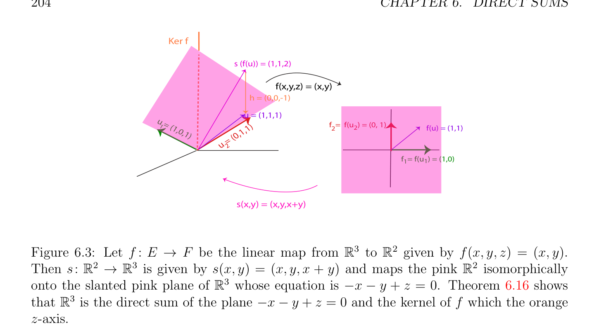

# Rank-Nullity Định lý; Grassmann's Quan hệ

<!-- PAGE 202 -->
Bởi khối phép nhân ta thu được
$$TC + UW = I_{n}$$
$$TV + \beta U = 0_{n,1}$$
$$\alpha W = 0_{1,n}$$
$$\alpha \beta  = 1.$$
Từ ở trên các phương trình ta suy ra rằng $\alpha , \beta  \neq  0$ và $\beta  = \alpha^{-1}$. Vì $\alpha  \neq  0$, phương trình $\alpha W = 0_{1,n}$ cho ta $W = 0_{1,n}$, và do đó
$$TC = I_{n},TV + \beta U = 0_{n,1}.$$
Suy ra rằng $T$ là khả nghịch và $C$ là nghịch đảo của nó, và vì $T$ là tam giác trên (upper triangular), theo giả thiết quy nạp, $C$ là cũng tam giác trên (upper triangular). ở trên lập luận có thể được dễ dàng được sửa đổi để chứng minh rằng nếu $A$ là khả nghịch, thì của nó đường chéo các phần tử (entries) là khác không. Ta là bây giờ ready để chứng minh rất then chốt kết quả relating hạng (rank) và số chiều của hạt nhân (kernel) của ánh xạ tuyến tính (linear map).

## 6.3 Rank-Nullity Định lý; Grassmann’s Quan hệ

Ta bắt đầu với sau đây cơ bản mệnh đề.

> **Mệnh đề 6.15.** Cho $E, F$ và $G$, là ba các không gian vectơ, $f$: $E \to F$ đơn ánh (injective) ánh xạ tuyến tính (linear map), $g: F \to G$ toàn ánh (surjective) ánh xạ tuyến tính (linear map), và giả sử rằng Im $f =$ Ker $g$. Thì, các tính chất sau đây đúng. () Với mọi mục $s: G \to F$ của $g$, ta có $F =$ Ker $g \oplus$ Im $s$, và ánh xạ tuyến tính (linear map) $f + s: E \oplus G \to F$ là $isomorphism.^{1}$
$(b)$ Với mọi phép co rút (retraction) $r: F \to E$ của $f$, ta có $F =$ Im $f \oplus$ Ker $r.^{2}$
$$f F/g G/$$
$$E$$
$$\overline{r}\overline{s}$$

*Chứng minh.* () Vì $s: G \to F$ là mục của $g$, ta có $g \circ s = id_{G}$, và với mọi $u \in F$,
$$g(u -s(g(u))) = g(u) -g(s(g(u))) = g(u) -g(u) = 0.$$
Do đó, $u$ - s(g(u)) $\in$ Ker $g$, và ta có $F =$ Ker $g +$ Im $s$. Mặt khác, nếu $u \in$ Ker $g \cap$ Im $s$, thì $u =$ s(v) với một số $v \in G$ bởi vì $u \in$ Im $s$, g(u) $= 0$ bởi vì $u \in$ Ker $g$, và do đó,
$$g(u) = g(s(v)) = v = 0,$$
$\overline{1}\overline{The} \overline{existence} \overline{of} \overline{a} \overline{section} \overline{s}\overline{:} \overline{G}\overline{\to} \overline{F} \overline{of} g$ suy ra từ Mệnh đề 6.11. 2The sự tồn tại của phép co rút (retraction) $r: F \to E$ của $f$ suy ra từ Mệnh đề 6.11.

<!-- PAGE 203 -->
Bởi vì $g \circ s = id_{G}$, mà chỉ ra rằng $u =$ s(v) $= 0$. Do đó, $F =$ Ker $g \oplus$ Im $s$, và vì bởi giả định, Im $f =$ Ker $g$, ta có $F =$ Im $f \oplus$ Im $s$. Nhưng khi đó, vì $f$ và $s$ là đơn ánh (injective), $f + s: E \oplus G \to F$ là đẳng cấu. chứng minh của $(b)$ là rất đồng dạng. Lưu ý rằng ta có thể chọn phép co rút (retraction) $r: F \to E$ sao cho Ker $r =$ Im $s$, vì $F =$ Ker $g \oplus$ Im $s =$ Im $f \oplus$ Im $s$ và $f$ là đơn ánh (injective) do đó ta có thể tập hợp $r \equiv 0$ trên Im $s$.
$$fg$$
Cho trước dãy của các ánh xạ tuyến tính (linear maps) $E \longrightarrow F \longrightarrow G$, khi Im $f =$ Ker $g$, ta nói rằng
$$fg$$
Dãy $E \longrightarrow F \longrightarrow G$ là chính xác tại $F$. Nếu ngoài đang là chính xác tại $F, f$ là đơn ánh (injective) và $g$ là toàn ánh (surjective), ta nói rằng ta có ngắn chính xác dãy, và điều này được ký hiệu là như
$$fg$$
$$0 \longrightarrow E\longrightarrow F\longrightarrow G \longrightarrow 0.$$
Tính chất của ngắn chính xác dãy cho trước theo Mệnh đề 6.15 là thường được mô tả bởi nói rằng
$$fg$$
Rằng $0 \longrightarrow E \longrightarrow F \longrightarrow G \longrightarrow 0$ là (ngắn) split chính xác dãy. Như hệ quả của Mệnh đề 6.15, ta có kết quả sau kết quả mà chỉ ra rằng cho trước ánh xạ tuyến tính (linear map) $f$: $E \to F$, của nó miền xác định $E$ là tổng trực tiếp (direct sum) của hạt nhân (hạt nhân (kernel)) của nó Ker $f$ với một số đẳng cấu copy của ảnh (ảnh (image)) của nó Im $f$.

> **Định lý 6.16.** (Rank-nullity định lý) Cho $E$ và $F$ là các không gian vectơ, và cho $f$: $E \to F$ là ánh xạ tuyến tính (linear map). Thì, $E$ là đẳng cấu đến Ker $f \oplus$ Im $f$, và do đó,
$$\dim(E) = \dim(\mathrm{Ker} f) + \dim(\mathrm{Im} f) = \dim(\mathrm{Ker} f) + rk(f).$$
Xem Hình 6.3.

*Chứng minh.* Xét
$$\longrightarrow i\longrightarrow$$
$$\mathrm{Ker} fE^{f'}\mathrm{Im} f,$$
$$if'$$
Ở đâu Ker $f \longrightarrow E$ là inclusion ánh xạ, và $E \longrightarrow$ Im $f$ là toàn ánh liên kết
$$fs$$
Với $E \longrightarrow F$. Thì, ta áp dụng Mệnh đề 6.15 đến bất kỳ mục Im $f \longrightarrow E$ của f' để thu được đẳng cấu giữa $E$ và Ker $f \oplus$ Im $f$, và Mệnh đề 6.7, để thu được dim(E) $=$ dim(Ker $f) +$ dim(Im $f)$.

> **Định nghĩa 6.10.** số chiều dim(Ker $f)$ của hạt nhân (kernel) của ánh xạ tuyến tính (linear map) $f$ được gọi là số chiều hạch (nullity) của $f$. Ta bây giờ derive một số quan trọng các kết quả bằng cách sử dụng Định lý 6.16.

> **Mệnh đề 6.17.** Cho trước không gian vectơ (vector space) $E$, nếu $U$ và $V$ là bất kỳ hai các không gian con của $E$, thì
$$\dim(U) + \dim(V ) = \dim(U + V ) + \dim(U \cap V ),$$
Phương trình đã biết như Grassmann’s quan hệ.

<!-- PAGE 204 -->
$$\mathrm{Ker} f$$
$$s (f(u)) = (1,1,2)$$
$$f(x,y,z) = (x,y)$$
$$h = (0,0,-1)$$
$$u = (1,1,1)$$
$$u =f  =  f(u  ) = (0, 1)$$
$$1 (1,0,,1)22f(u) = (1,1)$$
$$1)(0,1$$
$$=$$
$$u 2$$
$$\overline{f  = f(u  ) = (1,0)} 11$$
$$s(x,y) = (x,y,x+y)$$
$$\mathbb{R}^{3}  \mathbb{R}^{2}$$

**Hình 6.3:** Cho $f$: $E \to F$ là ánh xạ tuyến tính (linear map) từ đến cho trước bởi f(x, $y, z) = (x, y)$.
$$\mathbb{R}^{2} \mathbb{R}^{3}  \mathbb{R}^{2}$$
Thì $s: \to$ được cho bởi s(x, $y) = (x, y, x + y)$ và các ánh xạ hồng isomorphically
$$\mathbb{R}^{3}$$
Lên slanted hồng mặt phẳng của có phương trình là $-x$ - $y + z = 0$. Định lý 6.16 chỉ ra $\mathbb{R}^{3}$ rằng là tổng trực tiếp (direct sum) của mặt phẳng $-x$ - $y + z = 0$ và hạt nhân (kernel) của $f$ mà cam trục $z$.

*Chứng minh.* Nhắc lại rằng $U + V$ là ảnh (image) của ánh xạ tuyến tính (linear map)
$$a: U \times  V \to E$$
Cho trước bởi
$$a(u, v) = u + v,$$
Và rằng ta được chứng minh trước đó rằng hạt nhân (kernel) Ker của là đẳng cấu đến $U \cap V$. Theo Định lý 6.16,
$$\dim(U \times  V ) = \dim(\mathrm{Ker} a) + \dim(\mathrm{Im} a),$$
Nhưng dim(U $\times  V$) $=$ dim(U) $+$ dim(V), dim(Ker $a) =$ dim(U $\cap V$), và Im $a = U + V$, do đó Grassmann quan hệ nghiệm đúng. Grassmann quan hệ có thể được rất hữu ích đến hình ra liệu hai không gian con có không tầm thường giao trong các không gian có số chiều $> 3$. Ví dụ, nó là dễ để xem rằng trong $\mathbb{R}^{5}$, có các không gian con $U$ và $V$ với dim(U) $= 3$ và dim(V) $= 2$ sao cho $U \cap V = (0)$; ví dụ, cho $U$ được sinh bởi các vectơ $(1, 0, 0, 0, 0), (0, 1, 0, 0, 0), (0, 0, 1, 0, 0)$, và $V$ được sinh bởi các vectơ $(0, 0, 0, 1, 0)$ và $(0, 0, 0, 0, 1)$. Tuy nhiên, ta khẳng định rằng nếu dim(U) $= 3$ và dim(V) $= 3$, thì dim(U $\cap V$) $\ge 1$. Thật vậy, bởi Grassmann quan hệ, ta có
$$\dim(U) + \dim(V ) = \dim(U + V ) + \dim(U \cap V ),$$
Cụ thể là
$$3 + 3 = 6 = \dim(U + V ) + \dim(U \cap V ),$$

<!-- PAGE 205 -->
Và vì $U + V$ là không gian con của $\mathbb{R}^{5}$, dim(U $+ V$) $\le 5$, mà suy ra
$$6 \le 5 + \dim(U \cap V ),$$
Rằng là $1 \le$ dim(U $\cap V$). Như một cái khác hệ quả của Mệnh đề 6.17, nếu $U$ và $V$ là hai các siêu phẳng trong không gian vectơ (vector space) có số chiều $n$, sao cho dim(U) $= n$ - $1$ và dim(V) $= n$ - $1$, độc giả nên chỉ ra rằng
$$\dim(U \cap V ) \ge n -2,$$
Và do đó, nếu $U \neq  V$, thì
$$\dim(U \cap V ) = n -2.$$
Ở đây là đặc trưng của các tổng trực tiếp rằng suy ra một cách trực tiếp từ Định lý 6.16.

> **Mệnh đề 6.18.** Nếu $U_{1}, \dots  , U_{p}$ là bất kỳ các không gian con của hữu hạn dimensional không gian vectơ (vector space) $E$, thì
$$\dim(U_{1} + \cdots  + U_{p}) \le \dim(U_{1}) + \cdots  + \dim(U_{p}),$$
Và
$$\dim(U_{1} + \cdots  + U_{p}) = \dim(U_{1}) + \cdots  + \dim(U_{p})$$
Khi và chỉ khi $U_{i}s$ tạo thành tổng trực tiếp (direct sum) $U_{1} \oplus \cdots  \oplus U_{p}$.

*Chứng minh.* Nếu ta áp dụng Định lý 6.16 đến ánh xạ tuyến tính (linear map)
$$a: U_{1} \times  \cdots  \times  U_{p} \to U_{1} + \cdots  + U_{p}$$
Cho trước bởi $a(u_{1}, \dots  , u_{p}) = u_{1} + \cdots  + u_{p}$, ta thu được
$$\dim(U_{1} + \cdots  + U_{p}) = \dim(U_{1} \times  \cdots  \times  U_{p}) -\dim(\mathrm{Ker} a)$$
$$= \dim(U_{1}) + \cdots  + \dim(U_{p}) -\dim(\mathrm{Ker} a),$$
Do đó bất đẳng thức suy ra. Vì là đơn ánh (injective) khi và chỉ khi Ker $a = (0)$, $U_{i}s$ tạo thành tổng trực tiếp (direct sum) khi và chỉ khi phương trình thứ hai nghiệm đúng. Một cái khác quan trọng hệ quả của Định lý 6.16 là kết quả sau đây:

> **Mệnh đề 6.19.** Cho $E$ và $F$ là hai các không gian vectơ với cùng hữu hạn số chiều dim(E) $=$ dim(F) $= n$. Với mọi ánh xạ tuyến tính (linear map) $f$: $E \to F$, các tính chất sau đây là tương đương:
() $f$ là song ánh (bijective).
$(b) f$ là toàn ánh (surjective).
$(c) f$ là đơn ánh (injective).

<!-- PAGE 206 -->
$(d)$ Ker $f = (0)$.

*Chứng minh.* Hiển nhiên, () suy ra $(b)$. Nếu $f$ là toàn ánh (surjective), thì Im $f = F$, và do đó dim(Im $f) = n$. Theo Định lý 6.16,
$$\dim(E) = \dim(\mathrm{Ker} f) + \dim(\mathrm{Im} f),$$
Và vì dim(E) $= n$ và dim(Im $f) = n$, ta thu được dim(Ker $f) = 0$, mà có nghĩa là Ker $f = (0)$, và do đó $f$ là đơn ánh (injective) (xem Mệnh đề 3.19). Điều này chứng tỏ rằng $(b)$ suy ra $(c)$. Nếu $f$ là đơn ánh (injective), thì theo Mệnh đề 3.19, Ker $f = (0)$, do đó $(c)$ suy ra $(d)$. Cuối cùng, giả sử rằng Ker $f = (0)$, sao cho dim(Ker $f) = 0$ và $f$ là đơn ánh (injective) (theo Mệnh đề 3.19). Theo Định lý 6.16,
$$\dim(E) = \dim(\mathrm{Ker} f) + \dim(\mathrm{Im} f),$$
Và vì dim(Ker $f) = 0$, ta thu được
$$\dim(\mathrm{Im} f) = \dim(E) = \dim(F),$$
Mà chứng tỏ rằng $f$ là cũng toàn ánh (surjective), và do đó song ánh (bijective). Điều này chứng tỏ rằng $(d)$ suy ra () và kết luận chứng minh. Một nên là warned rằng Mệnh đề 6.19 không thỏa mãn trong vô hạn số chiều. Ở đây là một vài các ứng dụng của Mệnh đề 6.19. Cho $A$ là một ma trận cỡ $n \times  n$ và giả sử rằng $A$ một số nghịch đảo phải (right inverse) $B$, mà có nghĩa là $B$ là một ma trận cỡ $n \times  n$ sao cho
$$AB = I.$$
Ánh xạ tuyến tính (linear map) liên kết với $A$ là toàn ánh (surjective), vì với mọi $u \in \mathbb{R}^{n}$, ta có (Bu) $= u$. Theo Mệnh đề 6.19, ánh xạ này là song ánh (bijective) do đó $B$ là thực sự nghịch đảo của $A$; đặc biệt $BA =$ I. Tương tự, giả sử rằng $A$ có nghịch đảo trái (left inverse) $B$, sao cho
$$BA = I.$$
Điều này time ánh xạ tuyến tính (linear map) liên kết với $A$ là đơn ánh (injective), bởi vì nếu Au $= 0$, thì BAu $=$ B0 $= 0$, và vì $BA =$ I ta thu được $u = 0$. Một lần nữa, theo Mệnh đề 6.19, ánh xạ này là song ánh (bijective) do đó $B$ là thực sự nghịch đảo của $A$; đặc biệt $AB =$ I. Bây giờ giả sử rằng hệ phương trình tuyến tính Ax $= b$ có một số nghiệm với mọi $b$. Thì ánh xạ tuyến tính (linear map) liên kết với $A$ là toàn ánh (surjective) và theo Mệnh đề 6.19, $A$ là khả nghịch. Cuối cùng giả sử rằng hệ phương trình tuyến tính Ax $= b$ có nhiều nhất một nghiệm với mọi $b$. Thì ánh xạ tuyến tính (linear map) liên kết với $A$ là đơn ánh (injective) và theo Mệnh đề 6.19, $A$ là khả nghịch. sau đây Mệnh đề sẽ cũng là hữu ích.

<!-- PAGE 207 -->

> **Mệnh đề 6.20.** Cho $E$ là không gian vectơ (vector space). Nếu $E = U \oplus V$ và $E = U \oplus W$, thì có một đẳng cấu $f$: $V \to W$ giữa $V$ và $W$.

*Chứng minh.* Cho $R$ là quan hệ giữa $V$ và $W$, được định nghĩa sao cho
$$\langle v, w\rangle \in Riffw -v \in U.$$
Ta khẳng định rằng $R$ là phiếm hàm quan hệ rằng định nghĩa tuyến tính đẳng cấu $f$: $V \to W$ giữa $V$ và $W$, ở đâu f(v) $= w$ khi và chỉ khi $\langle v, w\rangle \in R (R$ là đồ thị của $f)$. Nếu $w$ - $v \in U$ và w' - $v \in U$, thì w' - $w \in U$, và vì $U \oplus W$ là tổng trực tiếp (direct sum), $U \cap W = (0)$, và do đó w' - $w = 0$, nghĩa là w' $= w$. Do đó, $R$ là phiếm hàm. Tương tự, nếu $w$ - $v \in U$ và $w$ - v' $\in U$, thì v' - $v \in U$, và vì $U \oplus V$ là tổng trực tiếp (direct sum), $U \cap V = (0)$, và v' $= v$. Do đó, $f$ là đơn ánh (injective). Vì $E = U \oplus V$, với mọi $w \in W$, tồn tại duy nhất một cặp $\langle u, v\rangle \in U \times  V$, sao cho $w = u + v$. Thì, $w$ - $v \in U$, và $f$ là toàn ánh (surjective). Ta cũng cần để kiểm chứng rằng $f$ là tuyến tính. Nếu
$$w -v = u$$
Và
$$w'-v'= u',$$
Ở đâu $u$, u' $\in U$, thì, ta có
$$(w + w') -(v + v') = (u + u'),$$
Ở đâu $u +$ u' $\in U$. Tương tự, nếu
$$w -v = u$$
Ở đâu $u \in U$, thì ta có
$$\lambda w -\lambda v = \lambda u,$$
Ở đâu $\lambda u \in U$. Do đó, $f$ là tuyến tính. Cho trước không gian vectơ (vector space) $E$ và bất kỳ không gian con $U$ của $E$, Mệnh đề 6.20 chỉ ra rằng số chiều của bất kỳ không gian con $V$ sao cho $E = U \oplus V$ phụ thuộc chỉ trên $U$. Ta gọi dim(V) đối chiều (codimension) của $U$, và ta ký hiệu nó bởi codim(U). không gian con $U$ của đối chiều (codimension) $1$ được gọi là một siêu phẳng (hyperplane). khái niệm của hạng (rank) của ánh xạ tuyến tính (linear map) hoặc của ma trận là quan trọng một, cả hai về mặt lý thuyết và một cách thực tế, vì nó là then chốt đến solvability của các phương trình tuyến tính. Nhắc lại từ Định nghĩa 3.19 rằng hạng (rank) rk(f) của ánh xạ tuyến tính (linear map) $f$: $E \to F$ là số chiều dim(Im $f)$ của ảnh (image) không gian con Im $f$ của $F$. Ta có kết quả sau đơn giản mệnh đề.

> **Mệnh đề 6.21.** Cho trước ánh xạ tuyến tính (linear map) $f$: $E \to F$, các tính chất sau đây đúng:
$(i)$ rk(f) $=$ codim(Ker $f)$.

<!-- PAGE 208 -->
(ii) rk(f) $+$ dim(Ker $f) =$ dim(E).
(iii) rk(f) $\le$ min(dim(E), dim(F)).

*Chứng minh.* Vì theo Mệnh đề 6.16, dim(E) $=$ dim(Ker $f) +$ dim(Im $f)$, và theo Định nghĩa, rk(f) $=$ dim(Im $f)$, ta có rk(f) $=$ codim(Ker $f)$. Vì rk(f) $=$ dim(Im $f)$, (ii) suy ra từ dim(E) $=$ dim(Ker $f) +$ dim(Im $f)$. Như cho (iii), vì Im $f$ là không gian con của $F$, ta có rk(f) $\le$ dim(F), và vì rk(f) $+$ dim(Ker $f) =$ dim(E), ta có rk(f) $\le$ dim(E). hạng (rank) của ma trận được định nghĩa như sau.

> **Định nghĩa 6.11.** Cho trước một ma trận cỡ $m \times n$ $A = (a_{i j})$ trên trường $K$, hạng (rank) rk() của ma trận $A$ là cực đại số của các cột độc lập tuyến tính của $A$ (được quan điểm như các vectơ trong $K^{m})$. Xét theo Mệnh đề 3.9, hạng (rank) của ma trận $A$ là số chiều của không gian con của $K^{m}$ được sinh bởi các cột của $A$. Cho $E$ và $F$ là hai các không gian vectơ, và cho $(u_{1}, \dots  , u_{n})$ là cơ sở (basis) của $E$, và $(v_{1}, \dots  , v_{m})$ cơ sở (basis) của $F$. Cho $f$: $E \to F$ là ánh xạ tuyến tính (linear map), và cho M(f) là ma trận của nó w.r.t. các cơ sở $(u_{1}, \dots  , u_{n})$ và $(v_{1}, \dots  , v_{m})$. Vì hạng (rank) rk(f) của $f$ là số chiều của Im $f$, mà được sinh bởi $(f(u_{1}), \dots  , f(u_{n}))$, hạng (rank) của $f$ là cực đại số của các vectơ độc lập tuyến tính (linearly independent) trong $(f(u_{1}), \dots  , f(u_{n}))$, mà bằng số của các cột độc lập tuyến tính của M(f), vì $F$ và $K^{m}$ là đẳng cấu. Do đó, ta có rk(f) $=$ rk(M(f)), với mọi ma trận biểu diễn $f$. Ta sẽ xem sau này, bằng cách sử dụng đối ngẫu, rằng hạng (rank) của ma trận $A$ là cũng bằng cực đại số của các hàng độc lập tuyến tính của $A$. Nếu $U$ là siêu phẳng (hyperplane), thì $E = U \oplus V$ với một số không gian con $V$ có số chiều $1$. Tuy nhiên, không gian con $V$ có số chiều $1$ được sinh bởi bất kỳ khác không vectơ $v \in V$, và do đó ta ký hiệu $V$ bởi Kv, và ta viết $E = U \oplus$ Kv. Rõ ràng, $v \in / U$. Ngược lại, cho $x \in E$ là vectơ sao cho $x \in / U$ (và do đó, x̸ $= 0)$. Ta khẳng định rằng $E = U \oplus$ Kx. Thật vậy, vì $U$ là siêu phẳng (hyperplane), ta có $E = U \oplus$ Kv với một số $v \in / U$ (với $v \neq  0)$. Thì, $x \in E$ có thể được được viết trong duy nhất cách như $x = u + \lambda v$, ở đâu $u \in U$, và vì $x \in / U$, ta phải có $\lambda  \neq  0$, và do đó, $v = -\lambda^{-1} u + \lambda^{-1} x$. Vì $E = U \oplus$ Kv, điều này chỉ ra rằng $E = U +$ Kx. Vì $x \in / U$, ta có $U \cap$ Kx $= 0$, và do đó $E = U \oplus$ Kx. Điều này lập luận chỉ ra rằng siêu phẳng (hyperplane) là cực đại thực sự/đúng đắn không gian con $H$ của $E$. Định lý 6.16 cũng cho ta đặc trưng của các siêu phẳng theo các dạng tuyến tính. Nhắc lại rằng cho trước không gian vectơ (vector space) $E$, siêu phẳng (hyperplane) $H$ trong $E$ là không gian con của đối chiều (codimension) $1$, mà có nghĩa là có một một chiều không gian con $L$ sao cho
$$E = H \oplus L.$$

> **Mệnh đề 6.22.** Cho trước không tầm thường không gian vectơ (vector space) $E$ trên trường $K$, không gian con $H$ của $E$ là siêu phẳng (hyperplane) khi và chỉ khi có một khác không dạng tuyến tính (linear form) $\phi$: $E \to K$ sao cho
$$H = \mathrm{Ker} \phi .$$

<!-- PAGE 209 -->
Hơn nữa, nếu $\phi_{1}$ và $\phi_{2}$ là bất kỳ hai khác không các dạng tuyến tính định nghĩa cùng siêu phẳng (hyperplane) $H$, trong nghĩa rằng $H =$ Ker $\phi_{1}  =$ Ker $\phi_{2}$, thì tồn tại một khác không $\alpha  \in K$ sao cho $\phi_{2}  = \alpha \phi_{1}$.

*Chứng minh.* Thứ nhất giả sử rằng $\phi$: $E \to K$ là khác không dạng tuyến tính (linear form) và rằng $H =$ Ker $\phi$. Thì có một khác không vectơ $u_{0} \in E$ sao cho $\phi (u_{0}) = \lambda_{0}  \neq  0$ với một số $\lambda_{0}  \in K$, và do đó với mọi $\lambda  \in K$, ta có
$$\phi (\lambda \lambda_{0}^{-1}  u_{0}) = \lambda \lambda_{0}^{-1}  \phi (u_{0}) = \lambda \lambda_{0}^{-1}  \lambda_{0}  = \lambda ,$$
Mà có nghĩa là $\phi$ là toàn ánh (surjective) lên $K$. Suy ra rằng trong Định lý 6.16 ta có thể định nghĩa $s$ bởi $s(\lambda_{0}$) $= u_{0}$, do đó không gian con $L =$ Im $s = Ku_{0}$ là một chiều không gian và ta có
$$E = \mathrm{Ker} \phi  \oplus L = H \oplus L,$$
Do đó $H$ là siêu phẳng (hyperplane). Ngược lại giả sử rằng $H$ là siêu phẳng (hyperplane), sao cho $E = H \oplus L$ ở đâu $L$ là không gian con có số chiều $1$. Nếu ta chọn khác không vectơ $u_{0} \in L$, vì $L$ có số chiều $1$ và $E = H \oplus L$, mọi $u \in E$ có thể được được viết một cách duy nhất như $u = h + \lambda u_{0}$ với một số $h \in H$ và một số $\lambda  \in K$. Nếu ta định nghĩa ánh xạ $\phi$: $E \to K$ bởi
$$\phi (u + \lambda u_{0}) = \lambda ,$$
Ta kiểm tra ngay lập tức rằng $\phi$ là tuyến tính và rằng hạt nhân (hạt nhân (kernel)) của nó là $H$. Giả sử rằng $H =$ Ker $\phi_{1}  =$ Ker $\phi_{2}$ với một số khác không các dạng tuyến tính $\phi_{1}$ và $\phi_{2}$. Ta chỉ được chứng minh rằng $E = H \oplus Ku_{0}$ với một số $u_{0} \in E$ sao cho $\phi_{1} (u_{0}) \neq  0$, và ta phải cũng có $\phi_{2} (u_{0}) \neq  0$, vì ngược lại, như $H =$ Ker $\phi_{2}$, dạng tuyến tính (linear form) $\phi_{2}$ sẽ là không trên $E$. Thì nhận thấy rằng
$$\phi_{2}  - \frac{\phi_{2} (u_{0})}{\phi_{1} (u_{0})} \phi_{1}$$
Là dạng tuyến tính (linear form) rằng triệt tiêu trên $H$ vì cả hai $\phi_{1}$ và $\phi_{2}$ triệt tiêu trên $H$, nhưng cũng triệt tiêu trên $Ku_{0}$ vì
$$\begin{pmatrix} \phi_{2} (u_{0}) \\ \phi_{2}  - & \phi_{1} \\ \phi_{1} (u_{0}) \end{pmatrix} (\lambda u_{0}) = \phi_{2} (\lambda u_{0}) - \frac{\phi_{2} (u_{0})}{\phi_{1} (u_{0})} \phi_{1} (\lambda u_{0})$$
$$= \lambda \phi_{2} (u_{0}) -\lambda \frac{\phi_{2} (u_{0})}{\phi_{1} (u_{0})} \phi_{1} (u_{0}) = \lambda \phi_{2} (u_{0}) -\lambda \phi_{2} (u_{0}) = 0$$
Với mọi $\lambda  \in K$. Vì $E = H \oplus Ku_{0}$, ta suy ra rằng $\phi_{2}$ - $\alpha \phi_{2}$ triệt tiêu trên $E$, với
$$\alpha  = \frac{\phi_{2} (u_{0})}{\phi_{1} (u_{0})̸} = 0,$$
Và do đó $\phi_{2}  = \alpha \phi_{1}$, như đã khẳng định.
